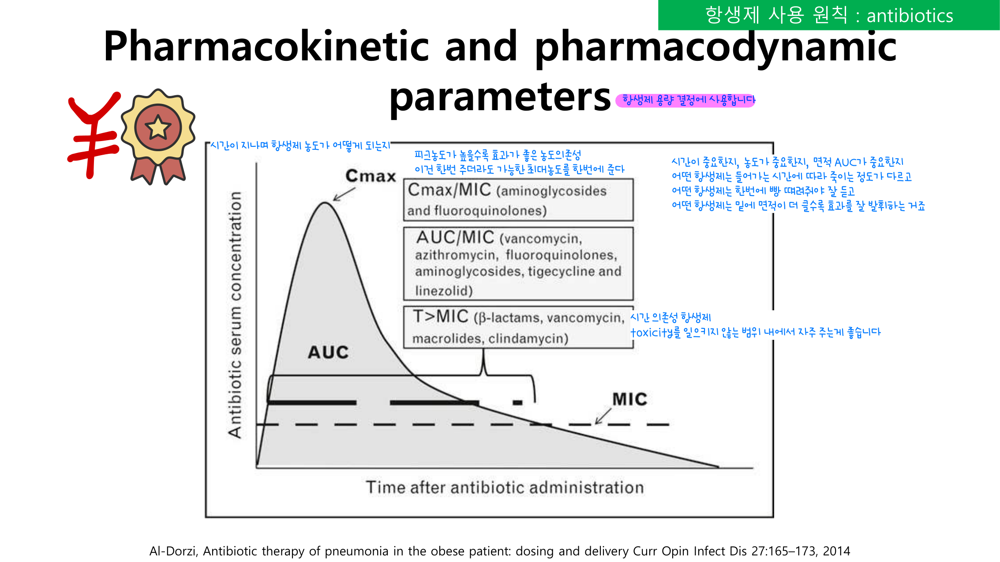
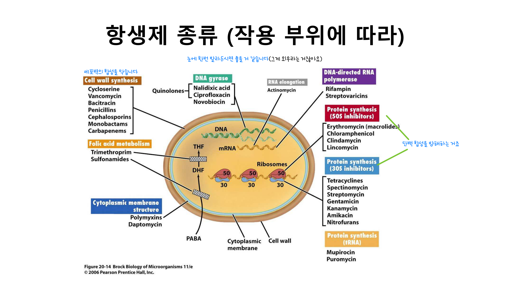
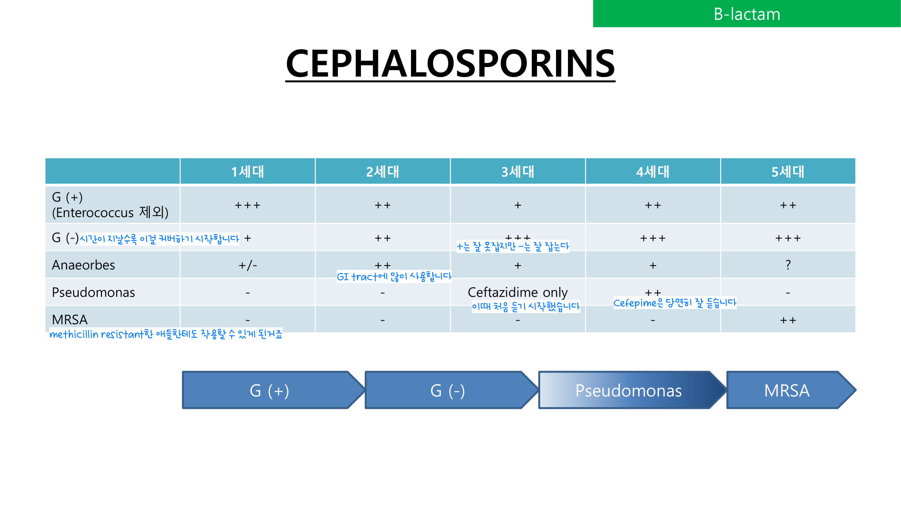

<!-- 필기본: 2025 -->
<!-- 단계: 수업 전 -->

# 0. 이 수업을 공부하는 법

배소현 교수님의 항생제 총론이다(2023·2024년은 김신우 교수님). 앞부분은 **항생제를 고르고 쓰는 원칙**, 뒷부분은 **항생제 계열별 스펙트럼·부작용**이다.

- 작년 필기 표시: **별 뱃지 · 보라 형광펜 = 교수님이 중요하다고 한 것**. 검은 글씨는 필기자의 덧붙임.
- 기출은 3년간 매년 6문항(2부 18문항)으로, 감염학 수업 중 가장 많은 편이다. 대부분 **한 줄짜리 암기형**이다.
- 3년 내내 나온 주제: **수술 전 예방적 항생제**, **자연내성(intrinsic resistance)**, **aminoglycoside 이독성**, **경구 생체이용률**, **세팔로스포린 세대별 스펙트럼**, **살균 vs 정균**, **PK/PD 지표**.

!!! key "핵심"
    "어떤 균에 안 듣는가(자연내성)", "어떤 부작용이 돌아오지 않는가(aminoglycoside 이독성)", "언제·얼마나 예방적으로 주는가(절개 30–60분 전, 24시간 이내)" — 이 세 가지가 매년 나온다.

# 1. 항생제란

## 정의와 역사
- 1942년 **왁스만**의 정의: 미생물이 만든 물질로 다른 미생물의 성장을 억제하거나 죽이는 것. 지금은 화학 합성제, 기존 항생제를 변형한 **반합성** 약까지 포함한다.
- 넓게는 항미생물제(antimicrobials: 항세균·항바이러스·항진균 등)이고, 이 수업에서 다루는 건 좁은 의미의 **항세균제(antibacterial)**.
- 역사: 고대 그리스(나무 추출물, 프로폴리스), 이집트(곰팡이 핀 빵을 상처에) → 1908년 **에를리히**가 비소 유도체 **arsphenamine(606호)**으로 매독 치료 — 병원체만 골라 공격하는 "**마법의 탄환**" 개념(그전에는 수은 욕조로 매독을 치료하다 사람도 다쳤다) → 1928년 **플레밍**이 페니실린 발견, 1940년대 임상 시험과 대량 생산.
- 항생제 도입 후 사망률이 크게 줄었다(조선시대 사망 원인 1위 = 전염병, 지금은 암). 특히 흔하던 연조직염(종기) 사망이 줄었다. 하지만 **내성균** 때문에 모든 것을 해결하지는 못한다. 신약 개발 속도보다 내성 발생이 빨라 제약회사의 연구도 줄었다.

## 내성 기전 4가지
| 기전 | 내용 | 예 |
|---|---|---|
| 1. 약물 불활성화 | 효소로 약을 부숨 | **β-lactamase**, aminoglycoside 변형효소(AME) |
| 2. 표적 변화 | 약이 붙는 자리를 바꿈 | **PBP 변화 → MRSA**, *erm* 유전자(macrolide·clindamycin), *van* 유전자(**VRE**) |
| 3. 약물 유출 | 들어온 약을 펌프로 내보냄 | tetracycline·macrolide efflux pump |
| 4. 투과성 감소 | 애초에 못 들어오게 | porin 감소·변형, **OprD 결손**(녹농균) |

대비는 결국 **적절한 사용** — 적절한 항생제를, 적절한 곳에, 적절한 기간만큼.

# 2. 항생제 사용 원칙

## 선택과 사용의 10단계
1. 임상 소견상 **항생제가 필요한가?** (열이 난다고 다 주지 않는다 — 바이러스면 듣지 않는다)
2. 투여 **전에** 적절한 검체로 **배양**했는가?
3. 가장 가능성 있는 원인균은? (각론에서)
4. 그 균에 가장 좋은 항생제는?
5. **병용**이 필요한가?
6. 환자 쪽에서 고려할 것은?
7. 투여 **경로**는?
8. 적절한 **용량**은?
9. 배양 결과 후 **변경**이 필요한가?
10. **기간**은?

"Start smart – then focus": 모를 때는 넓게 시작하고(경험적), 배양과 감수성이 나오면 좁혀서 정확한 약으로 바꾼다.

## 사용 목적에 따른 분류
| 분류 | 언제 | 예 |
|---|---|---|
| **예방적(prophylactic)** | 감염 없음, 감염 위험 높음 | 수술 전 예방 항생제 |
| **선제적(pre-emptive)** | 감염 증상 전, 감시 지표(surrogate marker)가 오를 때 | 신장이식 후 **CMV 수치**를 추적하다 일정 이상 오르면 투여 |
| **경험적(empirical)** | 감염은 있으나 원인균 모름 | 가장 흔한 원인균을 덮는 약 |
| **확정·선택적(definite/selective)** | 배양으로 균 확인 후 | 감수성에 맞춘 약 |

필기: prophylactic, empirical, selective 세 가지는 꼭 구별한다.

## 수술 전 예방적 항생제 ★
- **적응증**: clean-contaminated 수술(예: 맹장 — 균이 많음), **인공물·임플란트** 삽입, 고위험군(면역저하, 판막질환). 깨끗한 성형외과 수술 같은 clean 수술은 원칙적으로 쓰지 않는다.
- **원칙**: 수술 후 **24시간 이내**에 끊는다, **단일 약제**.
- **약제**: **cefazolin(1세대)**, 혐기균을 고려하면 cefamycin 계열(cefminox, cefotetan), 페니실린 계열(amp/sulbactam, amox/clavulanate), **β-lactam 알레르기면 clindamycin IV**.
- **시기**: **절개 30–60분 전**에 투여 → 수술 중 혈중·조직 농도 확보(너무 일찍 주면 농도가 떨어진다).
- **한계**: 균교대감염, 독성·알레르기, 내성균, 비용, 그리고 "항생제 줬으니 괜찮다"는 **잘못된 안도감**.

!!! exam "기출 포인트"
    매년 1문항. 2025년(2부 1번): 옳은 것 = **β-lactam 알레르기면 clindamycin**. 함정 — "72시간 유지"(→ 24시간 이내), "절개 후 투여해도 충분"(→ 절개 전), "clean 수술은 무조건"(→ 아님), "복합요법으로 광범위하게"(→ 단일 약제). 2023년(2부 15번): 틀린 것 = "심장 수술처럼 위험한 수술은 **3세대**가 더 효과적" — 권장은 1세대 cefazolin.

## 감염 치료에서 고려할 3요소
감염(infection)을 사이에 두고 **원인균(pathogen) – 항생제(antibiotics) – 숙주(host)**를 모두 본다.

### Pathogen
- 감염 부위마다 대표 원인균이 있다(예: 요로감염 = *E. coli*). 하지만 같은 *E. coli*도 **지역사회 vs 병원**에서 감수성이 다르다 — 병원 획득균일수록 내성이 많다(ESBL 등). 그래서 **우리 지역·병원의 감수성 자료**를 알아야 한다.

### Antibiotics — 고려할 것
- 항균 스펙트럼, **표적 부위 농도**(뇌–혈관장벽, 전립선, 안구, 심내막은 약이 잘 안 간다), 약동학/약력학·용량·**경구 생체이용률**·단백결합, **세포 내 침투**(세포 내 기생균), 투여 경로, 병용 효과(상승/길항/무관), **살균 vs 정균**, **항생제 후 효과(PAE)**, 부작용·금기, 비용, 순응도.
- 필기 예: 요로감염에 쓰려는 약의 소변 내 농도가 0이면 못 쓴다 — 표적 부위 농도를 알아야 한다.

!!! exam "기출 포인트"
    경구 생체이용률은 2023·2024년 연속 출제(2부 13번, 11번). 보기에 cefuroxime·cefixime·ampicillin·amoxicillin/clavulanate 같은 β-lactam 경구제와 metronidazole·levofloxacin이 섞여 나온다. ※ 확인 필요: 작년 필기에는 약별 생체이용률 표가 없다 — 일반적으로 **metronidazole, fluoroquinolone(levofloxacin)**처럼 거의 100% 흡수되는 약이 정답이 되는 유형이니 수업에서 표가 나오는지 확인하자.

### 약동학(PK)·약력학(PD)
- 약동학 = 몸이 약을 어떻게 다루나(**ADME**: 흡수·분포·대사·배설) → 감염 부위 농도. 약력학 = 약이 균에 무엇을 하나 → 균 수 감소, 임상 효과.
- **MIC**: 균이 더 이상 **자라지 못하게** 하는 최소 농도 → 감수성 S/I/R 판정의 기준.
- **MBC**: 균을 실제로 **죽이는**(99.9% 이상) 최소 농도 → 살균인지 정균인지 구분.

{: style="width:72%"}

| 지표 | 뜻 | 대표 약 | 투여 전략 |
|---|---|---|---|
| **Cmax/MIC** | 최고 농도가 높을수록 | **aminoglycoside, fluoroquinolone** | 하루 한 번 최대 농도로 "빵" |
| **AUC/MIC** | 곡선 아래 면적 | vancomycin, azithromycin, FQ, AG, tigecycline, linezolid | 총 노출량 |
| **T>MIC** | MIC 위에 머무는 시간 | **β-lactam**, vancomycin, macrolide, clindamycin | 독성 없는 범위에서 **자주** |

!!! exam "기출 포인트"
    2025년(2부 3번): T>MIC가 주요 지표인 약 = **ceftriaxone(β-lactam)**. gentamicin·amikacin(AG)과 ciprofloxacin은 Cmax/AUC, tigecycline은 AUC.

### 자연내성(intrinsic resistance) ★
"태어날 때부터 내성" — 안 듣는 조합에 쓰면 안 된다.

| 항생제 | 자연내성 균 |
|---|---|
| Penicillins | *Pseudomonas* (ureidopenicillin 제외) |
| **Cephalosporins** | ***Enterococcus*** |
| Vancomycin | 모든 그람음성균 |
| Aminoglycosides | **혐기균**, *Enterococcus* |
| Aztreonam | 모든 그람양성균 |
| Macrolides | 장내세균 |
| Tetracyclines | *Pseudomonas* |

!!! exam "기출 포인트"
    2023년(2부 14번)과 2025년(2부 2번) 모두 "**세팔로스포린 – 장구균**". 보기의 *E. faecium*/Cephalosporins가 정답 짝이다.

### 병용요법
| 목적 | 예 |
|---|---|
| 중증 감염 초기 경험적 치료(넓게) | 패혈증: 광범위 β-lactam + aminoglycoside |
| 내성균에 감수성 확보 | CRE: carbapenem + colistin |
| 다균종(호기+혐기) | 복강 내 감염: β-lactam + **metronidazole** |
| 호중구감소 발열 | piperacillin/tazobactam + aminoglycoside |
| **상승효과** | β-lactam + aminoglycoside (장구균) |
| 내성 발현 억제 | 결핵 INH+RIF+EMB+PZA, HIV 3제 |
| 용량 관련 독성 감소 | amphotericin B + flucytosine (크립토콕쿠스 수막염) |

단점: 길항, 비용, 부작용·알레르기, 균교대감염. 원칙적으로 **기전이 같은 약끼리는 병용하지 않는다**(상승효과도 기전이 달라서 생긴다).

### 살균 vs 정균
| 구분 | 약 | 반드시 살균제가 필요한 경우 |
|---|---|---|
| **살균** | penicillin, cephalosporin, **aminoglycoside**, vancomycin, fluoroquinolone, rifampin, metronidazole, bacitracin | 면역억제자, 화상, 카테터 감염, 만성질환자·임부, **심내막염** |
| **정균** | erythromycin, **tetracycline**, sulfonamide, trimethoprim, chloramphenicol, **clindamycin** | |

!!! exam "기출 포인트"
    2025년(2부 4번): 정균 작용 = **clindamycin**. 나머지(penicillin, cephalosporin, aminoglycoside, FQ)는 모두 살균.

### 주사가 필요한 경우
중증 감염(패혈증, 호중구감소 패혈증 — 빠른 혈중 농도), **수막염**(BBB 때문에 고농도), **심내막염**(혈류가 적은 부위 → 고농도 살균제), **골수염**(뼈 침투가 어렵고 오래 치료), 흡수 불량(위장관 장애, 쇼크).

### 약물 상호작용
- 기전이 같은 항생제 병용은 피한다.
- **제산제·철분 → tetracycline 흡수 장애**.
- β-lactam은 상호작용이 적다는 장점. **fluoroquinolone, macrolide, rifampin**은 상호작용 주의.

### 치료 실패 시 생각할 것
- 약이 닿지 않는 곳: **배농 안 된 농양, 이물, 보호된 부위(뇌척수액, 안구)** → 배농·이물 제거 같은 수술적 처치가 필요할 수 있다.
- 혼합 감염을 다 못 덮음, 잘못된 약·간격·용량, **균교대감염**.
- **떨어졌던 열이 다시 날 때**: 병원 내 감염(→ 내성균 가능성 높음), **약열**(항생제 실패가 아니라 부작용).
- 오진(비감염성 질환, 세균이 아닌 감염, 독소 질환), 동반된 비감염 질환, 심한 면역저하, 치료 중 내성 출현.

### 항생제 부작용 ★
| 부작용 | 약 |
|---|---|
| 알레르기·발진 | β-lactam, sulfonamide; **TMP-SMX → SJS/TEN** |
| ***C. difficile* 장염** | clindamycin, β-lactam, fluoroquinolone |
| 신독성 | **aminoglycoside**, vancomycin, amphotericin B |
| **이독성(비가역)** | **aminoglycoside** |
| QT 연장 | macrolide, fluoroquinolone |
| 혈액 이상 | linezolid(골수억제), TMP-SMX(빈혈·호중구감소), chloramphenicol(재생불량빈혈) |
| 신경 이상 | linezolid(말초·시신경염), metronidazole(**금속 맛**) |
| 기타 | vancomycin **red man**, rifampin **체액 주황색**, tetracycline 치아 변색·식도궤양, daptomycin **CPK 상승**, ceftriaxone **담낭 슬러지** |

- **Red man syndrome**(vancomycin): 첫 투여 때 너무 빨리 주면 히스타민이 나와 생기고, 중단하면 좋아진다(진짜 알레르기는 아님).
- 오래 쓰면 퇴원약으로도 **drug rash**가 생길 수 있다.

!!! exam "기출 포인트"
    이독성 문제가 매년 나온다. 2023년(2부 18번) "2주 투여 후 **영구적 평형기능 장애**" → gentamicin, 2024년(2부 8번) aminoglycoside 주요 부작용 → **신독성과 이독성**, 2025년(2부 5번) 패혈증 치료 1주 후 **청력 저하** → aminoglycoside.

### Host
- **감염 부위**(원인균·치료 기간), **이물·괴사조직·농양**, **면역 상태**(호중구감소, 면역억제제), **장기 기능**(신·간 기능 → 용량 조절; CKD 환자에 신독성 약 주의), **임신·수유**, **알레르기 병력**(특히 아나필락시스).

### 임신 중 항생제 ★
| 비교적 안전 | 주의 | 비교적 금기 |
|---|---|---|
| **penicillin, cephalosporin**, erythromycin base | TMP-SMX, metronidazole, aminoglycoside | **tetracycline**, erythromycin estolate, **fluoroquinolone**, chloramphenicol |

| 금기 약 | 태아·모체 독성 |
|---|---|
| Aminoglycoside | 제8뇌신경 손상(청각·평형) |
| Chloramphenicol | **gray baby syndrome** |
| Clarithromycin | 자연유산 ↑ |
| Erythromycin estolate | 모체 담즙정체성 간염 |
| Sulfonamide | G6PD 결핍 신생아 용혈, **핵황달** |
| Tetracycline | 사지 기형, **치아 착색**, 골성장 억제 |
| Trimethoprim | 엽산 억제 → 신경관 결손 |
| Quinolone | **연골 손상** |
| Vancomycin | 청신경 독성 가능 |

!!! exam "기출 포인트"
    2024년(2부 9번): 임신 중 가장 안전 = **ceftriaxone(세팔로스포린)**. tetracycline, chloramphenicol, fluoroquinolone, streptomycin(AG)은 금기·주의.

# 3. 항생제 계열 — 작용 부위로 나누기

{: style="width:80%"}

| 작용 부위 | 약 |
|---|---|
| **세포벽 합성** | **β-lactam(penicillin, cephalosporin, monobactam, carbapenem)**, vancomycin, bacitracin, cycloserine |
| 세포막 | polymyxin(colistin), daptomycin |
| 단백 합성 50S | macrolide, chloramphenicol, clindamycin |
| 단백 합성 30S | **tetracycline, aminoglycoside**(streptomycin, gentamicin, amikacin) |
| tRNA | mupirocin |
| DNA gyrase | **quinolone** |
| RNA 중합효소 | rifampin |
| 엽산 대사 | trimethoprim, sulfonamide |

!!! exam "기출 포인트"
    2024년(2부 7번): β-lactam의 작용기전 = **세포벽 합성 억제**.

# 4. β-lactam 계열

## 공통점과 β-lactamase
penicillin, cephalosporin, monobactam, carbapenem은 모두 **β-lactam 고리**를 가진다. 세균은 **β-lactamase**로 이 고리를 부숴 내성을 얻고(약물 불활성화), 사람은 그 효소를 막는 **억제제(clavulanate, sulbactam, tazobactam)**를 붙여 맞섰다. 이름의 슬래시 뒤가 억제제다(예: piperacillin/**tazobactam**).

## Penicillins
| 종류 | 주사 | 경구 |
|---|---|---|
| 좁은 스펙트럼 | penicillin G | penicillin V |
| 장내세균까지 | ampicillin | amoxicillin, ampicillin |
| + 녹농균 | piperacillin, ticarcillin 등 | |
| 포도알균용(β-lactamase 저항) | methicillin, oxacillin, nafcillin | cloxacillin, dicloxacillin |
| 억제제 복합 | amp/sulbactam, **pip/tazo**, ticarcillin/clavulanate | **amox/clavulanate** |

- **Penicillin G**: 스피로헤타, 연쇄구균, *Neisseria*, 혐기균(*Bacteroides* 제외). **DOC: 매독**, 렙토스피라, 연쇄구균·폐렴구균, **방선균증**, 수막구균, 클로스트리듐(가스괴저, 파상풍), 탄저, 구강·치주 감염. 내성이 늘어 필기에는 "실제로는 **매독**에 주로 쓴다".
- **Ampicillin**: penicillin G 범위 + 일부 그람음성 막대균 → 실제 임상에서 penicillin G 대신 많이 쓴다.
- **Penicillinase 저항 penicillin**(nafcillin, oxacillin, methicillin …, 외우기: "I Met a Nasty Ox Digesting Clover"): **MSSA의 DOC**(methicillin에 듣는 황색포도알균).
- **항녹농균 penicillin**: 녹농균·*Acinetobacter*에 효과, piperacillin이 가장 강함. 실제로는 억제제와 함께 쓴다.

!!! exam "기출 포인트"
    2023년(2부 16번): 매독 치료제 = **benzathine penicillin G**.

## Cephalosporins
처음엔 그람양성 위주였고, 세대가 갈수록 **그람음성**을 더 잘 덮는다.

{: style="width:72%"}

| | 1세대 | 2세대 | 3세대 | 4세대 | 5세대 |
|---|---|---|---|---|---|
| 그람양성(장구균 제외) | +++ | ++ | + | ++ | ++ |
| 그람음성 | + | ++ | +++ | +++ | +++ |
| 혐기균 | ± | ++ | + | + | ? |
| **녹농균** | − | − | **ceftazidime만** | ++ | − |
| MRSA | − | − | − | − | **++** |

- 이름으로 세대 구분(필기 요령): 1세대 cefa-/cepha-/cephra- (cefazolin), 2세대 cefo-/cefu- (cefuroxime; cefaclor 포함), 3세대 -one/-ten/-ime/-nir (ceftriaxone, ceftazidime, cefixime; 단 cefuroxime·cefepime 제외), 4세대 -pi- (**cefepime**), 5세대 -rol- (ceftaroline·ceftobiprole, **MRSA**까지).
- 3세대는 그람음성을 잘 잡아 장 감염에 많이 쓴다. 녹농균은 3세대 중 **ceftazidime만**, 4세대 **cefepime**은 당연히 덮는다.

!!! exam "기출 포인트"
    2025년(2부 6번): 녹농균에 효과적인 **3세대** = **ceftazidime**. cefepime은 녹농균에 듣지만 4세대라 함정, cefazolin은 1세대.

## Monobactam
- **aztreonam**: 그람음성 장내세균 + **녹농균**(ceftazidime과 비슷), **그람양성·혐기균에는 효과 없음** → 정상 장내세균총 보존.
- **β-lactam 알레르기 환자에게 쓸 수 있다**(교차반응 거의 없음). 신기능이 나빠 aminoglycoside를 못 쓸 때 대신. 현재 국내 품절.

## ESBL과 carbapenem
- **ESBL**: 장내세균(*E. coli*, *Klebsiella*, *Proteus*)이 만드는 넓은 범위의 β-lactamase → **3세대 세팔로스포린과 aztreonam을 분해**, 억제제 복합제에도 내성인 경우가 많다 → **carbapenem**을 쓴다.
- **Carbapenem**(imipenem/cilastatin — cilastatin은 신장에서 빨리 분해되는 imipenem을 보호, meropenem, doripenem): 대부분의 그람양성·음성·혐기균을 덮는 "끝판왕". **예외: MRSA, *E. faecium*, *Stenotrophomonas***. 특정 감염의 1차 약(DOC)은 아니고, 중증 병원감염·다제내성균 의심·다른 치료 실패 때 쓴다. 한계: 낮은 혈중 농도, 짧은 반감기, **CNS 독성(경련)**, 병원 녹농균 내성 약 20%.
- **Ertapenem**: ESBL은 덮지만 **녹농균·*Acinetobacter*를 못 덮는다** → "ESBL인데 carbapenem 삼총사는 아끼고 싶을 때".
- **CRE**(carbapenem 내성 장내세균): 최후의 보루마저 뚫린 균. 새 약 — ceftolozane/tazobactam(다제내성 녹농균), **ceftazidime/avibactam**(CRE 일부, NDM·VIM·IMP 제외), meropenem/vaborbactam, imipenem/relebactam. 적응증: 복잡성 요로감염, 복잡성 복강 내 감염(**metronidazole 병용**), 병원·인공호흡기 폐렴.

!!! exam "기출 포인트"
    2024년(2부 12번): carbapenem의 특징 = **광범위 스펙트럼**. "MRSA에 가장 효과적"은 틀림(MRSA는 carbapenem 예외).

## 스펙트럼 그림으로 정리 (필기 요약)
| 약 | 덮는 것 | 못 덮는 것 |
|---|---|---|
| pip/tazo | 그람양·음성, 혐기, 녹농균 | ESBL, MRSA |
| ceftriaxone | 그람음성(3세대) | 장구균(자연내성), 녹농균·*Acinetobacter*, ESBL·CRE, MRSA |
| ceftazidime | 그람음성 + **녹농균** | |
| cefepime | 그람양·음성 + 녹농균 | 장구균, MRSA, ESBL·CRE |
| aztreonam | 그람음성 + 녹농균 | 그람양성·혐기 전부, ESBL·CRE |
| imipenem 등 | 거의 다 | MRSA, CRE |
| ertapenem | ESBL | 녹농균, *Acinetobacter* |

## β-lactam 부작용 — 과민반응
| 유형 | 예 |
|---|---|
| Type I (즉시형, IgE) | **아나필락시스** |
| Type II (세포독성) | 간질성 신염, Coombs 양성 용혈빈혈 |
| Type III (면역복합체) | 약열, 혈청병 |
| Type IV (세포매개) | 접촉피부염, SJS/TEN |

- **Type I 과거력이 가장 중요** — 있으면 같은 약을 다시 쓰지 않는다. 피부반응검사(AST)로 예측, 꼭 필요하면 **탈감작(desensitization)**. 세팔로스포린과의 **교차반응** 주의.
- 고용량·장기 사용 → 신독성, 혈액 이상.

!!! exam "기출 포인트"
    2023년(2부 17번): cefazolin을 피해야 할 "중대한 부작용 병력"이 **아닌** 것 = **백혈구 감소**(용량 관련). 혈관부종·쇼크·호흡곤란(Type I), SJS(Type IV)는 중대한 과민반응 병력.

# 5. 그람양성 내성균용 — glycopeptide, oxazolidinone

## Vancomycin, teicoplanin
- **그람양성 전용**(그람음성에는 자연내성). **DOC: MRSA**, ampicillin 내성 장구균, penicillin 알레르기 환자의 중증 그람양성 감염. **경구 vancomycin = *C. difficile*의 DOC**.
- 부작용: 정맥염, **신독성**, **red man syndrome**(첫 투여, 히스타민), 이독성(드묾), 빠른 주사 시 저혈압, 백혈구 감소, 발진.
- Teicoplanin: 하루 한 번, 근육주사 가능.
- 못 덮는 것: **VRE, VISA**(vancomycin 중간내성 황색포도알균 — 나오면 뉴스에 나오는 슈퍼박테리아).

!!! exam "기출 포인트"
    2024년(2부 10번): vancomycin 적응증 = **MRSA 감염증**.

## Linezolid, tedizolid
- 주요 그람양성(*E. faecium*, MRSA, 연쇄구균). **정균**.
- 쓰는 때: MRSA에서 vancomycin 실패·부작용, **VRE 혈류감염**, 다제내성 결핵. 순서는 "MRSA는 **vancomycin 먼저**, 안 되면 linezolid".
- 부작용: **골수억제(혈소판 감소)**, 말초·시신경염(비가역일 수 있음). Tedizolid는 효과는 비슷하고 부작용이 적다.

# 6. 단백 합성 억제제

## Aminoglycosides ★
- 이름: -mycin, -micin, -kacin (단, -mycin이라도 AG가 아닌 약이 있으니 보라색 표시한 것만 외우자).
- **살균**. 그람음성 통성 막대균 + 일부 포도알균. 혐기균·장구균에는 단독으로 안 듣는다(자연내성).
- 적응증: 그람음성 균혈증(특히 호중구감소), **상승효과**(+ penicillin: 포도알균·장구균·연쇄구균 심내막염, 그람음성 균혈증), 중증 요로감염, 녹농균(amikacin, tobramycin), **streptomycin**(야토병, 페스트, 브루셀라, 결핵).
- 부작용:
    - **신독성(가역적)**: 근위세관 손상, 10–14일 치료 중 5–10%. 위험인자 — 고령, 탈수, 기존 신질환, 신독성 약 병용. creatinine 0.5 이상 오르면 주의. **약 종류보다 사용 기간**이 중요.
    - **이독성(비가역적)**: 청신경·전정 손상 → 청력·평형 장애, **영구적일 수 있다** — 돌아오지 않으니 매우 주의.
    - **신경근 차단**: ACh 분비 억제. 위험 — 저칼슘혈증, 복강 내 투여, 근이완제 병용, 기존 호흡 억제. 치료: 칼슘, 환기 보조.

!!! memo "암기"
    AG = 살균 · Cmax/MIC · 신독성은 돌아오고 이독성은 안 돌아온다 · 임신 중 제8뇌신경 손상 · 혐기균·장구균 자연내성

## Tetracyclines
- -cycline. 그람양·음성 모두 + **비정형균(*Mycoplasma*, *Chlamydia*, *Rickettsia*)**에 특히 좋다.
- 부작용: 위장관(식도염·궤양, 흔함), 간독성(IV·임신), 광과민성, 질소혈증 악화(doxycycline), **전정 독성(minocycline, 여성에서 어지럼 최대 70%)**, **8세 미만 금기**(영구치 착색, 성장 억제).

## Tigecycline
- 3세대 tetracycline 유도체(glycylcycline), **정균** → 균혈증·중증 감염에는 한계(조직으로 너무 잘 가 혈중 농도가 낮다).
- 다제내성균(MRSA, VRE, CRE, carbapenem 내성 *A. baumannii*)까지 넓게. **예외: *Proteus*, 녹농균**.
- 복합 감염(복부, 피부·연조직), carbapenem 내성균에. MRSA도 덮으므로 vancomycin을 따로 붙일 필요 없다. 부작용: 위장관.

## Macrolides
- erythromycin, roxithromycin, clarithromycin, azithromycin. 그람양성 알균 + 비정형균. **DOC: *Legionella*, *Campylobacter*, *Mycoplasma***.
- 폐렴구균 폐렴, A군 연쇄구균 인두염, 피부·연조직(특히 penicillin 알레르기), NTM(clarithro, azithro).
- 부작용: **위장관이 가장 흔함**(최대 50%, erythromycin이 motilin 수용체 작용) → 그래서 실제로는 clarithromycin·azithromycin을 많이 쓴다. QT 연장, 고용량 IV erythromycin의 가역적 이독성(드묾).

## Lincosamide — clindamycin
- 혐기균 + 그람양성 알균(erythromycin과 비슷). **DOC: 순수 혐기균 감염**(구강·치과 감염, 흡인성 폐렴, 복강 내 농양) — 단, 통성 그람음성 장내세균에는 효과 없음.
- **penicillin 알레르기 환자의 그람양성 감염 대체약**. **정균**.
- 부작용: 위장관(가장 흔함, 설사 최대 20%), **위막성 대장염**.

## Chloramphenicol
- 넓은 스펙트럼이지만 내성(플라스미드)과 부작용으로 잘 안 쓴다. 부작용: 용량 관련 가역적 범혈구감소, 특이체질성 **비가역적 재생불량빈혈**(1/25,000–40,000), 미숙아·신생아의 **gray baby syndrome**(대사 못 함 → 청색증, 저혈압, 사망).

# 7. DNA·엽산 합성 억제제

## Fluoroquinolones
| 세대 | 약 | 특징 |
|---|---|---|
| 1 | nalidixic acid | 그람음성만 |
| 2 | norfloxacin, **ciprofloxacin**, ofloxacin | 그람음성 ++, **녹농균(ciprofloxacin)** |
| 3 | **levofloxacin** | 그람양성·비정형 강화 |
| 4 | **moxifloxacin**, gemifloxacin | 그람양성·비정형 ++, 혐기 + |

세대가 갈수록 그람음성 중심 → 그람양성까지.

- 그람음성 막대균(특히 장내세균)에 매우 좋다. **ciprofloxacin = 녹농균에 가장 강력한 경구제**. 포도알균 보통, 연쇄구균 약함.
- 복잡성 요로감염(최근 내성 증가로 제한), 세균성 장염·장티푸스(여행자 설사에 많이), **만성 골수염**(뼈 침투가 좋음), 성인 그람음성 중이염, **항결핵제(moxifloxacin, levofloxacin)**.
- 비교적 안전하지만 **임신 금기**(동물에서 연골 손상), **건염**이 잘 생긴다 → 생기면 FQ 사용 확인 후 중단.

## 엽산 합성 억제 — TMP/SMX, sulfonamide
- TMP/SMX: 단순 요로감염(장구균 제외; 국내는 내성으로 사용 감소), 호흡기(중이염, *H. influenzae*, *M. catarrhalis*), **DOC: *Stenotrophomonas maltophilia*(병원감염), AIDS의 PCP**.
- Sulfonamide: DOC — **노카르디아**, 나병(dapsone), 톡소플라즈마(sulfadiazine). 부작용: 알레르기 흔함, 결정뇨, 혈구감소, **신생아 금기(핵황달 — 빌리루빈 치환)**.

# 8. 그 외 항생제

필기: 보라색 형광 부분을 기억하면 되고, **metronidazole은 다 알아야 한다**.

## Rifampin
- **MRSA에는 반드시 다른 약과 병용**(단독이면 내성이 금방 생김). 수막구균 감염 **예방**, 레지오넬라, **바이오필름 효과**(MRSA 골수염처럼 바이오필름이 생긴 곳에도 들어간다), 결핵.
- 부작용: **간독성(INH 병용 시)**, 간헐 투여 시 독감 유사 증상·용혈·혈소판감소·급성신부전, 체액 주황색.

## Metronidazole
- nitroimidazole. DNA에 붙어 이중가닥 절단·합성 억제.
- **혐기균 전용**(산소가 있으면 비활성). **DOC: 혐기성 농양(폐, 뇌, 복강 내)**, 세균성 질염, 위막성 대장염. 복강 내 감염에서 세팔로스포린·억제제 복합제와 **병용**하는 이유.
- 부작용: 심각한 것은 드묾. 구역, **금속 맛**, 고용량·만성 간질환에서 경련·뇌병증.

## 요로 전용 약
- **Nitrofurantoin**: 세균 안에서 nitroreductase로 활성화 → DNA 손상, 대사 억제. 범위는 넓지만 부작용(장기 사용 시 **간독성, 폐섬유화, 말초신경병증**) 때문에 **단순 요로감염에만**.
- **Fosfomycin**: 신장으로 변하지 않고 배설 → 소변에 고농도. 그람양성(황색포도알균, VRE 포함 장구균)·음성(*E. coli*, *Klebsiella* 등, 녹농균), **대부분의 ESBL**에 효과. **단순 방광염** 치료·예방, **3 g 1회 경구**(소변 고농도 48시간 이상). **신우신염 의심 시 쓰지 않는다**.

## Colistin
- polymyxin 계열, 다시 꺼낸 약(resurrected). **다제내성 그람음성균(녹농균, *Acinetobacter*), CRE**까지. 그람양성·혐기균에는 효과 없음. 부작용: **신독성, 신경독성**.

## Daptomycin
- 세포막에 채널을 만들어 탈분극·누출 → 파괴. 그람양성 전반(특히 **MRSA, VRE**), VRE 균혈증, vancomycin 실패한 MRSA. 부작용: **CPK 상승, 근병증**. "colistin은 그람음성, daptomycin은 그람양성(linezolid와 비슷한 자리)".

## 국소제 — fusidic acid, mupirocin, bacitracin
- **Fusidic acid**: 포도알균(반합성 penicillin 내성 포함), **단독 사용 금지**, rifampicin과 상승효과, 국내 경구제 있음.
- **Mupirocin**: isoleucyl-tRNA 합성효소 억제. **연고만**(경구 없음). **비강 도포로 MRSA 제균(decolonization)** — 심장 수술 전 코 배양에서 MRSA가 나오면 제균, MRSA 집락 의료인에도. 농가진·모낭염 연고.
- **Bacitracin**: 국소, 그람양성.

필기: fusidic acid, mupirocin, bacitracin 세 개는 비중이 낮다고 했다. 다만 mupirocin 비강 제균은 다른 수업(CP)에서 기출이 있다.

## 혐기균을 덮는 항생제
amp/sulbactam·amox/clavulanate, **pip/tazo**, **metronidazole**(복강 내 *B. fragilis*), imipenem, meropenem, chloramphenicol, clinafloxacin(교수님은 "ciprofloxacin"이라고 말함 — ※ 확인 필요), **clindamycin**(폐), **cefamycin**(cefoxitin, cefminox, cefmetazole), 고용량 항녹농균 penicillin.

# 9. 항생제 스튜어드십

- **항생제는 재료일 뿐**: 좋은 결과는 요리사의 솜씨, 야구로 치면 배트·글러브는 도구이고 경기는 팀워크.
- 미국 자료: 항생제 처방의 **약 1/3은 불필요**.
- 우리는 **항생제 후 시대(post-antibiotic era)**로 들어가고 있다(WHO 경고).
- **한국의 항생제 소비량은 OECD 평균보다 많다** — 고령자가 많고 의료 접근성이 좋아서.
- CDC "Get Smart", **원헬스(One Health)** — 사람·동물·환경의 항생제 사용이 모두 내성에 영향.
- 질병관리청·대한항균요법학회·대한감염학회 유튜브(항생제 스튜어드십 27편)를 소개했다.

# 10. 정리 (학습목표)
- 항균제 사용 원칙과 쓰기 전 고려사항(배양, 원인균, 숙주, 약의 특성)을 설명할 수 있다.
- 항생제 선택 시 고려사항(스펙트럼, 표적 부위 농도, PK/PD, 살균/정균, 부작용, 임신·장기 기능)을 설명할 수 있다.
- 병용요법이 필요한 경우(중증 경험적, 다균종, 상승, 내성 억제, 독성 감소)를 말할 수 있다.
- 치료 실패 시 원인(약이 못 닿는 곳, 잘못된 약·용량, 균교대, 병원감염, 약열, 오진)을 분석할 수 있다.
- 페니실린의 종류·범위·임상 응용, 세팔로스포린의 세대별 범위, 아미노글리코사이드의 응용과 부작용을 말할 수 있다.
