<!-- 필기본: 2025 -->
<!-- 단계: 수업 전 -->

# 0. 이 수업을 공부하는 법

**감염병학 증례토의 CP-1**(감염내과 **김신우 교수님**). Case 1~10을 조별로 발표하고 교수님이 사진을 보며 설명하셨다. 다음 수업 CP-A2(11번)가 Case 11~20을 이어서 다룬다.

필기한 선배: "말씀하신 내용은 되게 많은데, 기출문제를 보면 **사진을 보고 무슨 질환인지 알고, 원인균이 뭔지, 무슨 항생제로 치료하는지** 이 정도를 중심으로 보면 될 것 같습니다."

| Case | 환자 | 진단 | 원인 → 치료 |
|---|---|---|---|
| 1 | 62세, VP shunt, RLQ 통증·신기능 저하·혈뇨 | **shunt 감염 + shunt 신염** | 피부상재균 → **shunt 제거** + 항생제 |
| 2 | 16세, 어릴 때부터 큰 왼팔, 반복 감염 | **선천 림프부종 + 반복 봉와직염** | 연쇄상구균·포도알균 → 예방 항생제 |
| 3 | 58세, IUD 오래 사용, 골반 종괴 | **골반 방선균증** | *Actinomyces* → **penicillin 장기** |
| 4 | 45세, 간 종괴, 매일 녹즙 | **간질증(fascioliasis)** | *Fasciola hepatica* → **triclabendazole** |
| 5 | 27세, 필리핀 여행 후 다리 출혈반·저혈압 | **뎅기열** | Aedes 모기 → 대증(수액), NSAID 금지 |
| 6 | 50세, 발열·저혈압·장기부전, 배양 음성 | **독성쇼크증후군** | 초항원 → clindamycin + β-lactam ± IVIG |
| 7 | 54세 여자, 한 달 열 + 목 림프절 | **기쿠치병** | 괴사성 림프절염 → 대증 |
| 8 | 15세, 입 병변, 같은 반 친구 | **수족구병** | 콕사키 A16·EV71 → 대증 |
| 9 | 65세, 기침·흉막성 흉통, 엽성 폐렴 | **폐렴구균 폐렴** | *S. pneumoniae* → β-lactam ± macrolide |
| 10 | 67세, 당뇨 방치, 발 궤양 악화 | **당뇨발 감염** | 혼합감염 → 절제·배농 + 광범위 항생제, 절단 |

기출 23문항은 거의 **방선균증**(2, 5, 14, 21, 22번), **간질**(3, 9, 15, 23번), **뎅기열**(4, 11, 18번), **VP shunt**(1, 7번), **당뇨발**(6, 12번), **TSS**(10번), **기쿠치병**(13, 20번), **수족구병**(8, 16, 19번)이다.

!!! key "핵심"
    - **이물(foreign body)** — VP shunt, IUD — 은 감염의 발판이 된다. 치료의 핵심은 **제거**.
    - **IUD + 골반 종괴** → 암이 아니라 **방선균증**일 수 있다. 유황과립, **penicillin 6~12개월**.
    - **간 종괴 + 호산구 증가 + 녹즙(미나리)** → **간질**. 병력청취가 진단.
    - **배양 음성인데 매우 아프고, 나중에 손발바닥이 벗겨진다** → **TSS**(초항원 독소).
    - **뎅기열**: NS1 항원, 수액, **NSAID·아스피린 금지**. 다른 혈청형 재감염이 더 위험(ADE).

# 1. Case 1 — VP shunt 감염과 shunt 신염

> 62세 남자. 1년 전 뇌혈관질환과 관련된 수두증으로 **VP shunt**. 1주간 **우하복부(RLQ) 통증**, 압통, 38.5℃. **Cr 1.8**, 소변 500 mL/일, **단백뇨·혈뇨**. 복부 CT.

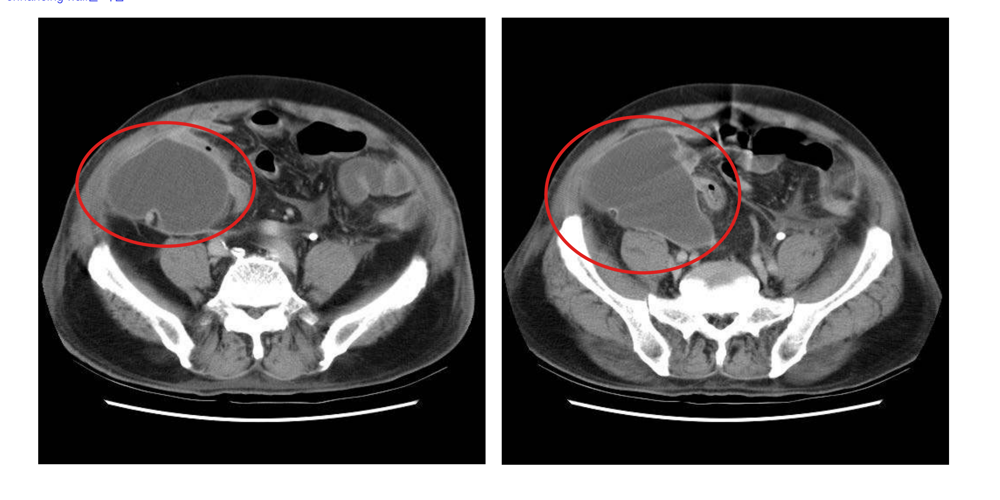{: style="width:62%"}

질문: 복부 병변으로 의심할 감염병? 신기능·소변 이상으로 의심할 신장질환? 조영제를 썼는데 향후 조치는?

- **VP shunt**: 뇌실의 CSF를 복강으로 빼 주는 관. 성인에서 CSF 흐름이 막히는 가장 흔한 이유는 **출혈**(지주막하출혈 등).
- 교수님: "**shunt의 distal 부분**에서 감염이 잘 생긴다(CSF가 위에서 아래로 흐르니까 — 댐 마지막에 때가 잘 끼는 것처럼)." → **복강 농양**(벽이 조영됨).
- 이물을 넣을 때 감염: **피부상재균**(**CoNS**, *S. aureus*)이 가장 많다. *E. coli*, *Klebsiella*도 가능.
- **Shunt 신염**: shunt 감염 → 면역반응 → **면역복합체**가 사구체에 침착 → **면역복합체 사구체신염**(단백뇨·혈뇨·신기능 저하). 교수님: "감염후 사구체신염의 special form. 이물을 넣을 때 피부상재균 감염이 **다른 장기에 영향**을 줄 수 있다는 것을 알고 있을 것." (편도염 뒤 PSGN과 같은 원리)
- 치료 — 교수님: "**제거하는 것이 가장 좋은 치료**, 이물 제거 없이는 치료가 어렵다. 그런데 이 환자는 shunt가 필요하므로 치료 뒤 다시 shunt를 넣고, 그동안은 **lumbar drain**(뇌실외배액) 등으로 CSF를 뺀다."
- 조영제: 신기능이 나쁜 환자 → 수액(0.9% NS)으로 신장 보호, **신독성 약물(NSAID, vancomycin 등) 중단**, Cr·소변량 모니터링, AKI면 투석.

!!! exam "기출 포인트"
    1번(2025): VP shunt 환자의 단백뇨·혈뇨·신기능 저하 → **shunt 신염(면역복합체 사구체신염)**. 7번(2024): VP shunt 감염 치료 → **감염된 shunt 제거**(필요하면 뇌실외배액) + 항생제.

# 2. Case 2 — 선천 림프부종과 반복되는 봉와직염

> 16세 여자. 1년 전부터 **왼손 감염이 잦다**(작년 3번 항생제 주사). **어릴 때부터 왼팔 전체가 컸다.** 37.8℃.

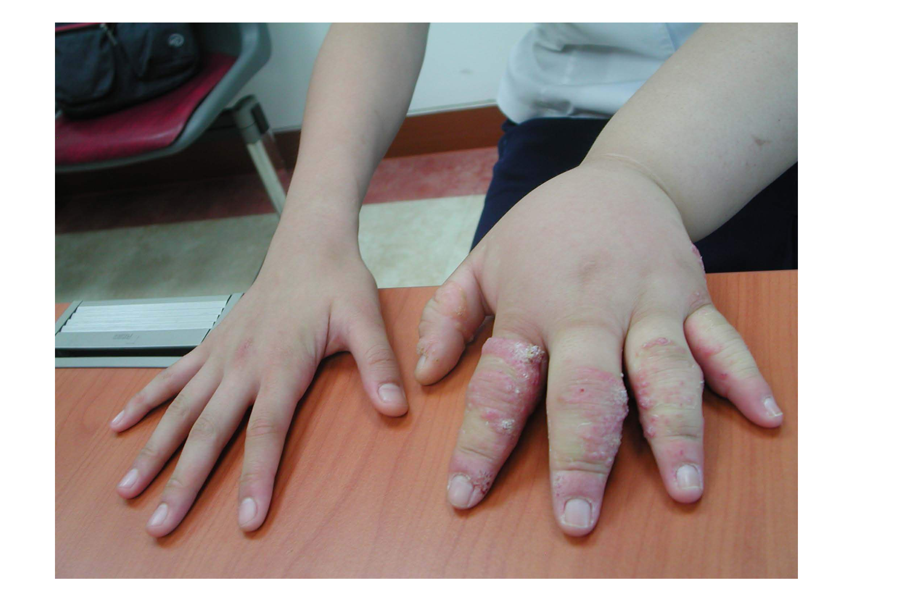{: style="width:50%"}

- 원 질환: **선천 림프부종**(primary lymphedema). 림프 순환장애 → 국소 면역 저하 → **반복 봉와직염**(피부상재균: β-용혈 연쇄상구균, *S. aureus*). 감별: lymphangioma, Klippel-Trenaunay 증후군(혈관기형 동반).
- 교수님: "림프부종은 주로 **하지**에 많다. 우리나라에서 가장 흔한 림프부종은 **자궁경부암 치료 이후** 림프 배액이 막혀 생기는 후천성." 선천성은 양쪽에 다 생길 수 있다. 아프리카의 후천 림프부종은 **사상충증(filariasis)** 의심.
- 치료: 급성기 **ampicillin/sulbactam, cefazolin**. 교수님: "penicillin V·G를 쓸 수 있으나 **국내에서 쓸 수가 없다**. 국내에 있는 약을 쓰자."
- 예방: 반복되면 득실을 따져 **평상시 항생제** — 1세대 cephalosporin(**cefadroxil**)을 장기 처방(교과서: 경구 penicillin V, 2~4주마다 benzathine penicillin G 근주). 림프부종 관리(압박, 배액, 운동, 피부 위생).

# 3. Case 3 — IUD와 골반 방선균증

> 58세 여자, 우측의 2달간 불편감. 젊을 때부터 **IUD** 사용, 결핵 과거력 없음, 체중감소 없음. 복부 CT에서 골반 종괴. 37.6℃. 조직검사를 원하지 않아 경험적 치료 **7개월** 후 CT에서 종괴가 사라짐.

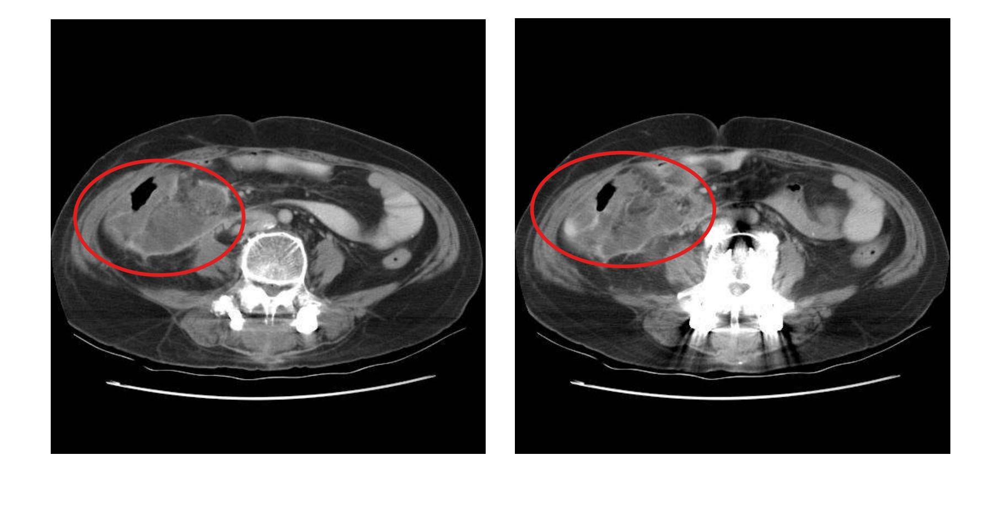{: style="width:62%"}

- 교수님: "IUD는 **폐경이 되면 제거**해야 하는데 안 하면 감염의 원인이 된다. 자궁·질의 정상균 중 ***Actinomyces***가 이물을 먹이 삼아 천천히 자란다. **암으로 오인**할 수 있다." "IUD가 있는데 골반 종괴로 왔다 → **방선균 감염을 의심할 수 있어야** 한다."
- *Actinomyces*: **혐기성** 그람양성, 균사 같은 가지 모양, 구강·장·질의 정상균. 점막 손상(치과·내시경·IUD)으로 침투 → 만성 화농성 염증, 누공. 조직에서 **유황과립(sulfur granule)**.
    - 대비: ***Nocardia***는 **호기성**, 토양, 흡입 → 폐 농양·피부 감염(같은 방선균류).

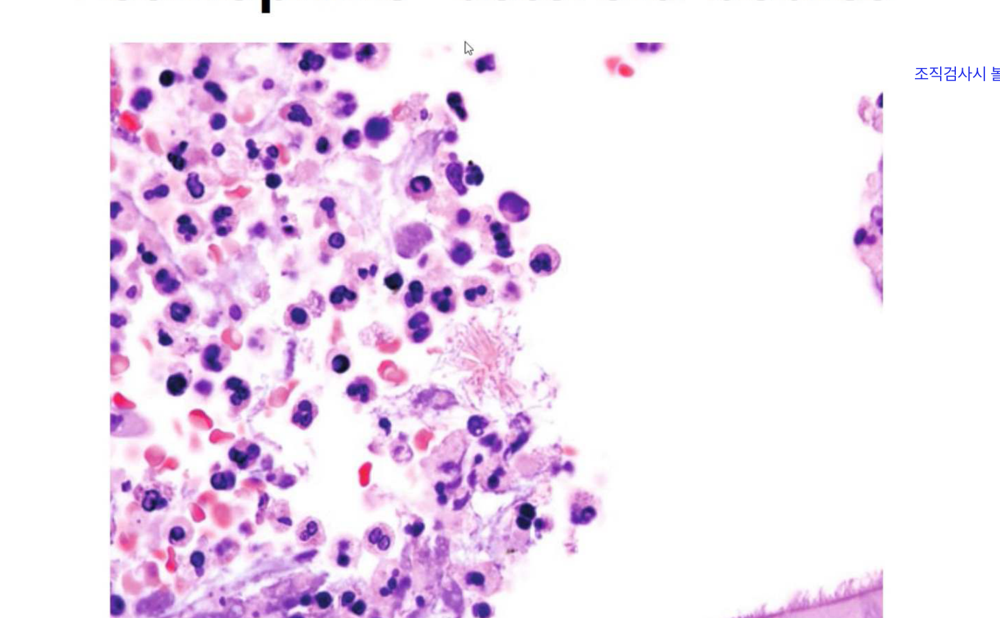{: style="width:42%"}

- 치료: **penicillin 계열**. 교수님: "penicillin V·G는 국내에 없으니 **ampicillin, ampicillin/sulbactam, piperacillin/tazobactam, amoxicillin/clavulanate**." 원칙: **penicillin G(또는 ampicillin) 정맥 2~6주 → 경구 penicillin V·amoxicillin 6~12개월**.

!!! exam "기출 포인트"
    5번 출제(2, 5, 14, 21, 22번): IUD 오래 쓴 여성의 골반 종괴, 유황과립·가지 친 그람양성 필라멘트 → **방선균증** → **penicillin 계열 장기 치료**. metronidazole·aminoglycoside는 효과 없음.

# 4. Case 4 — 간질증 (fascioliasis)

> 45세 남자, 건강검진 초음파에서 간 종양 의심. HBsAg/Ab 음성, HCV Ab 음성, 술 안 마심. **건강에 관심이 많아 아내가 매일 아침 녹즙**을 준다. 37.0℃.

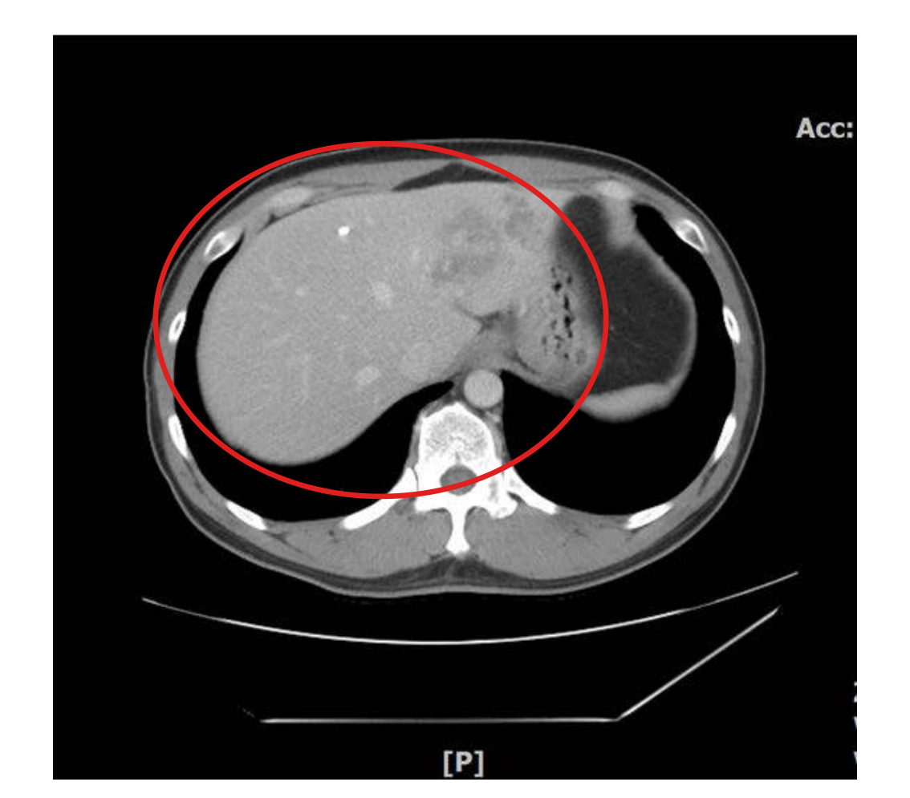{: style="width:42%"}

- 교수님: "사진만 보면 **hepatoma**를 의심한다. 하지만 **간암이 될 요인이 없다**. 병력청취 결과 **녹즙** — 이것이 원인!"
- ***Fasciola hepatica***(간질): 초식동물의 기생충. 제1중간숙주 **물달팽이**, 제2는 **수생식물**. 피낭유충이 붙은 **미나리·물냉이**를 날로 먹거나 감염된 소의 간을 날로 먹으면 감염 → 유충이 소장벽을 뚫고 복강 → **간 피막을 뚫고 간실질을 이동**(터널 모양 병변) → 담관에서 성충.
- **호산구 증가** — 교수님: "간 종괴에 호산구가 올라가 있으면 **Löffler 병**(호산구 침윤성 질환)으로 착각할 수 있다. **병력청취로 감별**해서 제대로 치료해야."
- 치료: **triclabendazole**(WHO 권고). 교수님: "유통되는 약이 아니라 처방해도 살 수 없다. 희귀의약품센터 같은 곳에서 구해야 한다." (다른 흡충은 praziquantel.) 내시경에서 담관으로 나오는 충체를 볼 수도 있다.

!!! exam "기출 포인트"
    3, 15, 23번: 녹즙 + 간에 **터널 모양** 저음영 병변 + 호산구 증가 → **간질** → **triclabendazole**. 9번: 감염 경로 → **미나리·물냉이 등 수생식물** 생식(날생선은 간흡충 *Clonorchis*).

# 5. Case 5 — 뎅기열

> 27세 여자, **필리핀 배낭여행 2주**. 대구 도착 때부터 다리에 소견(그림 1), BP 90/50, 37.5℃. 3일 뒤 다리(그림 2).

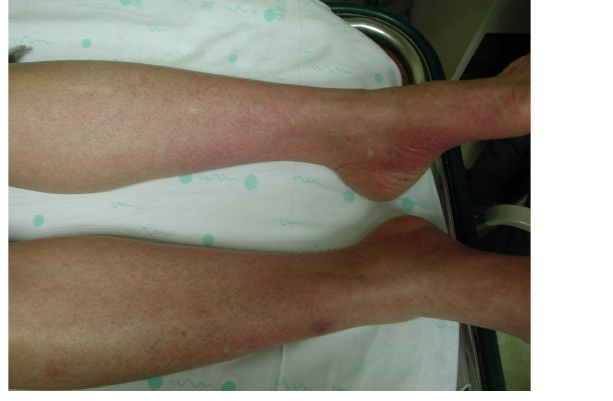{: style="width:50%"}

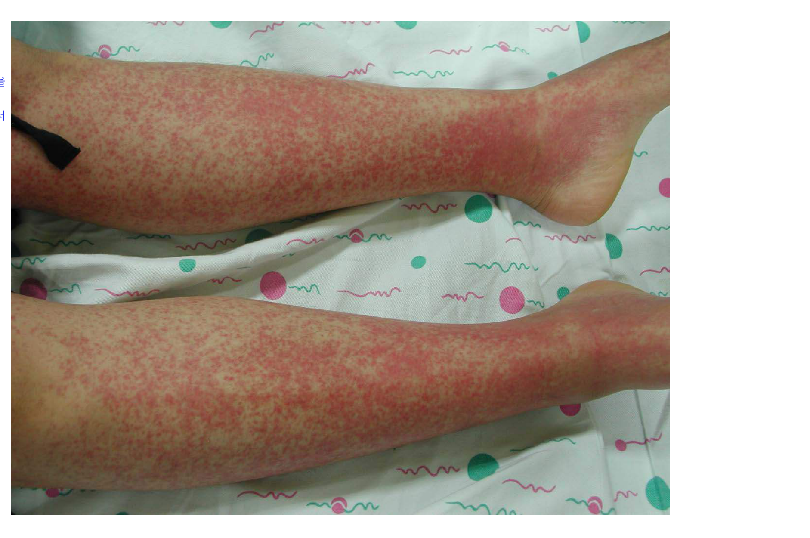{: style="width:50%"}

- 교수님: "**혈압을 재려고 토니켓을 묶거나 심전도 커핑한 자리를 따라** 출혈이 쭉 생긴다." 손을 댔다 떼면 하얗게 되며 **손자국**이 남는다. 회복기 발진 = **white islands in a sea of red**.
- 매개: 낮에 무는 **Aedes 모기**(이집트숲모기·흰줄숲모기). 지구온난화로 발생 지역이 넓어지는 중.
- **4가지 혈청형(DENV-1~4)**: 한 혈청형에 걸리면 그 형에만 면역. 교수님: "뎅기열에 여러 번 걸리면 면역반응이 심해져 사망할 수 있다 — **ADE**(antibody-dependent enhancement). 현지인은 재감염 위험이 높다."
- 병태: 면역반응 → **혈관 투과성 증가** → 모세혈관 누출, **혈액농축**, 저혈압 → 뎅기 출혈열·**쇼크 증후군**. 혈소판 감소, 간효소 상승.
- 진단: 잠복기 3~14일. **NS1 항원**(발병 5일 이내), IgM·IgG, PCR. 교수님: "**항원검사**로 진단. 얘도 **의심하는 것**이 중요."
- 치료: 특이 치료제 없음 → **수액**(링거젖산·NS), **acetaminophen**(교수님: "타이레놀 먹다 보면 좋아짐"), 중증은 ICU·수혈. **NSAID·아스피린 금지**(출혈 위험).
- 예방: 긴 옷·모기장·기피제, **귀국 후 2주 이내** 증상이면 병원.

!!! exam "기출 포인트"
    4, 11, 18번: 필리핀 여행 + 점상출혈 → 회복기 "붉은 바다의 흰 섬" + 저혈압·혈소판 감소 → **뎅기열**. 매개체 **Aedes**, 진단 NS1, 치료 수액.

# 6. Case 6 — 독성쇼크증후군 (TSS)

> 50세 남자, 발열·의식 변화. 3일 전 갑자기 발열·오심·구토·설사. **저혈압**, AST/ALT 65/80, BUN/Cr 39/2.1. **혈액·소변 배양 음성**. 38.1℃. 입원 1일, 4일, 14일 사진.

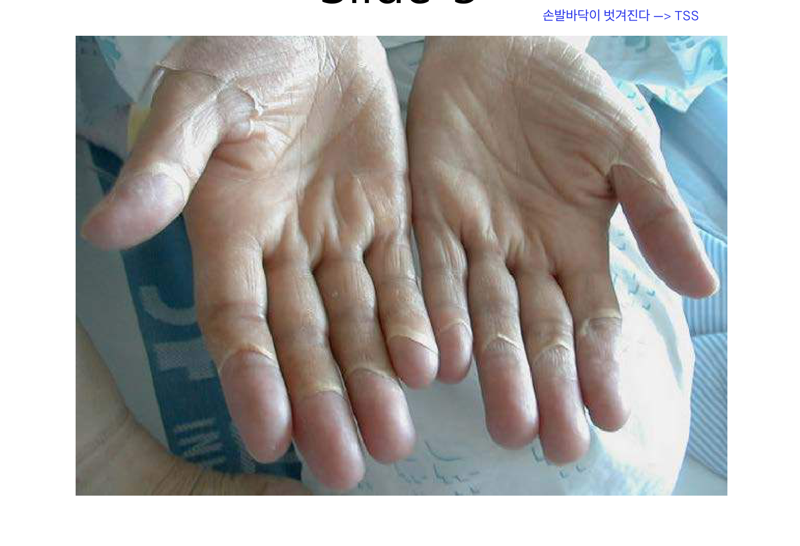{: style="width:42%"}

- 교수님: "보통 배양을 하면 확진으로 이어지는 줄 아는데 실제로는 그 비율이 생각보다 낮다. **TSS의 특징이 '균이 안 잡히는데 환자가 엄청 아프다'**는 것. 세균의 **독소**에 의한 증상이라 혈류에는 균이 별로 없다."
- 패혈증과 다른 점 두 가지(교수님): **피부가 벗겨진다**(얼굴은 비늘처럼 dandruff-like, 손발은 **두껍게 full-thickness**), **딸기혀**. 1일째 손바닥 홍반 → 4일째 결막충혈·구강 병변 → 14일째 **손발바닥 박리**.

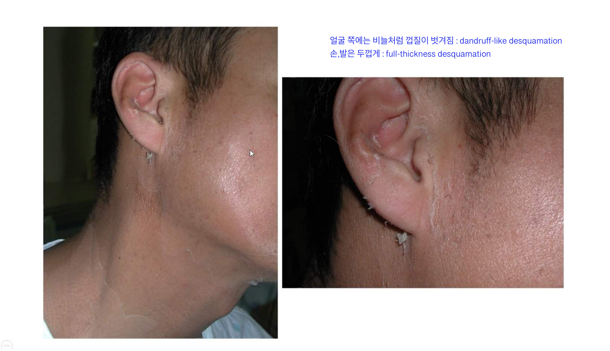{: style="width:50%"}

- **초항원(superantigen)**: TSST-1(*S. aureus*), SpeA·SpeC(*S. pyogenes*)가 항원 처리 없이 **MHC II와 TCR Vβ를 비특이적으로 연결** → T세포 대량 활성화 → **사이토카인 폭풍** → 발열·혈관확장·쇼크·다장기 부전.
- 교수님: "**연쇄상구균 TSS가 포도알균 TSS보다 더 심각.**" 처음 알려진 계기는 **탐폰**.
- CDC 기준: 발열 ≥ 38.9℃, 수축기 ≤ 90 mmHg, 발진 + 박리, **3장기 이상** 침범, 배양 음성(다른 원인 배제).
- 감별: 패혈증, SJS/TEN(약물력, 쇼크는 드묾), **포도알균 화상양 피부 증후군(4S)** — 아이들, 표피박리 독소(ETA·ETB), 점막 침범 없음. 같은 독소가 국소면 수포성 농가진.
- 치료: 감염원 제거(탐폰·농양·이물), 수액·승압제, **clindamycin**(독소 생성 억제) + **β-lactam** ± vancomycin, 중증이면 **IVIG**(2 g/kg). 교수님: "TSS는 antitoxin therapy로 **immunoglobulin & clindamycin**. (septic shock은 β-lactam 위주)"

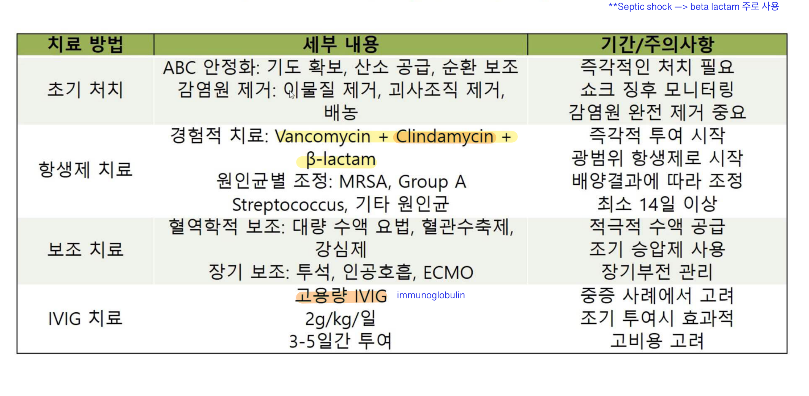{: style="width:85%"}

!!! exam "기출 포인트"
    10번(2023): 급성 발열·구토·설사, 저혈압, 간·신 이상, **배양 음성**, 2주 뒤 손발바닥 박리 → **독성쇼크증후군**. 17번(2022): 약 복용 후 발열·발진·**구강 점막 침범**·간효소 상승 → **SJS**(눈 점막 → 각막 손상).

# 7. Case 7 — 기쿠치병

> 54세 여자, 한 달간 열감과 목 불편. 유양돌기염으로 항생제, 소아과에서 **ceftriaxone**·소염제를 써도 간헐적 고열(39℃). 목 양쪽에 **0.5 cm 압통 있는 여러 림프절, 움직임**. 흉부 X선 정상, CRP 3.0, **WBC 3,400**.

- 교수님: "**백혈구 감소**가 단서. 열 + 림프절이면 ① lymphoma ② TB ③ Kikuchi ④ viral illness를 감별."
    - 림프종: 악성은 **움직이지 않는다**. 결핵: 움직이지 않고 영상에서 **중심 괴사**. 바이러스: 이렇게 오래가지 않는다.
    - "**림프절이 부었다, 움직인다, 열이 난다, 한 달 됐다 → 기쿠치!!**"
- **조직구성 괴사성 림프절염**: 피질 주변부의 조직구 증식, **핵 파편(karyorrhexis)**을 동반한 괴사, **호중구 없음**, 초승달 모양 핵의 조직구. **아시아의 젊은 여성**에 가장 흔하다.

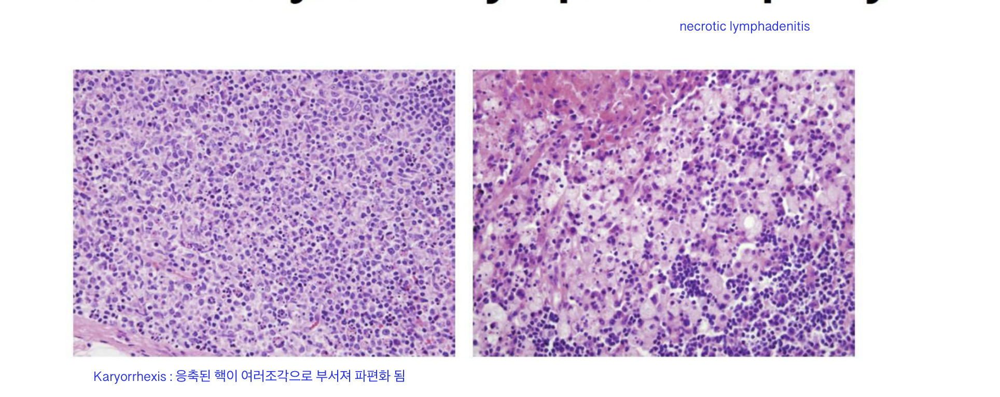{: style="width:62%"}

- 감별: Kimura병(조직 호산구, IgE 매우 높음), 결핵, 반응성. 진단은 **림프절 생검**.
- 치료(교과서 보충): 대개 **1~4개월에 저절로** 좋아진다 → 해열진통제 등 대증, 심하면 스테로이드. 일부는 SLE로 진행하므로 추적.

!!! exam "기출 포인트"
    13, 20번: 젊은~중년 여성의 지속 발열 + 압통 있는 작은 경부 림프절 + **백혈구 감소** + 항생제 무반응, 조직에서 **핵 파편 괴사·조직구(호중구 없음)** → **기쿠치병**.

# 8. Case 8 — 수족구병

> 15세 남자, 2일간 입 병변·통증, 열감·무력. **같은 반에 비슷한 증상의 아이를 7일 전**에 봄. 38.8℃.

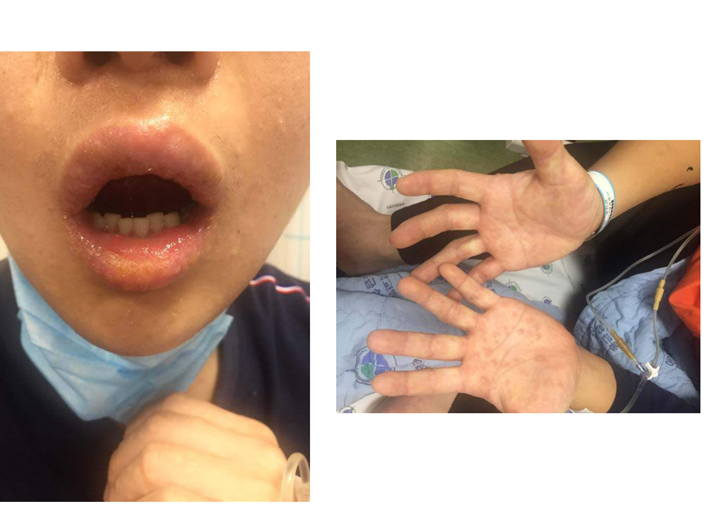{: style="width:50%"}

- **수족구병**: 장바이러스 — 주로 **콕사키바이러스 A16**, **엔테로바이러스 71**. 입·인두의 궤양, 손·발의 수포성 발진. 나이가 들어도 생기지만 **아이에게 더 잘**. 고름이 차는 경우도 있다.
- 대부분 **저절로 낫는다** → 대증(입 통증 때문에 못 먹어 **탈수** 주의). 교수님: "**수막염**이 간혹 생겨 사망할 수도 있다(EV71) — 수막염이 생기면 **신고**."

!!! exam "기출 포인트"
    8, 16, 19번: 구강 궤양·발열 + 같은 반 친구 → **수족구병·포진성 구협염** → 원인 **콕사키 A16·EV71**, 대부분 저절로 낫지만 탈수·드물게 뇌수막염·뇌염.

# 9. Case 9 — 지역사회획득폐렴 (폐렴구균)

> 65세 여자, 5일간 가래·기침·열. 기침할 때와 **자세를 바꿀 때 우측 흉통**(흉막성). 38.5℃.

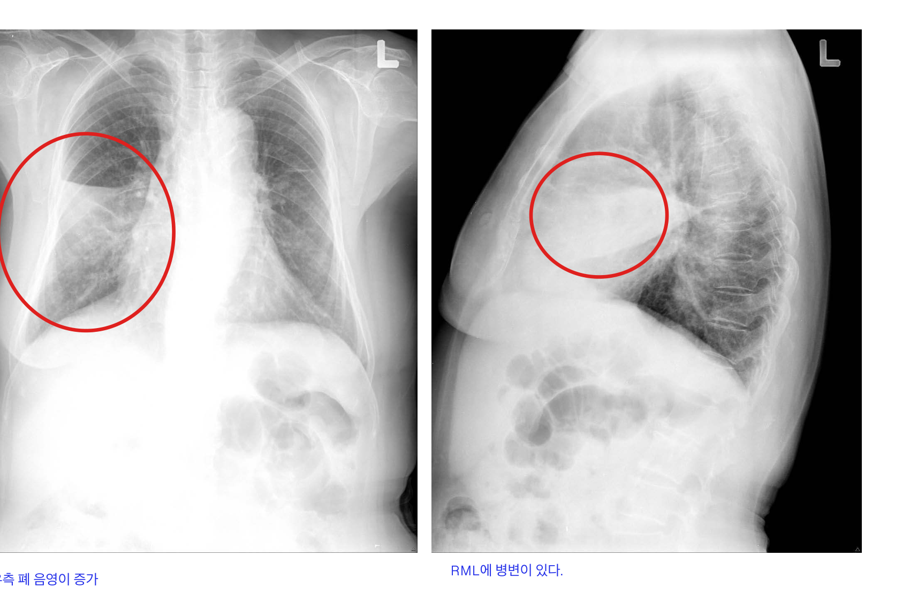{: style="width:55%"}

- 진단: **우중엽 엽성 폐렴**. 교수님: "lobe를 침범하는 **lobar pneumonia는 거의 대부분 폐렴구균**." 고열 + 화농성 가래 + 엽성 = **전형 폐렴**, 벗어나면 비전형.
- 원인균 변화: 예전엔 *S. pneumoniae* 비율이 더 높았지만 **백신**과 **고령화**로 다른 균 비율이 늘었다. "X선만으로 균을 알기는 어렵다. 고령이면 **Legionella**도 고려."
- 객담 그람 염색에서 **그람양성 쌍알균(diplococci)** → 폐렴구균. (짧은 사슬도 가능)

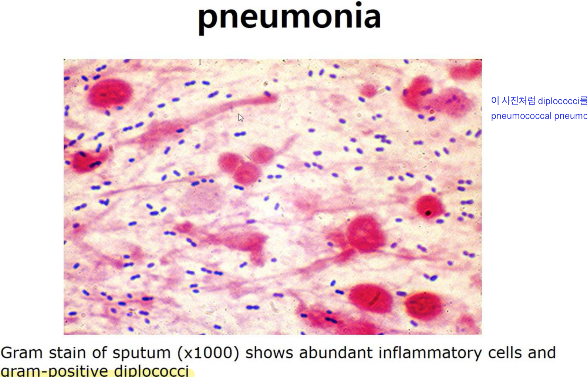{: style="width:42%"}

- 치료 장소별 원인균이 다르다(외래 / 입원 / 중환자실 — 중환자실은 MRSA, *Pseudomonas*, 그람음성균 추가).

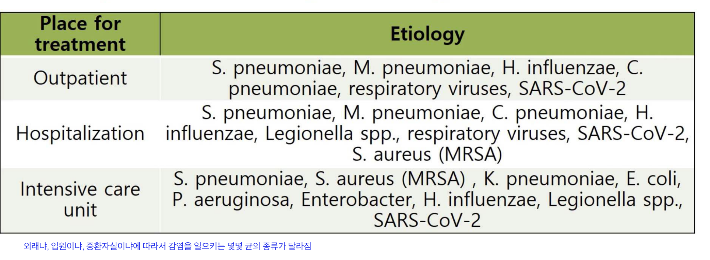{: style="width:70%"}

- 경험적 항생제: 외래 amoxicillin/clavulanate 5~7일, 입원 **β-lactam + macrolide** 또는 **호흡기 fluoroquinolone** 7~10일, 중환자실 β-lactam + azithromycin 또는 β-lactam + FQ. 교수님: "**결핵이 의심되면 FQ는 쓰지 않는다**(결핵을 가린다)." ceftriaxone을 많이 쓴다.
- 입원·외래 결정: **CURB-65**(의식저하, BUN, RR ≥ 30, 저혈압, 65세 이상) 또는 PSI(교과서 보충).

# 10. Case 10 — 당뇨발 감염

> 67세 남자, 2년 전 당뇨를 알았지만 종교 수련을 하며 약을 전혀 먹지 않음. 6개월 전 발 궤양을 스스로 치료, 2주 전부터 악화. BP 160/125, HR 115, 38.5℃.

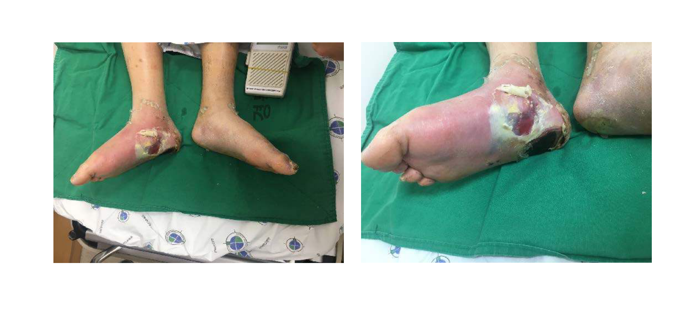{: style="width:62%"}

- 교수님: "**교수님 같으면 발을 자르자고** 한다. 빨리 자르고 재활하는 게 더 좋을 것." "**썩으면 절대 돌아오지 않는다.**" 새카매지면 mummification시켜 저절로 떨어지게 할 때도 있다. "딱 보면 알아야 한다."
- **혼합감염**(그람양성·그람음성·혐기균). 교수님: "MRSA가 나오긴 하지만 처음부터 배양되는 게 아니고, 계속 치료하다 보면 검출되기 시작." 열린 상처라 겉에만 있는 균인지 안까지 들어간 균인지 판단이 어려워 **치료 반응을 보며** 판단.
- 치료: **piperacillin/tazobactam, ampicillin/sulbactam** → 안 들으면 **carbapenem**, MRSA 나오면 **vancomycin** 추가. 무엇보다 **괴사조직 제거(변연절제)·배농**, 혈류 평가·재관류, 절단. 교수님: "일찍 잘 판단해야. 의족 차고 재활하는 게 훨씬 빠를 수도."

!!! exam "기출 포인트"
    6번: 당뇨발 감염에서 가장 중요한 것 → 적절한 항생제와 함께 **괴사조직 제거·배농**. 12번: 당뇨발은 대개 **다균 혼합 감염**, 열린 상처 **표면 배양**은 원인균을 반영하지 못한다.

# 암기 — CP-A1 요점

| Case | 한 줄 요점 |
|---|---|
| 1 VP shunt | distal 쪽 감염·복강 농양, CoNS·*S. aureus*. **shunt 신염**(면역복합체). **제거** + lumbar drain |
| 2 림프부종 | 선천 림프부종의 반복 봉와직염. amp/sulbactam·cefazolin, 예방 cefadroxil(국내 penicillin V 없음) |
| 3 방선균증 | IUD + 골반 종괴(암 오인). 유황과립. **penicillin 계열 6~12개월** |
| 4 간질 | 녹즙(미나리) + 간 터널 병변 + 호산구. **triclabendazole** |
| 5 뎅기열 | 필리핀, Aedes, 점상출혈 → 붉은 바다의 흰 섬. NS1, 수액·acetaminophen, **NSAID 금지**, ADE |
| 6 TSS | 배양 음성 + 쇼크 + 손발 박리·딸기혀. 초항원. **clindamycin + β-lactam ± IVIG**, 감염원 제거 |
| 7 기쿠치 | 아시아 젊은 여성, 움직이는 압통 림프절, **백혈구 감소**, 괴사(호중구 없음). 대증 |
| 8 수족구 | 콕사키 A16·EV71. 대부분 자연 치유, 탈수·수막염 주의 |
| 9 폐렴구균 폐렴 | 엽성 → 폐렴구균, 그람양성 쌍알균. β-lactam + macrolide 또는 FQ(결핵 의심 시 FQ ×) |
| 10 당뇨발 | 혼합감염. pip/tazo → carbapenem, MRSA면 vancomycin. **변연절제·절단** |
