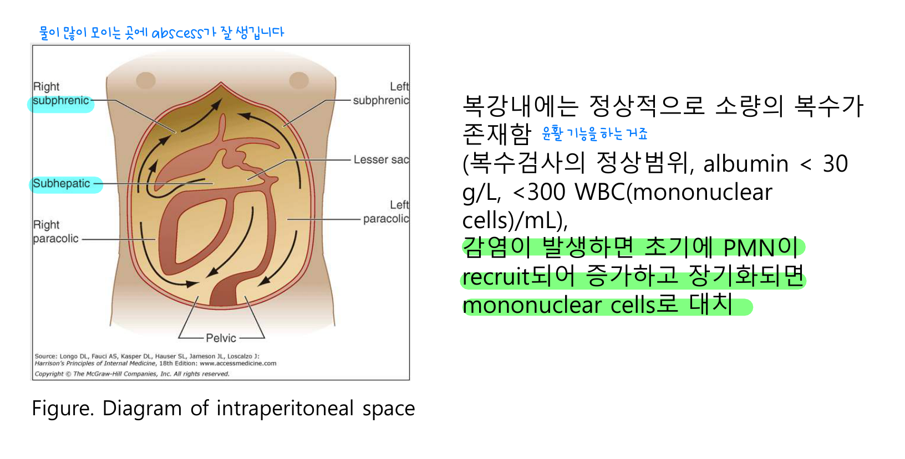
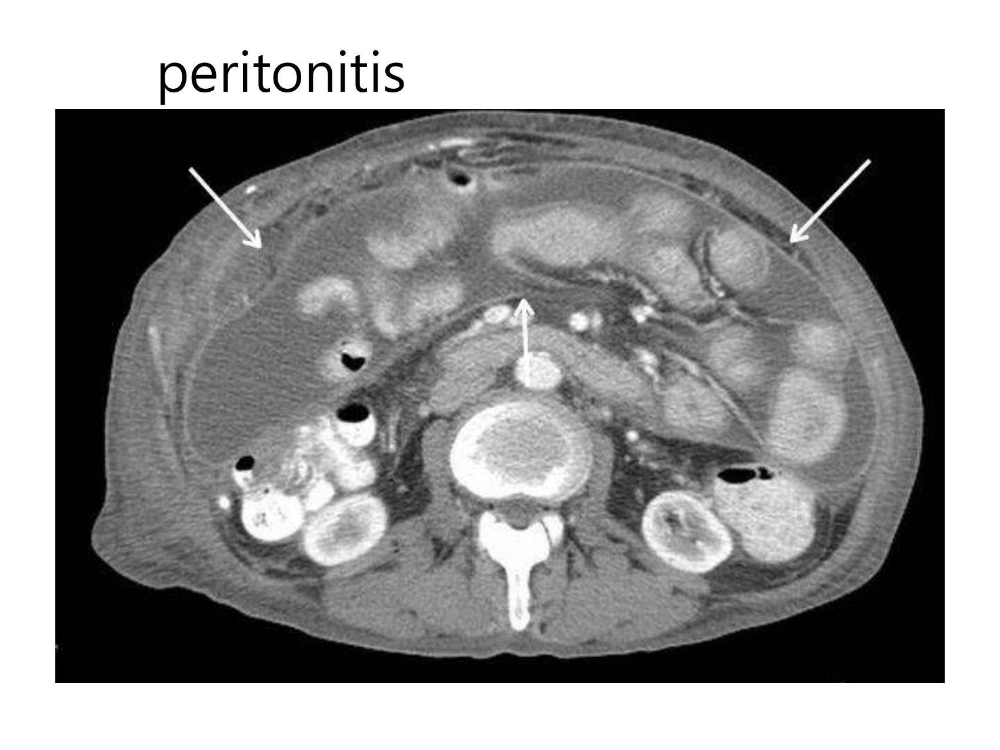
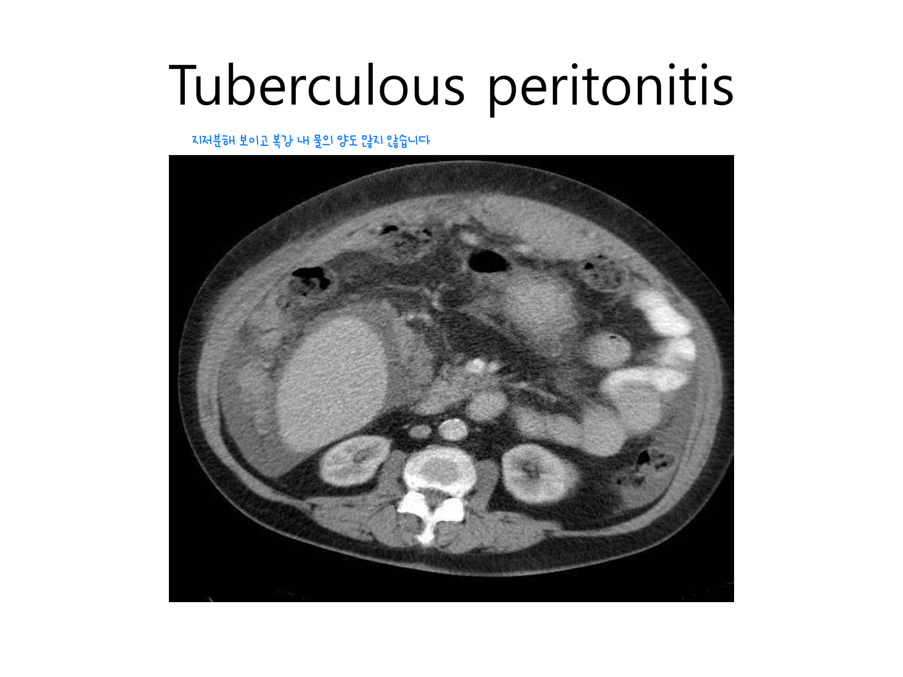
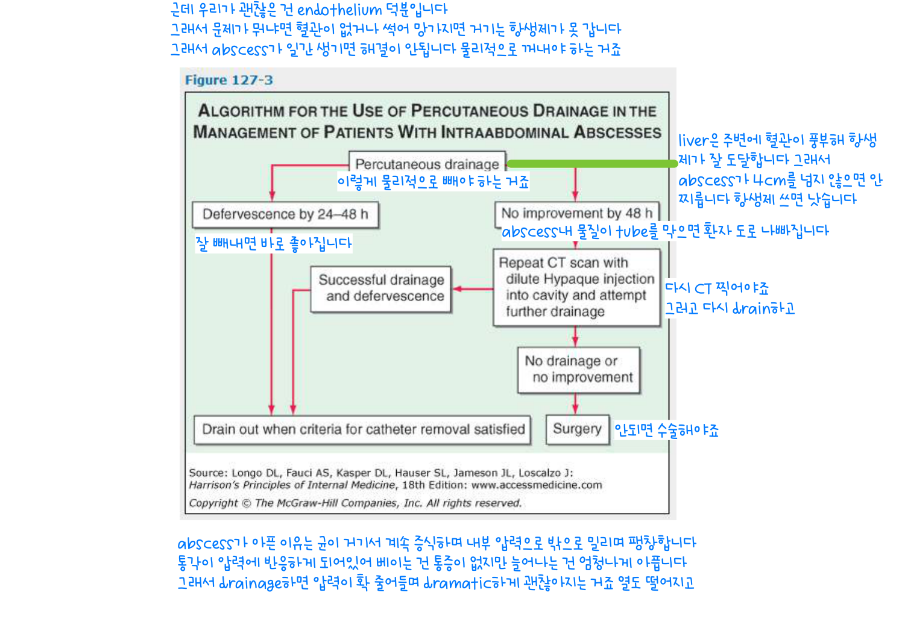
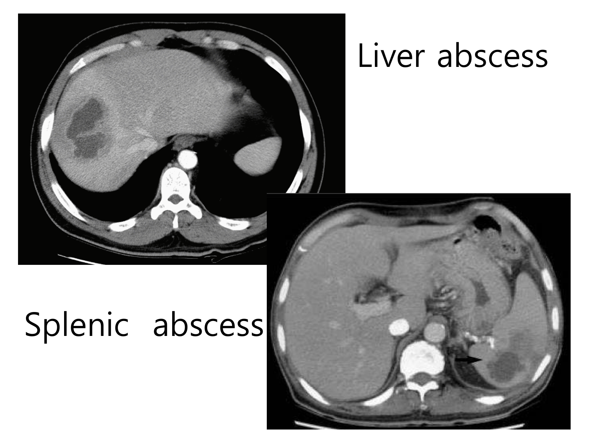
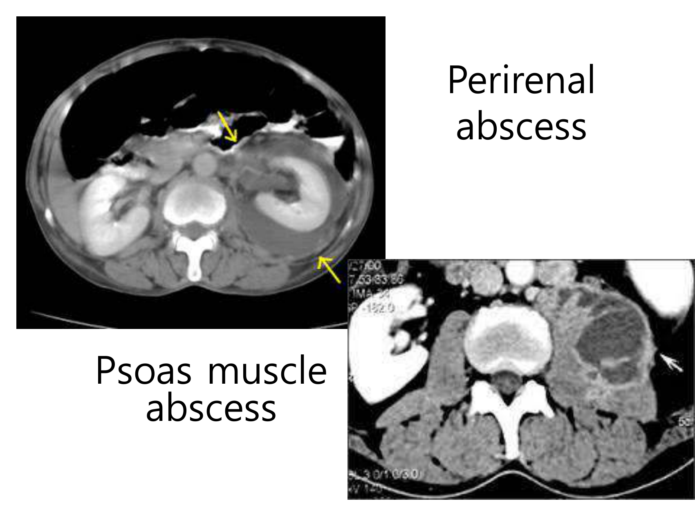

<!-- 필기본: 2025 -->
<!-- 단계: 수업 전 -->

# 0. 이 수업을 공부하는 법

작년(2025)에는 장현하 교수님이 강의했고, 올해(2026) 시간표에는 **배소현 교수님**으로 되어 있다. 강의 자료는 Harrison 내과학 "Intraabdominal infections and abscesses" 장을 거의 그대로 옮긴 영어 요약이고, 교수님 설명이 손글씨(파란 글씨)로 붙어 있다. 담당 교수님이 바뀌므로 올해 강의에서 강조점이 달라질 수 있다.

학습 성과

1. 복강내 감염의 대표적인 감염진단명을 설명한다.
2. 복막염의 원인과 진단, 감염경로·증상·치료를 설명한다.
3. 복강내 농양과 복강내 장기 농양의 원인·진단·감염경로·증상·치료를 기술한다.

- 기출 18문항(2020–2025). 거의 매년 나오는 두 주제는 **① 자발성(1차성) 세균성 복막염(SBP)** 과 **② 간농양** 이다. 같은 문제가 해를 바꿔 그대로 다시 나왔다(2부 1번 = 17번, 3번 = 6번).
- 나머지는 2차 복막염의 치료(응급 수술, 혐기균까지 덮는 항생제), 비장 농양 ↔ 심내막염, 요근 농양 CT, B. fragilis의 협막다당.

!!! key "핵심"
    **1차 복막염 = 간경변 + 복수 PMN ≥250, 단일 장내세균(E. coli·Klebsiella), 수술 X, 3세대 세팔로스포린, 혐기균 커버 X.**
    **2차 복막염 = 장 천공, 혼합균(+혐기균 B. fragilis), CT, 빨리 항생제(혐기균 커버) + 수술.**
    **농양 = 항생제만으로는 안 된다 → 물리적으로 빼낸다(배액).**

# 1. 복강내 감염의 원인과 두 단계

## 원인: 정상 해부학적 장벽(normal anatomic barrier)의 파괴
1. 충수·게실·궤양의 **파열(rupture)**
2. **허혈(ischemia)**·종양·염증으로 약해진 장 — 허혈은 나이가 많을수록 잘 생긴다(동맥경화, 탄력 감소)
3. 이웃한 염증(췌장염, 골반염 PID)이 복강으로 새는 것 — 예: 췌장염으로 앞쪽 십이지장이 상해 가는 경우

## 두 단계 (2 stages)
1. **복막염(peritonitis)** — 장 내용물이 새면서 생긴다.
2. **농양 형성(abscess formation)** — 면역이 정상이라면 나쁜 것을 한 곳에 몰아넣는 것으로, **방어기전**이라고 볼 수도 있다. 면역저하자는 동원할 T cell이 없어 농양이 잘 생기지 않는다.

각 단계에서 가장 우세한 원인미생물의 종류가 질병의 양상(pathogenesis)을 결정한다.

## 복강 공간과 정상 복수

{: style="width:78%"}

- 복강 안에는 정상적으로 **소량의 복수**가 있다 — 윤활 기능.
- 정상 복수: **albumin <30 g/L, WBC <300/mL(단핵구)**.
- 감염이 생기면 **초기에는 PMN(호중구)**이 모여 증가하고, **오래되면 단핵구(mononuclear cell)**로 바뀐다.
- 물이 많이 모이는 곳(우횡격막하, 간하, 양쪽 결장옆고랑, 골반)에 **농양이 잘 생긴다**.

# 2. 복막염 (Peritonitis)

{: style="width:52%"}

## 1차(자발성) 세균성 복막염 — Primary (spontaneous) bacterial peritonitis, PBP/SBP
**정의**: 눈에 보이는 오염원(천공, 허혈)이 **없이** 생기는 복막염. 1차인지 2차인지에 따라 원인균과 임상 양상이 달라진다. 교수님: "면역이 너무 낮아 그냥 생기는 것".

**기저질환**

- ★ **간경변(cirrhosis)** — 대개 알코올성, **가장 흔하다**.
- 전이성 악성종양, 괴사후 간경변, 만성 활동성 간염, 급성 바이러스 간염, **울혈성 심부전**(심장이 펌프질을 못해 간·비장 쪽에 물이 고인다), **전신홍반루푸스**(면역이 떨어지는 질환), 림프부종
- 기저질환이 없는 사람에서도 드물게 생긴다.

**원인(기전)**: 간이 병든 환자에서 **문맥 순환(portal circulation)**이 바뀌어 정상적인 여과가 안 되면서 균이 **혈행성으로 퍼진다**.

- 정상: 장 점막이 손상되면 장내세균이 들어오지만 일단 문맥으로 가서 **간에서 걸러져** 무균이 된 혈액만 하대정맥 → 심장으로 간다.
- 간경변: 이 여과가 안 된다 → 균혈증 → 복수 감염.

**임상증상**

- 2차 복막염과 다르다 — 충수염이나 장 천공처럼 전형적인 증상이 거의 없다.
- **발열이 가장 흔한 증상**.
- 복수는 감염 **전부터** 거의 항상 있다.
- 복통·복막자극 징후가 **미약하거나 없다**(CT를 찍으면 복수만 보인다).
- 권태·피로·**간성뇌증** 같은 **국소화되지 않는 증상**만 있을 수 있다.

**진단** — 복수천자

- 복수 **PMN >250/mm³** 이면 1차 복막염.
- 원인균: **장내 그람음성 막대균 — E. coli**(요즘은 **Klebsiella**가 더 우세), 그람양성균(사슬알균, 장알균, 폐렴알균)도 가능. 둘 다 장내 세균.
- 진단이 쉽지 않다(배양 음성이 흔함).
- **균혈증이 흔히 동반된다** → 혈액배양.

**치료**

- **수술하면 안 된다.** 항생제로 치료하면 **3일(72시간) 이내 좋아진다**.
- 혈액·복수에서 분리된 균을 겨냥 → 경험적으로 **3세대 세팔로스포린**(장내세균에 가장 잘 듣는 것), 또는 **piperacillin/tazobactam** 같은 penicillin/β-lactamase 억제제 병합.
- **혐기균은 경험적으로 커버하지 않는다** — 문제를 일으키지 않는다.
- 균이 동정되면 그 균에 맞춰 좁힌다. 치료기간 최소 5일~2주.
- **3일이 지나도 호전이 없거나 치료 후에도 복수 WBC가 지속되면 → 1차가 아니다**(미세천공 등) → 다른 진단을 찾고 수술한다.

!!! exam "기출 포인트"
    - 2부 1·17번(2025·2020, 같은 문제): 간경화 + 복수 + 복통 없는 발열 → 옳은 것 = **수술 없이 3세대 cephalosporin**. 함정: 심내막염이 원인(X), B. fragilis가 흔함(X, 혐기균은 2차), 균혈증 <5%(X, 흔하다), 췌장 염증의 직접 침범(X).
    - 2부 2번(2024): SBP의 특징으로 옳은 것 = **전이성 암·조절되지 않는 자가면역질환에서도 생길 수 있다**. 오답: 심한 오한·복통이 특징(X 미약), 혐기균(X), 응급수술(X), 균혈증 <5%(X).
    - 2부 11번(2022): 1차성 복막염 = **간경변 환자의 복막염**. 충수·게실·위궤양 천공은 2차, 결핵성은 따로.
    - 2부 13번(2021): 복수에서 Enterococcus faecalis → 감수성 가능성이 낮은 약 = **Cefotaxime**(장알균은 세팔로스포린에 자연 내성 — 간농양에서도 같은 이유로 ampicillin을 쓴다).

## 2차 복막염 (Secondary peritonitis)
**원인**: 위궤양·충수염이 터지거나 허혈 등으로 **복강 내 장기의 내용물이 쏟아져(spillage)** 복강이 세균에 오염된다. 원인균은 **통성 그람음성 막대균 + 혐기균의 혼합균(mixed flora)**.

**임상양상**

- 초기: 섬유소와 **PMN**이 든 삼출액. 단핵구로 바뀔 시간이 없다 — 그 전에 사망할 수 있어서.
- **그람음성균 패혈증과 혈중 내독소(endotoxin)**로 인한 조기 사망 → **바로 외과로 가야 한다**. 균은 숙주를 죽이고 영양분을 빼앗으려 독소를 내놓기도 한다.
- **E. coli와 Bacteroides fragilis** 균혈증이 흔하고, 원인균 동정이 비교적 잘 된다(혈액에서도 잘 나온다).
- **천공 부위에 따라 임상양상이 달라진다**(아픈 부위가 다르다). 시간이 지나면 사건 부위뿐 아니라 **전체 복부 통증, 반발압통**, 고열, 백혈구 증가, 염증 수치 상승.
- **복부 수술 후 병원감염**으로 오는 경우가 흔하다(예: 비만 수술로 위절제술 후).

**진단**: **무조건 CT** — 혈역학적으로 안정되면 응급 복부 CT로 오염원을 찾는다. 불안정하면 영상 없이 바로 수술할 수도 있다.

**치료**

1. **빨리 항생제** — 호기성 그람음성 막대균과 **혐기균을 반드시 커버**:
    - 광범위 penicillin/β-lactamase 억제제(**piperacillin/tazobactam**, ticarcillin/clavulanate), cefoxitin
    - fluoroquinolone 또는 **3세대 세팔로스포린 + metronidazole**(metronidazole이 혐기균 담당)
    - **carbapenem**(imipenem 500 mg q6h IV, meropenem 1 g q8h IV) — 혐기균까지 커버
    - ampicillin + metronidazole + ciprofloxacin 병합
2. **수술이 필요한 경우가 흔하다**(2차 복막염에서는 생명을 살리는 처치). 수술이 안 되면 경피적 배액이라도 한다.

!!! exam "기출 포인트"
    - 2부 5번(2023): 충수 천공 + 범발성 복막염(빈맥·빈호흡·전체 압통) → **응급 수술**. 함정: meropenem이 으뜸(X), fluconazole·vancomycin 바로 추가(X), 혈당 조절 불필요(X).
    - 2부 14번(2021): 천공성 충수염(조현병 환자, 늦게 발견) 경험적 항생제 = **Piperacillin/tazobactam**(그람음성 + 혐기균). Ceftriaxone·ciprofloxacin 단독은 혐기균 X, clindamycin·vancomycin은 그람음성 X.
    - 2부 10번(2022): 장천공 복막염 고름의 대장균 = **commensal pathogen**(평소 정상세균총이지만 무균 부위에 들어가 병을 일으킴).

## CAPD 복막염
**복막투석(지속적 외래 복막투석, CAPD)** 환자의 복막염. 도관이 피부와 연결되어 있어 장내세균이 아니라 **피부 상재균**(CNS = 코아굴라제음성 포도알균, **S. aureus**)에 의한 오염이 특징이다.

## 결핵성 복막염 (Tuberculous peritonitis)

{: style="width:50%"}

- **발생기전**: 터진 림프절이나 복강 내 장기(예: 여성의 생식기 결핵)에서 결핵균이 직접 퍼지거나(터져서 복강으로 나온다), 혈행성 파종.
- **증상**: 비특이적 복통, 발열, 복수 — 딱히 증상이 없는 경우가 많다. CT에서는 지저분해 보이고 복수 양도 많지 않다.
- **진단**:
    - 복수: 단백질이 많은 **삼출액**, 백혈구 증가(**림프구 우세**, 다만 **초기에는 PMN 우세**).
    - 도말·배양 검출률이 매우 낮다(결핵균이 거의 안 나온다). 복수 양이 많을수록 검출률이 오른다.
    - 안 되면 **복막 생검**(내시경 등) — 조직검사가 필요한 경우가 많다.
- **치료**: **항결핵제 9–12개월**.

# 3. 복강내 농양 (Intraabdominal abscesses)

## 복강내 농양 (Intraperitoneal abscess)

### 발생기전과 면역
- **농양** = 살아 있는 균과 PMN이 **섬유성 피막**에 갇힌 감염. 숙주가 균을 좁은 공간에 가둬 더 퍼지지 못하게 하지만, 대신 상당한 증상을 일으킨다.
- 숙주 세포와 세균의 독성인자가 함께 관여한다. 대표가 **B. fragilis의 협막다당복합체(capsular polysaccharide complex, CPC)** → 복강에서 숙주 반응을 일으켜 균을 농양에 가둔다 → 복막 대식세포가 **TNF-α, ICAM-1** 생산 → 자극된 **CD4+ T 림프구**가 백혈구 유인 사이토카인·케모카인 분비.
- 보체 대체경로와 섬유소원도 농양 형성에 참여한다.
- 교수님: 특별한 CD4 T 세포와 균의 특정 항원이 있어야 한다 — **모든 균이 농양을 만드는 것도, 모든 환자가 농양을 만들 수 있는 것도 아니다**.

!!! exam "기출 포인트"
    2부 18번(2020): 복강내 농양 형성에 가장 중요한 **세균의** 독성인자 = **capsular polysaccharide complex**. TNF는 숙주 사이토카인, lipoteichoic acid·peptidoglycan은 그람양성 세포벽, PBP는 항생제 표적 — 모두 함정.

### 임상양상
- 농양의 **74%는 복강내 또는 후복막**에 있고 장기 안(visceral)이 아니다.
- 대부분 **대장(결장)에서 나온 대변 유출**(예: 염증 있는 충수)에서 생긴다 → 그물막에서 장간막, 골반에서 요근, 횡격막하 공간에서 간 같은 장기로 퍼진다.
- 여성 생식기 감염과 췌장염도 흔한 원인. 초기 CT에서는 농양 벽이 불규칙할 수 있다.

### 진단
**복부 CT, 초음파**(복강 내는 **CT가 가장 좋다**). Indium 표지 백혈구·gallium 스캔. CT 이후 시험적 개복술은 드물어졌다.

### 치료 — 경피적 배액 알고리즘

{: style="width:74%"}

1. **경피적 배액(percutaneous drainage)** — 물리적으로 빼낸다.
2. 24–48시간 안에 해열 → (잘 빼면 바로 좋아진다) → 기준을 만족하면 배액관 제거.
3. 48시간이 지나도 호전 없음 → 농양 내용물이 관을 막았을 수 있다 → **CT 재촬영**(조영제를 공동에 넣어 확인) 후 다시 배액.
4. 배액이 안 되거나 호전이 없으면 → **수술**.

왜 배액해야 하나(교수님 설명):

- 대부분의 항생제는 조직에 직접 뿌리면 조직을 망가뜨린다. 우리가 괜찮은 것은 **혈관 내피** 덕분이고, 항생제는 혈관을 따라 간다 → **혈관이 없거나 썩어 망가진 곳(농양)에는 항생제가 못 간다** → 농양이 일단 생기면 항생제만으로는 해결되지 않고 물리적으로 꺼내야 한다.
- 농양이 아픈 이유: 균이 계속 증식해 **내부 압력**으로 팽창 → 통각은 압력·늘어남에 반응(베이는 건 덜 아파도 늘어나는 건 엄청 아프다) → 배액하면 압력이 확 줄어 **극적으로 좋아지고 열도 떨어진다**.
- 단, **간**은 주변 혈관이 풍부해 항생제가 잘 도달한다 → **간농양은 4 cm를 넘지 않으면 찌르지 않고** 항생제로 치료한다.

## 장기 농양 (Visceral abscesses)

{: style="width:62%"}

### 간농양 (Liver abscess)
간은 농양이 **가장 잘 생기는 장기**다.

**발생기전**

- 단발성 또는 다발성.
- **혈행성 전파** — 간으로 가는 혈액량이 많아서.
- **복강 내 인접 감염의 국소 전파**.
- 과거에는 충수염 파열 후 전파가 가장 흔한 원인이었지만, **현재는 담도계 질환이 가장 흔하다**(담도 결석 CBD stone이 가장 많고, 요즘엔 **간흡충** 때문인 경우도 많다).
- **문맥염(pylephlebitis, 문맥의 화농성 혈전증)** — 장에서 온 혈액은 모두 문맥으로 가는데, 그 안에서 균이 증식해 혈전으로 막히면 생긴다. 간이 나쁜 경우 잘 생긴다.

**임상증상**

- 발열, 담도 질환 동반, **우상복부** 통증·근육 강직·타진 압통·반발압통, 오한·식욕부진·체중감소·구역·구토.
- 간비대, 우상복부 압통, 황달.
- **환자의 절반은 간을 가리키는 증상·징후가 없다**(간 안에 파묻혀 있으면 안 아프다 — 특징지을 수 없다).
- 특히 노인에서는 **불명열(FUO)**이 유일한 증상일 수 있다.

**진단**

- **ALP(알칼리인산분해효소) 상승**(가장 흔함), 빌리루빈·AST 상승.
- 백혈구 증가 77%, 빈혈(정색소·정적혈구) 50%, 저알부민혈증 33%.
- 동반 균혈증 1/3–1/2.
- 초음파, CT, Indium 백혈구·gallium 스캔, MRI.

**원인균**

- **담도계에서 온 것**: 장내 **그람음성 호기성 막대균**(E. coli, **Klebsiella가 1번**)과 **장알균(enterococci)**. 담도 감염에서 온 간농양에는 **혐기균이 보통 관여하지 않는다**.
- **골반·기타 복강 내 원인**: 호기성 + 혐기성 혼합균, **B. fragilis**가 가장 흔하다.
- **혈행성 전파**: **S. aureus** 또는 S. milleri 같은 사슬알균.
- 배액관에서 얻은 배양은 원인균 판단에 믿을 만하지 않다.
- 항암치료 중 진균혈증 후 **Candida** — 호중구감소기가 지나 PMN이 돌아올 때 나타난다.
- **아메바 간농양**도 드물지 않다 — 아메바 혈청검사가 95% 이상 양성이므로, **음성이면 배제**하는 데 도움이 된다.

**치료**

- 가장 가능성 높은 원인균에 대한 경험적 항생제 — E. coli·Klebsiella가 1번이므로 **3세대 세팔로스포린**을 가장 많이 쓴다. 장알균은 3세대 세팔로스포린이 안 들어서 **ampicillin**.
- **경피적 배액(PCD) 또는 수술**.
- 원인 질환 치료(수술 또는 내과적 치료). 안 되면 수술.

!!! exam "기출 포인트"
    - 2부 3·6번(2024·2023, 같은 문제): 고열 + CT 간농양 → 옳은 것 = **즉시 경피적 배액술**. 함정: 혈행성·늑골 골염과 동반(X), S. aureus·Streptococcus가 가장 흔함(X → Klebsiella), meropenem + fluconazole(X), 배액 후 3–4일 발열 지속해도 기다림(X → 재평가).
    - 2부 4번(2024): 감수성 좋은 Klebsiella 간농양 = **Ceftriaxone + 배농**.
    - 2부 12번(2022): 담도·장 질환 없는 간농양 PCD 배양 = **Klebsiella pneumoniae**.
    - 2부 15번(2021): 간농양 시술 사진 = **percutaneous catheter drainage**.
    - 2부 16번(2020): 강가 거주 노인의 담도 폐색 기생충 = **Clonorchis sinensis(간흡충)**.

### 비장농양 (Splenic abscess)
- 임상적으로 의심해야 진단할 수 있다. **조기진단이 중요하지만 쉽지 않다**. 치료하지 않으면 흔히 치명적.
- 인접 감염이나 비장 외상에서도 오지만 **혈행성 전파가 더 흔하다**.
- **가장 흔한 동반 감염 = 세균성 심내막염**(전이로 생긴다) → **비장에만 농양이 보이면 반드시 심초음파**로 심장을 확인한다.
- 강한 면역억제 치료(특히 비장을 침범한 악성종양), 면역저하자 — 암을 확인해야 한다.
- **혈색소병증(hemoglobinopathy)** 등 혈액질환(특히 **겸상적혈구빈혈**) — 요즘 이주민 중 겸상적혈구·지중해빈혈 환자가 꽤 있다. 비장비대를 잘 일으키는 **말라리아**도 원인이 될 수 있다.
- 치료: 다방성·다발성 농양은 **비장절제 + 항생제**. 비장은 터지면 응급수술이고, 부분적으로 남기지 못하고 **무조건 떼어 낸다**.
- **비장절제 환자는 협막균 백신을 반드시 맞는다**: **S. pneumoniae, H. influenzae, N. meningitidis**(비장이 없으면 B 세포 교육이 안 된다 — B 세포가 중요한 감염).
- 성공적 치료의 가장 중요한 요소 = **조기 진단**.

!!! exam "기출 포인트"
    2부 8번(2022): 발열 + 복부 CT 비장 병변 → 가장 흔한 연관 감염 = **심내막염**(6강 감염성 심내막염과 연결).

### 신주위·신농양 (Perinephric and renal abscess)

{: style="width:62%"}

- **원인**: **75%가 요로감염**에서 온다(신장 결석 등).
- **위험인자**: 가장 중요한 것은 **요로를 막는 신장결석**(20–60%에 결석). 그 밖에 요로 구조 이상, 비뇨기 수술, 외상, 당뇨.
- **원인균**: **E. coli가 가장 흔하다**, Proteus, Klebsiella, Candida.
- **진단**: 신장 초음파와 **복부 CT**(CT로 잘 진단된다). 소변 pH가 높으면(요소분해균, 예: Proteus) 결석을 꼭 배제한다.
- **치료**: 고름 배액 + 원인균에 대한 항생제.

### 요근 농양 (Psoas muscle abscess)
- 요근은 **신장 뒤**에 있는 다리를 들어 올리는 근육 → 농양이 생기면 **다리를 펴지 못한다**.
- 원인: **혈행성**, 복강·골반의 인접 감염, 주변 뼈(척추체)에서의 인접 전파 → **골수염 동반**이 흔하다.
- 원인균: 과거에는 **결핵균**이 흔했다. **S. aureus**(혈행성으로 잘 온다), 또는 호기·혐기 그람음성 장내세균 혼합(E. coli 같은 균으로도 잘 온다).
- 증상: 발열, 하복부·허리 통증, **엉덩이나 무릎으로 뻗치는 통증**.
- 진단: **CT가 가장 유용하다**.

!!! exam "기출 포인트"
    2부 7번(2022): 7일 발열 + CT(양측 요근의 저음영 병변) → **Psoas abscess**. 2부 9번(2022)은 매운탕(생선 가시) 후 연하곤란·흉막성 흉통 → 식도 천공·종격동염 → **Piperacillin/tazobactam**(혼합균 광범위 커버).

!!! memo "암기"
    SBP: PMN >250 · E. coli/Klebsiella · 3세대 세팔로 · 수술 X · 혐기균 X · 3일 내 호전 없으면 2차 의심 / 2차: 혼합균 + B. fragilis · CT · 혐기균 커버 + 수술 / CAPD: CNS·S. aureus / 결핵성: 림프구, 생검, 9–12개월 / 간농양: 담도 원인, Klebsiella, 배액(간은 4 cm 이하면 항생제만) / 비장농양: 심내막염 → 심초음파, 비장절제 후 협막균 백신 / 신주위: UTI·결석·E. coli / 요근: 결핵·S. aureus, CT
