<!-- 필기본: 2025 -->
<!-- 단계: 수업 전 -->

# 0. 이 수업을 공부하는 법

경북대병원 감염내과 **배소현 교수님** 수업(작년 2025, 올해 2026 모두). 작년 필기는 Harrison·Mandell 슬라이드에 필기한 학생의 설명이 촘촘히 붙어 있다(필기자도 "틀린 설명이 있을 수 있다"고 적어 두었다 — 확인이 필요한 곳은 아래에 표시했다).

학습목표

1. 심내막염을 의심하고 진단할 수 있다.
2. 심내막염의 경험적 항생제를 선택할 수 있다.

- 기출 12문항(2020–2025). 필기에도 "**기억해야 할 것은 이 진단 기준들!**"이라고 적혀 있듯, **Modified Duke criteria(주요 vs 부 기준)** 가 5문항으로 가장 많다. 다음은 **원인균 고르기**(급성 = S. aureus, 아급성 = viridans, 조기 인공판막 = CoNS), **말초 소견(Janeway lesion)**, **TTE 음성이면 TEE**.
- 2025년(배소현 교수님) 두 문항: 주요 기준 = **인공판막 탈락(dehiscence)**, S. aureus 균혈증 + TTE 음성 → **TEE**.

!!! key "핵심"
    **주요 기준 = ① 전형적인 균의 혈액배양 양성(또는 지속 양성) ② 심내막 침범(초음파: 움직이는 증식체, 농양·인공판막 탈락, 새 판막 역류).** 발열·위험 심장질환/약물주사·혈관 현상·면역 현상·비전형 배양은 모두 **부 기준**. 확진 = 주요 2 / 주요 1 + 부 3 / 부 5.

# 1. 심내막염이란

## 정의
감염성 심내막염(infective endocarditis, IE)은 다음 세 곳 중 하나에 **미생물 감염**이 생긴 것이다.

1. **심장 판막**(자기 판막 native 또는 인공판막 prosthetic)
2. 심방·심실 내벽이나 혈관의 **심내막(endocardium)**
3. **선천 기형 부위**(예: 중격 결손)

원인은 보통 **세균**이지만 리케차, 클라미디아, 진균도 가능하다. 심장의 조직학·해부학은 예과 해부학 내용이고, 심내막염은 **endocardium**에 생긴다는 점만 다시 강조했다. (필기자: 병명에 "infective"가 붙는 거의 유일한 질환.)

## 균이 들어오는 길 (Portals of entry)
주로 **점막을 뚫고 들어온 균**이 혈액을 타고 **균혈증**을 일으킨 뒤 여기저기 달라붙는다.

1. **치과 치료** 후 (구강 상재균)
2. 비뇨생식기계 감염(UTI 등)
3. 피부 감염
4. 호흡기 감염

## 병태생리 (Pathogenesis)

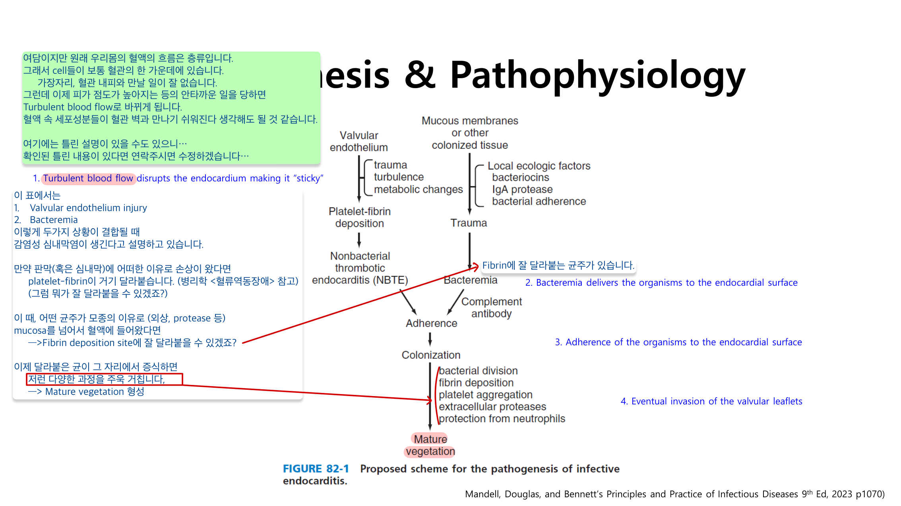{: style="width:94%"}

1. **난류(turbulent flow)**가 심내막을 손상시켜 "끈끈하게" 만든다.
2. **균혈증**이 균을 심내막 표면으로 나른다.
3. 균이 심내막 표면에 **부착**한다.
4. 결국 판막엽을 **침범**한다.

즉 **① 판막 내피 손상 + ② 균혈증** 두 상황이 합쳐질 때 생긴다.

- 판막(심내막)이 손상되면 거기에 **혈소판–섬유소(platelet-fibrin)**가 달라붙는다(비세균성 혈전성 심내막염; 병리학 "혈류역동장애" 참고).
- 이때 외상·protease 등으로 점막을 넘어 혈액에 들어온 균이 있으면 **섬유소 침착 부위에 잘 달라붙는다**(섬유소에 잘 붙는 균주가 있다).
- 붙은 균이 증식하면서 → **성숙한 증식체(vegetation)**가 된다.
- 정상 혈류는 층류(laminar)라 세포가 혈관 가운데로 흐르고 벽과 잘 만나지 않는다. 판막 질환 등으로 **난류**가 되면 혈액 성분이 벽과 만나기 쉬워진다.

## 위험인자
- **정맥주사 약물 남용(IVDU)**
- **인공판막·심박조율기** 등 몸에 인공물을 넣은 사람
- 후천성 심장 결손: 석회화 대동맥판 협착, **역류를 동반한 승모판 탈출증**
- **선천성 심장 기형**
- 혈관 내 카테터

# 2. 분류와 원인균

## 분류
- 임상 경과: **급성(acute)** vs **아급성(subacute)**
- 위치: **좌심(left-sided)** vs **우심(right-sided)**
- 판막: **자기 판막(native)** vs **인공판막(prosthetic)**

판막이 손상되어 잘 닫히지 않으면 역류가 생긴다.

- **좌심(MR, AR)** → 좌심실·좌심방 압력 ↑ → 폐정맥압 ↑ → **폐울혈, 호흡곤란**(폐부종).
- **우심(TR, PR)** → 우심실·우심방 압력 ↑ → 상·하대정맥압 ↑ → **경정맥 확장, 간울혈, 하지부종**.

## 급성 vs 아급성

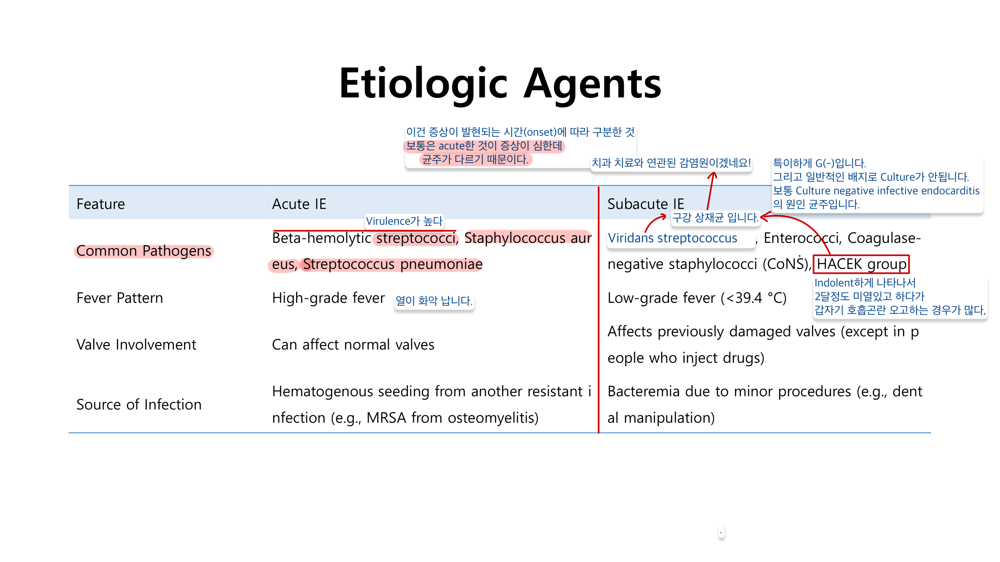{: style="width:94%"}

| | 급성 IE | 아급성 IE |
|---|---|---|
| 흔한 원인균 | **S. aureus**, β-용혈 연쇄구균, S. pneumoniae — **독성(virulence)이 높다** | **Viridans streptococci**(구강 상재균 → 치과 치료와 연관), 장알균, CoNS, **HACEK** |
| 열 | **고열**("열이 화악 난다") | 미열(<39.4℃) |
| 판막 | **정상 판막도 침범** | 이미 손상된 판막(약물주사자는 예외) |
| 감염원 | 다른 부위 감염에서 혈행성 파종(예: 골수염의 MRSA) | 사소한 시술(치과 처치)에 의한 균혈증 |
| 경과 | 빠르고 심하다 | **서서히** — 2달쯤 미열이 있다가 갑자기 호흡곤란이 오는 경우가 많다 |

- onset(증상 발현 시간)으로 나눈 것이고, 급성이 더 심한 것은 **균주가 다르기 때문**이다.
- **HACEK**(Haemophilus, Aggregatibacter(Actinobacillus), Cardiobacterium, Eikenella, Kingella)은 **그람음성**이고 일반 배지에서 잘 자라지 않아 **배양음성 심내막염**의 원인이 된다. (필기의 "특이하게 G(−), 일반 배지로 배양 안 됨"은 viridans가 아니라 HACEK에 대한 설명이다 — viridans 연쇄구균은 그람양성.)

!!! exam "기출 포인트"
    - 2부 6·10번(2022·2020): 1주의 고열, 손발 병변(Janeway), 급성 대동맥판 역류 → **S. aureus**.
    - 2부 8번(2021): 1주 만에 심잡음 + 심한 폐부종, 혈액배양 그람양성균 → **S. aureus**(급성). S. oralis·E. faecalis는 아급성, S. epidermidis는 인공판막.

## 원인균 빈도

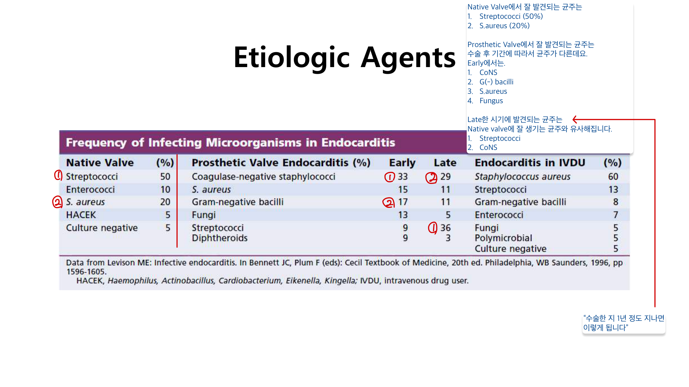{: style="width:94%"}

| 자기 판막 | % | 인공판막 조기 | % | 인공판막 후기 | % | 약물주사자(IVDU) | % |
|---|---|---|---|---|---|---|---|
| **Streptococci** | **50** | **CoNS** | **33** | **Streptococci** | **36** | **S. aureus** | **60** |
| **S. aureus** | **20** | **그람음성 막대균** | 17 | **CoNS** | 29 | Streptococci | 13 |
| Enterococci | 10 | S. aureus | 15 | S. aureus | 11 | 그람음성 막대균 | 8 |
| HACEK | 5 | 진균 | 13 | 그람음성 막대균 | 11 | Enterococci | 7 |
| 배양음성 | 5 | Streptococci, diphtheroids | 각 9 | 진균 | 5 | 진균, 다균, 배양음성 | 각 5 |

- **자기 판막**: 연쇄구균(50%) > S. aureus(20%).
- **인공판막 조기**: CoNS > 그람음성 막대균 > S. aureus > 진균.
- **인공판막 후기**: 자기 판막과 비슷해진다 — 연쇄구균 > CoNS. ("수술한 지 1년 정도 지나면 이렇게 된다.")

# 3. 임상양상

## 증식체가 일으키는 두 가지 문제
- **색전(emboli)**: 증식체 조각이 떨어져 → 뇌(**뇌졸중**), 관상동맥(**심근경색**), 비장(경색·비장비대), 신장 등.
- **면역복합체**: 증식체는 항원이므로 항원–항체 복합체가 떠다니다 혈관에 박혀 → **혈관염**, 출혈, **Osler 결절**, 점상출혈.

## 증상과 검사 소견

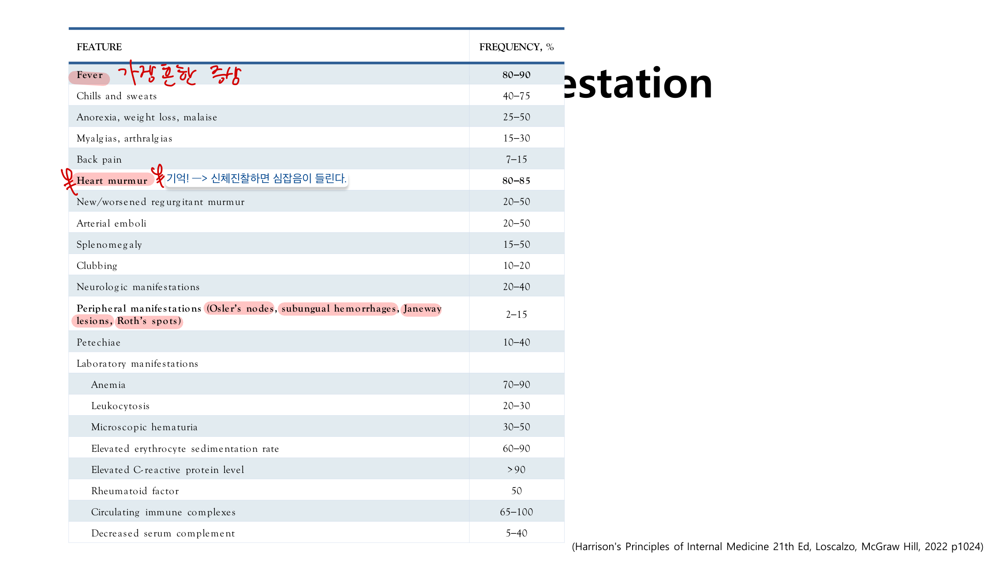{: style="width:94%"}

| 소견 | 빈도(%) |
|---|---|
| **발열** — 가장 흔한 증상 | 80–90 |
| 오한·발한 | 40–75 |
| 식욕부진·체중감소·권태 | 25–50 |
| 근육통·관절통 / 요통 | 15–30 / 7–15 |
| **심잡음** | **80–85** |
| 새로 생기거나 악화된 역류성 잡음 | 20–50 |
| 동맥 색전 / 비장비대 | 20–50 / 15–50 |
| 곤봉지 / 신경학적 증상 | 10–20 / 20–40 |
| 말초 소견(Osler, 손톱 밑 출혈, Janeway, Roth) | 2–15 |
| 점상출혈 | 10–40 |
| 빈혈 / 백혈구 증가 / 현미경적 혈뇨 | 70–90 / 20–30 / 30–50 |
| ESR 상승 / **CRP 상승** | 60–90 / **>90** |
| 류마티스 인자 / 순환 면역복합체 / 보체 감소 | 50 / 65–100 / 5–40 |

**기억! → 신체진찰을 하면 심잡음이 들린다.** (증례에서 교수님: "학생 선생님들께 당부드리는 건, **제발 심잡음을 들어 주세요**.")

## 말초 소견

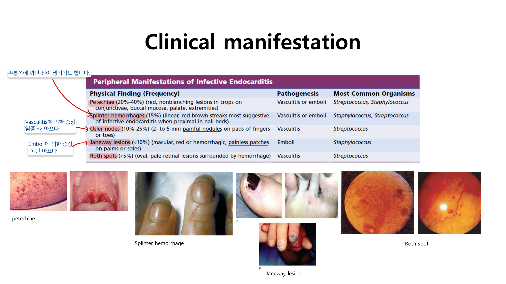{: style="width:94%"}

| 소견 | 모양 | 기전 | 아픈가 |
|---|---|---|---|
| 점상출혈(petechiae) | 결막·구강 점막·사지의 작은 붉은 반점 | 혈관염 또는 색전 | |
| **Splinter hemorrhage** | 손톱 밑의 붉은 갈색 선(손톱 쪽에 까만 선) | 혈관염 또는 색전 | |
| **Osler node** | 손가락·발가락 끝의 2–5 mm **아픈 결절** | **혈관염(면역)** | **아프다** |
| **Janeway lesion** | 손바닥·발바닥의 **아프지 않은** 붉은/출혈성 반점 | **색전** | **안 아프다** |
| Roth spot | 망막의 출혈로 둘러싸인 흰 병변 | 혈관염(면역) | |

정리: **색전에 의한 것 → 안 아프다(Janeway)**, **혈관염(염증)에 의한 것 → 아프다(Osler)**.

!!! exam "기출 포인트"
    2부 7번(2021): 발바닥의 아프지 않은 출혈성 반점 = **Janeway lesion**. Osler(아픈 결절), Roth(망막), Rose spot(장티푸스 복부 발진), splinter(손톱 밑)와 구별.

# 4. 진단

## Modified Duke criteria ★

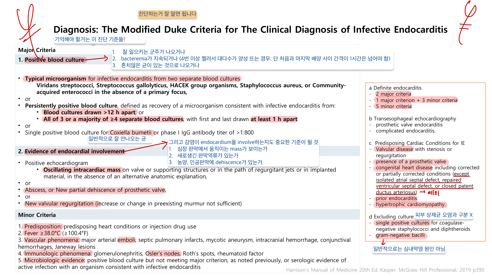{: style="width:94%"}

**주요 기준 (Major)**

1. **혈액배양 양성**
    - **전형적인 균**이 **두 번의 다른 혈액배양**에서: **viridans streptococci, S. gallolyticus(bovis), HACEK, S. aureus**, 일차 감염원이 없는 **지역사회 획득 장알균**
    - 또는 **지속 양성**: 12시간 넘게 간격을 둔 배양에서 양성, 또는 **3개 모두 / 4개 이상 중 대다수** 양성(첫 번째와 마지막 채혈 간격 **1시간 이상**)
    - 또는 **Coxiella burnetii** 단일 배양 양성 / phase I IgG >1:800 (일반적으로 잘 안 나오는 균)
2. **심내막 침범 증거**
    - 초음파 양성: 판막이나 지지 구조, 역류 제트 경로, 이식물에 **움직이는(oscillating) 심장 내 종괴**
    - **농양**, 또는 **인공판막의 새로운 부분 탈락(dehiscence)**
    - **새로 생긴 판막 역류**(원래 있던 잡음이 커지거나 바뀐 것만으로는 부족)

**부 기준 (Minor)**

1. **소인**: 위험 심장질환 또는 **정맥주사 약물 사용**
2. **발열 ≥38.0℃**
3. **혈관 현상**: 큰 동맥 색전, 패혈성 폐경색, 감염성 동맥류(mycotic aneurysm), 두개내 출혈, 결막 출혈, **Janeway lesion**
4. **면역 현상**: **사구체신염, Osler node, Roth spot, 류마티스 인자**
5. **미생물 증거**: 주요 기준에 못 미치는 혈액배양 양성, 또는 맞는 균의 혈청학적 활동성 감염 증거

**확진(definite)**: 주요 2개 / **주요 1개 + 부 3개** / 부 5개.

- 위험 심장질환: 협착·역류가 있는 판막 질환, **인공판막**, 선천성 심질환(교정했거나 부분 교정한 경우 포함 — 단 단순 심방중격결손, 교정한 심실중격결손, 닫힌 동맥관은 예외), **이전 심내막염**, 비후성 심근병증.
- **배양에서 제외**: CoNS·diphtheroids의 **단일** 양성(피부 상재균 오염과 구분이 안 된다), **그람음성 막대균**(일반적으로 심내막염 원인이 아니다).
- TEE 권장: 인공판막 심내막염, 합병된 심내막염.

!!! exam "기출 포인트"
    - 2부 1번(2025): 주요 기준 = **인공판막 탈락(dehiscence)**. 함정: 2세트 **E. coli** 양성(그람음성 → 전형적 균 아님), 발열·손끝 출혈반점·약물남용(부 기준).
    - 2부 3번(2024): 주요 기준 = **전형적 원인균의 혈액배양 양성**. 발열, 류마티스 인자, 사구체신염, 약물남용은 부 기준.
    - 2부 5번(2022): 주요 기준 2개 = **viridans 배양 양성 + 초음파 증식체**. 대장균(X), Janeway·발열·VSD(부 기준)는 함정.
    - 2부 4번(2023): 심내막염을 점검할 필요가 **가장 적은** 것 = **대장균 균혈증**(S. salivarius·S. aureus·E. faecalis 3쌍 양성, 비장경색은 모두 점검 대상).

## 배양음성 심내막염과 진단의 원칙
- "**의심하지 않으면 진단되지 않는다**"는 명제의 가장 대표적인 질환.
- 원래는 병리 소견으로 진단하지만 Duke 임상 기준으로 진단해도 된다.
- **배양음성 심내막염**: ① **혈액배양 전에 쓴 항생제**가 가장 중요한 원인 ② 배양이 잘 안 되는 비정형균(HACEK, Coxiella, Bartonella 등)이나 진균.

## 진단 검사 (Diagnostic work-up)
1. **혈액배양**: **최소 3세트**, 각각 **다른 정맥**에서 충분한 양(성인 10–20 mL, 소아 0.5–5 mL).
2. 혈액검사: CBC, ESR, CRP, 보체(C3, C4), 류마티스 인자, 기본 화학·응고 검사, 소변검사.
3. 흉부 X선: 여러 개의 국소 침윤(패혈성 폐색전), 판막 석회화.
4. 심전도: 진단적이진 않지만 허혈, 전도 지연(판막주위 농양), 부정맥을 본다.
5. **심초음파**
    - **경흉부(TTE)**: 처음 의심할 때, 자기 판막.
    - **경식도(TEE)**: **인공판막**, 심장 내 합병증, TTE가 불충분할 때, **진균·S. aureus 균혈증**. 식도에서 심장 뒤쪽을 보므로 더 잘 보인다.

## TTE와 TEE의 선택

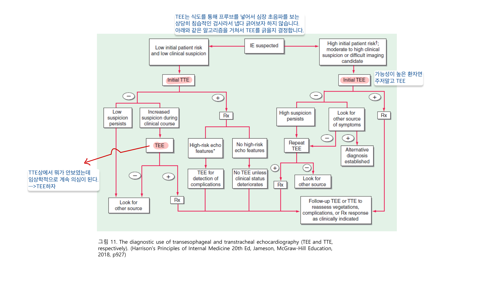{: style="width:94%"}

- TEE는 식도로 프로브를 넣는 **침습적인** 검사라 무조건 하지 않고 알고리즘으로 정한다.
- **위험도·임상적 의심이 낮으면** → 먼저 TTE. TTE에서 안 보였는데 **임상적으로 계속 의심되면 → TEE**.
- **위험도가 높거나(인공판막, S. aureus 균혈증 등) 의심이 높거나 TTE가 어려운 환자** → **주저 말고 처음부터 TEE**.
- 초음파 영상: TTE에서 증식체, 컬러 도플러에서 승모판 역류(MR).

!!! exam "기출 포인트"
    2부 2번(2025): 인공판막 1개월 + 중심정맥관 + S. aureus 2세트 양성, TTE 음성 → 다음 단계 = **TEE**. TTE 재검, 심장 MRI, 심도자, PET-CT는 오답.

# 5. 치료

## 원칙
- **조기 진단 + 조기 항생제 + 조기 수술 판단**.
- **다학제 접근**(endocarditis team): 감염내과, 심장내과, 심장외과, 영상의학과 협진.
- 치료 목표: ① **세균 제거** ② **합병증(색전, 심부전 등) 예방** ③ 구조적 손상 교정.

## 원인균별 항생제

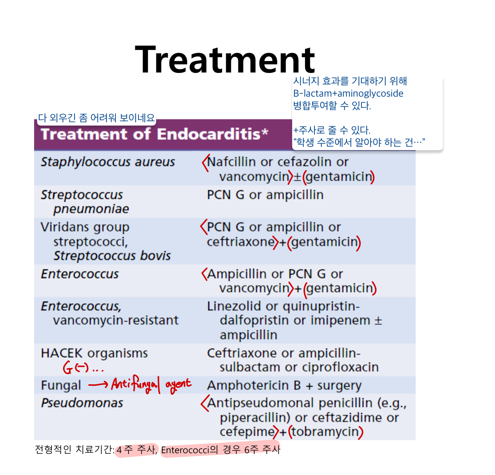{: style="width:62%"}

| 원인균 | 치료 |
|---|---|
| **S. aureus** | **Nafcillin 또는 cefazolin**(MSSA) 또는 **vancomycin**(MRSA) ± gentamicin |
| S. pneumoniae | PCN G 또는 ampicillin |
| **Viridans streptococci, S. bovis** | **PCN G 또는 ampicillin 또는 ceftriaxone** + gentamicin |
| **Enterococcus** | **Ampicillin 또는 PCN G 또는 vancomycin + gentamicin** |
| VRE | Linezolid, quinupristin-dalfopristin, imipenem ± ampicillin |
| **HACEK**(그람음성) | **Ceftriaxone**, ampicillin-sulbactam, ciprofloxacin |
| 진균 | **Amphotericin B + 수술**(항진균제) |
| Pseudomonas | 항녹농균 penicillin(piperacillin) 또는 ceftazidime·cefepime + tobramycin |

- **전형적인 치료 기간: 4주 주사, 장알균은 6주 주사.**
- 상승 효과를 위해 **β-lactam + aminoglycoside**를 병합할 수 있고, 주사로 준다. ("학생 수준에서 알아야 하는 건…" — 다 외우긴 어렵다.)

## 수술 적응증

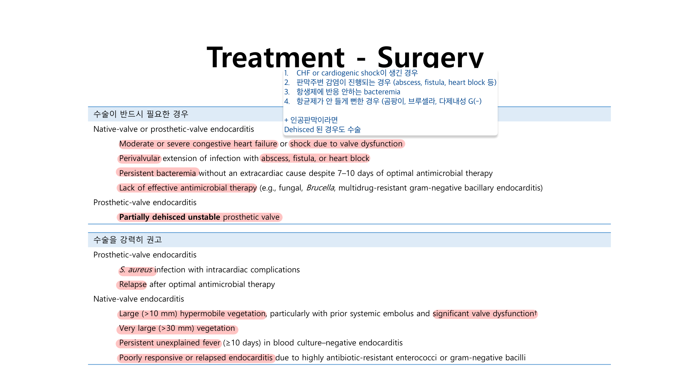{: style="width:94%"}

**수술이 반드시 필요한 경우** (자기·인공판막 공통)

1. 판막 기능 이상에 의한 **중등도 이상 심부전 또는 쇼크**
2. **판막주위로 감염이 퍼진 경우**: 농양, 누공, **심장 블록**
3. 최적 항생제 **7–10일에도 지속되는 균혈증**(심장 밖 원인 없음)
4. **효과적인 항생제가 없는 경우**: 진균, Brucella, 다제내성 그람음성균
5. 인공판막: **부분 탈락된 불안정한 인공판막**

**수술을 강력히 권고**

- 인공판막: **S. aureus + 심장 내 합병증**, 최적 치료 후 재발.
- 자기 판막: **10 mm 넘는 잘 움직이는 증식체**(특히 색전 병력과 판막 기능 이상이 있을 때), **30 mm 넘는 매우 큰 증식체**, 배양음성에서 설명 안 되는 발열 10일 이상, 내성 장알균·그람음성균의 반응 불량·재발.

**수술 시기**(한번 읽어 보면 된다): 응급(당일) — 폐부종·심인성 쇼크를 일으킨 판막 기능 이상, 발살바동 농양 파열 등 / 긴급(1–2일) — 증식체에 의한 판막 폐쇄, 불안정한 인공판막, 심부전(NYHA III–IV)을 동반한 급성 역류, 중격 천공, 판막주위 확장 / 선택(이를수록 좋음) — 진행하는 인공판막 주위 역류, 7–10일 치료에도 지속되는 감염, 진균(곰팡이) 심내막염, 조기 인공판막 심내막염(수술 후 2개월 이내), Candida, 내성균.

# 6. 합병증

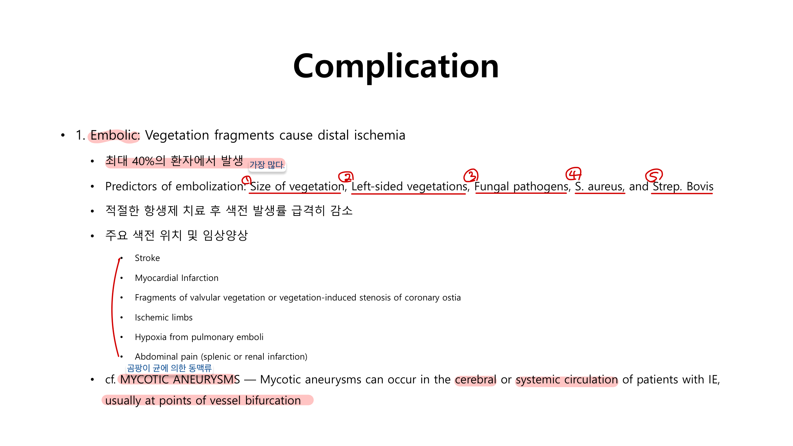{: style="width:94%"}

1. **색전(embolic)** — **가장 많다**. 증식체 조각이 원위부 허혈을 일으킨다.
    - 최대 **40%**에서 발생.
    - 색전 예측인자: **증식체 크기, 좌심 증식체, 진균, S. aureus, S. bovis**.
    - 적절한 항생제 치료 후 색전 발생률이 급격히 줄어든다.
    - 부위: **뇌졸중**, **심근경색**(증식체 조각 또는 관상동맥 입구 협착), 사지 허혈, 폐색전에 의한 저산소증(우심), **비장·신장 경색**(복통).
    - **감염성 동맥류(mycotic aneurysm)**: 뇌·전신 순환의 **혈관 분지점**에 잘 생기고, 터지면 출혈.
2. **국소 확산** — 주변 조직으로 감염이 번진다.
    - **심부전**: 광범위한 판막 손상에 의한 **주요 사망 원인**.
    - **판막주위 농양**(30–40%): **대동맥판**에 흔하고, 주로 **S. aureus**, IVDU 관련. 전도계로 퍼지면 **부정맥(심장 블록)**. 사망률·색전 위험이 높다.
    - 심막염, 심장 내 누공.
3. **전이성 감염** — 혈행성 파종: 신장·비장·뇌·연부조직 농양, 수막염·뇌염, **척추 골수염**, 화농성 관절염.
4. **면역복합체 손상** — **사구체신염, 관절염**(병리학 면역질환에서 배운 것 — 혈관이 많은 사구체에 면역복합체가 박힌다).

※ 확인 필요: 필기에 "mycotic = 곰팡이성(진균에 의한 동맥류)"이라 적혀 있지만, **mycotic aneurysm은 원인균과 상관없이 감염에 의한 동맥류**를 부르는 역사적 이름이다(Osler가 버섯 모양이라 붙인 이름). 세균성 심내막염에서도 생기므로, 증례에서 교수님이 말한 "mycotic aneurysm이 생겨 터져 출혈"은 틀린 말이 아니다.

!!! exam "기출 포인트"
    - 2부 9번(2021): 발열 + 손 감각이상 + 오심·구토, 뇌 MRI 고리 조영증강(뇌농양) → 경험적 항생제 = **Ceftriaxone + metronidazole**.
    - 2부 12번(2020): 포도알균 균혈증 + 뇌 병변(전이감염) → **가장 부적절** = **Cefazolin 유지**(중추신경 투과가 나쁘다).
    - 4강 복강내 감염의 **비장 농양 → 심내막염**과 연결된다(그 강의 2부 8번).

# 7. 인공판막 심내막염 (Prosthetic valve endocarditis, PVE)

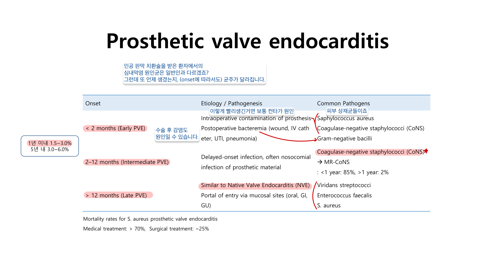{: style="width:94%"}

인공판막 환자의 원인균은 일반인과 다르고, **언제 생겼는지(onset)**에 따라서도 달라진다. 발생률: 1년 이내 1.5–3.0%, 5년 이내 3.0–6.0%.

| 시기 | 기전 | 흔한 원인균 |
|---|---|---|
| **<2개월(조기)** | **수술 중 인공판막 오염**(보통 컨타), 수술 후 균혈증(상처, 정맥 카테터, UTI, 폐렴) | **S. aureus, CoNS**(피부 상재균), 그람음성 막대균 |
| 2–12개월(중간) | 늦게 나타나는 병원감염 | **CoNS**(메티실린 내성 CoNS — 1년 이내 85%, 1년 이후 2%) |
| **>12개월(후기)** | 자기 판막과 비슷 — 점막(구강, 소화관, 비뇨생식기)으로 침입 | **Viridans streptococci**, E. faecalis, S. aureus |

- S. aureus 인공판막 심내막염 사망률: 내과적 치료 >70%, 수술 ~25%.

!!! exam "기출 포인트"
    2부 11번(2020): 승모판 인공판막 4주 후 발열, 판막 역류, 3쌍 모두 양성 → **Coagulase negative staphylococcus**(조기 PVE). Viridans·HACEK·Coxiella는 후기.

# 8. 예방적 항생제 (Abx prophylaxis)

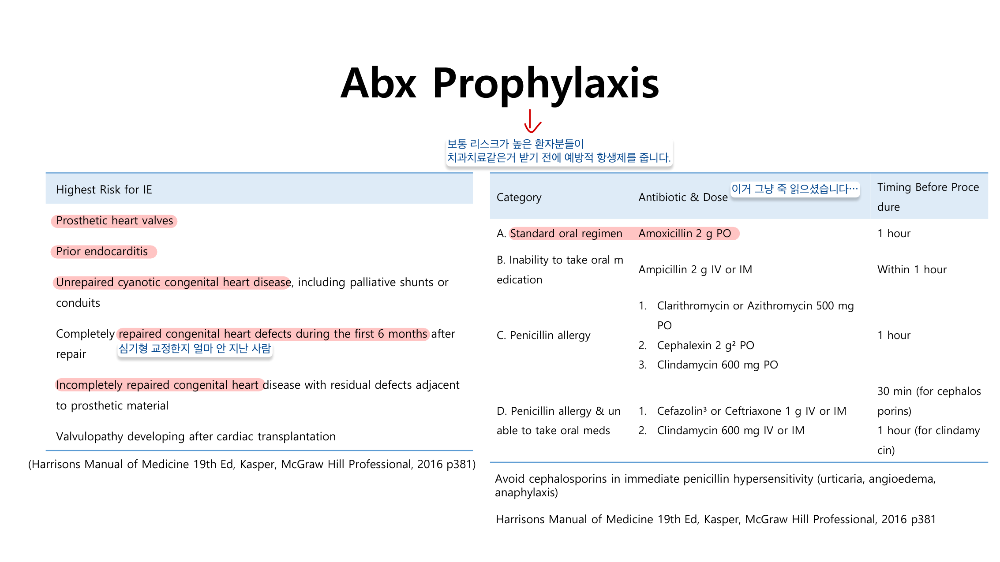{: style="width:94%"}

위험이 높은 환자가 **치과 치료** 같은 시술을 받기 전에 예방적 항생제를 준다(교수님은 죽 읽고 넘어갔다).

**최고 위험군**: 인공판막, **이전 심내막염**, 교정하지 않은 청색증 선천 심질환(완화 단락·도관 포함), **완전히 교정한 선천 기형의 교정 후 6개월 이내**, 인공물 옆에 잔여 결손이 있는 불완전 교정, 심장 이식 후 판막병증.

| 상황 | 약 | 시점 |
|---|---|---|
| 표준(경구) | **Amoxicillin 2 g 경구** | 시술 1시간 전 |
| 경구 불가 | Ampicillin 2 g 정주·근주 | 1시간 이내 |
| 페니실린 알레르기 | Clarithromycin·azithromycin 500 mg, cephalexin 2 g, clindamycin 600 mg 경구 | 1시간 전 |
| 알레르기 + 경구 불가 | Cefazolin·ceftriaxone 1 g 또는 clindamycin 600 mg 정주·근주 | 30분(세팔로) / 1시간(clindamycin) 전 |

즉시형 페니실린 과민반응(두드러기, 혈관부종, 아나필락시스)이면 세팔로스포린을 피한다.

## 새 지침 (ESC 2023) — "흘려듣고 넘어가면 된다"
- 경피적 판막 시술(TAVI/TEER), 판막 성형, 좌심실 보조장치(LVAD) 환자까지 고위험군으로 명시.
- 입원 정맥 치료 2주(수술·이물 제거·배농 포함) 후 선택된 환자는 외래 경구·주사로 이어 갈 수 있다(경구 전환 전 TEE로 합병증 없음 확인).
- 심장 CT 혈관조영, **18F-FDG PET/CT**(특히 인공판막), 백혈구 SPECT/CT의 권고 등급 상향 — 대동맥근 농양 등을 찾는다.

# 9. 증례 — 심잡음을 들어라

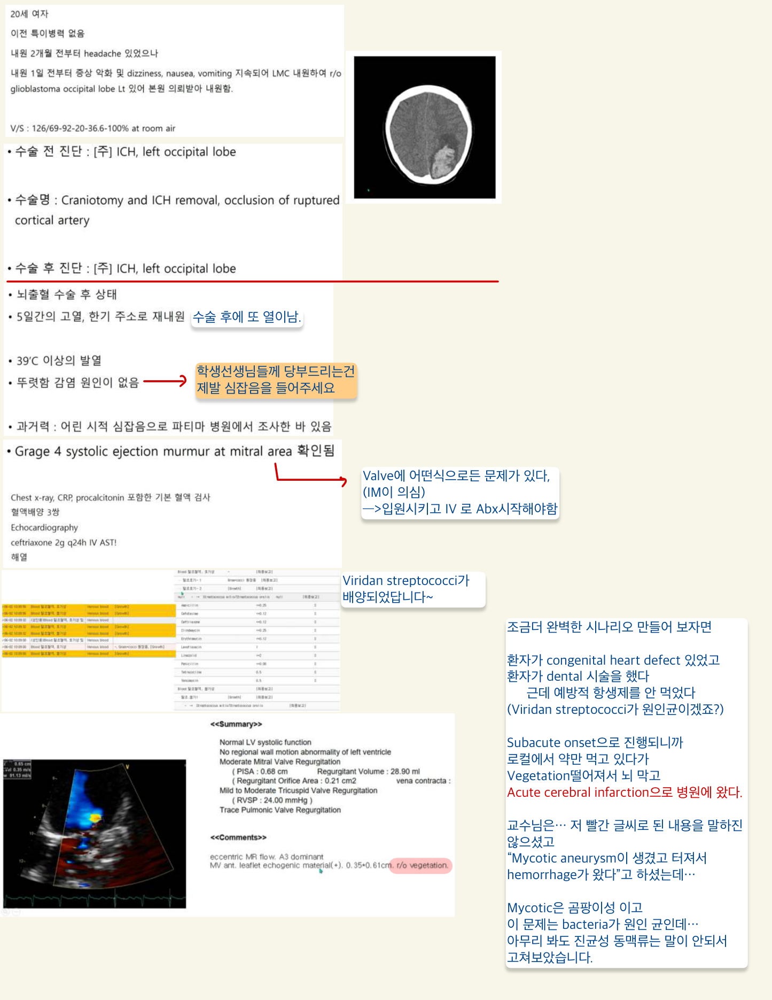{: style="width:94%"}

- 20세 여자, 특이 병력 없음. 2개월 전부터 두통, 1일 전 악화 → 뇌교모세포종 의심으로 의뢰 → 수술 전 진단 **좌측 후두엽 뇌내출혈(ICH)**, 개두술로 혈종 제거와 **터진 피질동맥 결찰**.
- 수술 후 **5일간 39℃ 이상 고열**, 뚜렷한 감염원 없음.
- 과거력: 어릴 때 심잡음으로 조사한 적 있음 → **승모판 부위 grade 4 수축기 박출성 잡음**.
- 판막에 어떤 식으로든 문제가 있다(IE 의심) → **입원시키고 혈액배양 3세트 후 정맥 항생제**(ceftriaxone 2 g q24h) 시작 → 혈액배양에서 **viridans streptococci**, 심초음파에서 승모판 앞엽의 증식체(0.35×0.61 cm) 의심, 중등도 승모판 역류.
- 시나리오로 정리하면: 선천 심장질환이 있던 환자가 치과 시술을 받으면서 예방적 항생제를 먹지 않았다 → viridans 균혈증 → **아급성**으로 진행해 동네 의원에서 약만 먹다가 → **감염성 동맥류가 터져 뇌출혈**(또는 증식체 색전으로 뇌경색)로 왔다.

!!! memo "암기"
    주요 기준 = 전형적 균(viridans, S. gallolyticus, HACEK, S. aureus, 지역사회 장알균) 2세트 / 지속 양성(12시간 간격, 3/3 또는 ≥4 중 대다수, 첫–끝 1시간) / Coxiella + 초음파(움직이는 증식체, 농양, 인공판막 탈락, 새 역류) · 확진 = 2M / 1M+3m / 5m · 급성 = S. aureus, 아급성 = viridans, 조기 PVE = CoNS, IVDU = S. aureus · Janeway(색전, 안 아픔) vs Osler(면역, 아픔) · 인공판막·S. aureus → TEE · 치료 4주(장알균 6주) · 예방 = amoxicillin 2 g 1시간 전
