<!-- 필기본: 2025 -->
<!-- 단계: 수업 전 -->

# 0. 이 수업을 공부하는 법

소아청소년과 소화기영양 **최병호 교수님** 수업(2023·2025·2026 같은 교수님). 슬라이드는 사진·도식 위주이고, 필기에 교수님 말씀이 적혀 있다. 교수님이 직접 "**세부적인 것보다 큰 그림을 알고 있을 것**", 일부 슬라이드는 "외울 필요 없다", "이런 거 몰라도 됩니다"라고 했다.

- 기출 13문항(2020–2025). 반복되는 세 덩어리:
    1. **염증성 vs 비염증성 설사**(고열·복통·혈변·CRP 상승 = 염증성), **식중독 ≠ 급성 위장염**
    2. **Campylobacter**(닭 상재균, 냉장고에서 생존, 일반 배지 X, cephalosporin X, 회복기 길랭-바레·반응성 관절염)
    3. **로타바이러스**(11분절 dsRNA, 융모 끝 장세포 파괴 → 흡수장애·유당 소화 저하, NSP4 장독소, 백신 있음, 장염 후 지속 설사엔 가수분해·아미노산 분유)
- 필기본 3쪽에 2020–2024 기출이 직접 붙어 있다 — 그만큼 같은 주제가 반복된다.

!!! key "핵심"
    혈변·고열·복통이면 **일단 세균성(염증성)** 의심 → 배양·PCR. 물설사는 대부분 **바이러스** → **수분·전해질(ORS)** 이 치료의 중심, 항생제 X. 장염 뒤엔 **반응성 관절염·길랭-바레·HUS·장중첩증**을 놓치지 말 것.

# 1. 급성 설사 질환의 분류

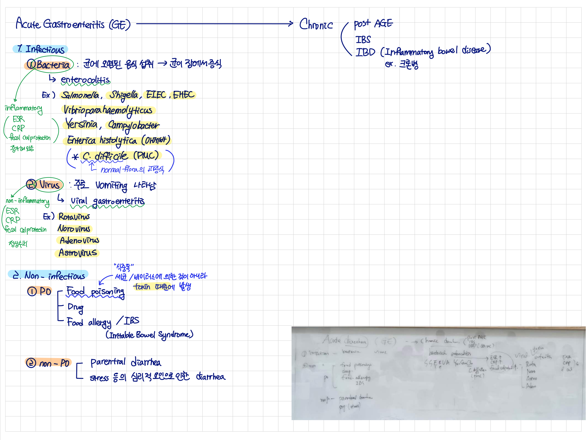{: style="width:90%"}

## 급성 설사의 원인
- **감염성**
    - **장염(enteritis)**: 바이러스 등 — **비염증성**
    - **장결장염(enterocolitis)**: 침습성 세균 — **염증성**
- **비감염성**
    - 식중독(food poisoning) — 균이 아니라 **독소(toxin)** 때문
    - 전신 감염에 의한 장관 외 설사(parenteral diarrhea), 항생제·약물 관련
    - 알레르기, 흡수장애, 자극적인 음식·음료, 심리적 요인(스트레스)
- 급성이 오래가면 **만성**: 감염 후 설사(post-AGE), 과민성 장증후군(IBS), **염증성 장질환(IBD, 예: 크론병)**.

필기의 큰 그림:

- **세균** → 균에 오염된 음식 섭취 → 균이 장에서 증식 → **장결장염(염증성)**: Salmonella, Shigella, EIEC, EHEC, Vibrio parahaemolyticus, Yersinia, Campylobacter, Entamoeba histolytica(아메바), C. difficile(위막성 대장염 — 정상세균총의 과증식). **ESR·CRP·대변 calprotectin 증가**.
- **바이러스** → 주로 **구토** → 바이러스성 위장염(비염증성): rotavirus, norovirus, adenovirus, astrovirus. ESR·CRP·calprotectin **정상**.

## 식품매개 질환 vs 식중독
- **식품매개 질환(food-borne disease)** = **식중독(food poisoning)** + **감염성 급성 위장염(infectious AGE)**.
    - 식중독(화학적·생물학적): 미리 만들어진 **독소** → **항생제 X**.
    - 감염성 AGE(균이 장에서 증식): **필요하면 항생제**.
- 식중독 균: **S. aureus, Bacillus cereus, Clostridium(botulinum, perfringens)**.
- 장염 균: **Salmonella, Brucella, Campylobacter, E. coli, Listeria, Vibrio cholerae·parahaemolyticus**.
- **AGE ≠ 식중독.** AGE에는 급성 위장염, 급성 장염, 급성 장결장염, 회결장염, 말단 회장염이 모두 들어간다.

!!! exam "기출 포인트"
    2부 4번(2024) O/X: 1) 급성위장염과 식중독은 같은 개념 → **X**. 2) 고열 + CRP·ESR 증가 + 혈변·점액변 = 염증성 → **O**. 3) 로타 장염으로 상부 융모 장세포 손상 → 수분·전해질 흡수 저하, 유당 소화 저하 → **O**.

## 비염증성 vs 염증성 ★

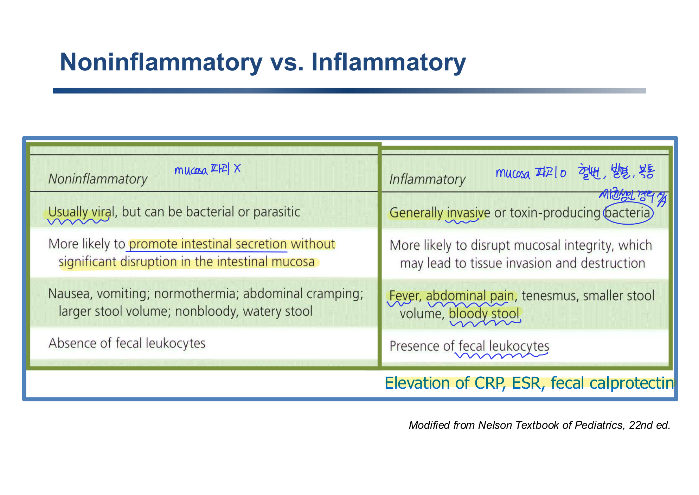{: style="width:84%"}

| | 비염증성(noninflammatory) | 염증성(inflammatory) |
|---|---|---|
| 점막 | **파괴 X** | **파괴 O** |
| 원인 | **대개 바이러스**, 세균·기생충도 가능 | 대개 **침습성** 또는 독소 생성 **세균**(세균성 장결장염) |
| 기전 | 점막을 크게 망가뜨리지 않고 장 분비를 촉진 | 점막을 파괴해 조직 침습 |
| 증상 | 구역·구토, 정상 체온, 경련성 복통(쥐어짬), **변량 많음, 혈변 없는 물설사** | **발열, 복통, 뒤무직(잔변감)**, 변량 적음, **혈변** |
| 대변 백혈구 | **없음** | **있음** |
| 검사 | | **CRP, ESR, 대변 calprotectin 상승** |

!!! exam "기출 포인트"
    - 2부 7번(2022): 옳은 것 = **고열·복통·혈변이 동반되면 염증성**. 함정: "세균성은 염증성이다"(세균도 독소형은 비염증성), "대변 백혈구 없으면 비염증성"(초기·EHEC·아메바는 백혈구가 안 보일 수 있다), "반복되면 IBS", "식중독 = 염증성".
    - 2부 10번(2022): 대변 형태로 로타 장염(물설사)과 감별되는 것 = **Dysentery(이질, 혈성·점액성)**. EPEC·콜레라·Cryptosporidium·노로는 모두 물설사.

## 원인균에 따른 분류

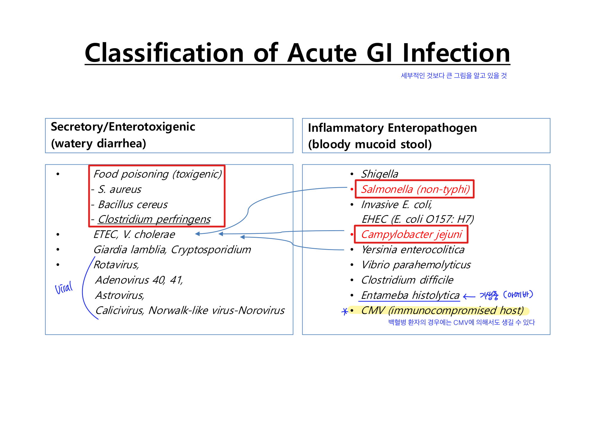{: style="width:80%"}

| 분비성·장독소형(물설사) | 염증성 장병원체(혈성 점액변) |
|---|---|
| 식중독(독소형): **S. aureus, B. cereus, C. perfringens** | **Shigella** |
| **ETEC, V. cholerae** | **Salmonella(비장티푸스)** |
| Giardia lamblia, Cryptosporidium | 침습성 E. coli, **EHEC(O157:H7)** |
| **Rotavirus**, adenovirus 40·41, astrovirus, calicivirus(**norovirus**) | **Campylobacter jejuni, Yersinia enterocolitica** |
| | V. parahaemolyticus, **C. difficile**, Entamoeba histolytica |
| | CMV(면역저하자 — 백혈병 환자 등) |

| 장염(enteritis) = 비염증성·분비성 | 장결장염(enterocolitis) = 염증성 |
|---|---|
| 바이러스성 AGE | 감염성 장결장염 |
| 세균성(ETEC, V. cholerae / Campylobacter·E. coli·Salmonella의 가벼운 형태) | 알레르기성 장결장염 |
| 식중독(S. aureus 등) | 장폐색 등 |
| 알레르기성 장병증, 흡수장애 | 만성 장결장염(IBD) |
| 약물, 음식, 장관 외 설사, 만성 비특이적 설사, IBS | |

## 혈변이면 세균성을 의심 — 위험인자

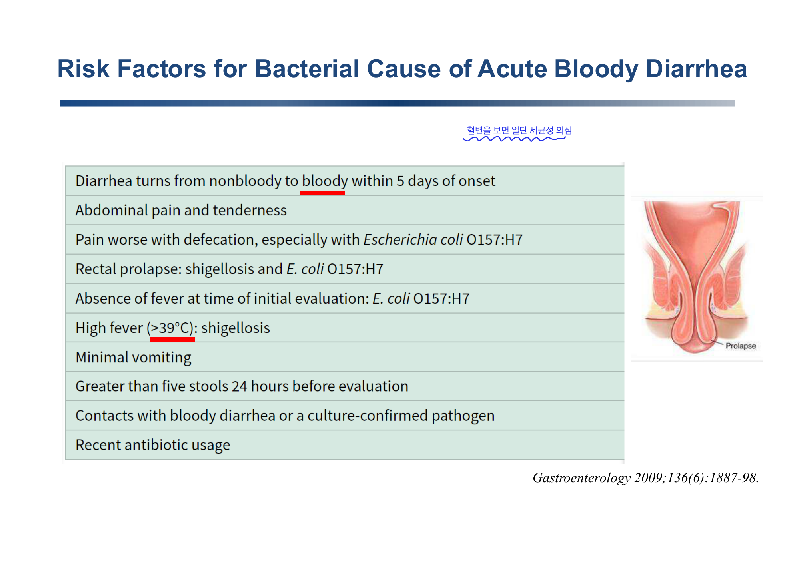{: style="width:76%"}

**혈변을 보면 일단 세균성 의심.**

- 발병 **5일 안에 물설사 → 혈변**으로 바뀜
- 복통·압통, **배변할 때 심해지는 통증**(특히 E. coli O157:H7)
- **직장탈출**: 세균성 이질(shigellosis), E. coli O157:H7
- 처음 진찰할 때 **열이 없음: E. coli O157:H7**
- **39℃ 넘는 고열: 세균성 이질**
- 구토는 적음, 진찰 전 24시간에 5번 넘는 배변
- 혈변 환자·배양 확인 병원체와의 접촉, 최근 항생제 사용

## 진단 접근

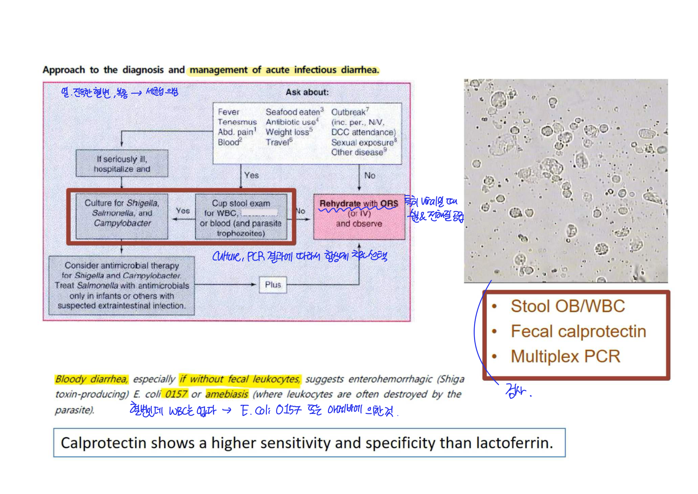{: style="width:86%"}

- 열·진한 혈변·복통 → 세균성 의심 → **대변 배양(Shigella, Salmonella, Campylobacter), 대변 백혈구·혈액(·기생충 영양형)**.
- 해당 없으면 → **경구수액(ORS)으로 수분 보충**(필요하면 정맥)하고 관찰 — 특히 바이러스성일 때 수분·전해질이 중요.
- 배양·PCR 결과에 따라 항생제 선택. Shigella·Campylobacter는 항균제를 고려하고, **Salmonella는 영아나 장관 외 감염이 의심될 때만** 치료.
- 검사: **대변 잠혈·백혈구(OB/WBC), 대변 calprotectin**(lactoferrin보다 민감도·특이도 높음), **다중 PCR**.
- **혈변인데 대변 백혈구가 없으면 → EHEC(E. coli O157) 또는 아메바**(아메바가 백혈구를 파괴한다).
- **FilmArray 위장관 패널**(다중 nested PCR): 한 번에 22종(세균·기생충·바이러스). Campylobacter·Yersinia는 일반 36℃ 배지에서 자라지 않아 예전엔 병원에서 거의 검출을 못 했다 → PCR로 검출되면서 **Campylobacter 유병률이 늘었다**.

!!! exam "기출 포인트"
    2부 1번(2025): 네 가지 상황별 접근 **모두 옳다** — ① 발열·혈변·대변 WBC(+) → 침습성 세균(Campylobacter, Shigella, EHEC, Salmonella) 배양·분자검사 ② 상온 음식 6시간 이내 구토·설사, WBC(−) → S. aureus·B. cereus 독소형 식중독, 특별한 검사 불필요 ③ 2주 이상·체중감소·여행력 → Giardia·Cryptosporidium 기생충 검사 ④ 장기 항생제 후 설사 → C. difficile toxin EIA + NAAT.

## 세균성 장염의 항생제

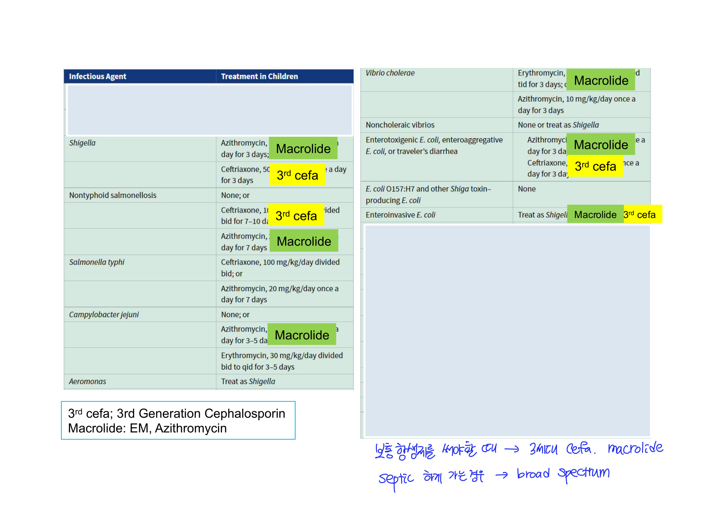{: style="width:90%"}

- 항생제가 필요할 때 보통 **3세대 세팔로스포린(ceftriaxone)** 또는 **마크롤라이드(azithromycin, erythromycin)**. 패혈증으로 가면 광범위 항생제.

| 원인균 | 소아 치료 |
|---|---|
| Shigella | Azithromycin 3일 또는 ceftriaxone |
| 비장티푸스 살모넬라 | **없음**, 또는 ceftriaxone·azithromycin(필요할 때) |
| Salmonella typhi | Ceftriaxone 또는 azithromycin |
| Campylobacter jejuni | **없음**, 또는 azithromycin·erythromycin(마크롤라이드) |
| V. cholerae | Erythromycin·azithromycin |
| ETEC·여행자 설사 | Azithromycin 또는 ceftriaxone |
| **EHEC(O157:H7, 시가독소 생성)** | **없음**(항생제 X — HUS 위험) |
| 침습성 E. coli, Aeromonas | Shigella처럼 |

항생제가 효과 있는 경우(외울 필요 없다): 중증 장티푸스성 살모넬라, 세균성 이질, C. difficile 설사, Yersinia 패혈증, 중증·혈변 여행자 설사, Campylobacter 이질·패혈증, 콜레라. 바이러스·식중독·알레르기에는 효과 없다.

# 2. Campylobacter와 Yersinia

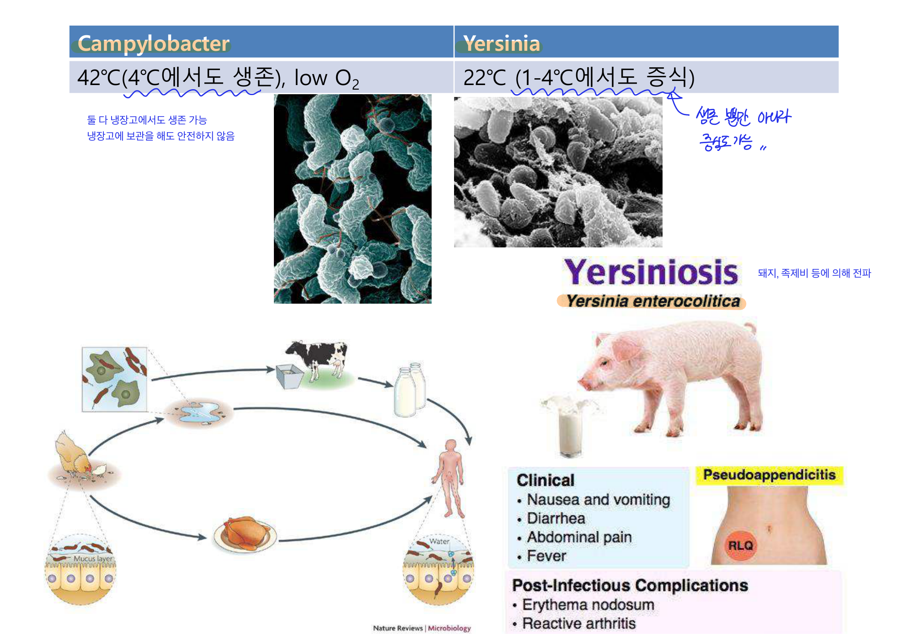{: style="width:86%"}

| | Campylobacter | Yersinia |
|---|---|---|
| 배양 온도 | **42℃**, 낮은 산소(미호기성) — **4℃에서도 생존** | **22℃** — **1–4℃에서도 증식**(생존뿐 아니라 증식) |
| 숙주·전파 | **닭(조류)의 정상 상재균** | 돼지, 들쥐·족제비 배설물 → 오염된 약수터 물, 우유 |
| 공통 | **둘 다 냉장고에서 살아남는다 → 냉장 보관해도 안전하지 않다** | |

## Campylobacter
- **Campylobacter·Salmonella는 새(닭)의 정상균**이다. 닭이 알을 낳을 때 계란 껍질이 균에 오염된다 → **날계란, 덜 익힌 닭, 계란을 만진 손·식당 위생**이 문제. 일본 나가시소멘(흐르는 국수)에서 900명 가까이 집단 감염된 사례(2023)도 있다.
- 온대 지역 산업국의 **염증성 설사**, **어린아이에서 호발**(전 세계 소아 세균성 설사의 상당 부분).
- 장관 외 질환: **균혈증**(드묾), 관절염, 담낭염.
- **회복기에**: **길랭-바레 증후군**(신경에 생기는 후유증), **용혈요독증후군(HUS)**, **반응성 관절염(특히 HLA-B27)**.
- **지사제(장운동 억제제)를 쓰면**: 장운동이 감소해 세균·독소가 배출되지 않아 → **독성 거대결장**, 위막성 대장염, 대장 출혈.
- **항생제 내성**: 닭에게 항생제를 너무 많이 써서 내성균이 생겼다. 미국 CDC 사례에서 82%가 azithromycin, ciprofloxacin 등에 내성. **Campylobacter jejuni는 penicillin, amoxicillin-clavulanate, cephalosporin, metronidazole, TMP-SMX에 본래 내성** → "현재 cephalosporin은 전혀 듣지 않음". 사람에게 쓸 항생제는 남겨 두고 가축에 써야 한다.

!!! exam "기출 포인트"
    - 2부 3번(2024, 주관식): 냉장고에서도 생존, 일반 배지 X, 조류의 상재균, cephalosporin X → **Campylobacter**.
    - 2부 2번(2025): 옳은 것 = **심한 급성 대장염은 IBD와 비슷해 보일 수 있다**. 함정: 독소만으로 설사(X, 침습), 소장만 침범(X), 소아에서 균혈증 흔함(X), 회복기 신경 합병증 = 다발성 경화증(X → **길랭-바레**).
    - 2부 5번(2023): 닭요리·날계란 후 고열·혈변·점액변 → 옳은 것 = **조기 치료하지 않으면 관절염이 생기기도 한다**. 함정: 대부분 바이러스(X), 배양 음성이면 세균성 배제(X), 냉장고 닭은 안전(X), 조기 대장내시경(X).

## Yersinia enterocolitica

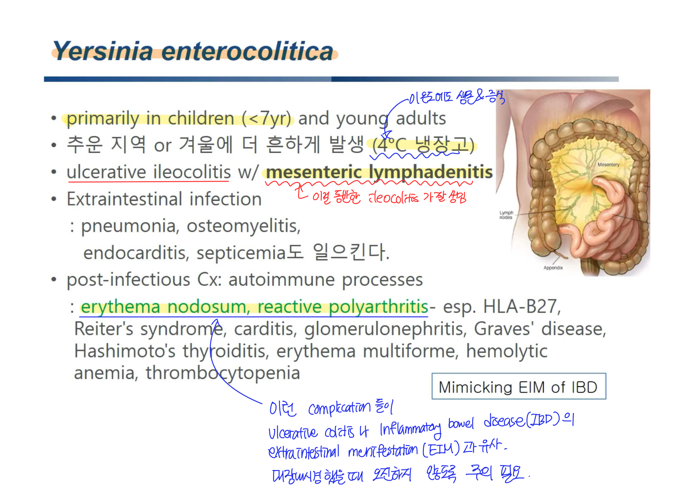{: style="width:62%"}

- 주로 **소아(<7세)와 젊은 성인**. **추운 지역이나 겨울**에 흔하다(4℃ 냉장고에서도 생존·증식).
- **궤양성 회결장염 + 장간막 림프절염** → 오른쪽 아랫배 통증으로 **충수염처럼 보인다(pseudoappendicitis)**. 이 경우 회결장염이 가장 잘 생긴다.
- 장관 외 감염: 폐렴, 골수염, 심내막염, 패혈증.
- **감염 후 합병증(자가면역)**: **결절홍반, 반응성 다발관절염(HLA-B27)**, Reiter 증후군, 심염, 사구체신염, Graves병, 하시모토 갑상선염, 다형홍반, 용혈빈혈, 혈소판감소 → **IBD의 장관 외 증상과 비슷하다** → 대장내시경 할 때 오진하지 않도록 주의.
- 국내 약수터 여시니아 오염(1990년대 신문): 들쥐·족제비 배설물 → 13세 이하 어린이 고열·복통·설사.

**Yersinia pseudotuberculosis**("이런 거 몰라도 됩니다"): 항원이 HLA class II와 직접 결합해 **초항원(superantigen)** 역할 → 충수염, IBD, **가와사키병 비슷한 질환**과 감별.

## 장염 후 합병증

### 반응성 관절염과 자가면역
- **세균 항원이 HLA-B27 항원과 교차반응**한다 → 세균 감염 후 세균 항원과 비슷한 우리 몸 조직을 공격 → 자가면역 질환·장관 외 증상. HLA-B27을 가진 환자는 관절염 같은 증상이 잘 생긴다(**피부, 관절**에 잘 온다).
- 유전 소인(HLA class I B27, class II DR, DW 등) + **유발 감염**(Chlamydia, Yersinia, Salmonella, Shigella, Campylobacter, 바이러스) → 비정상 면역반응 → 질환. 관련 요인(유전, 미생물총, 면역, 환경)이 많아 **사람마다 경과가 다르다**.

### 용혈요독증후군 (HUS)

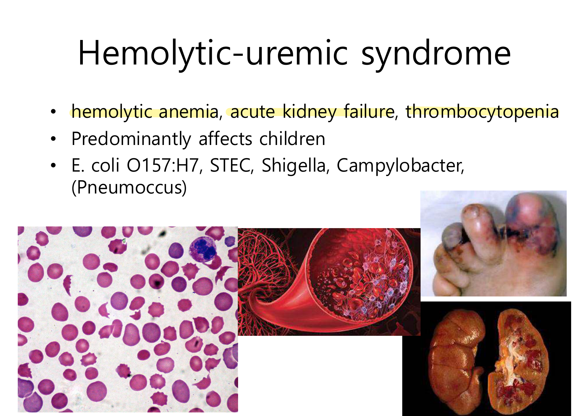{: style="width:66%"}

- **용혈빈혈, 급성 신부전, 혈소판감소** — 주로 **소아**.
- 원인: **E. coli O157:H7, STEC(시가독소 생성 대장균)**, Shigella, Campylobacter, (폐렴알균).

### 장중첩증 (Intussusception)

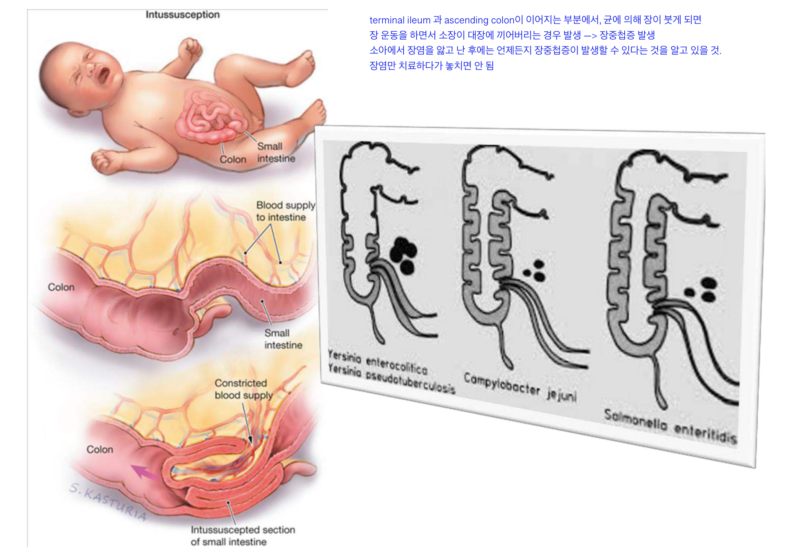{: style="width:72%"}

- **말단 회장과 상행결장이 이어지는 부분**이 균 때문에 부으면(림프조직 비대) 장운동을 하면서 **소장이 대장에 끼어 들어간다** → 장중첩증.
- **소아에서 장염을 앓고 난 뒤에는 언제든지 장중첩증이 생길 수 있다**는 것을 알고 있을 것. 장염만 치료하다가 놓치면 안 된다.

### 페스트 (여담)
흑사병 = **Yersinia pestis**. 쥐 → 벼룩 → 사람. 14세기 유럽 대유행, 1665년 런던, 1855년 중국에서 시작한 3차 대유행.

# 3. 만성 설사

원인: 감염 후, 약물, 식이(유당 불내성 등, 영양실조), 유분증(encopresis), IBS, 알레르기성 위장관 질환·호산구성 위장염, **IBD**, 해부학적 병변(단장증후군 등), 드문 원인.

# 4. 로타바이러스 (Rotavirus)

## 역학과 전파
- **1세 이전에 심하고 2세까지 증상**(어릴수록 심한 설사), 성인은 무증상인 경우가 많다. 방치하면 **심한 탈수** 때문에 위험해진다.
- **대변–구강 경로**: 아이가 장난감 등을 입에 넣는다. 대변·구토물에 **매우 높은 농도(>1012 입자/g)로 오래** 배출 → **손을 잘 씻어야 한다**.
- 늦가을–초겨울, 6–24개월에 가장 많고, 최근 3개월 미만·신생아 감염과 신생아실 집단 유행도 늘고 있다.
- 바이러스 구조: Reoviridae, **11분절 이중가닥 RNA(dsRNA)**. 군(group)·아군은 **VP6**, 혈청형은 G(VP7)·P(VP4)로 나뉘고 VP4·VP7이 중화항체를 만든다(G1P[8] 등, 해마다·지역마다 우세형이 다르다).

## 병태생리

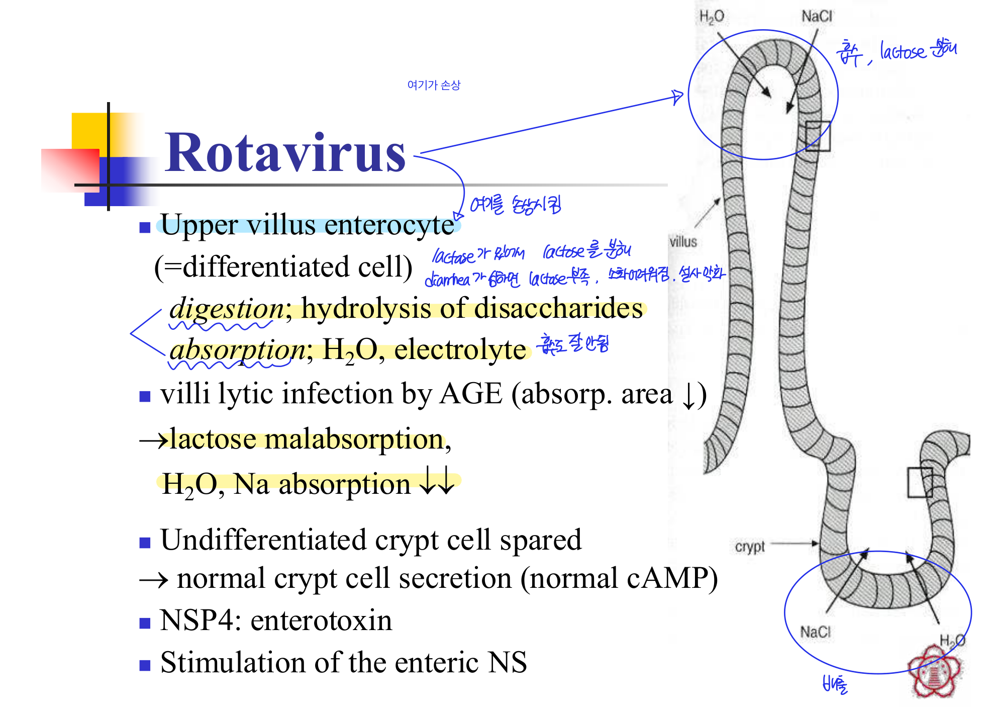{: style="width:80%"}

- **융모 위쪽 장세포(분화된 세포)**: 이당류 가수분해(소화), 물·전해질 흡수 → 로타바이러스가 **여기를 감염해 파괴**(흡수 면적 감소) → **유당 흡수장애**, 물·Na 흡수 감소.
- **분화되지 않은 crypt 세포는 보존** → 정상적인 분비(cAMP 정상)는 계속된다 → 흡수는 줄고 분비는 그대로 → 물설사.
- **NSP4 = 장독소(enterotoxin)**.
- 장 신경계 자극.

!!! exam "기출 포인트"
    - 2부 12번(2020): 옳은 것 = **villus enterocyte 손상으로 수분·전해질 흡수 장애**. 함정: crypt cell 흡수 증가(X, 분비), 재감염이 더 심함(X), 혈청 항원검사(X, 대변 항원), "유당 알레르기"(그런 용어 없음).
    - 2부 11·13번(2021·2020): 맞는 것 = **라(융모세포 세포질에서 증식 → 파괴·탈락 → 물·Na·포도당 흡수장애)만**. 가(dsDNA X → dsRNA), 나(백신 없음 X), 다(사람만 X).
    - 2부 9번(2022): 원본 정답은 ①(가·나·다)이지만 "예방백신이 없다"는 사실과 다르고 "NSP3가 장독소"도 틀렸다(NSP4) → 해설에 **※ 확인 필요**로 남겼다.

## 장 점막 손상과 분유 불내성

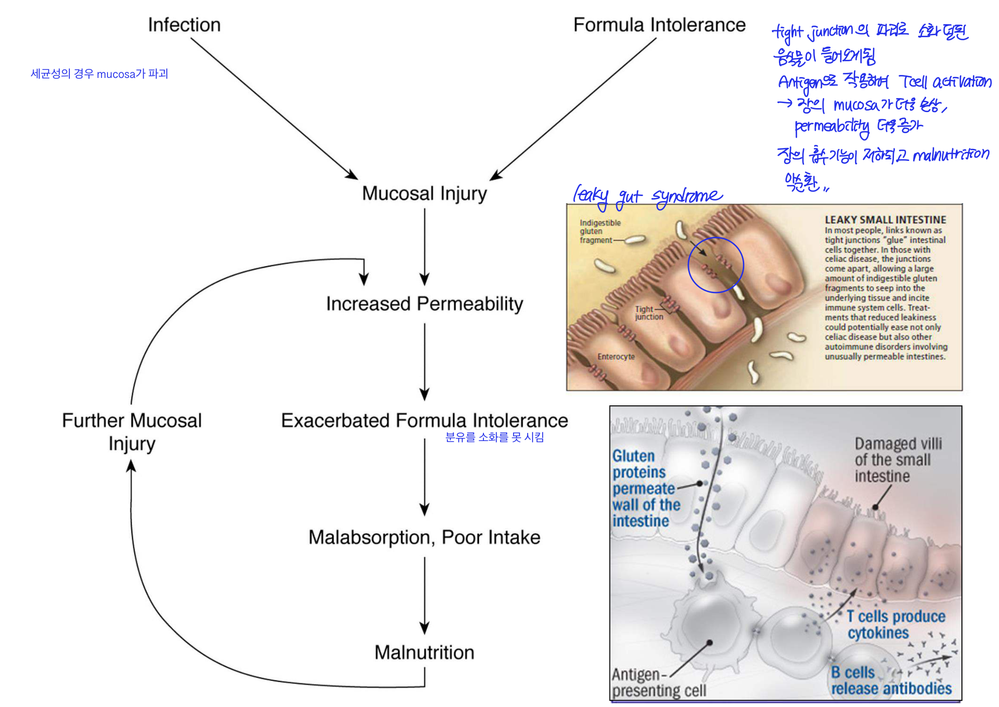{: style="width:86%"}

- 감염(세균성이면 점막 파괴) 또는 분유 불내성 → **점막 손상** → **투과성 증가**(tight junction이 망가져 소화 덜 된 음식이 들어온다, **leaky gut**) → 그것이 항원으로 작용해 T 세포 활성화 → 점막이 더 손상 → **분유 불내성 악화**(분유를 소화 못 시킴) → 흡수장애·섭취 저하 → 영양실조 → 더 심한 점막 손상의 **악순환**.
- **우유 알레르기가 생기는 이유**: 장벽이 새면 우유 단백이 고유판으로 들어가 T 세포가 감작 → 우유가 들어올 때 강하게 반응해 장염이 심해진다. 나을 때까지 조심하지 않고 계속 주면 더 나빠진다.

!!! exam "기출 포인트"
    - 2부 8번(2022): 생후 4개월, 로타 장염 후 물설사가 2주 지속 → **완전가수분해분유나 아미노산 분유를 시도**. 함정: "유당 알레르기 예방"(용어 없음), 그대로 먹이면 낫는다, 이온음료(X → ORS), 1단계 분유로 변경.
    - 2부 6번(2023): 생후 9개월 로타 장염 + 탈수 → 옳은 것 = **격리실 보험은 가능하나 법적 격리의무는 없다**. 함정: 분유 양 늘리기, 무유당 분유로 "우유 알레르기 예방", 광범위 항생제, 백신 안 맞았으면 치료 후 접종(X — 8개월이 지나면 접종하지 않는다).

## 로타바이러스 예방 (HRV prevention)

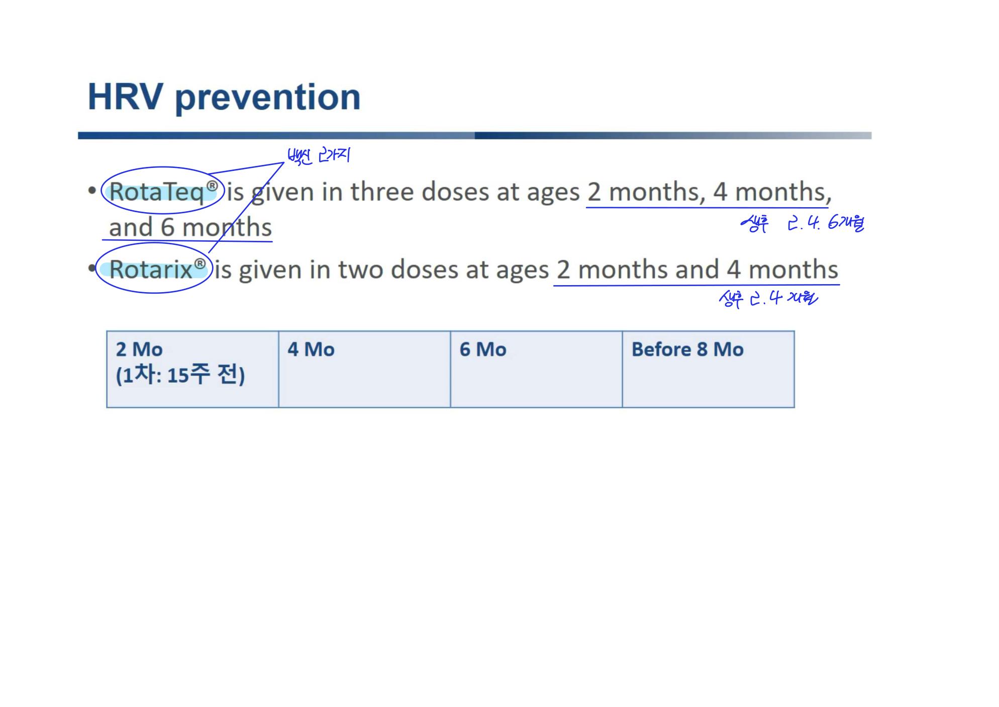{: style="width:72%"}

| 백신 | 횟수 | 접종 시기 |
|---|---|---|
| **RotaTeq**(5가) | **3회** | 생후 **2, 4, 6개월** |
| **Rotarix**(1가) | **2회** | 생후 **2, 4개월** |

- 1차는 **생후 15주 전**에 시작, **8개월 전**에 끝낸다. 경구 생백신.
- 필기의 퀴즈: HRV 백신(VP7/VP4 항원)과 HBV 백신(HBsAg 항원)은 모두 바이러스 표면 항원에 대한 체액성 면역(항체)으로 예방 효과를 낸다 → **참**.

# 5. C. difficile — 검사 해석

- C. difficile은 원래 장에 있는 **정상세균총**의 하나. 항생제를 많이·오래 쓰는 환자에서 **과증식**해 문제를 일으킨다.
- 그래서 **toxin A/B 유전자가 양성이라고 무조건 치료해야 하는 상태는 아니다.**
- **PCR에서 C. difficile이 나오는 건 크게 의미가 없다** — 소아에서는 거의 전부 양성으로 나온다(특히 영아는 무증상 보균이 흔하다).
- **CD toxin을 따로 검사**해서 높게 나오면 의미 있게 본다.
- 필기의 퀴즈: "toxigenic C. difficile(toxin A/B)가 multiplex PCR에서 양성이면 위막성 대장염에 준한 치료를 한다" → **거짓**.
- 필기의 퀴즈: "Campylobacter 장염 회복기에 길랭-바레 같은 자가면역성 신경계 합병증이 생길 수 있다" → **O**.

!!! memo "암기"
    식중독(독소, 항생제 X: S. aureus·B. cereus·C. perfringens) ≠ 감염성 AGE · 염증성 = 점막 파괴, 발열·복통·혈변, 대변 WBC, CRP·ESR·calprotectin ↑ · 혈변 + WBC 없음 = EHEC·아메바 · EHEC는 항생제 X(HUS) · Campylobacter = 닭, 42℃, 냉장고 생존, cephalosporin 내성, 길랭-바레·반응성 관절염 · Yersinia = 돼지·약수터, 4℃ 증식, 가성충수염, 결절홍반 · 장염 후 장중첩증 · 로타 = 11분절 dsRNA, 융모 끝 파괴(crypt 보존), NSP4, RotaTeq 2·4·6 / Rotarix 2·4개월, 지속 설사엔 가수분해·아미노산 분유 · C. difficile PCR 양성만으로 치료 X
