<!-- 필기본: 2025 -->
<!-- 단계: 수업 전 -->

# 0. 이 수업을 공부하는 법

**권기태 교수님** 수업(2023·2025·2026 같은 교수님). 교수님은 "고등학생이라 생각하고 강의할게요"라고 시작했고, "**각각의 특징에 대해 제가 얘기하는 것만 잘 기억하면 시험에는 문제없다**", "**이름하고 약 이름을 연결해서 알기!**"를 거듭 강조했다.

수업성과

1. 기회감염 진균증과 풍토성 진균증을 구분한다.
2. 진균증의 진단에 대해 설명한다.
3. 칸디다(candidiasis), 4. 아스페르길루스(aspergillosis), 5. 크립토코쿠스(cryptococcosis), 6. 털곰팡이(mucormycosis), 7. 폐포자충(pneumocystosis) 감염증의 특징과 치료를 설명한다.

- 기출 16문항(2020–2025). 필기 메모: "**보통 진단 + 치료제를 묻는 문제! 22년도에는 위험인자도 나왔다**". 2025년에는 **PCP 병리(거품 삼출물)**와 **Candida auris(MALDI-TOF)**.
- 2020–2022 문항 일부는 미생물학 쪽(거짓균사, 대분생자, 엽상형 분생자, 항진균제 기전) — 6장에 짧게 정리했다.

!!! key "핵심 — 진균과 치료제 짝 (필기 3쪽 요약)"
    | 진균 | 치료제 |
    |---|---|
    | **Candida** | **Fluconazole**(azole), **echinocandin**(caspofungin, anidulafungin, micafungin) |
    | **Aspergillus** | **Voriconazole** (isavuconazole, posaconazole) — fluconazole X |
    | **Cryptococcus** | **Amphotericin B ± flucytosine → fluconazole** |
    | **Mucor** | **Amphotericin B**(liposomal), posaconazole, isavuconazole + **수술** — voriconazole X |
    | **Pneumocystis** | **TMP-SMX**(항생제), clindamycin + primaquine, 중증이면 **prednisone** 추가 |
    **Amphotericin B·liposomal amphotericin B는 전부에 쓸 수 있다**(PCP 제외).

# 1. 풍토성 vs 기회감염 진균증

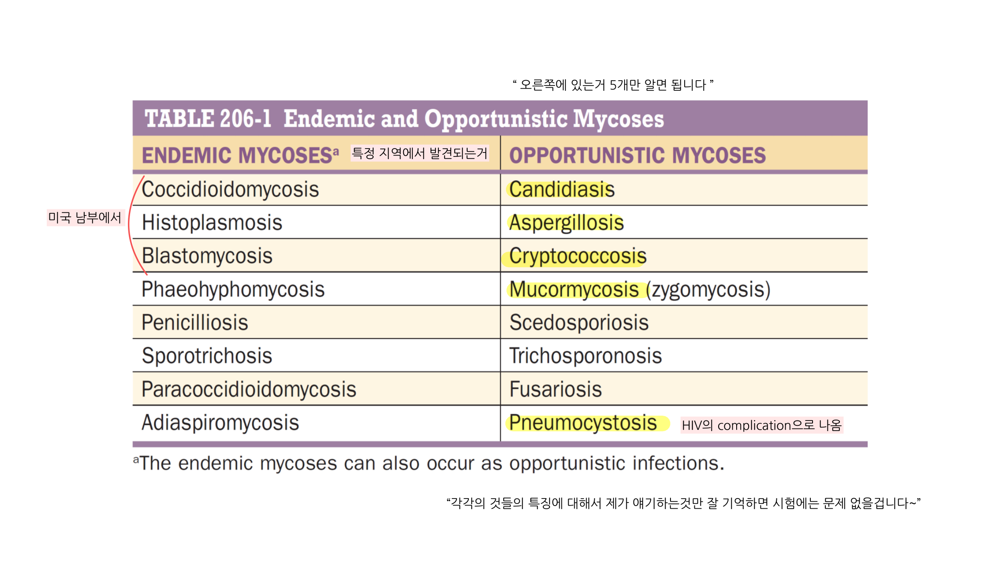{: style="width:76%"}

- **풍토성(endemic)**: **특정 지역**에서 발견되는 것 — coccidioidomycosis, histoplasmosis, blastomycosis(미국 남부) 등. 기회감염으로도 생길 수 있다.
- **기회감염(opportunistic)**: "**오른쪽에 있는 거 5개만 알면 됩니다**" — **칸디다증, 아스페르길루스증, 크립토코쿠스증, 털곰팡이증, 폐포자충증**(HIV 합병증으로 나옴).

## 기회감염 진균증 한눈에 보기 ★

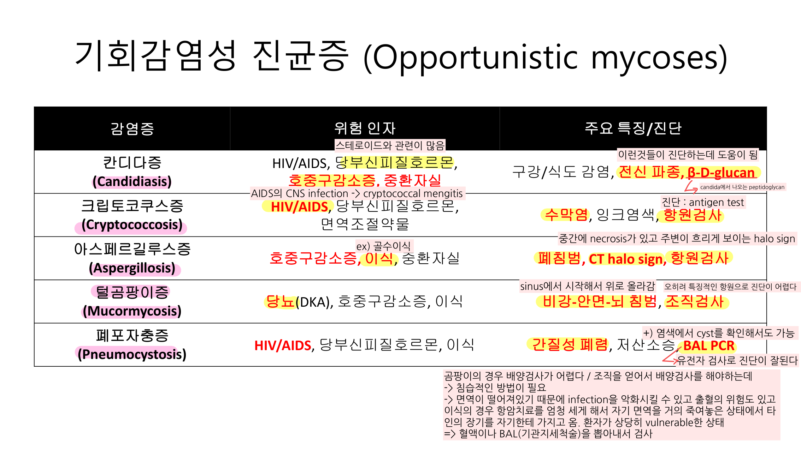{: style="width:90%"}

| 감염증 | 위험 인자 | 주요 특징·진단 |
|---|---|---|
| **칸디다증** | HIV/AIDS, 부신피질호르몬, **호중구감소증, 중환자실** | 구강·식도 감염, **전신 파종**, **β-D-glucan** |
| **크립토코쿠스증** | **HIV/AIDS**, 부신피질호르몬, 면역조절약물 | **수막염**, **잉크(묵즙) 염색**, **항원검사** |
| **아스페르길루스증** | **호중구감소증, 이식**(예: 골수이식), 중환자실 | **폐 침범, CT halo sign, 항원검사** |
| **털곰팡이증** | **당뇨(DKA)**, 호중구감소증, 이식 | **비강–안면–뇌 침범**, **조직검사** |
| **폐포자충증** | **HIV/AIDS**, 부신피질호르몬, 이식 | **간질성 폐렴**, 저산소증, **BAL PCR** |

필기 설명:

- 위험인자는 **스테로이드**와 관련이 많다.
- AIDS의 중추신경 감염 → **크립토코쿠스 수막염**, 진단은 **항원검사**.
- 아스페르길루스: 가운데 괴사가 있고 주변이 흐리게 보이는 **halo sign**.
- 털곰팡이: **부비동에서 시작해 위로 올라간다**. 오히려 특징적인 항원이 없어 진단이 어렵다 → 조직검사.
- 폐포자충: **유전자 검사(PCR)로 진단이 잘 된다**, 염색에서 cyst를 확인해도 된다.
- 진균은 **배양이 어렵다**. 조직을 얻어 배양해야 하는데 침습적이고, 면역이 떨어진 환자라 감염 악화·출혈 위험이 있다(이식 환자는 항암치료로 자기 면역을 거의 죽여 놓은 상태에서 남의 장기를 받는다). → **혈액이나 BAL(기관지폐포세척)**로 검사한다.

## 진균감염증의 진단 방법

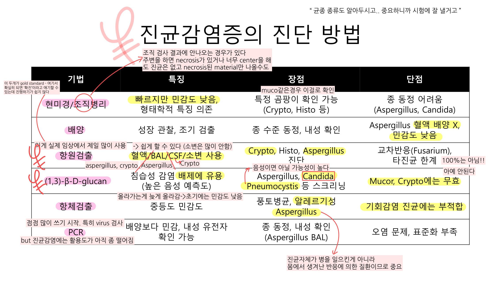{: style="width:88%"}

"**균종 종류도 알아 두시고, 중요하니까 시험에 잘 낼 거고**"

| 기법 | 특징 | 장점 | 단점 |
|---|---|---|---|
| **현미경·조직병리** | 빠르지만 민감도 낮음, 형태에 의존 | 특정 곰팡이 확인(Crypto, Histo) — **Mucor는 이걸로 확인** | 종 동정 어려움(Aspergillus, Candida). 괴사 물질만 나올 수도 |
| **배양** | 성장 관찰 | 종 수준 동정, 내성 확인 | **Aspergillus는 혈액배양 X**, 민감도 낮음 |
| **항원검출** — **임상에서 제일 많이** | 혈액·BAL·CSF(·소변) | **Crypto, Histo, Aspergillus** 진단 | 교차반응(Fusarium), 100%는 아님 |
| **(1,3)-β-D-glucan** | **침습 감염 배제에 유용(높은 음성 예측도)** — 음성이면 아닐 가능성이 높다 | **Aspergillus, Candida, Pneumocystis** 스크리닝(Candida의 세포벽 성분) | **Mucor, Crypto에는 무효**. 늦게 올라가 초기 민감도 낮음 |
| 항체검출 | 중등도 민감도 | 풍토병균, **알레르기성 Aspergillus** | **기회감염 진균에는 부적합** |
| PCR | 배양보다 민감, 내성 유전자 확인 | 종 동정, 내성(Aspergillus BAL) | 오염, 표준화 부족 — 진균에는 아직 활용도 낮음 |

- **조직병리와 배양이 gold standard**("확진") — 하지만 진행하기 쉽지 않다.
- 알레르기성 아스페르길루스증은 진균 자체가 아니라 **몸의 반응에 의한 질환**이라 항체검사가 의미 있다.

# 2. 칸디다 감염증 (Systemic candidiasis)

**원인균**: **Candida albicans(가장 흔함)**, C. parapsilosis, C. tropicalis, C. krusei, C. glabrata 등. 치료가 그나마 **제일 잘 된다**(krusei·glabrata 같은 건 골치 아프다).

## 발생 기전
- **광범위 항생제** 때문에 입·질·대변에 Candida 집락이 늘어난 뒤 생긴다(항생제를 너무 많이 쓰면 정상균총 장벽이 깨진다).
- **구강 아구창(thrush)**: 신생아, **당뇨**, HIV, 틀니 — 점막 감염이 많다.
- 외음질 칸디다증: 임신 3기에 흔하다.
- **칸디다혈증(candidemia)**: **중심정맥관** 관련, 특히 **완전정맥영양(TPN)** 때 — 관을 오래 잡고 있고, 고농도 영양액에는 Candida가 조금만 있어도 잘 자란다. 면역도 떨어져 있다.

## 임상양상
1. **구강 아구창**: 붉은 점막 위의 **하얀 치즈 같은** 병변(백태처럼).
2. 식도 칸디다증(내시경에서 하얗게).
3. 방광염·신우염·신유두괴사 — **그러나 소변에서 Candida가 나오는 대부분은 Foley 도관이나 잔뇨에 의한 단순 방광 집락**이다(진짜 감염이 아닐 확률 약 90%). 소변·객담은 주변 오염이 있어 해석에 주의 / **혈액·CSF는 무균 검체 → 나오면 무조건 감염**.
4. **혈행성 파종** — 임상적으로 실제 생명을 위협하는 것.
5. **만성 파종성(간비장) 칸디다증**: 심한 **호중구감소에서 회복되는** 급성백혈병 환자.
6. 기타 중추신경·관절·폐 감염(매우 드묾).

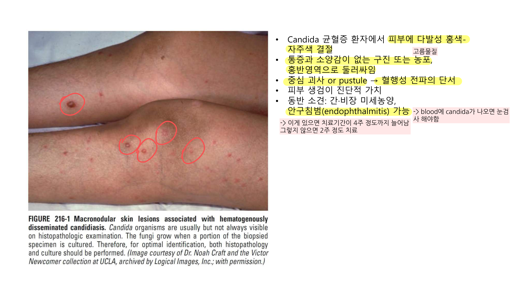{: style="width:70%"}

- 칸디다 균혈증 환자의 피부에 **다발성 홍색–자주색 결절**(통증·가려움 없는 구진·농포, 중심 괴사) → 혈행성 전파의 단서, **피부 생검**이 진단적.
- 간·비장 미세농양, **안구 침범(안내염)** 가능 → **혈액에서 Candida가 나오면 눈 검사**를 해야 한다. 안구 침범이 있으면 치료 기간이 **4주**까지 늘고, 없으면 **2주** 정도.

## 간비장 칸디다증 (Hepatosplenic candidiasis)

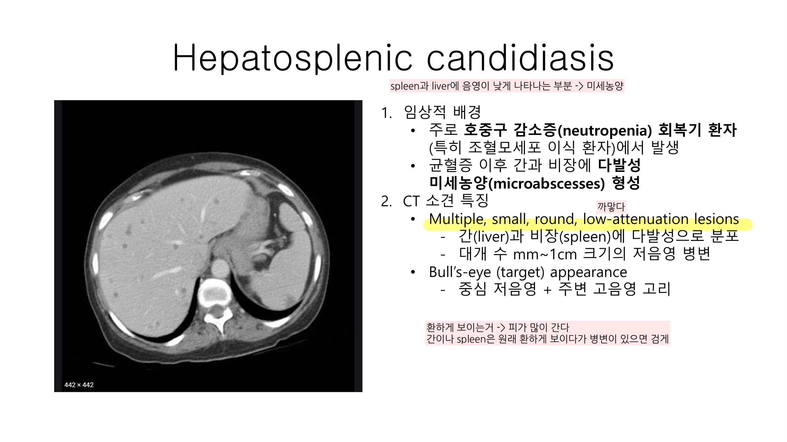{: style="width:60%"}

- 주로 **호중구감소증 회복기**(특히 조혈모세포이식) 환자. 균혈증 뒤 간·비장에 다발성 **미세농양**.
- CT: 간·비장에 **여러 개의 작고 둥근 저음영 병변**(수 mm–1 cm), **과녁 모양(bull's-eye)** — 중심 저음영 + 주변 고음영 고리.

## 진단
- **표재성**: 배양만으로는 진단 안 된다(원래 있는 균) → 젖은 도말에서 **거짓균사(pseudohyphae)**를 보고 배양으로 확인.
- **깊은 병변**: 생검 조직 + CSF·혈액·관절액·조직 배양(무균 검체).

!!! exam "기출 포인트"
    - 2부 5번(2022): 칸디다혈증 위험인자가 **아닌** 것 = **HIV 감염**(점막 칸디다증 위험인자). 중심정맥관, 복부·흉부 수술, 이식 면역억제제, 호중구감소는 위험인자.
    - 2부 9번(2022): 구강 흰 막 + 식도 흰 반점 + 간·비장의 작은 저음영 병변 사진 → **Candidiasis**.
    - 2부 14번(2020): 혈당 조절 안 되는 당뇨 환자의 구강 흰 병변 → **fluconazole**.

## 치료제

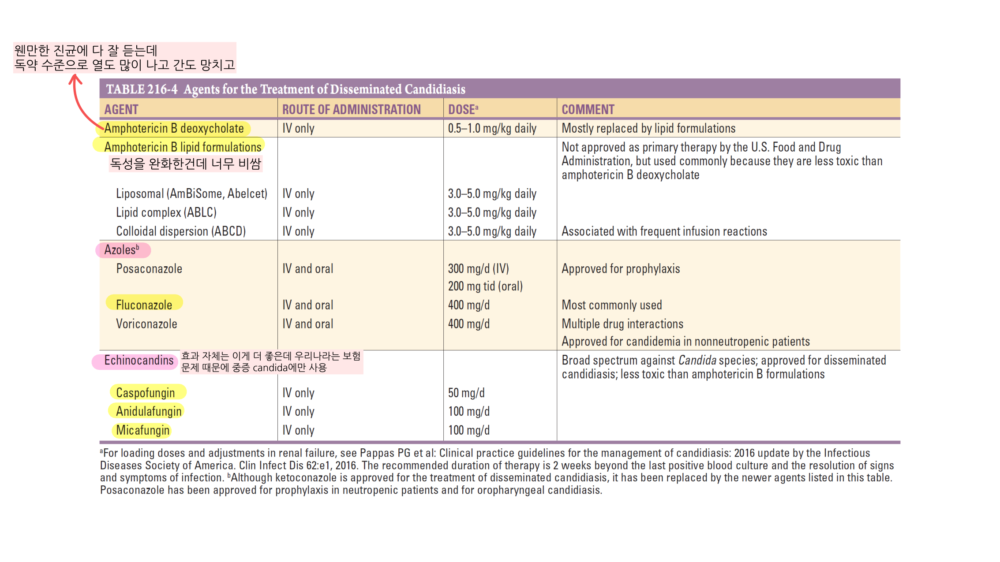{: style="width:82%"}

"**어떤 진균에 어떤 약을 쓰는가가 중요**"

- **Amphotericin B deoxycholate**: 웬만한 진균에 다 잘 듣지만 **독약 수준**(열이 많이 나고 신장·간을 망친다).
- **Amphotericin B 지질 제형(liposomal 등)**: 독성을 완화했지만 너무 비싸다.
- **Azole**: **fluconazole — 가장 흔히 쓴다**, voriconazole(약물 상호작용 많음), posaconazole(예방).
- **Echinocandin(caspofungin, anidulafungin, micafungin)**: Candida에 **효과 자체는 더 좋은데** 우리나라는 보험 때문에 **중증 Candida에만** 사용. 정맥 주사만.

!!! exam "기출 포인트"
    2부 3번(2024): 맞는 짝 = **Candidiasis – Caspofungin**. Mucor–voriconazole(X), Aspergillus–fluconazole(X), Cryptococcus–micafungin(X, echinocandin은 Crypto에 안 듣는다), Pneumocystis–fluconazole(X).

## Candida auris
"**표만 유심히 봐 두세요, 교과서 찾아보지 말고**", "**이름 알아 두세요**" — 최근 이슈.

| 구분 | 내용 |
|---|---|
| 역학 | 2009년 일본 첫 보고(역추적하면 한국 1996년), 30개국 넘게 확산, 요양병원·중환자실에서 집락. **환경·피부에 오래 생존** |
| 특징 | 고온(42℃), 고염(10% NaCl)에서도 자람, biofilm·피부 집락이 강함 |
| 임상 | 혈류감염, 다장기 침범, **치사율 30–60%**(다른 Candida와 비슷) |
| 진단 | 일반 검사법으로 잘 안 된다 — **C. haemulonii로 오인**이 흔함 → **MALDI-TOF MS**, ITS rDNA 염기서열, ePlex. CHROMagar에서 흰·분홍·보라 집락. 최근 MALDI-TOF를 일상적으로 써서 많이 확인된다 |
| 치료 | 1차 **echinocandin**, 2차 liposomal amphotericin B, 신생아는 amphotericin B deoxycholate. **집락은 치료 불필요**(나온다고 다 치료하지 않는다!) |
| 내성 | **Fluconazole >90%**, amphotericin B 30–35%, echinocandin 약 7%, 일부는 모든 계열 내성 |
| 감염관리 | **접촉 격리**, EPA 소독제, 전원 시 통보, 치료 후에도 피부 집락 지속 |

!!! exam "기출 포인트"
    2부 2번(2025): C. auris에 대해 옳은 것 = **MALDI-TOF MS로 동정할 수 있다**. 함정: C. albicans와 같은 감수성(X), CHROMagar 흑색 집락(X), 대부분 fluconazole 감수성(X), 집락이면 반드시 치료(X).

# 3. 아스페르길루스증 (Invasive aspergillosis)

- **원인**: **A. fumigatus(가장 흔함)**, A. flavus, A. niger.
- **발생 기전**: 환경 어디에나 있다. 포자 흡입은 매우 흔하지만 병은 드물다 → **폐 조직 침범은 거의 면역저하자에서만**(**호중구 <500/μL**, 스테로이드, 항암제).
- **임상**: 면역 정상인은 비침습성, **면역저하자(급성 백혈병, 골수이식)**는 **침습성 — 폐렴, 부비동염**. Candida와 달리 **덩어리(공)**를 잘 만든다.
- **진단**: 호중구감소 폐렴 환자(특히 소아·비흡연자)의 객담에서 **한 번만** 나와도 침습성 아스페르길루스증을 시사. 확진은 **생검**(나온다고 다 병은 아니고 조직에서 나와야 한다).
- **치료**: 할 수 있으면 **수술적 제거**(대부분 면역이 나빠 어렵다) + **전신 항진균제** — amphotericin B, itraconazole, **voriconazole**(획기적으로 치료가 잘되기 시작), caspofungin. **Fluconazole은 효과 없다.**

## 질환 스펙트럼

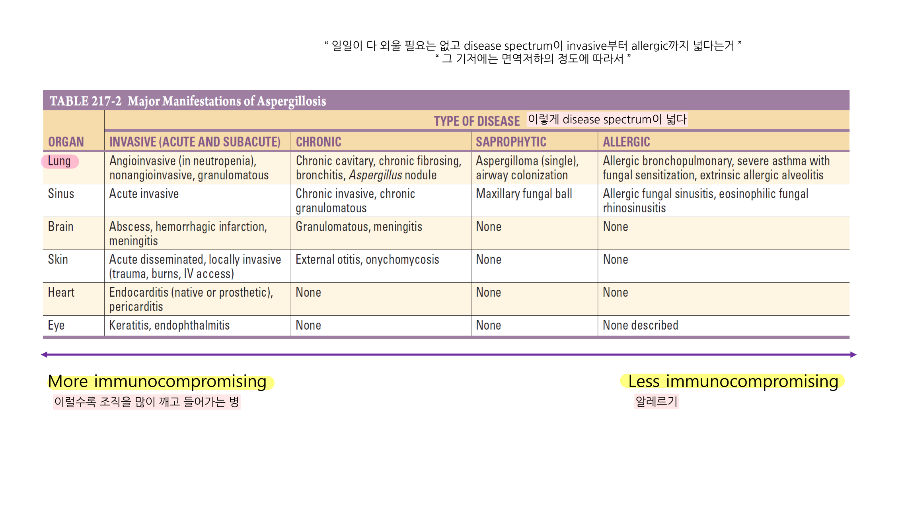{: style="width:88%"}

"**일일이 다 외울 필요는 없고, 스펙트럼이 침습성부터 알레르기까지 넓다는 것**, 그 기저에는 **면역저하의 정도**"

- **면역저하가 심할수록 → 침습성**(조직을 많이 깨고 들어가는 병): 폐의 혈관침습성, 급성 침습성 부비동염, 뇌농양 등.
- 만성(만성 공동성 폐, 아스페르길루스 결절) → 부생성(**아스페르길루스종**, 상악동 fungal ball) → **알레르기**(알레르기성 기관지폐 아스페르길루스증, 중증 천식) — 면역저하가 덜할수록.
- 항원검사는 **침습성**일 때, **항체(IgE·IgG)검사는 알레르기**일 때. 사망률은 침습성일 때 높다.

## 병리와 영상

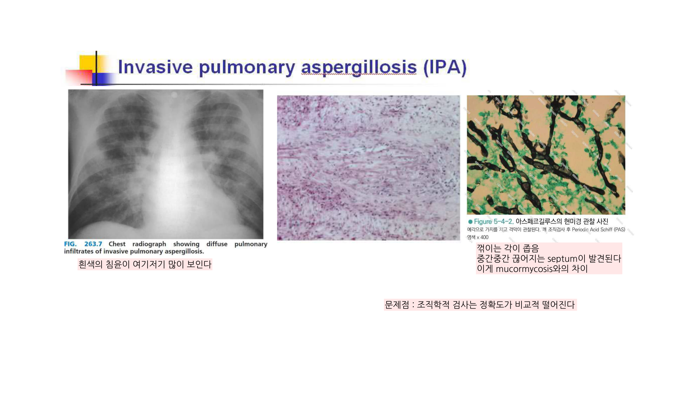{: style="width:72%"}

- 조직: 균사가 **좁은 각(45°)으로 가지를 치고**, 중간중간 **격벽(septum)**이 있다 → **털곰팡이와의 차이**(털곰팡이는 넓은 각, 격벽 없음). 조직검사의 정확도는 비교적 떨어진다.

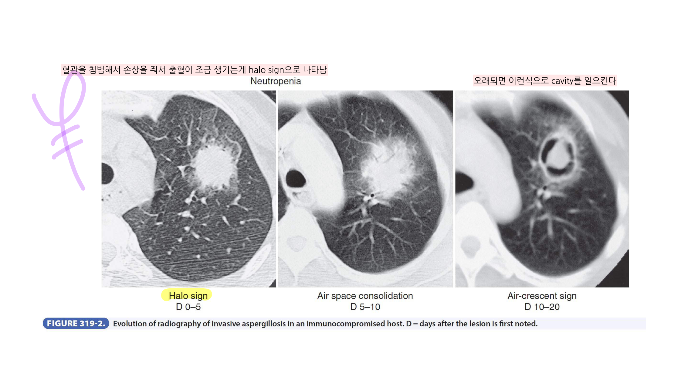{: style="width:66%"}

- **Halo sign**: 혈관을 침범해 주변에 약간의 출혈이 생긴 것. 오래되면 **공동(cavity)**을 만든다.

## 치료

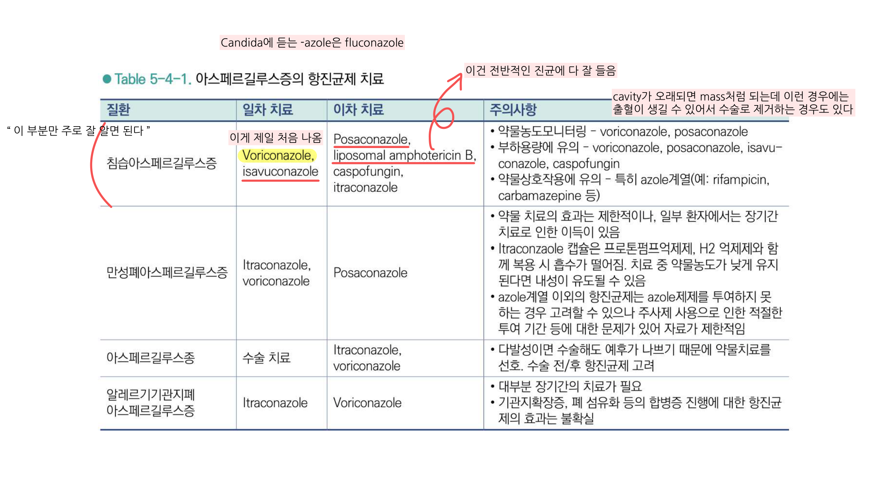{: style="width:84%"}

"**이 부분만 주로 잘 알면 된다**"

| 질환 | 1차 | 2차 |
|---|---|---|
| **침습성** | **Voriconazole**(가장 먼저 나옴), isavuconazole | Posaconazole, **liposomal amphotericin B**(전반적으로 다 잘 들음), caspofungin, itraconazole |
| 만성 폐 | Itraconazole, voriconazole | Posaconazole |
| 아스페르길루스종 | **수술** | Itraconazole, voriconazole |
| 알레르기성 기관지폐 | Itraconazole | Voriconazole |

- Candida에 듣는 azole은 **fluconazole**, Aspergillus에는 **voriconazole**.
- 공동이 오래되어 덩어리처럼 되면 출혈이 생길 수 있어 수술로 제거하기도 한다.

# 4. 크립토코쿠스증 (Cryptococcosis)

- **원인**: 효모 모양 진균 **Cryptococcus neoformans**.
- **소인**: **HIV**, 고형장기 이식, 스테로이드.
- **발생**: 진균을 **흡입** → 폐 감염 → **중추신경 침범이 흔하다**(특징적).
- **수막뇌염**: 적절히 치료하지 않으면 **치명적**. 두통, 구역, 비틀거리는 걸음, 치매, 혼동, 시야 흐림 / 발열·목 경직은 **약하거나 없다** / 유두부종(1/3), 비대칭 뇌신경 마비(1/4), 혼수, 뇌간 압박.
- **진단**
    - **요추천자 — 가장 유용한 단일 검사**
        - CSF **India ink(묵즙) 도말**: 피막을 가진 효모(50–60%)
        - 포도당 ↓(50%), 단백 ↑, **림프구성** 세포증가
    - **CSF·혈청 크립토코쿠스 항원(>90%)** — 아스페르길루스와 크립토코쿠스의 항원검사가 가장 대표적
    - 진균혈증 10–30%
- **치료**: **amphotericin B, fluconazole(± flucytosine)** — flucytosine은 희귀 약물이라 잘 없다.

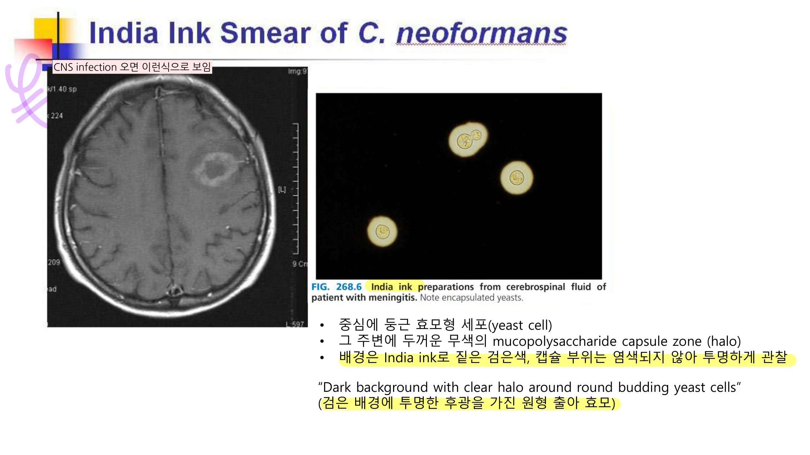{: style="width:62%"}

India ink: **검은 배경에 투명한 후광(두꺼운 무색 다당 피막)을 가진 둥근 출아 효모**.

!!! exam "기출 포인트"
    2부 4번(2024): 간이식 후 두통 + 뇌 MRI·CSF 소견(묵즙 염색 피막 효모) → **Cryptococcosis**.

# 5. 털곰팡이증 (Mucormycosis)

- **원인**: **Mucorales 목**(Rhizopus 47%, Mucor 18%, Cunninghamella, Apophysomyces, Absidia, Saksenaea, Rhizomucor). 앞의 것들은 종·속 이름이고 Mucorales는 **목** 이름 — 여러 종류를 합친 이름.
- **소인**: ★ **조절되지 않는 당뇨(DKA)**, 고형장기·조혈모세포 이식, 지속되는 호중구감소, 악성종양.
    - 인도에 당뇨 환자가 많고, 코로나 때 스테로이드로 혈당이 나빠져 **코로나 2차 감염으로 털곰팡이증**이 많이 생겼다.
- **병태**: **혈관을 침습**해서 자라 주변 조직의 **경색·괴사**.
- **비–안와–뇌 털곰팡이증**: 미열, 둔한 부비동 통증, 코막힘, 묽은 혈성 콧물 → **복시**, 고열, 의식 저하, 한쪽 안구운동 감소, 결막부종, 안구돌출, 실명 / 얼굴 **피부가 검게 변한다(괴사)** → 물체가 두 개로 보이고 눈이 잘 안 돌아가고 의식이 처지고 → 사망.
- **진단**: CT·MRI(부비동 혼탁, 해면정맥동 혈전), **생검·조직 절편이 가장 좋은 진단**, 조직 배양 확인.
- **치료**: **당 조절·면역억제제 감량** + **광범위 변연절제(수술)** + **amphotericin B**(+ posaconazole, isavuconazole).
    - 최근 아스페르길루스와 털곰팡이가 같이 있거나, 아스페르길루스인 줄 알았는데 털곰팡이인 경우도 있다 → **voriconazole은 털곰팡이에 안 듣는다** → 어느 쪽인지 모르면 **posaconazole·isavuconazole**, 비싸더라도 **liposomal amphotericin B**.

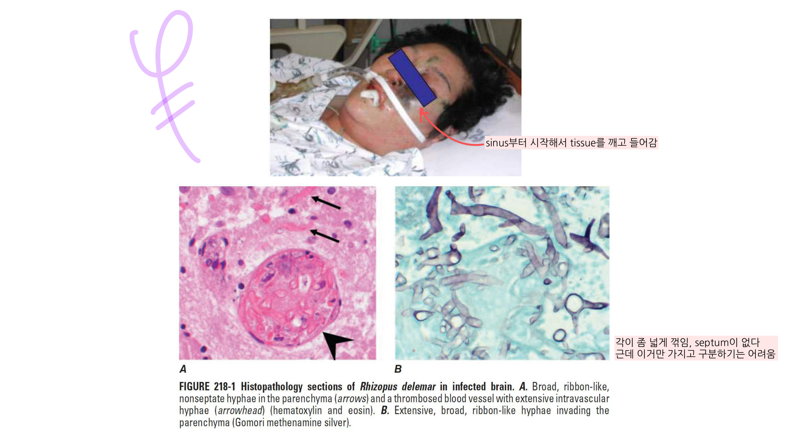{: style="width:66%"}

- 조직: 부비동부터 시작해 조직을 깨고 들어간다. 균사가 **넓은 각으로 꺾이고, 격벽이 없다**(리본 모양) — 다만 이것만으로 구분하기는 어렵다.

!!! exam "기출 포인트"
    2부 6·10·11번(2022·2021): 조절 안 되는 당뇨 + 한쪽 안면 통증·눈꺼풀 처짐·결막부종·시력장애, 얼굴이 검게 변함, 조직에 넓은 격벽 없는 균사 → **Mucormycosis → Amphotericin**. Voriconazole·fluconazole·caspofungin·micafungin은 오답.

## 항진균제 스펙트럼 한 장 정리

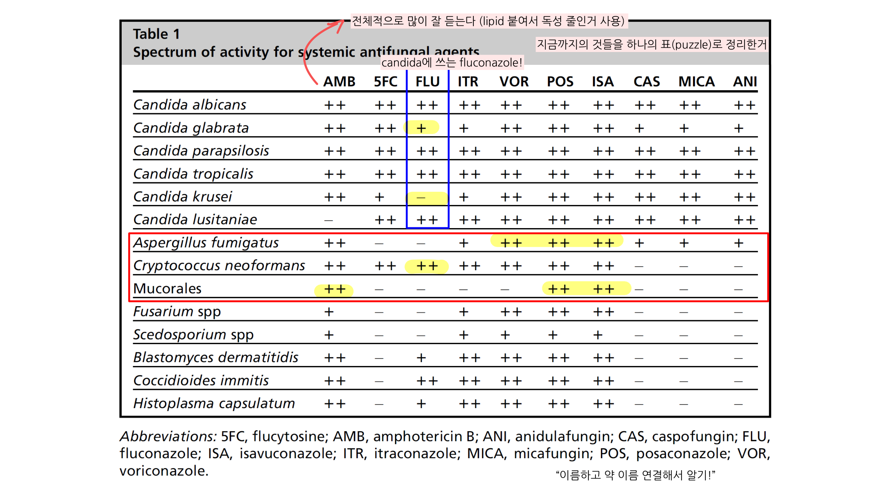{: style="width:84%"}

"**지금까지의 것들을 하나의 표(퍼즐)로 정리한 것 — 이름하고 약 이름 연결해서 알기!**"

- **AMB(amphotericin B)**: 전체적으로 다 잘 듣는다(지질을 붙여 독성 줄인 것 사용) — **Mucorales에 ++**.
- **FLU(fluconazole)**: **Candida에 쓰는 약**(C. krusei −, C. glabrata +), **Cryptococcus ++**, **Aspergillus −, Mucorales −**.
- **VOR(voriconazole)**: Aspergillus ++, Mucorales −.
- **POS·ISA(posaconazole, isavuconazole)**: Aspergillus ++, **Mucorales ++**.
- **CAS·MICA·ANI(echinocandin)**: Candida ++, Aspergillus +, **Cryptococcus −, Mucorales −**.

# 6. 폐포자충 폐렴 (Pneumocystis pneumonia, PCP)

- **Pneumocystis jirovecii**: 기회감염 병원체, 면역저하 숙주의 폐렴. 흔히 **PCP**라고 부른다.
- **역학**: 전 세계, **호흡기 경로로 사람 간 전파**(면역 정상인은 퍼져도 문제가 크지 않다).
- **소인(세포성 면역 저하)**: **스테로이드 등 면역억제 치료**, **장기 이식**, **AIDS**, 미숙아, 영양실조 영아. 최근에는 면역저하가 아니어도 스테로이드를 많이 썼거나 이식받은 사람에서 많이 생긴다. "**어떤 곰팡이가 어떤 조건에서 잘 오는지 기억하면 된다.**"
- **병리(생검)**: H&E에서 **폐포가 전형적인 거품 모양(foamy), 공포가 많은 삼출물로 차 있다**(호산성으로 보이는 것이 차 있는 액체). 중증이면 간질 부종, 섬유화, 유리질막.
- **임상**
    - **호흡곤란, 발열, 마른기침**(간질에 문제가 생겨 가래가 적다)
    - 빈호흡, 빈맥, 청색증 — **청진은 거의 정상**
    - ABGA: **저산소증**, 폐포–동맥 산소분압차 증가, 호흡성 알칼리증
    - **혈청 LDH ↑**
    - 흉부 X선: **폐문 주위에서 시작하는 양측 미만성 침윤** — 일반 폐렴과 다른 **간질성 폐렴**
    - 폐 외 파종: 림프절(40–50%)이 가장 흔함

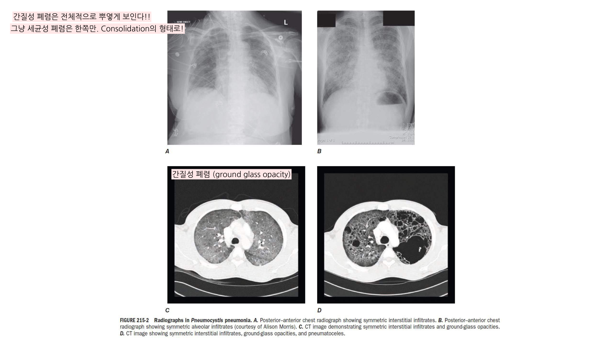{: style="width:60%"}

- **간질성 폐렴(간유리 음영)**: 전체적으로 뿌옇게. 일반 세균성 폐렴은 한쪽에 경화(consolidation) 형태.

## 진단

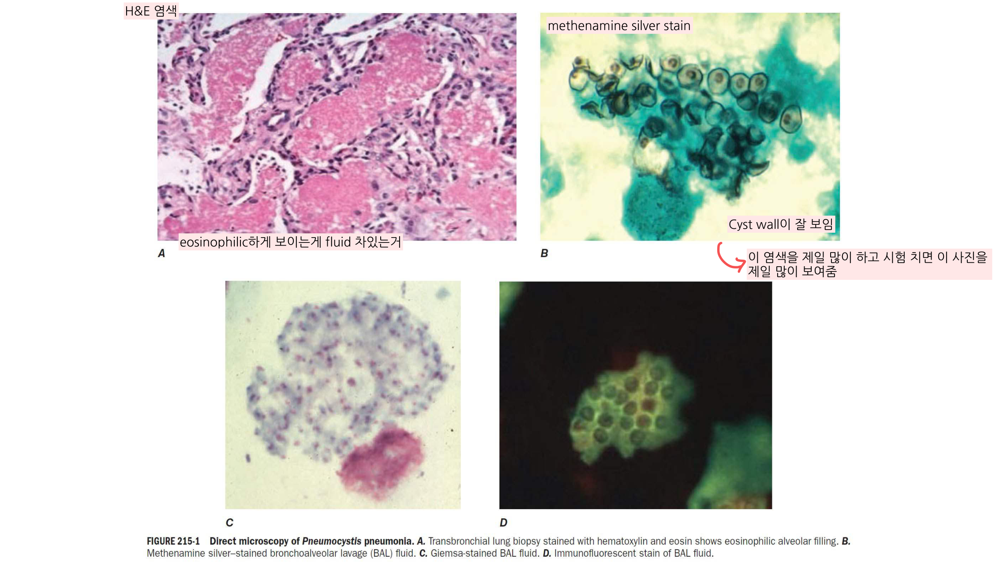{: style="width:68%"}

- **확진: 조직병리 염색** — **methenamine silver**(cyst wall이 잘 보인다 — **제일 많이 하고 시험에 이 사진이 제일 많이 나온다**), toluidine blue, Wright-Giemsa.
- 단클론항체 면역형광: 더 민감하지만 비싸다.
- **PCR**(BAL).
- 배양은 되지 않는다. **β-D-glucan**이 보조 진단에 쓰인다.

## 경과·예후·치료

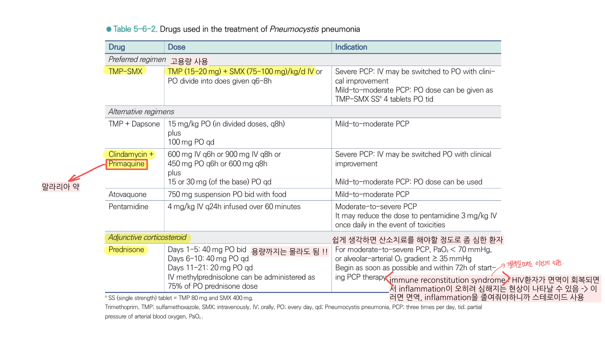{: style="width:84%"}

- **조기에 치료할수록 효과적**. 가장 중요한 예후 인자 = **동맥혈 산소분압, 폐포–동맥 산소분압차** → 산소치료까지 갔는지에 따라 예후가 달라진다.
- **치료 — 이 부분 시험문제로 잘 나옴!!**
    - **TMP-SMX(1차 약, drug of choice)** — 고용량. 대안: pentamidine, TMP + dapsone, **clindamycin + primaquine(말라리아 약)**, atovaquone.
    - **중등도–중증 AIDS 환자에게 스테로이드(prednisone)** → **생존율 향상**. 기준: PaO2 <70 mmHg 또는 A–a 차이 ≥35 mmHg(쉽게 말해 **산소치료를 해야 할 정도**), 치료 시작 72시간 안에. (용량까지는 몰라도 됨.) 면역재구성 증후군(HIV 환자가 면역이 회복되면서 염증이 오히려 심해지는 현상)에도 염증을 줄이려 스테로이드를 쓴다.
- **예방**: **TMP-SMX로 1차·2차 예방**(예방 목적으로는 하루 한 알). AIDS 환자는 면역저하가 회복될 때까지 계속 예방약을 먹는다.

!!! exam "기출 포인트"
    2부 1번(2025): PCP에 대해 옳은 것 = **병리에서 폐포 내 거품 모양(foamy) 삼출물**. 함정: 주로 호중구감소증(X, 세포성 면역 저하), 배양이 가장 유용(X, 배양 안 됨), β-D-glucan으로 진단 불가(X, 보조 진단 가능), 1차 약 amphotericin B(X → TMP-SMX).

# 7. 기출에 나온 진균 미생물학 (작년 필기에 없음)

- **거짓균사(pseudohyphae)**: 효모가 출아한 뒤 딸세포가 떨어지지 않고 길게 이어져 균사처럼 보이는 것 — 연결 부위가 잘록하다. **Candida albicans**에서 전형적(2부 7번).
- **대분생자(macroconidium)**: 두꺼운 벽에 여러 격벽이 있는 방추형 큰 포자 — **피부사상균**(Microsporum, 무좀의 Trichophyton). Sabouraud 배지(2부 8·16번).
- **엽상형 분생자(thallic)**: 이미 있는 균사가 분화·분절되어 생기는 포자 — 소분생자, 대분생자, 비후막포자, 분절분생자. **효모의 출아(budding)는 아생형(blastic)이라 아니다**(2부 12번).
- **항진균제 기전**
    - **Amphotericin B**: 세포막 **에르고스테롤에 결합** → 구멍 → 투과성 손실(2부 13번).
    - **Azole(itraconazole, ketoconazole 등)**: 에르고스테롤 **합성 억제**(lanosterol 14α-demethylase)(2부 15번).
    - **Echinocandin(caspofungin)**: 세포벽 **β-1,3-glucan 합성 억제**.
    - 5-fluorocytosine: 핵산 합성 억제 / griseofulvin: 미세관 억제.

!!! memo "암기"
    Candida = fluconazole·echinocandin, 칸디다혈증 = 중심정맥관·TPN·항생제·호중구감소(HIV는 점막), 혈액에서 나오면 눈 검사 · C. auris = MALDI-TOF, fluconazole 내성 >90%, echinocandin 1차, 집락은 치료 X · Aspergillus = 호중구감소·이식, halo sign, 좁은 각 + 격벽, voriconazole(fluconazole X) · Crypto = HIV·이식, 수막염, 묵즙·항원, amphotericin B + flucytosine → fluconazole · Mucor = 당뇨 DKA, 비–안와–뇌, 검은 괴사, 넓은 각·격벽 없음, 수술 + amphotericin B(voriconazole X) · PCP = 세포성 면역 저하, 거품 삼출물, methenamine silver, LDH ↑, TMP-SMX + (산소 필요하면) prednisone · β-D-glucan은 Mucor·Crypto에 무효
