<!-- 필기본: 2025 -->
<!-- 단계: 수업 전 -->

# 0. 이 수업을 공부하는 법

**김신우 교수님** 수업(2023·2025·2026 모두 같은 교수님, 2시간). 강의는 두 덩어리다 — **「HIV 감염의 현황, 진단」**과 **「HIV 감염의 치료와 예방」**. 필기본 본문(38쪽)과 PPT 보조 파일(114장)이 있는데 겹치는 내용이 많다. 필기한 선배 말로는 "형광펜·코멘트가 없는 쪽은 넘겨도 될 것 같다", "외우라는 것만 외우면 된다".

학습성과

1. 사람면역결핍바이러스(HIV)의 전파경로를 설명할 수 있다.
2. HIV 감염의 진단을 설명할 수 있다.
3. 후천성면역결핍증후군(AIDS) 환자에서 흔히 관찰되는 기회감염이나 종양을 열거할 수 있다.
4. HIV 감염의 치료와 그 예후를 설명할 수 있다.
5. AIDS의 예방법을 설명할 수 있다.

기출 35문항(2020–2025)이 매년 거의 같은 주제를 돌려 낸다:

| 주제 | 문항 수(대략) | 2부 번호 |
|---|---|---|
| **U=U의 뜻** | 5 | 4, 11, 15, 19 (+3) |
| **진단: 선별 = EIA, 확진 = Western blot** | 5 | 2, 7, 21, 28 |
| **PCP: 서서히 오는 호흡곤란 + 양측 간질성 → TMP-SMX (+스테로이드)** | 5 | 10, 17, 25, 27, 30 |
| 급성 HIV 증후군에 **없는** 것 고르기 | 3 | 9, 16, 24 |
| **치료 시작 = CD4와 관계없이 모두 즉시** / 치료 목표 = 바이러스 검출한계 미만 | 4 | 5, 8, 26, 3 |
| **90-90-90의 세 번째 90 = 바이러스 억제** | 2 | 12, 23 |
| 전파 위험 비교(모자감염이 가장 큼), 바늘찔림 PEP, 의료인 예방 | 4 | 6, 14, 18, 31 |
| 기회감염 영상·사진(CMV 망막염, PML, 모상백반증, 좁쌀결핵) | 5 | 1, 13, 20, 32, 33 |
| 바이러스학(gp120/CD4, retrovirus 유전자) | 4 | 22, 29, 34, 35 |

!!! key "핵심 — 이 수업의 메시지"
    교수님: "**치료받은 사람은 감염력이 없어진다. 이게 오늘 수업의 핵심 메시지다 — U=U.**"
    그래서 **진단되면 CD4와 상관없이 당일이라도 바로 ART**(Treat All, same day ART) → 개인·파트너·사회를 지킨다(TasP, Treatment as Prevention).

# 1. 역학 (현황)

## 전 세계 (2024, UNAIDS)

| 항목 | 수치 |
|---|---|
| 전 세계 HIV 감염인 | 약 **4,080만 명** (성인 3,940만, 아동 140만, 여성·소녀 53%) |
| 신규 감염 | 130만 명/년 |
| AIDS 관련 사망 | 63만 명/년 |
| ART 받는 사람 | 3,160만 명 (2025 목표 3,400만) |
| 본인 감염 인지율 | 87% (약 530만 명은 모름) |
| 치료 접근률 | 전체 77%, **아동 55%(낮음)**, 여성 83% > 남성 73%, 임산부 84% |

- 추세: **감염인으로 사는 사람은 늘고**(진단받아도 오래 산다), **신규 감염과 사망은 줄고 있다**.
- 아프리카(사하라 이남)에 집중. 아프리카는 **남녀 1:1**(일부다처제 등과 관련), 한국은 **약 15:1로 남성**이 압도적.
- HIV-1과 HIV-2가 있는데 **대부분 HIV-1**. 1920년경 콩고 킨샤사에서 원숭이의 SIV가 사람으로(원숭이 고기·피) 넘어온 것으로 추정. 사람에서 확인된 가장 오래된 HIV는 1959년 보관 혈액.

## 국내
- 한 해 신규 신고 **약 1,000명**. 유병률 **약 0.027%**로 낮다. 2020·21년 감소는 진단 감소·접촉 감소·TasP 정책 효과로 추정.
- **남성이 훨씬 많고**(남성 간 항문성교), 여성은 남성 감염인의 파트너나 성매매 관련이었는데 요즘은 거의 없다. **20–30대**에 많다. 최근엔 생존자가 늘어 70–80대 감염인도 있다.
- 외국인 감염인도 예전엔 추방했지만 지금은 추방하지 않는다.
- 국내는 **감염에서 진단까지 평균 4.2년** — 진단 지연이 문제(낙인, 인식 부족). MSM에게 1년마다 검사를 권하지만 진단되면 사회에서 핍박받을까 봐 잘 안 한다.

# 2. 자연경과와 분류

## AIDS의 정의
HIV 양성자가 **심한 면역저하(CD4 T 림프구 <200/µL 또는 <14%)**이거나 **「AIDS 지칭 질환」**을 가진 경우. 정상 CD4는 500–1,200/µL(6세 이상). **진행된 HIV 감염(advanced HIV)을 AIDS라 부른다.**

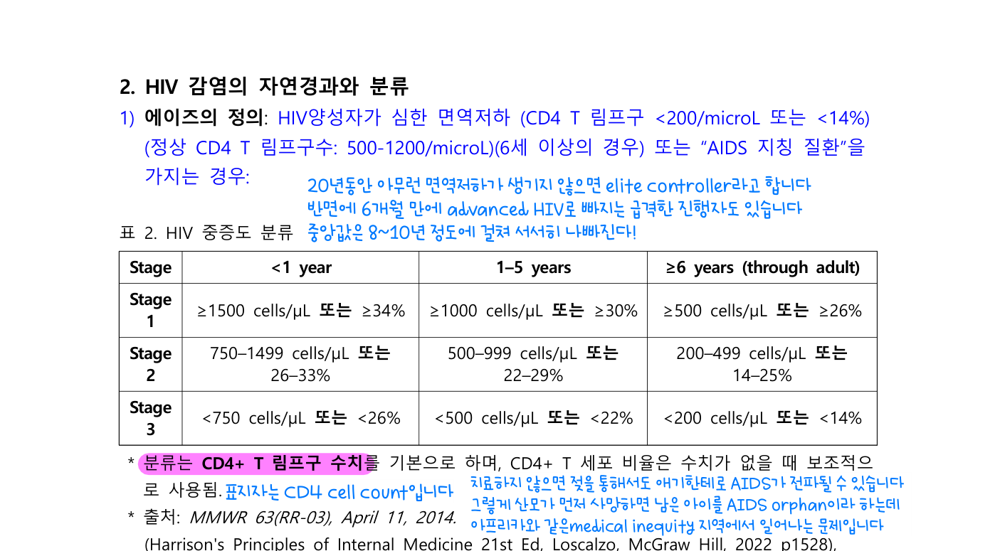{: style="width:80%"}

| 병기 | ≥6세 CD4 |
|---|---|
| Stage 1 | ≥500/µL (≥26%) |
| Stage 2 | 200–499/µL (14–25%) |
| **Stage 3 (AIDS)** | **<200/µL (<14%)** |

- 분류의 기준은 **CD4 수**이고, 비율(%)은 수치가 없을 때 보조로 쓴다. 나이가 어릴수록 기준치가 높다(<1세는 <750이 Stage 3).
- 보조 파일의 간단한 분류: **급성**(CD4 변동, 바이러스 매우 높음, 독감 유사) → **만성**(CD4 >500, 바이러스 낮음–중간, 무증상) → **AIDS**(CD4 <200, 바이러스 높음, 기회감염).

## 치료하지 않은 HIV의 전형적인 경과

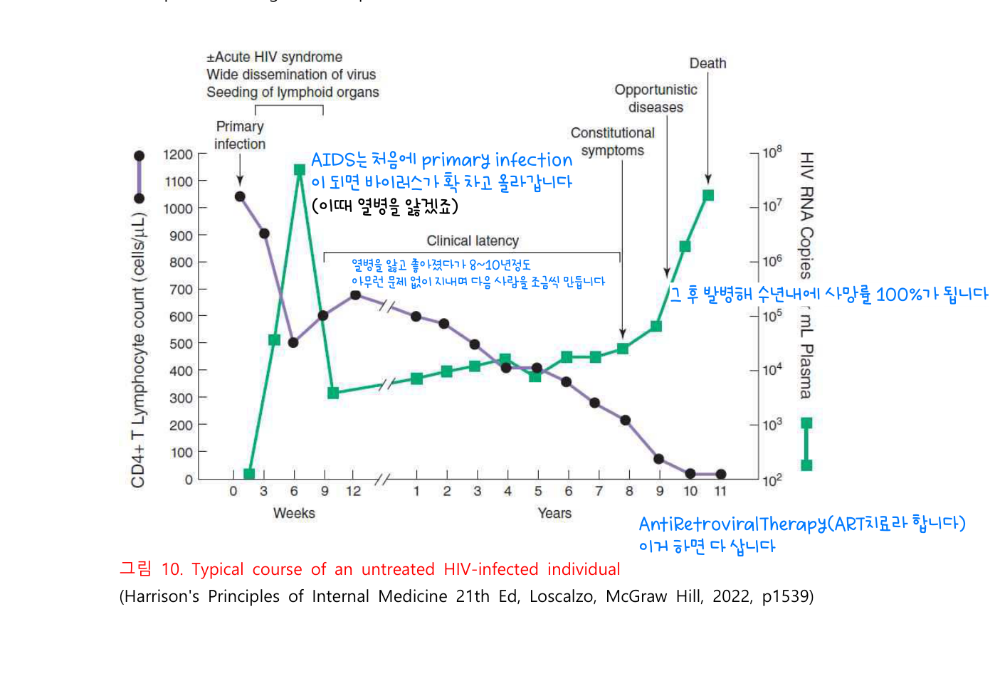{: style="width:78%"}

1. **일차 감염**: 바이러스가 확 치솟고(이때 열병을 앓는다) CD4가 뚝 떨어졌다가 일부 회복.
2. **임상적 잠복기**: **중앙값 8–10년** 동안 증상 없이 지내면서 CD4가 서서히 떨어지고, **그동안 다른 사람에게 조금씩 전파한다.**
3. **AIDS**: 기회감염·종양이 생기고 **치료하지 않으면 수년 내 사망률 거의 100%**. ART를 하면 "다 산다".

- 진행 속도는 사람마다 다르다: 약 **20%는 5년 안에** AIDS, **<5%는 10년 넘게** 증상 없고 CD4 >500 유지. **20년 동안 면역저하가 없으면 elite controller**, 반대로 6개월 만에 advanced HIV로 가는 급속 진행자도 있다.
- 진행을 늦추는 요인: **바이러스의 nef 유전자 돌연변이**, **숙주의 CCR5 유전자 돌연변이**. 감염인과 계속 성관계해도 감염되지 않는 사람 중 일부도 CCR5 돌연변이를 가진다.
- 급성기에 **CD4/CD8 비율이 역전**되고, 회복돼도 역전은 그대로 남는다.

## 감염의 진행 — 몸 안에서 무슨 일이

- 성관계로 정액 속 바이러스가 직장·항문 점막으로 들어감 → **수지상세포(DC)가 림프절로 운반** → **장관련 림프조직(GALT)**에서 대량 증식 → 바이러스혈증으로 전신 확산 → 지속 감염 확립.
- HIV는 CD4 세포를 좋아하는데 **안 가는 장기가 없다** → 완치가 어려운 이유(잠복 저장소).

## 바이러스 구조 — 기출로 나온 바이러스학

- HIV는 **retrovirus**(lentivirus). 유전체 양끝에 **LTR**(long terminal repeat — 프로모터·엔핸서·전사인자 결합부위).
- 단순 retrovirus의 기본 유전자 3개: **gag**(구조 단백), **pol**(효소 — **역전사효소, integrase, protease**), **env**(외피). HIV 같은 복합 retrovirus는 tat, rev, nef 등 추가 유전자를 가진다.
- **부착 단백질 = gp120, 1차 수용체 = CD4**, 공동수용체 = **CCR5 또는 CXCR4**, 막융합 = **gp41**.

!!! exam "기출 포인트"
    「HIV의 viral attachment protein과 숙주세포의 1차 수용체를 쓰시오」가 **주관식으로 3번**(22, 29, 35) — 답 **gp120 / CD4**. 34번은 retrovirus 기본 구조(LTR, gag·pol·env, pol에 RT·integrase·protease)로 **보기 전부 맞음**.

# 3. 임상 증상

## 급성 감염기 (급성 레트로바이러스 증후군)

- **2–6주 잠복기** 후 **50–70%**에서 발열, 인후통, 무력감, 기침, 근육통 등 **감기 같은 증상**. HIV에 특징적인 증상은 없다.
- 항체가 생기면서 치료하지 않아도 **1주–3개월(평균 1–2주) 안에 저절로 사라진다** → 감기가 지나간 걸로 생각한다. 그래서 급성기에 진단될 확률은 매우 낮다.
- 감기와의 차이는 **발진(홍반성 반구진 발진)이 있을 수 있다**는 것. 교수님: "**어른이 응급실에 왔는데 발진이 있다(어른은 발진이 잘 안 생긴다), 근데 젊은 남자다 → HIV 검사를 해야 한다. 기억해 주세요.**"

| 계통 | 급성 HIV 증후군의 소견 |
|---|---|
| 전신 | **발열, 인두염, 림프절병증**(특히 목), 두통/안와 뒤 통증, 관절통·근육통, 무기력, 식욕부진·체중감소, 오심·구토·설사 |
| 신경 | **(무균성) 수막염**(드묾), 뇌염, 말초신경병증, 척수병증 |
| 피부 | **홍반성 반구진 발진**, 점막피부 궤양 |

!!! exam "기출 포인트"
    「급성 HIV 감염에서 가능성이 **가장 낮은** 것」이 3번 — 정답은 늘 **진행된 HIV(낮은 CD4)의 기회감염**: **양측 폐렴(9번)**, **식도 칸디다증(16번)**, **PML(24번)**. 발열·발진·인두염·림프절병증·**무균성 수막염**은 급성기에 있을 수 있다(24번의 함정).

## 무증상기 (임상적 잠복기)
- 급성 증상이 사라진 뒤 **8–10년** 정상인과 똑같이 생활. 그러나 **면역기능은 계속 떨어지고, 이 시기에도 성관계로 타인에게 전파한다.**
- 일부는 **지속성 전신 림프절병증**: 원인 모르게 3개월 이상, **서혜부를 제외한 두 군데 이상**에서 **1 cm 이상** 림프절.

## AIDS 관련 증후군·초기 증상기 (CD4 <500)
- **구강 병변이 매우 흔함**: 아구창(구강 칸디다증), **구강 모상백반증(oral hairy leukoplakia — EBV)**, 아프타 궤양, 치주염. 캔디다 질염, 골반내 감염.
- 피부: **지루성 피부염**이 흔하고, 포도알균 감염, 피부진균증, 입술·생식기·항문 주위 **단순포진·대상포진**, **전염성 물렁종(molluscum contagiosum)**.

## AIDS
- 세포매개면역 저하로 정상인에게 잘 안 생기는 바이러스·진균·기생충·원충·세균의 **기회감염**, **기회종양**, **뇌 침범**이 생긴다.
- **PCP(폐포자충 폐렴)가 가장 흔히 오고, HIV로 인한 사망의 1번 원인**. Bactrim(TMP-SMX)을 써도 70%만 낫고 30%는 죽는다. 치료 안 하면 다 죽는다.

## 만성 염증 상태 — HIV 감염인에게 늘어나는 비감염성 질환
ART로 바이러스가 억제돼도 지속적 면역 활성화·염증으로 **가속 노화, 골 취약성, 암, 심혈관질환, 당뇨, 신장·간 질환, 신경인지 장애**가 늘어난다. 그래서 요즘 HIV 진료에는 당뇨·고지혈증·골다공증 관리도 들어간다.

# 4. CD4 수와 기회감염·종양

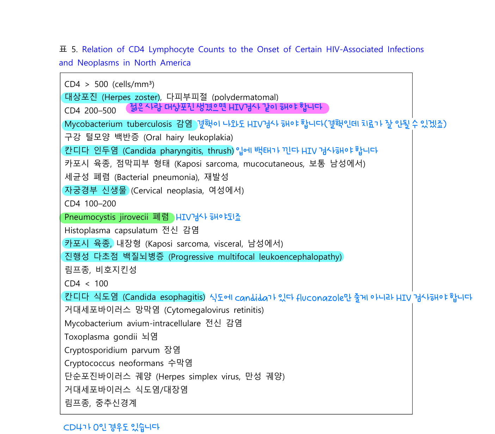{: style="width:80%"}

| CD4 (/µL) | 생기는 질환 | 필기 코멘트 |
|---|---|---|
| **>500** | 대상포진(여러 피부분절) | **젊은 사람 대상포진 → HIV 검사도** |
| **200–500** | **결핵**, 구강 모상백반증, **칸디다 인두염(아구창)**, 카포시 육종(점막피부형), 재발성 세균성 폐렴, 자궁경부 신생물 | 결핵이 나와도, 입에 백태가 껴도 HIV 검사 |
| **100–200** | **PCP**, 히스토플라스마 전신감염, 카포시 육종(내장형), **PML**, 비호지킨 림프종 | PCP → HIV 검사 |
| **<100** | **칸디다 식도염**, **CMV 망막염**, **MAC 전신감염**, **톡소포자충 뇌염**, 크립토스포리디움 장염, **크립토콕쿠스 수막염**, 만성 HSV 궤양, CMV 식도염·대장염, **중추신경계 림프종** | 식도 칸디다 → fluconazole만 주지 말고 HIV 검사 |

CD4가 0인 환자도 있다.

!!! memo "암기 — 「이걸 보면 HIV 검사」 (보조 파일 사진들)"
    젊은 사람 **대상포진**, **결핵**(특히 좁쌀결핵·**결핵성 경부 림프절염**), **입·식도 칸디다**, 한 달 넘게 안 낫는 **단순포진**(특히 **항문 주위 만성 herpes**), **구강 모상백반증(EBV)**, 잘 안 낫는 **아프타 궤양**, 입의 papilloma, **항문 곤지름**(항문성교를 한다는 단서), **PCP**, **PML**, **크립토콕쿠스**(머리를 좋아함), 톡소포자충(고양이 똥), **CMV 망막염**(눈 — 가장 치명적, 혈관 주위 출혈·삼출물), 세균성 혈관종증, 카포시 육종(검은색).

## AIDS 지칭 질환 (CDC Stage 3 defining illnesses)

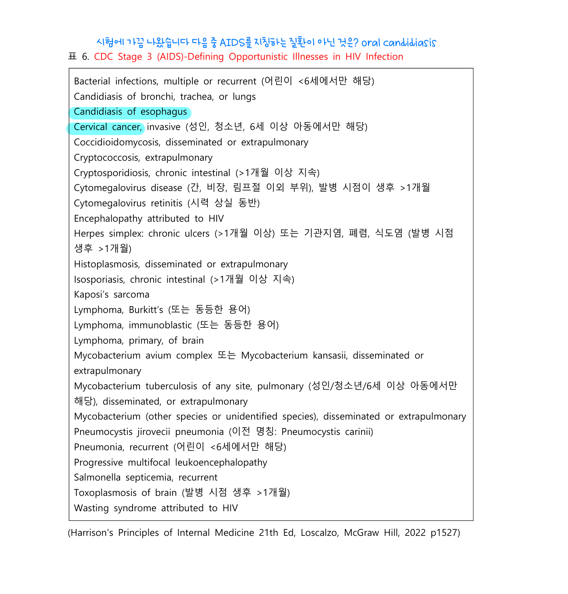{: style="width:72%"}

- 칸디다: **기관지·기관·폐, 식도** (← **구강 칸디다증은 아니다**)
- 침윤성 자궁경부암, 파종성/폐외 콕시디오이데스·히스토플라스마증, 폐외 크립토콕쿠스증, 만성(>1개월) 크립토스포리디움·이소스포라 장염
- CMV 질환(간·비장·림프절 외), **CMV 망막염**, HIV 뇌병증, **HSV 만성 궤양(>1개월)** 또는 기관지염·폐렴·식도염
- **카포시 육종**, 림프종(**버킷**, 면역모세포성, **원발성 뇌 림프종**)
- **MAC·M. kansasii 파종성**, **결핵(모든 부위)**, 기타 마이코박테리아
- **PCP**, **재발성 폐렴**, **PML**, **재발성 살모넬라 패혈증**, **뇌 톡소포자충증**, HIV 소모증후군
- 소아(<6세)에서만: 다발·재발성 세균감염

!!! exam "기출 포인트"
    필기: "시험에 가끔 나왔습니다 — **다음 중 AIDS를 지칭하는 질환이 아닌 것은? → oral candidiasis**". 13번(2022)은 반대로 「HIV를 기저질환으로 조사해야 할 질환」 → **PML**(신우신염·세균성 폐렴·심내막염·구강 단순포진은 정상인에게도 흔함).

## 뇌 침범
"온몸을 다 가는데 특히 **기회감염, 기회종양, 뇌 침범**." 뇌 침범은 다른 바이러스들을 깨운다.

| 범주 | 질환 |
|---|---|
| 수막염·두통 | 무균성 수막염, **크립토콕쿠스 수막염**, 결핵성 수막염 |
| 미만성 뇌질환 | 의식 보존: **AIDS 치매 복합증** / 의식 저하: 톡소플라스마 뇌염, CMV 뇌염 |
| 국소 뇌질환 | **뇌 톡소포자충증**, **원발성 CNS 림프종**, **PML(JC virus를 깨우면 생긴다)**, 결핵성 뇌농양 |
| 척수병증 | 공포성 척수병증, CMV 척수병증 |
| 말초신경병증 | 감각 다발신경병증, 약물 독성(zalcitabine·didanosine·stavudine), 자율신경병증, CMV 다발신경근병증 |
| 근병증 | 비염증성 근병증, **zidovudine 근병증** |

- **AIDS 치매 복합증**: 초기 — 집중력 저하·건망(인지), 동작 느림·서툼·운동실조(운동), 무관심·성격 변화(행동) → 후기 — 전반적 치매, 하반신 마비, 무언증.
- 증상만으로는 구별이 어려워 **영상·뇌척수액 검사를 종합**한다. **PML = 뇌를 침범하는 넘버원**(보조 파일).

!!! exam "기출 포인트"
    33번(2020): 말이 어둔해지고 보행장애, MRI 백질 병변, HIV ELISA 양성 → **JC virus(PML)**. 오답 짝: 톡소 = 조영증강 고리 병변, EBV = 원발성 CNS 림프종, CMV = 뇌실염.

## 폐 질환 — PCP가 사망률 1위

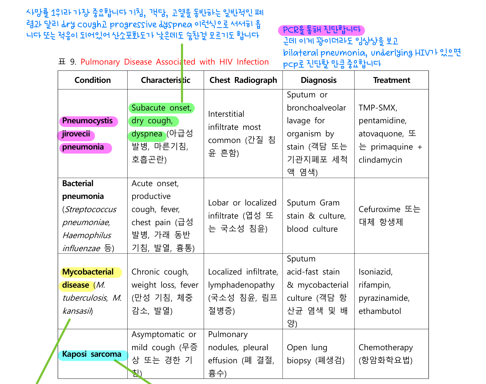{: style="width:80%"}

| | PCP | 세균성 폐렴 | 결핵 | 카포시 육종 |
|---|---|---|---|---|
| 양상 | **아급성, 마른기침, 호흡곤란** | 급성, 가래·발열·흉통 | 만성 기침, 체중감소, 발열 | 무증상·경한 기침 |
| 흉부 X선 | **간질성 침윤(양측 미만성)** | 엽성·국소 침윤 | 국소 침윤, 림프절병증 | 폐 결절, 흉수 |
| 진단 | 객담·**기관지폐포세척액 염색**(PCR) | 객담 그람염색·배양, 혈액배양 | 객담 항산균 염색·배양 | 개흉 폐생검 |
| 치료 | **TMP-SMX**, pentamidine, atovaquone, primaquine+clindamycin | cefuroxime 등 | INH, RIF, PZA, EMB | 항암치료 |

- PCP: 일반 폐렴처럼 기침·객담·고열로 오지 않고 **dry cough, 서서히 진행하는 호흡곤란**. 적응이 돼서 **산소포화도가 낮아도 숨찬 걸 모르기도** 한다. PCR이 음성이어도 **양측 폐렴 + 기저 HIV면 PCP로 진단할 만큼** 중요하다.
- **결핵이 넘버 투**. 잠복결핵이 많은데 HIV로 면역이 떨어지며 깨어난다. HIV에 특이한 것이 **좁쌀(miliary) 결핵**. 결핵은 보통 폐첨부(apex)에 오지만 HIV에서는 아닌 경우도 있다.
- Sarcoma vs Cancer: cancer는 상피세포 기원, **sarcoma는 중간엽세포 기원**.

!!! exam "기출 포인트"
    **PCP 사례가 5번**: 「젊은 남자, **1달(4주)간 서서히 진행하는 호흡곤란**, 영상」 → 경험적 1차 약 **TMP-SMX**(17·25번), 「효과를 기대하기 **어려운** 약」 → **doxycycline**(30번 — TMP-SMX·dapsone·atovaquone·pentamidine은 효과 있음), 「동맥혈 산소분압 55 mmHg」 → **TMP-SMX + glucocorticoid**(27번 — PaO2 <70이면 스테로이드). 10번 「HIV의 가장 흔한 사망원인」 → **PCP**(필기·오답노트 기준. 전 세계적으로는 결핵이라는 자료도 있으니 함정 주의). 20번 인도네시아 출장 잦은 HIV 환자 + 좁쌀 결절 → **M. tuberculosis**.

## 종양
- **림프종이 가장 많이 생기는 암**(EBV 관련으로 보임).
- **항문암**: 항문성교로 인한 HPV 때문에 일반인보다 훨씬 높다.
- **카포시 육종**: 검은색 병변. 한국에는 적고 아프리카에 많다.

# 5. 진단

!!! key "핵심"
    HIV/AIDS 진단은 **전적으로 실험실 확인**에 기초하며 **임상증상으로 진단을 시도해서는 안 된다**(AIDS phobia 환자 때문이기도). 의심되면 검사한다.
    **선별 = 4세대 항원/항체 EIA(ELISA) → 반복 양성이면 확진 = Western blot**. **급성 HIV는 항체가 아직 없으니 RNA(PCR)**.

## 항체가 생기는 시기
- 항체는 **감염 후 2주부터** 나타나고, 거의 대부분 **8주 이내** 양전. 극히 드문 예를 빼면 **3개월(12주) 이후 양전은 사실상 없다**.
- 혈청전환기에 가장 먼저 나오는 항체: **p24 항원**에 대한 항체와 막단백(gp160, gp41) 항체.
- 검출 순서(보조): **NAT(핵산) ~10일 → p24 항원 ~20일 → 3세대 항체 ~30일**. 4세대는 p24+항체를 함께 잡아 앞당긴다. 바이러스가 들어오고 가장 빨리 진단하는 것은 약 일주일.
- **창문기(window period)**: 감염 후 항체가 채 형성되지 않은 시기 — 이때 헌혈하면 수혈로 전파될 수 있다(그래서 외국은 만성 빈혈 수혈 기준을 Hb 10 → 7로 낮췄다). 우리나라 혈액은 RNA 검사로 거르므로 안전하다.
- 노출 후 검사: 한국은 **4주**(12주에서 당김, 2019)에 하고 6주(EIA)·12주(기타) 추적. 교수님: 모르는 사람과 성관계 → baseline 검사 후 추적, **12주가 넘었는데 계속 검사하려 하면 "이제 그만하시죠"**.

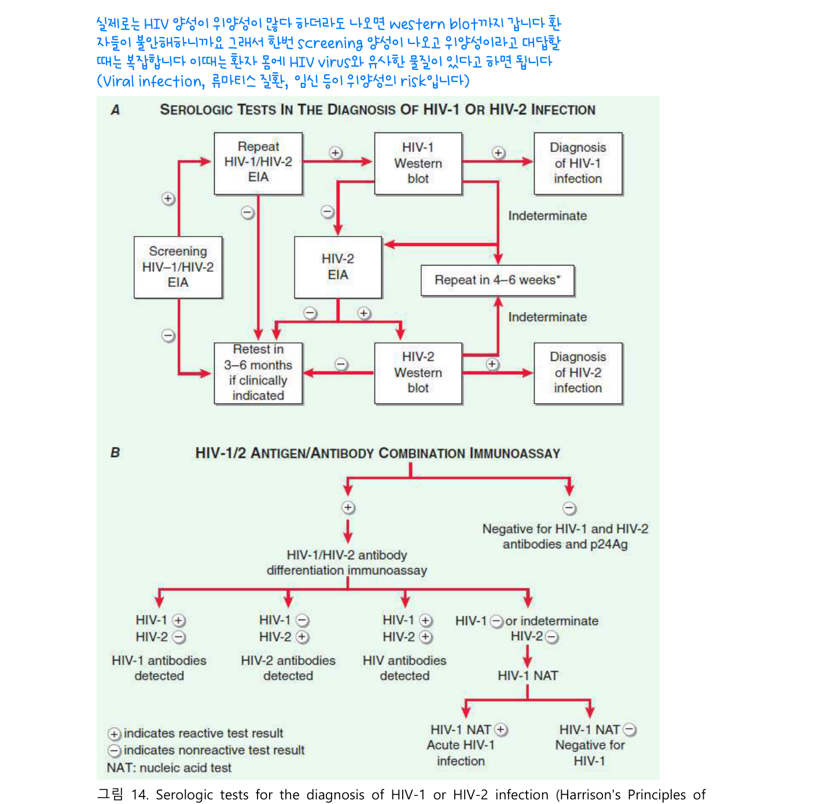{: style="width:72%"}

## 선별검사 — 4세대 항원/항체 복합검사 (HIV-1/2 Ag/Ab combo)
- 현재 표준 선별검사. **p24 항원 + HIV-1/2 항체 동시 검출**, 감염 후 **2–3주**에 검출(기존보다 1–2주 단축). 민감도·특이도 >99%.
- **양성예측도는 유병률에 따라 다르다**: 고위험군(유병률 10%) 91%, **일반인구(0.1%) 50%** → 위양성이 많다.
- 위양성 위험: 바이러스 감염, 류마티스 질환, 임신 등. 실제로는 위양성이 많아도 환자가 불안해하니 Western blot까지 간다. 위양성을 설명할 때는 "몸에 HIV와 유사한 물질이 있다"고 하면 된다.

## 신속검사 (rapid test)
- HIV 항체를 정성적으로 검출(대부분 HIV-1·2). **EIA만큼 신뢰도 높음**(민감도·특이도 99% 이상). **OraQuick**: 침(구강액)으로 **20분 내** 결과, 장비 불필요. 밴드 2개면 양성. 약국·온라인 구매 가능.
- **익명검사**로 쓰고, 매우 정확하지만 **확진검사로는 쓰지 못한다**.
- 장점: 검사 접근성(VCT, 모자감염 예방) 확대, 당일 진단·상담, 30분 이내, 냉장·장비·기술 거의 불필요. 단점: 한 번에 적은 수, 여러 장소의 질관리, 제품마다 성능 차이, 판독자 차이.

## 확인검사 — Western blot
- 선별검사에서 **반복 양성**인 검체에 시행. 대부분 **Western blot(항체 검사의 한 방법)**으로 확진.
- 판정: 3개 핵심 밴드(**p24, gp41, gp120/160**) 중 **2개 이상**이면 양성.
- 단점: 해석 기준이 여러 개, 비싸다. 최신 알고리즘은 HIV-1/2 감별 항체검사 + NAT를 쓴다(그림 14 B).

## 급성 HIV의 진단

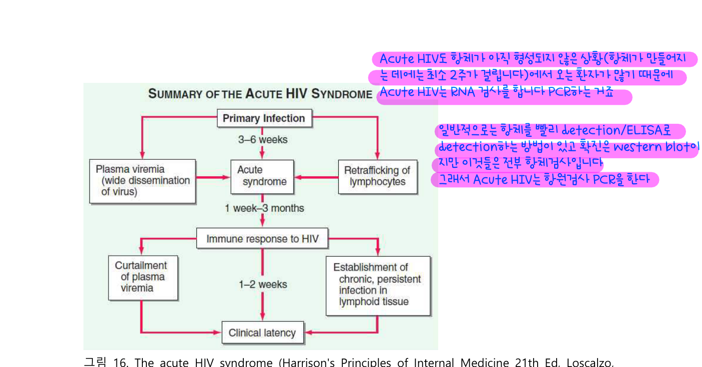{: style="width:72%"}

- 급성 HIV는 **항체가 아직 없는(최소 2주)** 상태로 오는 환자가 많다 → ELISA·Western blot은 전부 **항체검사**이므로 급성기에는 **RNA 검사(PCR)**를 한다.

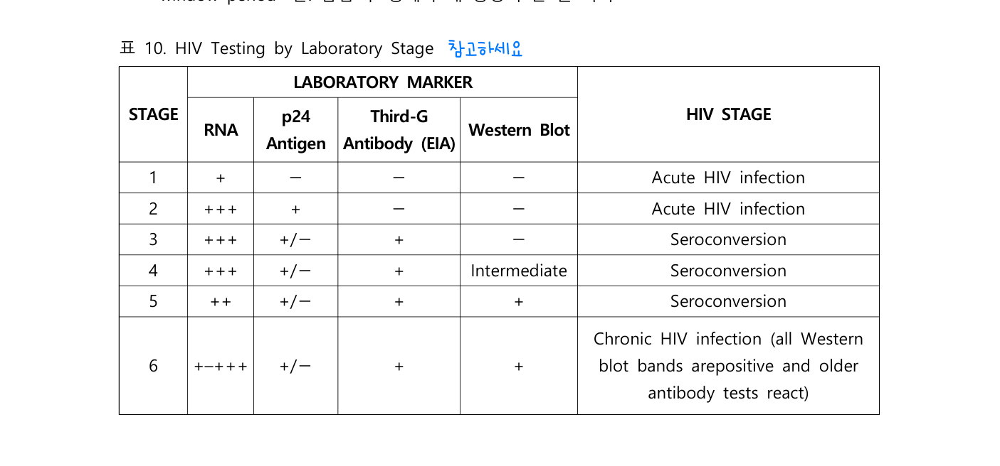{: style="width:72%"}

| 단계 | RNA | p24 | 3세대 항체 | Western blot | |
|---|---|---|---|---|---|
| 1–2 | + / +++ | − / + | − | − | 급성 감염 |
| 3–5 | +++ | +/− | + | − → 중간 → + | 혈청전환 |
| 6 | +~+++ | +/− | + | + (모든 밴드) | 만성 감염 |

## HIV RNA 정량검사와 CD4
- **HIV RNA 정량**: 질병 진행 예측, ART 시작 결정 보조, **치료 반응 모니터링**. 쓰임새는 (a) 초기 진단, (b) **신생아 진단**, (c) 치료 후 모니터링 — 실제로는 **대부분 치료 모니터링**.
- **CD4 수**: 예후, ART 기준, 치료 모니터링.
- **신생아**: 엄마 항체가 태반을 넘어오므로 태어나서 항체검사를 하면 **무조건 양성**. **1년 6개월**이 지나면 자기 항체로 바뀌므로 그 후에도 양성이면 감염. (그 전에는 RNA로 진단)

!!! exam "기출 포인트"
    「확진검사로 적절한 것」→ **Western blot**(2번, 28번 — ELISA 양성 다음 단계), 「가장 기본적인 선별검사」→ **HIV 항체 선별검사(EIA)**(7번). 오답: rapid test(선별용), p24 단독·CD4·viral load(확진 아님). 21번 ㄱㄴㄷㄹ형(2–4주 독감 증상+발진 / CD4 <200 기회감염 급증 / 항체검사·Western blot 확진 / 돌연변이로 백신 없음) → **모두 맞음**.

## 첫 진료 때 하는 검사 (Initial evaluation)

| 범주 | 항목 |
|---|---|
| 기본 진료 | 병력·신체검사, **간이정신상태검사(MMSE — 뇌를 침범하니까)** |
| 혈액 | 일반 화학·혈액, 간기능, 지질·공복혈당, **CD4 수, 혈장 HIV RNA, HIV 내성검사** |
| 감염 관련 | **매독(RPR/VDRL)**, 톡소포자충 항체, 소변검사, **PPD 또는 IGRA(결핵)**, **B·C형 간염**(외국 IV 약물 사용자는 HIV+HCV가 같이 온다) |
| 예방접종 | **폐렴구균, 인플루엔자**(면역 상태와 관계없이 사백신), HPV, A·B형 간염(음성이면). 면역이 괜찮으면 생백신도 가능 |
| 상담·지원 | 자연경과·전파 상담, 접촉자 연락 지원(보험, 기초수급 등). 상담 인력은 질병관리청이 고용 |

# 6. 치료

치료의 개선과 함께 사망자가 확 줄었다. AIDS 환자 치료의 구성:

1. **항바이러스제(ART)**
2. **기회감염 예방 항생제** — CD4 <200이면 PCP 예방 Bactrim 시작, **200 위로 두 번 올라오면 끊는다**
3. 기회감염 조사·치료(결핵, 식도 칸디다증 등)
4. 동반 질환(매독 등 성매개감염, B·C형 간염) 같이 치료
5. 치료 중 합병증(지질대사 이상, lipodystrophy, 당뇨, 말초신경염, 발진, 췌장염)

## 90-90-90 → 95-95-95

| | 2020 목표 | 2030 목표 |
|---|---|---|
| 첫째 | 감염인의 90%가 **자신의 감염을 안다**(진단) | 95% |
| 둘째 | 진단된 사람의 90%가 **지속적인 ART** | 95% |
| **셋째** | **ART 받는 사람의 90%가 바이러스 억제** | 95% |

잘 이루어지지 않아 2030년까지 95-95-95로 슬로건을 바꿨다.

!!! exam "기출 포인트"
    「세 번째(마지막) 90은?」 → **치료받는 사람의 90%에서 바이러스 억제**(12번, 23번). 오답: 90%가 자기 상태를 안다(첫째), 진단자의 90% 치료(둘째), CD4 >500, MSM 연 1회 검사.

## HIV 치료 연속체 (care cascade / continuum)
**진단 → 치료에 연결 → 치료 유지 → ART 시작 → 순응 → 바이러스 억제**. 선진국도 진단 안 된 채 사는 사람이 20–25%. 진단된 사람의 25%만 제대로 치료받는다는 자료도 있지만 우리나라는 **진단만 되면 공짜로 치료**해 줘서 60–70%는 확보한다.

## 기회감염의 치료
- 기존 치료제로 치료 가능한 경우가 많다(**PCP가 가장 중요, 그다음 TB**). 결핵은 일반 환자처럼 항결핵제로 잘 치료된다. 당연히 HIV도 같이 치료한다.
- 일반 환자와 다른 점: 치료가 끝나도 재발을 막기 위해 계속 투약해야 하는 경우(**유지요법·2차 예방**) — **PCP, CMV 망막염, 크립토콕쿠스 수막염**이 대표적.
- 약제 내성이 더 문제: 반복되는 아구창에 fluconazole, CMV 망막염 재발 방지에 ganciclovir를 오래 쓰면 내성.

## ART — 병합요법(HAART)

- 1987년 **zidovudine(AZT)**이 처음 나왔고, 단독·2제 요법은 내성으로 실패, **1996년 3제 병합요법(HAART)**이 성공했다. **계열이 다른 약**을 섞어야 한다.

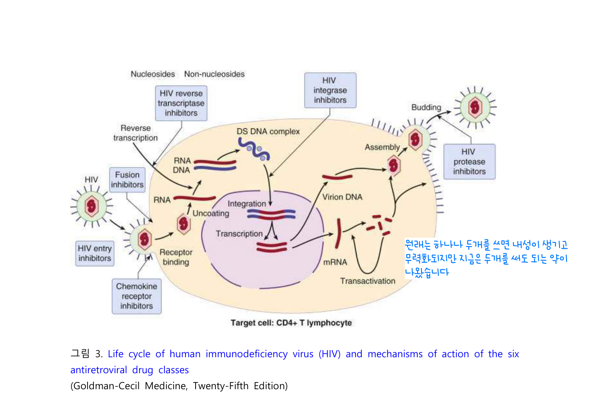{: style="width:72%"}

| 작용 단계 | 약물군 | 예 |
|---|---|---|
| 부착·진입 | CCR5 길항제(entry inhibitor), 융합 억제제 | maraviroc, enfuvirtide |
| 역전사 | **NRTI**(뉴클레오시드 — backbone), **NNRTI** | TDF/TAF, FTC, 3TC, ABC, AZT / efavirenz, rilpivirine, doravirine |
| 통합 | **INSTI(integrase 억제제)** | **bictegravir, dolutegravir**, raltegravir, cabotegravir |
| 성숙 | PI(protease 억제제) | darunavir, atazanavir, lopinavir/ritonavir |
| (캡시드) | capsid 억제제 | lenacapavir(PrEP용으로 최근) |

- 요즘 trend: **backbone(NRTI) 2개 + integrase 억제제**, 또는 **backbone 1개 + integrase 억제제(2제)**. 원래는 1–2개만 쓰면 내성이 생겼지만 약이 강해져 2제도 가능하다. 이제는 **하루 한 알(STR)**.
    - **Bictegravir/TAF/FTC (빅타비)** — 1일 1회, 효능 높고 부작용·상호작용 적음, 신기능 정상이면 1차. **약 70%**가 이것.
    - **Dolutegravir/3TC (Dovato) 2제** — 기저 RNA <500,000, **HBV 음성**일 때. 신독성·골밀도 영향 없음. 약 20%.
    - 대안(10%): dolutegravir + TAF/FTC, darunavir/cobicistat + TAF/FTC(내성 위험 높을 때).
- **장시간 작용형 주사(LAI)**: **cabotegravir(INSTI) + rilpivirine(NNRTI)** 근주, **2개월마다**가 표준(2024). 경구약으로 3개월 이상 억제 확인 후. 순응도·프라이버시 해결. "요즘은 주사로 맞는 게 대세, 두 달에 한 번 방문."

## 치료의 원칙과 목표
- 목표: **임상**(수명 연장, 삶의 질) · **바이러스**(가능한 한 오래, **viral load를 최대한 낮게 — 가급적 <20 copies/mL**, 진행 정지와 내성 방지) · **면역**(CD4 정상 범위로 양적·질적 회복) · **역학**(전파 감소).
- 원칙(Harrison): 지속적 복제가 면역 손상을 부른다 / RNA는 복제 정도, CD4는 현재 면역 능력 / 치료 결정은 RNA와 CD4로 개별화 / 억제가 강할수록 내성 적음 / 써본 적 없고 교차내성 없는 약의 병합으로 시작 / 여성은 임신 여부와 관계없이 최적 요법 / **복약 순응도(adherence = 처방받은 약을 다 먹는 비율)가 핵심 — 요법이 단순할수록 순응도가 높다**("이 말을 기억하셔야").
- 반응: 약을 먹으면 **4주쯤 바이러스가 거의 안 보이고, 8주면 옆 사람에게 전파가 안 된다** → 그래서 **same day treatment**.

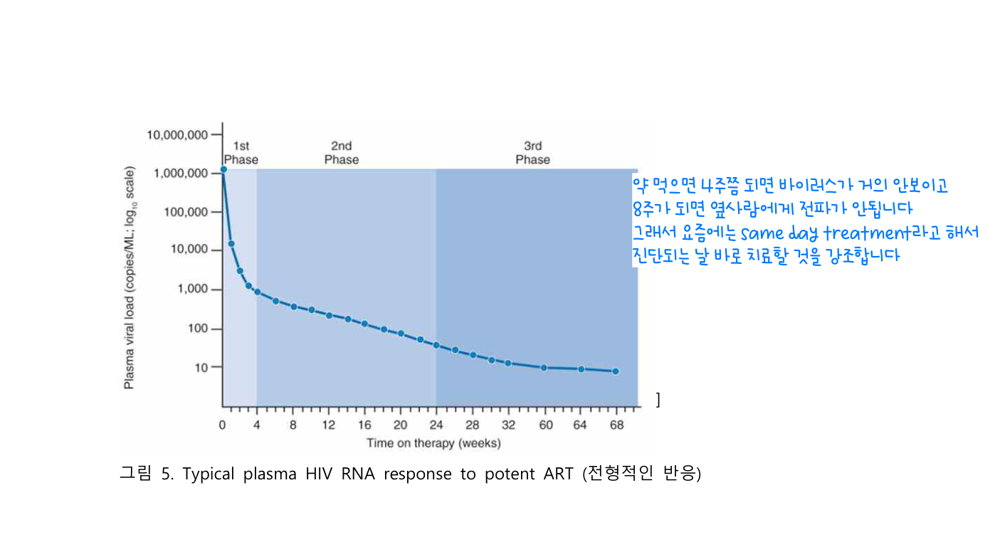{: style="width:62%"}

## 언제 시작하나 — 진단 즉시, 모두

!!! key "핵심"
    "**모든 HIV 감염자는 진단 즉시 ART 시작**(Treat All, Same Day ART). CD4나 동반질환과 관계없이"(START, TEMPRANO 연구). 예전엔 좋은 약이 없고 부작용이 심해 CD4가 200 아래로 떨어질 때까지 기다리기도 했지만(2007년 국내 기준 CD4 350), 2015년 WHO가 CD4와 관계없이 모두 치료로 바꿨다.

| 상황 | 시작 시점 |
|---|---|
| 모든 감염인, 임산부, 급성 HIV, B·C형 간염 동반, 소아·청소년 | **즉시** |
| 결핵 동반 | 결핵 치료 시작 후 **2–8주 이내**(CD4 <50이면 2주 이내) — IRIS 위험 고려 |
| **크립토콕쿠스 수막염** 동반 | 항진균 치료 후 **4–6주 지연** — 조기 시작 시 IRIS로 사망 ↑ |

- **면역재구성 염증증후군(IRIS, paradoxical reaction)**: 치료하는데 오히려 나빠지는 것. 예: 결핵성 림프절염에 약을 쓰면 균이 죽으면서 면역이 살아나 고름이 고이고 터진다. 그래서 결핵·크립토콕쿠스는 시작 시점을 조절한다.
- 고려사항: 환자의 **치료 의지·준비(동의)**, **순응 가능성(상담이 중요 — 약 받아 가서 안 먹으면 그만)**, 알약 수·횟수·음식, 병의 중증도(CD4, viral load, AIDS 정의 질환), 부작용, 동반질환(결핵, 간질환, 우울증, 심혈관, 약물의존, 임신), 약물상호작용.
- 외래: 처음엔 2·4·8주, 억제되면 **3–6개월 간격**, 안정되면 1년에 두 번.

!!! exam "기출 포인트"
    「현재 권고」 → **모든 감염자에게 즉시 치료**(8번), 「치료 대상 CD4」 → **CD4 수에 관계없이 모두**(26번). 「치료의 목표」 → **혈중 바이러스를 검출한계 미만으로**(5번 — CD4 50 이상 유지·급성 증상 호전은 오답). 3번: ART 1개월 후 CD4 상승 + RNA <20 → **성공적인 바이러스 억제**.

## 언제까지·바꿀 때·문제점
- **현재는 평생 치료**. 가장 중요한 것은 **첫 치료에서 최대 효과를 최대한 오래** — 내성이 향후 치료를 어렵게 하는 가장 큰 요인이고, 치료 실패의 가장 중요한 원인은 **환자가 약을 잘 안 먹는 것**과 최대 요법이 아닌 경우.
- 치료 변경 지표: 시작 **4주 내 RNA가 1-log 이상 안 떨어짐**, RNA가 **최저치에서 3배 이상 재상승**(일시 감염·예방접종·검사 오류 제외), CD4 지속 감소, 임상 악화, 심한 부작용.
- **내성**: 약을 먹다 안 먹다 하면 생긴다. **내성검사(유전자형이 표준)**: 치료 시작 전 모든 신규 환자, 치료 실패(RNA >200 지속), 재치료 전. 전파성 내성이 신규 감염의 8–15%, INSTI 내성 증가 추세. 요즘은 약이 좋아져 내성 이야기가 잘 안 나온다.
- 부작용: 초기 약은 **lipodystrophy**(지방세포 손상)가 많았지만 지금은 거의 없다. 최근 개선점 = **부작용 감소, 하루 한 알, 빠른 바이러스 억제**.
- 초기 HIV 관리: RNA·CD4를 **3–4개월마다**(RNA가 가장 중요), PPD, 톡소·매독·간염·간기능·흉부 X선, 기초 유전자형 내성검사, 정신사회 상담, 안전한 성관계·주사바늘 공유 회피 교육, 폐렴구균·간염·매년 인플루엔자 백신.
- 완치 사례: **베를린 환자(2008)**, 런던 환자(2019), 뒤셀도르프 — 모두 **CCR5 Δ32 돌연변이 공여자의 줄기세포 이식**. 이걸 유도할 기술은 아직 없다. 연구: shock and kill, 유전자 편집 등.

# 7. 기회감염의 예방 (1차 예방)

| 병원체 | 시작 기준 | 1차 약 | 대안 |
|---|---|---|---|
| **PCP** | **CD4 <200 (또는 <14%, 아구창 병력)** | **TMP-SMX 1정 매일** | dapsone, atovaquone, 흡입 pentamidine |
| **톡소포자충 뇌염** | **CD4 <100 + IgG 양성** | **TMP-SMX DS 매일**(PCP 예방과 같은 약) | dapsone + pyrimethamine |
| **MAC** | **CD4 <50**(ART 시작이 늦어질 때) | **azithromycin 1,200 mg 주 1회** | clarithromycin |
| 결핵(잠복) | TST ≥5 mm, 미치료 양성, 활동성 결핵 접촉 | **isoniazid 9개월 + pyridoxine** | rifampin 4개월 |
| 크립토콕쿠스 | 1차 예방은 아프리카 등 고위험 지역만(국내 비권장) | 치료 후 2차 예방 fluconazole 유지 | |
| CMV 망막염 | 주로 치료 후 2차 예방 | valganciclovir | |

- 잠복결핵에 rifampin도 쓰지만 **HIV 약과 상호작용이 많아 isoniazid를 9개월** 쓴다. 조기 ART를 하면 MAC 예방은 대부분 불필요.

# 8. 예방

## 전파 경로와 위험도

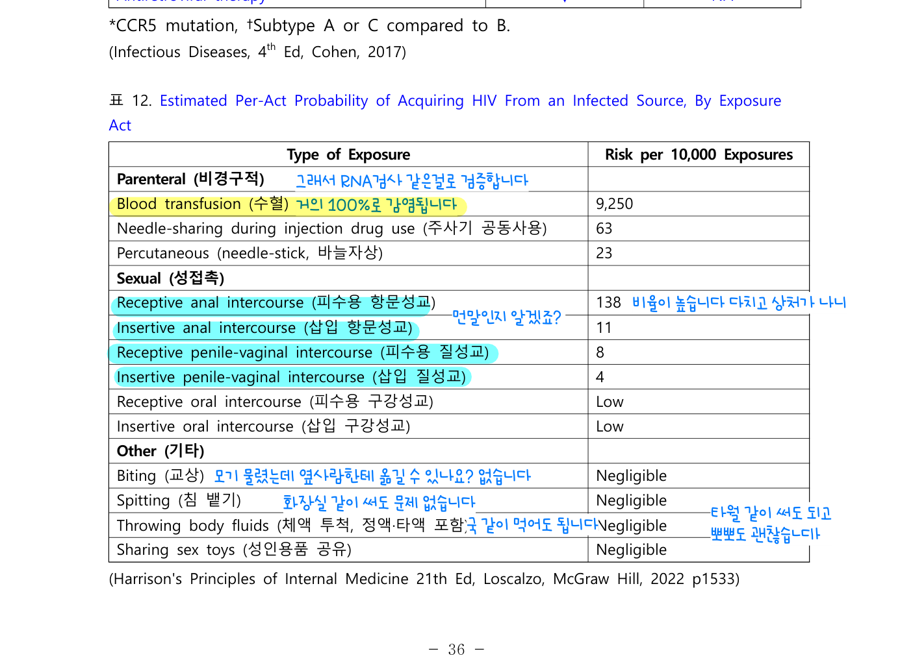{: style="width:72%"}

| 노출 | 위험 (10,000회당) |
|---|---|
| **수혈** | **9,250 — 거의 100%** (그래서 RNA 검사로 거른다) |
| (보조) 출산(모자감염) | 2,255 |
| 주사기 공동사용 | 63 |
| **바늘 자상** | **23 (≈0.3%)** |
| **피수용 항문성교** | **138** (다치고 상처가 나서 높다) |
| 삽입 항문성교 | 11 |
| 피수용 질성교 / 삽입 질성교 | 8 / 4 |
| 구강성교 | 낮음 |
| 교상·침 뱉기·체액 투척·성인용품 공유 | 무시할 수준 |

- **위험 없음**: 모기, 화장실·타월 같이 쓰기, 국 같이 먹기, 뽀뽀.
- 체액별: **정액, 질분비물, 눈에 보이게 피가 섞인 체액 = 큼** / 뇌척수액·관절액·흉수·복수·심낭액·양수 = 중등도 / **콧물·침·객담·땀·눈물·소변·대변·구토물 = 없음**. 모유에는 있을 수 있다.
- 전파를 늘리는 요인: **다른 성병**, 생식기 염증, **급성 감염**(바이러스가 엄청 많아 감염력 높음), 진행된 감염, subtype A·C. 줄이는 요인: **포경수술**(남아프리카 RCT에서 60% 감소 — "HIV 백신보다 낫다", 아프리카는 약보다 포경을 강조), **ART**, CCR5 돌연변이.

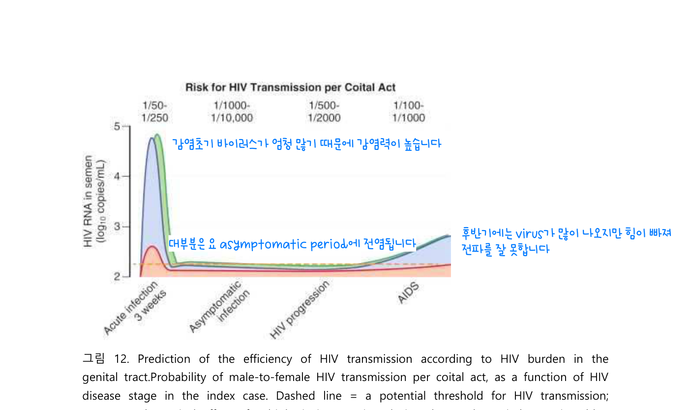{: style="width:62%"}

- 감염 초기는 바이러스가 많아 감염력이 높지만, **실제로 대부분은 긴 무증상기에 전염**된다. 후반기엔 바이러스는 많지만 힘이 빠져 전파를 잘 못한다.

!!! exam "기출 포인트"
    「감염 위험이 가장 큰 것」이 2번 — 둘 다 **치료받지 않은 감염 산모에게서 자연(질식)분만으로 태어난 신생아**(14번, 31번 — 자연 확률 25–50%). 바늘찔림 0.3%, 점막 0.09%, 피수용 항문성교 1회 ~1.4%, 주사기 공유 ~0.6%. 31번 함정: **바이러스가 검출되지 않는 환자**의 피에 찔림, **PrEP 중**인 사람은 위험이 매우 낮다.

## 의료행위 중 감염 예방
- 직업적 감염은 대부분 **혈액 + 피부를 뚫는 상처(주사바늘)**. 감염인 혈액에 한 번 노출 시 **0.3%**, **점막 노출 0.09%**, **손상 없는 피부는 위험 없음**. 혈액량·환자의 viral load가 중요하고, 바늘이 굵고 깊을수록 위험.

| 바늘찔림 시 전파 위험 | |
|---|---|
| HBV(미접종), 원천 HBeAg+ | 37–62% (임상 질환 30%) |
| HBV, HBeAg− | 23–37% (임상 질환 3%) |
| **HCV** | **1.8%** (예방약은 없지만 치료약이 있다) |
| **HIV** | **0.3%** (예방약을 먹는다) |

필기: "**외워야 합니다**."

- **일반주의(Universal precaution)**: 손씻기, 혈액·체액 예상 시 장갑, 튈 것 같으면 가운·마스크+보호안경, **사용한 바늘은 뚜껑을 다시 씌우거나 구부리거나 자르지 말고 바로 버리는 통에**(부득이하면 한 손으로), 환경 소독, 검체는 장갑 끼고 채취·뚜껑 있는 용기·「체액주의」 스티커.

## 노출 후 예방 (PEP)
- 찔렸을 때: **짜지 말고** 가능한 빨리 **비누와 흐르는 물로** 철저히 씻는다. 깊으면 씻고 봉합, 절개·도려낼 필요 없음. 원천 환자의 HIV 상태 확인(검사가 없으면 요청), 찔린 사람의 baseline HIV 확인 → 추적 중 양성이면 **산업재해**. 두 번째 상황은 **성폭력**(가해자가 HIV이거나 의심).
- 약: **3제가 기본 — TDF/FTC 1일 1회 + dolutegravir 50 mg 1일 1회(또는 raltegravir 400 mg 1일 2회), 28일(4주)**. **가능한 빨리(2시간 이내, 최대 72시간)**. 추적검사 **6주, 3개월, 6개월, 12개월**. 1개월 하면 전파율이 거의 없다.

!!! exam "기출 포인트"
    18번: 인턴이 HIV 신환(RNA 120,000)에게 ABGA 중 바늘찔림 → **TDF/emtricitabine + dolutegravir 4주**. 오답: zidovudine 단독, lamivudine 4주(단독 금지), **cabotegravir 주사 1회(= PrEP용)**, 「위험이 낮아 불필요」. 6번: 의료인 HIV 예방의 기본 조치 → **Universal precaution**(매일 예방약 = PrEP, 매월 검사, 격리는 오답).

## 노출 전 예방 (PrEP)
- "피임약 생각하면 된다" — 몸에 HIV 약이 떠 있으면 바이러스가 자리를 못 잡는다. 대상: **고위험군(MSM, 혈청 불일치 커플, 고위험 이성애자)**. 한 달에 4만 원 정도.
- **경구 TDF/FTC(Truvada) 1일 1회** → 성접촉 감염 위험 **99% 감소**(제대로 먹을 때). 2012 FDA 첫 승인, 국내도 이것만 허가. 효과는 **순응도**에 크게 좌우(VOICE·FEM-PrEP은 안 먹어서 실패).
- **event-driven(간헐적)**: 성관계 예상 2–24시간 전 2알 → 24시간 후 1알 → 48시간 후 1알.
- **장시간 작용형**: **cabotegravir 2개월마다 근주**(경구 대비 66% 추가 감소, 국제 표준 옵션), **lenacapavir 6개월마다 피하주사**(capsid 억제제) — 우리나라엔 없다.
- 모니터링: 시작 전 HIV·HBV·신기능·성병 검사, **3개월마다 HIV**, 6개월마다 신기능. PrEP은 다른 성병은 못 막으니 콘돔도 같이.

## 주산기(모자) 감염 예방
- 자연 전파 확률 **30–50%**(젖으로도 전파).
- **모든 임산부 ART**, 바이러스를 **<50(최소 <1,000) copies/mL**로 억제. 분만기 산모에게 **zidovudine 정주**, **제왕절개**, **수유 금지**, 신생아에게 **zidovudine 시럽** → **5% 이하**로.
- 치료 안 하면 산모가 먼저 사망하고 남은 아이를 **AIDS orphan**이라 한다(아프리카 같은 의료 불평등 지역의 문제).

## 백신
아직 없다. 높은 돌연변이율, 숙주 DNA 통합, 잠복 저장소, 면역 회피, 자연 완치 사례가 없어 모방할 면역 반응이 없는 것 등이 어려움. **mRNA 백신(Moderna, IAVI)**·광범위 중화항체(bnAbs) 연구 중.

## 예방 전략
- **ABC-Plus**: **A**bstinence(금욕 — 최고지만 불가능), **B**e faithful(배우자에게 충실 — 다수 파트너가 가장 위험), **C**ondom(**B+C가 가장 효과적**) + 포경수술, 마약 위험 홍보, 산전진찰·모자감염 예방, 성병 치료, **Test and Treat**.
- 감염인에게: 행동 변화, 법적 책임 교육, 빠른 치료, 성병 치료, 낙인 줄이기. 비감염인에게: 검사 접근성(신속검사), PEP·PrEP, 포경, 교육.
- 예방 방법별 효과(보조): 콘돔 80–95%, PrEP >90%, PEP ~80%, 모자감염 예방 >95%, **치료를 통한 예방(U=U) ~100%**.

# 9. U=U (Undetectable = Untransmittable)

!!! key "핵심"
    **ART로 혈중 HIV RNA가 <50 copies/mL로 6개월 이상 억제되면 성관계로 전파되지 않는다.**
    근거: **PARTNER 1·2**, Opposites Attract, HPTN 052 — 약 **148,000회 무콘돔 성관계에서 전파 0건**(PARTNER-2 MSM 76,088회 중 0). 2008 스위스 성명 → 2011 HPTN 052(전파 96% 감소) → 2016 국제 합의, WHO·CDC 공식 권고.

- 임상 적용: RNA <50 최소 6개월 유지, **3–6개월마다** 바이러스 확인, 성병에 걸리면 일시적으로 전파 위험 증가 가능.
- 사회적 의의: **감염인 낙인 해소, 치료 동기 강화, 공중보건 예방 효과**. 치료받을 권리를 보장하는 것이 비감염인을 보호하는 방법이기도 하다(TasP).
- 주의: U=U는 바이러스가 **완전히 없어진 것(완치)이 아니고**, 항체는 계속 양성이며, 백신도 아니다.

!!! exam "기출 포인트"
    **가장 많이 나온 문제(5번)**: U=U의 뜻 → **「혈중 바이러스가 검출되지 않을 정도로 억제되면 타인에게 전파되지 않는다」**(4, 11, 15, 19번). 오답은 늘 인권·장애인·국가 지원·「모든 양성자는 치료 대상」·「만성 질환일 뿐」, 2025년엔 「완전히 제거되어 재발하지 않는다」「ART를 받으면 감염이 예방된다」「항체 음성이 되면」「백신」.

# 10. 인권·비밀보장과 그 밖의 것

- **비밀유지의무**: 후천성면역결핍증예방법의 비밀누설 금지 — **3년 이하 징역 또는 1,000만 원 이하 벌금**.
- 진료비 **100% 국가 지원**, 감염인 일자리 창출. 우리나라 "에이즈 = 동성애" 접근은 부정적 결과를 낳는다 — 누구나 감염될 수 있고 감염자는 약자다. 위험군은 **최소 1년에 1회** 검사, 환자는 상대방 동의 등 책임의식.
- 낙인의 유형: 내재화된(자존감 저하·우울), 인지된(검사·치료 회피), 실행된(실제 차별).
- 다른 과의 진료 거부는 무지와 자기보호 본능에서 온다 — 협조는 감염내과를 통해. 차별 때문에 감염 사실을 숨기고 시술받는 경우가 많다. 장기요양이 필요한 환자: 뇌 질환(림프종, 뇌매독, PML, 톡소, HIV 뇌증), 정신질환·약물의존 동반.
- **HIV denialism**: Christine Maggiore 이야기, 2000년 **더반 선언**(HIV가 AIDS의 원인임을 확인).
- 역사 몇 개: 1981 CDC가 미국 동성애 남성의 PCP·카포시 육종 집단 발생 보고 → 1983 Montagnier(LAV), 1984 Gallo(HTLV-III) → 1986 HIV 명명 → **1987 AZT** → 1988 12월 1일 세계 에이즈의 날 → 1991 빨간 리본 → 1996 HAART·UNAIDS → **2012 Truvada PrEP** → 2014 90-90-90. 한국은 1985 첫 감염인.
