<!-- 필기본: 2025 -->
<!-- 단계: 수업 전 -->

# 0. 이 수업을 공부하는 법

**감염병학 증례토의 CP-2**(감염내과 **김신우 교수님**, 2025년 11월 20일). CP-A1(3번)에 이어 **Case 11~20**의 열 증례를 다룬다. 증례마다 "의심 진단은? 진단·치료 계획은?"을 묻고, 교수님이 사진을 보며 짧게 설명하셨다. 필기한 선배: "교수님이 사진을 보고 바로 알아야 한다고 강조하신 것" 위주로 적혀 있다.

| Case | 환자 | 진단 | 핵심 |
|---|---|---|---|
| 11 | 73세, 체중감소·호흡곤란 | **좁쌀결핵** + 결핵성 흉막염 | HIV 확인, 객담 양성률 낮음 |
| 12 | 67세, 1년간 손목 부종 | **관절결핵** | rice body, Phemister triad |
| 13 | 69세, 입이 안 벌어짐 | **파상풍** | 보고 진단, TIG + metronidazole |
| 14 | 75세 당뇨, 다리 + 배 수포 | **파종성 대상포진** | acyclovir **정맥** |
| 15 | 45세, 반복되는 종기 | 재발성 *S. aureus* 피부농양 | 비강 **mupirocin + chlorhexidine** |
| 16 | 78세, 침 맞은 뒤 하지 무력·고열 | **화농성 척추염** | 결핵성과 감별(CRP) |
| 17 | 신이식 2년, 호흡곤란 | **폐포자충폐렴(PCP)** | GMS 염색, TMP-SMX 21일 |
| 18 | 63세, 눈을 부딪힌 뒤 실명 | ***Klebsiella* 간농양 + 내안구염** | 간농양이면 눈, 눈이면 간 |
| 19 | 41세, 망막혈관염 + VDRL 1:64 | **안매독·신경매독** | 뇌척수액, penicillin G |
| 20 | 68세, 남편 코로나 | **COVID-19 폐렴** | 산소 필요 → remdesivir + 스테로이드 |

기출 23문항이 이 증례들에서 거의 그대로 나온다. 특히 **좁쌀결핵**(1, 5, 10, 20번), **파종성 대상포진**(3, 6번), **재발성 종기 탈집락화**(2, 8번), **Klebsiella 간농양·내안구염**(7, 16, 19번), **파상풍**(4, 11, 17번과 독소 주관식 14, 18, 23번), **신경매독**(15, 22번), **COVID-19**(9, 21번).

!!! key "핵심"
    - 결핵 진단·치료는 **한국 지침**을 우선 — 국내 유통 여부, 내성 빈도, 보험 적용을 고려.
    - **AFB 도말**은 확진이 아니고, **배양·PCR 양성**이 확진. 격리 환자는 객담 PCR **3번 음성**이면 일반 병실로.
    - 파상풍은 **검사가 소용없다 — 보고 진단**. 앓아도 면역이 생기지 않아 회복 후 **백신**.
    - 파종성 대상포진은 입원해서 **acyclovir 정맥주사** — 집에 먹는 약 주면 신경통 위험.
    - **간농양 + 눈 충혈·시력저하 → Klebsiella 내안구염**. 안구 안에 **vancomycin + ceftazidime** 주입.

# 1. Case 11 — 좁쌀결핵 (miliary TB)

> 73세 남자, 1주간의 호흡곤란. 2~3개월 전부터 식욕부진, **체중 8 kg 감소**, 1주 전부터 발열과 호흡곤란. 37.8℃.

- 흉부 X선: **흉수**. 흉부 CT: 양측 폐에 좁쌀 같은 결절 → **좁쌀결핵**. 교수님: "이렇게 CT가 나왔다 그럼 **반드시 underlying HIV가 있는지 확인**해야 한다."

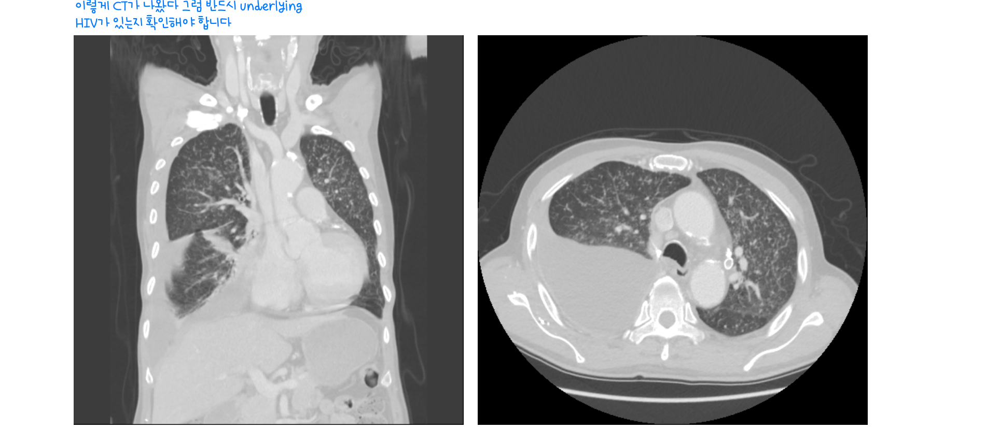{: style="width:62%"}

## 1-1. 정의와 역학

- 결핵균의 **혈행성 파종**에 의한 전신 결핵. 영상에서 **좁쌀(millet seed) 크기 결절이 양측 폐에 무작위로**. 교수님: "림프절 같은 데서 caseous necrosis가 **blood stream으로 확 퍼진** 것."
- 전체 결핵의 **1~2%**. 면역저하(HIV — CD4 < 200, 장기이식, 면역억제제), 소아·노인, 악성종양, 당뇨, 만성신부전. 치료 전 사망률 15~30%.
- 결핵에 감염되면 평생 발병 위험은 교과서상 5~10%지만 교수님: "요즘은 오래 살아 **20%**로 생각한다. **고령은 늘 결핵을 생각**해야 한다." 노인 결핵이 문제(70~80대).
- 교수님: "결핵은 호흡기 질환이다. 한센병도 호흡기 질환."

## 1-2. 임상양상

- **아급성형(가장 흔함)**: 수 주~수 개월, 발열·체중감소·야간발한, 진단 지연이 흔함. 급성형(빠른 진행, 호흡부전), 만성형(원인불명 열로 오인).
- 침범: 폐 100%, 간·비장 50~80%, 골수 25~75%, **중추신경계 10~30%**(교수님: "머리로도 갈 수 있다 — 두통이 있는지 보고 **tapping**을 할지 생각"), 복막·심낭, **척추**(cold abscess).
- 교수님: "**객담에서 양성률이 낮다** — 객담이 아니라 blood stream을 타고 폐 병변을 만들었기 때문."
- 일반 폐결핵은 **폐첨부(apex)**를 좋아한다(산소 농도가 높아서) → X선에서 apex를 본다.
- 종격동 림프절에 **중심 괴사** → TB 림프절염 의심, **HIV 검사**.

## 1-3. 진단

- **AFB 도말**: 확진이 아니다(다른 항산균도 양성). **배양**(액체 > 고체; 2주 이상) 또는 **PCR 양성이면 확진**.
- 교수님: "**PCR이 가장 핵심**이 됐다. TB PCR 3번 음성이면 결핵이 아니겠다 할 만큼." 요즘은 **PCR + rifampin 내성 유전자 검사(Xpert)**를 같이. 의심되면 **3회 정도 반복**.
- 감염병동에서 격리 → 객담 **3번** PCR 음성이면 일반 병실로.
- **Löwenstein-Jensen 배지** — 교수님: "가장 대표적인 배지. 이 그림 잘 봐 두면 시험에 도움이 될 수 있다. 민초같이 생겼네요."

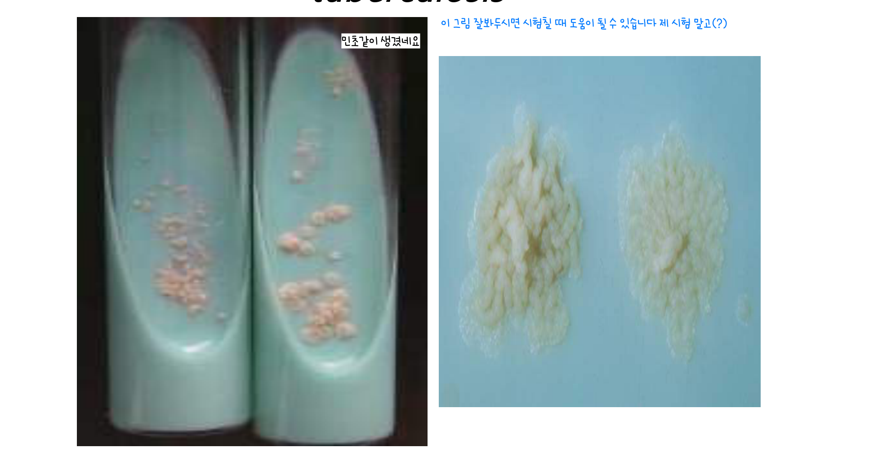{: style="width:55%"}

- **육아종(caseous necrosis with granuloma)** — 교수님: "이게 보이면 결핵. 근데 **99%이지 확진은 아니다**(1%는 브루셀라, 사르코이드증 등). 그럼 PCR과 배양을 해 놓고 결핵약을 시작한다."
- 교수님: "결핵 진단 및 치료는 **한국 지침을 우선** 참고, 교과서대로는 안 되는 경우가 많다. 우리나라에서 유통되는 약인지, 내성 빈도가 어떤지, 의료보험이 적용되는지 — 이 세 가지를 고려."

## 1-4. 치료

| | 초기 2개월 | 유지 | 총 기간 |
|---|---|---|---|
| 결핵성 흉막염 | **HRZE** | HR 4개월 | 6~9개월 |
| **좁쌀·파종성 결핵** | HRZE | HR 7~10개월 | **9~12개월** |

- 교수님: "**miliary는 9개월** 쓴다. 감수성이 있을 때만 (유지기에) 두 가지(HR)를 쓰고, 없으면 isoniazid·rifampin·ethambutol 세 가지." "airway를 누르면 **스테로이드**."
- 파종성 결핵 — 교수님: "진단이 어렵다. 딱 맞추면 큰일 난 상황. 빨리 치료하고 **수막염·AIDS 다 감별**해야 한다."

!!! exam "기출 포인트"
    - 좁쌀결핵 영상 고르기·진단(1, 5, 10, 20번): **양측 폐 전체의 1~3 mm 균일한 미세결절** = 혈행성 파종. 공동은 재활성화 폐결핵.
    - 20번: 2~3개월 식욕부진·8 kg 감소·미열 + 좁쌀 결절 + 흉수 → 좁쌀결핵과 **결핵성 흉막염**(흉수: 림프구 우세, **ADA > 40 U/L**).
    - 10번: 젊은 남성 → 면역저하(**HIV**) 확인.

# 2. Case 12 — 관절결핵

> 67세 여자. 1년 전 손을 짚은 뒤 오른손이 저리고, 물리치료를 해도 **손목 부종이 계속**. 36.7℃. 뼈스캔에서 염증, MRI에서 조영 증강되는 농양 주머니가 많다. 수술 부위에서 **rice body**.

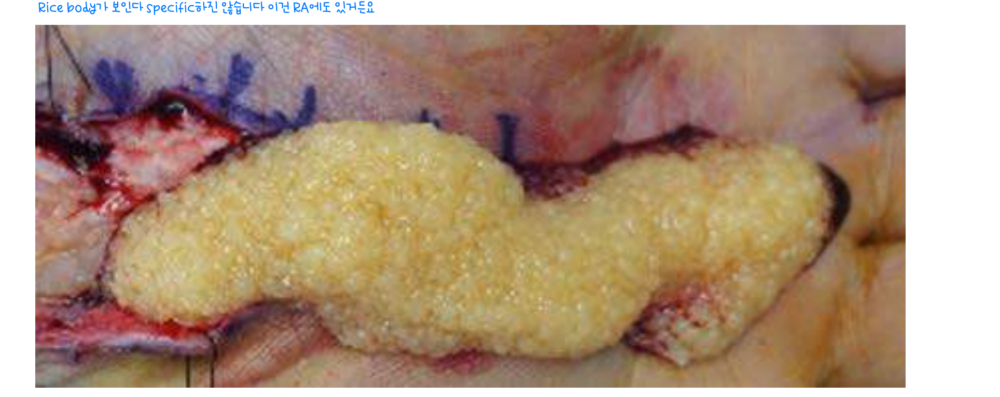{: style="width:55%"}

- 역학: 전체 결핵의 1~2%, 폐외결핵의 10~15%. **척추 50%** > 고관절 20% > 무릎 15%. 혈행성 전파 → 혈류 풍부한 활액막에 집락 → 육아종성 염증 → 판누스 → 연골·뼈 파괴.
- 교수님: "**놓치는 경우가 많다.** 이것저것 하다가 6개월 지나간다. 의심하고 단서를 찾아내는 능력이 중요." "**손톱, 발톱, 머리카락 빼고 결핵은 어디든 다 간다** — 대식세포가 잡아먹고 옮겨 주니까."
- **Rice body**: 관절결핵의 70%에서 관찰. 결핵에서 가장 중요하지만 **RA 등에도 있어 특이적이지 않다**. 교수님: "specific하진 않지만 도움은 된다."
- **Phemister triad**(X선): **관절주위 골감소증, 경계부 골미란, 관절간격 협착**.
- 의심 포인트 — 교수님: "monoarthritis인데 왜 이렇게 오래가지? RA는 양쪽인데 왜 단관절이지? 화농성은 며칠 화끈하게 아프지? 농양이 있는데 그 안에 뭐가 들었을까?" → 조직검사에서 **caseous necrosis with granuloma**면 결핵, PCR은 그날, TB 배양은 2~4주(6~8주) 뒤 확인.
- 확진 검사: 수술 검체의 **AFB 도말·배양·TB-PCR**, 조직검사.
- 치료: **HRZE 2개월 → HR 7~10개월, 총 9~12개월**(교수님: "9개월 이상"), 필요하면 활액막 절제 등 수술.
- 감별: 화농성 관절염(급성·고열·호중구), 진균, **브루셀라**(교수님: "소 키우는 사람"), RA(다관절·대칭), 통풍, 종양.

# 3. Case 13 — 파상풍

> 69세 여자, 수선 바느질로 생업. 2일 전부터 **입을 벌리기 어렵고 목이 굳는다**. 발음이 어렵고 말할 때 침이 흐른다. 37.2℃.

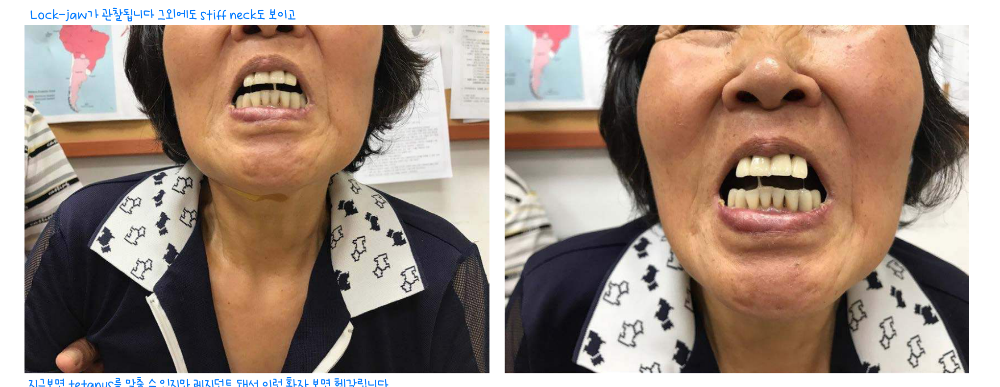{: style="width:62%"}

교수님

- "파상풍 환자 중에는 **상처가 없는 경우**도 있다."
- "중요한 건 파상풍은 **한 번 앓아도 면역이 생기지 않는다**. 그래서 앓고 나서 **예방접종을 새로** 해야 한다. 자연면역은 안 생기고 인공면역만 생긴다."
- "지금 보면 맞힐 수 있지만 레지던트 돼서 이런 환자 보면 헷갈린다. **검사 소용없다. 그냥 보고 진단해야 한다.**"

## 3-1. 원인과 병인

- ***Clostridium tetani***: 그람양성 **혐기성** 간균, **아포** 형성(열·소독제에 저항), 흙·먼지·동물 분변.
- 상처 → 아포가 혐기 환경에서 발아 → **tetanospasmin** → **역행성 축삭 수송** → 척수·뇌간의 **억제성 신경(GABA, glycine) 차단** → 운동신경 탈억제 → 근육 경직·경련.
- 독소는 **A-B형 독소**: 단백분해효소로 두 사슬로 나뉘고, B 사슬이 신경세포 표면 수용체(강글리오시드)에 결합해 들어간다.

!!! exam "기출 포인트"
    파상풍 독소 vs 보툴리눔 독소 주관식(14, 18, 23번): **파상풍** = 척수 억제성 중간뉴런의 **glycine·GABA 방출 차단 → 강직마비**. **보툴리눔** = 신경근접합부에서 **acetylcholine 분비 차단 → 이완마비**.

## 3-2. 임상

- 잠복기 3~21일. 다친 기억이 없는 경우가 많다. 국소형·두부형·**전신형(80% 이상)**.
- **아관긴급(trismus)** → 경부 경직, 연하곤란, 복부 근육 수축, 후궁반장. **의식은 명료**, 자극에 과민. 근육 수축은 3~4주 이상, 완전 회복은 수개월.
- 합병증: 호흡근·후두 경련 → 기도 폐색, 척추 골절, **자율신경 불안정**(고혈압·빈맥·부정맥·발한·고체온).
- 교수님: "입원하면 **한두 달 인공호흡기**를 달아야 할 만큼 숨을 못 쉰다. 독소가 사라지는 데 시간이 많이 걸린다. 이걸로 죽진 않고 **2차 폐렴(병원 폐렴), 패혈증**으로 인한 사망이 더 많다."
- Ablett 분류(I~IV)에 따라 사망률이 달라진다(<10% → >40%).
- 감별: 약물 부작용, 뇌수막염, 스트리크닌 중독, 악성고열증, 턱관절 장애 — **배양 불필요**, 임상으로 진단.

## 3-3. 치료

- 즉시: 기도 확보(조기 삽관), 상처 처치(괴사조직 제거), **어둡고 조용한 방**, 자극 최소화.
- **파상풍 면역글로불린(TIG)** — 결합되지 않은 독소 제거. **항생제: metronidazole**(penicillin G도 가능) — 교수님: "penicillin은 seizure를 더 일으킬 수도 있다는 얘기가 있어 metronidazole을 쓴다."
- 대증: **benzodiazepine**(diazepam·midazolam), baclofen, 진정제, **magnesium sulfate**·β차단제(자율신경).
- 교수님: "**Immunoglobulin, metronidazole 이 두 개가 중심**. 환자를 편하게 하기 위해 재우는 거죠."
- 회복기에 **반드시 파상풍 백신**. 교수님: "1년에 전국에서 20~30명밖에 보고되지 않지만 죽다 살아난다. 예방 가능한 질환이라 어릴 때 DTaP, 그리고 **10년마다 Td**."

!!! exam "기출 포인트"
    4, 17번: 외상력·접종력 불명, trismus·경부강직·연하곤란, 체온·염증수치 정상 → 파상풍 → **사람 파상풍 면역글로불린 + metronidazole**, 상처 처치, 진정. 11번: 파상풍에서 **의식은 보존**된다.

# 4. Case 14 — 파종성 대상포진

> 75세 여자, **당뇨 20년**. 7일 전 다리 통증, 4일 전부터 오른 다리에 피부 병변. 진찰 중 **배**에도 병변. 36.7℃.

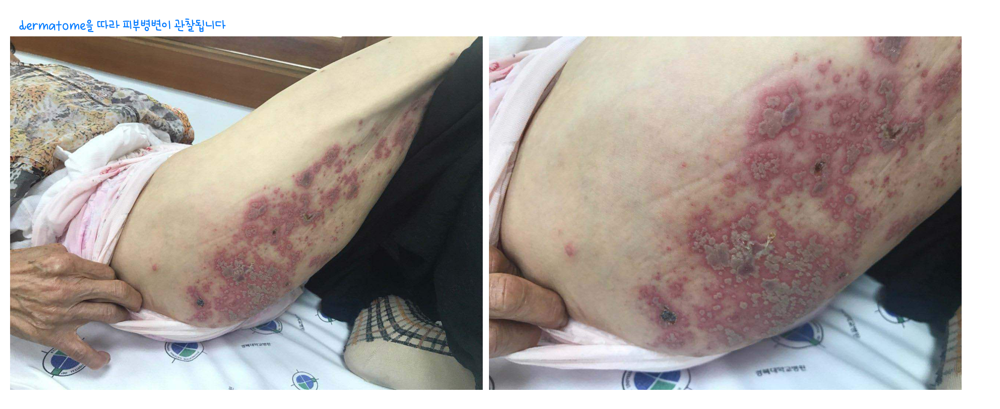{: style="width:62%"}

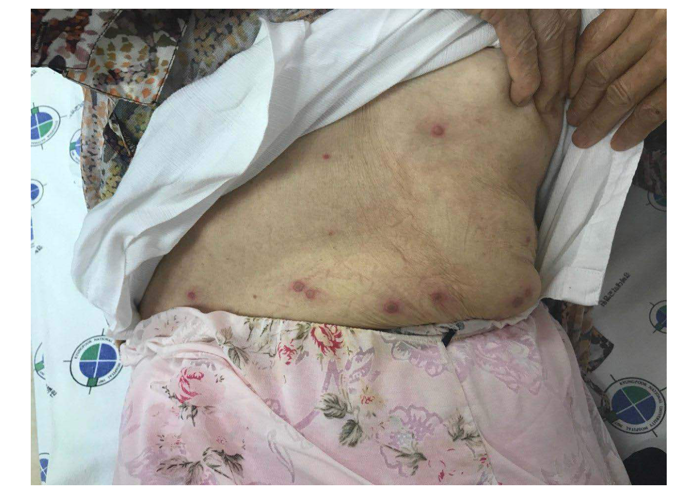{: style="width:42%"}

- 교수님: "**local lesion과 떨어진 곳**에 병변이 있다고 하면 **disseminated**라고 생각하면 된다(머리로도 갈 수 있다). local lesion 하나만 있다 → 대상포진."
- 대상포진: 감각신경절(후근)에 잠복한 **VZV의 재활성화**. 한쪽 피부분절에 발진·수포·심한 통증. 고령자 약 30%에서 신경통. 안면신경마비·내이 증상이 동반되면 **Ramsay Hunt 증후군**.
- 평생 20~30%가 앓고, **85세까지 살면 50%**. 가장 흔한 합병증은 **포진후신경통**(발진 후 1개월 이상 지속되는 통증).
- 교수님: "대상포진은 극단적으로는 통증으로 자살하는 사람도 있다. **신경통이 안 오게 하는 게 목적** — 내일 치료하자가 아니고 **지금 당장** 붙잡아서 치료한다."
- 백신 — 교수님: "예전 Zostavax(생백신)는 2/3를 막고 5년 갔다. 지금 **Shingrix**는 10년 이상, 95~98% 막아 내고, **사백신이라 면역저하자에게도** 쓸 수 있다. 50세 넘으면 Shingrix **두 번**."
- HIV 환자는 V1·V2를 함께 침범하는 등 더 넓게 온다.

**파종성 대상포진**: 여러 부위(20개 이상 수포), 면역저하자에 흔함, 내부 장기 침범 가능.

- 진단: 임상 + **PCR**(가장 민감), Tzanck, 필요하면 CSF.
- 치료: **acyclovir 정맥주사 10 mg/kg q8h**, 최소 7~10일(신기능에 따라 용량 조절). 교수님: "이런 사람들은 **acyclovir 주사**를 써야 한다. 집에 PO 약 주고 하면 신경통이 생길 가능성이 높아진다." "절대로 입원 안 하겠다 하면 (경구약을) 주는 것 — 하루 3번(valacyclovir)."
- 통증 조절: NSAIDs, 마약성 진통제, gabapentin·pregabalin.

!!! exam "기출 포인트"
    - 3, 6번: 당뇨 고령, 피부분절을 넘어 흩어진 수포 → **파종성 대상포진** → **acyclovir 정맥** + (공기·접촉) 격리.
    - 12번: 귀 통증·외이도 수포·같은 쪽 안면마비 → **Ramsay Hunt** → VZV.
    - 13번: 띠 모양 통증성 수포 → famciclovir(acyclovir, valacyclovir)를 **72시간 이내**.

# 5. Case 15 — 반복되는 *S. aureus* 피부농양

> 45세 남자, 3달 전부터 얼굴·엉덩이·겨드랑이·목에 **반복되는 종기**. 악화와 호전을 반복, 의원에서 항생제 치료. 37.0℃.

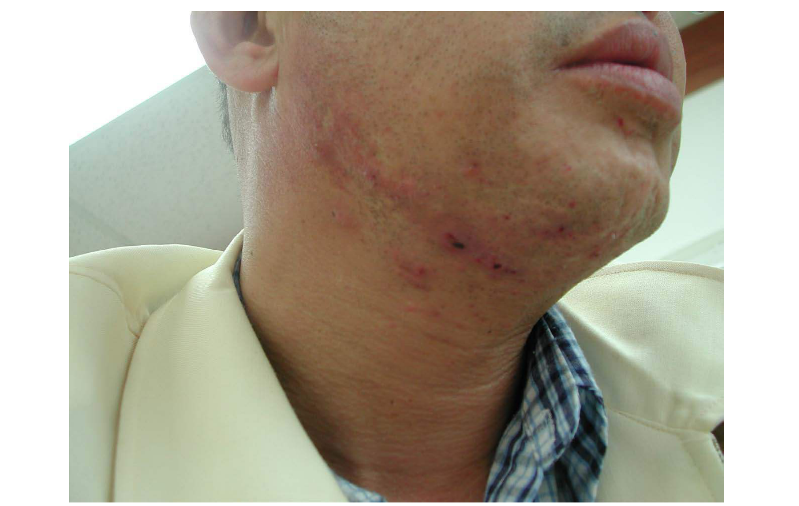{: style="width:45%"}

- 원인: ***S. aureus*의 비강 내 집락** → 반복적 농양·종기. 교수님: "정확하게는 nasopharynx. 다른 데 살 수도 있는데 빈도는 **코 안이 제일 많다**."
- 일반인 20~30%가 비강 보균자, 재발성 피부감염의 60~80%가 만성 보균. MRSA는 지역사회 1~3%(교수님: "드물게 있다"). 위험인자: 당뇨, 신부전, HIV, 비만, 아토피, 가족 내 보균자, 군대·기숙사, 의료종사자.
- 모낭염은 *S. aureus*와 ***Pseudomonas***(오염된 욕조·수영장, "습한 환경") 두 가지가 중요.
- 진단: 고름 **배양**(MRSA인지 구분), 비강·피부·인두·회음부 보균 검사, 당뇨·HIV 등 기저질환.
- 치료
    - 급성기: **절개 및 배농** + 항생제 — MSSA는 1세대 cephalosporin·amoxicillin/clavulanate, MRSA는 TMP-SMX·doxycycline·clindamycin, 7~14일.
    - **탈집락화(제균)**: **비강 mupirocin 연고 하루 2회 5일 + chlorhexidine 목욕**, 필요하면 전신 항생제(rifampin, doxycycline 등), **가족 동시 치료**, 환경 소독.

| 제균 방법 | 제균 성공 | 재감염 감소 |
|---|---|---|
| Mupirocin 단독 | 60~70% | 30~40% |
| **Mupirocin + chlorhexidine** | 75~85% | 50~60% |
| + 전신 항생제 | 85~90% | 60~70% |

교수님: "이게(병용) 조금 더 낫다. **rifampin + Bactrim**을 쓰기도 한다 — MRSA를 가진 의사로 환자들이 감염될 경우 사용."

!!! exam "기출 포인트"
    2, 8번: 반복되는 종기 + 비강 MSSA 보균 → 재발을 줄이는 방법 = **비강 mupirocin + chlorhexidine 목욕(탈집락화)**.

# 6. Case 16 — 화농성 척추염

> 78세 남자, 4일간 악화된 하지 무력. 4일 전 팥 수확 후부터. 허리 수술력 없음, **2주 전 허리에 침술**. URI·UTI·GI 증상 없음. **39.1℃**, CRP 9.

- X선·MRI: **척추염 + 척추주위 농양**. 교수님: "CRP가 9이니 pyogenic spondylitis인 것 같다."
- **침의 해석** — 교수님: "침으로 이렇게 깊은 곳을 찌르기는 어렵기 때문에 **침이 원인이라고 단정 지으면 안 된다**. 주 병변이 바깥쪽 침이 닿는 부위라면 의심할 수 있지만, 주 병변이 **척추체**라면 원인인지 모른다. 그러니까 **함부로 말하지 말자**."
- 교수님: "**고령화와 함께 많아지는** 대표적인 질환." 보통 추간판과 그 주변에 오고, 척추주위 농양이 신경근을 누르면 엄청 아프다.
- 진단
    - 임상: 허리·목 통증, 발열, 신경학적 증상(근력저하·마비·방사통·대소변 장애).
    - X선(종판 흐려짐, 디스크 간격 감소 — 2~8주 뒤), 뼈스캔(민감·비특이), **MRI = gold standard**.
    - 백혈구·**CRP**(척추감염에서 특히 오르고 치료하면 빨리 정상화)·ESR, **혈액배양**(교수님: "blood에서 30% 정도 자라 — 안 자라면 골치 아프다"), 소변배양, **CT 유도 생검**·수술 검체(항생제 전에).

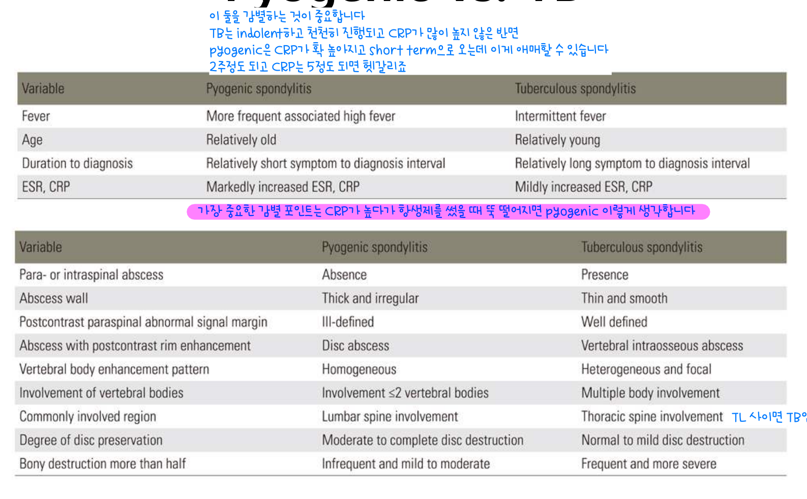{: style="width:70%"}

| | 화농성 | 결핵성 |
|---|---|---|
| 경과 | 고열, 짧음 | 간헐열, **indolent·길다** |
| CRP·ESR | **현저히 상승** | 약간 상승 |
| 부위 | **요추** | **흉추**(교수님: "TL 사이면 TB인 경우가 많다") |
| 농양·디스크 | 디스크 농양, 디스크 파괴 중등도 이상 | 척추 주위 농양 흔함, 디스크 비교적 보존, 여러 척추체 |

교수님: "**가장 중요한 감별 포인트는 CRP가 높다가 항생제를 썼을 때 뚝 떨어지면 pyogenic**." 2주쯤 되고 CRP 5 정도면 헷갈린다.

- 치료: 혈액배양 후 경험적으로 **그람양성 MSSA 중심**(국내는 MRSA 경험치료를 권하지 않음 — 보험이 안 돼서 β-lactam을 쓰다 안 되면 vancomycin), 요로 연관이면 그람음성 고려. **6~12주**. 수술 적응증: 보존적 치료 실패, **진행하는 신경학적 결손**, 척수·마미 압박.

# 7. Case 17 — 폐포자충폐렴 (PCP)

> 45세 남자, **2년 전 신이식**. 2주 전부터 호흡곤란. 37.9℃.

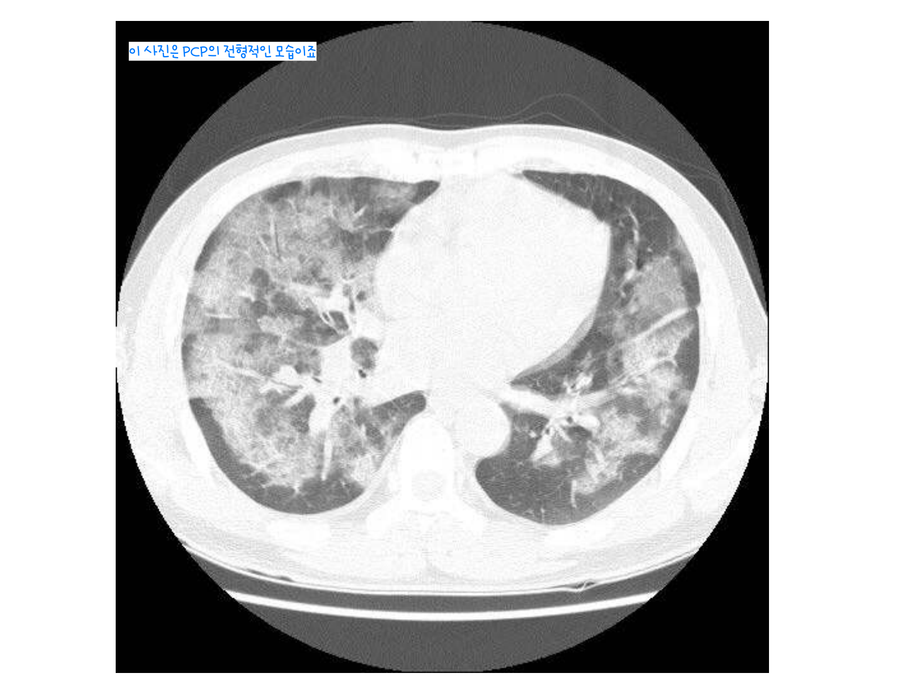{: style="width:48%"}

- 교수님: "hypersensitivity pneumonitis 또는 interstitial pneumonitis 모양. 이걸 HIV로 배웠지만 나중에는 병이 섞이니까 **PCP, CMV 두 가지**를 생각해야 한다." **양측 미만성 GGO + 서서히 진행하는 호흡곤란** → PCP ± CMV 폐렴.
- 진행하면 낭(cyst)을 만든다.
- 진단: 유도객담·**BAL**, **PCR**(교수님: "제일 sensitive한 건 PCR"), β-D-glucan·LDH 상승. "**시험 문제는 GMS stain이 많이 나온다** — 근데 이걸로는 거의 진단하지 않는다. 이 사진이 나오면 PCP란 걸 알아야 한다." **임상적 진단이 중요**.

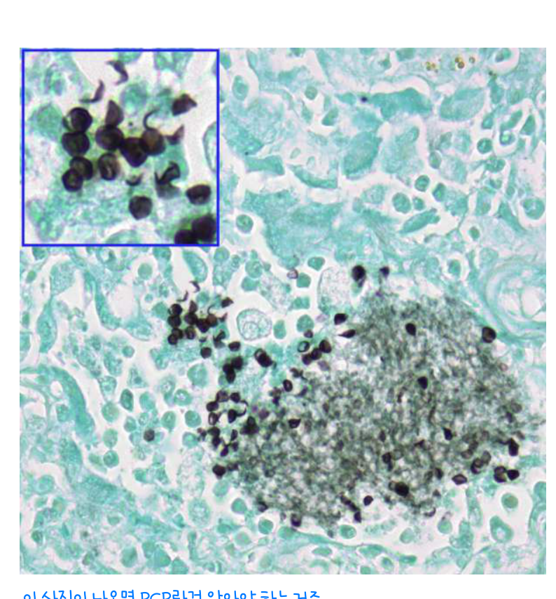{: style="width:35%"}

- 치료: **TMP-SMX**(TMP 15~20 mg/kg/일) **21일**. 교수님: "핵심 약인데 주사가 품절이라 경구로 시작한다." 대체: pentamidine, clindamycin + primaquine, atovaquone, dapsone + TMP.
- **스테로이드**: 중증(**PaO2 < 70 mmHg**)이면 치료 시작 72시간 이내 prednisone 40 mg 하루 2회. 교수님: "산소를 쓰게 되면 써야 한다."
- 예방: CD4 < 200이면 TMP-SMX 1차 예방, CD4 > 200이 6개월 유지되면 중단.

# 8. Case 18 — *Klebsiella* 간농양과 내안구염

> 63세 남자, 2일간 시력 감소. 1주 전 술 취해 철 대문을 열다 왼눈을 부딪힘. 2일 뒤 급격한 시력저하(빛 인지 가능) → 다음 날 빛도 못 봄. **38.6℃**.

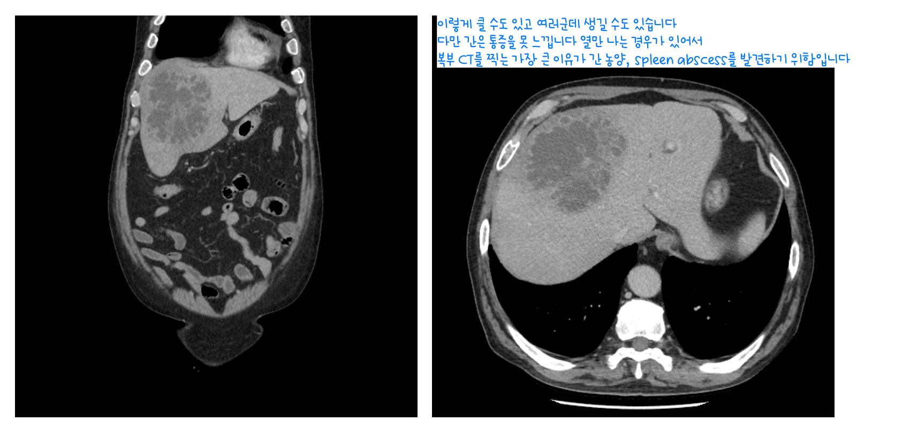{: style="width:55%"}

- 외상이 아니라 **간농양에서 혈행성으로 퍼진 내인성 내안구염**. 원인균 ***Klebsiella pneumoniae***.
- 교수님: "간은 통증을 못 느낀다. 열만 나는 경우가 있어서 **복부 CT를 찍는 가장 큰 이유가 간 농양, 비장 농양을 발견하기 위함**." "**간농양이 있으면 눈을 봐야 하고, 눈에 문제가 있으면 간을 봐야 한다.**" "Klebsiella는 **간, 신장, 눈**을 좋아한다."
- **Hypervirulent(hypermucoviscous) *K. pneumoniae*** — **string test 양성**, K1/K2 혈청형, 요즘 유행. 예전 간농양은 담도 질환 때문이 많았지만 요즘은 이유 없이 생긴다(**cryptogenic**). 당뇨 환자에 흔하다.
- 내안구염: 눈이 붉고, 열이 나고, 안 보인다. **전방축농(hypopyon)**. 교수님: "시간이 지나면 두 눈 다 먼다. 예후가 나빠 빨리 발견해도 눈을 살리기 어렵다."

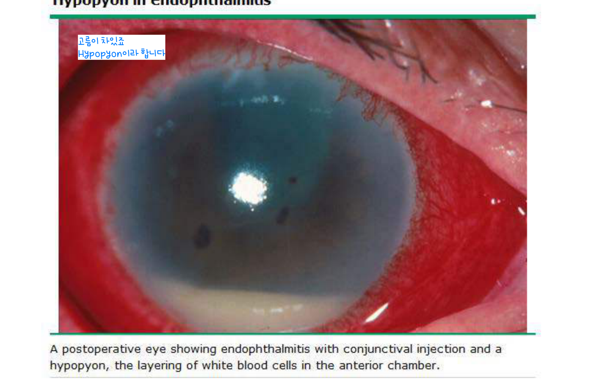{: style="width:45%"}

- 치료
    - 간농양: **ceftriaxone**(cefotaxime) 경험적, 최소 **4~6주**. 교수님: "화농성 간농양은 ceftriaxone + metronidazole을 쓰는데 **Klebsiella라면 ceftriaxone 단독**으로 써도 된다." 배농: 교수님 "**2 cm 넘으면 보통 drain**"(돼지꼬리 카테터, 10 cc 미만이면 뺀다), 슬라이드 기준은 5 cm 초과·다발성·약물 불응.
    - 내안구염: **안구 내(유리체 내) 항생제** — 교수님: "항생제가 잘 도달하지 않는 곳(**뇌, 전립선, 안구**). 무조건 두 가지 넣는다: **vancomycin, ceftazidime**." + 전신 항생제 4~6주 + 유리체절제술.

!!! exam "기출 포인트"
    7, 19번: 발열 + 급속한 시력 소실, 복부 CT 간농양 → **Klebsiella 간농양에서 온 내인성 내안구염**. 16번: 외상 없이 당뇨 조절 안 되는 환자의 눈 부종·결막 충혈·안구 혼탁 → 같은 진단.

# 9. Case 19 — 안매독·신경매독

> 41세 남자, 우울증으로 의원 다님. 1주간 좌안 시력 감소 → 3차병원 안과에서 **망막혈관염** 의심, **혈청 VDRL 1:64**. 시력 호전 없고 **하루 종일 두통**. 37.0℃.

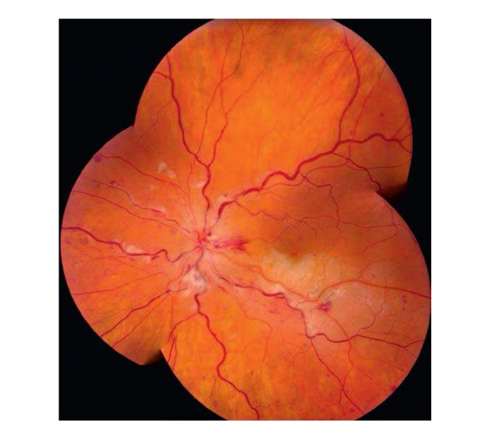{: style="width:40%"}

- 뇌척수액 검사: **백혈구 136/mm3, 단핵구 100%** → 신경매독.
- 교수님: "**손바닥, 발바닥에 병변**을 주면 매독이다. 시험 문제에 잘 나온다(손만 보통 나온다)."

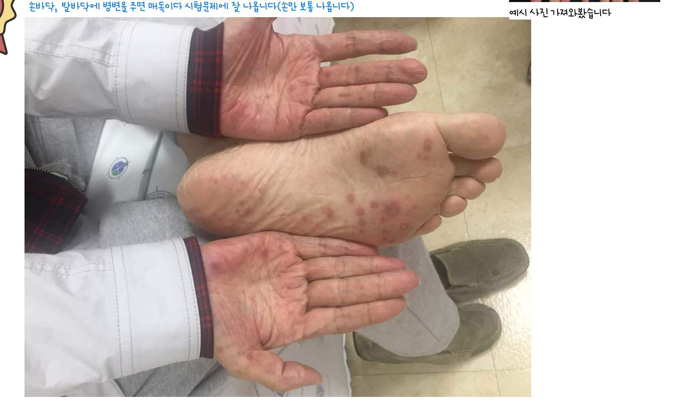{: style="width:50%"}

- 매독은 요즘 다시 늘고 있다. 치료받지 않으면 신경·뼈를 침범하고 선천 매독을 만든다.
- 1기: 무통성 **chancre**(귀두와 음경 몸통 사이가 전형적, 입에도 — oral sex), 2기: 전신 발진, **condyloma lata**(항문 — 이러면 **HIV도 검사**), 잠복 매독(건강검진 중 발견).
- **검사** — 선별(비트레포네마): VDRL·RPR(역가로 **활동성**), 확진(트레포네마): TPHA·TPPA·FTA-ABS.
    - 교수님: "screening 후 확진하는 방법(traditional)과 **확진을 먼저 하고 screening으로 activity를 보는 방법(reverse)**이 있는데 요즘은 reverse를 더 선호."
    - "확진 검사가 양성이면 양성. 활동성은 VDRL 값이 1:몇이냐 — 높을수록 활동성이 높아 치료를 안 받았다는 것."
    - 실제: VDRL·RPR 양성이면 TPHA, FTA-ABS(IgG·IgM), VDRL 역가 재검, **HIV**를 한 번에 해서 1주 뒤 상담(심리적 스트레스 해소도 중요).
- **치료**
    - 1·2기(확실한 조기): **benzathine penicillin G 240만 단위 근주 1회**. 오래됐거나 기간을 모르면 **1주 간격 3회**. 교수님: "penicillin G 주사용이 없다고 했는데 **benzathine penicillin G는 공급**이 된다." 1형 과민반응 약력 꼭 기록.
    - **신경매독·안매독**: 수용성 **penicillin G 1,800만~2,400만 단위/일 정주 10~14일**. 국내에서 구하기 어려우면 대체로 **ceftriaxone**.
- 뇌척수액 검사 — 교수님: "3기 매독이 머리로 갔을 거라 의심할 때. 지금처럼 **눈에 병변**이 있을 때, 또는 VDRL 1:8, 1:16을 넘을 때."
- 치료 성공 기준(VDRL 역가): 1기 6개월 4배·12개월 8배 감소, 2기 6개월 8배·12개월 16배, 3기 12개월 4배 감소. 교수님: "추적이 중요하다."

!!! exam "기출 포인트"
    15, 22번: VDRL 1:64 + 망막혈관염 + 두통 + CSF 세포 증가 → **신경매독** → 정주 **penicillin G 10~14일**(국내에서 어려우면 ceftriaxone).

# 10. Case 20 — COVID-19 폐렴

> 68세 여자, 1주 전 많은 사람이 모인 모임. 1주 전부터 호흡곤란, 5일 전부터 쇠약·식욕부진·구토. 오늘 **남편이 코로나19 진단**. 산소 **4 L/min** 사용 중, 입원 후 악화.

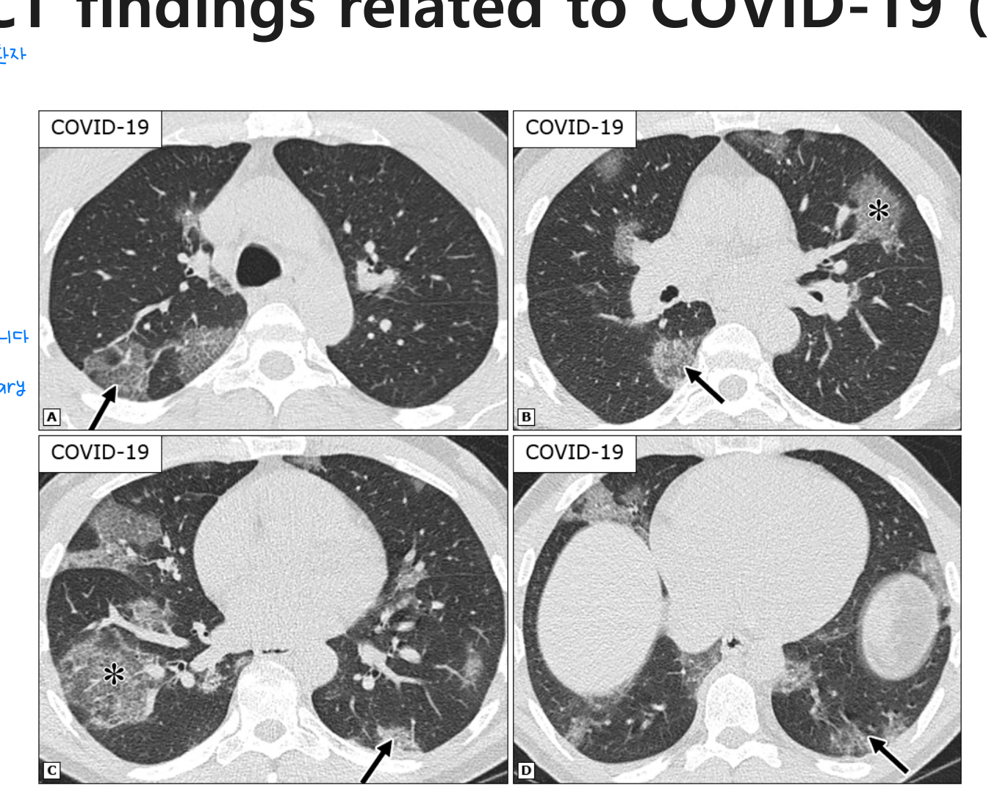{: style="width:50%"}

- 교수님: "폐의 **peripheral**로 간다. center가 아니고. center로 가면 pulmonary edema를 생각하겠죠."
- 진단: 교수님 "예전에는 PCR이 정답이었지만 **요즘은 항원검사만** 한다."
- 치료: 교수님 "제일 잘 듣는 약은 **remdesivir**." 초기(바이러스 증식기)에 항바이러스제가 좋고, 뒤에는 면역반응 → "**산소를 써야 하면 스테로이드**(dexamethasone)도 같이."

!!! exam "기출 포인트"
    9번: 산소 4 L/min이 필요한 중증 → 사망률을 낮춘다고 입증된 약 = **dexamethasone**(산소가 필요한 환자). 21번: 중증 폐렴의 보존적 치료 핵심 = **산소요법**(고유량·인공호흡)으로 저산소증 교정.

# 암기 — CP-A2 요점

| Case | 한 줄 요점 |
|---|---|
| 11 좁쌀결핵 | 혈행성 파종, 양측 균일 미세결절. **HIV 확인**, 객담 양성률 낮음, PCR 3회. HRZE 2개월 + HR → **9~12개월** |
| 12 관절결핵 | 단관절·만성. rice body(비특이), **Phemister triad**. 조직 AFB·배양·PCR. 9개월 이상 |
| 13 파상풍 | 보고 진단. GABA·glycine 차단. **TIG + metronidazole** + benzodiazepine. 회복 후 백신 |
| 14 파종성 대상포진 | 떨어진 부위 수포. **acyclovir IV 10 mg/kg q8h**. Shingrix 50세 이상 2회 |
| 15 재발성 종기 | 비강 *S. aureus*. 배농 + **mupirocin 비강 + chlorhexidine 목욕**, 가족도 |
| 16 화농성 척추염 | MRI. CRP 높고 항생제로 **뚝 떨어지면 화농성**, 흉추·indolent면 결핵. 침을 원인으로 단정 × |
| 17 PCP | 양측 GGO, **GMS**, PCR. **TMP-SMX 21일**, PaO2 < 70이면 스테로이드 |
| 18 Klebsiella | 간농양 ↔ 내안구염. ceftriaxone 4~6주, 유리체 내 **vancomycin + ceftazidime** |
| 19 매독 | 손·발바닥 발진. 조기 benzathine PCN 1회, 모르면 3회. **신경·안매독 → penicillin G IV 10~14일** |
| 20 COVID-19 | 말초 GGO. 항원검사. remdesivir, 산소 필요하면 **스테로이드** |
