<!-- 필기본: 2025 -->
<!-- 단계: 수업 전 -->

# 0. 이 수업을 공부하는 법

**김유경 교수님**(진단검사의학과) 수업(2023·2025·2026 같은 교수님, 2시간). 슬라이드 52장 + 교수님 말씀 필기. 필기 표시: **보라색 표시 = 교수님이 「무조건 외우라」고 한 부분**, 분홍 표시 = 강조, 노란 형광펜 = 임상에서 잘 쓰는 것. 교수님이 "그냥 읽어 보시면 되세요"라고 한 부분은 가볍게.

- 필기한 선배 메모: 2022–2024 교수님 기출을 모아 보니 **작년 수업에서 내용이 많이 빠졌다** → 문제가 새롭게 나올 수 있다. 실제로 2025 시험에는 **강의 슬라이드 그대로의 사례형**(객담 감수성 결과 해석, BAL 정량배양 계산, 혈액배양 후 조치)이 나왔다.
- 오늘 범위: **세균과 일부 진균, 배양으로 하는 검사 위주**. 혈청학적 진단·분자진단은 안 한다.

기출 30문항(2020–2025)의 주제

| 주제 | 2부 번호 |
|---|---|
| **항균제감수성검사: 「가장 정밀한 방법」= 경도확산법(E test)** — 같은 문제 3번 | 4, 19, 29 |
| 디스크확산법은 MIC를 재지 않는다 | 16, 22 |
| 감수성 결과 해석(S의 의미, 자연내성 → 재검) | 1, 12 |
| 객담 적합성(편평상피세포), BAL 정량배양 계산 | 10, 3 |
| 그람염색(사프라닌 빼먹으면), 예비동정(catalase, oxidase) | 15, 18, 8, 20, 27 |
| Campylobacter 배양 조건(5% O2, 10% CO2, 85% N2, 42℃) | 6, 11, 25 |
| 위성현상(H. influenzae, X·V 인자) | 21, 26, 30 |
| 배지(CNA, SS), 검체 채취·운송, 혈액배양 후 조치 | 7, 14, 28, 2 |
| (지금 강의에 없는) 생물안전·소독제·베이즈 정리·협막팽화 | 9, 13, 17, 23, 24 |

!!! key "핵심 — 미생물 검사의 흐름"
    **검체 → 직접도말(바로) → 배양 → 균종동정(예비 → 확정) → 항균제감수성검사**.
    매 단계의 질문은 하나다: **「이 결과가 진짜 원인균인가, 상재균·오염균인가?」** — 검체가 상재균에 노출되는 곳인지(객담·상처·대변) 무균 부위인지(혈액·뇌척수액·BAL)에 따라 기준이 달라진다.

# 1. 미생물 검사의 종류

임상에서 중요한 것은 세균·바이러스·곰팡이. 전통적인 미생물 검사는 **직접 배양**이지만 배양이 안 되는 것(특히 바이러스)이 많아 그런 것은 배양으로 검사하지 않는다.

- 직접도말검사
- **배양검사**
- **균종동정**
- 혈청학적 진단(항원·항체 — 오늘은 안 함)
- 감염분자진단
- **항균제감수성검사**

# 2. 직접도말검사

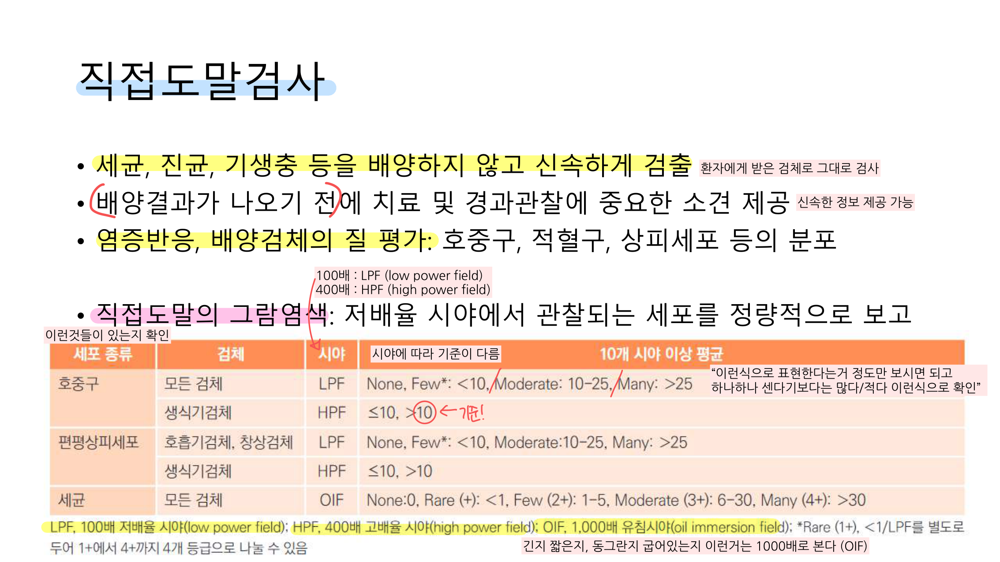{: style="width:80%"}

- 세균·진균·기생충을 **배양하지 않고** 환자 검체 그대로 **신속하게** 검출 → **배양결과가 나오기 전에** 치료·경과관찰에 중요한 정보를 준다.
- **염증반응과 배양검체의 질**을 평가: 호중구, 적혈구, 상피세포의 분포.
- 그람염색 도말은 **저배율(100배, LPF)**에서 보이는 세포를 정량적으로 보고(하나하나 센다기보다 많다/적다), 균의 모양(긴지 짧은지, 둥근지 굽었는지)은 **1,000배 유침(OIF)**으로 본다. 400배 = HPF.

## 객담 검체의 적합성 (Washington & Murray 등급)

!!! memo "암기"
    **호중구 >25/LPF, 편평상피세포 <10/LPF일 때만 배양검체로 적절.**
    충분히 호중구는 있어야 하고 편평상피세포는 없어야 한다. 편평상피세포가 10개 이상이면 침이 섞인(구강 오염) 것이라 객담으로 보지 않는다 → 객담배양 결과에 「적절/부적절」을 써 줘야 한다.

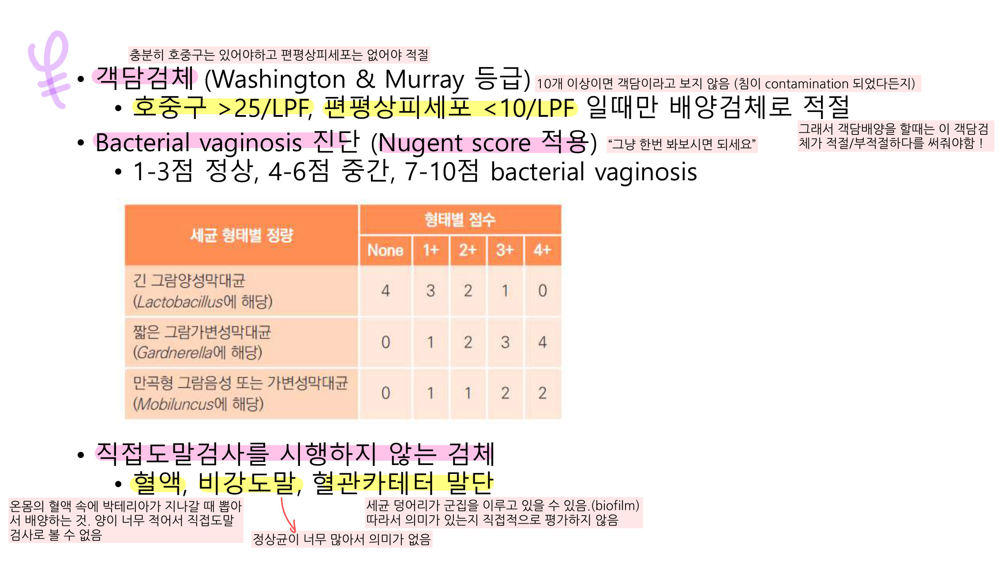{: style="width:80%"}

- **세균질증(bacterial vaginosis)** 진단은 **Nugent score**(질 분비물 그람염색에서 Lactobacillus·Gardnerella·Mobiluncus 형태의 양으로 점수): **1–3 정상, 4–6 중간, 7–10 세균질증**. "그냥 한번 봐 보시면 되세요."

## 직접도말을 하지 않는 검체
**혈액**(양이 너무 적어 볼 수 없다), **비강도말**(정상균이 너무 많아 의미 없다), **혈관카테터 말단**(바이오필름 덩어리라 의미를 직접 평가할 수 없다).

## 염색하지 않는 직접 검경
- **KOH 표본**: KOH로 사람 조직을 녹이면 **진균만 남는다**.
- **India ink(묵즙) 표본**: 엄밀히 말하면 염색은 아니고, 뇌척수액에 떨어뜨리면 주위가 까매지고 **두꺼운 협막** 때문에 동그란 균 주위가 비어 보인다 → **Cryptococcus**. 손쉽게 중요한 균을 볼 수 있어 루틴으로 한다. "문제 내기 좋겠죠?"

!!! exam "기출 포인트"
    10번(2023): 객담 LPF당 편평상피세포 28개, 호중구·대식세포 50개 → **편평상피세포가 많으므로 부적절**(백혈구가 많아도). 24번(2021): 폐렴사슬알균을 검체에서 직접 확인하는 방법 → **Neufeld 협막팽화시험**(오답 짝: 암시야 = 매독, India ink = 크립토콕쿠스, KOH = 진균).

# 3. 배양검사 — 혈액

## 균혈증
- **균혈증**: 혈액에서 세균·진균·바이러스·기생충 검출. **세균혈증**은 혈관내 감염이나 다른 부위 감염에서 혈액으로 세균이 들어가 생긴다.
- 원인 부위(혈관내 감염 제외): **비뇨생식기계 25%**(주로 요로감염), **하기도 20%**(폐렴), 농양 10%, 원인불명 25%.
- 흔한 균: **Staphylococcus, Enterococcus, Enterobacterales, Pseudomonas aeruginosa, Acinetobacter**.
    - S. pneumoniae — 주로 지역사회감염
    - **응고효소음성 포도알균(CNS)** — 피부 정상균이라 중요도가 떨어지지만 **정맥내 카테터, 인공심장판막** 환자에서는 중요
    - E. coli — 지역사회·의료기관 모두 흔함
    - 의료관련감염 — S. aureus, Enterococcus, Serratia marcescens, Enterobacter, Acinetobacter
- **피부유래 오염균**: **CNS, viridans streptococci, Aerococcus, Micrococcus, Bacillus(B. anthracis 제외), diphtheroid(C. diphtheriae 제외 Corynebacterium), Cutibacterium**. 소독을 제대로 안 하면 묻어 나온다.

!!! key "핵심 — 오염균인지 원인균인지"
    **38℃ 이상 발열, 오한, 저혈압 중 1개 이상** + **2쌍 이상의 혈액배양에서 분리** → 균혈증의 원인균으로 간주. 둘 중 하나만 나오면 오염일 수 있다. → **증상도 있어야 하고 혈액배양이 2쌍 이상 되어야 한다.** 그래서 최소 2쌍 이상 채혈한다.

## 채혈 시기·횟수·양
- **심내막염**: 혈관내 감염이라 심장에서 균을 계속 내보내는 **지속적 균혈증** → 언제 채혈해도 나온다.
- 다른 부위 감염: **간헐적**일 수 있어 채혈 시기가 중요. 발열 직전이 좋다지만 예측할 수 없으니 **발열이 있을 때 2세트 이상을 동시에**.
- **1세트 = 한 번의 정맥천자로 얻은 혈액배양**(병 4개에 나눠 담아도 1세트). 2세트 = **두 군데에서 천자**. 어려우면 시간 간격을 두고.
- **채혈량이 많을수록 양성률이 높다** — 성인은 혈액 1 mL당 세균이 1마리 이하라 1 cc 이하로 뽑으면 거의 안 나온다. **1회 권장량: 성인 20–30 mL**, 영아·소아는 **전체 혈액량의 1% 이하**(많이 뽑으면 빈혈), **12세 이상은 성인과 비슷**.

## 피부소독
- 클로르헥시딘 팅크(요즘 많이 씀), 요오드 팅크, (포비돈 요오드 — 착색되고 마를 때까지 기다려야 해서 환자들이 싫어함), 알코올.
- **생후 2개월 미만 영아는 클로르헥시딘 사용 불가**: 피부장벽 미성숙 → 전신독성, chemical burn.
- **오염률이 3%를 넘으면 피부소독 방법을 개선**해야 한다(혈액배양 1세트에서 피부유래 오염균이 나오면 오염으로 판정해 모니터링).
- **혈관단락(shunt)·정맥유치카테터에서 채혈하지 않는다**: 바이오필름에 세균이 집락화하기 쉬워 실제 원인균이 아닐 수 있다.

## 혈액배양병과 자동혈액배양기
- 양이 너무 적어 **액체배지**에 넣어 증폭: 영양성분(tryptic soy broth, brain heart infusion broth), **항응고제 SPS**(sodium polyanethol sulfonate — 혈액이 굳지 않게), **항생제 중화제·보조제**(resin, charcoal, β-lactamase — 항생제가 있으면 균이 못 자라므로), **지시제(CO2 측정용)**. 혐기성 배양병엔 산소제거 성분·환원제.
- **자동혈액배양기**: 병을 **흔들면서** 배양해 증식이 빠르고, 대사산물을 **10분 주기**로 측정해 자동으로 알람(눈으로 탁도를 보지 않는다).
- 결과 보고:
    - **음성**: **No growth after 2 days(중간보고), No growth after 5 days(최종보고)** — 5일 기다려 negative로 보고.
    - **양성**: "growth" → **그람염색**(예비보고) → **분리배양**(평판배지) → **동정·항균제감수성**. 시간이 상당히 걸린다.
- **검사실 획득감염 주의**: Brucella, Francisella tularensis, Histoplasma capsulatum 등. "그냥 써 놨으니 한번 보시고."
- **혈액배양 질관리지표**(채혈을 잘하고 있는가): **오염률 2–3% 이하**, **접종량 병당 10 mL**, **양성률 급성기 병원 8–10%**(이보다 낮으면 요양병원 같은 곳).

!!! exam "기출 포인트"
    2번(2025): 정맥유치카테터 환자 발열·오한, 혈액배양에서 분리된 균의 그람염색·간이검사 결과 → 다음 조치는 **생화학검사나 질량분석으로 확정 동정**. 오답: 2회 중 1회만 자랐으니 더 안 함 / 바로 오염균 간주 / 소독법 개선 / **카테터를 통해 채혈**(권장하지 않음). 28번(2020): 혈액은 **배양병**에 넣어야지 혈액배지·MacConkey 평판에 바로 접종하는 게 아니다.

# 4. 배양검사 — 호흡기 검체

굉장히 어려운 검체. 주로 객담을 보는데 뱉는 과정에서 **상기도 상재균**(하기도나 혈액에서 나왔다면 병원균이었을 균들)이 섞인다.

- **상기도**: 상재균 오염이 있으므로 **표적병원균에 선택적인 배지** 사용. 인두스왑(인두염 일으킬 사슬알균), 비강스왑(S. aureus 집락 확인). 보통은 경험적 항생제를 써서 잘 안 한다.
- **하기도**: 상재균은 없지만 채취 과정에서 상기도 상재균에 오염.
    - **객담, 기관지 흡인액** → 상재균 오염 → **반정량배양**
    - **기관지보호솔질검체(PSB), 기관지폐포세척액(BAL)** → 침습적이라 오염 최소화 → **정량배양**

## 반정량배양

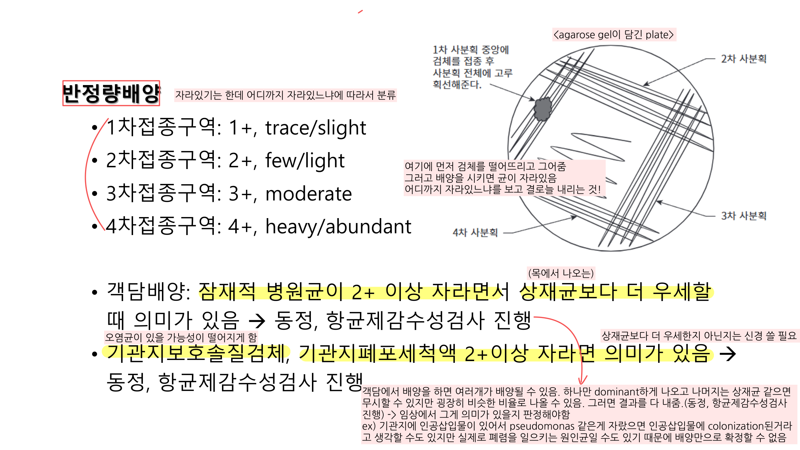{: style="width:80%"}

평판에 검체를 떨어뜨리고 구역을 나눠 그은 뒤 **어디까지 자랐는지**로 판정: **1차 구역 1+(trace/slight), 2차 2+(few/light), 3차 3+(moderate), 4차 4+(heavy/abundant)**.

- **객담배양**: 잠재적 병원균이 **2+ 이상** 자라면서 **상재균보다 우세할 때** 의미 → 동정·감수성검사.
- **PSB, BAL**: **2+ 이상**이면 의미(상재균보다 우세한지는 신경 쓸 필요 없음).
- 여러 균이 비슷한 비율로 자라면 결과를 다 내준다 → 임상에서 판정. 예: 기관에 인공삽입물이 있는 환자의 Pseudomonas는 집락일 수도, 진짜 폐렴 원인균일 수도 있어 배양만으로 확정할 수 없다.

## 정량배양 (PSB, BAL만)

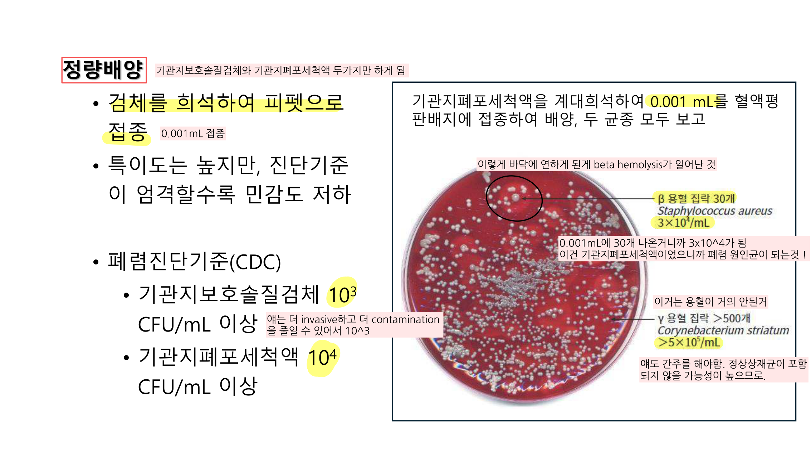{: style="width:80%"}

- 검체를 희석해 **피펫으로 0.001 mL**를 혈액평판배지에 접종·배양, **두 균종 모두 보고**.
- 특이도는 높지만 기준이 엄격할수록 민감도가 떨어진다.
- **폐렴 진단기준(CDC)**: **PSB ≥103 CFU/mL, BAL ≥104 CFU/mL**. PSB가 더 침습적이고 오염을 더 줄일 수 있어 기준이 낮다.
- 계산: **0.001 mL에 집락 1개 = 103 CFU/mL**. 슬라이드 예: S. aureus 30개 → 3×104(BAL이므로 원인균), Corynebacterium striatum >500 → >5×105(정상 상재균이 포함되지 않았을 가능성이 높으니 이것도 원인균으로 간주).

!!! exam "기출 포인트"
    3번(2025, 슬라이드 그대로): BAL 0.001 mL 접종 → S. salivarius 2개(2×103), **S. epidermidis 50개(5×104)**, **P. aeruginosa 10개(104)** → **기준(≥104)을 넘는 S. epidermidis와 P. aeruginosa를 원인균으로**(④). 「피부상재균이라 뺀다」는 함정 — BAL은 무균적으로 얻었으니 **숫자로만 판단**. 28번: 객담은 24시간 모으지 않는다(아침 첫 객담 바로).

# 5. 배양검사 — 요로생식기·소화기

## 요검체 — 정량배양

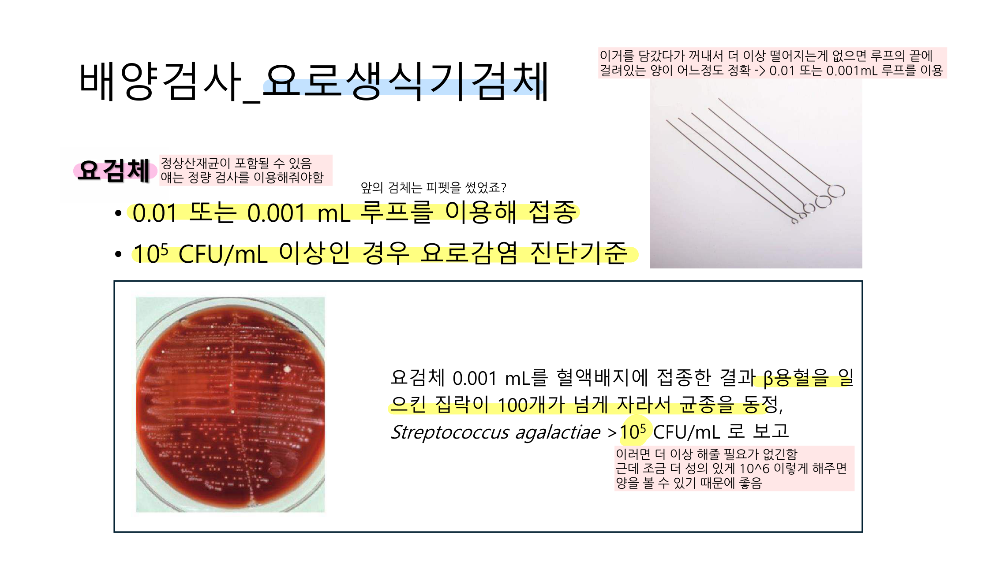{: style="width:80%"}

- 정상 상재균이 포함될 수 있어 **정량**. 담갔다 꺼내 루프 끝에 걸린 양이 일정한 **0.01 또는 0.001 mL 루프**로 접종.
- **≥105 CFU/mL이면 요로감염 진단기준**. 예: 0.001 mL 접종에 β용혈 집락 100개 넘게 → S. agalactiae >105 CFU/mL로 보고.
- 치골상부 천자 소변과 도뇨관 소변은 상재균 포함 가능성이 크게 다르다 → 일단 결과는 다 내주고 임상에서 판단.

## 생식기 검체
- 요도·질 스왑은 **상재균이 다량** → **특정 균종을 동정하기 위한 배지**가 필요(항상 목표를 둔다). 예: **N. gonorrhoeae → Thayer-Martin 배지**.
- 요즘은 균·바이러스를 한꺼번에 보는 **multiplex 성병 PCR**이 많아 배양은 잘 안 한다.
- **세균질증**: 표준법은 **질스왑 도말 그람염색**, **배양은 권장하지 않음**.

## 대변 — 표적배양

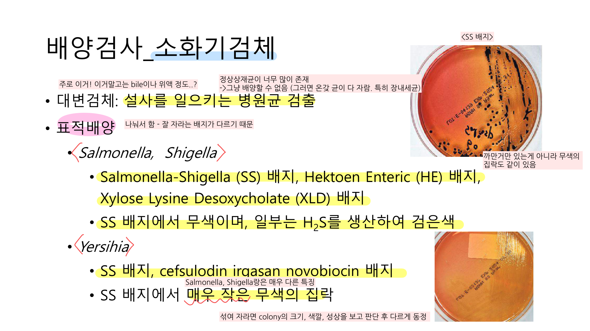{: style="width:80%"}

정상 상재균(특히 장내세균)이 너무 많아 그냥 배양할 수 없다 → 원하는 균별로 **잘 자라는 배지를 나눠서**.

| 표적 균 | 배지 | 집락 특징 |
|---|---|---|
| **Salmonella, Shigella** | **SS 배지, Hektoen enteric(HE), XLD** | SS에서 **무색**, 일부(Salmonella)는 **H2S 생산 → 검은색** |
| Yersinia | SS, **CIN**(cefsulodin irgasan novobiocin) | SS에서 **매우 작은 무색 집락** |
| **STEC/EHEC (O157)** — HUS의 대표 | **Sorbitol MacConkey** | **무색**(sorbitol에서 산을 못 만듦) ↔ 일반 E. coli는 산 생성 → 빨강 |
| **Vibrio** | SS, **TCBS** | TCBS에서 **노랑 = V. cholerae**, **초록 = V. parahaemolyticus, V. vulnificus**(법정감염병이라 빨리 아는 게 중요) |
| **Campylobacter** | charcoal cefoperazone deoxycholate, Skirrow, Butzler | **미호기 5% O2, 10% CO2, 85% N2, 42℃** |

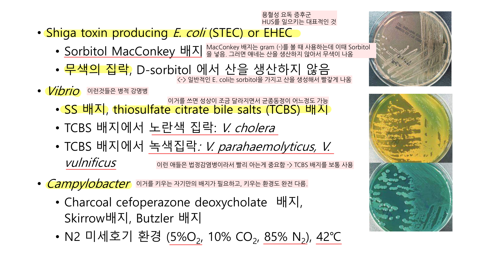{: style="width:80%"}

- 경북대병원 stool culture: 일반 오더 = **Salmonella, Shigella(하절기에 Vibrio 추가)**. **Campylobacter, EHEC(O157), Yersinia는 따로 오더**를 내야 한다.

!!! exam "기출 포인트"
    **Campylobacter 배양 환경이 3번**: **질소 85%, 산소 5%, 이산화탄소 10%**(6, 25번 — 수소가 들어간 보기는 혐기 조건), 배양기가 **40℃로 고장**났을 때 살아남는 균 → **C. jejuni(호열성, 42℃)**(11번). 7번: Salmonella·Shigella가 **못 자라는** 배지 → **Columbia CNA**(colistin·nalidixic acid가 그람음성균 억제). 14번: 장티푸스 대변을 혈액·MacConkey·**초콜릿** 배지에 접종 → 틀림(SS·XLD 같은 선택배지 필요).

# 6. 배양검사 — 체액, 창상·조직, 인공물

## 체액
- **정상적으로 무균**이므로 민감도를 높이는 **액체배지 증균**이 중요.
- **뇌척수액이 가장 중요**: 뽑기 어렵고 양이 적다 → **원심(농축)해 도말표본**을 만들고 **혈액평판 + 초콜릿 배지**에 접종(**Neisseria, Haemophilus는 초콜릿 배지가 반드시 필요** — N. meningitidis는 너무 critical해서 바로 잡아야 한다).
- **뇌척수액 단락(shunt)**이 있으면 **Cutibacterium acnes**(여드름균 — 정상인에겐 병을 거의 안 일으키지만 수술 환자의 뇌척수액으로 들어가면 문제)를 키우기 위해 **thioglycolate 액체배지**(혐기성도 같이 자라는 증균배지)에 접종.
- 복막액·흉막액·심낭액·관절액: 탁도가 낮으면 **침사(원심 침전물)**로 민감도를 높인다. **최근 체액은 혈액배양병 접종 권장**(혐기성 배양에도 좋다).
- 일반·진균 배양은 7일까지, 결핵 배양은 결과까지 약 2달.

## 창상감염과 조직검체 — 주치의가 「상재균이 많을 검체를 냈는지」 알아야 한다
- **상재균이 많은 검체**(개방농, 각막, 외이, 결막 등 외부 노출 부위): **오염균과 병원균의 감별**이 중요, 혼합감염이 많아 경험적으로 광범위 항균제.
- **폐쇄농, 심부조직**에서 **침습적으로**(흡인, 수술장) 얻은 검체: 병원균일 가능성 높음 → **혐기성 배양 필수**, **혈액배양병 접종 권장**.
- **배액관으로 채취한 검체**(예: 간농양에 꽂은 관): 상재균에 오염될 수 있어 **액체배지로 증균하면 안 된다**.
- **조직**: 다지거나 분쇄해 균질화 후 접종. 분쇄 불가능한 것(인공관절 등)은 **초음파(sonication)**로 표면 부착균을 떼어 배양.

## 인공물
- 인공물에 형성된 **바이오필름** 내 세균을 파악. 조직검체와 동일하게 하고, 혈류와 접촉하면 **혈액배양을 함께** — 이 때문에 전신 혈류감염이 생겼는지 보는 게 중요.
- **중심정맥관 관련 혈류감염**: 중심정맥관 **말단부 5 cm를 무균적으로 잘라** 배양 의뢰, **혈액배양은 말초에서 따로**. **혈액배양에서 분리된 균종과 같은 균이 15 CFU 이상** 자라면 진단(혈액에서도 나오면 → 카테터 집락이 계속 문제를 일으켰다 / 혈액에서 안 나오면 → 집락만 된 것).
- 중심정맥관 외 배액관(예: 소변 카테터 끝)은 균이 자라도 **해석 기준이 없다** → 그냥 소변을 검사하는 게 낫다.

# 7. 균종동정

## 집락 관찰과 염색

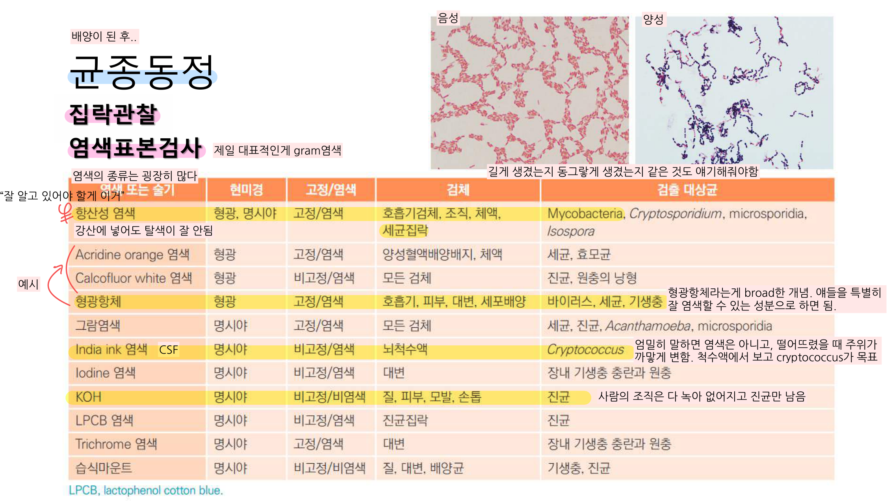{: style="width:84%"}

- 염색 종류는 매우 많다. **제일 대표가 그람염색** — 모양(막대·알)까지 함께 알려 준다. "잘 알고 있어야 할 게 이거."
- 항산성 염색: **강산으로도 탈색이 잘 안 되는** 균(Mycobacterium, Nocardia 등). 형광항체는 특정 균을 잘 염색하는 성분을 쓰는 넓은 개념. **KOH = 진균**, **India ink = 뇌척수액의 Cryptococcus**.

!!! memo "그람염색 순서와 원리"
    crystal violet(1차) → 요오드(매염) → **알코올 탈색** → **사프라닌(대조염색)**. 그람양성균은 두꺼운 펩티도글리칸에 보라색이 남고, 그람음성균은 탈색돼 무색이 됐다가 사프라닌으로 분홍.
    → **사프라닌을 빼먹으면: 그람양성(S. aureus) = 보라색, 그람음성(E. coli) = 무색.**

!!! exam "기출 포인트"
    15번 S. aureus → **보라색**, 18번 E. coli → **무색**(분홍이 아님!). 5번(2024): 광학현미경으로 관찰이 어려운 세균 → **Mycoplasma pneumoniae**(세포벽 없음, 매우 작음).

## 예비동정검사 — 빠른 간이검사 (확진은 못 한다)

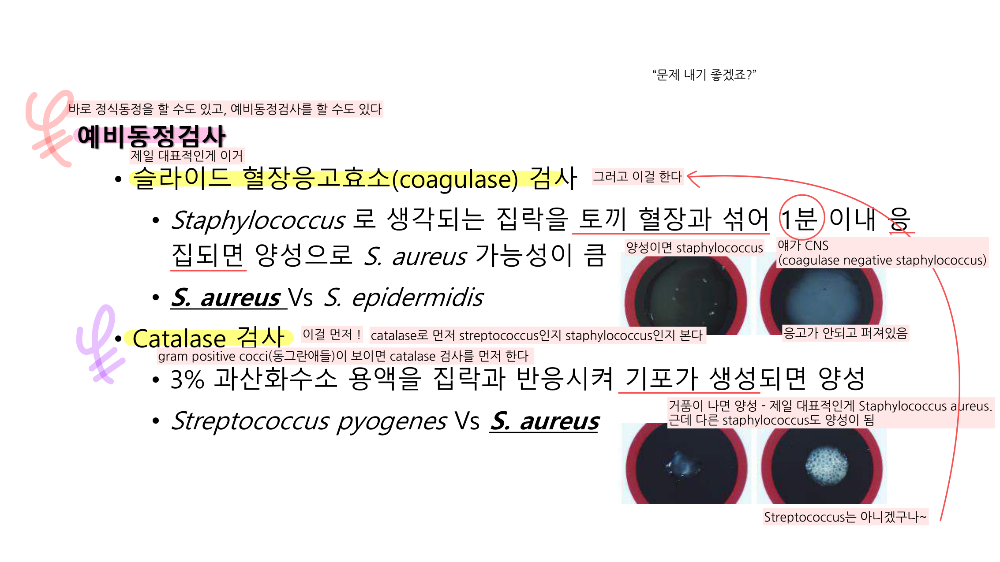{: style="width:80%"}

| 검사 | 방법 | 양성 | 구별 |
|---|---|---|---|
| **Catalase** | 3% 과산화수소 + 집락 | **기포** | **그람양성알균이 보이면 먼저**: 양성 = Staphylococcus, 음성 = Streptococcus(Enterococcus) — S. pyogenes vs S. aureus |
| **Coagulase(슬라이드 혈장응고효소)** | 포도알균 집락 + 토끼 혈장 | **1분 이내 응집** | 양성 = **S. aureus**, 음성(퍼져 있음) = CNS(S. epidermidis) |
| **담즙용해** | S. pneumoniae 의심 집락에 sodium deoxycholate | **집락이 없어짐** | catalase 음성 사슬알균 중 **폐렴알균** |
| Spot indole | Kovac 시약 | 분홍 | |
| 혈청형 | 항혈청과 반응 | 응집 | **Salmonella, Shigella** 혈청형 |
| **Cytochrome oxidase** | oxidase 시약 | **청색(보라)** | 둘 다 그람음성 막대인 **E. coli(−) vs P. aeruginosa(+)** |

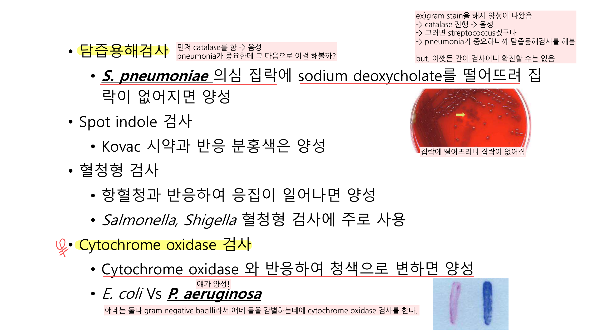{: style="width:80%"}

흐름 예: 그람양성알균 → **catalase** → 음성이면 사슬알균 → 폐렴알균이 중요하니 **담즙용해** / 양성이면 포도알균 → **coagulase**로 S. aureus vs CNS.

!!! exam "기출 포인트"
    8번: 그람양성알균을 확인한 다음 예비동정 → **catalase**. 20번: 포도송이 모양 그람양성알균 + catalase 양성 → **Staphylococcus**(S. aureus까지는 coagulase가 있어야). 27번: MacConkey에서 자란 그람음성균, **oxidase 음성** → **Acinetobacter**(Pseudomonas·Aeromonas는 양성).

## 위성현상 (satellitism) — 기출 단골
**H. influenzae는 X 인자(hemin)와 V 인자(NAD)**가 필요하다. 혈액평판에서 **포도알균이 적혈구를 용혈시키면 X·V 인자가 배지로 나오고**(포도알균은 NAD도 분비), 그 주변에서만 H. influenzae가 작은 집락으로 자란다. 초콜릿 배지(가열해 적혈구를 깬 배지)에선 그냥 자란다.

!!! exam "기출 포인트"
    3번 출제: 21번(주관식 — 위성현상이 생기는 이유: **포도알균이 적혈구를 용혈 → V·X 인자 유리**), 26·30번(신장이식 환자, S. epidermidis의 β용혈 주위 위성현상, 초콜릿 배지 계대 → **Haemophilus influenzae**).

## 확정동정검사
최소 5–6시간, 당일에 안 나온다는 단점.

1. 전통적 생화학 검사
2. 상품화 키트(**API 스트립** — 색깔 조합을 표에서 찾음)
3. **자동화 시스템 동정**(카드에 균액을 풀어 장비에 넣으면 반응을 읽어 데이터베이스와 비교) — 요즘 병원은 이걸 쓴다.

## MALDI-TOF MS

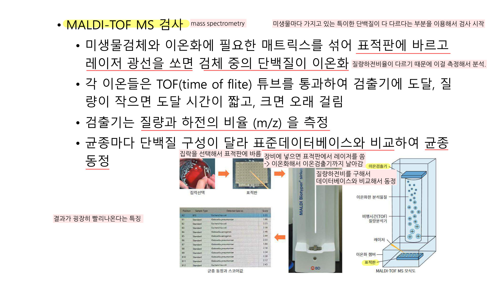{: style="width:80%"}

- 미생물마다 가진 **특이한 단백질 구성이 다르다**는 원리.
- 집락을 **매트릭스**와 섞어 표적판에 바르고 **레이저**를 쏘면 단백질이 이온화 → **TOF(비행시간) 튜브**를 지나 검출기에 도달(**질량이 작으면 빨리, 크면 늦게**) → **질량/전하 비(m/z)** 측정 → **표준 데이터베이스와 비교**해 균종 동정.
- **결과가 굉장히 빨리 나온다.**

# 8. 항균제감수성검사

## 왜·언제 하나
- 배양검사의 최종 목표. **치료 항균제의 선택, 내성균주 출현 감시**.
- 원인균의 감수성을 예측할 수 없을 때, 내성이 문제가 될 때(요즘 대부분의 균이 내성을 획득) → 무조건 한다. 국가·지역(인도·중국은 내성이 매우 높다), 시기, 환자 병력(항균제를 많이 썼던 환자), 기관 내 다제내성균 역학을 고려.

## 최소억제농도 (MIC)

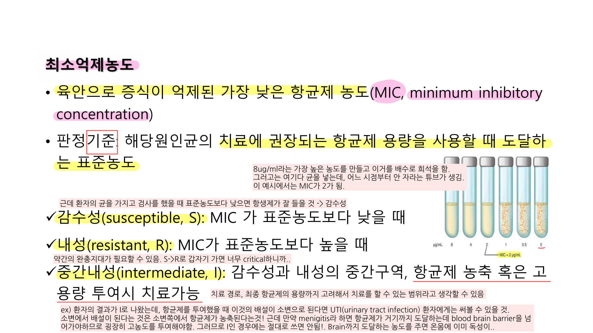{: style="width:80%"}

- **MIC = 육안으로 증식이 억제된 가장 낮은 항균제 농도**. 예: 8 µg/mL부터 2배씩 희석한 튜브에 균을 넣으면 어느 농도부터 안 자란다 → 그게 MIC(예시에선 2).
- **판정기준(breakpoint)**: 권장 용량을 쓸 때 도달하는 **표준농도**.
    - **감수성(S)**: MIC < 표준농도
    - **내성(R)**: MIC > 표준농도
    - **중간(I)**: 그 사이 — **항균제가 농축되는 부위**나 **고용량**이면 치료 가능. 예: 소변으로 배설되는 약은 요로감염엔 써 볼 수 있지만, **수막염엔 BBB를 넘어야 하므로 I면 절대 쓰면 안 된다**.

## 판독기준의 출처
- **임상판독기준**: 임상효과를 반영. 예: ESBL 생산균은 검사상 일부 cephalosporin MIC가 낮아도 실제 치료가 안 될 수 있다.
- **자연판독기준(검사실)**: 검사법이 같지 않으면 표준화가 어렵다 → **국제 표준 기관: CLSI(미국), EUCAST(유럽)**. 경북대병원은 CLSI.

## 검사의 종류

| 방법 | 원리 | MIC? | 특징 |
|---|---|---|---|
| **디스크확산법** | Müller-Hinton 한천(MHA)에 균을 펴 바르고 **6 mm 항균제 디스크** → 억제대 **지름(mm)** 측정 | **MIC 아님** | 표준화가 잘 돼 있고 정확·재현성(검사자 숙련도 중요) |
| **한천희석법** | 농도별 항균제를 섞은 한천에 여러 균주 접종 | MIC | **MIC 분포 측정의 대표적 참고방법**, 많은 균주 동시, 높은 재현성 |
| **액체배지 희석법** | cation-adjusted MHB(Ca2+ 20, Mg2+ 10 µg/mL) | MIC | **대량(시험관)·미량희석법**, 자동화 장비 패널 — **표준 방법** |
| **E test(경도확산법, gradient diffusion)** | 항균제가 **농도 구배**로 코팅된 플라스틱 스트립 → 타원형 억제대가 스트립과 만나는 눈금 | MIC | 원하는 항균제만 골라, **증식이 느린 혐기균·까다로운 균**에 |

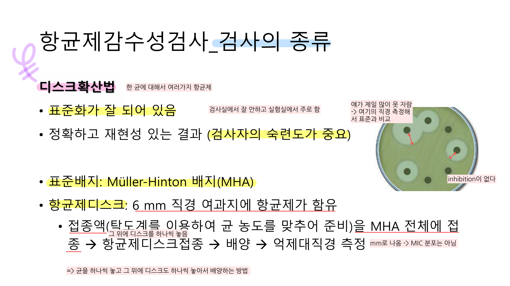{: style="width:76%"}

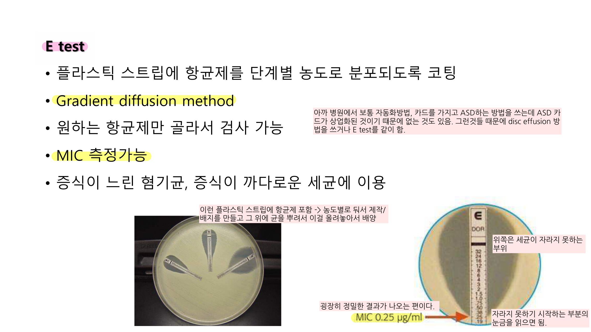{: style="width:76%"}

!!! exam "기출 포인트"
    **같은 문제 3번(2020·2022·2025)**: 「가장 **정밀한** 결과를 얻을 수 있는 것」 → **경도확산법(E test)** — 연속 농도라 2배 희석 단계 사이 값까지 읽는다(출제자 정답). 단, 강의는 **미량희석법이 표준 방법**이라 했으니 「표준」을 물으면 미량희석법. **「MIC를 측정하지 않는 것」 → 디스크확산법**(16, 22번).

## 판독 기준의 의미 (판독 및 보고)
- **감수성(S)**: 권장 용량에서 도달하는 혈중 농도로 균 성장이 억제된다 → 치료 효과(약 90% 이상) 기대.
- **내성(R)**: 권장 용량으로 도달할 수 있는 농도에서 억제되지 않을 **위험이 높다**("무조건 안 된다는 아니고 위험이 높다~"). 특정 내성기전 가능성, 또는 임상효능이 입증되지 않은 경우.
- **중간(I)**: 감수성보다 효과는 떨어지지만 치료 효과가 있는 경우. **독성 한계범위가 좁은 약에서 S → R 사이의 완충지대로 중대 오류를 막는다.**
- "여기 있는 건 그냥 읽어 보시면 되세요":
    - **감수성 용량 의존성(SDD)**: 권장보다 **고용량**을 써야 효과 → 문헌 근거 최대용량.
    - **비감수성(nonsusceptible)**: 내성이 보고된 적 없거나 매우 드물어 S 기준만 있는데 그 범위를 벗어날 때 — **내성기전이 있다는 뜻으로 해석하면 안 된다**(기준이 없는 것).

!!! exam "기출 포인트"
    12번(2023) 감수성 결과표: **vancomycin S → 치료효과 90% 이상 기대**(⑤). 오답: 「tetracycline R → 효과가 **전혀** 없다 / 90% 이상 실패」(위험이 높다는 뜻일 뿐), 「vancomycin MIC가 penicillin보다 높으니 쓰지 말자」(**약마다 기준이 달라 MIC 숫자끼리 비교 불가**), 수막염에 ampicillin.

# 9. 항균제 자연내성 — ★ 무조건 외우기

- **균종 특이적 내성**: 균이 원래(자연적으로) 가진 내성. 예: 진균에서 유래한 항생물질은 그 진균에 효과가 없다.
- **자연내성인 항균제에 대해 S나 I로 나와도 치료 효과가 없다고 간주해야 한다.** (아주 드물게 이렇게 나올 수 있다 → 검사 오류를 의심하고 재검)

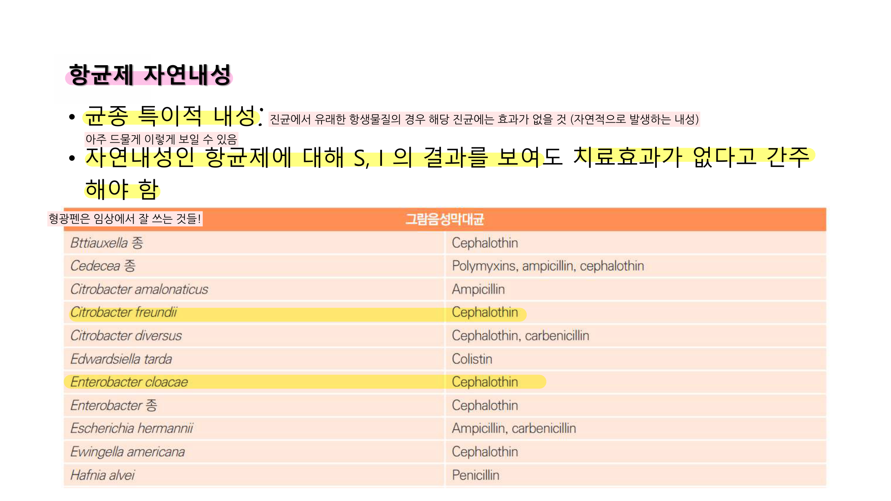{: style="width:80%"}

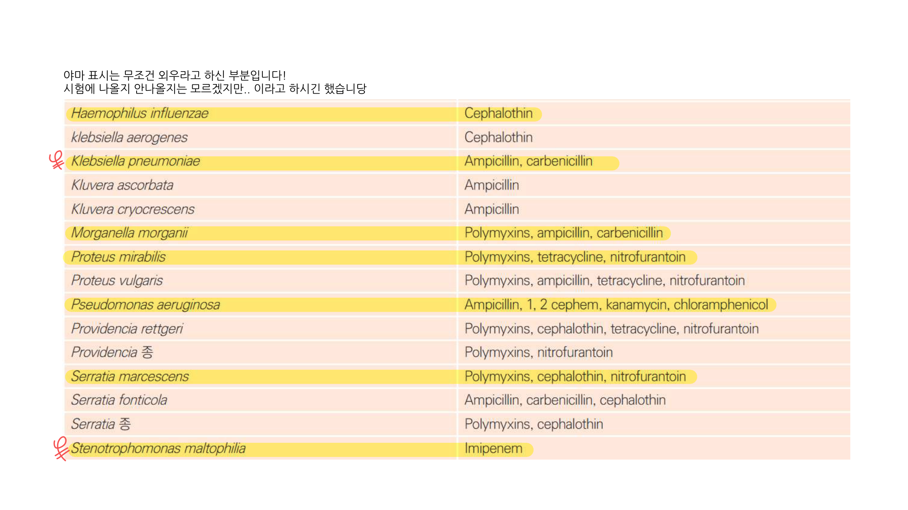{: style="width:80%"}

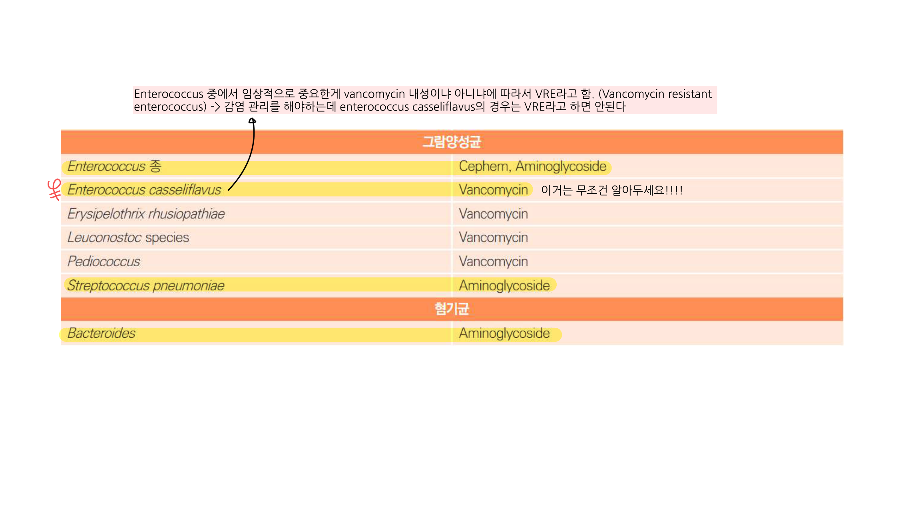{: style="width:80%"}

!!! memo "암기 — 보라색 ★ 3개 (교수님이 무조건 외우라고 한 것)"
    1. **Klebsiella pneumoniae → ampicillin, carbenicillin**
    2. **Stenotrophomonas maltophilia → imipenem**
    3. **Enterococcus casseliflavus → vancomycin** — Enterococcus는 vancomycin 내성 여부로 **VRE**를 따져 감염관리를 하는데, E. casseliflavus(와 E. gallinarum)는 원래 vancomycin 내성이라 **VRE라고 하면 안 된다**. "이거는 무조건 알아 두세요!!!!"
    
    통상 감수성 카드에 많이 들어가는 약 중 중요한 것이 **ampicillin과 imipenem**.

노란 형광펜(임상에서 잘 보는 균)도 함께:

| 균 | 자연내성 |
|---|---|
| Citrobacter freundii | cephalothin |
| Enterobacter cloacae (Enterobacter 종) | cephalothin |
| Haemophilus influenzae | cephalothin |
| Morganella morganii | polymyxins, ampicillin, carbenicillin |
| Proteus mirabilis | polymyxins, tetracycline, nitrofurantoin |
| **Pseudomonas aeruginosa** | **ampicillin, 1·2세대 cephem, kanamycin, chloramphenicol** |
| Serratia marcescens | polymyxins, cephalothin, nitrofurantoin |
| **Enterococcus 종** | **cephem, aminoglycoside** |
| Streptococcus pneumoniae | aminoglycoside |
| Bacteroides(혐기균) | aminoglycoside |

그 밖(표에만): Cedecea — polymyxins·ampicillin·cephalothin, Citrobacter amalonaticus — ampicillin, Edwardsiella tarda — colistin, Hafnia alvei — penicillin, Proteus vulgaris — polymyxins·ampicillin·tetracycline·nitrofurantoin, Providencia — polymyxins·nitrofurantoin(±cephalothin·tetracycline), Klebsiella aerogenes — cephalothin, Erysipelothrix·Leuconostoc·Pediococcus — vancomycin.

!!! exam "기출 포인트"
    1번(2025, 슬라이드 결과지 그대로): 객담 WBC >25/LPF·편평상피 <10/LPF(**적절한 검체**), 그람음성 막대 많음, KOH 음성, **Heavy → Klebsiella pneumoniae**인데 **ampicillin이 S**로 나옴 → K. pneumoniae는 ampicillin **자연내성**이므로 믿을 수 없는 결과 → **항균제감수성검사 재검**(⑤). 오답: 상기도 오염으로 부적절(검체는 적절), >1,000 CFU/mL(Heavy는 반정량 4+), S인 4가지 약 모두 사용, KOH 음성이니 진균 배제.

# 10. 강의 밖에서 나온 기출 (과거 강의 내용)

선배 메모처럼 예전 강의에 있던 내용이 몇 개 나왔다. 올해 강의에 없으면 가볍게 보기.

- **생물안전**: 2등급 생물안전작업대·일반 가운 복장(BSL-2)으로는 **Marburg 같은 4위험군**(13번), **Brucella abortus**(23번 — 실험실 감염이 잘 돼 BSL-3)를 다루면 안 된다. 탄저균·B. pseudomallei·SARS-CoV-2·홍역·B형 간염·콜레라·이질균은 2등급 작업대에서.
- **소독제**: **4급 암모늄**은 저수준 소독제라 **결핵균을 못 죽인다**(9번). 과산화수소 7.5%, 글루타르알데하이드, 과초산은 고수준.
- **베이즈 정리**: P(H|E) = P(E|H)·P(H)/P(E) — 검사 전 확률에 검사 결과를 반영해 검사 후 확률(17번).
- **검체 운송**(28번): **뇌척수액은 냉장 금지**(수막알균이 저온에 약함 — 실온·즉시), **대변은 즉시 못 보내면 냉장 가능**(정답), 소변도 냉장 보관 가능(14번).
