<!-- 필기본: 2025 -->
<!-- 단계: 수업 전 -->

# 0. 이 수업을 공부하는 법

감염내과 **권기태 교수님** 수업. 필기 작성자 말대로 CP(증례토의) 내용과 겹치는 부분이 많아서, 강의에서는 의료관련감염 자체보다 **항생제 고르기**를 더 많이 이야기하셨다. CP 수업과 묶어서 공부하면 좋다.

학습성과 5가지가 그대로 단원이다.

1. 의료관련감염을 **정의**한다.
2. 감염 **부위별 원인균** 차이를 비교한다.
3. 주된 병원체의 **전파경로**를 설명한다.
4. 부위별(요로·폐렴·수술부위·중심정맥관) **예방대책**을 설명한다.
5. 의료인에게 **혈액으로 전파되는 질환**과 노출 후 관리를 설명한다.

- 기출 60문항(2020–2025)으로 인체감염학에서 가장 많은 편이다. 크게 네 덩어리로 반복된다.
    - **4대 의료관련감염의 예방 번들**(요로·VAP·수술부위·중심정맥관) — 그림을 주고 "이 술기가 막으려는 감염의 예방법"을 2–3개 고르게 한다. 보기를 서로 섞어 놓는다(머리 올리기 ↔ 폐쇄배뇨 ↔ chlorhexidine 피부소독).
    - **수술창상 분류**(청결/청결-오염/오염/불결) — 설명 문장을 주고 이름 고르기. 거의 매년.
    - **격리(표준주의 + 접촉·비말·공기)** 와 **손위생**(5가지 시점, 6단계 순서 그림).
    - **원인균·항생제** — VAP·의료관련감염 경험적 항생제(pip/tazo), CLABSI 원인균(CoNS), CRE·*Acinetobacter*·*Burkholderia*, 주사침 사고(HBV·HIV).
- 필기 2–4쪽에 22–24년 기출이 붙어 있다. 24년도는 CP가 없어서 이 강의 문제가 적었고, 22·23년은 CP 문제와 구분이 어려워 비슷한 것을 다 넣었다고 한다.

!!! key "핵심"
    **48시간(입원 후) · 14일(퇴원 후) · 30일/90일(수술 후, 인공물 있으면 90일)** 이 의료관련감염의 시간 기준.
    **예방의 공통 원칙 = 꼭 필요할 때만 넣고, 무균적으로 넣고, 매일 필요성을 묻고 빨리 뺀다.** 예방적 항생제는 **수술 예방 하나만** 쓴다.
    **손위생이 가장 중요하고 기본적인 예방법**, 표준주의는 **모든 환자**, 전파경로별 주의는 그 위에 **추가**.

# 1. 의료관련감염의 정의와 중요성

## 정의 (healthcare-associated infection, HAI)
- **의료와 관련된 모든 감염.** 예전에는 병원감염(hospital-acquired infection)·원내감염(nosocomial infection)이라 불렀지만, 의료행위 관련 감염이 병원 안에만 있지 않고 **퇴원 후 요양시설·다른 의료기관·지역사회**까지 이어지므로 범위를 넓힌 이름이다. 그래서 감염관리의 대상도 병원 + 관련 기관 + 지역사회다.
- **입원 당시 없었고 잠복하지도 않던 감염이 입원 중 생긴 것.**
    - 통상 **입원 48시간 후** 발생
    - **퇴원 후 14일 이내** 발생한 감염
    - **수술 후 30일 이내** 수술부위감염(인공물을 넣으면 90일 — 4단원)
    - **병원 직원과 병원 출입자**가 걸린 감염도 포함
- 왜 48시간인가: 입원하고 48시간이 지나면 몸에 **집락하는 균이 병원 균으로 바뀐다**. 48시간 안에 생기는 폐렴은 지역사회 균, 그 뒤는 병원 균이 원인이 된다.

### 증가 요인
노령 인구 증가, 만성 퇴행성 질환 증가, 항암제·면역억제제 치료를 받는 **면역저하자 증가**, **항생제 내성균 증가**, **침습적 의료기술** 발전. 대표적인 의료관련감염은 **요로감염, 창상감염(수술부위), 폐렴, 혈류감염**.

교수님 말씀: 병원 안 곳곳에서 관리해도 어쩔 수 없이 생기는 부분이 있고, 기구를 넣는 경우가 많아 병원 안에서만 생기는 것도 아니다. 고령 환자 척추에 인공물을 넣었다가 감염되면 다 빼야 하고, 뼈 감염은 2–3개월 치료해도 1년 뒤 재발하기도 한다 — 근육이 다 빠지고 삶의 질이 무너진다. 그래서 요즘은 내시경적 수술로 위험을 줄이기도 한다.

## 발생률 (국내 감시 자료)
- **중환자실 감염(KONIS, 2020.7–2021.6, 257개 병원 339개 ICU)**: 총 4,435건 중 **혈류감염 45% > 요로감염 37.1% > 폐렴 17.9%**. 전체 감염률 2.68/1,000 재원일(전년 2.83에서 감소). 요로 0.99, 혈류 1.24(전년과 비슷), 폐렴 0.48(0.55에서 유의하게 감소).
- 예전에는 요로감염이 무조건 1위였다 — 도뇨관을 한 달 넣으면 무증상 세균뇨가 거의 다 생기기 때문. **무증상 세균뇨가 감시에서 빠지면서**(미국 NHSN 2009년, 국내 2011–2012년부터) 요로감염 순위가 내려갔다. 미국 자료는 이보다 높게 나온다.
- **수술부위감염(2021.7–2022.6, 291개 기관, 165,859건)**: 전체 0.79%.
    - 30일 감시: **결장 2.82%**, 위 1.9%, 직장 1.88%, **충수절제 1.39%**, 질자궁적출 0.74%, 복부자궁절제 0.67%, 제왕절개 0.33%, 담낭 0.29%, 척추후궁절제 0.28%, 전립선 0.23%, 흉부 0.06%
    - 90일 감시: 심장동맥우회술(가슴만 절개) 1.80%, 공여부위 절개 1.64%, 심장 1.13%, 뇌실단락 0.92%, 척추고정 0.89%, 개두술 0.70%, **고관절치환 0.54%**, 슬관절치환 0.16%

!!! exam "기출 포인트"
    순서 문제가 반복된다. ICU 감염은 **혈류 – 요로 – 폐렴**(44번), 수술부위감염은 **결장 – 충수절제 – 고관절치환**(33번), **결장 – 위 – 담낭**(45번). 소화기 수술(특히 결장)이 높고 관절치환은 낮다고 기억하면 고를 수 있다.

## 중요성
- 의료의 질 저하, 경제적 손실(재원기간 연장·항생제 비용), 환자–의료진 간 법적·윤리적·사회적 문제, 이환율·사망률 증가, 주요 병원균의 **높은 내성률**로 항생제 선택이 어렵다.
- 현대의학으로도 **100% 예방은 불가능**하고 일부만 예방 가능하다. 그런데도 일반인은 의료진의 부주의·과실로 오해해 소송으로 가는 경우가 많다.
- 교수님 말씀: **사망 환자 직접사인의 50%가 감염**(선행사인은 암이 1위). 의료관련감염은 항생제·소독제에서 살아남은 **독한 균**에 의해 생겨서 치료가 어렵다. 교수님은 집에 가면 다 씻고 나서야 아이들과 접촉하셨다고 한다.
- 제도: **2006년 KONIS**(전국병원감염감시체계, 대한의료관련감염관리학회 + 질병관리본부) 시작, **2010년** 의료기관인증평가에 감염관리 비중 확대, **2016년** 감염관리료 수가 신설.

# 2. 요로감염 (UTI)

## 개요
- 입원 성인에서 **가장 흔한 감염**: 전체 의료관련감염의 30–40%, 발생률 1–10%.
- 병원 요로감염의 **95% 이상이 유치도뇨관(indwelling urinary catheter) 관련**, 대부분 무증상 세균뇨.
- 폐쇄배뇨시스템을 유지해도 세균뇨가 **매일 3–8%** 생긴다 → 1개월 이상 유치하면 대부분 세균뇨·진균뇨. 그래서 현실에서는 **1달 안에 다 교체**한다.
- **간헐적 도뇨** 시 세균뇨 3%, 도뇨관 없는 입원 환자 1.4% → **유치도뇨관 삽입을 최소화**하는 것이 가장 효과적. 다만 간헐적 도뇨는 환자가 스스로 소변을 잘 보는지 수시로 확인해야 해서 쉽지 않다.

## 정의와 분류
| 용어 | 정의 |
|---|---|
| 무증상 세균뇨(ASB) | 요로감염 증상·징후 없이, 적절히 채취한 소변에서 **2종류 이하 균이 105 CFU/mL 이상** |
| 급성 단순요로감염 | 비뇨생식기 이상이 없는 **여성**의 방광 감염 — 빈뇨·절박뇨·배뇨곤란·치골상부 압통 |
| 급성 비폐쇄성 신우신염 | 갈비척추각(CVA) 통증·압통, 발열을 동반한 신장 염증. 단순요로감염과 같은 인구집단 |
| 복잡요로감염 | 비뇨생식기에 **기능적·구조적 결함**이 있는 사람. 치료 어렵고 재발 잘 되고 내성균 흔함. **막힌 곳을 푸는 게 항생제보다 중요.** 남자에게 생기면 주로 폐쇄 동반(전립선, 결석, 암) |
| 농뇨(pyuria) | 소변 다형핵백혈구 증가 = 요로 염증의 증거 |
| 요로패혈증(urosepsis) | 상부 요로 염증 → 균혈증. 혈액배양에서 **소변배양과 같은 균** |
| 도뇨관 관련 세균뇨 | 유치도뇨관 환자에서 증상 유무와 관계없이 의미 있는 세균뇨. 증상 없으면 **CA-ASB**, 있으면 **CA-UTI** |

- 무증상 세균뇨는 **치료하지 않는다**(임신, 비뇨기과 시술 전 제외). 어차피 다시 생기고, 다시 생길 때 앞서 쓴 항생제에 **내성**이 생겨 진짜 감염 때 치료가 더 어려워진다. 놔둬도 예후 차이가 없다.

## 위험인자와 경로
- 균이 도뇨관 **내부** 또는 **외부 표면**을 따라 방광으로 들어간다.
    - 내부 경로: **폐쇄배뇨시스템이 깨지거나** 소변백 소변이 오염 → 역류(upstream infection). 중간에 연결이 끊어지면 오염된다.
    - 외부 경로: 삽입·관리 시 무균술 미준수, **장·회음부 상재균**이 도뇨관 외벽을 타고 올라감.
- **가장 중요한 위험인자 = 삽입기간.** 그 외 도뇨관 관리 부실, 폐쇄배뇨 미유지, 요도구·소변백 집락, **여성, 고령, 신경계 기저질환, 당뇨, 중증도**.
- 오래 넣으면 방광벽이 약해져 혈뇨·출혈 위험도 커진다.
- 폐쇄배뇨시스템: 중간 연결부위에 주사기를 찔러 검체를 뽑을 수 있게 되어 있고, 찔렀다 빼도 새지 않는다 — 시스템을 열지 않고 검체를 얻는 방법.

## 원인균
- 단순요로감염은 원인균이 한정적(*E. coli* 80% 이상), 의료관련 요로감염은 **광범위하고 다제내성**이 흔하다.
- 단기 유치: 대부분 **단일균** — 장알균(*Enterococcus*)과 그람음성 막대균. 가장 흔한 것은 여전히 ***E. coli***(단순 UTI보다 비율은 낮음). 그 외 *Klebsiella, Serratia, Citrobacter, Enterobacter*, 비발효균 *P. aeruginosa*, CoNS, 장알균.
- **진균뇨**: 대부분 칸디다뇨, 국내 ICU 요로감염 분리균의 **30–35%**. 도뇨관 있는 환자에서 더 흔하다.
- 장기 유치: 대개 **혼합균**, *Proteus mirabilis, Providencia, Morganella*도 흔함(교수님: 설명은 하셨지만 몰라도 된다).
- 장기 유치 도뇨관에는 **생체막(biofilm)** 이 생겨 방광 내 세균뇨를 정확히 반영하지 못한다 → 배양 검체는 **새로 넣은 도뇨관**에서 채취.

### 단순집락균 vs 병원균
- 장기 유치 환자, 요양시설 환자, 여성은 도뇨관에 집락된 균이 배양될 뿐 실제 원인균이 아닌 경우가 흔하다 → 요로감염이 의심되면 **도뇨관을 교체하고 신선한 소변으로 다시 배양**.
- ICU 환자 소변의 **Candida**는 오염·집락인 경우가 많다. **도뇨관 제거·교환만으로 40%에서 칸디다뇨가 사라진다.**
- 여러 균이 동시에 자라면 오염·집락일 가능성. 현실에서는 다시 빼고 넣기 어려워 경험적으로 항생제를 쓰는 경우도 많다.

## 예방법
- **꼭 필요한 환자에게만** 삽입. 치료자의 편의만을 위해 넣지 않는다(발표에서 나온 "의료인 편의에 따른 foley 삽입 지양" — 현실적으로 쉽지 않다).
- 삽입·유지 시 **무균적 조작**.
- **폐쇄배액체계 유지, 최소한 조작**, 꼬여 막히거나 역류하지 않게.
- **가능하면 빨리 제거.**
- **예방적 항생제는 권장되지 않는다.** 교수님: 오늘 배우는 4가지 감염 중 **수술 예방적 항생제를 빼고는 예방적 항생제를 쓰지 않는다.**

!!! exam "기출 포인트"
    1번(2025): 정답 "**폐쇄배액체계를 유지하고 최소한으로만 조작**". 함정 — 자주 교체, 삽입 후 예방적 항생제, 매일 소변배양, "소변백을 위생적으로 비우면 무균술 불필요". 35번은 그림(도뇨관)을 주고 **무균술 삽입 + 폐쇄배뇨 + 매일 필요성 평가**를 고르게 했다.

# 3. 병원획득폐렴(HAP)과 인공호흡기 관련 폐렴(VAP)

## 개요
- 요로감염·카테터 관련 감염과 함께 주요 의료관련감염. **사망률 약 30%**, 입원기간·의료비를 크게 늘린다. 폐렴은 사망원인 10위권에서 최근 **3위**까지 올라왔다(고령화).
- 하기도는 원래 무균 → 어떤 경로로든 미생물이 들어가 자라면 폐렴.
- 고위험군: 영유아·소아, **65세 이상**(나이에 따라 U자 모양), 심각한 기저질환, 면역저하, **의식저하**, 심폐질환, **흉부·복부 수술**, **인공호흡기**. 폐·심장·뇌 같은 생명 장기 감염은 저산소증 → 호흡부전 → 사망으로 간다.
- 전통적 예방: 흡인 감소, 손위생, 호흡기 장치의 적절한 소독·멸균, 백신, 교육. 구강·위의 병원균 집락을 줄이는 방법은 연구 중.

## 정의·기전·위험인자
- **HAP**: 입원 당시 잠복 상태가 아니며 **입원 48시간 이후** 발생한 폐렴.
- **VAP**: 기도삽관·인공호흡기 적용 **48–72시간 이후** 발생한 폐렴.
- 기전: 환자 자신의 또는 병원에서 얻은 **상기도 집락균이 하기도로 흡인(aspiration)**.
- 위험인자 3가지 묶음
    - 병원균 **집락화 조장**: 이전 항생제 치료, 오염된 인공호흡기 회로·장비, **위산 감소**
    - 구강인후부 **흡인 조장**: 기관내 삽관, **의식저하**, 비위관
    - 숙주 방어 약화: COPD, 고령, 흉부·상복부 수술

## 원인균
- 지역사회 폐렴 원인균과 **완전히 다르다.** 호기성 그람음성균(*E. coli, K. pneumoniae, Enterobacter, P. aeruginosa, Acinetobacter*)과 그람양성균(*S. aureus*·MRSA, *Streptococcus*). 면역저하자는 바이러스·진균도. 여러 균 동시 감염도 가능.
- **국내 KONIS 2020–2021**: ***A. baumannii* 26.7% > *P. aeruginosa* 17.4% > *K. pneumoniae* 16.6% > *S. aureus* 15.0% > *S. maltophilia* 6.1%** — 대부분 다제내성이라 치료가 어렵다.
- **다제내성균 위험요인**: **90일 이내 주사 항생제**, VAP 당시 패혈성 쇼크, 선행 ARDS, VAP 전 **5일 이상 입원**, VAP 전 급성 신부전으로 신대체요법.
- 카바페넴 내성 *Acinetobacter*에는 들을 약이 별로 없다(cefiderocol이 있긴 한데 효과가 그닥, colistin은 독성).

!!! exam "기출 포인트"
    27번: 인공호흡기 14일째 VAP의 원인균 4개 → ***S. aureus, P. aeruginosa, A. baumannii, K. pneumoniae***. 폐렴구균·*Mycoplasma*·*Coxiella*·결핵균은 아님. 20번은 뇌출혈로 의식저하된 환자의 아래쪽(dependent) 폐 경화 → **흡인성 폐렴**(인공호흡기 안 했으니 VAP 아님).

## 예방법 (VAP 번들)
- **꼭 필요한 환자에게만 삽관**, 가능하면 **비침습적 환기(NIV)** — 환자가 의식이 있고 협조가 되어야 한다.
- 삽관도 빨리 제거: **"sedation vacation"** — 하루 한 번 진정제를 끊고 깨워서 발관 가능한지 평가.
- **상체를 30–45도** 올려 흡인 방지.
- **Chlorhexidine으로 구강인두 오염 제거**(oral care).
- 심부정맥혈전 예방(금기가 아니면).
- 그 외 표(Table 142-1): 기계환기 피하기, 호흡기 장비 무균 관리, 성문하 분비물 흡인 튜브 고려.

!!! exam "기출 포인트"
    13번(2023): 인공호흡기 7일째 VAP의 예방법 2개 → **상체 30–45도 + 매일 진정 중단·인공호흡기 필요성 확인**. 함정 — 예방적 항생제(쓰지 않음), **최대멸균방어술(이건 중심정맥관)**, 몸을 매일 chlorhexidine으로 닦기(이것도 중심정맥관 유지 번들).

## 항생제 고르기 — 강의에서 가장 길게 다룬 부분
교수님: "이 표를 알고 있으면 시험 칠 때 choice에 도움이 된다." 학생 수준에서 알아야 할 항생제는 이게 다다.

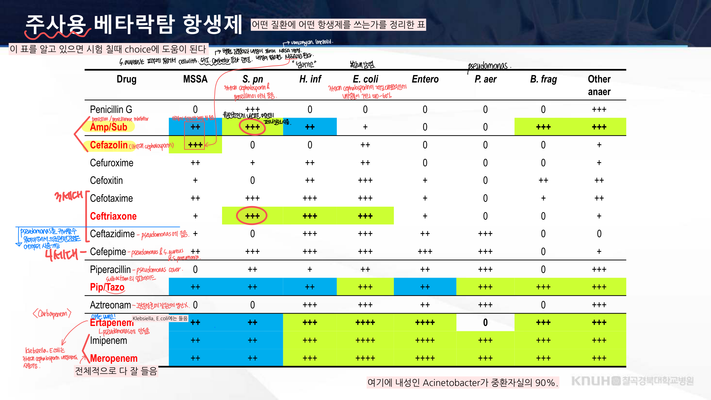{: style="width:80%"}

| 약 | 핵심 |
|---|---|
| Penicillin G | 폐렴구균·혐기균. 아직 들음 |
| **Ampicillin/sulbactam** | MSSA·폐렴구균·*H. influenzae*·혐기균. 지역사회용, **녹농균 X** |
| **Cefazolin (1세대)** | **MSSA**(피부·연조직) — **수술 예방 항생제의 기본** |
| Cefuroxime (2세대) | |
| **Cefoxitin (2세대)** | **특이하게 항혐기균 효과** → 복강 수술 예방에 단독 |
| **Ceftriaxone·cefotaxime (3세대)** | 폐렴구균·*H. influenzae*·*E. coli* 강함. **녹농균 X** — 지역사회 폐렴·복강내 감염의 대표 |
| **Ceftazidime (3세대)** | **녹농균 O**, 대신 그람양성(폐렴구균) 약함 |
| **Cefepime (4세대)** | **녹농균 + 그람양성(*S. aureus*, 폐렴구균)** 모두 |
| Piperacillin | 녹농균, *E. coli* 내성률 50–60% |
| **Piperacillin/tazobactam** | 녹농균 + 혐기균 + 거의 전부 — **의료관련감염 경험적 치료의 대표** |
| Aztreonam | 그람음성만, 녹농균 O |
| **Ertapenem** | 카바페넴인데 **녹농균 X**("얘는 빼고") |
| **Imipenem·meropenem** | 전체적으로 다 잘 듣는다. ESBL(3세대 내성 *Klebsiella·E. coli*)에도 사용 |

- **의료관련감염에는 녹농균을 덮을 수 있어야** 해서 ceftazidime·cefepime·pip/tazo·카바페넴부터 쓴다. 중환자실 *Acinetobacter*는 카바페넴에도 **90%가 내성**.
- MRSA 위험이 있으면 **vancomycin**(안 되면 linezolid) 추가 — *S. aureus*는 피부에 있어 카테터·기구와 관련된다.

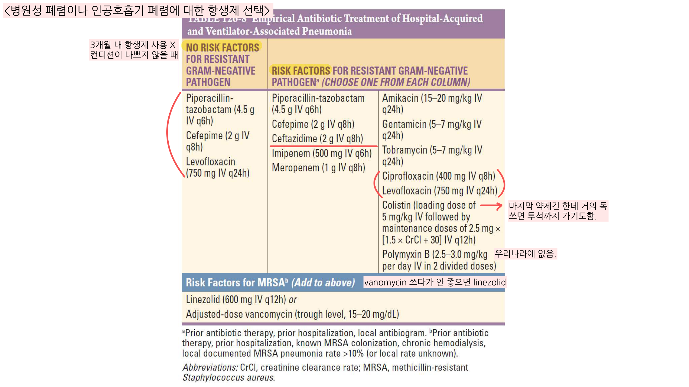{: style="width:72%"}

- HAP·VAP 경험적 치료: 다제내성 위험(3개월 내 항생제 등)이 없으면 **pip/tazo·cefepime·levofloxacin·imipenem·meropenem 중 하나**. 위험이 있으면 **β-lactam 하나 + 다른 계열(aminoglycoside 또는 ciprofloxacin·levofloxacin) 하나** — 베타락탐 둘은 잘 안 쓴다. MRSA 위험이면 vancomycin 또는 linezolid 추가. Colistin·polymyxin B는 마지막 약, 독성이 커서 투석까지 가기도 한다.

### 경구 베타락탐
- **Amoxicillin/clavulanate**: amp/sub의 경구판. 거의 다 고르게 듣고 혐기균까지 — 인두염·폐렴·연조직염.
- 1세대 경구(cephalexin, cefadroxil 등): *S. aureus*·연쇄알균 → 인두염·**연조직염**. 폐렴구균에 약해 폐렴에는 안 씀.
- 2세대(cefaclor, cefuroxime, cefprozil 등): 어중간해서 빼고.
- 3세대(cefixime, cefpodoxime, cefdinir 등): 그람음성 강함 → 인두염·**요로감염**.

### Fluoroquinolone
| 세대 | 약 | 특징 |
|---|---|---|
| 1 | **Ciprofloxacin** | 그람음성·**녹농균·*Acinetobacter*에 듦** → 요로감염, 병원감염 조합용. 폐렴구균 X |
| 2 | **Levofloxacin** | 폐렴구균에도 듣는다 → 폐렴·UTI·연조직염. 녹농균에도 어느 정도 → 병원감염에 쓸 수 있는 경구약 |
| 3 | Gemifloxacin·moxifloxacin | 폐렴구균 강함 → 지역사회 폐렴 단독. **녹농균 X → 의료관련감염에 X** |

- **결핵에 잘 들어서** 쓰면 폐렴인지 결핵인지 가려진다 → 결핵을 먼저 배제하고 쓴다(너무 중하면 둘 다 치료하려고 쓰기도 함).
- 부작용: 경련, torsade de pointes, **아킬레스건 파열**, 망막박리, **대동맥 박리·동맥류**.

### 항혐기성 항생제
- **Clindamycin과 metronidazole**이 가장 대표적. amp/sub·amx/clav·pip/tazo·카바페넴처럼 혐기균까지 덮는 약을 쓰면 **clindamycin·metronidazole을 같이 쓸 필요가 없다.**
- 2세대 cephalosporin 중 cefoxitin은 혐기균에 들어 복강·부인과 수술 예방에 단독으로 쓴다.
- Doxycycline: 쯔쯔가무시 치료, 말라리아 예방.

!!! exam "기출 포인트"
    다제내성균 의료관련감염 치료제 → **piperacillin/tazobactam**(8번, 55번). Amp/sub·amx/clav·ceftriaxone·cefazolin·cefuroxime·azithromycin은 지역사회용이다. 28번: chemoport 환자의 호중구감소 패혈성 쇼크에 가장 부적절한 초기 항생제 → **ceftriaxone**(녹농균 X).

# 4. 수술부위감염 (SSI)

## 개요
- 개발도상국에서는 수술 환자 약 1/3에서 감염, 가장 흔한 의료관련감염. 고소득 국가에서는 빈도가 낮지만 여전히 **두 번째**로 많다.
- 입원 연장, 이환율·사망률 증가. 완전히 피할 수는 없지만 **근거중심 지침을 지키면 약 60% 예방** 가능. 수술 전·중·후 통합 관리가 필요.

## 위험인자
- 대부분 **환자 자신의 피부·수술 개방 부위 상재균**에 의해 감염된다 → **피부절개부터 봉합까지** 열려 있는 동안 위험. 외부(오염된 환경·기구)는 덜 흔하다.
- 원인균: 일반적으로 **피부 상재균인 그람양성 알균(*S. aureus*, *S. epidermidis*)**. 복강 수술은 그람음성 막대균(*E. coli, Klebsiella*), 질 쪽은 혐기균.
- 환자 요인: 연령, **조절 안 되는 당뇨**, 비만, 흡연, 면역억제제, 영양상태, **수술 전 긴 재원기간**.
- 수술 요인: **긴 수술시간**, 기구 삽입, 혈종·괴사조직, **수술 중 저체온·저산소증·수술 전후 고혈당**.
- 창상등급: 청결 창상은 5% 미만, **응급 오염 창상은 20%** 까지.

## 수술창상의 분류 — 거의 매년 출제

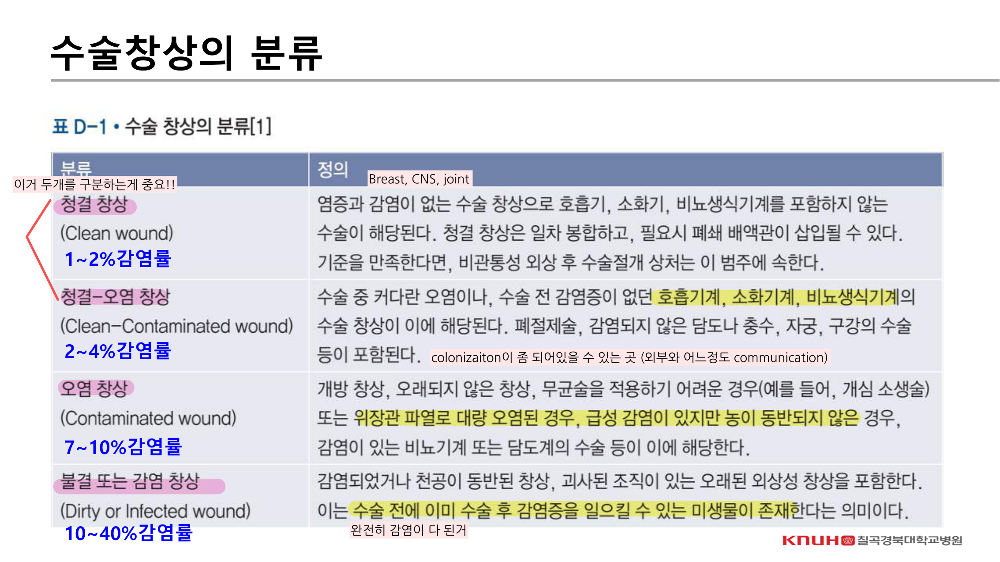{: style="width:76%"}

| 분류 | 정의 | 예 | 감염률 |
|---|---|---|---|
| **청결(clean)** | 염증·감염 없고 **호흡기·소화기·비뇨생식기를 열지 않는** 수술. 일차 봉합, 필요하면 폐쇄 배액. 비관통성 둔상 수술도 | **유방, 중추신경계, 관절** | 1–2% |
| **청결-오염(clean-contaminated)** | 수술 중 큰 오염이나 수술 전 감염 없이 **호흡기·소화기·비뇨생식기를 연** 수술 | **폐절제, 감염 안 된 담도·충수·자궁·구강, 대장(결장) 수술** | 2–4% |
| **오염(contaminated)** | **개방·신선한 외상 창상**, 무균술 유지 어려움(**개흉 심폐소생술**), **위장관 내용물이 크게 샌** 경우, **농 없는 급성 염증**, 감염된 비뇨기·담도 수술 | | 7–10% |
| **불결-감염(dirty-infected)** | **오래된 외상** 창상, 괴사조직, **이미 감염·천공** — 수술 전에 이미 감염을 일으킬 미생물이 있음 | | 10–40% |

- 교수님: **청결과 청결-오염을 구분하는 게 중요.** 청결-오염은 외부와 어느 정도 통해 있어(colonization이 있을 수 있는 곳) 균이 좀 있는 곳을 연 수술이다. 대장 수술이 청결-오염의 대표 예시.

!!! exam "기출 포인트"
    설명 문장을 주고 이름을 고르게 한다 — "호흡기·소화기·비뇨생식기를 포함하지 않는" → **청결**(36번), "수술 전 감염 없던 호흡기·소화기·비뇨생식기, 폐절제·담도·충수·자궁·구강" → **청결-오염**(10, 46번), "개방창상·개흉 소생술·위장관 파열 대량 오염·농 없는 급성 감염" → **오염**(16번). 2번(2025)에서는 "유방 수술 = 청결-오염"이 오답 보기였다(**유방은 청결**).

## 위험도 점수
- **ASA 분류**(미국마취과협회, 수술 전 신체 상태): 1 정상 건강 / 2 경미한 전신질환 / 3 중증 전신질환 / 4 생명을 계속 위협하는 중증 전신질환 / 5 수술 안 하면 생존 기대 불가 / 6 장기 기증 목적의 뇌사자. 원래 수술 전체 위험을 말하는 점수다.
- **NNIS 위험지수** = 아래 각 1점(0–3점)
    1. 창상이 **오염 또는 불결**
    2. 수술시간 > **T시간**(그 수술 소요시간의 **75 백분위수**)
    3. **ASA 3·4·5**
- 교수님: 수치를 외울 필요는 없고 **어떤 항목이 들어가는지, 점수가 높을수록 나쁘다**는 것만.

## 수술부위감염의 정의
교수님: "대략적인 이해만 하고 하나하나 외울 필요는 없다." 분류 기준은 **기간 · 범위(깊이) · 감염의 증거** 세 가지다.

| 종류 | 기간 | 범위 | 감염의 증거(하나 이상) |
|---|---|---|---|
| **표재성 절개부위** | **30일** 이내 | 절개 부위 **피부·피하조직** | ① 고름 배출 ② 무균 채취 검체에서 균 분리 ③ 의료진이 의도적으로 열었고(배양 안 함) 통증·압통·부종·발적·열감 중 1개 ④ 의료진이 진단 |
| **심부 절개부위** | 수술 종류에 따라 **30일 또는 90일** | **근막·근육층** | ① 심부 고름 ② 저절로 벌어지거나 의도적으로 열었고 균 분리(또는 배양 안 함) + 발열(>38℃)·국소 통증·압통 ③ 농양 등이 육안·조직·영상으로 확인 |
| **기관/강(organ/space)** | 30일 또는 90일 | 근막·근육보다 **깊은** 부위 | ① 삽입 배관에서 농 ② 무균 채취 체액·조직에서 균 ③ 농양 등 확인 + 특정 부위 감염 진단기준 1개 이상 |

- 표재성은 연조직 감염으로 치면 연조직염(cellulitis) 수준까지.
- **인공물(기구)이 들어가면 90일**까지 생긴 감염을 의료관련감염으로 본다. 기간 안이라고 무조건 의료관련감염은 아니지만, 기간이 지나서 생긴 것은 아니라고 본다 — 날짜가 생각보다 중요하다.

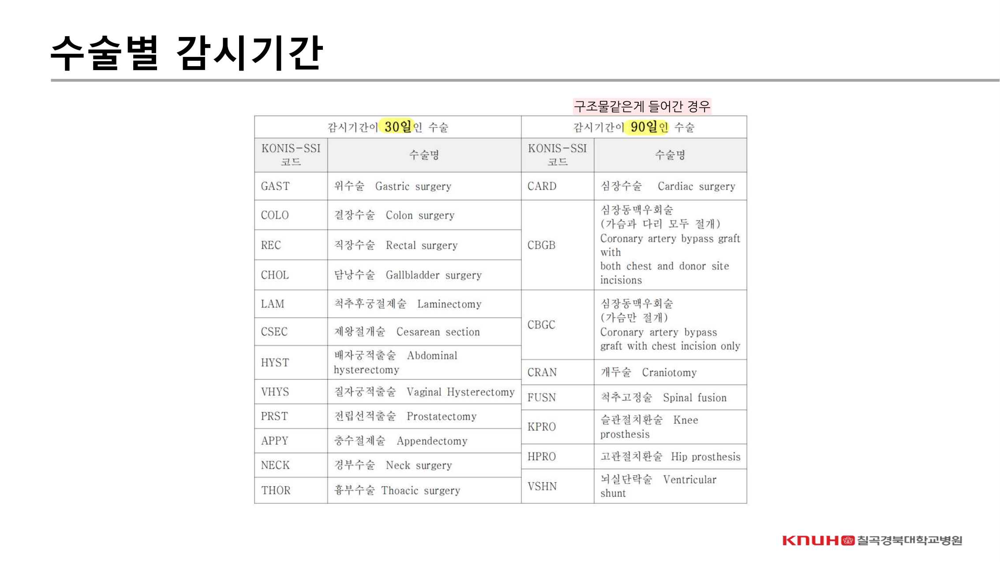{: style="width:70%"}

- 90일 감시 수술은 심장·관상동맥우회술·척추고정·관절치환·개두술·뇌실단락처럼 **구조물이 들어가는** 수술.

## 원인균과 추세
- WHO 자료: 유럽 SSI는 대장 수술(청결-오염의 대표)에서 높고 청결 수술로 갈수록 낮다. 원인균 1위는 ***S. aureus***, 그다음 CoNS — 주로 인공구조물이 들어갔을 때. *E. coli* 등은 복강내 감염, *Enterococcus*·*Pseudomonas*는 오래 입원했거나 면역저하자의 의료관련 균.
- 국내 KONIS 2021: 그람양성 52%(장알균 23.9%, CoNS 12.9%, *S. aureus* 8.1%), 그람음성 36.5%(*E. coli* 14.3%). **최근 그람양성균이 계속 줄고 있다**(감염관리·손위생 개선).

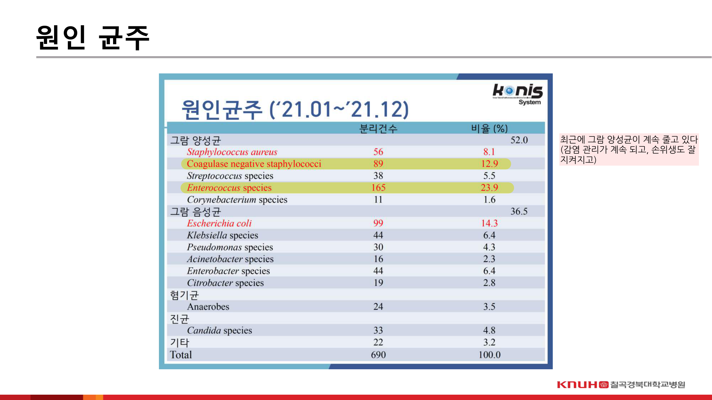{: style="width:62%"}

!!! exam "기출 포인트"
    56번: 수술부위감염의 가장 흔한 원인균(2016 WHO) → ***S. aureus***.

## 예방법
- **Choose a surgeon wisely** — 수술하는 사람 요인도 중요하다.
- 수술 전 다른 감염은 충분히 치료한 뒤 수술.
- **예방적 항생제는 피부절개 전 1시간 이내** 투여, **24시간 이내 중단**(가능하면 한 번). 오래 쓰면 내성만 생긴다.
- 제모는 수술 직전에만, **clipper를 쓰거나 아예 하지 않는다(면도칼 X)**.
- 수술 부위는 **chlorhexidine-alcohol**로 소독.
- 수술실 무균: **양압 유지**, 드나들며 문을 자주 열지 않기.
- 수술 기술(불필요한 개방·예방적 배액관 피하기), 수술 후 창상을 자주 보고 가벼울 때 대처. 외과의에게 감시 결과 환류.

### 수술 전 예방적 항생제
- 목적: 절개 부위의 **내인성 상재균 수를 낮추는 것**(외부에서 들어오는 감염을 막는 게 아님).
- **불결-감염 창상은 예방이 아니라 치료** 목적 항생제.
- **청결 수술에는 일반적으로 권고하지 않는다** — 단, **인공장치를 넣는 청결 수술은 권고**(예: 두경부 청결 수술은 None, 보형물 들어가면 cefazolin).
- 대부분 **cefazolin**. 결장·충수 등 혐기균이 있는 곳은 **cefoxitin 단독 또는 cefazolin + metronidazole**. 대장 수술은 정주 예방에 더해 **기계적 장 준비 + 경구 neomycin + erythromycin(또는 metronidazole)**.
- 교수님: 나머지는 대부분 1세대 — **항생제 종류보다 언제 넣고 언제 끊느냐가 더 중요하다.**

!!! exam "기출 포인트"
    2번(2025) 정답 "**수술 중 저체온과 고혈당은 SSI 위험을 높인다**". 오답 — 대부분 외부 오염(아님, 내인성), 2시간 이내 투여(1시간), 유방 = 청결-오염(청결), 최소 72시간 유지(24시간 이내). 54번: SSI 예방 → **chlorhexidine-alcohol 소독**. 상체 30–45도·구강 chlorhexidine(VAP), 면도기 제모, 최소 3일 유지는 오답.

# 5. 중심정맥관 관련 혈류감염 (CLABSI)

## 개요와 두 가지 정의
- 중심정맥관은 약물·투석·영양·혈관내 시술에 쓰이는 침습 장비라, 혈류감염 시 비용·재원기간·이환율·사망률이 증가한다.
- **CLABSI**(central line-associated BSI): **감시 목적.** 중심정맥관 48시간 이후, 다른 감염원 없이 혈액에서 균이 자람.
- **CRBSI**(catheter-related BSI): **진단·치료 목적.** 카테터 팁에서 자라거나, 중심정맥관 혈액배양이 말초보다 **2시간 먼저** 자라거나 균량이 더 많을 때. 오늘 하는 건 CLABSI.

## 위험인자·경로

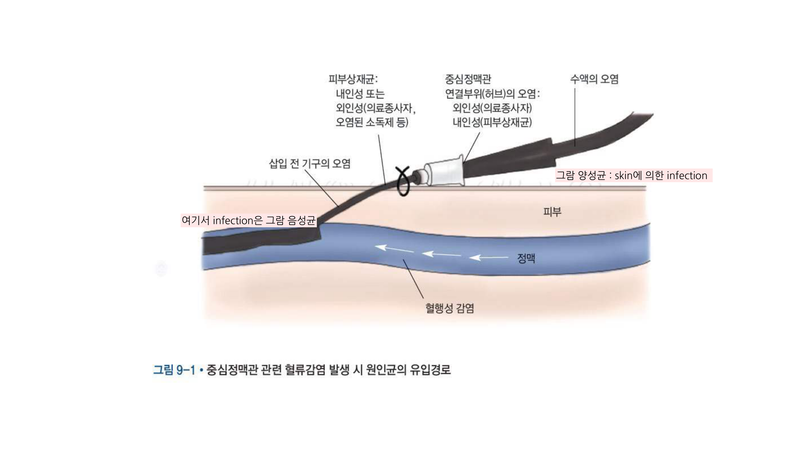{: style="width:66%"}

- **단기간** 중심정맥관: 주로 **삽입부위 피부 상재균**이 관 바깥을 따라 이동해 끝을 오염(그람양성 — 피부).
- **장기간** 중심정맥관: **연결부위(catheter hub) 오염** → 내강에 균 정착(의료진 손 등).
- 드물게 다른 부위 감염의 균혈증이 관에 붙거나(혈행성), **오염된 수액**(그람음성).
- 핵심 전략: 삽입·관리 시 오염 최소화 + **불필요하면 빨리 제거**. 오래 두는 것이 위험인자. (CP 시간 언급: 수액 세트는 일주일은 길고 96시간마다 교체.)

## 진단
- 중심정맥관 **삽입 2일 후**, 발열·오한·저혈압 + **다른 감염원 없음** + 새로 생긴 의미 있는 균혈증.
- 의미 있는 병원체는 **검체 1개**로, **흔한 피부 오염균은 검체 2개 이상**에서 자라야 한다.
- 피부 상재균: *Corynebacterium*(디프테리아 제외), *Bacillus*(탄저 제외), *Propionibacterium*(*Cutibacterium*), **CoNS(*S. epidermidis*)**, viridans 연쇄알균, *Aerococcus*, *Micrococcus*.

!!! exam "기출 포인트"
    34번: 중심정맥관 관련 균혈증의 가장 흔한 원인 → **CoNS**. 39번: 투석 중 1시간 만에 40℃ — 투석 카테터 감염 → ***S. aureus***. 51번: ICU 치료 중 생긴 균혈증에서 보기 어려운 균 → ***Listeria***.

## 예방법 — 삽입 번들과 유지 번들

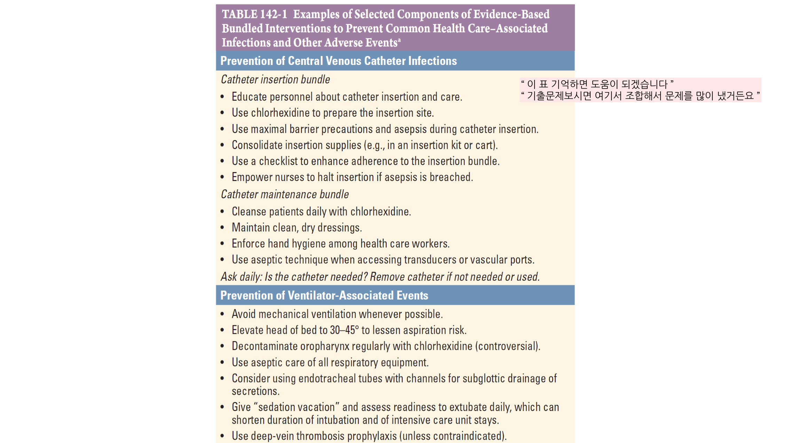{: style="width:62%"}

교수님: **"이 표 기억하면 도움이 되겠습니다. 기출문제 보시면 여기서 조합해서 문제를 많이 냈거든요."**

| 감염 | 번들 |
|---|---|
| **중심정맥관 — 삽입** | 교육 / **chlorhexidine으로 삽입부위 소독** / **최대 멸균 차단(maximal barrier precautions)**·무균술 / 물품을 키트로 / **체크리스트** / **무균이 깨지면 간호사가 중단시킬 권한** |
| **중심정맥관 — 유지** | **매일 chlorhexidine으로 환자 몸 닦기** / **깨끗하고 건조한 드레싱** / **손위생** / 연결부 무균 접근 / **매일 "필요한가?" 묻고 필요 없으면 제거** |
| **VAP** | 기계환기 피하기 / **머리 30–45도** / **구강 chlorhexidine** / 호흡기 장비 무균 / 성문하 분비물 흡인 / **sedation vacation과 매일 발관 평가** / DVT 예방 |
| **수술부위** | 외과의 선택 / 수술 전 감염 치료 / **절개 전 1시간 내 항생제, 24시간 내 중단** / clipper 또는 제모 안 함 / **chlorhexidine-alcohol** / 수술실 무균 / 수술 기술 / 감시 결과 환류 |
| **요로** | **필요할 때만**(제공자 편의 X) / 무균 삽입 / **폐쇄배뇨·최소 조작** / **매일 필요성 묻고 제거** / 방광 초음파로 도뇨 대신 소변량 확인 |
| **교차 전파** | 모든 접촉 전후 **알코올 손소독** |

- 최대 멸균 차단 = 수술 복장과 같다(모자·마스크·멸균 가운·멸균 장갑·전신 멸균포). 시간이 오래 걸려 잘 안 지키면 위험이 높아진다.
- 삽입 위치는 **쇄골하정맥 > 내경정맥**(대퇴는 피함).

!!! exam "기출 포인트"
    예방법 고르기에서 보기는 다섯 번들에서 섞여 나온다. 26·43번(중심정맥관 그림): **삽입부위 chlorhexidine 소독, 손위생, 매일 필요성 평가 후 제거**. 9번: 가장 적절한 조치 → **최대 무균술식**(일상적 교체·항생제 연고·매일 드레싱 교환·헤파린 세척은 X). 31번: 부적절한 것 → "**povidone-iodine을 chlorhexidine보다 우선**"(반대다). 37번 그림의 정답 "간호사 권한 강화"가 아니라 **"환자와 접촉하기 전에 반드시 수행"(손위생)**, 14번 그림은 **"환자 주변 기구와 접촉한 후에도 수행"**.

# 6. 기타 의료관련감염

## *Clostridioides difficile* 감염 (항생제 연관 설사)
- 항생제 투여 환자 설사의 **주 원인균**. 장독소와 세포독소로 설사. 단순 장염부터 **위막성 대장염, 중독성 거대결장**까지.
- 항생제 관련 설사의 **20–30%**, **병원 설사의 가장 흔한 원인**. 입원환자 유병률 0.3–0.8%, 최근 증가 — **미국에서는 가장 흔한 의료관련감염**.
- 관련 항생제: **clindamycin, cephalosporin**이 고전적, 최근 **fluoroquinolone** 사용 증가로 집단발생.
- 전파: 환자 간 직접 접촉, **의료인 손 → 분변-경구** → **접촉주의**가 가장 효과적. 장갑 + 손씻기, 1인실·코호트 격리, 병실·변기 환경 청소·소독.
- **아포** 때문에 **알코올 손소독이 안 듣는다 → 물과 비누로 손씻기.**

!!! exam "기출 포인트"
    6번: 수술 후 상처감염으로 2주 항생제 중 하루 10회 설사·발열 → ***C. difficile***. 53번: 역학조사 그림의 원인균과 **격리 지침이 같은 것** → *C. difficile*(접촉주의). 인플루엔자·SARS-CoV-2·백일해는 비말, 결핵은 공기.

## 그 밖에
- 세균: 다제내성균, 수막알균, 결핵, 레지오넬라 폐렴, 백일해. 바이러스: 호흡기 바이러스, 수두, A형 간염, 엔테로바이러스, 로타바이러스 설사. 진균: 아스페르길루스 폐렴, 칸디다.
- **요양시설에서는 옴(scabies)·이** 같은 피부질환이 문제.

!!! exam "기출 포인트"
    19번: 요양병원 뇌졸중 노인의 심한 가려움·피부 병변 → 옴. 치료제가 **아닌** 것 → **metronidazole**(permethrin 크림, lindane, crotamiton, ivermectin은 치료제).

## 다제내성균의 발생과 전파 — 감염관리 vs 항생제 관리

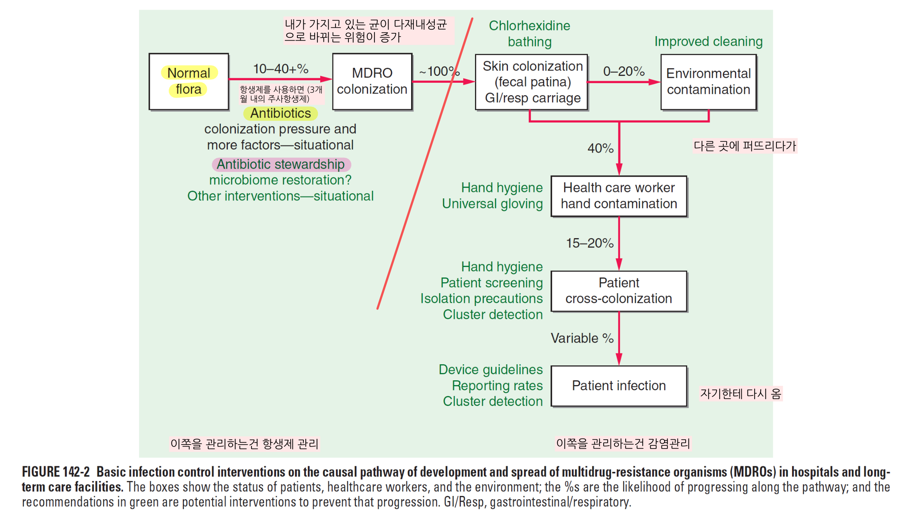{: style="width:76%"}

- 왼쪽(정상 균총 → **MDRO 집락**): 항생제를 쓰면(특히 3개월 내 주사 항생제) 내 몸의 균이 다제내성균으로 바뀔 위험이 커진다(10–40% 이상). 이 단계를 관리하는 것이 **항생제 관리(antibiotic stewardship)**.
- 오른쪽(피부 집락·환경 오염 → 의료진 손 → 다른 환자 → 감염): **감염관리** — chlorhexidine 목욕, 환경 청소 개선, **손위생**·보편적 장갑, 환자 선별검사·격리, 집단발생 감지, 기구 지침.
- 다른 곳에 퍼뜨린 균이 결국 자기한테 다시 온다.

!!! exam "기출 포인트"
    21번: 그림의 "가"(내성균이 생기는 단계) → **antibiotic stewardship**. 22번: "라"와 "마"에 모두 해당 → **hand hygiene**. 30번: ASP 핵심 팀(감염내과 의사·항생제 약사·임상미생물 전문가·정보전산 전문가)에서 가장 먼 것 → **병원장**.

### 기출에 자주 나온 병원 내성균 (필기 밖 내용)
- **CRE(카바페넴 내성 장내세균)**: 대표 균종 ***K. pneumoniae*, *E. coli***(40번). *Klebsiella*는 **젖당 발효, 비운동성, 두꺼운 협막**, 카바페넴 내성이 문제(48번).
- ***Acinetobacter baumannii***: WHO 2017년 슈퍼버그 **1순위**, 국내 3차병원 카바페넴 내성 50% 이상·요양병원 80% 이상(49, 59번).
- ***P. aeruginosa***: 호기성 그람음성, **낭성섬유증**에서 잘 감염, ICU에서 더 많음. 3세대 cephalosporin(ceftriaxone)은 안 듣는다(41번). 화상 환자 고름의 **포도 향(방향족 냄새)·녹갈색 색소**(50번).
- ***Burkholderia cepacia***: **chlorhexidine·포비돈 같은 소독제 안에서도 살아** 소독제 오염으로 집단 균혈증(42, 60번).
- **Citrobacter freundii**: 2017년 이대목동병원 신생아중환자실 사망 사건(오염된 지질 영양제)(18번).

# 7. 의료관련감염관리

## 역사
- **1847년 Ignaz Semmelweis**(비엔나): 산욕열이 **의료진의 오염된 손**으로 산모 사이에 전파된다고 주장하고 **염소 손소독**을 시킨 최초의 의사. 동료가 산모 부검 중 칼에 찔려 사망했는데 그 사인이 산모의 사인과 같았던 데서 착안 — 균을 모르던 시절이라 "손이 어떤 입자를 옮긴다"고 생각했다. 아이러니하게 패혈증으로 사망했다.
- **1860년대 후반 Joseph Lister**: antisepsis 도입.
- 미국 1960년대 본격화, 1970년대 감염관리 프로그램·감시활동.
- 국내 1980년대 초 시작, 1990년대 대학병원 중심 전담 조직, **2006년 KONIS**, **2010년 인증평가**, 이후 메르스·코로나.
- 교수님: 의료관련감염은 방심하면 생긴다 — **교통질서**처럼 사소하지만 병원에 근무하는 모두(실습 학생 포함)가 지켜야 한다.

## 필수요소와 기능
- 필수요소 4가지: **체계적 감염감시**, 감염률 **환류 프로그램**(외과의 등), **전담 감염관리간호사**, **감염관리전문의사**. 4가지가 다 있는 병원은 감염이 **32% 감소**, 없는 병원은 **18% 증가**.
- 의료법(제47조): **100병상 이상** 병원급 의료기관은 **감염관리위원회와 감염관리실**을 설치·운영하고 **전담 인력**을 둔다(필기: 전담 인력 150병상 — 예전 기준과 섞여 있음).
- 업무: 감염발생 감시, 유행 조사, 교육, **항생제 사용관리·내성률 감시**, 감염관리 검사, 규정·지침 개발, 환경위생, 물품·기기 평가, **직원 감염관리**.
- 교수님은 감시와 체계가 중요하다고만 언급하고 넘어가셨다.

!!! exam "기출 포인트"
    29번: 감염관리위원회·감염관리실 설치 의무 규모 → **100병상 이상**. 17번: 매달 질병관리청에 보고하는 것 → **중심정맥관 관련 혈류감염 + 손위생**.

## 감염관리 방법
### 감시(surveillance)
- 의료관련감염 발생 분포와 위험요인을 체계적으로 관찰 — **감염관리의 기본 업무**. 매일·격일로 수집해 매달·분기·연도별로 분석하고 문제가 있으면 중재.

### 격리 — 표준주의와 전파경로별 주의

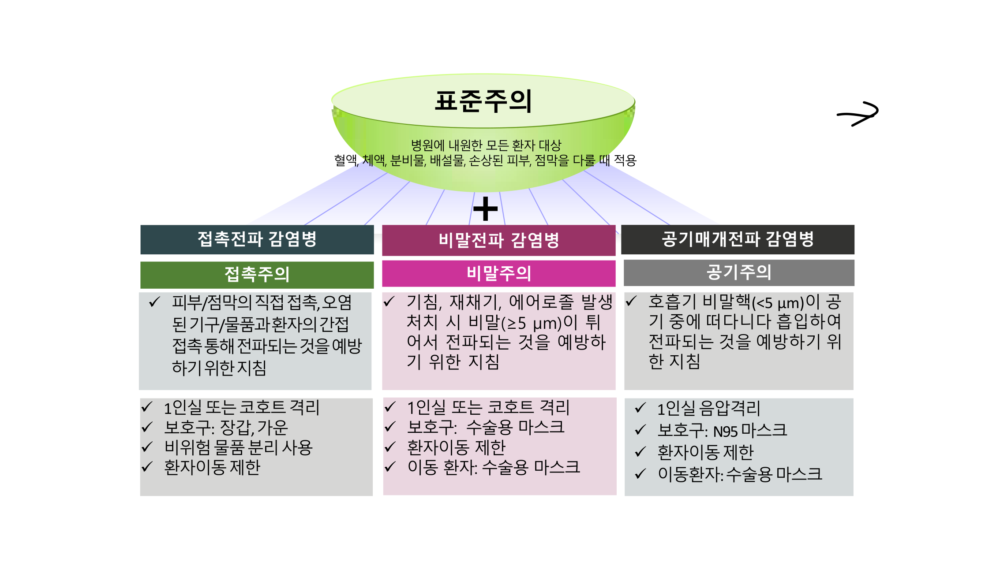{: style="width:70%"}

- **표준주의(standard precautions)**: 병원에 온 **모든 환자**. 혈액·체액·분비물·배설물·손상된 피부·점막을 다룰 때 장갑·가운·마스크, 환자 치료 전후 손씻기.
- **전파경로별 주의**는 표준주의에 **추가**한다. 감염 없이 수술 때문에 입원하면 표준주의만.

| | 접촉주의 | 비말주의 | 공기주의 |
|---|---|---|---|
| 막는 것 | 피부·점막 직접 접촉, 오염된 기구·물품 간접 접촉 | 기침·재채기·에어로졸 처치 시 **비말(≥5 μm)** | 공기 중 떠다니는 **비말핵(<5 μm)** 흡입 |
| 병실 | 1인실 또는 코호트 | 1인실 또는 코호트 | **1인실 음압격리** |
| 보호구 | **장갑, 가운** | **수술용 마스크** | **N95 마스크** |
| 기타 | 비위험 물품 분리 사용, 이동 제한 | 이동 제한, 이동 시 환자 수술용 마스크 | 이동 제한, 이동 시 환자 수술용 마스크 |
| 예 | ***C. difficile*, MRSA, VRE**, 옴 | **인플루엔자, 코로나19, 백일해**, 볼거리 | **결핵**, 홍역, 수두 |

!!! exam "기출 포인트"
    3번(2025): 두 주의의 관계 → "**전파경로별 주의는 표준주의를 보완하여 추가로 적용**". 표준주의는 감염환자에 한정되지 않는다. 짝짓기 — **표준주의 – 손위생**(15번), **표준주의 – 소변백 비우기**(23번). 오답: 비말 – MRSA, 공기 – 볼거리, 비말 – *C. difficile*, 접촉 – 결핵, 접촉 – 홍역, 공기 – 백일해. **N95·음압격리 = 결핵**(7, 38번).

### 표준주의의 구성 (인증평가 필수요소)
1. 손위생 2. 개인보호구(PPE) 3. 호흡기 위생·기침 예절 4. 환자 배치 5. 치료기구·물품 6. 환경 관리 7. 린넨 관리 8. 안전한 주사 9. 특수 요추천자 시술 시 감염관리 10. 직원 안전(주사침·날카로운 기구)

### 손위생 — "강조했습니다"
- 손은 병원 환경에서 **미생물 전파의 가장 효과적인 매개체**, 손씻기는 의료관련감염 예방의 **가장 중요하고 기본적이며 가장 효과적인 방법**.
- 요즘은 물 없이 쓰는 **알코올 손소독제**가 기본(단, *C. difficile*은 물과 비누).
- **손위생 5가지 시점(WHO)**: ① 환자 접촉 **전** ② 청결·무균 처치 **전** ③ 체액 노출 **후** ④ 환자 접촉 **후** ⑤ **환자 주변 기구·물건 접촉 후**.

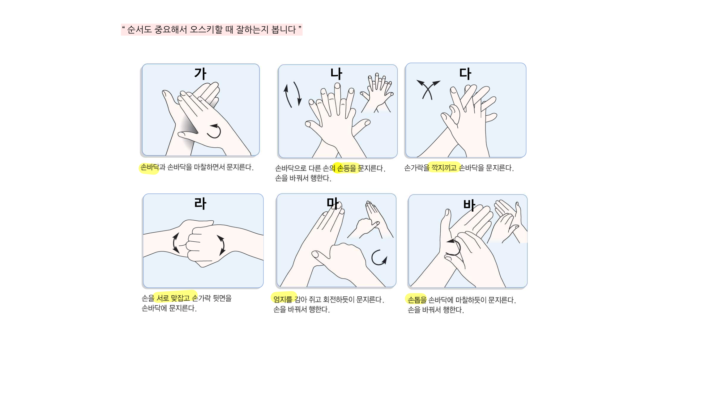{: style="width:60%"}

- 6단계 순서(오스키 때 순서를 잘 지키는지 본다): 가 손바닥과 손바닥 → 나 손등과 손바닥 → 다 손가락 깍지 끼고 → 라 두 손 모아 손가락 등 → 마 엄지를 돌려가며 → 바 손톱 밑(손끝)을 손바닥에.

!!! exam "기출 포인트"
    4번(2025): 손위생 시점이 **아닌** 것 → "**개인보호구 착용 후**"(PPE는 착용 전·벗은 후). 5번: 감염 예방 전략 → **알코올 기반 손소독제**(손씻기 10초 X — 20초 이상, 기침 예절은 입과 코 모두). 12·25번은 그림 순서 맞추기 — 시험 그림의 가~바 배치가 매번 달라서 **동작으로 순서를 외워야** 한다. 52번: 손위생 그림 → "**의료관련감염 예방에 가장 효과적인 방법**". 47번: 두 그림의 사례를 막는 가장 효과적인 방법 → **손위생**.

### 소독과 멸균
- **세척(cleansing)**: 모든 이물질 제거(물·마찰·세제). **소독·멸균 전에 반드시** 한다.
- **소독(disinfection)**: **세균 아포를 제외한** 모든 미생물을 죽임.
    - 높은 수준: 충분한 노출시간이면 아포까지 포함해 거의 모든 미생물 파괴
    - 중간 수준: **결핵균·진균**은 불활성화, 세균 아포는 못 죽임
    - 낮은 수준: 세균·바이러스·일부 진균만, 결핵균·아포 X
- **멸균(sterilization)**: **아포를 포함한 모든** 미생물을 죽임 — 고압증기(스팀) 멸균, **EO 가스** 멸균, 화학멸균제.

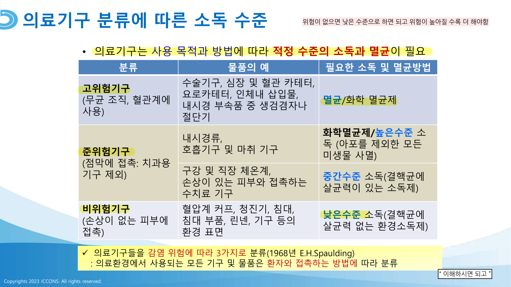{: style="width:66%"}

| 분류(1968 Spaulding) | 접촉 | 예 | 방법 |
|---|---|---|---|
| **고위험기구** | 무균 조직·혈관계 | 수술기구, 심장·혈관 카테터, **요로카테터**, 인체 삽입물, 생검겸자 | **멸균**/화학멸균제 |
| **준위험기구** | 점막(치과 제외) | **내시경**, 호흡기구·마취기구 | 화학멸균제/**높은 수준 소독** |
| | | 구강·직장 체온계, 손상 피부 수치료기구 | 중간 수준(결핵균 살균력) |
| **비위험기구** | 손상 없는 피부 | **혈압계 커프, 청진기**, 침대, 린넨, 환경 표면 | **낮은 수준** |

!!! exam "기출 포인트"
    58번: "미생물은 죽이지만 포자는 죽이지 않는" WHO 용어 → **disinfection**. 32번: 아포를 제거할 수 있는 방법 → **증기 혹은 고열 공기 30분**(짧은 시간의 고수준 소독제는 아포 X).

# 8. 직원감염관리와 혈액노출

## 필요성과 예방접종
- 의료진은 일반인보다 병원체 노출이 많고, 걸리면 환자·동료·가족에게 퍼뜨린다 → 건강진단·안전교육, 예방접종, **감염된 직원의 근무제한**, 노출 후 조치와 추적.
- **강력 권장 접종: B형 간염, 인플루엔자, 홍역, 볼거리, 풍진, 수두.**
- 교수님 예시: 수두·홍역 아이가 소아 병동에 입원하면 간호사 중 가임기 여성이 많다. **MMR·수두는 생백신이라 임신 시 금기** → 노출되면 면역글로불린밖에 없다 → **미리 예방**해 두는 게 중요. 신규 직원 채용 때 항체를 확인하고 없으면 접종하고 오게 한다.

!!! exam "기출 포인트"
    57번: 의료기관 종사자 권장 접종 → **홍역 백신**(C형 간염 백신은 없고, HPV·폐렴구균·대상포진은 직원 권장 목록이 아님).

## 혈액·체액 노출사고
- **날카로운 기구·주사침 사고**가 병원 직원 사고 중 **가장 흔하다**. 주사 후 바늘을 버리다가, **채혈 후 뚜껑을 다시 씌우다가(recapping)**, 물품 정리하다가.
- CDC가 특별 관리를 권고하는 질환: **B형 간염, C형 간염, HIV** → 노출 후 처치(PEP)와 추적검사.

| 원인 | 조치 |
|---|---|
| **HBV** | 노출자가 미접종이거나, 접종했어도 항체가 없거나 **anti-HBs < 10 mIU/mL** 이고 감염원이 HBsAg 양성이면 → **HBIG + B형간염 백신 동시**. **항체 ≥10이면 조치 불필요.** |
| **HCV** | **노출 후 예방약이 없다**(확률도 낮음) → 조기 발견: **4–6주 HCV RNA RT-PCR**, **4–6개월 anti-HCV** |
| **HIV** | 경피 노출인지 점막·손상 피부인지, 노출 정도, 원인 환자의 바이러스양·내성에 따라 **예방약(항레트로바이러스제)** 결정. **최소 6개월**(4주·12주·6개월) anti-HIV 추적, HCV 동시감염자 노출이면 **12개월**까지 |

- 교수님: "기출문제에 있다는 거고 이번에는 안 냈습니다." 아무튼 **안 찔리는 게 중요**.

### 직원 안전
- 적절한 보호구, 날카로운 기구는 **손으로 직접 건네지 않기**, 쓴 것은 **즉시 손상성 폐기물 용기**에.
- **사용한 주사바늘은 recapping 하지 않는다** — 다시 끼우는 과정에서 가장 잘 다친다. 불가피하면 **one-hand technique**.
- 폐기물 박스 밖으로 튀어나온 것이 없는지 확인, 의료폐기물은 즉시 전용 용기에 분리.

!!! exam "기출 포인트"
    11번: HBsAg 양성 환자 바늘에 찔림, 직원 anti-HBs **20 mIU/mL** → **조치 필요 없음**(10 이상 = 면역). HBV에는 예방적 항바이러스제를 쓰지 않는다. 24번: PCP 치료 중인 HIV 환자 바늘 → **예방적 항바이러스제 투여**(HIV 면역글로불린·백신은 없음).

!!! memo "암기"
    **48h / 14일 / 30일·90일** · **예방적 항생제는 수술만, 절개 전 1시간·24시간 내 중단** · 청결 = 유방·CNS·관절, 청결-오염 = 호흡기·소화기·비뇨생식기를 감염 없이 연 수술 · VAP = 머리 30–45도 + 구강 chlorhexidine + 매일 진정 중단 · CLABSI = chlorhexidine 피부소독 + 최대 멸균 차단 + 매일 필요성 · 결핵 = 공기주의(N95, 음압) · *C. difficile* = 접촉주의 + 비누 손씻기 · anti-HBs ≥10이면 조치 X, HCV는 예방약 없음, HIV는 PEP.
