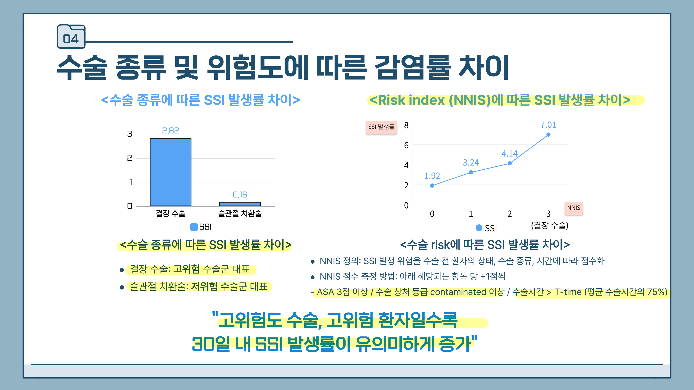
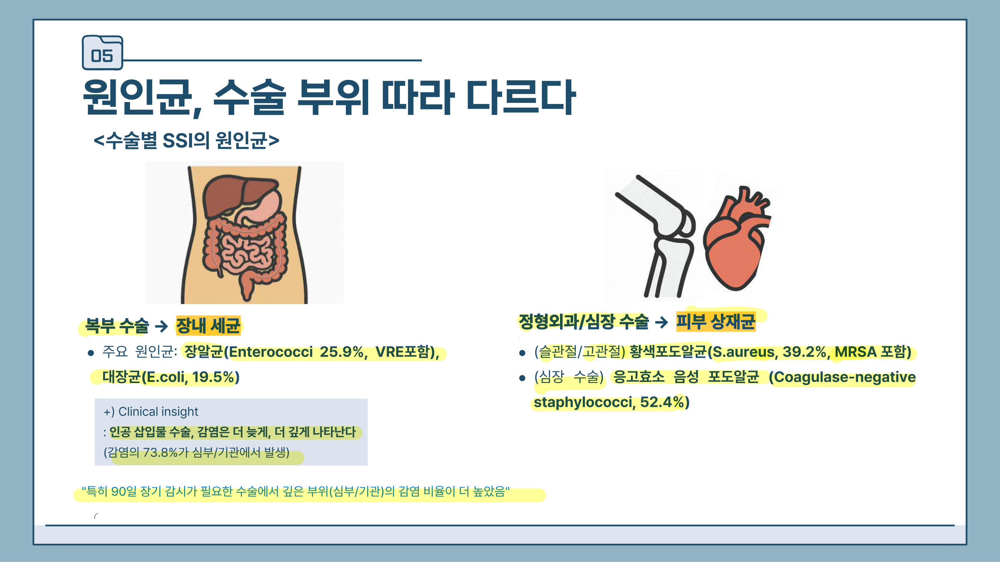
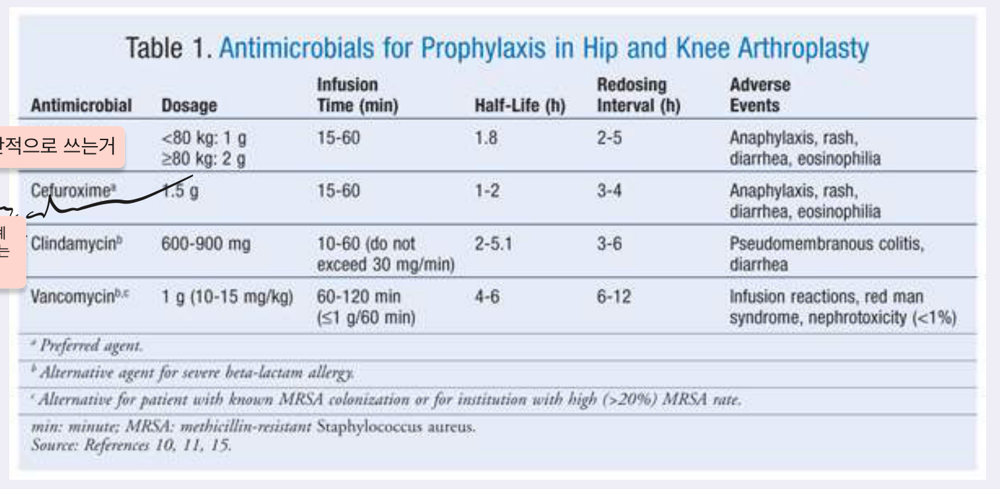

<!-- 필기본: 2025 -->
<!-- 단계: 수업 전 -->

# 0. 이 수업을 공부하는 법

CP-B1은 **의료관련감염과 감염관리**를 주제로 한 **조별 발표** 시간이다. 조마다 한 가지 주제를 맡아 발표하고, 교수님이 짧게 덧붙이셨다. 필기한 선배: "교수님 코멘트 위주로 적어 두겠습니다. **3, 4교시 수업(13. 의료관련감염 및 감염관리)과 겹치는 내용**이라 그 강의 위주로 보시면 될 것 같습니다."

**이 수업으로 분류된 기출은 없다**(2부 비어 있음). 다만 내용이 13번 수업과 거의 같고, 그쪽에는 기출이 60문항이나 있다. 이 정리는 발표 내용을 주제별로 묶고, 교수님 코멘트를 표시한다.

| 조 | 발표 주제 | 교수님 코멘트 |
|---|---|---|
| 1 | KONIS 중환자실 감시 결과 (2020–2021) | 코로나로 줄어든 건 주로 지역사회감염 |
| 2 | 전국 수술부위감염 감시 결과 (2021–2022) | 수술 종류별 감염률·원인균이 중요 |
| 3 | 유치도뇨관 관련 요로감염 (CAUTI) | **폐쇄배뇨시스템**, **전신 항생제 쓰지 않음** |
| 4 | 병원획득폐렴 (HAP/VAP) | 우리나라는 MRSA를 그렇게 적극적으로 커버하지 않음 |
| 5 | 수술부위감염 (SSI) | "중요한 거 다 잘 얘기했다" |
| 6 | 중심정맥관 관련 혈류감염 (CLABSI) | CLABSI vs CRBSI 구분 |
| 7 | 제멜바이스와 손 씻기 | — |
| 8 | 이대목동병원 신생아 사망 사건 | — |
| 9 | 감염관리 수가 정책과 CLABSI | **지원(수가)이 굉장히 중요하다** |
| 10 | 표준주의와 전파경로별 격리 | 표준주의·전파경로별 주의의 관계와 질환별 적용 |

!!! key "핵심"
    - 기구 관련 감염 예방의 공통 원칙: **필요할 때만 넣고, 필요 없으면 바로 뺀다.** 주기적 교체·일상적 예방 항생제는 하지 않는다.
    - CAUTI: **폐쇄배뇨시스템 유지**, 소변백은 **방광보다 낮게**, 무증상 세균뇨는 치료하지 않음.
    - SSI 예방적 항생제: **절개 1시간 전** 투여, **수술 후 24시간 이내** 중단, 보통 **cefazolin**.
    - CLABSI: 최대멸균차단, **클로르헥시딘**(0.5% 초과, 알코올 함유) 소독, **대퇴정맥 피함**, 매일 필요성 평가.
    - 격리: 결핵·홍역·수두 → **공기**, 인플루엔자 → **비말**, *C. difficile*·MRSA → **접촉**.

# 1. 의료관련감염 감시 — KONIS (1조·2조)

## 1-1. 중환자실 감시 (2020.7–2021.6)

전국 257개 병원(339개 중환자실)이 참여한 **KONIS**(전국의료관련감염감시체계) 결과.

- 감시 대상: **요로감염(UTI), 혈류감염(BSI), 폐렴(PNEU)**. 감염률은 재원일수 1,000일당, 기구관련 감염률은 기구사용 1,000일당으로 계산.
- 감염 종류: **혈류감염 45%** > 요로감염 37% > 폐렴 18%.
- 원인균: 그람음성균 48%, 그람양성균 40%, 진균 9%.
    - 요로감염: *E. faecium*, *E. coli*
    - 혈류감염: *E. faecium*, *Candida*
    - 폐렴: ***A. baumannii***, *P. aeruginosa*
- 내성: **imipenem 내성 *A. baumannii* 92.5%**, imipenem 내성 *K. pneumoniae* 증가, MRSA는 감소했지만 여전히 높음.
- 코로나19 시기에 마스크·방역 덕에 **폐렴 감염률은 감소**, 요로감염은 증가.

교수님: "코로나에 의한 감염 감소는 주로 **지역사회감염**에서 많았고, 의료관련감염과 연관시키기에는 조금 무리가 있다."

## 1-2. 전국 수술부위감염 감시 (2021.7–2022.6)

전국 291개 기관, 165,859건(20종 수술)을 **전향적**으로 추적.

- 전체 SSI 0.79% — 2018년(1.06%)보다 감소. 다만 참여 병원 구성이 바뀐 영향도 고려해야 한다.
- **수술 종류에 따라 크게 다르다**: 결장 수술 2.82%(고위험) vs 슬관절 치환술 0.16%(저위험).
- **NNIS risk index**가 높을수록 SSI가 증가(0점 1.92% → 3점 7.01%). 항목: **ASA 3점 이상, 수술 창상 등급 contaminated 이상, 수술시간이 T-time(75 백분위수) 초과** — 각 1점.

{: style="width:70%"}

- 원인균은 수술 부위에 따라 다르다: **복부 수술 → 장내 세균**(장알균·대장균), **정형외과·심장 수술 → 피부 상재균**(황색포도알균·CoNS). 인공물 삽입 수술은 감염이 늦게 나타나고 깊은 부위에 많다.
- 문제점: SSI 사례 중 **배양 검사 시행률 44%** — 원인균을 모르는 "깜깜이 치료"가 내성의 주범.

{: style="width:62%"}

교수님: "**수술의 종류에 따른 감염률, 원인균** 이런 부분이 중요하고, 예방은 3, 4교시에 강의한다."

# 2. 유치도뇨관 관련 요로감염 — CAUTI (3조)

교수님: "제 강의에서는 **예방**에 집중하고, 요로감염 자체는 다른 교수님 강의에서 합니다. **폐쇄배뇨시스템**과 **전신 항생제를 사용하지 않는다**는 점 유념해 주세요."

- 입원 성인 환자에서 **가장 흔한** 의료관련감염. 도뇨관을 넣으면 세균뇨가 **매일 3~10%** 늘어 **30일이면 100%**.
- **삽입 원칙**: 적응증이 있을 때만, 필요한 기간만. 수술 후 가능하면 **24시간 이내 제거**. 대안: 콘돔 카테터, **간헐적 도뇨**.

| 적응증 | 비적응증 |
|---|---|
| 급성 요정체·방광 출구 폐쇄 | 요양원 거주자의 **실금 처치** |
| 중환자실 시간당 소변량 확인 | 자발 배뇨 가능한 환자의 배양·검사 |
| 비뇨생식기 수술, 수술 중 다량 수액·이뇨제, 수술 중 소변량 확인 | 특별한 이유 없는 수술 후 장기 사용 |

- **가장 큰 위험인자 = 유치 기간**. 그 밖에 폐쇄시스템 파괴, 여성, 고령, 신경인성 방광, 당뇨.
- **권고하지 않는 것**: 항생제·소독제 코팅 도뇨관의 일상적 사용, **무증상 세균뇨 스크리닝·치료**(임신·비뇨기 시술은 예외), **예방 목적 전신 항생제**, 카테터·소변백의 **정기 교체**, 방광 세척, 요도 주변 항균 연고, 제거 전 **clamping**.
- **유지·관리**: 폐쇄배뇨시스템 유지(연결 부위가 분리되면 **전체를 교체**), 무균 조작·손위생·장갑, 소변백은 **방광보다 낮게**, 바닥에 닿지 않게, **3/4 이상 채우지 않음**.
- 진단: 중간뇨 배양 105 CFU/mL 이상. 치료 3일 후에도 열이 나면 영상(CT).

# 3. 병원획득폐렴 — HAP·VAP (4조)

- **HAP**: 입원 **48시간 이후** 생긴 폐렴. **VAP**: 인공호흡기 시작 48시간 이후(HAP의 일종). 국내 입원 1,000명당 2.5명, VAP는 HAP의 12.5%.
- 원인균(국내 2023): 그람음성균 78%. ***A. baumannii*** 28.8% > *P. aeruginosa* > *K. pneumoniae* > *S. aureus*. 확인된 원인균의 **69%가 다제내성**.
- **가장 중요한 위험인자 = 인공호흡기**(기관삽관 튜브, 분비물 흡인, 회로 응축수). 그 밖에 면역저하, 의식저하·연하장애.
- 진단: 임상증상 + **흉부 X선 새 병변**(필수), 객담·혈액배양(보조).
- 치료: 의심되면 신속히 경험적 항생제. MDR 위험(**90일 내 항생제**)이나 패혈성 쇼크가 있으면 **항녹농균 2제 병합**, MRSA 위험이면 vancomycin·linezolid 추가. 합병증 없으면 **7일**, 배양 결과에 맞춰 **de-escalation**.
- 예방: 인공호흡기 최소화(NIV 우선), 진정 최소화와 매일 각성·자발호흡 시도, **상체 거상 30~45°**, 커프압 유지, 성문하 분비물 배출, **클로르헥시딘 구강간호**, 회로·응축수 관리. 가장 효과적인 예방은 **인공호흡기 조기 이탈**.

교수님: "MRSA나 MRSA 감염 위험이 실제로 **우리나라는 더 낮다.** HAP·VAP가 의심될 때 면역저하자나 septic shock처럼 아주 심각한 상황이 아니면 가이드라인처럼 **MRSA 커버를 그렇게까지 적극적으로 하지는 않는다.**"

# 4. 수술부위감염 — SSI (5조)

교수님: "**중요한 거 다 잘 얘기했다. 이거 그대로 가지고 공부해도 된다.**" (실제로 3, 4교시에는 거의 안 하고 넘어가셨다고 한다.)

- 수술 후 절개 부위나 인접한 곳에 생기는 감염, 주로 **30일 이내**. 국내 전체 수술의 0.5~2% — 결장·심혈관·제왕절개 수술에 많다.
- 병태생리: 조직 오염 → 염증세포 침윤 → 미세혈관 손상·허혈 → 국소 저산소증(대식세포 기능 저하) → 괴사 조직에서 세균 증식.
- **예방적 항생제**(clean-contaminated, contaminated wound): **절개 1시간 전** 투여, **수술 후 24시간 이내 중단**. 일반적으로 **cefazolin**, 베타락탐 알레르기면 clindamycin·vancomycin.

{: style="width:80%"}

- 환자 관리: 면역억제제는 **중단하지 않음**, 영양 결핍 교정, 수술 전후 **정상 체온** 유지, **혈당 180 mg/dL 이하**, 적절한 수액.
- 그 밖에: 수술 30일 전 **금연**, 수술 전 샤워, 비강 내 *S. aureus* 탈집락을 위한 **mupirocin**, 수술 부위 소독은 **클로르헥시딘**(포비돈-아이오딘보다 SSI 감소), 손위생.

# 5. 중심정맥관 관련 혈류감염 — CLABSI (6조·9조)

## 5-1. 정의·경로·원인균

- 중심정맥관 삽입 환자의 혈류감염. 미국 의료관련감염의 25%.
- 경로: **삽입 부위 피부 상재균**이 관 외부를 타고 침투 → **초기(7일 이내)**. **허브(hub) 오염**으로 관 내부에 집락 → **장기(10일 이상)** 사용 때.
- 원인균: CoNS, *E. faecalis*, *Candida*, *S. aureus*, *Klebsiella*. 국내는 *S. aureus*가 가장 흔하고 그람음성 비율이 늘고 있다.

## 5-2. 진단 — CLABSI와 CRBSI

- 항생제 투여 **전**, **말초정맥 + 중심정맥관** 양쪽에서 혈액배양 2세트 이상.
- 중심정맥관이 **48시간 이상** 있었고, 혈액배양에서 균이 나오고, 다른 감염원이 없으면 → **CLABSI**(감시용 정의).
- **DTP**(differential time to positivity): 카테터 혈액이 말초 혈액보다 **120분 이상 먼저** 양성 → 카테터가 원인. 카테터 끝 배양 >15 CFU.

교수님 설명

- **CLABSI**(central line-associated)와 **CRBSI**(central line-related)는 다르다. CRBSI가 중심정맥관과 **더 직접적으로 관련** — 카테터를 제거해 말초와 중심에서 자란 균이 같다고 확인한 경우.
- 그런데 다 이렇게 하기에는 무리(환자가 위급하다거나)라서, 기준을 완화해 **CLABSI**로 약속한 것. CLABSI는 중심정맥관에서 생겼을 수도, 다른 안 보이는 곳에서 생겼을 수도 있다. **감시할 때는 CLABSI 기준**을 쓴다.

## 5-3. 치료

| 균 | 치료제 | 기간 |
|---|---|---|
| CoNS | vancomycin | 5~7일 |
| *S. aureus* | MSSA: nafcillin·cefazolin / MRSA: vancomycin·daptomycin | **14일 이상** |
| *Enterococcus* | ampicillin | 7~14일 |
| 그람음성 막대균 | cefepime 등 | 7~14일 |
| *Candida* | **echinocandin** | **14일 이상** |

경험적 치료: 그람양성 vancomycin, 그람음성 cefepime·piperacillin-tazobactam, 진균 위험(TPN·장기 사용)이면 echinocandin. 장기 카테터는 **antimicrobial lock therapy**.

## 5-4. 예방 — central line bundle

- **삽입**: 감염 위험 높은 **대퇴정맥은 피함**, 숙련자가 **초음파** 사용, 필요한 최소 내강, **최대멸균차단**(모자·마스크·멸균가운·멸균장갑·전신 방포), 손위생, **0.5% 초과 알코올 함유 클로르헥시딘**으로 소독하고 **마를 때까지** 기다림.
- **유지**: 투명필름 드레싱 **7일**, 거즈 **2일**마다(젖거나 느슨하면 즉시), 수액세트는 7일 이내·혈액/지방유제는 **24시간 이내** 교체, 허브는 소독제로 문질러 닦기.
- **제거**: 필요 없으면 즉시 제거, **매일** 필요성 평가. **주기적 교체 금지**, 가이드와이어 교체 권장 안 함.
- 그래도 줄지 않으면: 클로르헥시딘 스펀지 드레싱, 항균제 코팅 카테터.

교수님 메모: 필기본에 "3~4일이라고 하셨는데 확인해 보고 알려 주신다고 — 뒷 수업에서 **96시간**이라고 하셨다"는 기록이 있다. 슬라이드의 수액세트 교체 주기 부분으로 보인다. (※ 확인 필요: 슬라이드에는 "최소 7일 이내"라고 적혀 있다.)

## 5-5. 감염관리 수가 정책과 CLABSI (9조)

750병상 병원 ICU 3곳에서 2016년 감염관리 수가 도입 전후를 시계열(ARIMA)로 비교한 연구(Park et al., AJIC 2020). 수가 도입 후 감염관리 인력이 늘고 **최대멸균차단(MBP) 준수율**이 크게 오르면서 전체 ICU, 특히 MICU의 **CLABSI가 유의하게 감소**했다.

교수님: "**지원이 굉장히 중요하다.** 수가 등등."

# 6. 역사와 사건에서 배우는 감염관리 (7조·8조)

**이그나스 제멜바이스** (1818–1865, 헝가리 산과 의사)

- 의사·의대생이 있는 제1산과의 산욕열 사망률이 조산사의 제2산과보다 훨씬 높은 것에 주목 → **부검 후 손을 씻지 않은 의사의 손**이 "시체 입자"를 옮긴다는 가설.
- 1847년 **염소화 석회 용액 손 씻기** 의무화 → 사망률 18.27% → **1.27%**.
- 세균설 이전이라 당대에 외면당함 → 이후 리스터(소독법), 파스퇴르(세균설, 산욕열은 연쇄상구균), 코흐(결핵균)가 근거를 세웠다. 오늘날 "**감염관리의 아버지**". 새로운 증거를 통념과 다르다고 거부하는 경향을 **제멜바이스 반사**라 부른다.

**이대목동병원 신생아 사망 사건** (2017.12.16)

- 신생아중환자실의 미숙아 4명이 같은 밤 연달아 사망. 역학조사 결과 **시트로박터 프룬디(*Citrobacter freundii*) 패혈증** — 오염된 **지질영양주사제**(분주 과정의 무균술 위반)가 원인으로 지목됐다.
- 교훈: 수액·주사제 준비의 **무균술**과 감염관리 체계(인력·감시)의 중요성.

# 7. 표준주의와 전파경로별 격리 (10조)

교수님: "수칙들을 지키기 쉽지 않다 — 병실에 출입하는 **모든 사람**(미화, 영양팀, 영안실 직원, 시설팀 등)이 지켜야 하기 때문. 기억할 것은 **표준주의와 전파경로별 주의의 관계**, **어떤 질환에 어떤 전파경로별 주의를 적용하는지**, **각 주의의 차이점**."

- 감염 전파 사슬: **병원체 – 감염원 – 전파경로 – 감수성 숙주**. 하나라도 끊으면 예방된다.
- **표준주의**: **모든 환자**의 혈액·체액·분비물·손상된 피부·점막을 감염 위험이 있는 것으로 보고 적용하는 기본 원칙(손위생, PPE, 호흡기 예절, 기구·환경 관리). 전파경로별 주의는 표준주의에 **추가**로 적용한다.

| | 접촉주의 | 비말주의 | 공기주의 |
|---|---|---|---|
| 전파 | 환자·환경과 직접·간접 접촉 | **5 마이크로미터 이상** 비말, 1~2 m 이내 | **5 마이크로미터 이하** 비말핵, 공기 중 부유 |
| 대표 질환 | **MRSA, *C. difficile*, 로타바이러스**, 노로바이러스 | **인플루엔자, 백일해, 수막구균** | **활동성 결핵, 홍역, 수두** |
| 병실 | 1인실 또는 코호트(병상 간 1 m 이상) | 1인실 또는 코호트, 병상 간 **2 m** 권고 | **음압격리실**(시간당 환기 12회 이상) |
| 보호구 | 입실 시 **장갑·가운** | 입실 시 **수술용 마스크** | **N95** 착용(밀착 확인) |

| 질환 | 격리 | 해제 기준 |
|---|---|---|
| 활동성 결핵 | 공기 | 적절한 치료 후 객담 AFB 도말 **3회 연속 음성** |
| 홍역 | 공기 | 발진 시작 후 **4일**까지 |
| 수두 | 공기 + 접촉 | 모든 병변에 **딱지**가 앉을 때까지 |
| 인플루엔자 | 비말 | 증상 발현 후 **5일**까지 |
| *C. difficile* | 접촉 | 설사 멈춘 후 **48시간**까지 |
| 노로바이러스 | 접촉 | 증상 소실 후 **48시간**까지 |

- **보호격리**: 동종조혈모세포이식 환자. 생화·화분 반입 금지, HEPA 필터, 양압.
- **PPE 탈의 순서**(오염이 심한 것부터): **장갑 → 가운 → 고글/안면보호구 → 마스크**, 마지막에 손위생.

# 암기 — CP-B1 요점

| 주제 | 꼭 기억할 것 |
|---|---|
| KONIS ICU | BSI > UTI > 폐렴. 폐렴 원인균 *A. baumannii*(imipenem 내성 92.5%) |
| SSI 감시 | 결장 수술 고위험, 슬관절 저위험. NNIS = ASA≥3, contaminated 이상, T-time 초과 |
| CAUTI | 유치 기간이 최대 위험인자. 폐쇄배뇨, 소변백은 방광 아래, 예방 항생제·정기 교체·clamping ×, 무증상 세균뇨 치료 × |
| HAP/VAP | 48시간 이후. 인공호흡기가 최대 위험. 7일 치료, de-escalation. 국내는 MRSA 커버 덜 적극적 |
| SSI 예방 | 절개 1시간 전 cefazolin, 24시간 내 중단. 혈당 180 이하, 정상 체온, 클로르헥시딘 |
| CLABSI | 48시간 이상 + 다른 감염원 없음. DTP 120분. 대퇴정맥 피함, 최대멸균차단, 매일 필요성 평가, 주기적 교체 × |
| 격리 | 결핵·홍역·수두 공기 / 인플루엔자·백일해 비말 / MRSA·C. diff·로타 접촉. 탈의: 장갑 → 가운 → 고글 → 마스크 |
