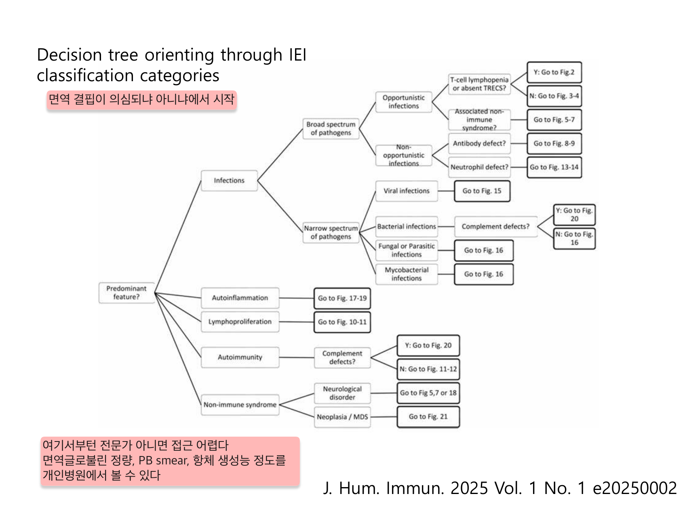
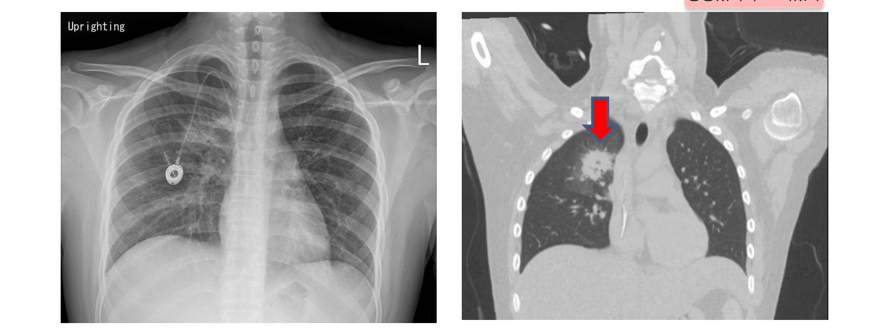
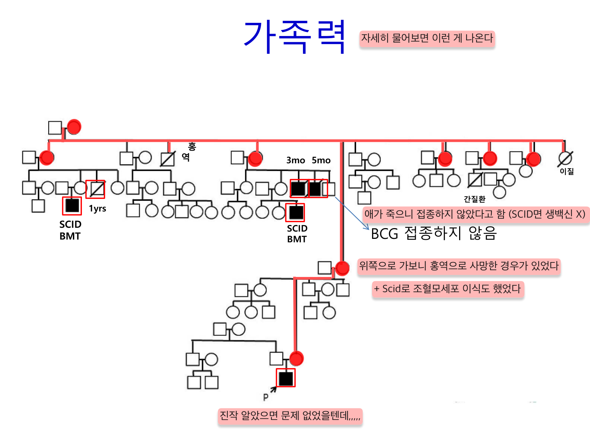

<!-- 필기본: 2025 -->
<!-- 단계: 수업 전 -->

# 0. 이 수업을 공부하는 법

소아청소년과 감염 **김동섭 교수님** 수업. 2025 필기본은 두 덩어리다.

1. **일차면역결핍질환자의 감염** — 면역결핍을 의심하는 신호, 면역 기능 검사(체액·세포·식세포·보체), 주요 질환(XLA, DiGeorge, SCID, Wiskott-Aldrich, 만성육아종질환 등)
2. **소아종양환자의 감염** — 호중구감소 발열(neutropenic fever, NF)의 정의와 경험적 치료, 침습진균감염(IFD) 고위험군·진단 분류, 주폐포자충(PCP) 예방·증상
3. 증례 3개 — X-연관 SCID, X-연관 범저감마글로불린혈증(XLA), 침습성 아스페르길루스증

- 기출 14문항(2020–2025) 중 **11문항이 두 가지 사례형의 반복**이다.
    - **PCP 사례**: 항암치료 중 TMP/SMX를 자의로 끊음 + 빈호흡·호흡곤란 + **청진 정상(rale 없음)** → 치료는 **TMP/SMX 정주**(보기에 없으면 **pentamidine 정주**).
    - **아스페르길루스 사례**: 발열·흉통 + 흉부 CT 결절 + **galactomannan 양성** → 치료는 **voriconazole**, "직접적 위험인자"는 **호중구 수치를 보고** 정한다(낮으면 호중구감소, 정상이면 스테로이드).
- 나머지: XLA 환자의 예방접종(2025), 소아 AML 호중구감소(2021), 항암 중 B형간염 재활성화·수두(2020).
- 필기본 2–3쪽에 2023·2024 기출이 직접 붙어 있다. 이 중 면역결핍 문항들(XLA 진단·면역글로불린, SCID에서 TMP/SMX·면역글로불린)은 저장소에서 **16강(선천성 면역결핍)** 으로 분류되어 2부에는 없지만, 같은 교수님·같은 내용이므로 아래 2–3단원에 기출 포인트로 적어 두었다.

!!! key "핵심"
    **T세포 결함 → 생후 6개월 이내, 기회감염(PCP·CMV·칸디다), 생백신 금기 → 조혈모세포이식.**
    **항체(B세포) 결함 → 6개월 이후(모체 항체 소실), 피막 세균(폐렴구균·Hib) 반복 → 면역글로불린 정주.**
    **항암 중 소아: 열 나면 곧바로 경험적 항생제(cefepime·pip/tazo), 오래가는 깊은 호중구감소·스테로이드 → 곰팡이, TMP/SMX 끊으면 → PCP.**

# 1. 일차면역결핍증 — 언제 의심하나

## 일차면역결핍증(inborn errors of immunity, IEI)
- 면역계의 **선천적 결함**으로 생기는 다양한 질환군. **2024년 기준 559개** 질환이 보고되어 있다.
- 임상 양상은 질환마다 매우 다양하지만 **많은 경우 감염에 취약**하다. 감염뿐 아니라 **자가면역, 자가염증, 알레르기, 악성질환**과도 연관될 수 있다.
- 이름이 "면역결핍(immunodeficiency)"에서 "면역의 선천 오류(inborn errors of immunity)"로 바뀐 이유가 이것이다 — 면역이 "모자라는" 병만이 아니라 "잘못 작동하는" 병(자가면역·자가염증)도 포함한다.

## 면역결핍 의심 증상
- **1회 이상의 전신 세균 감염**(패혈증, 수막염 등)
- **1년에 2회 이상 심한 호흡기 또는 다른 부위 세균 감염**(연조직염, 농양, 폐렴, 중이염, 림프절염 등)
- **비전형적 부위의 감염**: 간농양, 뇌농양 등
- **비정형 병원균**에 의한 감염: *Serratia marcescens*, *Pneumocystis jirovecii* 등
- 증상이 **비정상적으로 심할 때**

교수님 말씀: **횟수가 절대적인 기준은 아니다.** 어린이집에 다니는 아이는 일반 폐렴·중이염이 흔히 올 수 있다. 다만 **심하게** 오면(예: 폐렴인데 농흉, 중환자실 입원) 면역결핍을 의심한다. **PCP(주폐포자충 폐렴)는 정상 면역에서는 생기지 않으므로**, 생기면 정상 면역이 아니라고 생각해야 한다.

※ 확인 필요: 필기에는 "PVC는 정상 면역이 아니라고…"로 적혀 있는데, 문맥(바로 위 슬라이드의 *Pneumocystis*)상 **PCP**를 받아 적은 것으로 보인다.

### 경고 신호 10가지 (외우기 쉬운 목록)

| 번호 | 경고 신호 |
|---|---|
| ① | 연간 **4회 이상 중이염** |
| ② | 연간 **2회 이상 심한 부비동 감염** |
| ③ | **2개월 이상** 항생제 치료(에도 효과 미미) |
| ④ | 연간 **2회 이상 폐렴** |
| ⑤ | **체중·키 성장 지연** |
| ⑥ | **심부·장기 농양** |
| ⑦ | **지속되는 아구창**이나 피부 곰팡이 감염 |
| ⑧ | **정주 항생제**를 써야 감염이 해결됨 |
| ⑨ | **2회 이상 패혈증이나 뇌수막염** |
| ⑩ | 일차면역결핍질환의 **가족력** |

- 이런 경우 개인 병원에서도 대학병원으로 의뢰한다.
- 중이염 4회는 정상 아이에게도 올 수 있다(특히 젖병을 쓰는 영아). 그러나 **초등학생인데 계속** 생긴다면 의심한다.
- 가족력은 "면역결핍 있나요?"가 아니라 **"친척 중 어려서 죽은 사람, 병원에 자주 다닌 사람이 있나요?"** 처럼 구체적으로 물어야 나온다.

## 병력과 신체검진
- **가족 중 조기 영아 사망**: 유산을 숨기는 경우, 나이가 많아 형제자매의 사망을 모르는 경우가 있다 — 다음 세대로 정보가 전해지지 않을 수 있어 **구체적으로 물어야** 한다.
- **발생 연령** — 결함의 종류를 짐작하는 가장 쉬운 단서:

| 결함 | 증상 시작 | 이유 |
|---|---|---|
| **T세포 결함**(세포면역, SCID 등) | **생후 6개월 이내** | 모체 항체로는 막을 수 없는 바이러스·진균·기회감염이 곧바로 생김 |
| **항체 결핍**(체액면역, XLA 등) | **생후 6개월 이후** | 태반을 통해 받은 **어머니 IgG**로 6개월쯤까지 버티다가 소실되면서 세균 감염 시작 |

- **신체검진**: 기본 진찰에서는 이상이 없을 수 있다. **증후군적 특징(syndromic feature)** — 특이한 얼굴, 심장 기형, 저칼슘 등 — 이 보이면 의심한다.

!!! memo "암기"
    **T세포 결함 = 6개월 이내**, **항체 결핍 = 6개월 이후**(모체 IgG 소실).

# 2. 면역 기능 검사

## 체액면역 기능 검사 (B세포·항체)
면역결핍 질환군 중 **가장 큰 비율**을 차지하고, 일반 병원 처방으로도 검사할 수 있다.

- **면역글로불린 정량**: IgG, IgA, IgM, IgD, IgE, **IgG 아형**(IgG1, IgG2 …). 검사실은 **성인 기준치**를 주는 경우가 있으므로 **연령별 정상치**로 판단해야 한다(증례 2).
- **Isohemagglutinin**: A·B형 혈액형 항원에 대한 자연 항체(IgM). 혈액형 항원에 대해 스스로 항체를 만드는지 본다.
- **Schick test**: 디프테리아(diphtheria) 항원에 대한 피부반응.
- **측면 인두 X선(lateral pharyngeal X-ray)**: 아데노이드·편도 림프조직이 있는지. 체액면역이 떨어지면 **림프조직(림프절·편도·아데노이드)이 잘 만들어지지 않는다** → 림프절이 잘 붓는 아이라면 체액면역 결핍 가능성은 낮다.
- **B세포 측정**(CD19, 유세포분석).
- **특정 항체 생성능 검사**: 백신 **접종 2–3주 후** 항체가 생겼는지 본다. 항체 생성 능력이 전반적으로 떨어지면 의심. 단, 접종 후 **1년쯤 지나면 수치가 떨어질 수 있어** 오래전 접종으로는 판단하기 어렵다.

### 폐구균 다당백신 접종 후 항체 생성 검사
- B세포에 의한 **체액면역 기능**을 평가하는 검사. 23가 다당백신 접종 **전(Pre)과 후(Post)** 의 혈청형별 항체가를 비교해 **얼마나 올라가는지**를 본다.
- 필기 예시: 대부분의 혈청형에서 접종 후 항체가가 정상 기준(예: 혈청형 14 ≥ 7.0 mcg/mL)에 못 미치거나 거의 오르지 않았다(혈청형 22F는 접종 전후 모두 <0.3).
- 교수님: 체액면역 결핍을 **이 검사 하나로 단독 진단하기는 어렵고, 선별 검사 정도의 의미**로 쓴다.

## 세포면역 검사 (주로 T세포)
- **말초혈액 림프구 수와 형태**: 호중구는 중요하게 보면서 **림프구는 놓치는 경우**가 많다. 림프구 수가 **나이에 맞게** 있는지(영아는 성인보다 림프구가 훨씬 많다), 형태가 적절한지 본다. 나이가 들면 줄고, 스트레스가 있으면 줄어 건강한 사람도 적게 보일 수 있다.
- **지연 피부반응 검사**(delayed-type hypersensitivity skin test)
- **X선으로 흉선 확인**: 흉선(가슴샘) 그림자가 없으면 T세포 결함 의심(DiGeorge, SCID).
- **T 림프구와 아형(subset)**: CD3, CD4, CD8 — T세포 분획이 얼마나 잘 갖춰져 있는지.
- **림프구 증식 반응**(mitogen 자극 시험)

## 식세포계 검사 (호중구·대식세포)
- **말초 백혈구 수와 형태**
- **부착인자(adhesion molecule) 검사** — 백혈구접합물질결핍증
- **혈청 IgE 농도** — Hyper-IgE 증후군
- **NBT(nitroblue tetrazolium) 검사**, **DHR(dihydrorhodamine) 검사**: **만성육아종질환** 진단. NADPH oxidase가 활성산소를 만드는지 본다.
- **탐식 검사**, **살균 기능 검사**
- 교수님: **병원체를 삼키기는 하는데 죽이지 못하고 그냥 머금고 있는 질환**(만성육아종질환)이 있다.

## 보체계 검사
- **CH50 activity**: 항체가 결합된 적혈구를 **50% 용혈**시킬 수 있는 정도를 측정 — 고전 경로 전체를 보는 **선별 검사**.
- **혈청 C3, C4 농도**
- 보체 cascade 세부 검사는 **특정 기관으로 보내야** 가능하다.

## 진단 접근 — IEI 분류 결정 나무

{: style="width:80%"}

- 출발점은 **"면역결핍이 의심되느냐"**. 주된 양상이 감염이면 → 병원체 범위가 넓은지(기회감염 포함) 좁은지(바이러스만, 세균만, 진균, 결핵균 등)로 나누고 → T세포 감소·항체 결함·호중구 결함·보체 결함을 확인해 해당 분류로 간다. 자가염증·림프증식·자가면역·비면역 증후군으로 시작하는 갈래도 있다.
- 교수님: 이 뒤로는 **전문가가 아니면 접근하기 어렵다.** 개인 병원에서 볼 수 있는 것은 **면역글로불린 정량, 말초혈액 도말(PB smear), 항체 생성능** 정도다.
- 1차 검사(IgG·IgA·IgM 감소 → B세포 수) 결과를 가지고 해당 표(B세포 없음 → XLA 등 무감마글로불린혈증, B세포 >1% → 분류불능형 면역결핍증 CVID 등)로 찾아가는 식이다. 표 안의 개별 유전자는 외울 필요 없다.

# 3. 주요 일차면역결핍질환

## 체액면역결핍질환 (항체 결핍)
- 범저감마글로불린혈증(무감마글로불린혈증)
- 분류불능형 면역결핍증(CVID)
- 선택적 IgA 결핍증 — **비교적 흔하다.** 질병 형태가 다양하고 **증상이 없는 경우**도 있어 다른 검사 중 우연히 발견되거나 수치만 낮은 경우도 있다.
- IgG 아군 결핍증
- 반성유전 림프계 증식 증후군(XLP)
- 고IgM 증후군

교수님은 이 중 **X-연관(X-linked)** 질환을 많이 이야기한다.

### 범저감마글로불린혈증 (agammaglobulinemia, XLA)
- **IgG, IgA, IgM 항체가 선천적으로 생성되지 않는다.** 항체를 만드는 B 림프구가 없거나 매우 적다.
- 유전: **반성유전(X-linked, Bruton형 — *BTK* 유전자)**, 상염색체 열성, 또는 산발 발생.
- **태반을 통해 받은 항체가 소실되는 6–9개월부터** 세균 감염. 만삭아는 6–9개월에 수치가 쭉 떨어지므로 **6개월 전에는 잘 진단되지 않는다.**
- 감염: **농가진, 중이염, 부비동염, 폐렴, 농흉, 패혈증**. 균: ***S. pneumoniae*, *H. influenzae***(피막 세균 — 옵소닌 항체가 필요), **장바이러스(enterovirus)** 감염.
- 교수님: **장염이 주된 병의 형태는 아니다.** 편도·아데노이드가 크면 가능성이 낮다.
- 소견: **림프절 결여, 글로불린 감소, 순환 B 림프구 결핍**.
- 치료: **3–4주 간격 정맥 또는 피하 면역글로불린 400–500 mg/kg.** 심한 만성 호흡기 감염이 있으면 고용량. 국내에서는 **정맥 주입**을 많이 한다(400–500으로 안 되면 고용량을 쓰지만 심평원에서 삭감되기도 한다). **일찍 진단하는 것이 중요하다.**

필기의 검사 예시(범저감마글로불린혈증):

| 항목 | 결과(%) | 절대수 | 정상(%) | 판정 |
|---|---|---|---|---|
| T (CD3) | 95.3 | 4501 | 43–76 | |
| Th (CD4) | 67.2 | 3174 | 23–48 | |
| Tc (CD8) | 24.1 | 1138 | 14–33 | |
| **B (CD19)** | **0.1** | **5** | 14–44 | **absence** |
| NK | 4.0 | 189 | 4–23 | |

→ **B 림프구 결핍 + 항체 결핍**으로 진단. B세포가 **1%도 안 되면 매우 낮은 것**이다. T세포는 오히려 비율이 높다(B가 빠진 만큼).

!!! exam "기출 포인트"
    2부 **3번**(2025): 10개월 남아, 반복 폐렴·농흉(*S. aureus*), 형 사망, IgG·IgA·IgM 모두 −2SD 미만 → XLA. **필요한 예방접종 = 인플루엔자 사백신.** BCG·수두는 **생백신이라 금기**, A형·B형간염은 면역글로불린 보충 중이라 의미 없음.
    (16강 분류) 2024 2번: 반복 피부 농양 + 형 사망 + 면역글로불린 감소 → **정주 면역글로불린**. 2023 14번: 면역글로불린 감소 + **B 림프구 0.1%** → **범저감마글로불린혈증**.

## 세포면역결핍질환 (T세포 결핍)
### 가슴샘 저형성증 — DiGeorge 증후군
- **가슴샘(흉선)과 부갑상샘의 무형성 또는 형성 저하** → T세포 결핍 + 저칼슘혈증.
- **대혈관 기형, 식도 폐쇄, 선천 심질환, 짧은 인중, 안구 격리(눈 사이가 넓음), 하부 소악(작은 아래턱)**.
- 흔히 **저칼슘혈증 경련이나 테타니**로 발견된다.
- **22q11.2 미세결실**이 95% 이상에서 확인.
- **CATCH 22**: **C**ardiac(심장 기형), **A**bnormal face(얼굴 이상), **T**hymic hypoplasia(흉선 저형성), **C**left palate(구개열), **H**ypocalcemia(저칼슘혈증), 22q11.2.
- 한 환자에게 모두 생길 수도, 일부만 생길 수도 있다. 이런 환자에서는 **세포면역 결핍이 어느 정도인지 판단하는 것**이 중요하다(완전형이면 SCID처럼 치료).

## 복합면역결핍증후군 (체액 + 세포 결핍)
### 중증 복합면역결핍증 (SCID)
- **어떤 면역결핍 질환보다도 가장 심한 형태** — 그래서 면역질환 분류표에서 앞쪽에 있다. **조치하지 않으면 사망**한다.
- **신생아 선별검사가 가능한 질환**(TREC 검사).
- **T 림프구 수 저하**(흉선 없이 태어남).
- **출생 수개월 내 설사, 폐렴, 중이염, 피부 감염**.
- ***Pneumocystis jirovecii*, CMV, *Candida albicans*** 등 **기회감염으로 사망**.
- **생백신 접종 절대 금기** — 진단 전에 생백신(BCG, 로타 등)을 맞으면 그로 인해 사망할 수 있다.
- 치료: **조혈모세포이식.** 빨리 진단해 조치했을 때 가능하고, 거의 죽기 직전이면 못 할 수도 있다.
- B세포는 있을 수도, 없을 수도 있다(T−B+ / T−B− 형). 그러나 **B세포는 T세포의 도움을 받아야 항체를 만들기 때문에** B세포가 있어도 항체 생성 능력은 거의 없다 → **면역글로불린 투여가 필요**하다.

필기의 검사 예시(중증 복합면역결핍증):

| 항목 | 결과(%) | 절대수 | 정상(%) | 판정 |
|---|---|---|---|---|
| **T (CD3)** | **0.2** | **3** | 43–76 | **absence** |
| Th (CD4) | 0.2 | 3 | 23–48 | |
| Tc (CD8) | 0.0 | 0 | 14–33 | |
| B (CD19) | 99.1 | 1450 | 14–44 | |
| **NK** | **0.3** | **4** | 4–23 | |

→ **T 림프구와 NK 세포 결핍**(T−B+NK−) — X-연관 SCID(γc 결핍, *IL2RG*)의 전형적 형태. SCID는 **림프구 총수 자체가 낮은 경우가 많다.** 이 환자는 조치를 했음에도 사망했다.

!!! exam "기출 포인트"
    (16강 분류) 2024 10번·2023 12번: 생후 1개월부터 패혈증·폐렴·장염, 외삼촌 영아기 사망, **총 T 림프구 2–5/µL** → SCID. 가장 적절한 조치 = **정주 면역글로불린**(2024), **TMP/SMX 투약**(2023). 함정 보기: **BCG 접종, 로타바이러스 접종**(생백신 금기), **모유수유 적극 권장**(CMV 전파 위험 — 중단해야 함), 칼슘·비타민 D(DiGeorge 함정).

### 그 밖의 복합면역결핍증
- **연골-털 형성저하증**(cartilage-hair hypoplasia)
- **Wiskott-Aldrich 증후군**: **반성유전**, **습진성 피부염 + 혈소판감소 자반 + 감염 감수성**(triad). 혈소판이 **작고 기능이 저하**(보통 혈소판이 적으면 크기로 보상하는데 이 질환은 크기도 작다). ***WASP* 유전자 변이**. 이런 증상(출혈 경향·피부염)으로 병원에 온다.
- **모세혈관확장성 운동실조(ataxia-telangiectasia)**: 모세혈관 확장증, 만성 부비동염, 폐렴, **악성종양**, 체액·세포면역 결핍, **조화운동 불능(운동실조)**.
- **Hyper-IgE 증후군**: 잦은 **피부·호흡기 감염**, ***S. aureus*, *C. albicans*** 감염. 혈청 IgE가 매우 높다.

## 식세포 이상증
공통점: **탐식(phagocytosis) 이후 병원체 살상이 잘 안 된다.**

| 질환 | 특징 |
|---|---|
| **백혈구 접합물질 결핍증**(LAD) | 백혈구가 혈관 밖으로 못 나감 → **혈액 내 중성구 증가**인데 감염 부위엔 고름이 없음. 세균·진균 감염 반복, 피부·구강·호흡기·점막·**배꼽 감염**, **탯줄이 늦게 떨어짐**(정상도 늦을 수 있지만 피부·진균 감염이 동반되면 의심) |
| **Chediak-Higashi 증후군** | **상염색체 열성**, 중성구 **탈과립 장애**(거대 과립), 반복 감염, **출혈 경향**, **백색증**(부분 색소결핍), 진행성 말초신경병 |
| **만성육아종질환**(CGD) | 식세포 **NADPH oxidase** 유전 결함 → 활성산소를 못 만들어 **탐식 후 살균 실패**, 세균·진균 반복 감염, **육아종 형성** |

- 만성육아종질환의 균: ***S. aureus*, *Serratia marcescens*, *Aspergillus*, *Candida albicans*** 등(catalase 양성균).
- 병원체를 머금고 있는 상태라 육아종이 생기고, **결핵이나 비결핵항산균(NTM)으로 오인**되기도 한다.
- 치료: **TMP/SMX + itraconazole 매일 지속 복용**(예방), 근본 치료는 **조혈모세포이식**.
- 진단: **NBT·DHR 검사**(2단원).

## 보체 결핍 질환
- **C2 결핍**: **폐렴구균 패혈증** 호발.
- **C3 결핍**: 세균에 대한 **옵소닌화 감소** → 반복 세균 감염.
- (참고) 말단 보체(C5–C9) 결핍은 *Neisseria* 감염이 특징이다.

## 자가염증 질환 (autoinflammatory disorders)
- **무균성(sterile) 염증** 질환. 예: 골수염이 있는데 **병원체는 검출되지 않을 수** 있다(만성 재발성 다발성 골수염 CRMO 등).
- 감염처럼 보이지만 균이 없고 항생제에 반응하지 않는 반복 발열·염증이면 떠올린다. 개별 질환은 외울 필요 없다.

# 4. 소아종양환자의 감염 — 호중구감소 발열

## 정의 (IDSA 2010, Freifeld)
- **호중구감소(neutropenia)**: 절대호중구수(**ANC, absolute neutrophil count**) **< 500/mm³**, 또는 **48시간 이내에 ANC < 500이 예상**되는 경우. 항암치료로 골수가 억제되어 앞으로 떨어질 것이 예상되는 경우도 같은 의미가 있어 포함한다.
- **심한 호중구감소(profound neutropenia)**: ANC **< 100/mm³**.
- **발열**: 구강 체온 1회 **> 38.3 ℃**, 또는 **> 38.0 ℃가 1시간 이상 지속**.

!!! memo "암기"
    **ANC < 500(또는 48시간 내 예상) = 호중구감소**, **< 100 = profound**. **발열 = 38.3 ℃ 1회 또는 38.0 ℃ 1시간 지속.**

## 배경
- 고형암의 10–50%, **혈액암의 80%** 에서 항암치료 중 적어도 한 번 NF를 경험한다(대부분 한 번 이상 겪는다).
- 원인이 밝혀지는 경우는 **20–30%** 뿐이고 대부분은 원인을 모른다.
- **균혈증은 10–25%**, 특히 **오래가는 심한 호중구감소(ANC < 100)** 때 잘 생긴다.
- **Profound NF가 10–15일 이상** 지속되면 **침습 진균감염 위험이 매우 증가**한다 → 이런 경우 침습 진균감염을 의심해야 한다.

## 경험적 치료 (Lehrnbecher, J Clin Oncol 2023)
- 암환자가 열이 나면 → **배양 결과를 기다리지 않고 곧바로 경험적 항생제.**
- 소아 고위험 FN: **항녹농균 β-lactam(piperacillin/tazobactam), 4세대 cephalosporin(cefepime), 또는 carbapenem 단독요법.**
- **두 번째 항그람음성제나 glycopeptide(vancomycin) 추가**는 다음 경우로 아껴 둔다:
    - 임상적으로 **불안정**한 환자(환자 상태가 심각하면 일단 넓게 — 배양 결과를 기다릴 시간이 없다)
    - **내성균 감염이 의심**될 때
    - **내성균이 많은 병원**
- 항생제 선택은 두 가지를 고려한다: **병원 측면** — 그 병원에 어떤 균·내성이 많은지, **환자 측면** — 최근 어떤 균에 감염됐고 어떤 내성이 있었는지(예: cefepime 내성균이 있었다면 cefepime을 쓰면 안 된다).

!!! exam "기출 포인트"
    2부 **12번**(2021): 감염 위험이 가장 큰 환자 = **ANC 200의 1세 AML 환자**. 함정: ANC 100이지만 **7일 내 회복 예상**(단기), ANC 500(경계값)·점막염.

## 침습 진균감염(IFD) 고위험군 (Lehrnbecher 2023, Fisher 2018)
- **질환 자체가 고위험**: **AML(급성골수성백혈병), 고위험 ALL(급성림프구성백혈병), 재발 급성백혈병, 동종 조혈모세포이식(allo-HSCT)**.
- **치료 요인**: **오래가는 호중구감소**, **고용량 스테로이드**, GVHD 예방을 위한 **여러 면역억제제** 투여.
- 나머지는 모두 IFD 저위험으로 분류. 병원 상황에 맞게 대응한다.

## IFD 진단 분류 (EORTC/MSG, De Pauw 2008)

| 분류 | 근거 | 비고 |
|---|---|---|
| **Proven** | **현미경 검사, 배양**으로 조직에서 곰팡이 확인 | 배양이 잘 안 되는 경우가 많다(살아 있는 곰팡이를 보기 어렵다) |
| **Probable** | **숙주 요인 + 임상 기준 + 진균학적 기준(galactomannan, β-D-glucan)** | **대부분 환자에 적용됨** |
| **Possible** | 숙주 요인 + 임상 기준, **진균학적 기준 없음** | |

- IFD는 진단하기 어렵고, 많은 경우 **침습성 진균 폐렴**이다.
- 그래서 곰팡이가 만드는 물질을 보는 검사를 한다: **galactomannan(GM, 아스페르길루스 세포벽)**, **β-D-glucan**. 단 **위양성**이 나올 수 있다.

## 증례 3 — 침습성 아스페르길루스증

{: style="width:78%"}

- 13세 남아, **T세포 백혈병**(숙주 요인 — IFD 고위험군), **심한 호중구감소와 발열**, 흉통이 있어 CT를 찍었더니 **결절**, **galactomannan 양성**(진균학적 기준) → **probable 침습성 아스페르길루스증**.
- 흉부 X선은 거의 정상인데 CT에서 결절이 보인다 — 호중구감소 환자는 X선만으로 놓칠 수 있다.
- 아스페르길루스는 면역억제 환자에서 **혈관을 따라 주변 조직으로 계속 파고들어 퍼진다.**
- 치료(기출 해설 기준): **voriconazole**(1차). caspofungin은 구제요법.

!!! exam "기출 포인트"
    같은 사례가 매년 나온다(2부 **2, 5, 6, 8, 10번**). 그림은 늘 비슷한 **CT 결절 + galactomannan 양성**.

    - "**적절한 치료는?**" → **voriconazole**(5·6번). 함정: caspofungin, pentamidine·TMP/SMX(PCP 약), acyclovir.
    - "**CT 소견에 기여한 직접적 위험인자는?**" → **호중구 수치를 먼저 본다.** 호중구 **30/µL처럼 낮으면 → 호중구감소**(8번). 호중구가 **1,300·2,300처럼 정상이면 → 고용량 dexamethasone**(2·10번). **TMP/SMX 중단은 PCP 위험인자**라 함정, **galactomannan 양성은 진단 표지자**일 뿐 위험인자가 아니다.

# 5. 주폐포자충(Pneumocystis jirovecii) 감염

## 왜 예방하나
- **AIDS 환자의 높은 사망 원인**이었고, AIDS 환자에서 예방 효과가 입증되었다.
- 예방하지 않으면 **소아 백혈병 환자의 10–20%** 에서 주폐포자충 폐렴(PCP)이 생긴다 — 암환자에서 위험하다는 것을 몰랐을 때 부검해 보니 많은 수에서 발견되었다.
- **비AIDS 위험군에서도 TMP/SMX 예방 효과가 입증**되었다(암환자에서도 효과 입증). TMP/SMX는 1차 **예방약이자 치료약**이다.
- **TMP/SMX를 쓸 수 없는 경우**(설폰아마이드 알레르기, 간·신장 기능 장애, 임신 후기, 신생아 등) → **pentamidine 흡입 또는 정주 예방요법**.

## 예방 대상
- **급성림프구성백혈병(ALL)**
- **동종 조혈모세포이식**
- **일차면역결핍질환 일부**(SCID 등)
- **고용량 스테로이드 장기 투약**
- **급성골수성백혈병(AML)**
- **고형종양**

- TMP/SMX는 **생후 2개월 이후** 허용된다. 그러나 **SCID처럼 매우 심각한 경우는 더 어려도** 준다.

## 예방 중단의 위험
- **예방요법을 중단한 환자에서 발병이 유의하게 높다.**
- 국내 1개 기관 발생 환자의 **86.7%가 발병 1개월 전부터 예방 투약을 하지 않았다** — 결국 문제가 된 경우는 예방 투약을 안 해서다.

## 증상과 예후
- **점진적인 호흡곤란과 마른기침, 미열, 빈호흡, 저산소증, 정상 청진 소견.**
- 청진이 정상이라는 점이 핵심: 일반 폐렴에서 전형적으로 들리는 **수포음(rale, crackle)이 들리지 않는다.** 영상은 양측 미만성 간유리 음영.
- 국내 1개 기관 PCP 이후 **사망률 21%**, **중환자실 치료를 받은 경우 63%**.

!!! exam "기출 포인트"
    2부 **1, 4, 7, 9, 11번** — 모두 같은 사례: 백혈병·수모세포종 항암 중(스테로이드), **TMP/SMX를 자의로 끊음**, 빈호흡 35회, **rale 없음**, CT 미만성 간유리 음영.

    - 보기에 **TMP/SMX(정주, 치료 용량)** 가 있으면 정답(1·7·11번). 2025년은 "TMP 기준 5 mg/kg 8시간마다".
    - TMP/SMX가 없으면 **pentamidine 정주**(4·9번).
    - 함정: **Pentamidine 4주마다 1회·흡입**(= **예방** 용법), **"복용 중이던 용량으로 재시작"**(예방 용량이라 부족), fluconazole·amphotericin B·voriconazole·caspofungin(PCP에 효과 없음), dexamethasone(단독 치료 아님).

# 6. 그 밖에 기출에 나온 것 (필기에 없음)
2020년 기출 2문항은 2025 필기에 직접 나오지 않지만, 항암치료 중인 소아의 감염 관리로 묶인다.

- **B형간염 재활성화**(2부 **13번**): 진단 때 HBsAg 음성 → 항암 중 **HBsAg 양성**으로 바뀜(최근 수혈 없음, 어머니 보균자) → 숨어 있던 HBV가 면역억제로 **재활성화** → **entecavir** 같은 핵산유사체 항바이러스제.
- **수두**(2부 **14번**): 항암 중 소아가 수두 환자(동생)에 노출된 뒤 **수포성 발진 + 발열** → 파종성 수두(폐렴·간염)로 진행할 수 있어 **즉시 acyclovir 정주**.

!!! key "핵심 — 항암 중 소아의 약 짝짓기"
    | 상황 | 약 |
    |---|---|
    | 호중구감소 발열(경험적) | **cefepime, piperacillin/tazobactam**(± vancomycin) |
    | PCP 치료 | **TMP/SMX 정주**(2차 **pentamidine 정주**) |
    | PCP 예방 | TMP/SMX 경구(주 3일), 못 쓰면 pentamidine 흡입/정주 |
    | 침습성 아스페르길루스증 | **voriconazole** |
    | 수두 | **acyclovir 정주** |
    | HBV 재활성화 | **entecavir** |

# 7. 증례로 정리

## 증례 1 — X-연관 중증 복합면역결핍증
- **3개월 남아**, 생후 3주부터 기침 지속, 7주에 **구강 궤양**, 최근 3주간 경구 항생제에도 **중이염 호전 없음**.
- 출생 39+5주 3.6 kg으로 잘 태어났는데 3개월에 키 10–25%, **체중 5–15%** — 하한에 가까운 **성장 부진**의 징후. 형제도 없는데 자꾸 아프다. "어린 애가 잔병치레가 많다"고 넘기기 쉽다.

{: style="width:75%"}

- **가족력을 자세히 물어보니**: 외가 쪽(모계, 빨간 선 = 보인자)에 **SCID로 조혈모세포이식**을 받은 남자, **3개월·5개월에 사망한 남아**, **홍역으로 사망**한 경우가 있었다. 그 집은 아이가 죽은 뒤 다음 아이에게 **BCG를 접종하지 않았다**(SCID면 생백신 X). 모계로만 남자가 걸리는 **X-연관 유전** 형태. 진작 알았으면 문제가 없었을 것이다.
- 검사: **T(CD3) 0.2%(3/µL), NK 0.3%, B 99.1%** → **X-연관 SCID**(T−B+NK−) → **조혈모세포이식 대상**.

### 진단 후 가장 먼저 할 조치는?
보기: ① 모유수유 중단 ② PCP 예방 투약 ③ 항진균제 예방 투약 ④ 항생제 예방 투약 ⑤ 면역글로불린 정주 ⑥ 조혈모세포이식 준비 → **모두 동시다발적으로 한다.**

- **모유수유 중단**: 의심되는 검사 시점부터 먹이지 말라고 한다 — 모유에는 일반적으로 **CMV**가 있을 수 있다.
- **PCP 예방 투약(TMP/SMX)**: 보통 한다(SCID는 생후 2개월 전이라도).
- **조혈모세포이식**이 가장 효과적이고 **이른 시기**에 해야 한다 — **생후 3.5개월 내 이식 시 생존율 94%**. 감염 병력이 있으면 성공률이 떨어진다.

### 유전상담
- **X-연관 유전 질환**이므로 **SCID 환자를 출산할 가능성이 있는 성인 여성 모두** 상담.
- 동의하면 유전자 검사. 동의하지 않으면 **남아를 임신·출산하면 병원에 오라고** 설명한다(강제할 수는 없다).
- 임신 중에 오는 것이 가장 좋고, 안 되면 **낳자마자라도(모유 먹이지 말고)** 오는 것이 좋다 — 실제로 이렇게 진단된 경우가 있었다.

## 증례 2 — X-연관 범저감마글로불린혈증
- **13개월 남아**, **7개월 전(생후 6개월)부터 농가진**으로 개인 병원 치료 10여 회, 최근 피부 배농 수술. 4개월 전부터 **폐렴으로 4차례 입원**, 최근엔 **중환자실·농흉**, 흉수에서 세균 동정. → 폐렴인데 농흉·중환자실은 **일반적인 경우가 아니다.**
- 출생 38주 3.1 kg, 키·체중 25–50%로 성장은 정상. 부모와 36개월 형이 있는 4인 가족.
- 검사: **IgG 72 mg/dL, IgA 4, IgM 10 — 모두 감소**(검사실은 성인 기준치를 주므로 **연령에 맞게** 봐야 한다). 유전자 패널에서 ***BTK* 변이**(XLA, X-연관 열성). **B(CD19) 0.1%** → **X-연관 범저감마글로불린혈증**.
- 보통 B세포 검사를 하고 유전 검사를 한다. 급한 상황에서는 **할 수 있는 조치부터** 한다.
- 치료·관리: **4주 간격 면역글로불린 주사**, 예방접종은 **독감만** 시행 — 일반적으로 면역 반응이 유도되지 않아 접종하지 않지만 **독감은 예외적으로** 접종한다.
- **형제 진료**: 형은 잘 지냈다고 해도 넘어가면 안 된다. **어머니를 검사했더니 보인자(carrier)** 였다.

!!! key "핵심 — 두 증례 비교"
    | | 증례 1: X-SCID | 증례 2: XLA |
    |---|---|---|
    | 시작 | **생후 3주**(6개월 이내) | **생후 6개월**(모체 항체 소실 후) |
    | 감염 | 구강 궤양, 지속 기침, 기회감염 | 농가진, 폐렴·농흉(세균) |
    | 성장 | 부진 | 정상 |
    | 림프구 | **T·NK 없음**, B 있음 | **B 없음**, T 정상 |
    | 치료 | **조혈모세포이식**, PCP 예방, 면역글로불린, 모유 중단 | **면역글로불린 4주마다**, 독감 사백신 |
    | 공통 | **생백신 금기**, X-연관 → 어머니·형제·모계 여성 상담 | |
