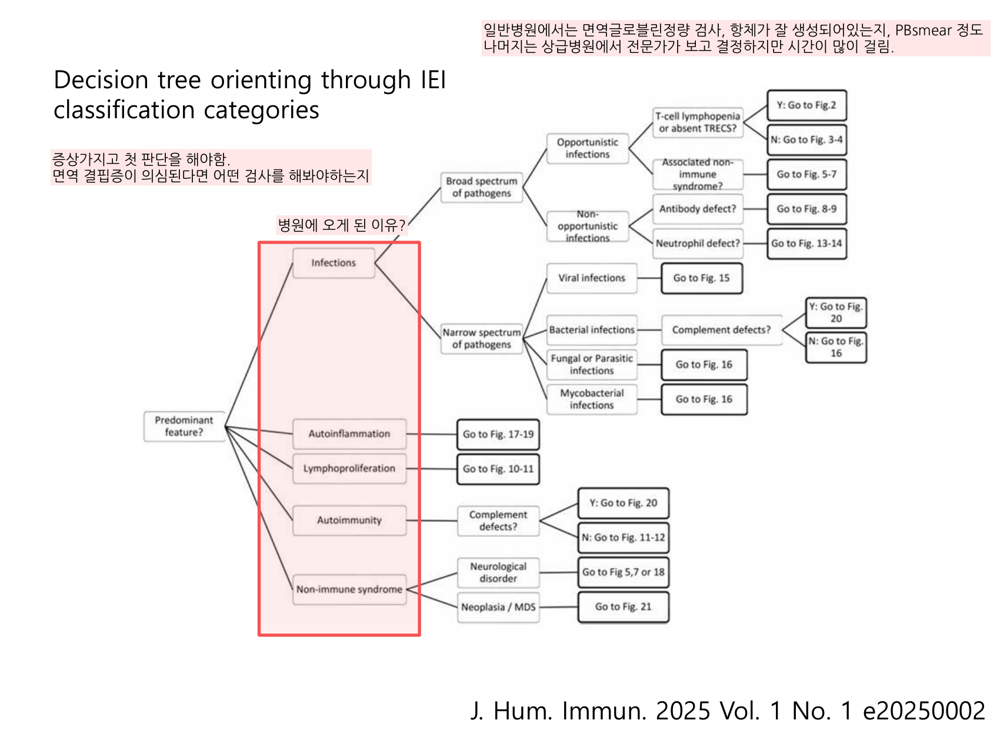
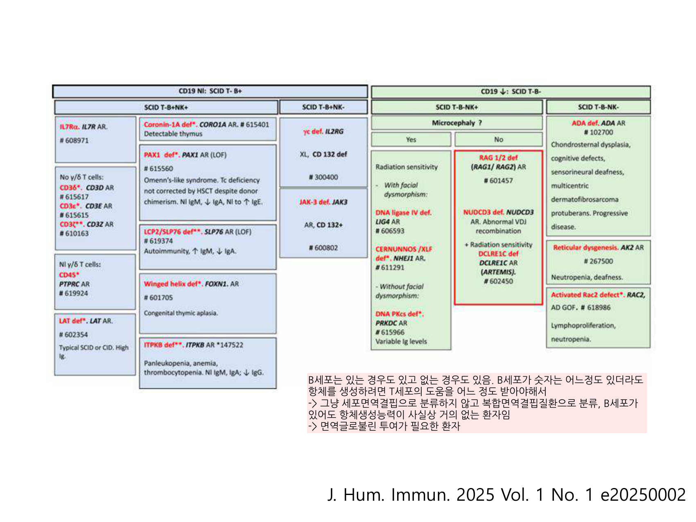

<!-- 필기본: 2025 -->
<!-- 단계: 수업 전 -->

# 0. 이 수업을 공부하는 법

소아청소년과 감염 **김동섭 교수님** 수업("일차면역결핍질환자의 감염"). 한 시간짜리라 뒷부분 질환들은 "간단하게 소개"만 하셨다. 15강(소아 면역저하 및 감염예방) 앞부분과 같은 슬라이드라 함께 보면 된다.

필기 순서
1. 일차면역결핍증이란 — 의심 증상, 경고 신호 10가지, 병력
2. 면역 기능 검사 — 체액·세포·식세포·보체
3. 질환 — 체액면역결핍(범저감마글로불린혈증), 세포면역결핍(DiGeorge), 복합면역결핍(SCID, Wiskott-Aldrich 등), 식세포 이상(CGD 등), 보체결핍, 자가염증

- 기출 14문항(2020–2025)은 **딱 두 가지 사례**가 해마다 숫자만 바뀌어 나온다.
    - **XLA 사례**: 남아, **생후 6개월 이후**부터 반복되는 피부 농양·폐렴(*P. aeruginosa*·*S. aureus*), **외삼촌·형**이 소아기에 폐렴으로 사망, **IgG·IgA·IgM 모두 -2SD 미만**, B세포 0.1% → 진단 **범저감마글로불린혈증**, 치료 **정주 면역글로불린 400 mg/kg**.
    - **SCID 사례**: 남아, **생후 1개월부터** 패혈증·폐렴·장염 반복, 지속 설사, **외삼촌이 영아기에 사망**, 기형 없음, **T세포가 거의 0** → 진단 **SCID**, 할 일 **정주 면역글로불린(면역글로불린 수치가 정상이라도)**, TMP/SMX, 생백신(로타·BCG) **금기**.

!!! key "핵심"
    **언제 시작했나**가 첫 단서: **T세포 결함 → 생후 6개월 이내**(기회감염, 설사, 성장장애), **항체 결함 → 6개월 이후**(모체 IgG 소실 후 피막 세균).
    **외삼촌·형이 어려서 죽은 남아 = X-연관**(XLA: BTK, X-SCID: IL2RG, Wiskott-Aldrich).
    **생백신은 금기, 면역글로불린 정주, 근치는 조혈모세포이식(SCID·CGD·WAS).**

# 1. 일차면역결핍증 — 언제 의심하나

## 일차면역결핍증(inborn errors of immunity, IEI)
- 면역계의 결함으로 생기는 다양한 질환군. 예전 이름은 primary immune deficiency. **2024년 기준 559개** 질환이 보고되었다.
- 임상 양상이 매우 다양하고 많은 경우 감염에 취약하다. **자가면역, 자가염증, 알레르기, 악성질환**과도 연관될 수 있다 — 면역이 "모자란" 것만이 아니라 "잘못 작동하는" 병도 포함해서 이름이 바뀌었다.
- 분자·유전 검사가 발전하면서 예전에 같은 병으로 묶였던 것이 떨어져 나오기도 하고, 다른 병인 줄 알았던 것이 같은 병의 다른 형태로 밝혀지기도 한다 — 분류가 실시간으로 바뀌는 중.

## 면역결핍 의심 증상
- **1회 이상의 전신 세균 감염**(패혈증·수막염)
- **1년에 2회 이상 심한** 호흡기 또는 다른 부위 세균 감염(연조직염, 농양, 폐렴, 중이염, 림프절염)
- **비전형적 부위** 감염(간농양, 뇌농양)
- **비정형 병원균** 감염(*Serratia marcescens*, *Pneumocystis jirovecii*) — 정상 면역에서는 안 생기므로, 생기면 정상 면역이 아니다. 결핍된 부분을 반드시 찾아야 한다.
- 증상이 **비정상적으로 심할 때**(흔한 감염이어도 입원해서 주사 항생제를 써야 하거나, 회복이 더디거나 합병증이 있을 때)

교수님: **횟수나 숫자는 절대적인 게 아니다.** 비특이적 감염으로 온 아이를 보고 "면역결핍이 원인은 아닐까" 생각해 보는 것이 핵심이다.

### 경고 신호 10가지
| | |
|---|---|
| ① 연간 **4회 이상 중이염** | ⑥ **심부·장기 농양** |
| ② 연간 **2회 이상 심한 부비동염** | ⑦ **지속되는 아구창**·피부 곰팡이 |
| ③ **2개월 이상** 항생제 치료 | ⑧ **정주 항생제**를 써야 해결됨 |
| ④ 연간 **2회 이상 폐렴** | ⑨ **2회 이상 패혈증·뇌수막염** |
| ⑤ **체중·키 성장 지연** | ⑩ 일차면역결핍의 **가족력** |

- 중이염은 젖병을 빠는 아이에게 흔하다. 그 나이가 지났는데(초등학생) 자주 생기면 1차로 생활습관·환경을 보되 면역결핍도 의심한다.

## 병력과 신체검진
- **가족 중 조기 영아 사망** — 보호자도 가족력을 모르는 경우가 많고, 유산·영아 사망은 잘 알리지 않는다. "어린 나이에 원인 모르게 죽은 사람, 병원을 계속 다닌 사람이 있나요?"처럼 **구체적으로** 물어야 나온다.
- **발생 연령**
    - **T세포 결함 → 생후 6개월 이내** 증상. 기회감염에 약해서 출생 직후부터 감염이 반복된다.
    - **항체 결핍 → 6개월 이후.** 엄마에게 받은 IgG가 4–6개월에 사라지므로, 그 뒤 다른 원인 없이 자주 아프면 의심.
- 신체검진: 동반 기형(DiGeorge의 얼굴·심장), 림프절·편도 크기(체액면역결핍이면 거의 없음).

# 2. 면역 기능 검사

## 체액면역 — 1차로 하는 검사
단일 질환으로 따지면 체액면역 결함이 가장 많고, 일반 병원에서 처방 내서 쉽게 할 수 있다.
- **면역글로불린 정량**: IgG, IgA, IgM, IgD, IgE, IgG subclass — **연령대 정상값**과 비교.
- **동종혈구응집소(isohemagglutinin)**: A·B 혈액형에 대한 자연 항체(IgM).
- Schick test: 디프테리아 항원 피부반응.
- **측면 인두 X선**: 체액면역이 떨어지면 아데노이드·림프조직이 잘 안 생긴다. 편도·아데노이드가 크면 가능성이 낮다.
- **B세포 측정**(유세포 CD19).
- **특정 항체 생성능**: 접종 **2–3주 후** 항체가 생겼는지. 접종 1년이 지나면 판단이 어렵다 — 시기가 맞아야 한다(돌쯤 홍역·수두 백신 후 확인 등).

### 폐구균 다당백신(PPSV23) 항체 검사
- 다당 항원은 **T세포 도움 없이 B세포 단독**으로 반응 → 순수한 항체 생성능 검사. 23개 혈청형의 접종 전후 항체가를 보고 "몇 배 이상 오르면 유의"로 판단.
- 다른 백신들은 T세포가 같이 관여해 체액면역 단독 평가로는 덜 적합하지만, 선별검사 의미로는 쓸 수 있다.

## 세포면역
- 말초혈액 **림프구 수**와 형태(연령 대비 충분한가, 특정 질환의 형태인가)
- 지연형 피부반응
- **흉부 X선으로 흉선** 확인 — 스트레스·나이에 따라 작아지고, 영아 폐렴과 헷갈릴 수 있다.
- **T 림프구와 subset**(CD3·CD4·CD8), 림프구 증식반응

## 식세포
- 백혈구 수·형태, **부착인자** 검사, 혈청 IgE
- **NBT(nitroblue tetrazolium) 검사, DHR(dihydrorhodamine) 검사 → 만성육아종질환**
- 탐식 검사, **살균 기능** 검사 — 탐식한 뒤 균을 죽이지 못하고 머금고 있는 질환들이 있다.

## 보체
- **CH50**: 항체가 붙은 적혈구를 50% 용혈시키는 능력 — **선별검사**.
- 혈청 **C3, C4** 농도. 나머지 성분은 특정 기관에 보내야 한다.

## 진단의 흐름

{: style="width:72%"}

- **증상(병원에 오게 된 이유)으로 첫 판단** → 감염(기회감염인가, 광범위 병원체인가, 특정 병원체인가) / 자가염증 / 림프증식 / 자가면역 / 비면역 증후군 / 종양으로 나눈 뒤 해당 검사로 간다.
- 일반 병원에서는 **면역글로불린 정량, 항체 생성, 말초혈액도말**까지. 나머지는 상급병원 전문가가 보고 결정하며 시간이 많이 걸린다.

# 3. 체액면역결핍질환

대표 질환군: **범저감마글로불린혈증**, 분류불능형 면역결핍증(CVID — 상대적으로 흔하지만 형태가 다양하고 증상 없어 보이는 환자도 있음), **선택적 IgA 결핍증**, IgG 아군 결핍증, 반성유전 림프계증식증후군, 고IgM 증후군. 교수님: "나머지는 호흡기 알레르기 할 때."

## 범저감마글로불린혈증 (X-linked agammaglobulinemia, XLA)
- 항체를 만드는 **B 림프구가 선천적으로 거의 없어** IgG·IgA·IgM이 생성되지 않는다.
- 유전: **반성유전(X-linked, Bruton type — BTK 유전자)**, 상염색체 열성 또는 산발. 보통 **남자아이** → **모계 쪽**에 다른 환자나 의심되는 사람이 있는지 확인.
- **경태반 항체가 사라지는 6–9개월부터** 세균 감염. 태어난 직후에는 감염도 없고 검사해도 항체가 별로 안 떨어져 있어 알기 어렵다.
- 감염: **농가진, 중이염, 부비동염, 폐렴, 농흉, 패혈증** — 흔한 병이 반복되기도 하고, 처음부터 심할 수도(농흉, 패혈증, 세균성 수막염).
- 원인: ***S. pneumoniae*, *H. influenzae*(피막 세균)**, **장바이러스**(주로 수족구를 일으키는 흔한 바이러스인데 이 환자에게는 치명적일 수 있다).
- 소견: **림프절 결여**(편도·림프절이 거의 안 만져짐 — B세포가 없어 2차 림프기관이 발달하지 못함), 글로불린 감소, **순환 B 림프구 결핍**.
- 검사 예: T(CD3) 95%, **B(CD19) 0.1%** — 전체 림프구 중 1%가 안 되면 거의 없다고 본다.
- 치료: **3–4주 간격 정맥(또는 피하) 면역글로불린 400–500 mg/kg.** 국내에서는 정맥을 주로 쓴다. 통상 용량에도 폐렴이 생기거나 만성 호흡기 감염·폐 합병증이 있으면 **고용량** (단, 먼저 다른 질환이 없는지 확인). 조치해도 성인기까지 가면 반복 폐질환으로 폐기능이 떨어질 수 있다.

!!! exam "기출 포인트"
    XLA 사례 9문항: 진단 → **범저감마글로불린혈증**(6·13번), 치료 → **정주 면역글로불린**(3·9번), **400 mg/kg 정주**(7번 — 함정 "0.5 mL/kg 근주"), 지금 고름에서 녹농균이 나왔으면 급성기에는 **정주 ceftazidime**(11번). 함정 보기: 비장절제, 편도절제, **치료 전 수두·MMR 접종**(생백신 금기), 수두 면역글로불린 근주(노출 후 예방용), 덱사메타손, 혈장교환술.
    2번(2025): BTK 변이 XLA 환아의 가족 중 같은 질환이 생길 수 있어 검사할 대상 → **7개월 남동생**(X-연관 열성은 남자 형제. 누나·어머니는 보인자 가능).

# 4. 세포면역결핍 — DiGeorge 증후군 (가슴샘 저형성증)
- **가슴샘(흉선)과 부갑상샘의 무형성·형성저하** → T세포 결핍 + 저칼슘혈증.
- 동반 기형(진찰할 때 확인): **대혈관 기형, 식도폐쇄, 선천심질환, 짧은 인중, 안구 격리(눈 사이가 멂), 작은 아래턱**.
- 흔히 **저칼슘혈증으로 경련·테타니**.
- **22q11.2 미세결실**이 95% 이상.
- **CATCH 22**: Cardiac, Abnormal face, Thymic hypoplasia, Cleft palate, Hypocalcemia + 22번 염색체.
- 가슴샘이 얼마나 형성됐는지에 따라 세포면역결핍 정도가 다양하므로 정도를 확인해야 한다.

!!! exam "기출 포인트"
    SCID 사례 보기의 "**예방적으로 칼슘·비타민 D 투여**"는 DiGeorge용 함정이다. 문제에 "**동반된 기형이 없어 보였다**"는 DiGeorge를 배제하라는 단서.

# 5. 복합면역결핍증후군

## 중증복합면역결핍증 (SCID)
- **어떤 면역결핍보다도 가장 심한 형태.** 흔하지는 않지만 진단받기 전에 사망할 수 있다. **신생아 선별검사**가 가능한 질환.
- **T 림프구 수 저하**(흉선 없이 태어나 T세포를 못 만듦) + 체액면역도 결핍.
- **출생 수개월 내 설사, 폐렴, 중이염, 피부감염.**
- ***Pneumocystis jirovecii*, CMV, *Candida albicans*** 같은 **기회감염**으로 사망 — 일상에서 걸리는 병원체인데 치명적. 모든 세균 감염에도 취약.
- **생백신 접종 절대 금기** — 진단 못 받고 생백신(BCG·로타)을 맞으면 사망하거나 그에 버금가는 합병증.
- 근치: **조혈모세포이식** — 비교적 빨리 진단했을 때 생존율이 높고, 장기 기능이 많이 떨어져 있으면 이식이 불가능하다.
- 이식 전까지: **정주 면역글로불린**(필기 작성자 메모: 수업에서는 언급 없었지만 기출을 보면 투여) + **TMP/SMX**(PCP 예방).

### 검사 예
- T(CD3) **0.2%(3/μL)**, CD4·CD8 거의 0, B(CD19) 99%, NK 0.3% → **T·NK 결핍 SCID**(T-B+NK-; X-연관이면 IL2RG). 총 림프구 1,400대 — 영아에서 **3,000 미만이면 유심히** 봐야 한다. 이 환자는 조치했는데도 사망했다.

{: style="width:70%"}

- **B세포가 있어도** 항체를 만들려면 T세포의 도움이 필요하므로 항체 생성 능력은 사실상 없다 → 세포면역결핍이 아니라 **복합면역결핍**으로 분류하고, **면역글로불린 투여가 필요**하다.

!!! exam "기출 포인트"
    SCID 사례 7문항: 진단 → **SCID**(1번, 총 T 림프구 5). 할 일 → **정주 면역글로불린**(4·8·10번), "**혈중 면역글로불린 수치가 정상이라도 정기 투여**"(14번), **TMP/SMX 투약**(5번). 함정 — **로타바이러스 접종, BCG 접종**(생백신 금기), **독감 접종**(6개월부터), 칼슘·비타민 D(DiGeorge), **CMV 감염 과거력 엄마의 모유수유 장려**(CMV 전파 위험), **혈소판 수혈**(Wiskott-Aldrich 함정), 비장절제.

## 그 밖의 복합면역결핍증 — "간단하게 소개"
- **연골-털 형성저하증**(cartilage-hair hypoplasia).
- **Wiskott-Aldrich 증후군**: **X-연관**, **습진(피부염) + 혈소판감소 자반 + 감염 감수성**. 만성 혈소판감소 환자는 보통 혈소판이 커지는데 이 병은 **혈소판이 작고 기능도 떨어져** 출혈이 잦다. **WASP 유전자** 변이. 수치만 낮고 가끔 자반만 생기는 아이부터, 감염과 피부 질환이 심해 빨리 조혈모세포이식을 해야 하는 아이까지 다양.
- **모세혈관확장성 조화운동불능(ataxia-telangiectasia)**: 모세혈관확장증, 만성 부비동염·폐렴, **악성종양**, 체액·세포면역 결핍, 조화운동불능.
- **Hyper-IgE 증후군**: 잦은 피부·호흡기 감염, ***S. aureus*, *C. albicans***.

# 6. 식세포 이상증
탐식(phagocytosis)이 일어난 이후 병원체를 죽이지 못하는 경우가 많고, 피부 감염·진균 감염이 동반된다.

| 질환 | 특징 |
|---|---|
| **백혈구 접합물질 결핍증**(LAD) | 백혈구 기능장애, 세균·진균 감염 반복, **혈중 중성구 증가**(혈관 밖으로 못 나감). 피부·구강·호흡기·점막·**배꼽 감염, 탯줄이 늦게 떨어짐** |
| **Chediak-Higashi 증후군** | 상염색체 열성, **중성구 탈과립 장애**, 반복 감염, **출혈 경향, 백색증, 진행성 말초신경병** |
| **만성육아종질환**(CGD) | 식세포 **NADPH oxidase** 결함 → **탐식 후 살균**이 안 됨. 세균·진균 반복 감염, **육아종** 형성(결핵·NTM으로 오해받을 수 있음) |

- **CGD 원인균**: ***S. aureus*, *Serratia marcescens*, *Aspergillus*, *Candida albicans*** (카탈라아제 양성균).
- **진단: NBT·DHR 검사.**
- 치료: **TMP/SMX + itraconazole 지속 복용** — 감염이 없을 때도 문제가 해결될 때까지 **매일**. TMP/SMX(Bactrim)는 PCP 예방·치료약이지만 항생제로서 *S. aureus* 예방 효과를 기대한다. 근치는 **조혈모세포이식** — 결국 이걸 해야 해결되고, 그때까지 약을 먹는다.

# 7. 보체결핍과 자가염증
- **C2 결핍**: 폐구균 패혈증 호발.
- **C3 결핍**: 세균에 대한 **옵소닌화 감소**.
- (교과서 보충: 말단 보체 C5–C9 결핍은 반복 수막알균 감염.)
- **자가염증 질환(autoinflammatory disorders)**: 세균 감염의 증거 없이 염증이 반복. 예 — 골수염·화농관절염이 의심되어 여러 번 수술했는데 매번 세균·곰팡이가 안 나온 환자. 일부 IEI는 자가염증이나 IBD 같은 대장염이 동반된다.

!!! memo "암기"
    | 결함 | 발병 | 대표 감염 | 대표 질환 | 치료 |
    |---|---|---|---|---|
    | B세포(항체) | **6개월 이후** | 폐렴구균·Hib·장바이러스 | **XLA**(BTK, B세포 0) | **IVIG 400–500 mg/kg 3–4주마다** |
    | T세포 | 6개월 이내 | PCP·CMV·칸디다 | DiGeorge(22q11.2, 저칼슘) | 정도에 따라 |
    | T+B | **수개월 내** | 기회감염·설사·성장장애 | **SCID**(T 거의 0) | IVIG + TMP/SMX → **조혈모세포이식**, 생백신 금기 |
    | 식세포 | 다양 | *S. aureus*·*Serratia*·*Aspergillus* | **CGD**(NADPH oxidase, NBT·DHR) | TMP/SMX + itraconazole 매일 → 이식 |
    | 보체 | | 폐렴구균(C2), 옵소닌화↓(C3) | | |
