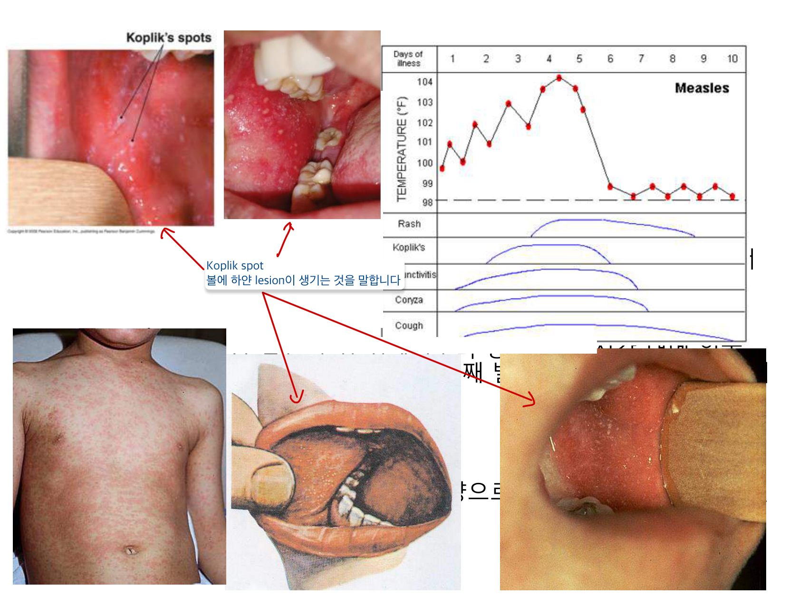
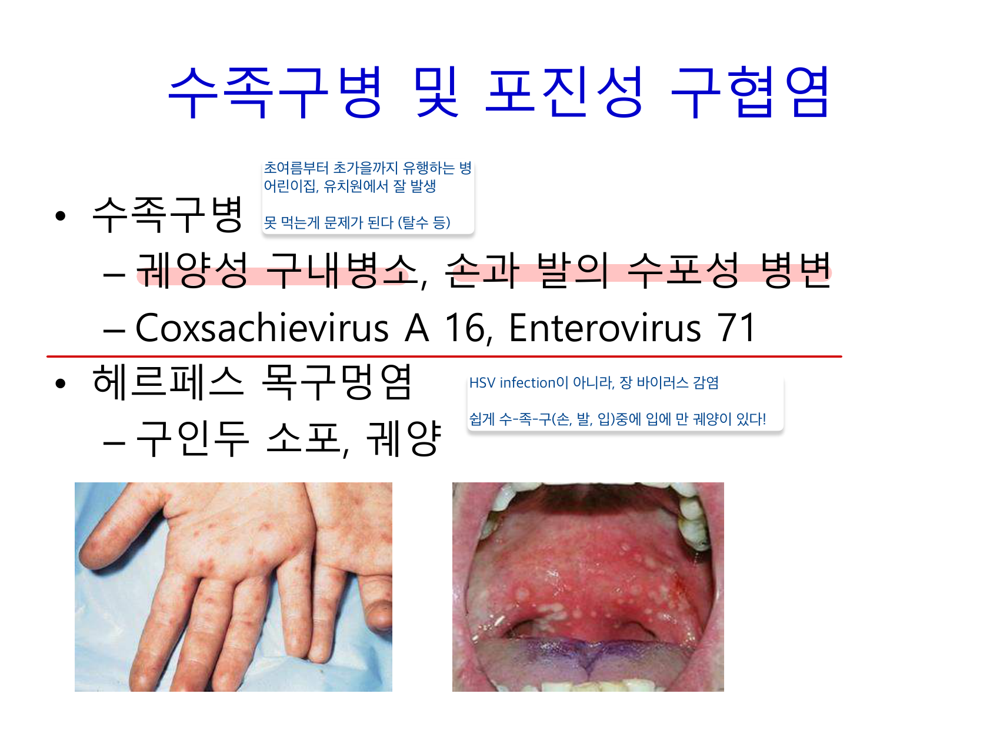
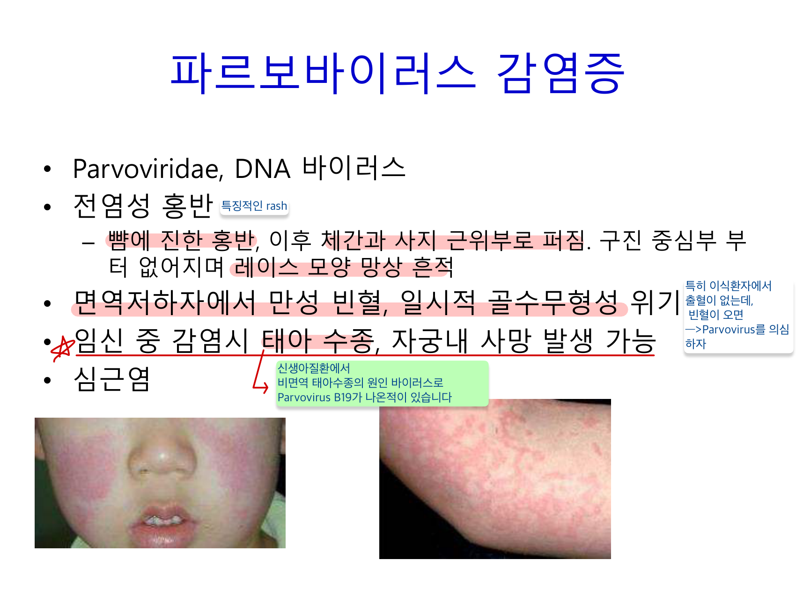
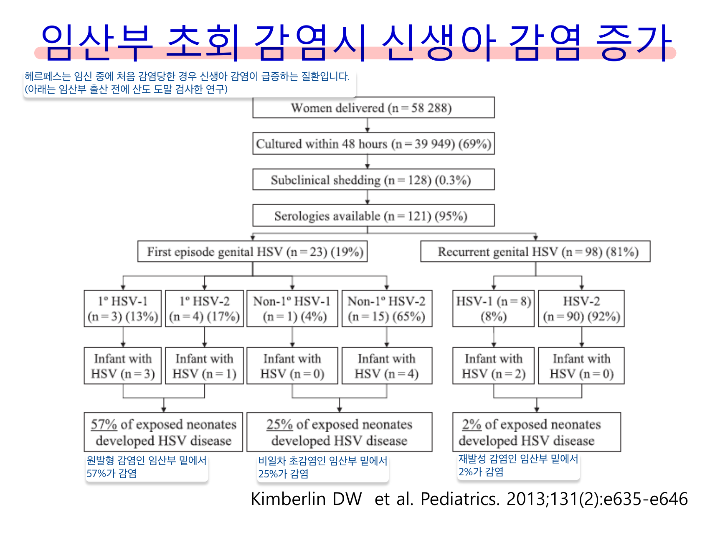
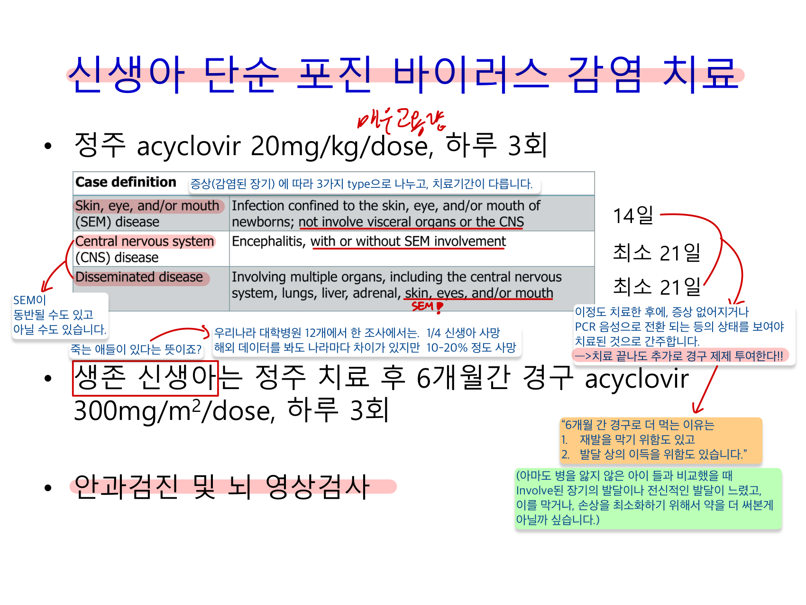
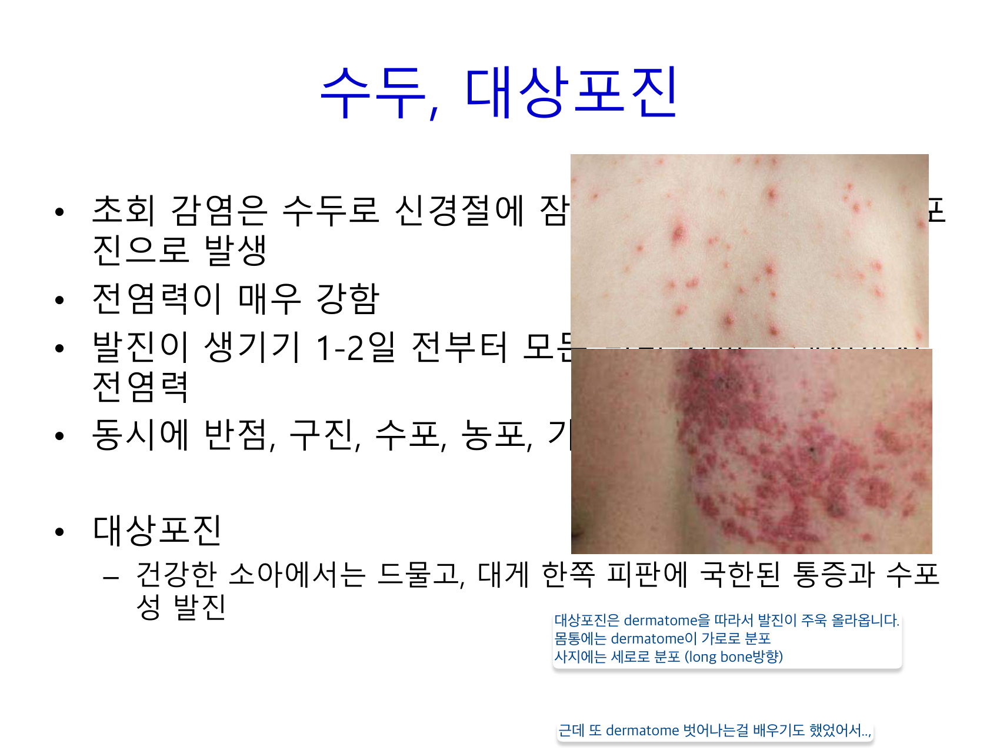
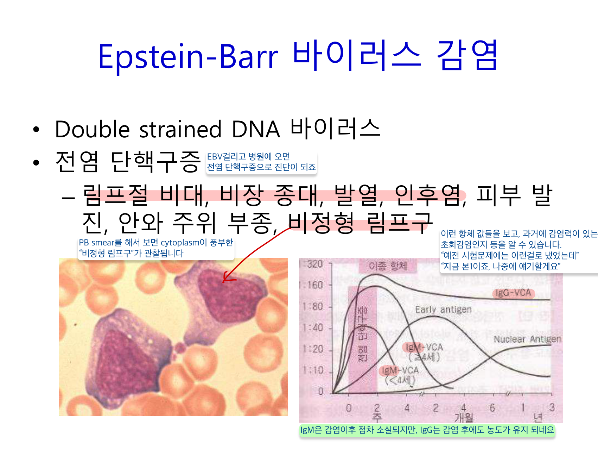

<!-- 필기본: 2025 -->
<!-- 단계: 수업 전 -->

# 0. 이 수업을 공부하는 법

소아청소년과 감염 **김동섭 교수님** 수업("소아청소년의 바이러스 감염"). 소아에서 흔한 바이러스 질환을 하나씩 훑고 마지막에 증례 3개(신생아 HSV, 선천 CMV, MMR–자폐 논란)를 다룬다.

필기 순서: 홍역 → 풍진 → 볼거리 → 장바이러스(수족구·헤르판지나) → 파르보바이러스 → 단순포진(신생아 HSV) → 수두·대상포진 → CMV(선천 CMV) → EBV → 돌발진 → 인플루엔자 → 기타 호흡기 바이러스 → 일본뇌염 → 코로나19 → 증례

- 기출 53문항(2020–2025). 김동섭 교수님 출제분은 **사례 6종이 해마다 반복**된다.
    1. **아버지의 대상포진 + 증상 없는 아이** → 아이에게 생길 수 있는 병은 **수두**, 조치는 **아이의 면역 상태에 따라** 다르다(이미 수두를 앓았으면 관찰, 접종 안 한 1세면 접종, 6개월 영아는 관찰).
    2. **10개월 영아, 3일 고열 후 열이 떨어지며 발진** → **돌발진**.
    3. **청소년, 2–3주 발열 + 삼출성 편도염 + 비장비대 + 비정형 림프구** → **EBV 전염단핵구증**, 진단은 **바이러스 급성기·회복기 항체 검사**.
    4. **선천 CMV**(작게 태어남·난청·간비종대·혈소판감소) → **valganciclovir**(금식이면 **ganciclovir 정주**), 생후 3개월에 발견되면 **치료 없이 추적**.
    5. **생후 2–3주 발열 + 두피 수포/산모 외음부 궤양** → **혈액·소변·CSF 배양 + CSF HSV PCR + 정주 acyclovir 즉시**.
    6. **해외여행 후 3C + 귀 뒤에서 내려오는 발진 + 구강 흰 반점** → **홍역**.
- 2022년 2월·2021년 2월·2020년 미생물학 문항(피코르나·파라믹소·파르보·두창 등)도 이 수업으로 분류되어 있다.

!!! key "핵심"
    **발진의 순서와 열의 관계**로 거의 다 가른다 — 홍역은 3C 뒤 **귀 뒤→얼굴→몸통→발**로 내려오며 융합, 풍진은 얼굴에서 **몇 시간 만에** 전신(뒤목 림프절), 돌발진은 **열이 떨어진 뒤** 발진, 수두는 **반점·구진·수포·가피가 동시에**, 대상포진은 **한쪽 피절**.
    **신생아 HSV는 치료 결과를 기다리지 않는다**(acyclovir 즉시), **선천 CMV는 중등도 이상이면 생후 1개월 안에 시작해 6개월**.

# 1. 홍역 (measles)

## 특징
- **Paramyxoviridae, RNA 바이러스.**
- 발열, 기침, 콧물, 결막염, **홍반성 반점구진이 융합**하는 발진.
- 전염력: 감수성 있는 사람(항체가 없거나 면역이 낮은)이 노출되면 **90% 이상** 감염. **발진 4일 전부터 4일 후까지 공기 전파** — 아주 먼 거리까지 전파된다.
- **2014년 우리나라는 WHO 홍역 퇴치국가**로 인정. 퇴치는 전혀 발생하지 않는다는 뜻이 아니라, 발생해도 **해외 유입**이고 통제·추적이 가능하다는 뜻. WHO 인증 기준(2013): **토착 바이러스 환자 3년간 없음, 2회 접종률 95% 이상**, 인증 감시체계 가동.

## 증상 — 세 시기

{: style="width:72%"}

- **전구기(3–5일)**: **전염력이 가장 강한 시기**인데 증상이 뚜렷하지 않다. 비인두 분비물 비말로 전파. 발열 + **3C(cough 기침, coryza 콧물, conjunctivitis 결막염)**.
    - **Koplik spot**: 볼 점막의 하얀 병변. **진단적 가치**가 있다 — 없다고 홍역이 아닌 건 아니지만 있으면 진단 가능. 대개 **발진 1–4일 전**에 나타나 **12–18시간 내** 사라진다(금방 사라짐).
- **발진기**: 홍반성 구진상 발진이 **귀 뒤에서 시작 → 24시간 내 얼굴·목·팔·몸통 상부 → 2일째 대퇴부 → 3일째 발**까지(위에서 아래로), 나타난 순서대로 사라진다. 발진은 **서로 융합**. 급성 복통, 비장비대, SGOT 상승, 황달도 가능. 이때부터 증상으로 의심할 수 있다 — **해외여행력, 유학생과 함께 생활**한 병력이 단서.
- **회복기**: 발진이 사라지며 **작은 겨껍질 모양으로 벗겨지고** 7–10일 내 소실. **손·발은 벗겨지지 않는다**(특징).

!!! exam "기출 포인트"
    14·35·51번: 해외여행(또는 영아) + 4일간 열·기침·콧물 → 결막충혈과 **귀 뒤·목에서 얼굴로 퍼지는 발진** + **구강 흰 반점** → **홍역**. 함정 보기: 풍진(전구증상 가볍고 Koplik 없음), 성홍열(사포 발진·딸기혀), 돌발진(열이 떨어진 뒤 발진), 볼거리, 수족구.

## 합병증
- 대표적인 호흡기 감염병이라 **호흡기 합병증**이 주: 기관지염, 세기관지염, **크루프**, **폐렴**, 중복 세균 폐렴.
- 신경계: **뇌염**(1,000례 중 1–3례, 감염 후 면역반응), **아급성 경화 전뇌염(SSPE)**: 감염 **7–10년 후** 발생, 서서히 진행하며 **3년 이상 생존 못함**.
- 그 밖에 눈(각결막염·실명), 귀(중이염), 장(설사), 임신 결과 이상 등 다양한 곳에.
- **Measles-induced immune suppression(immune amnesia)**: 홍역이 기존 면역 기억을 지운다는 가능성이 제기 중.

## 예방과 치료
- **능동면역**: 예방접종(**MMR**) **2회**. 유행지역에서는 **6–12개월**에도 접종할 수 있다. 노출자가 면역이 없으면 **72시간 이내 접종**.
- **수동면역**(외부 항체를 넣어 줌): 경태반 항체는 생후 **4–6개월 이후 소멸**. 대상 = **6개월 미만 영아, 임신부, 면역저하자**. **노출 6일 이내 면역글로불린** — 근주 0.5 mL/kg 또는 정주 400 mg/kg.
- 교수님: 이 조치들은 **노출된 사람**에게 하는 예방조치다. 건장한 성인이면 통상 추가 조치가 필요 없다.
- 치료: **대증치료**, 급성 홍역 환자에게 **고용량 비타민 A**.

# 2. 풍진 (rubella)
- **Togaviridae, RNA 바이러스.** 미열, 홍반성 구진, **림프절 종창**. 홍역과 비슷하다.
- 잠복기 **2–3주**. **발진 1일 전부터 귀 뒤·목 뒤·후두부 림프절 비대**.
- 발진은 **얼굴에 처음 나타나 2–3시간 내에 머리·팔·몸통 등 온몸으로 급속히** 퍼진다. 첫날은 홍역과 비슷하지만 **굉장히 빠르게 훅 퍼진다.**
- 전염력: **발진 7일 전부터 7일 후까지.** 구강인두 분비물로 호흡기 전파.
- 문제는 **선천풍진증후군**: 임산부 감염 후 **경태반 감염** → 사망, 발육부전, **백내장, 난청**, 소두증, 간비종대, 혈소판감소, 간염, 황달, 수막염 등 모든 장기에.
- 그래서 임신 준비 여성은 **풍진 항체 검사** → 없으면 접종. **임산부에게는 접종하지 않는다**(생백신).

!!! exam "기출 포인트"
    26번: 풍진 — "**구강인두 분비물로 호흡기 전파**"가 정답. 인수공통 아님, 혈청형 1개, 태아 세포 용해가 아니라 세포 분열 억제·혈관 손상으로 기형, 분류는 Togaviridae > **Rubivirus**(Alphavirus 아님).

# 3. 볼거리 (mumps)
- **Paramyxoviridae, RNA 바이러스.** 타액·분비물 **비말**. 타액선 종창 **7일 전부터 후까지** 타액에서 바이러스 검출.
- 잠복기 **2–3주**. 발열·두통·구토 후 **한쪽에서 시작해 양쪽으로** 타액선(이하선) 비대 — 진단 시점엔 대개 양쪽이 다 부어 있다.
- 진단: **혈청 amylase 증가**(침샘 염증), PCR·혈청검사 — **민감도가 낮아** 적기에 검사하지 않으면 음성이 나온다. **음성이어도 배제할 수 없다.**
- 교수님: 인플루엔자, 장바이러스, 파라인플루엔자도 감염 후 침샘염을 일으킨다. 독감·수족구 후 볼이 아프다고 오면 볼거리보다 **그 병 원인 바이러스의 침샘염**으로 보는 게 합리적이다.
- 합병증: **수막뇌염**(흔함 — 두통·구토·경부강직이면 의심), **고환염·부고환염**, 난소염, **췌장염**, 청력장애, 심근염·신장염·관절염.

!!! exam "기출 포인트"
    미생물 문항(21·41·22·48번): 홍역과 볼거리 공통점 — **사람이 유일한 숙주**, 비말·호흡기 전파, 생백신(MMR)으로 예방, Paramyxoviridae. 파라믹소바이러스가 일으키는 병을 고르는 문제도 있다(홍역·볼거리·파라인플루엔자·RSV·hMPV).

# 4. 장바이러스 (폴리오 외)
폴리오는 지금 국내에 발생이 없어 설명하지 않으셨다. 대표 증상이 수족구병이고, 그 외 매우 다양한 형태:
- 비특이적 발열, **수족구병**, **헤르판지나(헤르페스 목구멍염)**, 호흡기·위장관 증상, 안질환(급성 출혈성 결막염), **무균성 수막염**, **심근염·심낭염**, 고환염·부고환염, **신생아 감염**.
- **뇌수막염의 원인**이자 **신생아 발열에서 감별할 병원체**.
- 교수님 예: 형제 둘 중 첫째는 수족구, 둘째는 머리 아프고 열나고 토하면 둘 다 장바이러스일 수 있다 — **증상이 달라도 원인이 같을 수 있다.**

{: style="width:60%"}

- **수족구병**: **궤양성 구내 병소 + 손·발의 수포**. **Coxsackievirus A16, Enterovirus 71**. **초여름–초가을** 유행, 어린이집·유치원. **못 먹는 것(탈수)** 이 문제.
- **헤르판지나**: **구인두(입 뒤쪽) 소포·궤양**만 — 수·족·구 중 입에만. 이름과 달리 HSV가 아니라 **장바이러스**.

!!! exam "기출 포인트"
    49번: 사진(손·발·입 병변) → **수족구병, coxsackievirus**. 19·20·39번(피코르나바이러스): 폴리오와 콕사키 공통 — **분변-구강 전파**, 주 방어기전은 **항체**, 대부분 무증상. 폴리오는 1% 미만에서 이완성 마비.

# 5. 파르보바이러스 B19
- **Parvoviridae, DNA 바이러스.**
- **전염성 홍반(제5병, erythema infectiosum)**: **뺨에 진한 홍반**("뺨 맞은 듯") → 이후 몸통·사지 근위부로 퍼지고, 구진 중심부부터 없어지며 **레이스 모양 망상 흔적**.
- **면역저하자에서 만성 빈혈, 일시적 골수무형성 위기** — 이식 환자가 출혈 없이 빈혈이 오면 파르보바이러스를 의심.
- **임신 중 감염 → 태아수종(비면역 태아수종), 자궁내 사망.**
- 심근염, (성인) 다발관절염.

{: style="width:60%"}

!!! exam "기출 포인트"
    46번: 뺨 맞은 듯한 발진 → **Parvovirus B19**("Parvovirus"만 쓰면 감점). 25번: Erythroparvovirus에 의한 병이 **아닌** 것 → **돌발진(roseola)** (골무형성위기·감염홍반·태아수종·다발관절염은 맞음).

# 6. 단순포진 바이러스 (HSV) — "이걸 주로 설명할 것입니다"

## 감염 형태
- **HSV-1, HSV-2.**
- **원발형(일차) 감염**: 처음 걸린 것. 대부분 **불현성**(모르거나 경미) — 신생아·면역저하자 제외.
- **비일차 초감염**: 한 형에 걸린 적이 있는데 다른 형에 처음 걸린 것(예: 1형만 앓았다가 2형).
- **재발성 감염**: 잠복했던 바이러스의 재활성화.
- 건강한 소아·성인에서는 굳이 구분하지 않지만, **신생아·임산부에서는 구분이 중요**하다.

## 증상
- **급성 구강인두 감염**(herpetic gingivostomatitis), **입술 헤르페스**(피곤하면 입술에 물집 — 재활성화, 주로 입 앞), **피부 감염**(아토피 등 피부장벽이 무너지면 심하게 — 포진상 습진), **생식기 헤르페스**, 눈 병변, **중추신경계 감염**, 면역저하자 감염.
- **출생 전후기 감염**: 피부·눈·입 국소감염(SEM) / 뇌염 / 파종 감염. 대부분 **분만 중 산도의 바이러스(transcervical)** 로 감염.
- 헤르페스 병변이 있는 가족과 신생아가 같이 살면 전파 위험을 상담하고 병변 접촉을 피하게 한다("입술에 물집 잡히면 뽀뽀하지 마라").

## 신생아 HSV — 엄마가 처음 걸렸을 때가 위험

{: style="width:66%"}

- 분만 전 산도 검사 연구(약 6만 명): 산모가 **원발형(첫 감염) → 신생아 57%** 감염, **비일차 초감염 → 25%**, **재발성 → 2%**.
- 이유: 처음 걸린 산모는 아기에게 넘겨줄 **항체(IgG)가 없고** 바이러스 배출량이 많다.
- 신생아 HSV는 세계적으로 통계를 잡는 질환이고 선진국이라고 적지 않다(미국 최근 한 해 40명 정도).

## 신생아 HSV 치료

{: style="width:70%"}

- **정주 acyclovir 20 mg/kg/dose, 하루 3회**(매우 고용량).
- 감염 장기에 따라 3가지 형태로 나누고 기간이 다르다.
    - **SEM**(피부·눈·입 국소): **14일**
    - **CNS**(뇌염, SEM 동반 여부 무관): **최소 21일**
    - **파종(disseminated)**: **최소 21일**
- 증상이 없어지고 PCR이 음성으로 바뀌는 등의 상태여야 치료된 것으로 본다.
- **생존 신생아는 정주 치료 후 6개월간 경구 acyclovir 300 mg/m²/dose 하루 3회** — ① 재발을 막고 ② **발달상의 이득**.
- **안과 검진, 뇌영상 검사.**
- 사망률: 국내 대학병원 12곳 조사에서 **1/4 사망**, 해외는 10–20%.

## 증례 1 — 분만 3일 전 genital herpes 진단받은 28세 첫 임신 산모
- 일단 **산모는 항바이러스제 치료를 다 한다.** 그리고 **초회감염인지** 묻는다(병력, PCR, 항체).
- **HSV-1 초회감염**이라면 → **제왕절개**(감염률이 낮아지지만 완전 예방은 아님). 아기는 **바로 입원**시켜 검사(피부·입안 점막 면봉 PCR, **CSF**)하고 **치료를 미리 시작**.
- **HSV-2 재발**(감염 이력이 많음)이라면 → 제왕절개 이득은 논란(현실에선 보이는 병변이 있으면 한다). 아기는 검사를 해 놓고 결과에 따라 — 증상 없고 괜찮으면 통원 관찰, 감염이면 입원 치료. 보호자에게 증상·발병 시기를 반드시 교육.

!!! exam "기출 포인트"
    생후 2–3주 발열 + 두피 수포(4·13번) 또는 산모 외음부 궤양(12번) → 할 일 2가지: **혈액·소변·CSF 세균 배양** + **CSF HSV PCR**(4번) / **정주 acyclovir 즉시**(12번). 함정 — "48시간 관찰 후 결정", "어머니가 분만 시 항생제를 맞았으면 관찰", "**경구 valganciclovir**", BCG, 불명열 검사. 9번: 제왕절개로 낳은 아기의 향후 발병에 가장 큰 영향 → **어머니의 HSV IgG 음성**(= 초회감염).

# 7. 수두와 대상포진 (VZV)

{: style="width:62%"}

- **초회감염 = 수두** → 신경절에 잠복 → 재발하면 **대상포진**.
- **전염력이 매우 강하다.** **발진 1–2일 전부터 모든 병변에 가피가 앉을 때까지** 전염.
- **반점·구진·수포·농포·가피가 동시에** 관찰된다(시기가 다른 병변이 섞여 있음).
- **대상포진**: 건강한 소아에서는 드물다. 대개 **한쪽 피절(dermatome)에 국한된 통증과 수포성 발진** — 몸통은 가로, 사지는 세로(긴뼈 방향)로 분포.
- **대상포진 환자와 감수성 있는 사람이 밀접 접촉하면 수두가 생길 수 있다** — 대상포진 자체가 옮는 게 아니다(대상포진은 신경절 바이러스의 재활성화).
- 합병증: **2차 세균감염**(피부), 폐렴, 화농관절염, **뇌염**·신경염, **Reye 증후군**, 사구체신장염, 심근염, 관절염. 호흡기로도 전파되는 바이러스라 **격리를 더 엄격하게(공기주의)**.

## 노출 후 예방
- **능동면역**: 예방접종 **1회**(국내 12–15개월). 맞아야 하는 사람은 맞는다(노출 후 3–5일 내).
- **수동면역**: **고위험군에 한해** — **면역저하자, 항체 없는 임산부, 감염된 산모의 신생아** → **10일 이내 VariZIG 근주**(수두 특화 면역글로불린). 접종을 못 받는 고위험군에게 준다.

!!! exam "기출 포인트"
    "**아버지 대상포진 + 증상 없는 아이**"는 매년 나온다. 아이에게 생길 수 있는 병 → **수두**(7번). 조치는 아이 상태로 가른다.
    - **이미 수두를 앓았음**(검사로 확진, 또는 2년 전 비슷한 발진) → **조치 없이 관찰**(1·10·15·28번)
    - **6개월** 건강한 영아 → **관찰**(33번 — 접종 연령 전, 고위험군 아님)
    - **1세** 건강한 아이 → **접종 안 했으면 접종**(53번)
    - 함정: VZIG 근주·IVIG(고위험군만), 경구 acyclovir, PCR 결과로 결정.
    32번: 수두 의심 형 + **항암 중인 백혈병 동생** → 동생에게 먼저 **Varicella IgG 항체 검사**. 18·43번: 성인의 수포성 발진(아들이 비슷한 발진) → **VZV**. 40번: 감염력 시작 → **2차 바이러스혈증 시작 시기**. 45번: 대상포진 환자는 어린이에게 수두를 전파할 수 있다. 38번: 두창은 병소가 **모두 같은 단계**, 수두는 **각각 다른 단계**.

# 8. 거대세포바이러스 (CMV)
- **선천 바이러스 감염의 가장 흔한 원인**(자궁내 감염 포함). 출생아의 0.1–1%가 감염되어 태어난다는 보고. 감염이 흔해 선별검사를 하는 나라도 있다. 대부분 **불현성**.
- **선천 CMV**: **간비장비대, 혈소판감소증, 소두증, 황달, 출혈성 피부반점(점상출혈), 자궁내 성장지연, 뇌실질 석회화, 감각신경 청력손실.** 산전 진찰이나 출생 직후 이런 소견이면 의심.
- 모체가 **임신 중 1차 감염**하면 발병 증가.
- 진단: 바이러스 배양, 항원, **PCR**(출생 3주 이내 소변·침에서 검출되어야 선천감염).
- 치료: 면역저하자·선천감염에 **ganciclovir 정주 또는 valganciclovir 경구**.
- 임신부 CMV 예방 생활수칙(아이 침·소변 접촉 후 손씻기, 식기 공유 X 등) — "한번 읽어보시고요".

## 유증상 선천 CMV 신생아 치료
- **중등도 및 심한 증상 환자에 한해 생후 1개월 이내** 치료 시작(생후 4주 안에 시작해야 성적이 좋다. 그 이후 시도한 치료는 이득이 잘 안 나왔다).
- **6개월간 경구 valganciclovir 16 mg/kg/dose 하루 2회.**
- **경구 섭취가 안 되면 정주 ganciclovir 6 mg/kg/dose**로 시작, 먹을 수 있게 되면 경구로.
- 골수 억제·간수치 상승 때문에 6개월 치료가 쉽지 않지만, 발달·청력 손실에 이득이 있어서 한다.
- **무증상이나 경한 경우 바로 치료하지 않는다**(즉시 치료의 이득이 없음) → 학교 갈 나이까지 **청력·발달을 계속 추적**.

## 증례 2 — 38주 2,100 g(5–10백분위 미만), 출생 후 청력검사 이상, 생후 2주 감각신경난청
- 이 수업에선 **CMV**를 의심 → CMV에 의한 장기 침범 정도를 평가하고 치료 계획.
- 중등도 이상이면 **경구 valganciclovir 6개월 + 청력 추적**(생후 4주 이내 시작).
- 신생아 청력 선별검사는 보통 태어나면 다 한다.

!!! exam "기출 포인트"
    선천 CMV 6문항. 작게 태어남 + 점상출혈 + 간비종대 + 혈소판감소 + 출생일 소변 CMV(8·50번) 또는 난청 + 소변·CSF CMV(17번), 산전 뇌실비대 + 출생일 CSF CMV(36번) → **valganciclovir**. **금식·정주영양 중**이면 → **ganciclovir**(3번, 2025). **생후 3개월**에 처음 발견(머리둘레 97%, CSF CMV) → **치료 없이 정기 진료**(30번 — 1개월 이내 시작이 원칙). 함정: acyclovir(CMV에 약함), oseltamivir, ribavirin, tenofovir. 37번 주관식 답 cytomegalovirus.

# 9. EBV — 전염단핵구증
- **이중가닥 DNA 바이러스.**
- **전염단핵구증(infectious mononucleosis)**: **림프절 비대, 비장 종대, 발열, 인후염(삼출성 편도염), 피부 발진, 안와주위 부종, 비정형 림프구.**
- 말초혈액도말에서 **세포질이 풍부한 "비정형 림프구"**.
- 항체(VCA IgM·IgG, EA, EBNA)로 급성 초회감염인지 과거 감염인지 알 수 있다. IgM은 감염 후 점차 소실, IgG는 계속 유지. "예전 시험문제는 이런 걸로 냈었는데, 지금 본1이죠, 나중에 얘기할게요."

{: style="width:62%"}

- 치료: 기본은 **보존적 치료**. **기도폐쇄 위험, 심한 비장비대, 심근염, 용혈빈혈, 혈구탐식성 림프조직구증(HLH)** 등이 동반되면 **전신 스테로이드**.
- **HLH로 진행하면 사망 위험** — 임상적으로 암에 준하는 상황.
- (교과서 보충) 비장 파열 위험이 있어 접촉 운동을 피하고, ampicillin·amoxicillin을 쓰면 발진이 잘 생긴다.

!!! exam "기출 포인트"
    청소년 + **2–3주 발열·인후통** + **경부 림프절 비대 + 편도 삼출물** + **비장이 갈비뼈 아래 6–12 cm** + 항생제 무반응 + 도말 사진 → 원인 **EBV**(34번), 진단을 위한 추가 검사 → **바이러스(병원체) 급성 및 만성기 항체검사**(6·16·29·52번). 함정: 골수천자, **비장 절제 후 조직검사**, 결핵 피부반응, 편도 세균 신속항원, 편도 PCR.

# 10. 돌발진(장미진) — HHV-6A, 6B, 7
- 어린 영아·소아에서 **장미진(roseola)** 형태로.
- **갑자기 고열**(3일쯤) → **열이 떨어지면서 발진** — "돌발 + 발진", "장미 + 발진". **15%에서 열성경련**.
- 이식 환자에서 재활성화하면 **뇌염, 간염, 골수억제, 폐렴**.

!!! exam "기출 포인트"
    2·5·11·31번: **8–11개월** 건강한 영아, 39℃ 발열·보챔 **3일 → 열이 자연히 떨어지며 발진** → **돌발진**. 보기의 수두·파종 단순포진·풍진·홍역은 함정.

# 11. 인플루엔자
- **Orthomyxovirus, 단선 RNA.** 사람의 주요 병원체는 **A, B형**. 잠복기 **12–72시간**으로 짧다.
- 콧물, 결막염, 인두염, 기침, **크루프, 모세기관지염, 폐렴** + 발열, 근육통, 두통.
- 치료: 대증치료, **oseltamivir**(타미플루), 주사 **peramivir**, 흡입 zanamivir. **Reye 증후군 우려로 아스피린 금기.**
- 접종 대상(예방접종 파트에서 다룸): **금기가 없는 6개월 이상 모든 사람**, 특히 고위험군과 그 접촉자·보호자 — 6–59개월 소아, 50세 이상, 만성 폐·심혈관(단순 고혈압 제외)·신장·간·신경·혈액·대사질환(당뇨), 면역저하자, **임신부**, **아스피린을 복용하는 6개월–18세**(Reye 위험), 요양시설 거주자, 고도비만(BMI ≥40).

# 12. 기타
- **기타 호흡기 바이러스**(호흡기 파트에서): 파라인플루엔자, **RSV**(세기관지염·저산소증으로 입원, 개발도상국 사망원인), human metapneumovirus, **아데노바이러스**(눈·위장관 감염, **출혈성 방광염**, 면역억제 환자 감염, 폐렴), 리노바이러스, 코로나바이러스.
- **일본뇌염**: **Flaviviridae, RNA**. **모기** 매개 급성 질환, 태평양 연안 아시아. 감염 **250명 중 1명**만 증상, 뇌염이 생기면 사망률이 높다.
- **코로나19**: 일반적으로 성인보다 경하지만 국내 소아청소년에서도 위중증·사망 보고. **MIS-C**(소아 다기관 염증증후군).

## 증례 3 — MMR과 자폐
- 1998년 Lancet에 MMR 접종–장 문제–자폐(전반적 발달장애)를 연결한 논문(Wakefield)이 실려 파급력이 컸지만 **철회**되었다.
- 반박: 1999년 Lancet "Autism and MMR vaccine: **no epidemiological evidence for a causal association**". → MMR은 자폐와 관련이 없다.

!!! memo "암기"
    | 질환 | 바이러스 | 발진·특징 | 전염기간 | 노출 후 |
    |---|---|---|---|---|
    | 홍역 | Paramyxo, RNA | 3C → Koplik → **귀 뒤에서 아래로**, 융합, 손발 안 벗겨짐 | 발진 **±4일**, 공기 | 72h 내 접종, 6일 내 IG(영아·임신부·면역저하) |
    | 풍진 | Toga, RNA | 얼굴 → **2–3시간 내 전신**, 뒤목 림프절 | 발진 **±7일** | 선천풍진(백내장·난청) |
    | 볼거리 | Paramyxo, RNA | 한쪽→양쪽 이하선, amylase↑ | 종창 ±7일 | 수막뇌염·고환염·췌장염 |
    | 수두 | VZV | 여러 단계 병변 **동시에** | 발진 1–2일 전 ~ 전부 가피 | 접종, 고위험군 **10일 내 VariZIG** |
    | 돌발진 | HHV-6·7 | **열 떨어진 뒤** 발진 | | 열성경련 15% |
    | 전염성 홍반 | Parvo B19, DNA | 뺨 → 레이스 모양 | | 골수무형성 위기, 태아수종 |
    | 신생아 HSV | HSV | 두피·피부 수포, 발열 | 산모 초회감염 57% | **acyclovir 20 mg/kg 8시간마다** 14/21/21일 → 경구 6개월 |
    | 선천 CMV | CMV | 난청·간비종대·혈소판↓·석회화 | | 중등도↑, **1개월 내 valganciclovir 6개월** |
