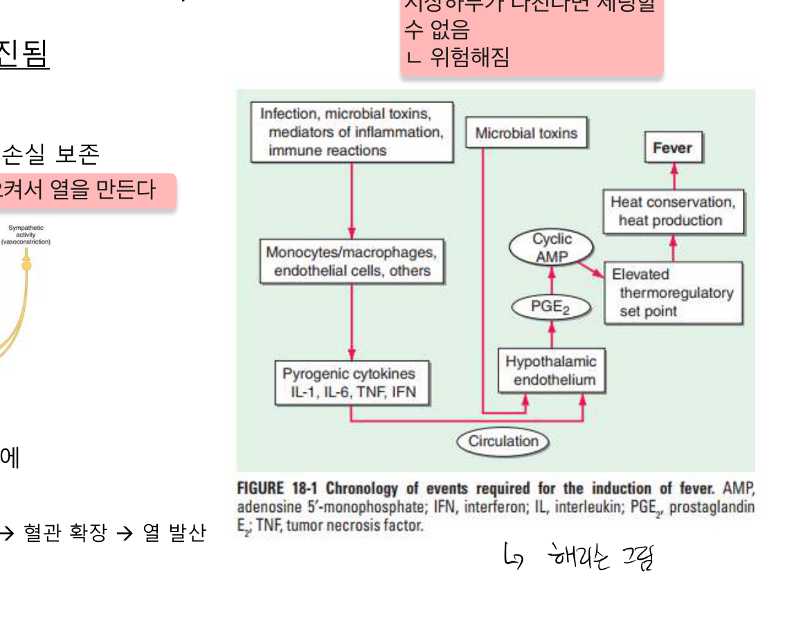
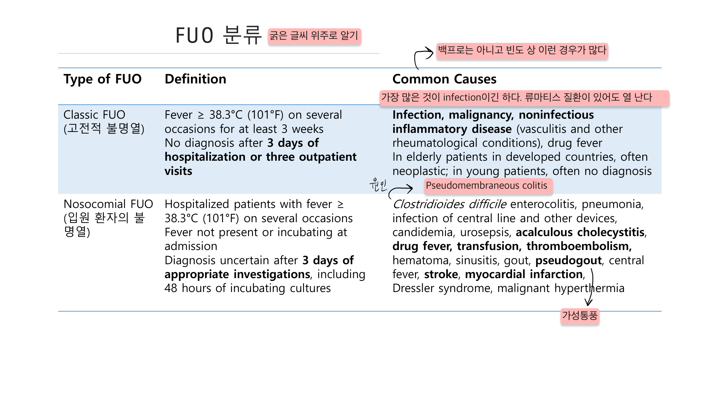
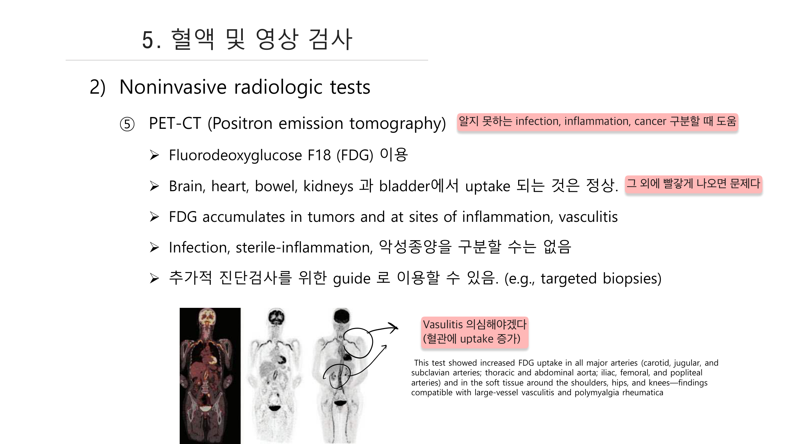
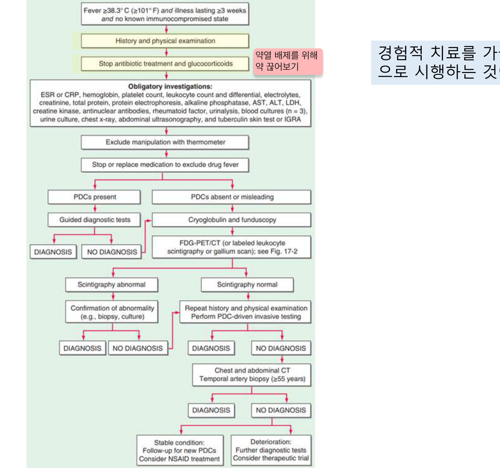

<!-- 필기본: 2025 -->
<!-- 단계: 수업 전 -->

# 0. 이 수업을 공부하는 법

경북대병원 감염내과 수업. 필기 작성자 말대로 **담당 교수님이 해마다 바뀌어**(2021–22 김신우·출제자 미상 → 2023–24 김윤정 → 2025 배소연) 기출이 어디까지 의미가 있을지는 모른다. 그래도 문항은 놀랄 만큼 같은 틀로 반복된다.

학습성과
1. 불명열을 **정의**한다.
2. 불명열의 **가장 흔한 3가지 원인**과 원인별 흔한 질병을 기술한다.
3. 불명열의 **진단 과정**을 설명한다.

목차: 발열의 정의·특징 → FUO 정의와 분류 변화 → 원인 질환 → 진단 접근 → 혈액·영상 검사 → 치료 → 예후

- 기출 21문항(2020–2025)의 반복 틀
    - "**35세 여자, 한 달 이상 발열 — 초기에 반드시 할 혈액검사가 아닌 것**" → **FSH**(2번), **myoglobin**, **cortisol**. 나머지(CRP·ESR·ANA·RF·ferritin·LDH·IGRA)는 필수 목록.
    - "**발열 환자 접근법 — 옳은/틀린 것**" → 정답은 거의 늘 **"IGRA(TST) 음성이라도 결핵을 배제할 수 없다"**, **"6개월 이상 원인 미상이면 예후는 대부분 좋다"**, **"항생제 중단 3일 후 해열되면 약열"**, **"혈종·혈전도 발열"**. 오답은 "경험적 항생제·스테로이드를 빨리", "배양 음성이면 심내막염 배제".
    - 입원 중 불명열(nosocomial FUO)의 원인, **central fever**, 성인형 스틸병, 해열제(NSAID vs acetaminophen), 노인의 발열(섬망).

!!! key "핵심"
    **불명열 = 38.3℃ 이상이 여러 번, 3주 이상, 기본 검사를 다 했는데도 원인 불명.** 원인은 **감염 · 비감염성 염증(교원성) · 종양 · 기타** — 최근엔 감염이 줄고 교원성 질환과 "원인 미상"이 늘었다.
    **상태가 안정적이면 경험적 항생제·스테로이드는 피하고 관찰과 검사를 계속한다.** 쓸모없는 약은 끊어 본다(약열). **6개월 이상 못 찾으면 대개 예후가 좋다.**

# 1. 발열의 정의와 특징

## 체온은 시상하부가 정한다
- 시상하부는 체온, 혈압, 배고픔·갈증, 포만감, 기분, 성욕, 수면 등 내분비대사·자율신경계를 조절한다. **체온의 기준점(set point)** 도 여기서 정한다.
- 발열은 감염·패혈증 등으로 이 **기준점이 높게 다시 설정**되는 것.

{: style="width:58%"}

1. **그람음성균의 내독소(endotoxin)** 같은 외인성 발열물질, 또는 대식세포가 내는 **발열성 사이토카인(IL-1, IL-6, TNF, IFN)** 이 활동
2. 시상하부 혈관내피에서 **prostaglandin E2(PGE2)** 활성화
3. 시상하부 체온조절중추 **preoptic nucleus**의 PGE2 수용체에 작용 → **기준점 상승**, 교감신경 항진
4. 기준점에 도달하려고 **말초혈관 수축(열 손실 보존) + 떨림(shivering)으로 열 생산** → 발열
- 체온이 기준점보다 높아지면 교감신경 억제 → 혈관 확장 → 땀으로 열 발산.
- 보일러 온도를 올리는 것에 비유. 뇌출혈로 시상하부가 다치면 세팅을 할 수 없어 위험해진다.
- (교수님) 왜 36.5℃인가 — 일부 학자는 40℃ 언저리면 균이 잘 못 버티지 않겠냐고 하지만, 균만이 아니라 우리 조직도 죽으면 안 되니 적절하게 설정된 것.

## 발열 vs 고체온 (hyperthermia, 열사병)
| | 발열(fever) | 고체온(hyperthermia) |
|---|---|---|
| 기준점 | **올라감**(발열물질 관여) | **그대로**(발열물질 관여 X) |
| 원인 | 내인성(사이토카인)·외인성(미생물 독소) | 외부 열 노출, 열을 발산하지 못함 |
| 피부 | 차가움 → 해열기엔 **땀으로 촉촉** | **뜨겁고 건조**(땀 없음) |
| 몸의 반응 | 떨고 혈관을 조여 체온을 올리려 함 | 체온을 올리려는 활동 없음 |
| 해열제 | 반응 | **반응 없음** → 얼음팩 등 **외부 냉각** |

- 열사병은 몸 안 세팅은 그대로인데 외부에서 열이 들어오니 몸이 대응할 방법이 없다 → 아이스 찜질, 차가운 곳에 둘 수밖에.

## 정상 체온과 변동
- 발열 = 정상 체온 **36.5–37.5℃** 이상으로 오른 것.
- 평균 구강체온 36.6℃(95% CI 35.7–37.3). **직장 체온이 구강보다 0.4℃ 높다**(가장 높음) — 어디서 재느냐에 따라 다르다.
- 건강한 성인의 발열 기준 **>37.7℃** (흔히 37.8℃부터 열). **고열증(hyperpyrexia) >41.5℃** — 흔치 않고, 대개 **CNS 출혈** 같은 문제. 42℃까지는 잘 안 오른다(그건 열사병 같은 문제).
- 체온은 일정하지 않다.
    - **일내 변동**: 오전 8시 낮고 **오후 4시 높다**. 계절: 여름 낮고 겨울 높다.
    - 나이: 10년마다 0.02℃ 낮아진다(대사 감소).
    - 동반질환: 암은 0.02℃ 높고(암세포 대사), 갑상샘저하증은 0.01℃ 낮다.
    - **여성**: 배란 2주 전 가장 낮고 배란기부터 0.6℃ 올라 생리까지. 임신 초기도 높을 수 있다 → **젊은 여성의 원인 미상 발열에는 소변 HCG**.

!!! exam "기출 포인트"
    17·20번 **central fever**: 시상하부를 침범한 뇌병변(지주막하출혈 등), **땀이 없음**, **해열제에 잘 반응하지 않음**, 다른 감염 증거 없음, 열에 비해 **심박수가 상대적으로 느림**(빠른 심박수가 오답). 20번 보기 — vancomycin 2주 중 열(약열), 신경이완제 + 근육강직(신경이완제 악성증후군), 마라톤 중 열(운동 유발 고체온).

# 2. FUO의 정의와 분류

## 정의의 변화
1. **Petersdorf & Beeson (1961)**: **38.3℃(101°F) 이상**, **3주 이상** 지속, **1주간 입원**해 검사해도 원인 불명.
    - 왜 3주? 감기 열이 2주 조금 넘게 가므로 저절로 낫는 바이러스 질환을 배제하고, 초기 평가에 충분한 시간을 두려는 의도.
2. **Durack & Street (1991)**: 입원 1주 대신 **최소 3회 외래 또는 3일 입원** — 진단 기법이 발전해 빨라졌고, 외래 평가가 늘어서. 그리고 **숙주 요인에 따라 4가지**로 나눴다.

{: style="width:76%"}

| 종류 | 정의 | 흔한 원인 |
|---|---|---|
| **고전적(classic)** | ≥38.3℃ 여러 번, **3주 이상**, 3일 입원 또는 3회 외래에도 진단 안 됨 | **감염, 악성종양, 비감염성 염증질환(혈관염·류마티스), 약열**. 선진국 노인은 종양이 흔하고 젊은 환자는 진단이 안 되는 경우가 많다 |
| **입원환자(nosocomial)** | 입원 당시 없던(잠복도 아닌) ≥38.3℃, 배양 48시간 포함 **3일** 적절한 검사에도 불명 | ***C. difficile* 장염(위막성 대장염)**, **폐렴**, **중심정맥관·기구 감염**, 칸디다혈증, 요로패혈증, **무결석 담낭염**, **약열**, 수혈, **혈전색전증**, 혈종, 부비동염, 통풍·**가성통풍**, central fever, **뇌졸중, 심근경색**, Dressler 증후군, 악성 고열 |
| **호중구감소(neutropenic)** | **ANC <500/mm3** + ≥38.3℃, 3일 검사에도 불명 | 폐렴, **중심정맥관 패혈증**, *C. difficile*, 점막염, 연조직염, **아스페르길루스·칸디다·푸사리움**(면역저하자 곰팡이), HSV, 호중구감소 장염(typhlitis) |
| **HIV 관련** | HIV + ≥38.3℃, 외래 **4주** 또는 입원 3일 이상, 3일 검사에도 불명 | **전 세계 1위 결핵**, PCP, ***M. avium***, CMV, 톡소플라스마, 크립토코쿠스, 풍토성 진균, 내장 리슈마니아. 가끔 림프종, 약열, IRIS |

- 입원 불명열은 절반 이상이 감염(50%), 비감염성 25%. 감염이 제일 많지만 류마티스 질환이 있어도 열이 난다. 굵은 글씨 위주로 알면 된다 — 100%는 아니고 빈도상 많다는 것.
- 호중구감소 환자에서는 3주를 기다릴 수 없다.

!!! exam "기출 포인트"
    19번: 입원 중 불명열의 원인 → **C. difficile 장염, 폐렴, 약열, 혈전색전증 모두**. 3번: 입원 중 새로 생긴 발열의 원인으로 가장 의심하기 **어려운** 것 → **림프종**(입원 전부터 지속되는 고전적 불명열의 원인).

## 현재의 FUO 정의
- **38.3℃ 이상, 적어도 2회**, **3주 이상** 지속, **면역저하 상태가 아닐 것**, 아래를 확인한 뒤에도 진단이 불확실.
    - 병력(예: **여행력** — 풍토병을 잘 모를 수 있으니 꼭 물어라), 신체진찰(예: **림프절 비대**, 경부강직), 그리고 **필수 검사**
- 시간이 흐르며 기간·입원 여부보다 **해야 할 검사의 질적 기준**이 더 중요해졌다.

### 필수 검사 목록 (외우기)
| 분류 | 검사 | 왜 |
|---|---|---|
| 염증 | **ESR, CRP**, 혈소판, 백혈구와 감별계수, Hb | 염증 수치 |
| 화학 | 전해질, **creatinine**, 총단백, **ALP**, ALT/AST, **LDH**, **CK** | 신기능·간·조직 손상(LDH는 림프종에서도↑) |
| | **ferritin** | 철분 지표이자 염증 시 상승(스틸병에서 매우 높음) |
| 자가면역 | **ANA, RF** | 자가면역질환 |
| | **단백전기영동(PEP)** | 다발골수종 의심 |
| 소변 | 소변검사, **소변배양** | |
| 결핵 | **TST 또는 IGRA** | |
| 배양 | **혈액배양 3쌍** | 심내막염 등 |
| 영상 | **흉부 X선, 복부 초음파** | |

!!! exam "기출 포인트"
    "35세 여자, 한 달 이상 발열, 초기에 반드시 할 혈액검사가 **아닌** 것" — **FSH**(1·8번), **myoglobin**(11번), **cortisol**(15번). CRP·ESR·ANA·RF·ferritin·LDH·IGRA는 모두 필수 목록에 있다.

# 3. 원인 질환

## 전반적 경향
- 연령·시대·국가별로 다르다. 대개 **감염, 비감염성 염증질환, 종양, 기타** 4가지.
- **2000년대 이후 감염 빈도는 감소, 비감염성 교원성 질환은 증가.** 광범위 항생제 보편화와 새 진단기법(초음파·CT·MRI·PET-CT·면역검사)으로 감염 FUO가 줄었다(원인을 알게 되니 불명열에서 빠짐).
- **개발도상국·아시아는 감염 빈도가 높다**(브루셀라증, 장티푸스).
- **소아**: 감염(EBV·콕사키 등 바이러스), 악성종양(윌름스 종양, 신경모세포종, 림프종), 비감염성 염증(연소성 류마티스 관절염).
- **노인**: **결핵**, **류마티스 다발근통**, **거대세포동맥염(측두동맥염)**, 림프종 등 악성종양 비율이 젊은 연령보다 높다. 자가면역(류마티스) 비율도 높다.

## 1) 감염
- **결핵, 특히 폐외결핵** — 굉장히 만성으로 진행하고 검사해도 잘 안 나올 때가 있다. 균이 많아지면 진단되기도.
- **EBV에 의한 지속형 단핵구증 증후군**
- 세균: **척추 골수염, 감염성 심내막염**, 게실염
    - **배양 음성 심내막염** 가능성 고려. SLE·항인지질항체증후군 환자에서는 **무균성(sterile) 심내막염**.
- **Q열**: ***Coxiella burnetii***(그람음성 — 강의 중 양성이라고 하셨지만 그람음성이 맞다고 필기 작성자가 확인). **동물·동물 산물 노출, 시골 거주, 심장판막질환·대동맥류·혈관 보형물** 병력이 단서. 흔히 내는 검사는 아니라서 잘 모르다가 전문가에게 와서 진단되기도 한다.

### 증례 — M/41, 2주 발열
- 기저질환 없음, 다른 병원에 2주 입원해도 원인 불명 → 전원. 사무직, 여행력·동물 접촉력 없음.
- 식욕부진·소화장애, **우상복부 압통, 간비장종대**, 간효소 경한 상승. 복부 CT는 간비장종대 외 정상, 8일째 **PET-CT에서 간 섭취 증가 → 간 조직검사**.
- 조직: **도넛 모양 육아종(doughnut granuloma)** → "이게 나오면 Q열이라 생각하면 된다."
- *C. burnetii* **phase II** 항원 IgG <1:16, **IgM 1:512** → **급성 Q열**. **Doxycycline 200 mg/일 2주** 후 호전.

### 여행력이 있을 때 (국내에선 거의 없음)
- **말라리아**(동남아·아프리카, 모기 매개 원충), **리슈마니아증**(아프리카·서유럽, 모래파리 매개 원충), **히스토플라스마증**(미국 동·중부, 진균), **콕시디오이데스진균증**(미국 남서부, 진균).

## 2) 교원성 질환(비감염성 염증)
**대혈관 혈관염**, **류마티스 다발근통**, 유육종증(sarcoidosis), **성인형 스틸병**, 가족성 지중해열. 노인에게 많다.

### 류마티스 다발근통 (polymyalgia rheumatica, PMR)
- **양측 어깨·고관절 통증과 경직**이 특징인 만성 염증성 류마티스 질환, 주로 **50세 이상**.
- **ESR·CRP 증가**, ANA·RF·anti-CCP 등 **자가항체는 대부분 음성**.
- 근육통이 심한데도 **CPK, 근전도, 근육 조직검사는 정상**.
- 특징적 진단검사가 없어 임상 소견으로 진단 — 류마티스내과와 함께.
- **저용량 스테로이드(prednisolone 20 mg/일)에 잘 반응**(쓰면 바로 좋아짐). 재발이 흔해 치료 중에도 약 50% 재발.
- **악성종양의 비특이 증상을 PMR로 오인**할 수 있으니 주의.

### 성인형 스틸병 (adult-onset Still's disease, AOSD)
- 다발성 전신 장기를 침범하는 염증질환. 유전적 소인이 있는 사람이 바이러스·세균에 감염되면 발병한다고 알려짐.
- **발열, 피부 발진(연어색 일과성), 관절통, 림프절 비대, 비장비대, 인후통.**
- **ESR·CRP·AST/ALT 상승, 백혈구 증가, 빈혈, ferritin 상승**(호전되면 감소 → 치료 반응 평가에 사용). **ANA·RF는 음성이거나 약양성.**
- **배양 음성, 항생제에도 호전 없음.** 확진 수치는 없다(배제진단).
- 치료: **NSAIDs, 스테로이드.**

!!! exam "기출 포인트"
    6번: 35세 여자, 3주 이상 발열 + 피부 발진 + 백혈구·CRP·ESR·간효소·**ferritin 증가**, **ANA·RF 음성**, 혈액배양 음성, CT에 **림프절·비장 종대**뿐 → **성인형 스틸병**. 류마티스 다발근통은 고령의 어깨·골반 통증이 주증상.

## 3) 종양
- **림프종 — FUO를 일으키는 가장 흔한 종양**, 백혈병(혈액 악성종양), 고형암(신세포암, 간암, 대장암 등).

## 4) 기타
- **약열(drug fever)**: **배제진단.**
    - 호산구증가, 림프절 비대, 발진은 **1/5에서만** 나타남.
    - **치료 시작 1–3주에 시작, 약 중단 후 2–3일에 호전.**
    - 대표 약: allopurinol, carbamazepine, lamotrigine, phenytoin, sulfasalazine, furosemide, 항생제(특히 **β-lactam, vancomycin**, minocycline, sulfonamide, isoniazid).
- **운동 유발 고체온**: 중등도–격렬한 운동 후 30분–수 시간 체온 상승, **CRP·ESR 정상**, 땀을 흘림.
- **인위적인 열(factitious fever)**: 환자 스스로 열을 유발(예: 오염된 물 정맥주사). 전형적으로 **의료계 종사 젊은 여성, 정신과적 기저질환**.
- **사기열(fraudulent fever)**: 체온은 정상인데 **체온계를 조작**(외부 열원, 마찰, 뜨거운 물로 입 헹구기, 보호자가 변조).
- 교과서 표(Table 20-2)의 기타 원인 중 감염이 아닌데도 열이 날 수 있는 것: 부신부전, 무균성 수막염, 혈종, 폐색전, 혈전증, 갑상샘항진증, 갈색세포종, 기쿠치병, 아급성 갑상샘염 등. 체온조절 장애 — 중추(뇌종양·뇌혈관 사고·뇌염·시상하부 기능장애), 말초.

!!! exam "기출 포인트"
    16번: **항생제 중단 3일 후 해열되면 약열**을 고려(정답). 9번: **혈종이나 혈전증이 있어도 발열**(정답).

# 4. 진단을 위한 접근

## 1) 정확하고 상세한 병력
- 증상·징후, **발열 양상과 기간** — 몇몇 질환에서 특징적이지만 **민감도·특이도는 낮다**.
    - **재귀열(relapsing fever)**: 발열기와 정상 체온기가 주기적으로 반복 — **말라리아**
    - **지속열(continuous fever)**: **브루셀라증, 장티푸스**
- **과거력**(최근 입원), **약물 노출**(약열 감별), 가족력, **위험한 성생활**(HIV), **직업**(농축산물 — Q열·브루셀라), **여행력**, **동물 접촉력**(인수공통감염).

## 2) 반복적인 진찰 — 림프절, 갑상샘, 장기 비대 등
| 부위 | 소견 | 진단 |
|---|---|---|
| 머리 | 부비동 압통 | 부비동염 |
| 측두동맥 | 국소 압통, 맥박 감소 | **측두동맥염** |
| 구강인두 | 궤양, 치아 압통 | 치근단 농양 |
| 안저 | **맥락막 결절, Roth 반점** | 파종 결핵, **심내막염** |
| 심장 | **잡음** | **심내막염** |
| 직장 | 직장 주위 압통 | 농양 |
| 하지 | 심부정맥 압통 | 혈전(정맥염) |
| 피부 | 점상출혈, 피하결절 | 혈관염 |

(교수님: 듣고 넘어가라.)

## 3) 주사 부위·이전 수술 부위 점검 — 정맥염이 있는지.
## 4) 꼭 필요한 약 외에는 중단 — 약열을 배제하려고. 불필요한 건강보조식품도 다 끊어 본다.

!!! exam "기출 포인트"
    18번: 62세 여자 3주 발열 — 옳지 **않은** 것 → "**흉부 X선 정상이면 결핵은 배제**"(폐외결핵이 있다). 약물 변경·영양제·건강식품, 최근 6개월 입원·수술력 문진은 맞다.

# 5. 혈액 및 영상 검사

## 1) 기본 검사와 배양
- **혈액배양 3쌍**, 소변배양
- ESR, CRP, 혈소판, 백혈구·감별, Hb, 전해질, creatinine, 총단백, ALP, ALT/AST, LDH, CK, ferritin, ANA, RF, **단백전기영동**(다발골수종)
- 소변검사
- **TST 또는 IGRA** — **위음성**: **좁쌀결핵(miliary TB)**, 영양실조, 유육종증, 호지킨 림프종, AIDS → **음성이라도 결핵을 배제할 수 없다.**
- **말초혈액도말**: 말라리아, *Babesia*, *Leishmania*, *Borrelia*(적혈구 안에서 발견되기도).

## 2) 비침습 영상
1. 단순 X선
2. **초음파** — **심장초음파(2D-echo)로 감염성 심내막염 배제**
3. **CT** — 감염 부위, 암 여부
4. **핵의학 스캔**: 67Ga-citrate, 111In·99mTc 표지 백혈구 스캔 — 염증 위치 찾기에 유용하지만 초기 병변은 놓칠 수 있다. 골수염·뼈 전이 확인(bone scan: 암·감염이면 섭취 증가). **민감도·특이도가 낮아 PET-CT보다 떨어진다.** CT에서 악성종양이 없으면 더 적극적으로 원인을 찾아야 한다.
5. **PET-CT**(18F-FDG)

{: style="width:66%"}

- 뇌·심장·장·신장·방광 섭취는 **정상**, 그 외에 빨갛게 나오면 문제.
- FDG는 **종양, 염증, 혈관염** 부위에 쌓인다. 단, **감염·무균 염증·악성종양을 구분할 수는 없다** → **표적 조직검사의 길잡이**로 쓴다.
- 예: 모든 큰 동맥(경동맥·대동맥·장골·대퇴동맥)과 어깨·고관절·무릎 주변 연조직 섭취 증가 → **대혈관 혈관염 + 류마티스 다발근통**.

## 3) 침습적 검사 — 선별 목적으로 쓰지 않는다(의심될 때만)
- **뇌척수액 검사** — 두통 동반 시
- **간 조직검사** — 육아종성 간염 의심 시
- **골수 조직검사** — 혈액종양 의심 시
- 의심 부위 조직검사 → 세균·진균 배양, **AFB 염색·배양, PCR(TB, NTM)**

## 진단 흐름

{: style="width:52%"}

- 병력·진찰 → **항생제·스테로이드 중단** → 필수 검사 → 체온계 조작 배제 → 약 중단(약열 배제) → **진단의 중요한 단서(PDCs: potentially diagnostic clues — 국소화 징후·증상·이상 소견)** 가 있으면 그에 맞춘 검사, 없으면 FDG-PET/CT(또는 백혈구 스캔) → 그래도 없으면 반복 병력·진찰, 흉복부 CT, 고령이면 측두동맥 조직검사 → **안정적이면 추적 관찰(NSAID 고려), 악화되면 추가 검사·치료적 시도 고려**.
- **경험적 치료를 가급적 피하고, 관찰과 검사를 지속하는 것이 무엇보다 중요.**

# 6. 치료
- **항생제·스테로이드·항결핵제의 경험적 치료는 피한다.** 예외: **혈역학적으로 불안정하거나 호중구감소** — 그땐 항생제를 끊으면 안 된다. 이미 항생제를 쓰다 불명열로 왔다면 불필요하게 쓰지 말고 일단 지켜본다.
- **Colchicine**: **가족성 지중해열** 발작 예방에 매우 효과적.
- **NSAIDs**: 후기 단계 검사까지 다 했는데도 원인을 못 찾고 발열이 지속되면 **대증치료**로.
- **스테로이드**: **거대세포동맥염·류마티스 다발근통**에 효과. 그러나 **림프종을 배제하기 전에는 피한다** — 진단 전에 쓰면 림프종의 병리 진단이 어려워진다(응급이 아니면 피함).
- **Anakinra**(재조합 IL-1 수용체 길항제): 여러 **자가염증 증후군**에 효과, 24–48시간 내 호전 기대. 2주 이상 써도 효과 없으면 중단 고려.

## 해열제 (기출 보충)
- **NSAID(ibuprofen, aspirin, naproxen)**: COX 억제 → **위장 장애, 혈소판 기능 저하** → 위궤양·출혈 위험, 혈소판감소 환자(뎅기 등)에서 주의.
- **Acetaminophen**: 위장 장애·혈소판 기능 저하가 **거의 없어** 흔히 쓰지만 **과량에서 간독성**.
- 아스피린은 소아 바이러스 감염(인플루엔자·수두)에서 Reye 증후군 때문에 금기.

!!! exam "기출 포인트"
    10번: 위장장애·혈소판 기능 감소로 주의할 해열제 → **ibuprofen**. 13번: 위장·혈소판 문제는 적지만 간독성이 있어도 흔히 쓰는 것 → **acetaminophen**. 21번: 간에서 만드는 급성기 반응물질로 가장 신뢰성 있게 쓰는 것 → **CRP**.
    접근법 옳은 것: **IGRA 음성이라도 결핵 배제 불가**(2·7번), 틀린 것: **6개월 이상 원인 미상이면 예후 나쁨**(4번). 오답 단골 — "초기 최대한 빨리 경험적 항생제", "배양 음성이면 심내막염 배제", "스테로이드를 빨리", "TST 음성이면 결핵 배제", "고령 감염성 불명열의 가장 흔한 원인은 심내막염/요로감염", "불명열의 가장 흔한 원인은 악성 종양".

# 7. 예후
- 최근 수십 년간 **FUO 관련 사망률은 계속 감소** → 사망의 대부분을 차지하던 **악성종양**이 줄었기 때문(예전엔 진단이 안 되어 불명열이던 암이 많았다).
- **6개월 이상 원인을 못 찾으면 대개 좋은 예후.**
- 치료는 NSAIDs·해열제 같은 대증요법으로 하되, 해결이 어려우면 다른 병원에 보내 보는 것도 필요하다.

# 8. 노인의 발열 (기출 보충)
- 노인 감염은 **발열이 없거나 약할 수 있다.** 대신 **섬망**(낙상 주의), 보행장애, 배뇨장애(실금), 식욕저하 같은 비전형 증상으로 온다.
- 갑자기 평소와 다른 말을 하고 **지남력**이 떨어지면 → **섬망(delirium)** — 급성으로 시작하고 하루 중 변동이 심하며 원인을 치료하면 좋아진다(치매는 서서히).

!!! exam "기출 포인트"
    5번: 노인 발열의 설명으로 적절하지 **않은** 것 → "**고체온증이 흔하다**"(오히려 체온 반응이 둔함). 14번: 노인의 발열 중 지남력 저하 → **delirium**.

!!! memo "암기"
    **38.3℃ · 3주 · 3일 입원/3회 외래** · 원인 4가지(감염·교원성·종양·기타) · 노인 = 결핵·PMR·거대세포동맥염·림프종 · 종양 1위 = 림프종 · 약열 = 1–3주에 시작, 끊으면 2–3일 · Q열 = 도넛 육아종, phase II IgM, doxycycline · 스틸병 = ferritin↑ ANA/RF 음성 · PMR = 어깨·골반, CK 정상, prednisolone 20 mg · TST/IGRA 위음성(좁쌀결핵·영양실조·유육종증·호지킨·AIDS) · 경험적 치료 피하기(불안정·호중구감소 예외) · 림프종 배제 전 스테로이드 X · 6개월 이상 미상 = 예후 좋음.
