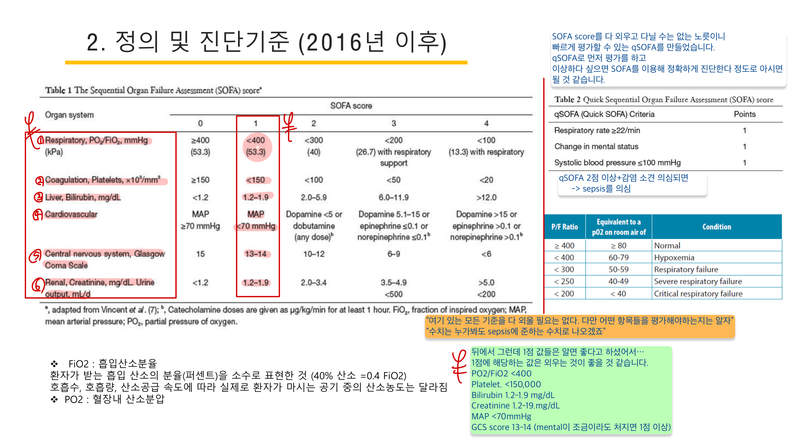
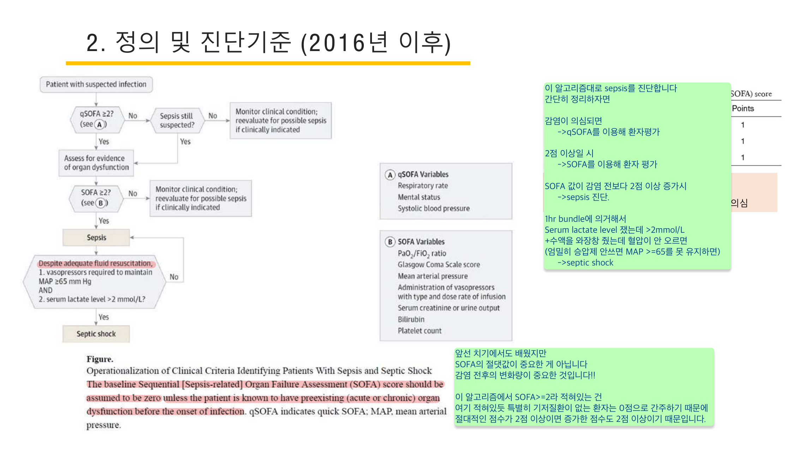
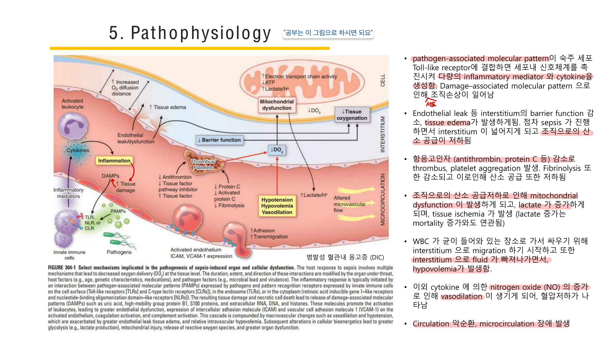
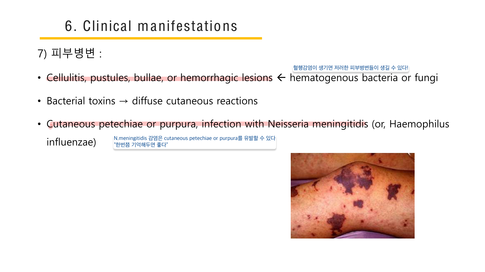
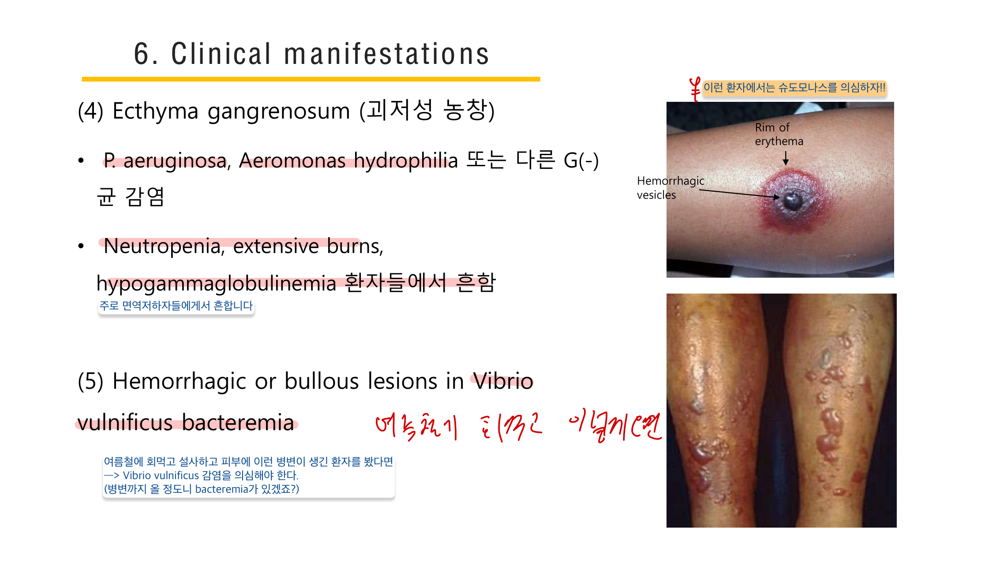
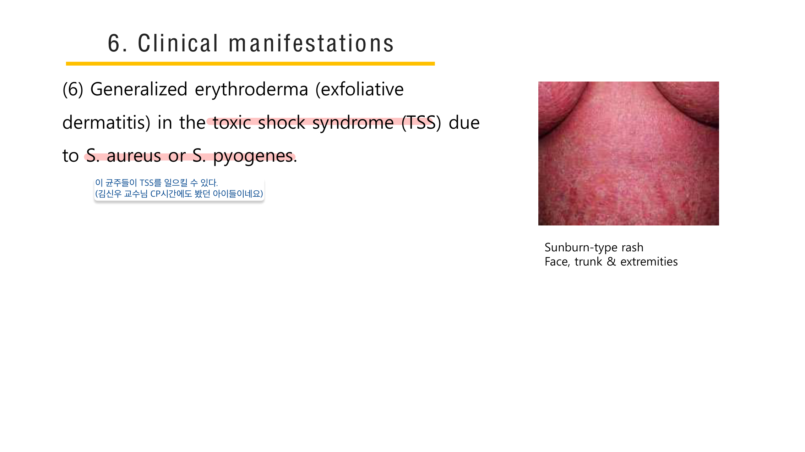
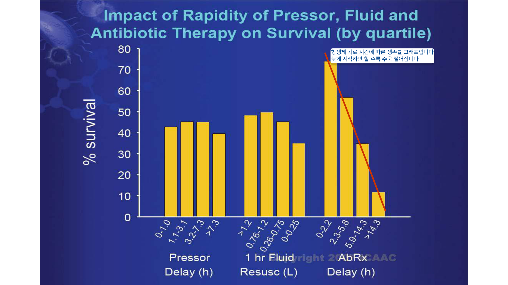
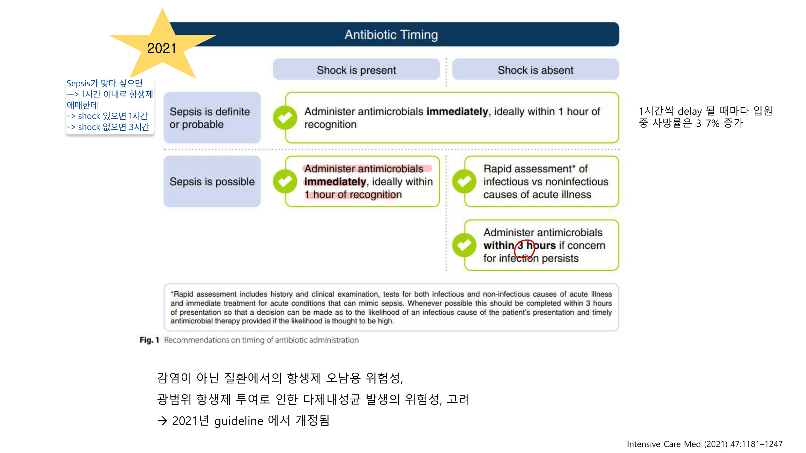

<!-- 필기본: 2025 -->
<!-- 단계: 수업 전 -->

# 0. 이 수업을 공부하는 법

경북대병원 감염내과 수업. 필기 작성자 말대로 지난 "치기"(치료의 기본) 때 많이 나온 sepsis·septic shock라 익숙한 내용이다. 교수님이 대표에게 공지까지 부탁하신 핵심 하나:

!!! key "핵심"
    **SOFA는 "감염 전과 후의 점수를 비교"한다.** 기저 지방간·신부전으로 creatinine 1.3, bilirubin 1.3인 환자는 SOFA가 이미 2점 이상이지만 감염이 없으면 sepsis가 아니다. **감염 이후 이전보다 2점 이상 올라야 sepsis.**
    **Septic shock = sepsis + 충분한 수액에도 MAP ≥65를 유지하려면 승압제 필요 + lactate >2 mmol/L.**
    치료 = **1시간 안에 배양 후 광범위 항생제**, **30 mL/kg 결정질 수액(3시간 내)**, **1차 승압제 norepinephrine(MAP 65)**, **감염원 제거(12시간 내)**, **de-escalation은 빨리**.

학습성과
1. 패혈증 쇼크의 **기전**을 설명한다.
2. 패혈증 및 패혈성 쇼크를 **정의**한다.
3. 패혈증의 **원인균**을 추정하고, 쇼크의 **치료 원칙**을 설명한다.

- 기출 28문항(2020–2025). 반복 유형
    - **SOFA에 들어가지 않는 항목** → **호흡수**(4번 출제), 심박수, lactate.
    - **병태생리로 옳지 않은 것** → **혈관수축**, **fibrinolysis 증가**, **lactate 감소**, **antithrombin 증가**(모두 반대).
    - **패혈증 특징으로 옳지 않은 것** → "신손상은 대부분 비가역적"(가역적이다), "혈액배양 음성이면 배제".
    - **항생제 원칙으로 틀린 것** → "de-escalation을 최대한 늦춘다", "β-lactam 알레르기면 carbapenem".
    - **쇼크 사례 치료** → norepinephrine 우선, 1시간 내 항생제 **전에 배양**, 수액 30 mL/kg, 반응 없으면 hydrocortisone.
    - 피부 소견: **괴저성 농창 = 녹농균**, TSS 홍피증, 수막알균 자반.

# 1. 역학
- 사망률이 높은 급성 질환. **비심장 중환자실 사망의 가장 흔한 원인**, 병원 내 사망원인의 **25–50%**, 의료비 지출이 막대하다.
- 증가 이유 = 감염에 취약한 환자군이 늘어남
    - 혈관 내 도관 같은 **침습적 장치** 사용 증가
    - 암·이식 환자의 **세포독성 약제·면역억제제** 사용 증가
    - 패혈증에 걸리기 쉬운 **당뇨·암 환자의 수명 연장**
    - **항균제 내성균** 감염 증가

# 2. 정의와 진단 기준

## 2016년 이전 — Sepsis-2 (지금은 폐기)
- **SIRS**: 아래 4개 중 2개 이상
    1. 체온 >38℃ 또는 <36℃
    2. 호흡수 >20회/분 또는 PaCO2 <32 mmHg
    3. 맥박 >90회/분
    4. WBC >12,000 또는 <4,000/mm3 또는 미성숙 띠호중구 >10%
- Sepsis = 감염에 의한 SIRS / Severe sepsis = 장기부전 징후(저혈압, 대사성 산증, 의식 저하, 핍뇨, ARDS)를 동반한 sepsis / Septic shock = sepsis + 수액에 반응 없는 저혈압.
- **현재는 SIRS·severe sepsis라는 말을 쓰지 않고 sepsis와 septic shock만 쓴다.**

## 2016년 이후 — Sepsis-3
- **패혈증(sepsis)** = 감염에 대한 숙주의 **조절되지 않는 반응**으로 생긴 **생명을 위협하는 장기부전** = **감염 + SOFA 2점 이상 상승**(사망률 약 10%).
- **패혈성 쇼크(septic shock)** = 순환·세포·대사 이상이 심해 사망률이 더 높은(**>40%**) 패혈증의 부분집합.
    1. 패혈증이면서
    2. **충분한 수액에도 MAP ≥65 mmHg를 유지하려면 승압제가 필요**하고
    3. **lactate >2 mmol/L(18 mg/dL)**

## SOFA score

{: style="width:80%"}

| 장기 | 지표 | **1점 기준(외워 둘 것)** |
|---|---|---|
| 호흡 | **PaO2/FiO2** | **<400** |
| 응고 | **혈소판** | **<150,000** |
| 간 | **bilirubin** | **1.2–1.9 mg/dL** |
| 심혈관 | **MAP**·승압제 | **MAP <70 mmHg** |
| 중추신경 | **GCS** | **13–14**(조금이라도 처지면 1점 이상) |
| 신장 | **creatinine** 또는 **소변량** | **1.2–1.9 mg/dL** |

- 교수님: "여기 있는 모든 기준을 다 외울 필요는 없다. **어떤 항목을 평가하는지**는 알자. 수치는 누가 봐도 sepsis에 준하게 나오겠죠." 다만 1점 값은 알면 좋다고 하셨다.
- **PaO2/FiO2**: FiO2는 흡입산소분율(40% 산소 = 0.4). 예: 인공호흡기 FiO2 0.4에서 PaO2 70.1 → 70.1/0.4 = 175.

!!! exam "기출 포인트"
    SOFA에 **포함되지 않는** 것 → **호흡수**(3·13·15번 — RR은 qSOFA 항목!), **심박수**(19번), **lactic acid**(26번 — lactate는 쇼크 정의에 쓰지 SOFA 항목이 아님). 소변량·GCS·bilirubin·혈소판·creatinine·MAP·PaO2/FiO2는 포함.

## qSOFA — 빠른 선별
| qSOFA(0–3점) | |
|---|---|
| **호흡수 ≥22회/분** | 1 |
| **의식 변화**(GCS <15) | 1 |
| **수축기 혈압 ≤100 mmHg** | 1 |

- SOFA를 다 외우고 다닐 수 없어 만든 도구. **qSOFA 2점 이상 + 감염 의심 → sepsis를 의심**하고 SOFA로 정확히 평가.
- (필기 작성자 주의) 증례에서 교수님이 "맥박"으로 qSOFA를 매기셨지만 원래 기준은 **수축기 혈압**이다.

{: style="width:70%"}

1. 감염 의심 → **qSOFA ≥2**?
2. → **SOFA가 감염 전보다 2점 이상 상승** → **sepsis**
3. → 충분한 수액에도 **MAP ≥65 유지에 승압제 필요 + lactate >2** → **septic shock**
- 알고리즘에 "SOFA ≥2"라고 적힌 이유: 기저질환이 알려지지 않은 환자는 기저 SOFA를 **0점**으로 보기 때문에 절대값 2점 = 증가분 2점.

### 2021년 개정 — qSOFA의 한계
- qSOFA는 **특이도는 높지만 민감도가 낮다** → **단독 선별 도구로는 적절하지 않다** → **NEWS**(National Early Warning Score) 또는 **MEWS** 같은 도구의 도움을 받으라고 권고. NEWS는 호흡수, 산소포화도, 산소 사용, 수축기 혈압, 심박수, 체온, 의식 수준을 본다.

# 3. 원인 (etiology)
- 지역사회 획득·병원 획득 모두 가능.
- 흔한 원인 질환: **폐렴(가장 흔함, 64%)** > **복강내 감염(20%)** > **신장·비뇨생식기(14%)**.
- **혈액배양 양성률은 1/3 정도뿐** — sepsis 30–60%, septic shock 60–80%(심해질수록 양성률↑). **배양 음성이어도 패혈증을 배제할 수 없다.**
- 최근 **그람양성균이 그람음성균보다 더 자주 보고**된다.
    - 그람양성: ***S. aureus*, *S. pneumoniae***가 가장 흔함
    - 그람음성: ***E. coli*, *Klebsiella*, *P. aeruginosa***
- 패혈성 쇼크로 가는 비율: **그람음성 감염의 25–40%**, 그람양성 5–15%.

## 위험인자 (원인균별) — 의인성이 많다
| 원인균 | 위험인자 |
|---|---|
| **그람음성 막대균** | 당뇨, 림프증식질환, 간경변, 화상, 침습적 시술·기구, 약물 유발 호중구감소, **유치도뇨관**, 게실염, 장기 천공 — 면역이 약한 환자 |
| **그람양성 알균**(원내 sepsis 증가 추세) | **혈관내 카테터**, 기계 장치, 화상, 호중구감소, 정맥약물 사용자, 초항원 생성 *S. pyogenes* |
| **진균** | **심한 호중구감소**, **광범위 항생제 장기 사용** |

!!! exam "기출 포인트"
    6번: 패혈증의 가장 흔한 원인 질환 → **폐렴**. 5번: 옳지 않은 것 → "**혈액배양 양성이 확인되지 않으면 패혈증 배제**". 중심정맥관 환자는 그람양성균이 주 원인, 그람양성 중 *S. aureus*가 가장 흔하다는 맞다. 28번: 비장절제 후 예방접종을 안 한 환자의 패혈증 원인 → **N. meningitidis**(피막 세균: 폐렴구균·Hib·수막알균).

# 4. 병태생리

{: style="width:80%"}

교수님: "공부는 이 그림으로 하시면 돼요."
- **PAMP(pathogen-associated molecular pattern)** 가 숙주세포의 **Toll-like receptor**(예: TLR4)에 결합 → 세포내 신호 → **대량의 염증 매개체·사이토카인(TNF, IL-1 등)**. 조직이 손상되면 **DAMP(damage-associated molecular pattern)** 가 나와 염증을 또 유발 → **악순환**(PAMP가 제거돼도 염증이 지속).
- **혈관 반응**: **endothelial leak**(혈관 투과성 증가)·**interstitium의 barrier function 감소** → **조직 부종(tissue edema)**, 간질이 넓어져 조직과 혈관의 거리가 멀어짐 → **산소 공급 저하**.
- **응고 반응**: tissue factor 활성화로 응고가 전신에서 일어나고, **항응고인자(antithrombin, protein C) 감소** → 혈전·혈소판 응집. **섬유소용해(fibrinolysis)도 감소** → 미세혈전이 안 녹음 → 산소 공급 더 저하. 응고인자·혈소판이 소모되어 출혈도 막지 못함 → **DIC**.
- **세포 반응**: 산소 공급 저하 → **미토콘드리아 기능장애** → **lactate 증가**, 조직 허혈(lactate 증가는 사망률 증가와 연관).
- 백혈구가 균이 있는 곳으로 가려고 간질로 이동하고, 체액도 간질로 빠져 → **hypovolemia**.
- 사이토카인 → **NO(nitric oxide) 증가 → 혈관 확장(vasodilation)** → 혈압 저하.
- 순환의 악순환, **미세순환 장애**.

정리하면 패혈증은 **① hypovolemia(투과성↑ + 혈관 확장) ② 조직 허혈(lactate↑) ③ 응고병증(DIC)** 세 가지 문제를 일으킨다.

!!! exam "기출 포인트"
    병리기전으로 **옳지 않은** 것: **vasoconstriction**(11번 — 확장이 맞음), **fibrinolysis 증가**(14번 — 감소), **lactate 감소**(18번 — 증가), **antithrombin 증가**(24번 — 감소). 4번(2025) 옳은 것 → **mitochondrial dysfunction으로 lactate 상승**. 오답 — 내피 손상이 투과성을 "감소", fibrinolysis "항진", 미세혈전 "감소", NO "감소로 혈관 수축".

# 5. 임상 양상
1. 감염 병소가 있는 환자가 갑자기 **발열·오한·빈맥**. 천천히 오거나 알아채기 어려울 수도 있다.
2. 양상이 매우 다양하고 **열이 없을 수도** — **신생아, 노인, 알코올중독자**.
3. **과호흡·호흡성 알칼리증**이 초기 증상일 수 있다(qSOFA 기준이 RR ≥22인 이유).
4. **호흡기 — ARDS**: 감염 후 7일 내, 저산소혈증 + 심인성이 아닌 양측 침윤. 분류: mild PaO2/FiO2 201–300, moderate 101–200, severe ≤100. 회복해도 제한성 장애·확산능 저하가 남을 수 있다. 우리가 기억할 것은 "SOFA에서 **PaO2/FiO2 <400이 1점**".
5. **심혈관 — 패혈증 유발 심근병증**: 패혈성 쇼크는 **심근기능 저하 + 혈관 확장에 따른 상대적 hypovolemia**. 전형적으로 발병 24–48시간 뒤 보이고, 수액 소생 등으로 회복되면 5–10일 후 정상화. "개념적으로만 이해하시면 됩니다." 결국 혈압은 떨어진다.
6. **신손상(AKI)**: 패혈증 환자의 **50% 이상**, 동반되면 입원 사망률 **6–8배**. 핍뇨·**질소혈증**(BUN 상승), 투석이 필요할 수도. 기전은 혈류량 감소·저혈압·신혈관 수축. 경한 단백뇨부터 중증 신부전까지. **패혈증에 의한 신손상은 대부분 가역적.**
7. **혈소판감소(10–30%)**, 중증 패혈증의 **30–50%에서 DIC** — 응고가 부적절하게 활성화되어 광범위 혈전 → 장기 혈류 감소, 혈소판·응고인자 소모 → 출혈(상처 부위의 지속적 삼출, 위장관 출혈이 가장 흔함), 혈전 → **말단청색증·말초조직 허혈성 괴사**.
8. **피부 병변**
    - 혈행성 세균·진균 → 연조직염, 농포, 수포, 출혈성 병변
    - 세균 독소 → 미만성 피부 반응
    - **피부 점상출혈·자반 → *Neisseria meningitidis***(또는 *H. influenzae*) — "한번쯤 기억해 두면 좋다"
    - **괴저성 농창(ecthyma gangrenosum)**: ***P. aeruginosa***, *Aeromonas hydrophila* 등 그람음성균. **호중구감소, 광범위 화상, 저감마글로불린혈증** 환자에서 흔함 — 이런 환자면 녹농균을 의심.
    - **출혈성·수포성 병변 → *Vibrio vulnificus* 균혈증** — 여름철 회를 먹고 설사 + 피부 병변.
    - **전신 홍피증(박탈피부염) → 독성쇼크증후군(TSS)**, ***S. aureus* 또는 *S. pyogenes*** — 햇볕에 탄 듯한 발진, 얼굴·몸통·사지.

{: style="width:52%"}

{: style="width:56%"}

{: style="width:52%"}

9. **위장관**: 말초혈관 확장으로 장 혈류 감소 → 장벽 기능 저하 → 장내 세균이 혈액·림프로. 구역·구토·설사, 간기능 장애(간부전은 드묾)·**담즙정체성 황달**, **스트레스 궤양** 출혈, 장마비, 허혈성 장괴사.
10. **신경계**: 지남력 소실·혼동 같은 **패혈증 연관 섬망·패혈성 뇌병증**, 다발신경병증·근병증, 생존자의 25–50%에서 **장기 인지장애**.
11. 기타
    - **고혈당 또는 저혈당**: 급성 감염 반응은 포도당신생·글리코겐분해·인슐린 저항성으로 혈당을 유지하는 쪽이라 저혈당은 흔치 않지만, 간·신장질환·영양불량이면 저혈당.
    - **부신 기능장애**: cortisol·aldosterone 분비 감소, vasopressin 증가 → 저나트륨·고칼륨. "뒤에 나올 스테로이드 치료와 연관되니 기억."
    - **Sick euthyroid syndrome**.

!!! exam "기출 포인트"
    8번: 항암 중 화상 입원 환자의 피부 병변 → ***P. aeruginosa***(괴저성 농창). 25번 옳은 것 → "**황색포도알균 TSS는 전신 발적이 흔하다**". ①"그람양성이 더 흔하다"는 필기(최근 그람양성이 더 자주 보고)와 맞아 보이지만 출제 정답은 ④다 — ※ 확인 필요. 나머지 오답: 혈액배양 100%, *Vibrio*는 출혈성 수포(가피 동반 작은 수포 X), ecthyma는 녹농균(H. influenzae X). 22번: 알코올 좋아하는 55세, 상처 없이 저혈압·급성 신부전 → **superantigen exotoxin**(TSS). 23번: 패혈증으로 투석까지 하고 퇴원 시 손바닥 피부가 벗겨짐 → **포도알균 TSS**. 10번: 열·간수치 상승 + 얼굴·가슴 발진 + 구강 병변·삼킴 곤란 → **Stevens-Johnson 증후군**(감별).
    2·9번: 옳지 **않은** 것 → "**패혈증에 의한 신손상은 대부분 비가역적**".

# 6. 검사 소견
1. CBC: **백혈구 증가 또는 감소**, **혈소판 감소**
2. **PT·PTT 연장, fibrinogen 감소, D-dimer 증가** → DIC 시사
3. 고빌리루빈혈증, 아미노전이효소 상승(간기능 저하)
4. 질소혈증·단백뇨, 전해질 불균형(신기능 저하)
5. ABGA: **대사성 산증**(조직에 산소가 잘 안 감) + **호흡성 알칼리증**(호흡수 증가)
6. EKG: 동성빈맥 또는 비특이적 ST–T 이상

### DIC 진단 기준 (4개 중 3개 이상, 증례에서 제시)
1. 혈소판 <100,000/mm3 또는 급격한 감소
2. FDP 또는 **D-dimer 증가**
3. **fibrinogen <150 mg/dL**
4. **PT 3초 초과 또는 aPTT 5초 초과** 연장
- antithrombin III 같은 응고억제제의 낮은 농도는 진단 표지자로 의미는 없다.

# 7. 치료
치료의 세 축: **항생제 + 감염 병소 제거 + 패혈증·쇼크 환자 관리**.

## 왜 빨리 해야 하나
- 패혈증에서 몸을 해치는 것은 **감염량(infectious load), 독소(toxic burden), 염증반응, 조직 손상(PAMP·DAMP)**. 치료의 목표는 **쇼크 역치를 넘지 않게** 하는 것.
- 치료해도 염증반응 때문에 바로 좋아지지 않는다(**clinical response gap**). 감염원을 더 적극적으로 조절하면(예: 고름 절개 배농) gap이 짧아지고, **항생제를 조기 투여**하면 훨씬 좋아진다.

{: style="width:58%"}

- 항생제 시작이 늦을수록 생존율이 주욱 떨어진다. **1시간 지연될 때마다 입원 중 사망률 3–7% 증가.**

## 1) 항균제 치료 원칙
1. **초기에 적절한 항균제**가 생존율을 높인다.
2. 초기엔 **그람양성·음성 모두 덮는 광범위 항균제**로 경험적 치료 → 배양 결과에 따라 범위를 좁힌다(**de-escalation → 낮은 사망률과 연관**).
3. **정맥주사로 최대 용량.**
4. 정균(bacteriostatic)보다 **살균(bactericidal)** 항균제.
5. **지역·병원의 내성 현황** 고려.
6. **병용요법**으로 상승·부가 효과(예: β-lactam + aminoglycoside).
7. **기저질환(당뇨, 간경변)과 면역상태(호중구감소, 비장절제)** 고려.

- 패혈성 쇼크 경험적 항생제: **piperacillin/tazobactam**, **cefepime**, **meropenem·imipenem/cilastatin** 중 하나.
- **β-lactam 알레르기 → fluoroquinolone(ciprofloxacin)** 고려(carbapenem이 아님).
- **호중구감소 환자에서 중심정맥관 관련 혈류감염 의심 → vancomycin 추가**(MRSA).

### 항생제 투여 시점 (2021 개정)

{: style="width:62%"}

| | 쇼크 있음 | 쇼크 없음 |
|---|---|---|
| **패혈증 확실/가능성 높음** | 즉시, **1시간 이내** | 즉시, **1시간 이내** |
| **패혈증 가능성 있음** | 즉시, **1시간 이내** | 빠른 평가 후, 감염 우려가 지속되면 **3시간 이내** |

- 감염이 아닌 질환에서 항생제 오남용, 광범위 항생제로 인한 다제내성균 발생 위험을 고려해 개정.
- **상당한 지연이 없는 한 항생제 시작 전에 배양 검체를 확보**한다.
- 원인균과 감수성이 정해지거나 임상적으로 좋아지면 범위를 좁히고, **de-escalation을 위해 매일 평가**.

## 2) 감염 병소 제거 (source control)
- 배농·절제가 필요한 곳이 있는지 파악하고, 가능하면 **진단 후 12시간 이내** 조치 → 감염 제거가 빨라진다. 수술적 배농, 경피 배액 등. 장기부전이 있으면 그에 맞는 치료를 같이.

## 3) 패혈증·쇼크 환자 관리
### 소생술
- **IV 결정질 수액 30 mL/kg를 초기 3시간 이내.** **생리식염수 또는 balanced crystalloid** 권장.
- 승압제가 필요한 쇼크의 **MAP 목표 65 mmHg**. (85 vs 65 비교: 90일 사망률 차이 없이 심방세동 등 합병증만 증가.)
- **1차 승압제 = norepinephrine** — 심박수·일회박출량에 거의 영향 없이 혈관 수축으로 MAP 상승. dopamine보다 생존 이득, 더 나은 혈역학, 부작용 감소.
- **Vasopressin**: 초기 단독으로는 쓰지 않고, NE 용량을 줄이려고 **NE와 병합**.
- **Dopamine**: 심박수·일회박출량을 늘려 MAP·심박출량 상승 → **부정맥이 더 많아** 빠른 부정맥 위험이 낮거나 **서맥**인 환자에서만 제한적으로.
- 충분한 수액·승압제에도 저혈압(심장 기능 저하)이면 **dobutamine** 고려.
- 승압제 쓸 때 가장 주의할 것은 **말초혈관 괴사**(혈관수축제) → 가능한 빨리 **동맥 카테터(A-line)**.
- **적혈구 수혈**: **Hb <7.0 g/dL일 때만**(급성 심근경색·심한 저산소혈증·급성 출혈 제외). Hb 10 이상 유지와 생존율 차이 없음 — 산소 전달은 늘려도 산소 소비는 늘리지 않으므로 7–9를 목표.
- **혈소판 수혈**: **≤10,000이면 출혈 증거가 없어도**, **≤20,000이면 출혈 위험이 있을 때**, 수술·침습적 시술 시 **≥50,000** 유지. (정상 150,000 이상)

### 호흡 보조 ("호흡기내과에서 할 거니까 가볍게")
- sepsis 유발 ARDS의 목표 **일회호흡량 6 mL/kg(예측 체중)**, 중증 ARDS는 **높은 PEEP**(폐허탈 방지, 5 이상), **PaO2/FiO2 <150이면 엎드린 자세(prone)**. 폐동맥 카테터 일상적 삽입은 권고하지 않음. **침상 머리 30–45도**(흡인·VAP 예방).

### 일반적 보존 관리
- **스테로이드**
    - 2016: 적절한 수액·승압제로 혈역학적 안정이 유지되면 **권고하지 않음**(장기 생존률을 높이지 않고 쇼크 회복만 늦춤).
    - **2021: 4시간 이상 승압제를 썼는데도 NE 요구량 ≥0.25 mcg/kg/min이면 사용을 제안** — **IV hydrocortisone 200 mg/일(지속 또는 50 mg 6시간마다)**.
    - 교과서 요약: 연구마다 결과가 달랐는데, 효과가 있던 연구는 더 중증 환자 대상이었다 → **수액·승압제에도 불안정한 환자에게만** 쓴다.
- **진정제**: 사용을 제한하면 기계호흡 기간·ICU·재원기간이 줄어든다 → 매일 평가해 양을 조절하고 중단 시점을 정해 둔다.
- **혈당**: 프로토콜 기반. **2회 연속 >180 mg/dL이면 인슐린 시작**, 목표 **≤180**. 80–110까지 낮추는 것은 오히려 해롭다. 1–2시간마다(안정되면 4시간마다) 확인. "**너무 엄격하게 혈당을 관리하지 않는다.**"
- **신대체요법**: AKI에 CRRT 또는 간헐적 투석.
- **DVT 예방**: 신기능 저하면 저분자량 헤파린 우선, 가능하면 기계적 압박 병합, 약제 금기(혈소판감소·응고병증·출혈·최근 뇌출혈)면 기계적 압박 먼저.
- **스트레스 궤양 예방**: 위장관 출혈 위험(응고장애, 48시간 이상 기계호흡, 저혈압)이 있으면 **PPI**(H2 차단제보다 효과가 다소 큼).

!!! exam "기출 포인트"
    쇼크 사례(신농양·간농양·신우신염·폐렴 + 저혈압 + lactate 4): 수액 30 mL/kg 후에도 저혈압 → **norepinephrine**(1·17번). 12번: 옳지 **않은** 것 → "**1시간 내 광범위 항생제를 먼저 투여한 후 혈액배양**"(배양을 먼저). 농양 배액, 반응 없을 때 hydrocortisone, 30 mL/kg, NE 우선은 맞다. 17번 오답 — qSOFA 2점(이 환자는 3점), qSOFA를 산소포화도로 평가, **dexamethasone**(hydrocortisone이 맞음), 5 mL/kg. 21번 정답 "수액·승압제로 혈압이 회복되지 않아 **corticosteroid**", 오답 — qSOFA를 맥박으로, dopamine 우선. 27번 정답 "**hydrocortisone 50 mg 6시간마다 IV**", 오답 — 정균 항생제, 경구 혈당강하제로 ≤100, 생리식염수 금지, 혈압 유지 위해 적혈구 수혈.
    항생제 원칙 틀린 것 → "**de-escalation을 최대한 늦춘다**"(16·20번), "**β-lactam 알레르기면 carbapenem**"(7번 — fluoroquinolone).

# 8. 예후와 예방
- 심한 sepsis의 20–35%, **septic shock의 40–60%가 30일 이내 사망**. 6개월까지 사망이 이어지는 원인: 조절 안 된 감염, 기저질환, 면역저하, 다장기부전.
- **배양 양성과 음성 중증 패혈증의 사망률은 비슷**하다.
- 사망률의 가장 중요한 인자: **나이와 기저질환의 중증도**.
- 선진국의 심한 sepsis는 대개 **병원감염** → 예방: 침습적 시술·카테터(혈관·요로) 사용 제한, 항생제·스테로이드 남용 방지, 감염관리 준수(평소에 적당히 쓰라는 의미).

# 9. 증례

## 증례 1 — F/89, 발열 (요로결석 + 요로감염)
- HTN·DM·골다공증. 2일 전부터 하복부 통증, 오한, 배뇨 끝의 찌릿함, 발열, 숨참.
- MAP <65 → 수액을 줬는데도 혈압이 안 올라 **septic shock**, NE 투여(원래는 필요하면 vasopressin 병용).
- 염증 수치 상승, 소변검사에서 요로감염 소견. SOFA: bilirubin 1점, creatinine 1점, 의식 1점 → 이미 3점 → **sepsis**, lactate >2 + NE → **septic shock**.
- 복부 CT: **8 mm 우측 중간 요관 결석 → 상부 폐쇄성 요로병증** → 결석에 동반된 요로감염의 패혈증 → **경피적 신루설치술(PCN)** 로 배액(source control).

## 증례 2 — M/72, 전신 쇠약 (간농양 + Klebsiella)
- HTN·DM. 7일 전 콧물·열감, 감기약으로 지내다 3일 전부터 전신쇠약·복부 불편감.
- MAP 60 미만 → qSOFA 2점 이상, 해열제 때문에 발열이 가려졌을 수 있다 → sepsis 의심 → SOFA 7점 이상 → **sepsis**. 승압제 + lactate >2 → **septic shock**. **DIC**도 동반. 대사성 산증 + 과호흡(호흡성 알칼리증).
- 복부 CT: **간농양**, 혈액배양 ***Klebsiella pneumoniae***(그람음성). (흉부 CT 폐렴 소견은 설명 없이 넘어가심.)

!!! memo "암기"
    Sepsis = 감염 + **SOFA ≥2 상승**(사망 10%) / Shock = 승압제로 **MAP ≥65** + **lactate >2**(사망 >40%) · qSOFA = **RR ≥22, 의식 변화, SBP ≤100** · SOFA = PaO2/FiO2·혈소판·bilirubin·MAP·GCS·creatinine(소변량) — **RR·HR·lactate는 SOFA 아님** · 원인 1위 **폐렴** · 혈배 양성 1/3 · 기전: 투과성↑·혈관 **확장**(NO↑)·antithrombin/protein C↓·**fibrinolysis↓**·lactate↑ · AKI는 **가역적** · 치료: 배양 → **1시간 내 항생제**, **30 mL/kg/3h**, **NE**(+vasopressin), **MAP 65**, source control **12시간**, Hb <7 수혈, 혈당 ≤180, NE ≥0.25 4시간이면 **hydrocortisone 200 mg/일**.
