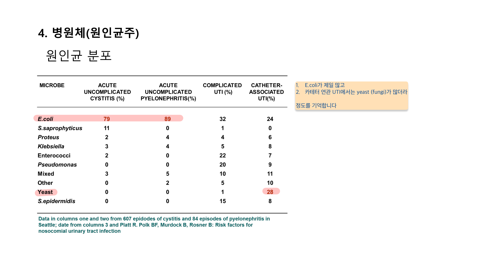
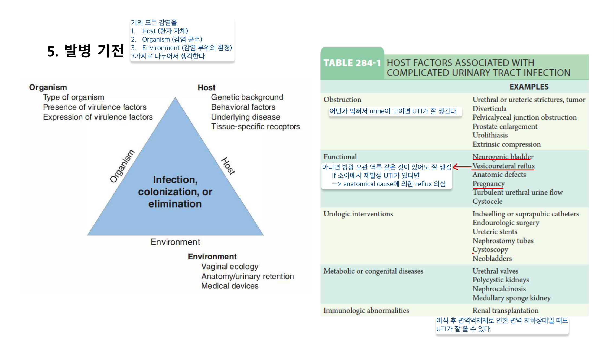
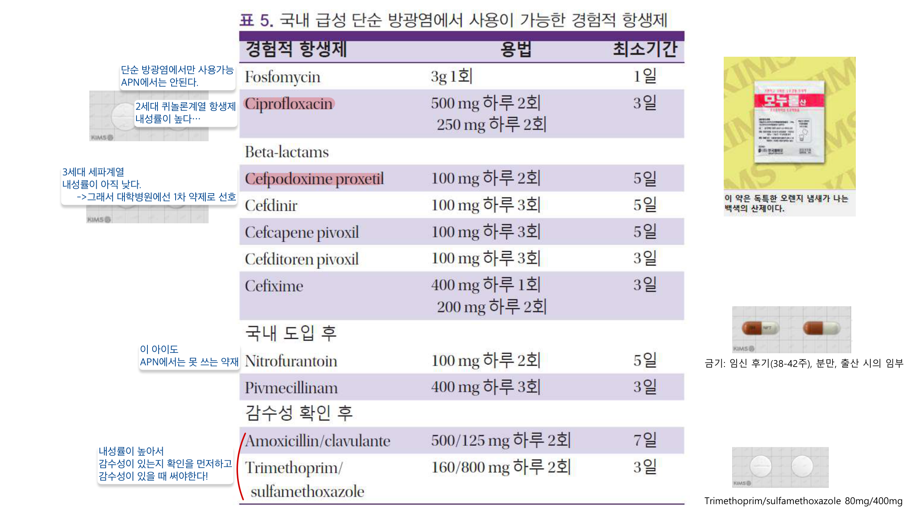
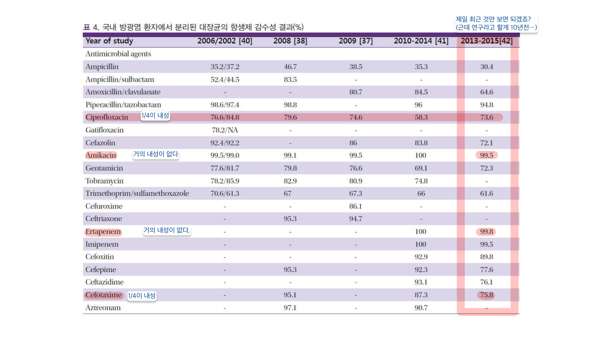
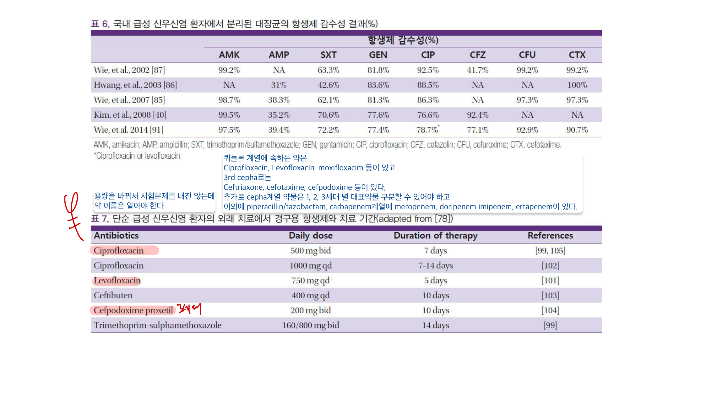
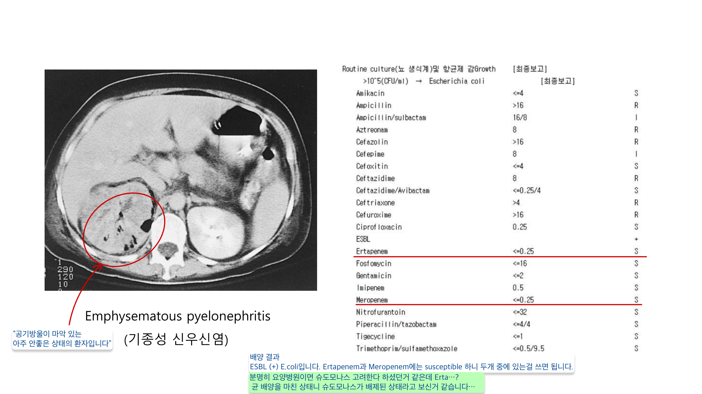

<!-- 필기본: 2025 -->
<!-- 단계: 수업 전 -->

# 0. 이 수업을 공부하는 법

칠곡경북대병원 감염내과 **황소윤 교수님** 수업(원래 본인 파트가 아니라 "최대한 빨리 달릴 것"이라고 하셨다). 2023–24년은 김윤정 교수님 출제.

학습성과
1. 방광염과 급성 신우신염의 **흔한 원인과 발병기전**
2. 급성 신우신염의 **전형적 증상과 징후**
3. 급성 신우신염의 **진단과 치료** — 교수님: "**치료가 제일 중요**"

- 기출 22문항(2020–2025)의 반복 유형
    - **건강한 젊은 여성 + 발열 + CVA 압통 → 원인균 *E. coli***(3번 출제).
    - **무증상 세균뇨 → 치료하지 않고 관찰**(건강 여성, 당뇨 노인, 도뇨관 칸디다뇨). 예외 = **임산부**(+ 비뇨기과 시술 전).
    - **경험적 항생제**: 젊은 여성 APN → 지역 내성에 따라 ciprofloxacin/ceftriaxone, **임산부 → ceftriaxone**, **요양병원·당뇨·잔뇨 노인 → piperacillin/tazobactam**, 반복 감염 ESBL → **ertapenem**.
    - 신농양 + 패혈성 쇼크 사례(19강과 같은 틀): 틀린 것 = **dexamethasone**(hydrocortisone이 맞음), 적절하지 않은 초기 항생제 = **vancomycin 단독**.
    - **발열 = 상부 vs 하부 요로감염 감별의 가장 중요한 증상.**

!!! key "핵심"
    **원인균 1위는 어디서나 *E. coli*.** **발열이 있으면 신우신염(상부)**, 없으면 방광염(하부).
    **무증상 세균뇨는 임산부·비뇨기과 시술 전만 치료** — 나머지는 선별검사도 하지 않는다.
    **증상이 없어졌다고 치료 완료가 아니다**(증상은 저절로 사라질 수 있음). 기간: 단순 방광염 3일(당뇨 7일), 젊은 여성 APN 14일(퀴놀론 7일), 임산부 7–10일, 남성 APN 2주, 급성 전립선염 4–6주.

# 1. 개요와 분류
- 요로감염은 임상 증상·징후, 농뇨, 세균뇨로 진단하지만, 증상이 다양하고 의미 있는 세균뇨·농뇨 기준이 달라 **전 세계적으로 통일된 정의·진단기준이 없다.**

## 감염 부위에 따라
- **상부 요로감염**: 방광 위 — **신장, 요관**
- **하부 요로감염**: **방광, 요도**(남자는 **전립선**)

## 해부·기능 이상이나 기저질환 유무에 따라
- **단순(uncomplicated)**: **임산부를 제외한 성인 여성의 방광염** — 해부학적 구조 이상·신경학적 기능장애가 없는 여성.
- **복잡(complicated)**: **소아, 남자, 임산부, 신장의 감염, 요로폐쇄, 도관, 잔뇨감**, 신장이식 환자.
    - "임산부는 **무조건 치료 대상**이라 단순으로 분류하지 않는다."
    - "남자는 요도가 길어서 보통 감염이 드물다" → 남자는 거의 무조건 복잡 요로감염으로 간주.

## 그 밖의 분류
- 증상: 유증상 vs 무증상 / 형태: 무증상 세균뇨, 방광염, 신우신염
- **재발**: 산발적(≤1회/6개월, ≤2회/년) vs **재발성(6개월 내 2회 이상 또는 1년 내 3회 이상)** — relapse(같은 균 재발) vs reinfection(재감염)
- 역학: **도관 관련(병원)** vs 비도관(지역사회)

# 2. 역학
1. 증상이 있는 요로감염은 **남성보다 여성에서 흔하다.**
2. **영아에서는 남아가 더 흔하고**(선천 요로기형이 남아에 흔함), 이후엔 여성이 흔하다. **노인(50세 이후)에서는 전립선 문제로 남녀 비율이 비슷해진다.**
3. 신우신염 횟수가 늘수록 **재발률도 증가**(재발을 잘 하는 병).
4. 나이가 들수록 **무증상 세균뇨** 증가(위생, 면역 저하).
5. **당뇨 여성 9–27%, 간헐적 도뇨를 하는 척수손상 환자 23–89%** 가 무증상 세균뇨.

# 3. 원인균

{: style="width:62%"}

1. 국내 **급성 방광염 원인균 1위 *E. coli*(71–83%)**, **급성 신우신염도 *E. coli*(80–92%)**.
2. 그 외 ***Klebsiella pneumoniae*, *Proteus mirabilis*, *Enterobacter*, *Enterococcus*, *Staphylococcus saprophyticus*.**
3. **30일 이상 장기 도뇨관** 환자에서는 **균막(biofilm)** 에 잘 집락하는 ***Proteus mirabilis*, *Morganella morganii*, *Providencia stuartii***.
4. 국내 APN 대장균의 **ciprofloxacin·광범위 cephalosporin 내성률이 최근 20년간 증가**(많이 쓴 항생제에 내성이 많다).
- 기전: 요도·질 입구에 집락한 균(항문으로 나온 **장내 세균**)이 요로를 타고 올라간다.
- 표에서 기억할 것: ① ***E. coli*가 제일 많다** ② **카테터 관련 UTI에서는 yeast(진균)가 많다**(28%).

!!! exam "기출 포인트"
    건강한 여성의 발열·CVA 압통·농뇨 → ***E. coli***(5·8·14번). 함정 — *S. saprophyticus*(젊은 여성 방광염의 10%), *Proteus*, *E. faecalis*, *Ureaplasma*, 임균. 13번: 도뇨관 관련 세균뇨의 가장 흔한 원인균도 ***E. coli***. 18번: **유주현상(swarming)**, **신장결석** → ***Proteus mirabilis***(요소분해효소 → 스트루바이트 결석). 20번: 신이식 7일째 면역억제 중 농뇨 → 그래도 ***E. coli***(BK virus 아님).

# 4. 발병 기전과 위험요인

{: style="width:76%"}

- 거의 모든 감염을 **숙주(host) · 균(organism) · 환경(environment)** 셋으로 나눠 생각한다.
- 복잡 요로감염의 숙주 요인
    - **폐쇄**: 요도·요관 협착, 종양, 결석, 전립선 비대 — **어딘가 막혀 소변이 고이면 UTI가 잘 생긴다.**
    - **기능적**: 신경인성 방광, **방광요관역류(VUR)**, 임신 — **소아의 재발성 UTI면 해부학적 원인에 의한 역류를 의심.**
    - 비뇨기과 시술: 유치·치골상부 도관, 요관 스텐트, 신루관, 방광경
    - 대사·선천 질환: **당뇨**, 다낭신, 신석회증
    - 면역: **신이식**(면역억제제)
- 위험요인: **나이가 많을수록 유병률 증가.** 남자는 특이하게 **태어난 직후 높고**(선천 기형) 이후 나이가 들수록 증가. 여성 — 성교, 살정제, 질 격막, 임신, 폐경 후 에스트로겐 결핍. 남성 — 전립선 비대·폐쇄, 포경, 항문 성교.

!!! exam "기출 포인트"
    19번: 73세 여자 하복부 통증 + 사진(기종성 방광염/신우신염) → 가장 중요한 기저 위험요소 **당뇨**.

# 5. 임상 양상
- **방광염**: 갑자기 시작. **배뇨통**, 소변량 감소, **빈뇨·긴박뇨**, 아랫배 불쾌감·허리 통증. 약 **1/3에서 혈뇨**(혈뇨만으로 오기도). 요의가 있는데 양이 적다, 계속 마렵다, 잔뇨감. 교수님: "직접 걸려 보니 진짜 찌릿찌릿하다는 말밖에는…"
- **남자 전립선염**: 방광염 증상 + **방광출구 폐쇄 증상**(hesitancy, 가는 소변줄, 야간뇨, 배뇨 후 점적).
- **신우신염**: **오한, 발열, 측복부 통증**, 두통, 오심·구토, 복통, 허리 통증. 경증부터 **그람음성균 패혈증**까지 다양.
- **발열이 하부와 상부 요로감염을 감별하는 가장 중요한 요소** — 방광염은 국소 감염이라 배뇨 증상만, 신우신염은 발열 같은 전신 증상.
- 적절한 항생제에도 **48–72시간 이상 발열이 지속**되면 **신농양**을 고려 → CT를 찍을 수 있는 병원으로.

!!! exam "기출 포인트"
    22번: 상부와 하부 요로감염을 감별하는 가장 중요한 증상 → **열**.

# 6. 진단
## 1) 요 배양검사 — 가장 중요
- 원인균을 알고 **항생제 내성까지** 볼 수 있어서 매우 중요.
- 요도구 주변 오염균이 섞이므로 처음 소변은 버리고 **중간뇨**.
- **전립선염**은 **전립선 마사지 후 마지막 몇 방울**.
- 깨끗한 중간뇨의 배양 양성 기준 **105 CFU/mL 이상**.

## 2) 영상 검사
- 필요한 경우: **치료 후에도 3일 이상 발열**(통상 치료 무반응), **반복성**, 심한 증상, **당뇨·면역억제** 같은 위험인자, **요로폐쇄 의심**, **신농양** 등 합병증 우려.
- **단순요로촬영(KUB)**: 결석, **기종성 신우신염**(공기) 확인.
- **CT**: 진단과 합병증 발견에 초음파·요로조영술보다 **민감도가 높다**. "열이 있으면 찍어보는 게 좋다", 교수님은 대학병원 응급실 환자는 시작부터 CT.

# 7. 치료

## 일반 원칙
- **수액**이 도움이 된다고 본다(단, 전립선 비대가 있는 신우신염은 과다 수액이 악화시킬 수 있음).
- 항생제 치료의 목적은 **요로에서 세균을 박멸**하는 것.
- **증상은 항생제 없이도 저절로 소실될 수 있으므로**(APN도 50–70%는 저절로 증상이 사라진다) **증상이 없어졌다고 치료 완료로 평가하면 안 된다** — 임상 증상 소실 ≠ 세균학적 완치.
- 성별, 나이, 증상 유무, 상부인지, 반복성인지에 따라 치료가 달라진다.

!!! exam "기출 포인트"
    11번: 옳지 **않은** 것 → "**증상이 없어지면 치료 완료로 평가한다**". *E. coli* 1위, 성인 여성은 방광염이 대다수, 증상은 저절로 소실될 수 있음, 임산부는 ceftriaxone — 모두 맞다.

## 무증상 세균뇨
- 정의: 증상 없는 환자에서 **2회 연속 소변배양에서 같은 균 105 CFU/mL 이상**.
- **치료해도 증상 빈도나 합병증이 줄지 않는다** → 보통 치료하지 않고 경과관찰.
- **예외(치료)** — "예외 상황을 잘 알아 두셔야"
    - **임산부**(저체중아 출산·신우신염을 줄임)
    - **비뇨기과적 처치·수술 예정**(교과서상 임산부와 함께 권고)
    - (근거 약함, 선별적) 백혈구 감소증 환자, 신이식 환자
- 그 외 — **비임신 여성, 양로원 거주 여성, 당뇨 여성, 척수손상 환자, 유치 도뇨관 환자** — 치료 대상이 아니므로 **선별검사도 하지 말 것.**
- 유병률: 건강한 여성 1–5%, 당뇨 여성 20% 이상, 요양병원 거주자도 많다 → 전부 경과관찰.

!!! exam "기출 포인트"
    반드시 치료할 대상 → **임산부**(10번). 건강검진에서 *E. coli*가 나온 무증상 28세 여성 → **경과 관찰**(2번), 당뇨 70세 여성에서 반복 분리 → **경과 관찰**(16번 — 영상·fosfomycin·도뇨관 재채취·감수성 후 처방 모두 X). 도뇨관 환자의 무증상 *Candida* 칸디다뇨 → **경과관찰**(9번). 21번: 무증상 도뇨관 환자에서 **다제내성 녹농균** → 치료가 아니라 **접촉주의**.

## 성인 여성의 단순 방광염 (비임신)
- 성인 여성 요로감염은 **방광염이 대다수**. 원인 ***E. coli* 60%**, 기타 그람음성 20%, ***S. saprophyticus* 10%**.
- **지역의 감수성**을 고려해 처방(예: 지역에 ESBL 대장균이 많은데 세파만 주면 안 됨).
- 외래 **3일 단기 치료가 표준**. **당뇨 환자는 상부 요로감염 확률이 높아 7일**.

{: style="width:70%"}

| 약 | 용법 | 기간 | 비고 |
|---|---|---|---|
| **Fosfomycin** | 3 g 1회 | 1일 | |
| **Ciprofloxacin**(2세대 퀴놀론) | 500 mg 하루 2회 | 3일 | **내성률이 높아(약 1/4)** 단순 방광염에서만, APN 경험적으로는 X |
| **Cefpodoxime**(3세대 세파) 등 β-lactam | 100 mg 하루 2회 | 5일 | **내성률이 아직 낮아** 대학병원 1차 선호 |
| **Nitrofurantoin** | 100 mg 하루 2회 | 5일 | **APN에서는 못 씀**(신장 조직 농도 낮음). 금기: 임신 후기(38–42주)·분만 |
| Pivmecillinam | 400 mg 하루 3회 | 3일 | |
| Amoxicillin/clavulanate, **TMP/SMX** | | 7일/3일 | **내성률이 높아 감수성 확인 후** |

- TMP/SMX(셉트린) — 사용이 줄면서 내성률도 줄었다 → **항생제를 덜 쓰면 내성균이 줄고, 많이 쓰면 늘어난다.**

{: style="width:62%"}

- 최근 자료(2013–2015): **ciprofloxacin·cefotaxime은 약 1/4이 내성**, **amikacin·ertapenem은 내성이 거의 없다.**

## 젊은 여성의 급성 신우신염
- 주요 증상: **배뇨통, 발열, 늑골척추각(CVA) 압통.** 경증부터 그람음성 패혈증까지.
- 원인 ***E. coli* 85%**, 기타 장내세균 10%, 나머지 그람양성.
- **외래 vs 입원 결정**: 나이·기저질환·임상상태·순응도. **중증, 고령, 균혈증 의심, 면역저하는 입원.** 열·CRP가 높고 바이탈이 불안정하면 입원이 좋다. (교수님 여담: 환자가 "제발 입원하게 해주세요" 하면 입원 — 환자의 의사가 1번, 삶의 지혜다.)
- **경한 환자**(열이 심하지 않고 오심·구토 없음)는 **경구** 치료 가능. 소변배양을 기다리며 **지역 내성을 고려한 경험적 항생제**.
- 경구 전에 **정주 ceftriaxone 1회** 투여도 가능 — 3세대 세파 정주는 24시간 효과가 있어 오늘 맞고 내일부터 약을 먹게 한다. APN은 IV 반응이 좋다.
- 호전되면 **감수성 있는 경구약으로 전환.**
- **기저질환 없는 젊은 여성 APN 치료기간 14일** 권장(약 2주).

{: style="width:70%"}

- 외래 경구: **ciprofloxacin 7일**(또는 7–14일), levofloxacin 750 mg 5일, ceftibuten·**cefpodoxime 10일**, TMP/SMX 14일.
- 용량으로 문제를 내진 않지만 **약 이름은 알아야 한다** — 퀴놀론: ciprofloxacin, levofloxacin, moxifloxacin / 3세대 세파: ceftriaxone, cefotaxime, cefpodoxime / 세파 1·2·3세대 대표 약 구분 / piperacillin/tazobactam / 카바페넴: meropenem, doripenem, imipenem, ertapenem.

!!! exam "기출 포인트"
    4번: 건강한 25세 여자, 처음 겪는 APN(HCG 음성, 외래) → 초기 항생제 **ciprofloxacin**. 함정 — **fosfomycin·nitrofurantoin**(방광염 약, APN X), doxycycline, meropenem(과함).

## 경험적 항생제 고르기 (교수님 정리)
| 상황 | 경험적 항생제 |
|---|---|
| 지역사회 획득 UTI, 젊은 여자 | **3세대 세파(ceftriaxone)** |
| **요양병원에서 온 할머니**(당뇨 등) | **piperacillin/tazobactam** |
| 바이탈이 불안정 | **meropenem**까지 고려 |
| ESBL(+)인데 녹농균은 아닐 것 | **ertapenem**으로 충분(ertapenem은 녹농균 X → 녹농균이면 meropenem) |
| 1개월 내 ESBL(+) 균이 나온 적 있음 | meropenem(보통 3개월 내 동정 균이면 재발 고려) |

- 필기 작성자 메모: CRE 증가를 생각하면 카바페넴을 바로 쓰기보다 pip/tazo를 우선 써 보는 것이…

!!! exam "기출 포인트"
    1번(2025): 68세 남성, 조절 안 되는 당뇨, **한 달 전부터 요양병원**, 배뇨 지연·잔뇨 → **정맥 piperacillin/tazobactam**. 함정 — ceftriaxone(지역사회용), ciprofloxacin(내성), vancomycin, **ceftazidime/avibactam**(CRE용, 아껴 둠). 17번: 도뇨관 + 요양병원 + 반복 UTI의 대장균 → 감수성이 가장 높은 약 **ertapenem**. 7번: 요로결석·수신증 + 쇼크의 초기 항생제로 적절하지 **않은** 것 → **vancomycin**(그람음성을 못 덮음 — cefepime·meropenem·imipenem·pip/tazo는 적절). 12번: *E. faecalis* 균혈증에 효과 가능성이 가장 낮은 약 → **ceftriaxone**(장알균은 세팔로스포린에 **내재 내성**).

## 임산부의 요로감염
- **무증상 세균뇨도 치료.**
- 증상이 있으면 3일 단기 치료는 하지 않고 **7–10일**.
- 경험적 치료: **광범위 세팔로스포린**(ceftriaxone).
- 태아 이독성 때문에 **aminoglycoside 사용 안 함.** **Fluoroquinolone도 안 씀.**

!!! exam "기출 포인트"
    15번: 32세 **임산부** APN → **ceftriaxone**(ciprofloxacin X).

## 남성의 요로감염
- **급성 신우신염 2주**, **급성 전립선염 4–6주**, 만성 전립선염 가능성이면 **6–12주**. 전립선염은 치료 기간이 다르니 따로 알아두자(초음파도 본다).
- **TMP/SMX·퀴놀론**이 **전립선 침투력이 좋다**(감수성이 있을 때). 교과서상 2011–12년 내성 29.2% → 감수성 결과 없이 쓰기는 어렵다.

## 도뇨관 관련 요로감염
- 도뇨관이 있으면 **하루 3–10%** 세균뇨, **약 한 달이면 100%**.
- **내성균**을 고려. 치료 기간 약 1–2주.
- 세균이 검출된다고 무조건 치료할 필요는 없다(무증상이면). 증상이 생기면 치료.

## 신농양·패혈성 쇼크가 동반되면
- 19강 원칙 그대로: **배양 후 1시간 내 광범위 항생제**, 수액 **30 mL/kg/3시간**, **norepinephrine**, 반응 없으면 **hydrocortisone**, **농양 배액(경피적 카테터 배액, PCD)**.

!!! exam "기출 포인트"
    3·6번: 신장 농양 + 패혈성 쇼크에서 옳지 **않은** 것 → "수액·승압제로 회복이 안 되어 **dexamethasone**"(hydrocortisone이 맞다).

# 8. 증례
## Case 1 — 건강한 40세 여자, 1주 배뇨통·빈뇨 → 2일 전부터 발열 38.7℃, 우측 CVA 압통, 농뇨
- 진단 **급성 신우신염**, 원인 ***E. coli***, 치료 **ceftriaxone(3세대)**.
- CT: 우측 신장 하부 실질의 저음영 병변 + 주변 지방 침윤(APN), 우측 근위 요관염.
- 같은 증상이라도 80세·요양병원·당뇨면 **pip/tazo**, 바이탈이 흔들리면 **meropenem**. "선지에 둘 다 있으면 진짜 헷갈리겠다."

## Case 2 — 당뇨 10년·뇌경색 75세 남자, 요양병원 와상·foley 유치, 4일째 발열

{: style="width:60%"}

- CT: **기종성 신우신염(emphysematous pyelonephritis)** — 공기방울이 있는 아주 안 좋은 상태. 신장 주위 농양, **장요근(psoas) 농양** 동반 → **PCD(경피적 카테터 배액)** 로 배농.
- 소변배양 **ESBL(+) *E. coli*** — ertapenem·meropenem 감수성 → 둘 중 하나. (요양병원이면 녹농균을 고려한다고 했지만, 배양이 끝나 녹농균이 배제된 상태라 ertapenem도 가능.)

!!! memo "암기"
    | 상황 | 원인·치료 | 기간 |
    |---|---|---|
    | 단순 방광염(비임신 여성) | *E. coli* 60%, *S. saprophyticus* 10% · fosfomycin 1회, cefpodoxime, nitrofurantoin | **3일**(당뇨 7일) |
    | 젊은 여성 APN | *E. coli* 85% · cipro(지역 내성 고려)/ceftriaxone 1회 후 경구 | **14일**(cipro 7일) |
    | 임산부 | 무증상도 치료 · **ceftriaxone**, AG·퀴놀론 X | **7–10일** |
    | 남성 | APN **2주**, 급성 전립선염 **4–6주**, 만성 6–12주 · TMP/SMX·퀴놀론(침투력) | |
    | 요양병원·당뇨·도뇨관 | **pip/tazo**, 불안정 meropenem, ESBL **ertapenem** | 1–2주 |
    | 무증상 세균뇨 | **치료 X**(임산부·비뇨기과 시술 전만 O), 선별검사도 X | |
