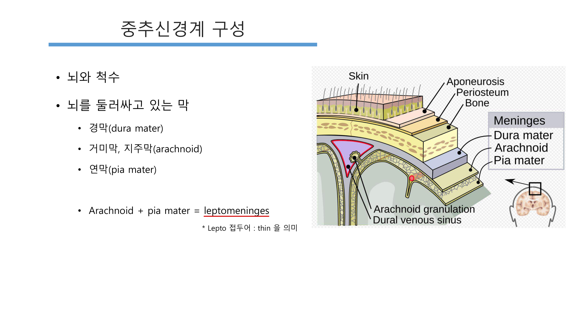
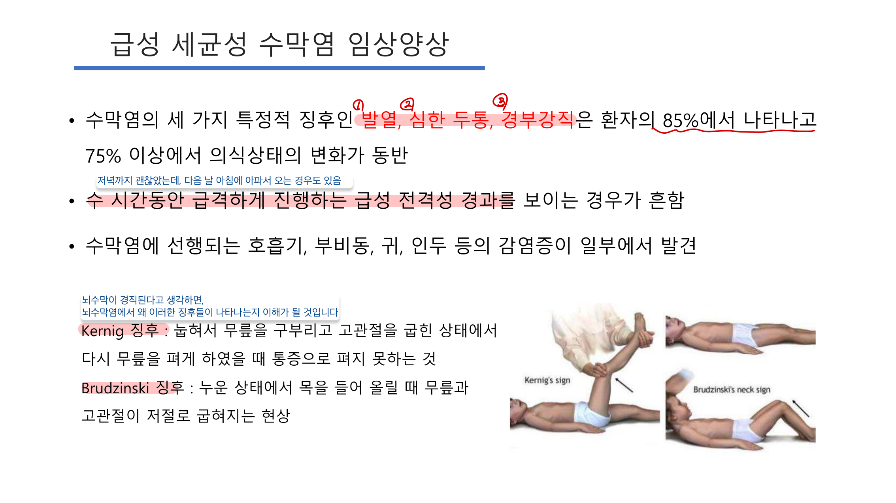
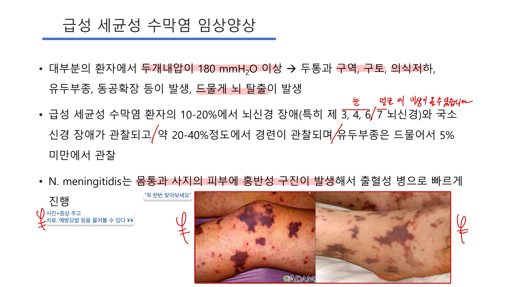
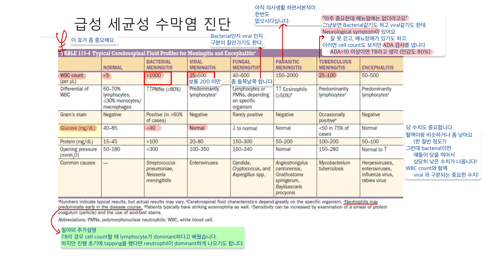
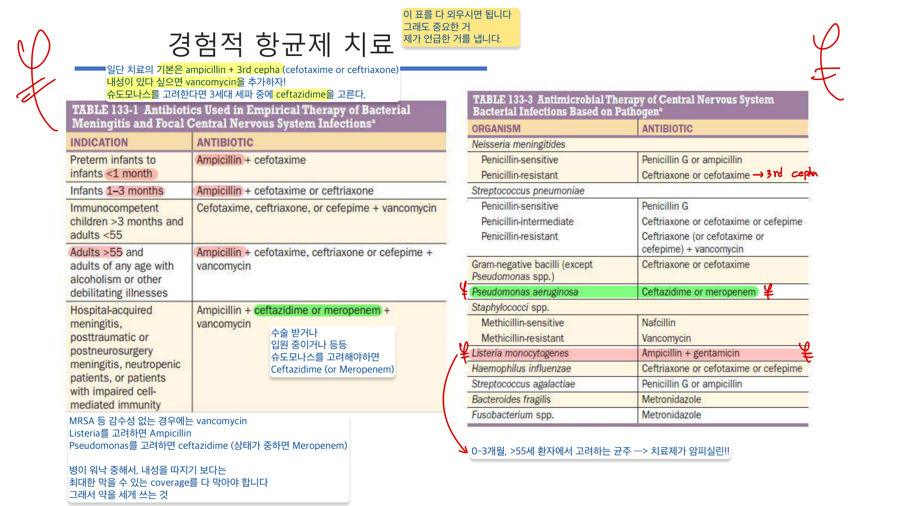
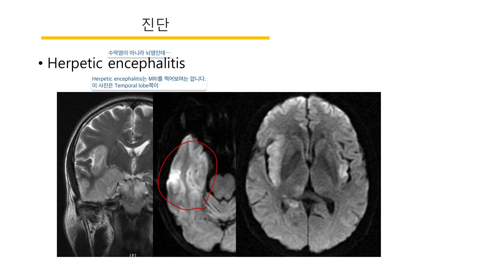
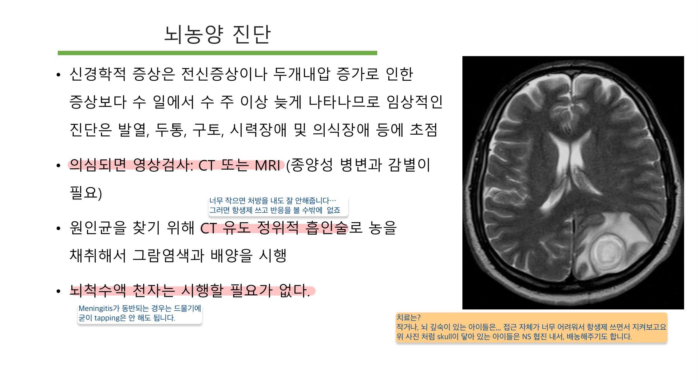

<!-- 필기본: 2025 -->
<!-- 단계: 수업 전 -->

# 0. 이 수업을 공부하는 법

경북대병원 감염내과 **황소윤 교수님** 수업("약이 복잡하다…"). 2021–24년은 김윤정 교수님 출제.

학습성과
1. 중추신경계 감염병의 **주된 질환과 주요 원인균**
2. 중추신경계 감염병의 **감별진단과 진단법**
3. 중추신경계 감염병의 **치료와 예후**

목차: 중추신경계 구성 → 중추신경계 감염의 특징 → **급성 세균성 수막염** → 바이러스성 수막염 → 뇌농양

- 기출 23문항(2020–2025). 가장 많은 유형은 **"CSF 수치 + 환자 나이·기저질환 → 경험적 항생제"**.
    - 50세 이상·알코올 간경변·조절 안 되는 당뇨(면역저하) → **ceftriaxone + vancomycin + ampicillin**(*Listeria*)
    - 신경외과 수술(shunt) 후 → **ampicillin + ceftazidime + vancomycin**(녹농균)
    - 림프구 100%·당 정상 + 성기 수포 → **acyclovir**(HSV 수막염)
- 그 밖에: **기숙사 + 점상출혈 → 수막알균**, 국내 성인 지역사회 원인 1위 **폐렴구균**, CSF에서 세균성으로 보기 어려운 소견 = **림프구 우세**, 뇌농양에 **요추천자 X**, 응급실 순서(혈액배양 → 스테로이드 → 항생제 → CT → 요추천자).
- 2021·2022년 미생물학 문항(*Listeria* 발병기전 LLO·ActA, 프리온, 크립토코쿠스)도 이 수업으로 분류되어 있다.

!!! key "핵심"
    **세균성 수막염은 응급** — 도착 **60분 이내 항균제**. 의심되면 검사를 기다리지 말고 **혈액배양 → dexamethasone(항균제 직전·동시) → 경험적 항균제**, 영상이 필요하면 그 뒤에 CT/MRI → 요추천자.
    **경험적 항생제 = 3세대 세파(ceftriaxone/cefotaxime) + vancomycin** 기본, **<3개월·>50–55세·면역저하·알코올 → ampicillin 추가**, **신경외과 수술 후 → ceftazidime(또는 meropenem) + vancomycin**.
    **CSF: 세균성 = 호중구↑(>1,000), 단백↑(>100), 당↓(<40) / 바이러스성 = 림프구, 당 정상 / 결핵 = 림프구, 당↓, ADA >10.**

# 1. 중추신경계 구성

{: style="width:56%"}

- 뇌와 척수, 그리고 뇌를 둘러싼 막: **경막(dura mater) – 거미막(arachnoid) – 연막(pia mater)**. 거미막 + 연막 = **연수막(leptomeninges)**(lepto = thin).
- **거미막밑공간(지주막하공간)**: 뇌척수액이 있다. 감염이 생기면 연수막 전체로 퍼져 **수막염**이 되고 **뇌실염(ventriculitis)** 으로 진행하기도 한다.
- **경막하농흉(subdural empyema)**: 경막과 거미막 사이의 화농성 감염, 국소 두개내 감염의 13–20%로 쉽게 진행할 수 있다.

# 2. 중추신경계 감염의 특징

| 진단 | 증상·징후 |
|---|---|
| **수막염** | 발열, 두통, 목·등 통증, **수막자극증(meningism)**, 오심·구토, **Kernig·Brudzinski 징후**, 광공포증, 기면·혼수, 경련 |
| **뇌염** | 발열, 구토, **정신 변화**, **국소 신경 결손**, 혼미·혼수, 경련, **EEG 변화** |

- **수막자극증**: **목의 뻣뻣함(경부강직), 광공포증, 두통** 세 가지 — 수막염, 지주막하출혈 등. 수막염의 주요 증상은 발열·두통 + nuchal rigidity.
- 뇌염은 두통을 호소하지 못하고 **mental change**로 오며 경련이 동반되기도 한다 → 일단 **EEG와 MRI**.
- 중추신경계는 두피·두개골·수막·**혈액뇌장벽(BBB)** 이 막지만, 일단 균이 들어오면 **보체와 면역글로불린이 적은 국소적 면역결핍 상태**라 **매우 빠르게 진행**한다.
- 증상은 균의 독력, 감염 부위, 발병 기전에 좌우된다.
- 경과: **세균·바이러스 → 급성**, **결핵균·진균 → 아급성**, **매독균 → 만성**.
- 사망률이 높고 영구 신경 후유증을 남길 수 있어 **시간을 다투는 응급질환**.

# 3. 급성 세균성 수막염

## 개요
- 거미막밑공간에 세균이 침입한 **급성 화농성 염증**. 두개내압 상승, 의식 저하, 경련 → 항균제가 늦으면 치명적.
- **병원 도착 후 60분 이내 항균제 시작**을 권고 — 투여 시기와 예후가 밀접하다. "응급실에서 초기에 적절한 항균제를 얼마나 빠르게 줬느냐가 예후와 밀접합니다."

## 원인균 — 나이와 위험인자별 ("아 이걸 다 외워야 된다니…")
| 나이 | 원인균 | 비고 |
|---|---|---|
| **0–4주** | ***S. agalactiae*(GBS), *E. coli*, *L. monocytogenes***, *S. pneumoniae* | 산도를 통한 수직감염(질·장내 세균) |
| **1–3개월** | *E. coli*, *H. influenzae*, ***L. monocytogenes***, *N. meningitidis*, GBS, *S. pneumoniae* | |
| **3개월–18세** | ***H. influenzae*, *N. meningitidis*, *S. pneumoniae*** | 예방접종 덕에 원인균이 줄었다. CSF 누출·중이염·부비동염 → CNS로 |
| **18–55세** | ***S. pneumoniae*(30–60%)**, ***N. meningitidis*(10–35%)** | 수막알균 = **군대·기숙사** 같은 집단생활(전염성이 높음) |
| **>55세** | ***S. pneumoniae*, *L. monocytogenes***, 그람음성 막대균 | **알코올 간경변 등 면역저하·당뇨면 반드시 *Listeria* 고려** |
| 나이 무관 | 장내세균, ***S. aureus***, *Propionibacterium acnes*(*Cutibacterium*) | **신경외과 수술**, 병원 획득, CSF 누출, 심내막염, 피부 동 |

- ***Listeria***: 원래 임산부·신생아의 균이었는데 최근 **면역저하자**에서 증가. **치료제는 ampicillin.**
- 병력 청취에서 **부비동염, 중이염, 치과 치료** 이력을 묻는다.

## 역학
- 화농성 CNS 감염 중 **가장 흔한 질환**. 미국 연간 10만 명당 2.5례 이상: *S. pneumoniae* ~50%, *N. meningitidis* ~25%, GBS ~15%, *L. monocytogenes* ~10%, Hib <10%.
- **국내 성인 지역사회 획득**: ***S. pneumoniae*(가장 흔함)**, *S. aureus*, *K. pneumoniae*, *L. monocytogenes*.
- **국내 성인 병원 획득**: **그람음성 막대균**, *S. aureus*, CoNS, *S. pneumoniae* — 수술이 원인인 경우가 많다.
- 백신 도입으로 역학이 변했다(예: 수막알균 → 군대 백신). 교수님은 2–3달에 한 명 정도 환자를 본다.

!!! exam "기출 포인트"
    5번: 국내 성인 지역사회 획득 세균성 수막염의 가장 흔한 원인 → ***S. pneumoniae***. 8번: 가장 가능성이 **낮은** 것 → ***P. aeruginosa***(폐렴구균·*S. aureus*·*Klebsiella*·*Listeria*는 국내 원인 목록에 있음). 22번: 심장이식 10일 후 수막염, 그람양성·catalase(+)·약한 β용혈, penicillin·ampicillin에 호전 → ***Listeria monocytogenes***.

## 발병 기전
1. *S. pneumoniae*·*N. meningitidis* 등이 **비인두 상피에 집락**
2. **점막 장벽 통과** → 혈액 침투, **다당류 피막** 덕에 호중구 포식·보체 살균에 저항하며 혈액에서 증식
3. **뇌실 맥락막총(choroid plexus)** 의 상피세포를 통해 **뇌척수액으로 침입**
4. CSF에는 백혈구·보체·면역글로불린이 적어 **옵소닌화가 안 됨** → 세균 증식
5. 세균의 LPS·펩티도글리칸 → 사이토카인 → 염증
- 교수님은 ① 점막을 통해 직접 넘어가는 경로 ② 혈액을 통해 넘어가는 경로 두 가지로 설명하셨고, 혈액에서 증식해 CSF로 넘어간 경우는 사망률이 50%에 가까울 정도로 독하게 진행한다고 하셨다.

### 신경 손상은 숙주 면역반응 때문 (독소 X)
- 그람음성균 **LPS**, 폐렴구균 **펩티도글리칸** → **TNF, IL-1** → CSF 단백·백혈구 증가, 수막 염증.
- TNF·IL-1 → **BBB 투과성 증가** → 혈관성 부종, 혈청 단백이 거미막밑공간으로 누출.
- 거미막밑 삼출물이 CSF 흐름을 막고 거미막과립의 흡수를 줄임 → 간질 부종, **교통성·폐쇄성 수두증**.
- 호중구 탈과립 독성 대사물 → 세포독성 부종·괴사.
- **두개내압 상승** → 혼수. 혈관염 → 뇌저 동맥 협착·허혈·경색, 중대뇌동맥 가지 폐쇄, 정맥굴 혈전증, 피질 정맥 혈전정맥염.

## 임상 양상
- **발열, 심한 두통, 경부강직**(세 가지 특징)이 **85%**, **75% 이상에서 의식 변화**.
- **수 시간 만에 급격히 진행**하는 전격성 경과가 흔하다(저녁까지 괜찮다가 다음 날 아침 아파서 온다).
- 일부는 선행 호흡기·부비동·귀·인두 감염.

{: style="width:62%"}

- **Kernig 징후**: 눕혀서 고관절·무릎을 굽힌 상태에서 무릎을 펴게 하면 통증으로 못 편다.
- **Brudzinski 징후**: 누운 상태에서 목을 들면 무릎과 고관절이 저절로 굽혀진다.
- 뇌수막이 경직된다고 생각하면 이해가 된다.
- 대부분 **두개내압 180 mmH2O 이상** → 두통, 구역·구토, 의식저하, 유두부종, 동공확장, 드물게 뇌탈출.
- **10–20%에서 뇌신경 장애**(특히 **3, 4, 6, 7번** — 눈·얼굴) 와 국소 신경 장애, **20–40%에서 경련**, **유두부종은 드물어 5% 미만**.
- ***N. meningitidis***: 몸통·사지에 **홍반성 구진 → 빠르게 출혈성(점상출혈·자반)** 으로. "꼭 한번 찾아보세요" — 사진 + 증상을 주고 **치료·예방요법**을 물을 수 있다.

{: style="width:52%"}

!!! exam "기출 포인트"
    1번(2025): **기숙사** 21세 남자, 고열·두통·경부강직·**점상출혈 발진** → ***N. meningitidis***. 18번: 하루 만에 사망한 30세 여자의 피부(자반) — 임신 3개월 간호사에게 줄 예방약 → **ceftriaxone**(임신부는 rifampin·ciprofloxacin을 피함. 필기에는 임산부 azithromycin도 있다).

## 진단
- 세균성 수막염이 의심되면 **진단 검사 때문에 치료가 지연되면 안 된다** → 바로 **혈액배양 + 요추천자**, 지체 없이 **경험적 항생제 + 보조 dexamethasone**(염증반응을 줄여 조직 손상을 줄임).
- 확진: **요추천자**로 두개내압을 재고 CSF의 **당, 호중구·림프구 수, 유산염** 등을 측정 → 세균성 추정, 바이러스성·결핵성과 감별.

### CSF 소견 — "이 표가 좀 중요해요"

{: style="width:80%"}

| | 정상 | **세균성** | **바이러스성** | 진균 | **결핵** |
|---|---|---|---|---|---|
| WBC(/μL) | <5 | **>1,000** | **25–500** (보통 200 미만) | 40–600 | 25–100 |
| 우세 세포 | 림프구 | **호중구(PMN)** | **림프구** | 림프구 | **림프구**(초기엔 호중구일 수도) |
| 그람염색 | 음성 | 양성(>60%) | 음성 | 드묾 | 가끔 |
| **당(mg/dL)** | 40–85 | **<40** | **정상** | 정상–↓ | **<50 (75%)** |
| 단백(mg/dL) | 15–45 | **>100** | 20–80 | 150–300 | 100–200 |
| 압력(mmH2O) | 50–180 | **>300** | 100–350 | 160–340 | 150–280 |

- **당 수치가 중요**: 정상 CSF 당은 혈당과 비슷하거나 절반 정도. **세균이 당을 먹어 상당히 낮아진다** → WBC와 함께 바이러스성과 구분되는 핵심.
- **결핵성 수막염** — "아주 중요한데 메뉴얼에는 없더라고요." 세균성인지 바이러스성인지 애매한데 **신경학적 증상**(잘 못 걷고, 배뇨장애)이 있으면 cell count와 함께 **ADA**를 낸다 — **ADA >10이면 결핵**(민감도 80%). 초기에 천자하면 호중구 우세로 나오기도 한다.
- CSF **호산구 증가** → **기생충**(개회충증 toxocariasis, 낭미충증 cysticercosis), 림프종, 드물게 아스페르길루스 같은 진균. 교수님도 1년에 1번 정도 보는 드문 경우(대개 면역저하자).
- 수막주위 감염, 세균성 심내막염, CNS 유육종, 암세포 누출도 세균성과 비슷한 CSF → 감별.
- CSF만으로는 원인균이 명확하지 않다 → **그람염색(60%), 배양(80%)**, 라텍스응집, **PCR**(특히 **이미 항균제를 맞은 환자**에서 유용). cell count·당이 애매했는데 나중에 배양에서 나오기도 하므로 **배양을 같이** 낸다.
- **Multiplex PCR**(BioFire ME 패널, 1시간 30분): 세균(*E. coli* K1, Hib, *Listeria*, 수막알균, GBS, 폐렴구균), 바이러스(CMV, 엔테로, HSV-1·2, HHV-6, 파레코, VZV), 효모(*Cryptococcus*). 매우 민감·특이하지만 위양성·위음성이 있고, 모든 원인을 찾지 못하며 **감수성 정보가 없다** → **표준 배양과 함께** 사용.

!!! exam "기출 포인트"
    4번: CSF에서 세균성 수막염을 의심하기 **가장 어려운** 소견 → **림프구 우세**. 그람염색 양성, WBC >1,000, 단백 >100, 당 <40은 모두 세균성 소견.

### 요추천자 전에 뇌 영상(CT/MRI)을 먼저 하는 경우
- **면역억제**, **최근 1주 이내 경련**, **의식 수준 저하**, **국소신경증상**, **유두부종**, 신경학적 질환 기왕력(종양·뇌졸중·뇌농양), 경험적 치료 72시간 후에도 지속되는 발열, 천자 부위의 국소 감염 징후.
- 뇌압이 많이 높거나 종괴가 있는데 천자하면 **뇌탈출(brain herniation)**.
- **MRI 적응증**: 두부외상·신경외과 수술·CSF 누출 관련 재발성 수막염, 뇌허혈·경색, 정맥동 혈전증, 뇌농양·경막하축농, 뇌실염·수두증 평가.
- **영상 때문에 요추천자가 늦어지면 혈액배양 후 바로 항생제.** 요추천자 **6시간 전** 투여한 항생제는 CSF 백혈구·당·그람염색·PCR에 의미 있는 영향을 주지 않는다. 경대병원은 **항생제 주고 → MRI → 천자**가 루틴.

!!! exam "기출 포인트"
    21번: 71세 의식저하·발열, 수막염 의심 — 응급실 순서 → **혈액배양 → 스테로이드 → 항생제 → 뇌 CT → 요추천자**. 20번: 축농증이 있던 45세, CSF WBC 10,500(PMN 98%)·당 24 → **ceftriaxone + vancomycin + rifampin 병합**(정답). 오답 — "가장 먼저 Brain MR"(CT가 정상이었음), "항생제 먼저, 그다음 dexamethasone"(dexamethasone은 항생제 **직전·동시**), acyclovir, amphotericin B.

## 치료

### 일반 원칙
- 응급 → 도착 후 혈액배양(가능하면 CSF 검사)을 신속히 하고 **1시간 이내 경험적 항생제**.
- 검사 결과를 기다리지 말고 나이·기저질환으로 원인균을 추정해 **즉시** 투여.
- ***N. meningitidis* 의심 → 격리**(전염성이 높다, 비말주의).
- 두개내압 상승 의심(유두부종 등) → **만니톨이나 스테로이드** 고려. **머리를 30–45도** 올리고, 삽관 후 **과호흡으로 PaCO2 25–30 mmHg**(CO2가 낮아지면 뇌혈류가 줄어 두개내압 하강).
- 항균제 **7일이 지나도 고열** → 정맥염, 뇌농양, 경막하축농, 뇌실염, 폐쇄성 수두증 등 **합병증 검사**.
- CSF 재검사: 잘 반응하면 일반적으로 하지 않는다. **적절한 항균제 48–72시간 후에도 반응이 없으면** 다시 한다. 항균제를 끊으려고 다시 할 필요는 없다.

### 경험적 항균제
- **BBB를 잘 통과**하는 약을 **정맥으로, 최대량**.
    - **1세대·대부분의 2세대 세팔로스포린, clindamycin, aminoglycoside는 BBB를 못 통과 → 수막염에 쓰지 않는다.**
    - 3세대 세파·vancomycin은 원래 잘 못 통과하지만 염증으로 BBB가 헐거워지면 잘 들어간다. rifampin 같은 지용성 약은 정상 BBB도 통과.
- 가장 흔한 원인인 ***S. pneumoniae*에 듣는 약**을 기본으로.
- 배양·감수성 결과가 나오면 **좁은 범위로 조절**.

{: style="width:82%"}

| 대상 | 경험적 항균제 |
|---|---|
| 1개월 미만 | **ampicillin + cefotaxime** |
| 1–3개월 | **ampicillin + cefotaxime 또는 ceftriaxone** |
| 면역 정상 3개월–55세 | **ceftriaxone(또는 cefotaxime·cefepime) + vancomycin** |
| **>55세**, 또는 **알코올중독·쇠약 질환**이 있는 모든 나이 | **ampicillin + ceftriaxone(cefotaxime·cefepime) + vancomycin** |
| **병원 획득·외상 후·신경외과 수술 후**, 호중구감소, 세포면역 저하 | **ampicillin + ceftazidime 또는 meropenem + vancomycin** |

- 교수님 정리 — "이 표를 다 외우시면 됩니다. 그래도 중요한 거, 제가 언급한 거를 냅니다."
    - **기본 = ampicillin + 3세대 세파(cefotaxime/ceftriaxone)**
    - **내성(MRSA·내성 폐렴구균)이 있다 싶으면 vancomycin 추가**
    - ***Listeria* 고려(0–3개월, >55세, 면역저하) → ampicillin**
    - **녹농균 고려(수술·입원 중) → 3세대 중 ceftazidime**(상태가 중하면 meropenem)
    - 병이 워낙 중해서 내성을 따지기보다 막을 수 있는 커버리지를 다 막는다 — 그래서 약을 세게 쓴다.
- 균별: 수막알균 — penicillin G·ampicillin(감수성) 또는 ceftriaxone / 폐렴구균 — 감수성에 따라 penicillin, 3세대 세파, + vancomycin / ***Listeria* — ampicillin + gentamicin** / 녹농균 — ceftazidime·cefepime·meropenem / 포도알균 — nafcillin(MSSA), vancomycin(MRSA) / *Bacteroides*·*Fusobacterium* — metronidazole.
- **치료 기간**: *S. pneumoniae* **7–14일**, *S. agalactiae* 14–21일, ***L. monocytogenes* 21일**, ***N. meningitidis* 7일**, Hib 7일, **그람음성 막대균 21–28일**.

!!! exam "기출 포인트"
    경험적 항생제 사례는 매년 나온다.
    - **65세·70세**(기저질환 없음/고혈압) → **ceftriaxone + vancomycin + ampicillin**(3·14번)
    - **알코올 간경변 45세** → **ceftriaxone + vancomycin + ampicillin**(10번)
    - **조절 안 되는 당뇨 60세** → **ampicillin + ceftriaxone + vancomycin**(2번, 2025)
    - **뇌실 단락술(shunt) 후 신경외과 입원 중** → **ampicillin + ceftazidime + vancomycin**(7번)
    - 함정: ceftriaxone + vancomycin만(ampicillin 빠짐), ceftriaxone + metronidazole(뇌농양 조합), ceftazidime(지역사회엔 X), clindamycin·azithromycin 조합.

### 스테로이드 보조요법
- 청각·신경학적 **후유증을 줄인다**는 연구로 미국·유럽 지침에서 권장.
- 국내: **첫 항균제 투여 전 또는 동시**에 **dexamethasone 10 mg 6시간마다 4–5일 IV**.
- **이미 항균제를 투여받은 환자에서는 권장하지 않는다.**
- ***S. pneumoniae*·*H. influenzae* 이외의 균**이면 권고하지 않는다.

## 예후
- 치명률: ***S. pneumoniae* 20%**, *L. monocytogenes* 15%, Hib·수막알균 3–7%.
- 높은 사망률 인자: **50세 이상, 입원 시 의식 저하, 쇼크, 뇌압 상승, 기계호흡, 입원 24시간 내 경련, 치료 지연**.
- 생존자의 **25%에 중등도 이상 후유증**: 지적기능 감소, 기억력 장애, 경련, **청력 소실**, 어지럼증, 보행 장애.

## 격리와 접촉자 예방 (*N. meningitidis*)
- 수막알균 수막염이 의심되면 **증상 발생 전 7일 이내** 접촉한 **가족·긴밀한 접촉자·호흡기 분비물에 노출된 의료인**에게 **화학예방**.
    - 환자 확인 후 **24시간 이내**가 좋고, **14일 초과**는 권고하지 않는다.
    - **rifampin 600 mg 하루 2회 2일**, **ciprofloxacin 500 mg 경구 1회**, 또는 **ceftriaxone 250 mg 근주 1회**. **임산부는 azithromycin 500 mg 경구 1회**(교과서상 임신부에는 ceftriaxone도 사용).
- 위험군(**보체결핍, 비장기능저하**)에게는 **백신**.

# 4. 바이러스성 수막염
- 원인: 흔한 것 — **엔테로바이러스(콕사키·에코)**, **VZV**, **HSV-2**, EBV, 아르보바이러스, HIV. 덜 흔한 것 — HSV-1, HHV-6, CMV, LCMV, 볼거리, 지카.
- **성인은 소아보다 HSV가 많고**, 특히 **재발성 무균성 수막염**이면 HSV 가능성. → **Mollaret 수막염**: 1년에 2번 정도 두통이 엄청 심하고 열이 나다 2–3일이면 괜찮아짐, 올 때마다 천자하면 바이러스성. 치료는 수액, 또는 acyclovir.
- 임상: 발열·두통·수막자극징후 + 무력감·근육통·오심·구토·설사. **의식 저하는 대부분 경미** — 세균성보다 경하다. **심한 의식 저하·경련·국소 신경 증상**이 있으면 **뇌염** 등을 의심.
- 진단: CSF **림프구성 백혈구 증가(25–500)**, 단백 정상–약간 상승(20–80), **당 정상**, 두개내압 약간 상승(100–350). CSF 바이러스 배양·**PCR**. 장바이러스는 **대변·인두 스왑**도 함께. 부분 치료된 세균성 수막염, 수막주위 감염, 종양성·비감염성 염증성 수막염과 감별.
- **HSV 뇌염**은 수막염이 아니라 뇌염 — **MRI**에서 **측두엽** 병변으로 안다.

{: style="width:56%"}

- 치료: **대증요법**, 두통에 진통제(요추천자 후 두통이 줄기도). **HSV·EBV·VZV면 acyclovir.** 수일 뒤에도 호전이 없고 초기 진단이 의심되면 **요추천자 반복**(결핵성 수막염 등일 수 있음).
- 예후: 대개 **7일 이내** 경미한 경과로 **자연 치유**. 드물게 두통·경한 정신장애·무력증이 수 주–수 개월.

!!! exam "기출 포인트"
    6번: 젊은 여자, 두통·메스꺼움 + **성기 주위 수포**, CSF WBC 39(**림프구 100%**), 단백·당 정상 → **acyclovir**(HSV-2 수막염). 11번은 같은 CSF에 목 주위 피부 병변 + multiplex PCR에서 **VZV 검출** → 역시 **acyclovir**. 19번: HIV 양성, 1달 두통, CSF 림프구·당 저하, **잉크(India ink) 도말**에서 피막 효모 → ***Cryptococcus neoformans***.

# 5. 뇌농양
- 정의: **뇌실질 내 국소 화농성 염증**, 혈관이 잘 발달한 **피막**으로 둘러싸임.
- 세균성 수막염 뒤 2차로 생기는 경우는 **드물다**. 대부분 **단독**, 혈행성이면 **다발성**.

## 원인균
- **면역 정상**: ***Streptococcus***, *E. coli*, *K. pneumoniae*, **혐기균(*Bacteroides*, *Clostridium*, *Fusobacterium*)**, *Staphylococcus*, 결핵균.
- **면역 저하**: ***Actinomyces*, *Listeria*, *Nocardia*, 진균(*Aspergillus*, *Candida*)**.

## 발병 기전
- **인접 부위에서 파급**: **부비동염, 중이염, 유양돌기염, 치아 감염**, 두부 손상·신경외과 시술 후.
- **혈행성**: 멀리 떨어진 감염(**감염성 심내막염**, 폐농양, 골수염, 편도농양) → 다발성.
- **20–30%는 1차 병소를 알 수 없다.**

## 임상
- 증상은 감염 자체보다 **좁은 두개 내에서 농양이 누르는 것** 때문.
- 감염 증상: **발열은 50%뿐** — 높지 않거나 없을 수 있다.
- 두개내압: **두통 75% 이상**(편측이 많음), 진행하면 **구토(50%)**·의식장애, 유두부종 25%.
- 뇌조직 파괴: 신경학적 증상 약 50%, 부위에 따라 다름(뇌간·소뇌 → 뇌신경마비, 보행장애). 경련 15–25%.

## 진단

{: style="width:54%"}

- 신경학적 증상은 수일–수주 늦게 나타나므로 **발열, 두통, 구토, 시력장애, 의식장애**에 초점.
- 의심되면 **CT 또는 MRI**(종양성 병변과 감별).
- 원인균: **CT 유도 정위적 흡인술**로 농을 채취해 그람염색·배양.
- **뇌척수액 천자는 할 필요가 없다**(수막염 동반이 드물고, 뇌압 상승 시 위험).

## 치료
1. **항균제**: 기저 질환·원발 병소로 결정.
    - 주로 **3세대 cephalosporin(cefotaxime/ceftriaxone) + metronidazole**.
    - **혈행성 다발성 농양·두부 손상 후** → 포도알균 대비 **nafcillin 또는 vancomycin 추가**.
    - **신경외과 시술 후** → **vancomycin + ceftazidime**(포도알균 + 녹농균).
    - 배양 결과로 조절. 배양 음성이면 반응을 보이는 항생제를 계속.
    - **최소 6–8주 주사제.**
    - 큰 농양은 항생제만으로 부족 → 항생제 단독은 **작거나(<2–3 cm) 외과적 배농이 불가능할 때만**.
2. **수술**: **CT 유도 정위적 흡인·배농**은 진단과 치료 모두에 유용. 개두술·두개골 절제로 완전 절제하기도. 뇌 깊숙이 있거나 작으면 접근이 어려워 항생제로 지켜보고, 두개골에 닿아 있으면 신경외과 협진으로 배농.
3. **스테로이드**: **루틴으로 주지 않는다**(숙주 면역을 갉아먹음). 농양 주위 부종·종괴 효과·두개내압 상승이 의심되면 **dexamethasone 10 mg 6시간마다** 고려하고 최대한 빨리 감량.

## 예후
- 대다수 성공적으로 치료, **사망률 15% 이하**. 경련·신경학적 증상·정신장애 등 합병증 약 20%.

!!! exam "기출 포인트"
    15번: 65세, 2주 발열·두통·구토 + MRI(뇌농양) — **잘못된** 것 → "**뇌척수액 천자로 원인균 확인**". 부비동염·중이염 파급, 뇌압 상승에 dexamethasone, 3세대 세파 + metronidazole, 6–8주 주사는 맞다. 9번: 뇌농양 치료에 사용이 가장 어려운 약 → **cefazolin**(1세대, BBB 통과 X).

# 6. 미생물학 보충 (2021–22 기출)
- ***Listeria monocytogenes***: 냉장 보관 음식으로도 감염(저온에서 증식), 신생아·노인·임산부·세포면역결핍자. **internalin A**로 부착 → 포식용해소체에서 **LLO(listeriolysin O)** 와 phospholipase C가 막을 녹여 세포질로 탈출 → **ActA**가 **actin 재배열**을 유도해 옆 세포로 이동 → 장점막 통과 → 혈액 → 간·비장 → **뇌·태반**(12·16번).
- **프리온**: 핵산이 없고 **면역반응을 일으키지 않으며**, 긴 잠복기 후 아급성 해면상 뇌병증(신경세포 공포화). 정상 PrPc가 PrPsc와 상호작용해 PrPsc로 전환·축적. 사람 PrP 유전자는 **20번 염색체**. **protease K 저항성**을 western blot으로 확인(13·17·23번).

!!! memo "암기"
    **나이별**: 신생아 GBS·*E. coli*·*Listeria* / 소아 Hib·수막알균·폐렴구균 / 성인 **폐렴구균**·수막알균 / **>55세·알코올·면역저하 + Listeria** / 수술 후 그람음성·*S. aureus* · **경험적**: 3세대 세파 + vanco (+ **ampicillin** for Listeria, **ceftazidime/meropenem** for 녹농균) · **dexamethasone 10 mg q6h 4일, 첫 항생제 전·동시**(폐렴구균·Hib만) · **CSF 세균성**: >1,000 PMN, 단백 >100, 당 <40 · **ADA >10 결핵** · 영상 먼저: 면역억제·1주 내 경련·의식저하·국소증상·유두부종 · 수막알균 접촉자 rifampin 2일/cipro 1회/ceftriaxone 1회 · **뇌농양**: 3세대 세파 + metronidazole 6–8주, **천자 X**, <2–3 cm만 항생제 단독.
