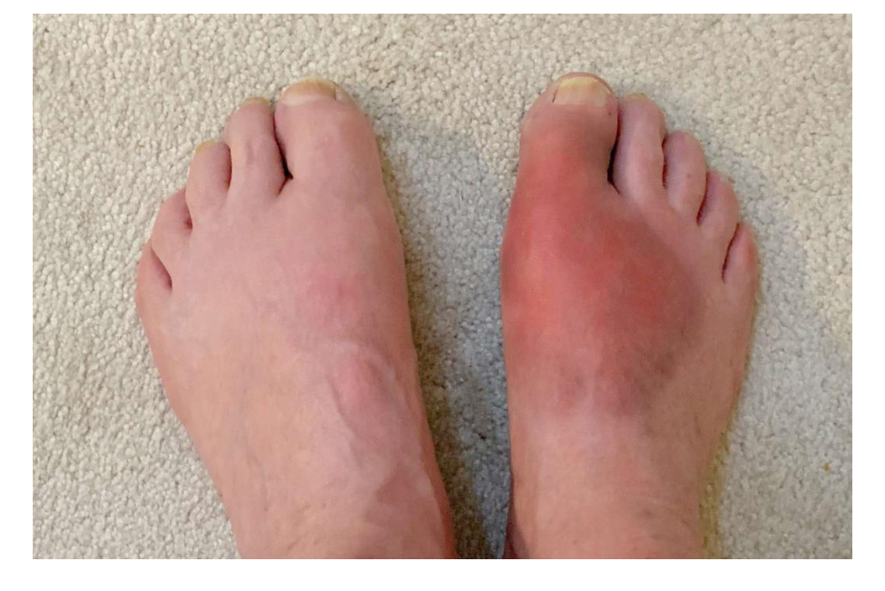
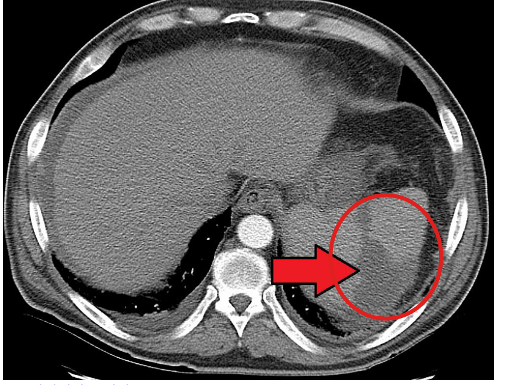
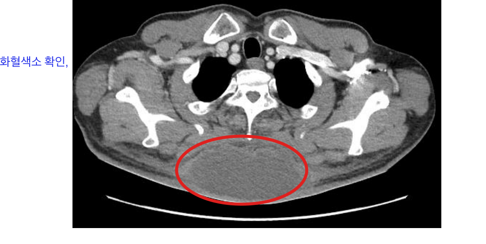

<!-- 필기본: 2025 -->
<!-- 단계: 수업 전 -->

# 0. 이 수업을 공부하는 법

CP-D는 **증례 토의** 시간이다(2025년 10월 20일, 장현하 교수님). 1조부터 10조까지 증례가 하나씩 주어지고, 학생마다 하나를 골라 A4 2장 이내 레포트를 LMS로 낸다. CP-D1(이 수업)이 1~5조, CP-D2가 6~10조 증례를 다룬다.

필기본은 교수님이 각 질문과 관련해 하신 말씀 위주로 적혀 있다. 이 정리도 증례마다 **문제 → 교수님 요점 → 정리**로 쓴다.

| 조 | 증례 | 생각할 것 |
|---|---|---|
| 1 | 신장이식 후 기침·발열 | 이식 후 시기별 감염, 부비동~폐 전체 |
| 2 | 2달 새 세균성 폐렴 2번 | 면역저하 평가 (Ig, T cell) |
| 3 | 발 연조직염인데 cefazolin에도 열 | 항생제 반응 시점, 통풍 감별 |
| 4 | 하루 한 번 열 + 비장 경색 | 말라리아, 심내막염 |
| 5 | 등의 10 cm 농양 | 당뇨 등 면역저하, 배농 |

기출은 1문항(2025년 82번)이다 — **원인불명 발열 + 비장 농양 → 가장 먼저 심장초음파**. 4조 증례와 같은 생각의 흐름이다.

!!! key "핵심"
    - 감염 증례는 언제나 **어디(부위) · 무엇(균) · 누구(숙주 면역)** 를 묻는다.
    - 항생제 효과는 바로 나오지 않는다 — 연조직염은 **5~7일**, 신우신염도 **약 5일**은 지나야 열이 떨어진다.
    - 그래도 안 떨어지면 ① 진단이 맞는가(감염이 아닌 병?) ② 합병증(농양·전이 감염)이 생겼나를 확인한다.
    - 비장 경색·농양 → **감염성 심내막염**(심장초음파·혈액배양)과 말라리아를 떠올린다.

# 1. 1조 — 신장이식 환자의 기침과 발열

> 55세 남자, 1주 전부터 기침·발열. 5년 전 당뇨병성 만성 신부전으로 **신장이식**. BP 130/80, HR 98, RR 22, **체온 38.9℃**.
> Q: 병력청취를 위한 질문, 조사할 병력, 필요한 신체검사와 추가 검사는?

교수님 요점

- 고형장기 이식(solid organ transplantation) 환자에서 **이식 6개월 이후**에 가장 잘 생기는 것은 일반인과 비슷한 **호흡기 세균·바이러스 감염**(폐렴, 기관지염)이다.
- 체온이 높다.
- "기침과 발열이 있다? **폐만 생각할 것이 아니라 sinus부터 폐까지** 모두 포함될 수 있다는 것을 알고 있을 것."
- 검사: **paranasal sinus X-ray, chest X-ray, CT, 혈액배양, 객담배양, RFT**(신기능), 항원검사(상기도 바이러스 감염 여부).

!!! memo "보충 정리 (교과서) — 병력청취"
    이식 시기(5년 → 후기), 면역억제제 종류·용량·최근 변경, 거부반응 치료(고용량 스테로이드) 여부, 예방약(TMP-SMX 등) 복용, 주변 호흡기 환자 접촉, 백신 접종, 이식신 기능(소변량·크레아티닌).

# 2. 2조 — 반복되는 세균성 폐렴과 면역 평가

> 55세 여자, 2달 전 우상엽 세균성 폐렴으로 1주 치료 후 퇴원. 1주 전부터 같은 증상으로 다시 와서 이번에는 **좌하엽** 세균성 폐렴 의심.
> Q: 면역상태 파악을 위해 필요한 병력청취와 검사는?

교수님 요점

- "55세의 건강한 사람이면 1년에 pneumonia가 1번 걸릴까 말까인데, 이 환자는 이미 **2달 사이에 2회** 감염 → **면역저하자**."
- 55세라 선천성은 아닐 가능성이 높지만, **immunoglobulin deficiency** 환자는 체액성 면역 외의 다른 면역체계는 잘 작동해서 늦게 발견될 수도 있다.
- 검사: **Ig level**, **T cell count**, 자가면역검사, **악성종양**이 있는지, 호흡계 **구조적 이상**(기관지확장증, 폐암에 의한 폐쇄 등)은 없는지 **CT**로 확인.

!!! memo "보충 정리 (교과서)"
    다른 엽에 반복 → 국소 원인(폐쇄)보다 **전신 면역저하** 쪽. 같은 엽에 반복이면 **구조적 이상**(종양·이물·기관지확장)을 먼저.
    병력: 당뇨·신부전·간경변, 스테로이드·항암제, HIV 위험, 음주·흡연, 비장 절제, 다른 부위 반복 감염(부비동염·중이염).

# 3. 3조 — 항생제를 써도 열이 날 때 (연조직염)

> 33세 남자, 이틀 전부터 발열·**우측 발 통증**. 연조직염 의심으로 **cefazolin 2 g q8h** 투여.
> Q1: 항생제 치료 **3일째** 38℃ 발열 지속 — 조치는? Q2: **7일째**에도 지속 — 조치는?

{: style="width:45%"}

교수님 요점

- 연조직염은 약을 쓰고 **호전되는 데 약 5~7일** 걸린다.
- **3일째**: 아직 약효가 나타나려면 좀 더 기다려야 한다.
- **7일째**: 병이 연조직염이 아닐 확률이 높다. "사진처럼 **엄지발가락만** 특징적으로 감염처럼 붉어지는 경우는 **통풍(gout)**."
- 이 증례에서 배울 것 두 가지:
    1. 병을 잘 **감별**할 수 있어야 한다.
    2. 항생제를 썼을 때 보통 증상이 **호전되기 시작하는 시기**를 알아 두어야 한다.

!!! memo "보충 정리 (교과서) — 7일째에도 열이 날 때 점검"
    진단이 맞나(통풍·혈전정맥염·약열) → 균이 맞나(MRSA 등 내성, 배양 재확인) → 합병증(농양·괴사근막염·골수염, 영상·배농) → 용량·경로가 맞나.

# 4. 4조 — 하루 한 번 열 + 비장 경색

> 23세 남자, 1주 전부터 발열·좌측 옆구리 통증. BP 130/80, **HR 68**, 체온 38.6℃. **열이 하루 한 번 정도** 나는데 열이 나면 너무 힘들고, 열이 안 나면 증상이 거의 없다. 복부 CT에서 **비장 경색**.
> Q: 병력청취 내용과 시행해야 할 검사는?

{: style="width:40%"}

교수님 요점

- 열이 났다가 증상이 없다가를 반복하는 양상 → **말라리아**의 대표적인 특징. 필기 메모: 말라리아로 인한 비장 병변.
- 병력청취 필수: **강원도나 경기도에 거주·방문**한 이력(파주·일산은 헌혈도 안 받는다).
- 비장 경색을 보고 감별해야 하는 질환: **감염성 심내막염**, 전이성 감염(metastatic infection) 등.
- 면역저하자는 아닌지 병력청취 후 판단, **candidiasis**는 아닌지 확인.
- 검사: CT, **심장초음파**, **혈액배양** 등. (말라리아라면 말초혈액 도말·신속항원검사.)

!!! exam "기출 포인트"
    2025년 82번: 72세, 1달간 매일 38℃ 이상 원인불명 발열, CT에서 **비장 농양** → 치료를 위해 가장 먼저 할 검사 = **심장초음파**. 비장 농양·경색의 흔한 원인이 심내막염의 색전이고, 그 결과가 항생제 기간과 수술 여부를 정한다.

# 5. 5조 — 등에 생긴 10 cm 농양

> 54세 남자, 1주 전부터 등이 아프고 열이 난다. 타병원 흉부 CT에서 **등에 10 cm 농양** 의심으로 의뢰.
> Q: 필요한 병력청취와 검사, 치료는?

{: style="width:42%"}

교수님 요점

- 일반 사람에게 농양이 저 정도로 크게 오지 않는다 → **면역이 저하된 환자**일 가능성이 높다. "우리나라에서 면역력을 가장 잘 떨어뜨리는 것이 **당뇨병**."
- 검사: 다른 기저질환이 없는지, **수술 후 감염**은 아닌지, 혈액검사, **혈당·당화혈색소**, 자가면역질환.
- 치료: **수술 또는 PCD**(경피적 배액)로 **배농**이 필요하다. (농양은 항생제만으로는 잘 낫지 않는다.)

# 암기 — CP-D1 요점

| 조 | 한 줄 요점 |
|---|---|
| 1 | 이식 6개월 이후 → 일반 호흡기 감염. 기침·발열이면 **부비동부터 폐까지** |
| 2 | 2달에 폐렴 2번 → 면역저하: **Ig, T cell**, 자가면역, 악성종양, CT로 구조 이상 |
| 3 | 연조직염 호전 **5~7일**. 3일째는 기다림, 7일째는 진단 재검토(엄지발가락 → **통풍**) |
| 4 | 하루 한 번 열 → **말라리아**(강원·경기 방문력). 비장 경색 → **심내막염**: 심장초음파·혈액배양 |
| 5 | 큰 농양 → 면역저하(**당뇨**) 확인, **배농**(수술·PCD) |
