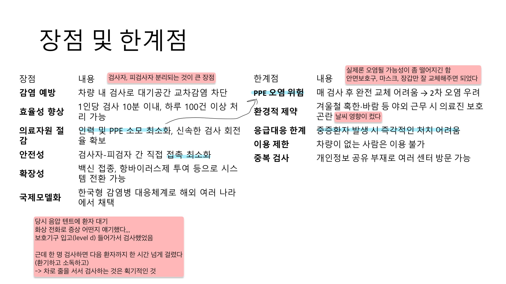
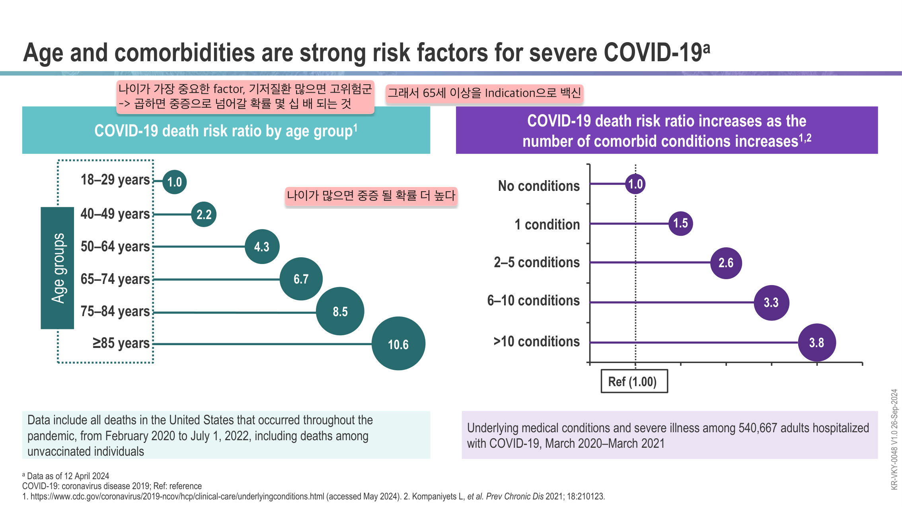
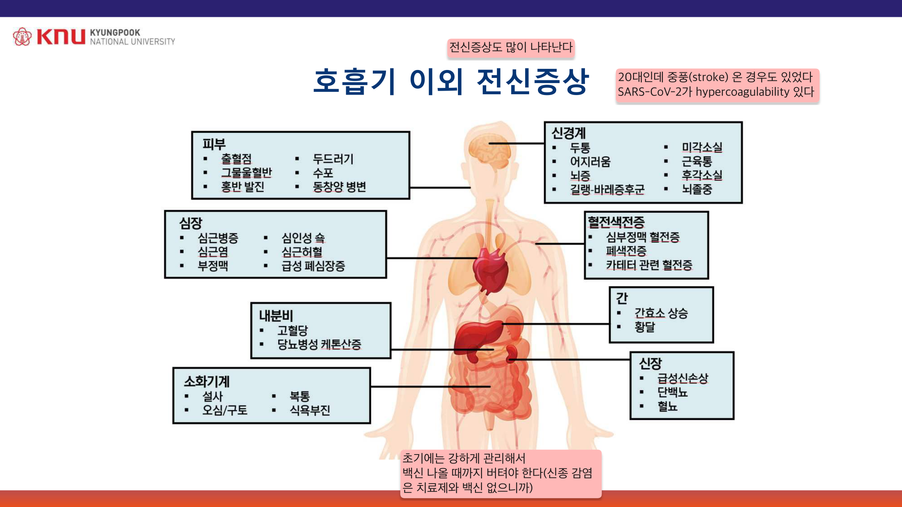
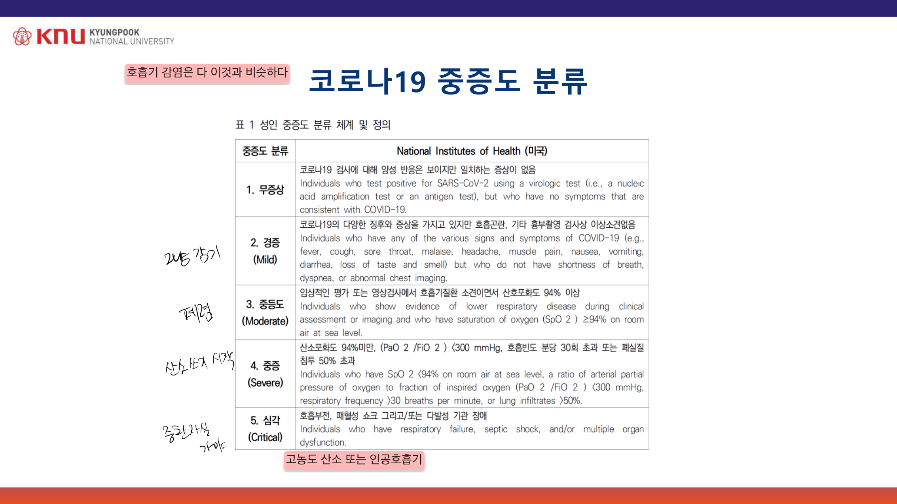
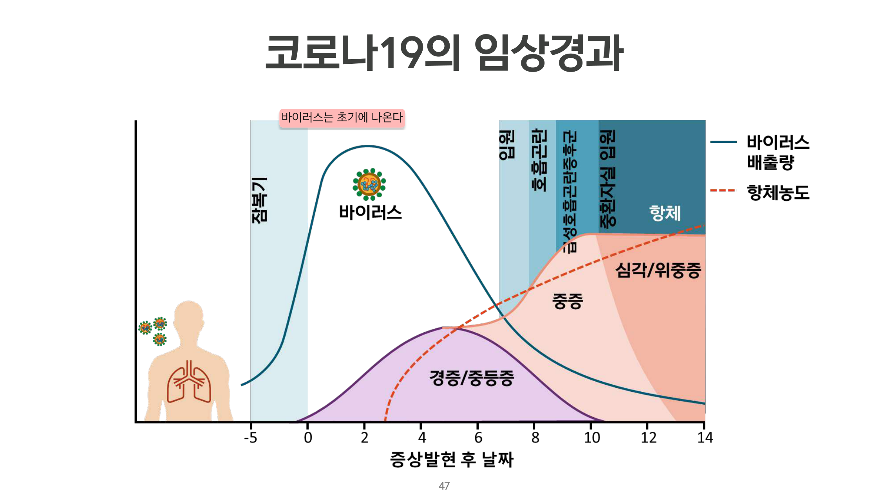
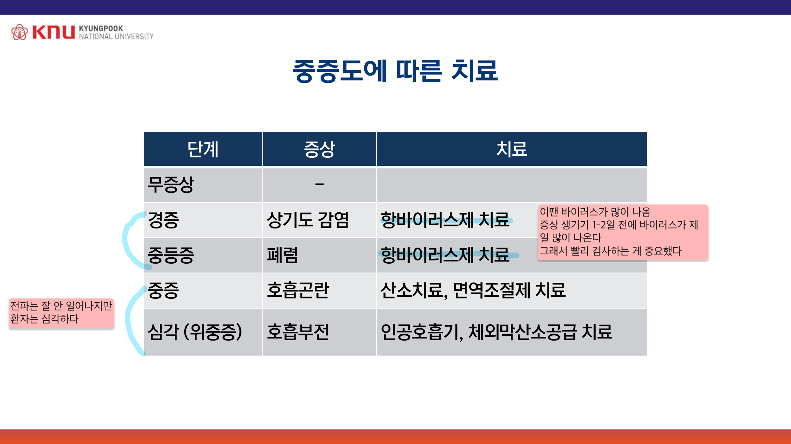
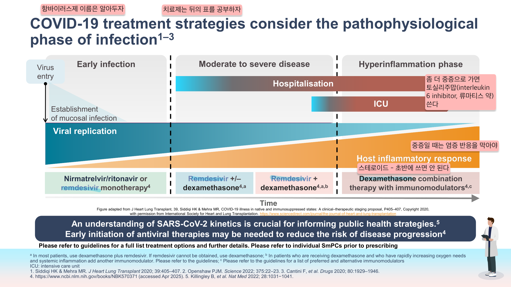
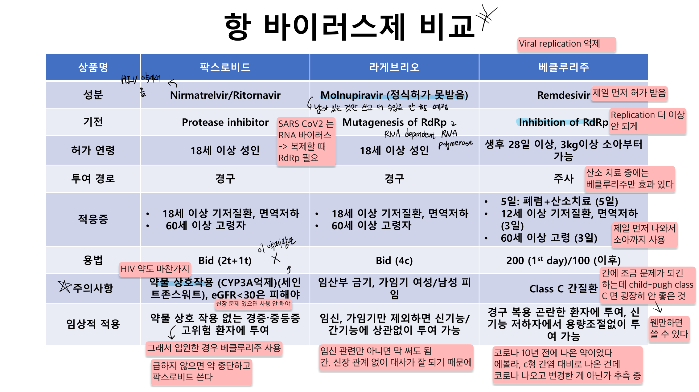
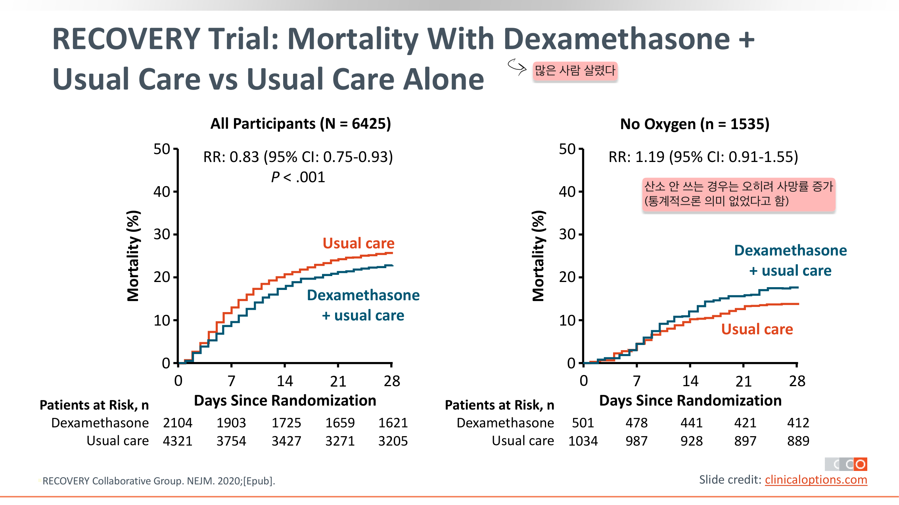
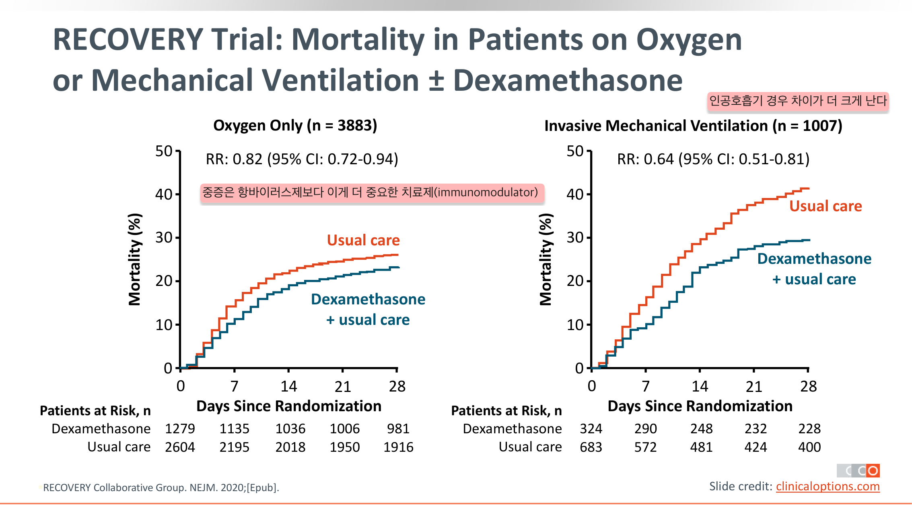

<!-- 필기본: 2025 -->
<!-- 단계: 수업 전 -->

# 0. 이 수업을 공부하는 법

권기태 교수님(감염내과, 칠곡경북대병원) 수업. 작년(2025) 강의는 제목과 달리 **거의 전부 코로나19(COVID-19)** 였다. 앞부분은 2020년 대구 유행 때 칠곡경북대병원이 한 일(드라이브스루, 음압병상, 원격진료 등)의 "현장 이야기", 뒷부분은 **위험인자 → 증상 → 중증도 분류 → 중증도별 치료 → 항바이러스제 비교 → 덱사메타손 → Long COVID** 의 임상 내용이다.

- 기출 44문항(2020–2025). 최근 3년(2023–2025, 권기태 교수님) 문항은 모두 이 필기 범위에서 나왔다: **드라이브스루 장점, 대구 유행 때 대응(백신 없음), 중증도별 치료제, 항바이러스제 비교표, 덱사메타손, 백신 부작용**.
- 2020–2022년 문항에는 말라리아·뎅기열·에볼라 같은 **해외유입 감염병**과 바이러스학 문항도 섞여 있다. 작년 필기에는 없는 내용이라 4장에 짧게 정리했다.

!!! key "핵심"
    시험의 중심은 두 장의 표다 — **중증도별 치료 표**(경증·중등증 = 항바이러스제, 중증 = 산소 + 면역조절제)와 **항바이러스제 비교 표**(팍스로비드·라게브리오·베클루리주). 교수님이 직접 "치료제는 뒤의 표를 공부하자", "항바이러스제 이름은 알아두자"고 했다.

# 1. 2020년 대구 코로나19 유행과 칠곡경북대병원의 대응

## 유행 초기 상황
- 2020년 2월 대구에서 하루 확진자가 폭증했다(신천지 관련 집단 발생). 필기의 그래프는 대구와 전국 일일 확진자 수, 누적 환자 수, 응급실 폐쇄 일수를 보여 준다.
- **응급실 폐쇄**: 확진자 한 명만 다녀가도 응급실을 닫았고(약 2일), 다시 열 때는 응급실 근무자 전원에게 보호장구를 입게 했다.
- **입원 대기 환자**: 격리 병상이 모자라 집에서 대기하는 환자가 많았다 → 이들을 **생활치료센터**로 옮겼다. 쉬워 보이지만 "병원이 아닌 곳에 환자를 두는" 결정이라 법에 근거가 없었고, 위기 단계가 '심각'으로 올라가면서 가능해졌다.
- 병원은 한창일 때 약 400명을 입원시켜 볼 수 있었고, **음압 수술실**(당시 4개)을 만들어 코로나 환자 수술도 했다. 창문 없는 방, 음압 장비 소음 때문에 장기 입원 환자가 우울해하거나 힘들어했다.

## 드라이브스루 선별진료소 (Drive-through screening center)
- 2001년 미국 탄저균 테러 때 차에 탄 채 약을 나눠 준 방식에서 아이디어를 얻었다. **칠곡경북대병원이 가장 먼저 시행**했고(2020년 2월), 기록을 남기려 논문(JKMS)으로 냈다. 이후 해외 여러 나라가 벤치마킹했다.
- 흐름: 등록·문진 → 진찰 → 안내·정보 제공 → 검체 채취 — 모두 **차 안에서**. 처음엔 넓은 장소가 필요하다고 했지만 병원 안에서도 충분히 가능했다.
- 그 전에는 음압 텐트에서 환자를 대기시키고 화상 통화로 증상을 묻고, Level D 보호구를 입고 들어가 검사했다. 한 명을 검사하면 환기·소독 때문에 다음 환자까지 **한 시간 넘게** 걸렸다 → 차로 줄을 서서 검사하는 방식이 획기적이었던 이유.

{: style="width:78%"}

| 장점 | 내용 |
|---|---|
| 감염 예방 | 차 안에서 검사 → 대기 공간 교차감염 차단 |
| 효율성 향상 | 1인당 10분 이내, 하루 100건 이상 |
| 의료자원 절감 | 인력·PPE 소모 최소화, 빠른 회전율 |
| **안전성** | **검사자–피검자 직접 접촉 최소화** (교수님: "검사자, 피검사자가 분리되는 것이 큰 장점") |
| 확장성 | 백신 접종·항바이러스제 투여 등으로 전환 가능 |
| 국제모델화 | 한국형 감염병 대응체계로 해외에서 채택 |

| 한계점 | 내용 |
|---|---|
| PPE 오염 위험 | 매 검사 후 완전 교체가 어려워 2차 오염 우려 (실제로는 안면보호구·마스크·장갑만 잘 갈면 됐다) |
| 환경적 제약 | 겨울 혹한·바람 — **날씨 영향이 컸다** |
| 응급대응 한계 | 중증 환자가 생기면 즉각 처치가 어렵다 |
| 이용 제한 | 차가 없는 사람은 이용 불가 |
| 중복 검사 | 개인정보 공유가 안 돼 여러 센터를 돌 수 있다 |

!!! exam "기출 포인트"
    2부 1번(2025): 드라이브스루의 주요 장점 = **검사자–피검자 간 직접 접촉 최소화 및 회전율 향상**. "검사 정확도 향상", "의료폐기물 감소", "실내 환기 효율"은 표에 없는 함정이다.

## 병원 안의 감염관리
- **이동형 음압기(portable negative-pressure)**: 호흡기내과 이신엽 교수님과 함께 일반 병실·중환자실의 공기 흐름을 바꿔 음압 격리 공간을 만들었다(7명 동시 입원 가능). 지금은 6동 중환자실로 옮겨 소아청소년과 PICU로 쓰려고 손보는 중. 중환자실 경험은 논문(Critical Care 2020)으로 남겼다.
- **응급실 감염관리** (필기 표):
    - 외부 선별 구역·검사실·흉부 X선실 운영 → 응급실 안으로 들어오기 **전에** 밖에서 선별·검사
    - 드라이브스루·워크스루 검체 채취 → 접촉 최소화
    - 의심 환자는 즉시 분리·격리
    - 이동형 음압격리 장비(portable negative-pressure chamber)로 응급실 안에서도 안전하게 이송·처치
    - 전 직원 마스크 + PPE 전면 사용(보편적 마스크 착용)
    - 의료 인력 증원, TF 간 실시간 소통(단톡방이 큰일을 했다 — 하나하나 연락해선 감당이 안 됐다)
- 검사해서 **음성이면 응급실 안으로** 들어오게 바꿨고, 오염 구역(contaminated area) 근무자는 모두 Level D로 일했다.
- 예: 편의점 직원 확진자 한 명의 접촉자가 300명 → "검사라도 빨리 하자"가 드라이브스루의 출발점.

!!! exam "기출 포인트"
    2부 4번(2024): 2020년 초 대구 유행 때 한 감염관리가 **아닌** 것 = **코로나19 백신 접종**(백신은 2021년 2월부터). 마스크, 이동형 음압기 격리시설, 의심환자 검사·격리, 드라이브스루는 모두 했다.

## 진료 방식의 혁신
- **원격진료(Telemedicine)**와 **코로나 산모용 초음파**: 투명한 벽을 사이에 두고 환자 쪽 초음파·마이크·스피커, 의사 쪽 모니터로 Level D 없이 진찰(약 천만 원). 코로나 산모 분만이 많아 산부인과가 Level D를 입고 벗기를 반복했던 것을 줄였다.
- **전 진료과 참여**: 마취과·정신과·흉부외과·성형외과·안과·정형외과·비뇨기과·신경외과·병리과까지 2주마다 로테이션.
- **Critical pathway(자동 처방 세트)**: 감염내과가 아닌 의사도 비교적 안정된 환자를 볼 수 있도록 일주일 치 약속 처방을 만들었다.
- **환자 모니터링 대시보드**: 산소포화도, 산소량, 체온, 검사 수치, 약을 한눈에 → 갑자기 나빠지는 환자, 중환자에게 집중.
- **기록 서식(입원·경과·퇴원 기록)**: 기본 포맷을 만든 것이 "신의 한 수" — 모은 기록이 그대로 연구 자료가 되었다.
- **병상·소통 모바일 앱**: 코로나 환자는 동선이 겹치면 안 되고 격리 해제 후 이동해야 해서 병상 현황을 앱으로 공유.

## 인공지능과 앞으로의 계획
- **CovSF(COVID-19 Severity Forecast)**: 언제쯤 중환자실에 갈지 예측하는 딥러닝 모델. 중환자실 병상이 전체 입원 환자보다 훨씬 적어서, 누구를 보내고 누구를 뺄지 결정하는 데 썼다. 코로나는 **산소 요구량**으로 중증도가 나뉘므로 이를 기준으로 학습했다(Sci Rep 2025).
- 유전자와 연관을 본 결과의 교훈: 코로나는 **사이토카인(과염증) 때문에 중증**이 된다 → 중증일 때는 스테로이드·토실리주맙 같은 면역조절제, 경증일 때는 항바이러스제. 경증에 스테로이드를 쓰면 초기 면역이 떨어져 바이러스를 못 없애 오히려 중증이 될 수 있고, 중증에는 항바이러스제가 효과가 없다(3장 치료와 같은 원리).
- 병원에 "자비스" 같은 AI(ChatGPT 연동)를 만들어 데이터가 빠짐없이 모이게 하는 꿈, 항생제 적정사용관리(ASP) 지능형 에이전트 개발, 감염병 전문병원 지정에 따른 시스템 구축을 진행 중.

# 2. 코로나19의 현재와 위험인자

## 사망 통계와 초과사망
- 2022년 사망원인 통계에서 코로나19가 3위 — 단일 감염병이 3위까지 오른 것은 처음.
- **초과사망(excess mortality)** = 신종 감염병 대응의 "최종 성적표". 낮을수록 잘 대응한 것.
    - 미국: 초반 초과사망이 많았다(첨단의료와 후진의료가 공존). 이후는 "사망할 사람이 앞에서 다 사망한" 자연 감소.
    - 한국: 초기 중증 대응은 잘했지만, 초반에 너무 엄격하게 하다 보니 막을 수 없는 확산기 대응이 늦어 그 시기 초과사망이 높았다. 그 시점에는 감염관리를 느슨하게 하더라도 **고위험군을 빨리 찾아 치료제를 주는** 쪽으로 갔어야 했다 — 앞으로 비슷한 감염병이 오면 참고할 점.

## 지금의 코로나19
- 질병관리청 표본감시(2025년 8–9월): 급성호흡기감염증 입원 바이러스 중 코로나19가 약 40–45%로 가장 많았다. 여름·가을에 유행이 온다.
- 입원 환자는 **65세 이상이 약 60%** — 고위험은 나이와 관련이 크다.
- 미국 자료에서도 코로나19 입원율은 인플루엔자와 비슷한 수준 → **지금 코로나는 인플루엔자와 거의 같은 질환**이 되었다(특성에는 차이가 있다).

## 중증·사망의 위험인자: 나이 > 기저질환

{: style="width:76%"}

| 연령(18–29세 기준) | 사망 위험비 | 기저질환 수 | 위험비 |
|---|---|---|---|
| 40–49세 | 2.2 | 없음 | 1.0 |
| 50–64세 | 4.3 | 1개 | 1.5 |
| 65–74세 | 6.7 | 2–5개 | 2.6 |
| 75–84세 | 8.5 | 6–10개 | 3.3 |
| ≥85세 | 10.6 | 10개 초과 | 3.8 |

- **나이가 가장 중요한 인자**이고, 기저질환이 많으면 위험이 더해진다 → 둘을 곱하면 중증 진행 확률이 수십 배. 그래서 **65세 이상**이 백신·치료제 대상의 기준이다.
- 증례: 고혈압·당뇨·뇌졸중(언어장애 4급)·방광암 환자가 호흡곤란 2시간 만에 쓰러져 CPR, ROSC 후 다시 심정지로 사망(Ct 18.0). 늦게 와서 사망한 경우(언어 문제가 있었을 것)이며, 지금도 이런 사망이 없지 않다.

!!! exam "기출 포인트"
    2부 24번(2022): COVID-19 사망에 가장 큰 영향을 미치는 인자 = **고령의 나이**. 심장·폐·신장·간질환, 당뇨, 비만, 암은 모두 위험인자지만 나이만큼 크지 않다.

## 소아가 덜 중증인 이유 (교수님: "시험엔 안 나온다")
낮은 ACE2 수용체 발현과 약한 결합력(코로나는 spike가 ACE2에 붙어 들어간다), 효과적인 선천면역(인터페론 생산, 많은 림프구), 강한 IgM·IgG 반응, 사이토카인 폭풍 억제(IL-6·IL-10 낮음), 기저질환이 적음, 여러 호흡기 바이러스 노출에 의한 교차면역.

# 3. 코로나19의 임상 — 증상, 중증도, 치료

## 증상
- 잠복기 **2–14일** 후 증상. **기본적으로 호흡기 질환**: 콧물·코막힘·후각/미각 소실, 기침·인후통, 호흡곤란, 두통, 피로·근육통·발열·오한, 구역·구토·설사.
- 그러나 **전신 질환**이기도 하다. SARS-CoV-2는 **과응고(hypercoagulability)**를 일으켜 20대에서 뇌졸중이 온 경우도 있었다.

{: style="width:70%"}

| 장기 | 증상 |
|---|---|
| 피부 | 출혈점, 그물울혈반, 홍반 발진, 두드러기, 수포, 동창양 병변 |
| 심장 | 심근병증, 심근염, 부정맥, 심인성 쇼크, 심근허혈, 급성 폐심장증 |
| 신경계 | 두통, 어지러움, 뇌증, 길랭-바레증후군, 미각·후각 소실, 근육통, 뇌졸중 |
| 혈전색전증 | 심부정맥 혈전증, 폐색전증, 카테터 관련 혈전증 |
| 간·신장 | 간효소 상승, 황달 / 급성신손상, 단백뇨, 혈뇨 |
| 내분비·소화기 | 고혈당, 당뇨병성 케톤산증 / 설사, 오심·구토, 복통, 식욕부진 |

신종 감염병은 처음엔 치료제도 백신도 없으므로, **초기에는 강하게 관리해서 백신이 나올 때까지 버텨야** 한다.

## 중증도 분류 (NIH)

{: style="width:74%"}

| 단계 | 정의 |
|---|---|
| 1. 무증상 | 검사 양성, 증상 없음 |
| 2. 경증(mild) | 발열·기침·인후통 등 증상은 있으나 호흡곤란·영상 이상 없음 |
| 3. 중등도(moderate) | 진찰·영상에서 하기도 질환(**폐렴**)이 있으나 **SpO2 ≥94%**(실내 공기) |
| 4. 중증(severe) | **SpO2 <94%**, PaO2/FiO2 <300, 호흡수 >30회, 폐 침윤 >50% → **산소가 필요해지는 시점** |
| 5. 심각(critical) | 호흡부전, 패혈 쇼크, 다발 장기 기능장애 → 고농도 산소·인공호흡기, 중환자실 |

호흡기 감염은 다 이와 비슷하게 나눈다. 핵심 경계선은 **"산소가 필요한가"**(중등도 ↔ 중증).

## 임상경과: 바이러스는 초기에, 염증은 나중에

{: style="width:66%"}

- 바이러스 배출량은 **증상 발현 1–2일 전부터 가장 많고** 초기에 빠르게 줄어든다 → 그래서 **빨리 검사하는 것**이 중요했다. 경증·중등증 시기가 전파가 많은 시기.
- 7–10일 무렵 호흡곤란·입원·급성호흡곤란증후군·중환자실로 가는 환자는 바이러스보다 **숙주 염증 반응**이 문제다. 이때는 전파는 잘 안 일어나지만 환자는 심각하다.

!!! exam "기출 포인트"
    2부 7번(2023): 시기별 바이러스·항체 검출 확률 그래프에서 **비인두도말(nasopharyngeal swab) PCR** 선 = 증상 직후 양성률이 가장 높고 2–3주에 걸쳐 떨어지는 선. 하기도 검체 PCR은 더 오래 양성, IgM·IgG는 1–2주 후 올라간다.

## 중증도에 따른 치료

{: style="width:66%"}

| 단계 | 증상 | 치료 |
|---|---|---|
| 무증상 | – | – |
| 경증 | 상기도 감염 | **항바이러스제** |
| 중등증 | 폐렴 | **항바이러스제** |
| 중증 | 호흡곤란 | **산소치료, 면역조절제** |
| 심각(위중증) | 호흡부전 | 인공호흡기, 체외막산소공급(ECMO) |

{: style="width:76%"}

- **초기(바이러스 증식기)**: nirmatrelvir/ritonavir 또는 remdesivir 단독.
- **중등도~중증(입원)**: remdesivir ± dexamethasone → remdesivir + dexamethasone.
- **과염증기(중환자실)**: dexamethasone + 면역조절제. 더 중증이면 **토실리주맙(tocilizumab, IL-6 억제제, 원래 류마티스 약)**이나 baricitinib(JAK 억제제)을 더한다.
- **스테로이드는 초반에 쓰면 안 된다.** 중증일 때 염증 반응을 막기 위해 쓴다.
- NIH 지침(필기 50쪽)은 **산소 쓰는 양**에 따라 나눈다: 외래 고위험(산소 없음) – Paxlovid·remdesivir(대안 molnupiravir), 스테로이드는 쓰지 않음 / 저유량 산소 – dexamethasone(+remdesivir) / 고유량·비침습 환기 – dexamethasone + baricitinib 또는 tocilizumab / 인공호흡기·ECMO – dexamethasone + baricitinib 또는 tocilizumab(remdesivir는 새로 시작하지 않음). 스페인 SEMES 알고리즘(51쪽)은 교수님이 "넘어간다"고 했다.

!!! exam "기출 포인트"
    2부 6번(2023)·25번(2022): 중증도–치료제 짝 고르기. 정답은 **중등도 – Remdesivir**, **중증 – Dexamethasone**. 함정: 경증 – Tocilizumab/Dexamethasone(경증에 면역억제는 금물), 심각 – Lagevrio, 중증 – Paxlovid(경구 항바이러스제는 산소 필요 없는 고위험 경증용).
    2부 29번(2021): 산소 2 L가 필요한 폐렴 → **Remdesivir + Dexamethasone** 두 가지.

## 항바이러스제 비교 ★

{: style="width:96%"}

| | 팍스로비드 | 라게브리오 | 베클루리주 |
|---|---|---|---|
| 성분 | Nirmatrelvir/Ritonavir | Molnupiravir (정식 허가 못 받음) | Remdesivir |
| 기전 | **Protease inhibitor** | **RdRp에 돌연변이 유발**(mutagenesis) | **RdRp 억제** |
| 허가 연령 | 18세 이상 | 18세 이상 | **생후 28일·3 kg 이상 소아부터** |
| 투여 경로 | 경구 | 경구 | **주사** |
| 적응증 | 18세 이상 기저질환·면역저하, 60세 이상 | 같음 | 폐렴+산소치료(5일), 12세 이상 기저질환·면역저하(3일), 60세 이상(3일) |
| 용법 | 하루 2번(nirmatrelvir 2알 + ritonavir 1알) | 하루 2번(4캡슐) | 첫날 200 mg, 이후 100 mg |
| 주의 | **약물 상호작용(CYP3A 억제)**(세인트존스워트), **eGFR <30 피함** | **임신부 금기**, 가임기 남녀 피임 | **Child-Pugh C** 간질환 |
| 임상 적용 | 상호작용 없는 경증·중등증 고위험 환자 | 임신·가임기만 아니면 신·간 기능과 상관없이 | 경구 복용이 어려운 환자, 신기능 저하에도 용량 조절 없이 |

교수님 설명으로 기억할 것:

- SARS-CoV-2는 RNA 바이러스라 복제할 때 **RdRp(RNA-dependent RNA polymerase)**가 필요하다 → 렘데시비르는 RdRp를 막아 더 이상 복제가 안 되게 하고, 몰누피라비르는 RdRp가 돌연변이를 잔뜩 넣게 만든다.
- **팍스로비드**: ritonavir는 HIV 약에서 온 것으로, CYP3A를 억제해 nirmatrelvir 농도를 유지한다(HIV 약도 마찬가지). 그래서 상호작용이 많다 — 급하지 않으면 다른 약을 잠깐 끊고 팍스로비드를 쓴다. 신장 문제가 있으면 쓰지 않는다(eGFR 30–60은 감량: nirmatrelvir 1알 + ritonavir 1알).
- **라게브리오**: 임신 관련만 아니면 간·신장과 관계없이 "막 써도 된다"(대사가 잘 된다). 다만 효과가 낮아 남아 있는 것만 쓰고 더 수입하지 않을 예정.
- **베클루리주**: 코로나 10년 전에 에볼라·C형 간염 대비로 나온 약 → 가장 먼저 허가받아 소아까지 쓴다. **산소 치료 중에는 베클루리주만 효과가 있다** → 입원 환자에게 쓴다. 간에 조금 문제가 되지만 Child-Pugh C가 아니면 웬만하면 쓸 수 있다.

!!! exam "기출 포인트"
    - 2부 2번(2025): 연결이 **틀린** 것 = 팍스로비드 – "eGFR <30에서도 안전"(피해야 한다).
    - 2부 9번(2022): 세인트존스워트 복용 중인 고위험 경증 → **라게브리오**(CYP3A 유도로 팍스로비드 금기, 폐경 여성이라 임신 걱정 없음).
    - 2부 10번(2022): eGFR 50의 가임기 여성 → **팍스로비드 감량(1알+1알)**. 라게브리오는 가임기라 피한다.
    - 2부 18번(2022): 고위험 경증에 공식 권고되는 **경구약** = Paxlovid(remdesivir는 주사).
    - 2부 19번(2022): Nirmatrelvir의 기전 = **viral protease inhibitor**.
    - 2부 40번(2020): 에볼라 치료제에서 재창출된 약 = **렘데시비르**.

## 덱사메타손 — RECOVERY 연구

{: style="width:74%"}

{: style="width:74%"}

| 호흡 보조 | 28일 사망 RR (덱사메타손 vs 일반치료) |
|---|---|
| 전체 | 0.83 — 사망 감소, "많은 사람을 살렸다" |
| 산소 없음 | **1.19** — 오히려 증가 경향(통계적으로 유의하지 않음) |
| 산소만 | 0.82 |
| **인공호흡기** | **0.64** — 차이가 가장 크다 |

- 중증에서는 **항바이러스제보다 덱사메타손(면역조절제)이 더 중요한 치료제**이고, 생존율 향상이 입증된 약이다.
- 산소가 필요 없는 환자에게는 쓰지 않는다(바이러스 제거를 방해).

!!! exam "기출 포인트"
    2부 3번(2024): 항암치료 중 SpO2 60% 중증 COVID-19에서 생존율을 높이는 약 = **Dexamethasone**(필기 2쪽에 이 문제가 실려 있다).
    2부 30번(2021): 생존율 향상 효과가 있는 약 = Dexamethasone(remdesivir는 회복 기간 단축).

## Long COVID
- 코로나19 이후 증상이 지속되는 연속체: 급성기(<4주) → 급성 후기(4–12주) → **Long COVID(>12주)와 후유증**.
- 원래는 호흡기 질환이지만 **전신 질환**이라 Long COVID도 다양하다: 피로, 호흡곤란, 우울, 브레인 포그(기억력 저하), 후각 저하(냄새를 못 맡음), 통증 / 후유증으로 뇌졸중, 폐섬유화, 심근염, 심부전, 만성 신장질환, 신경계 문제.
- **위험군**(중증 코로나와 비슷): 여성, 나이(때때로), **급성기 중증도**(중증일 때 잘 온다), **기존 기저질환**, 낮은 사회경제적 수준, **백신 미접종**.

# 4. 기출에 나왔지만 작년 필기에 없는 내용

2020–2022년 시험(다른 교수님 출제 포함)에 나온 내용이다. 올해 강의에 없을 수 있지만 반복된 것만 짧게 정리한다.

## 코로나19 백신

| 플랫폼 | 대표 백신 | 기출 포인트 |
|---|---|---|
| **mRNA** | 화이자(21일 간격, −70℃대, 효능 95%), 모더나 | 국내 최다 접종(화이자), 오미크론 2가 백신, **심근염·심낭염**(젊은 남성, 2차 접종 후) |
| **바이러스 벡터(아데노바이러스, 비증식형)** | 아스트라제네카(8–12주 간격, 2–8℃, 효능 60–90%), 얀센 | **혈소판감소성 혈전증(TTS/VITT)** |
| 재조합 단백질 | 노바백스(Matrix-M saponin adjuvant) | Adjuvant는 면역반응을 키우지만 **자기 자신에 대한 면역반응은 만들지 않는다** |

- 2023–2024 절기 백신 = **XBB.1.5** 단가 백신(2022–23은 BA.1·BA.4/5 2가).
- 그림 문항(Nature 2020 백신 그림)에서는 번호로 고른다: ② = RNA(mRNA) 백신, ⑥ = 증식하지 않는 바이러스 벡터(아데노바이러스).

!!! exam "기출 포인트"
    2부 5번(XBB.1.5), 8·16번(TTS → 바이러스 벡터), 12번(심근염 → mRNA), 11·15·26번(mRNA), 27번(아스트라제네카 = ⑥), 22번(백신–플랫폼 짝), 32번(adjuvant).

## SARS-CoV-2 바이러스
- Spike 단백의 RBD가 **ACE2(angiotensin-converting enzyme 2)**에 결합한다.
- 변이가 잘 생기는 이유: RNA 바이러스라 **RdRp의 교정(proofreading) 능력이 부족**해 spike 표면 아미노산 변이가 쌓인다 → 전파력 증가, 백신·단클론항체 효능 저하(SARS-CoV 항체가 SARS-CoV-2 RBD에 붙지 못한 이유도 같다).
- Real-time RT-PCR 진단 표적 유전자: E, RdRp, N(일부 S).

## 해외유입 감염병
- **말라리아**: 열대 지역(인도·아프리카) 여행 후 불규칙한 발열 + 혈액도말 원충. **중증(신부전·간부전·황달·혈소판감소·의식저하) = artesunate 정맥주사**. 합병증 없으면 경구 ACT(artemether/lumefantrine), atovaquone–proguanil 등.
- **뎅기열**: 동남아·인도 여행 후 발열, 발진·점상출혈, 백혈구·혈소판 감소. 매개 = **숲모기(Aedes)**. 국내 증가는 해외여행객 유입 때문. 2차 감염의 중증화 = 항체의존 감염증강(ADE).
- **매개체 짝**: 뎅기·황열 – 숲모기(Aedes), 일본뇌염 – 작은빨간집모기(Culex), 말라리아 – Anopheles, SFTS – 작은소피참진드기(Haemaphysalis).
- **Flavivirus**: 뎅기, 일본뇌염, 지카, 황열(에볼라는 Filovirus). **Arenavirus**(라싸)는 Bunyavirales 목. **Arbovirus** = 절지동물 매개 바이러스(대부분 외피 RNA 바이러스).
- **출혈열**: 뎅기, 라싸, 황열, 에볼라(외피 바이러스, 사람 간 전파, 백신 있음, 광범위 조직·혈관 손상).
- 잠복기: 지카·뎅기 3–14일, 장티푸스 3–60일, 리슈만편모충증 2–10개월, **아메바 간농양은 수주–수개월**(2–14일 아님).

!!! memo "암기"
    중증 말라리아 = **Artesunate 주사** · 뎅기 = **Aedes** · 산소 필요 COVID = **Dexamethasone (+Remdesivir)** · 고위험 경증 COVID 경구 = **Paxlovid**(상호작용·eGFR<30이면 Lagevrio, 임신·가임기면 Lagevrio 금지)
