<!-- 필기본: 2025 -->
<!-- 단계: 수업 전 -->

# 0. 이 수업을 공부하는 법

**권기태 교수님** 수업(2023·2025·2026 같은 교수님). 작년 강의는 학습성과에 병원획득·인공호흡기연관 폐렴까지 있지만, 실제 내용은 **지역사회획득 폐렴(CAP)** 이 거의 전부다 — 정의, 원인균, 진단, **중증도(PSI·CURB-65)**, **항생제 선택(국내 내성)**, 예방(백신). 필기본 2–3쪽에 2022–2024 기출이 붙어 있다.

학습성과

1. 지역사회획득 폐렴, 병원획득 폐렴, 인공호흡기연관 폐렴을 구분할 수 있다.
2. 각각의 원인균과 항균제 내성을 설명할 수 있다.
3. 각각의 항균제 치료와 예방을 설명할 수 있다.

- 기출 45문항(2020–2025). 권기태 교수님 문항은 같은 증례를 돌려 쓴다:
    - **"평소 건강하던 30세 남자, 5일 발열·기침·화농성 객담, 오른쪽 아래 거품소리"** → 원인균(폐렴알균 + 마이코플라스마), **CRB-65 0점 → 외래**, **경구 amoxicillin/clavulanate**(6문항)
    - **"75세, 간암, 의식 혼탁, 호흡수 35, 혈압 80/40"** → CRB-65 4점, 예후 인자 = **나이**
    - **입원 CAP → ceftriaxone + azithromycin**, 인플루엔자 후 공동 → **S. aureus**, COPD → **H. influenzae**
- 2020–2022 문항 상당수는 미생물학(결핵·나병·인플루엔자·마이코플라스마·레지오넬라) — 8장에 정리했다.

!!! key "핵심"
    **폐렴 = 하기도 증상 + 흉부 영상의 새 침윤.** 원인균은 대부분 모른다 → **경험적 치료**. 결정 순서는 **① 중증도(CURB-65: 의식, BUN >19, 호흡수 ≥30, 혈압 ≤90/≤60, 나이 ≥65) → 외래·병동·중환자실 ② 그에 맞는 항생제**(외래 β-lactam 단독 / 병동 β-lactam ± macrolide 또는 호흡기 퀴놀론 / 중환자실 β-lactam + azithromycin 또는 퀴놀론).

# 1. 폐렴의 중요성

- **2023 사망원인 순위**: 폐렴이 최근으로 오며 확 높아졌다.
- **전 세계적으로는 폐렴 사망이 줄고 있다** — **5세 미만에서 극적으로 감소**(백신, 특히 **단백결합 백신**의 효과가 매우 크다 + 개도국 생활수준 향상).
- **한국**: 5세 미만 사망은 거의 없는 대신 **고령자 사망이 늘어난다**. 인구는 줄어도 고령화로 의료 수요는 줄지 않는다(고령자는 폐렴만 있는 게 아니라 다른 병도 있다).

# 2. 정의와 병태생리

## 정의 — "정의가 중요"
폐렴 = **폐 실질의 감염**으로 **하기도 증상**이 생기고 **흉부 영상에서 폐 침윤**이 보이는 것.

- 상기도 감염 = 목 아프고 콧물 / **하기도 = 기침, 가래, 호흡곤란**.
- 상·하기도 증상(± 전신 증상)이 있으면서 **영상 소견이 있을 때** 폐렴으로 정의한다(초반에는 영상 소견이 없을 수도).

| 구분 | 정의 |
|---|---|
| **지역사회획득 폐렴(CAP)** | HAP·VAP가 아닌 폐렴 |
| **병원획득 폐렴(HAP)** | **입원 48시간 이후** 발생(VAP 제외) |
| **인공호흡기연관 폐렴(VAP)** | **기관 삽관(인공호흡기) 48시간 이후** 발생 |

!!! exam "기출 포인트"
    - 2부 1번(2025): 폐렴 진단의 **필수 조건** = **흉부 방사선에서 폐 침윤 확인**. 객담 배양, procalcitonin, 산소포화도 저하, 백혈구 증가는 필수 아님.
    - 2부 37번(2020): 뇌출혈로 인공호흡기 **7일째** 발열·화농성 객담·산소 요구 증가 + 새 침윤 = **VAP** → 다제내성균(MRSA + 녹농균)을 덮는 **vancomycin + meropenem + amikacin**.

## 병태생리
- 폐포 수준에서 병원체가 증식하고 숙주의 염증 반응이 생긴다(**원인 병원체가 있는 게 폐렴**, 병원체 없이 면역학적으로 오는 게 간질성 폐렴).
- 구인두의 세균이 **미세 흡인(micro-aspiration)**으로 하기도에 들어온다 — **S. pneumoniae**가 잘 들어온다(어린이집 아이 20–30%에서 집락; **백신을 맞으면 구인두 집락이 없어진다**).
- 병원체가 선천·후천 면역을 이기면 → 상피·내피 손상 → 사이토카인 → 염증·세균 증식 촉진 → 국소 호중구 증가.
- 폐포 모세혈관 누출 → 산소화 저하·저산소혈증·영상의 침윤.
- 액체로 찬 폐포 → 심한 저산소혈증, **폐 순응도 감소**(물이 차면 폐가 단단해져 잘 안 늘어난다), 호흡곤란, **폐내 션트**(가스교환 못 하고 그냥 지나감) → 호흡부전.

# 3. 지역사회획득 폐렴의 원인균

## 전형 vs 비전형 폐렴

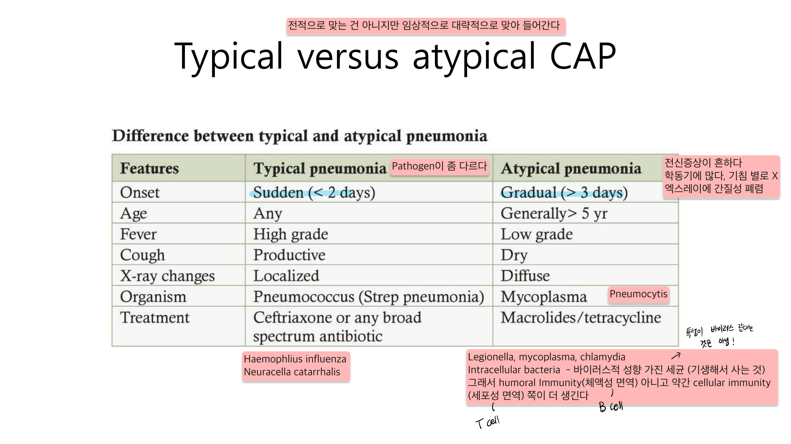{: style="width:94%"}

"전적으로 맞는 건 아니지만 임상적으로 대략 맞아 들어간다"

| | 전형(typical) | 비전형(atypical) |
|---|---|---|
| 시작 | **갑자기(<2일)** | **서서히(>3일)** |
| 나이 | 모두 | 대개 >5세(**학동기에 많다**) |
| 열 | 고열 | 미열 |
| 기침 | **가래** | **마른기침**(기침 별로 X) |
| X선 | **국소** | **미만성**(간질성) |
| 원인 | **폐렴알균**, H. influenzae, Moraxella catarrhalis | **Mycoplasma**, Chlamydia, Legionella, (Pneumocystis), 바이러스 |
| 치료 | Ceftriaxone 등 β-lactam | **Macrolide, tetracycline** |

- 비전형균(Legionella, Mycoplasma, Chlamydia)은 **세포내 세균** — 바이러스 성향(기생해서 산다) → 체액성 면역보다 **세포성 면역**이 더 생기고, 전신 증상이 흔하다.
- **일반 배지에서 배양되지 않고 그람염색에도 안 보인다**. **모든 β-lactam에 내성** → macrolide, fluoroquinolone, tetracycline으로 치료.

## 원인균 목록
- **전형**: ① **S. pneumoniae** ② **H. influenzae** ③ S. aureus ④ 그람음성 막대균(K. pneumoniae, P. aeruginosa)
- **비전형**: ① **Mycoplasma pneumoniae** ② Chlamydia pneumoniae ③ Legionella ④ 호흡기 바이러스(인플루엔자, 아데노, 메타뉴모, RSV, 코로나)
- 폐렴알균 백신 사용이 늘면서 폐렴알균 폐렴은 감소 중. **바이러스**는 점점 더 중요한 원인.
- **다균 감염**: CAP의 10–15%에서 전형 + 비전형이 함께.
- **S. aureus**: **인플루엔자 감염 후 합병**, **MRSA → 괴사성 폐렴**(HA-MRSA vs CA-MRSA).

## 치료 장소별 원인균

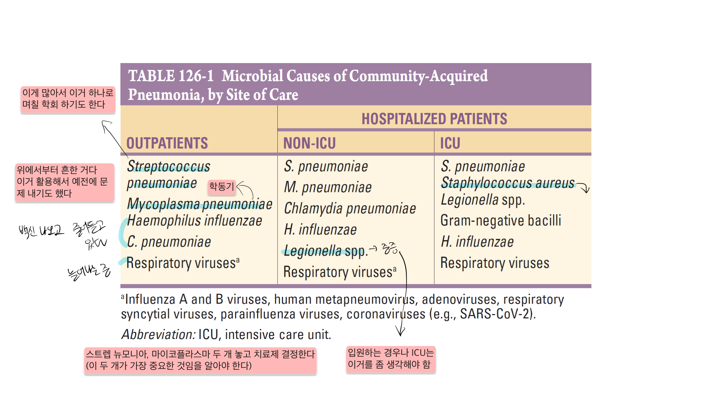{: style="width:94%"}

| 외래 | 입원(일반병동) | 중환자실 |
|---|---|---|
| **S. pneumoniae** | S. pneumoniae | S. pneumoniae |
| **M. pneumoniae**(학동기) | M. pneumoniae | **S. aureus** |
| H. influenzae | C. pneumoniae | **Legionella** |
| C. pneumoniae | H. influenzae | **그람음성 막대균** |
| 호흡기 바이러스 | **Legionella**(중증) | H. influenzae |
| | 호흡기 바이러스 | 호흡기 바이러스 |

- 위에서부터 흔한 것 — **"S. pneumoniae, Mycoplasma 두 개를 놓고 치료제를 결정한다(이 두 개가 가장 중요하다)"**. 입원·중환자실이면 아래쪽(Legionella, S. aureus, 그람음성)도 생각해야 한다.
- 국내 3차 병원 데이터(내성균이 좀 들어가 있다)에서도 **S. pneumoniae**가 가장 많고, Klebsiella, S. aureus, Pseudomonas, H. influenzae 순.

!!! exam "기출 포인트"
    - 2부 22번(2021): 건강한 30세 외래 CAP의 원인 2가지 = **S. pneumoniae, M. pneumoniae**.
    - 2부 5번(2023): 같은 환자에서 가능성이 **가장 낮은** 것 = **Legionella**(중증·입원 쪽).
    - 2부 8번(2022): 인플루엔자 A 회복 중 다시 고열·가래, CT 공동성 결절 → **S. aureus**.

## 위험인자·역학에 따른 원인균

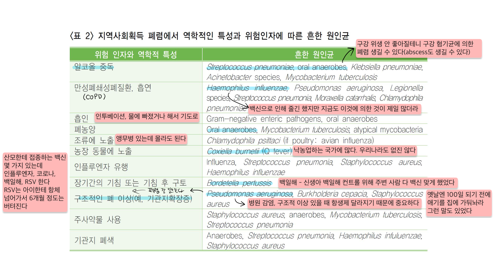{: style="width:94%"}

| 위험 인자 | 흔한 원인균 |
|---|---|
| **알코올 중독** | S. pneumoniae, **구강 혐기균**(구강 위생 → 폐농양도), **K. pneumoniae**, Acinetobacter, 결핵 |
| **COPD, 흡연** | **H. influenzae**(백신으로 줄었지만 지금도 제일 많다), P. aeruginosa, Legionella, S. pneumoniae, M. catarrhalis |
| 흡인(삽관, 물에 빠짐) | 그람음성 장내세균, 구강 혐기균 |
| 폐농양 | 구강 혐기균, CA-MRSA, 결핵 |
| 조류 노출 | Chlamydophila psittaci(앵무병 — 몰라도 된다) |
| 농장 동물 | **Coxiella burnetii(Q fever)** — 낙농 국가에 많다 |
| 인플루엔자 유행 | 인플루엔자, S. pneumoniae, **S. aureus**, H. influenzae |
| 오래가는 기침 후 구토 | **Bordetella pertussis(백일해)** |
| **구조적 폐질환(기관지확장증)** | **P. aeruginosa**, Burkholderia cepacia, S. aureus — 항생제가 달라져 중요 |
| 주사약물 | S. aureus, 혐기균, 결핵, S. pneumoniae |
| 기관지 폐쇄 | 혐기균, S. pneumoniae, H. influenzae, S. aureus |

- 산모에게 접종하는 백신: **인플루엔자, 코로나, 백일해, RSV** — RSV는 아이에게 항체가 넘어가 6개월 정도 버틴다(신생아 백일해를 막으려 주변 사람 모두 백신을 맞게 했었다).
- 해외: 동남아 여행 → Burkholderia pseudomallei, 조류 인플루엔자 / 호텔·크루즈 → Legionella / 미국 남서부 → Hantavirus, Coccidioides.

## 원인균별 임상 특성

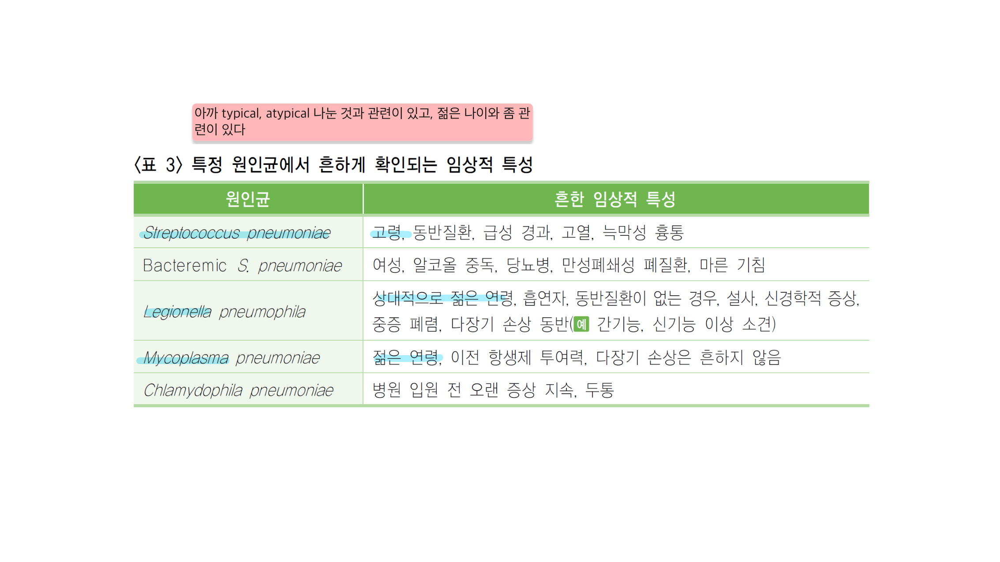{: style="width:94%"}

| 원인균 | 흔한 임상 특성 |
|---|---|
| **S. pneumoniae** | **고령**, 동반질환, 급성 경과, 고열, 늑막성 흉통 |
| 균혈증 S. pneumoniae | 여성, 알코올 중독, 당뇨, COPD, 마른기침 |
| **Legionella** | 상대적으로 젊은 연령·흡연자·동반질환 없음, **설사, 신경학적 증상, 중증 폐렴, 다장기 손상(간·신기능 이상)** |
| **Mycoplasma** | **젊은 연령**, 이전 항생제 투여력, 다장기 손상 드묾 |
| Chlamydophila | 입원 전 오래 지속된 증상, 두통 |

!!! exam "기출 포인트"
    2부 6번(2023): 바른 짝 = **COPD – H. influenzae**. 알코올–Burkholderia(X), 기관지확장증–Coxiella(X → 녹농균), 치매–녹농균(X → 흡인·혐기균), 흡연–Legionella(위험인자이긴 하나 출제 답은 COPD).

# 4. 역학과 임상양상

## 역학
- 미국: 매년 500만 건 이상, **70% 외래 / 30% 입원**. 사망률은 외래 <5%, 입원 12–40%.
- 발병률은 **나이의 양 극단**(어린이와 노인)에서 높다 — **U자형**.

## 임상양상
- **전신·폐 증상**: 발열·빈맥, 오한·발한, 기침(마른기침 또는 점액·농·혈성 가래), **육안적 객혈 → CA-MRSA 폐렴 시사**, 호흡곤란, **늑막성 흉통**, 소화기 증상(약 20%), 피로·두통·근육통·관절통.
- **진찰**: 호흡수 증가, 보조근 사용, 촉각진탕음 증가·감소, 타진 둔탁음, **수포음(거품소리)**, 기관지 호흡음, 늑막 마찰음.
- **노인은 전형적이지 않을 수 있다** — 새로 생긴 **혼돈·인지 저하**로 처음 나타난다(신경과에서 의식 변화로 봤는데 알고 보니 폐렴·요로감염). 노인 감염 질환의 20–30%가 의식 변화로 온다 → 폐렴 정의의 범주에서 벗어나 있어 중요한 포인트.
- 패혈 쇼크·장기부전이 동반될 수 있다. 영상 소견은 **중력 의존 부위**에서 더 뚜렷하다.

# 5. 진단

## 두 가지 질문
1. **폐렴인가?** → 임상·영상으로
2. **원인균은 무엇인가?** → 검사로 (배양이 안 나올 수도 → 임상적으로 판단)

## 임상 진단
- **감별진단**(폐렴 같지만 아닌 경우가 있다): 급성 기관지염, 만성 기관지염 급성 악화, **심부전**, **폐색전증**, 과민성 폐렴, **방사선 폐렴**(항암 방사선 치료 후). 병력이 중요 — 심질환 → 폐부종 악화, 폐암 → 방사선 폐손상.
- 신체진찰의 정확도: 민감도 58%, 특이도 67%.
- **흉부 X선**은 대부분 필요.
    - **기종낭(pneumatocele) → S. aureus**
    - **상엽 공동 → 결핵** 의심 → 객담 검사. X선은 전형적인데 천천히 만성으로 오면 결핵일 수 있다.
- 흉부 CT: 종양·이물에 의한 폐쇄 후 폐렴, 공동 병변 의심 시.
- **외래는 임상·영상 평가만으로 치료를 시작**하는 경우가 많다(검사 결과가 초기 결정에 바로 반영되지 않는다).
- 신속 검사: 인플루엔자·SARS-CoV-2 항원검사.

## 원인 진단
- **중요성**: 경험적 치료 범위를 좁혀 **내성 발생을 줄인다**, 공중보건(결핵, 인플루엔자), 내성 동향 추적.
- **하지만 50% 이상에서 원인균을 모른다** → 경험적으로 치료할 수밖에 없다. "**임상적인 것이 더 중요**" — 증상 보고 X선 보고 하면 된다.
    - 객담에서 나온다고 원인균이 아니다(비인두 집락이 섞인다, 양이 많다고 원인인 것도 아니다).
    - **혈액·흉수 같은 무균 검체**에서 나오면 원인균이라 할 수 있다.
    - 치료해서 좋아지고 있으면 그 균을 원인으로 보고, 내성균이 나왔는데 항생제가 잘 들으면 그대로, 안 들으면 바꾼다.
- **객담 그람염색·배양**: 적절한 검체 = 저배율에서 **호중구 >25, 편평상피세포 <10**(상피세포가 많으면 오염된 검체). 의식이 나쁘면 가래를 못 뱉는다. 심부 흡인·BAL이 수율이 높다.
- **혈액배양**: 입원 환자의 **5–14%**만 양성, 가장 흔한 균은 **S. pneumoniae**. 혈액에서 나올 정도면 매우 중증(사망률 높음, 수막염 동반 가능). 모든 입원 CAP에 필수는 아니고 고위험군에서 반드시.
- **소변 항원**: **폐렴알균**(민감도 70%, 특이도 >90%), **Legionella serogroup 1**(민감도 70%, 특이도 99%). 항생제 시작 후에도 검출된다.
- **PCR**: 비인두 도말 PCR이 **호흡기 바이러스의 표준 진단** — Legionella, Mycoplasma, Chlamydia, 결핵도 검출. 1시간에 20여 종 결과(최근 뜨는 중). 있기만 하면 나와 과대평가되기도 하지만 없는 것보단 낫다.
- **혈청검사**: 급성기·회복기 IgM 4배 상승 — 오래 걸려 요즘은 안 쓴다(연구용).
- **바이오마커(CRP, procalcitonin)**: 높으면 세균·중증, 낮으면 바이러스·경증. PCT만으로 항생제를 보류하면 안 되고, CRP는 단독 진단에 부적절 → **보조 지표**로 종합 해석(교수님은 개인적으로 CRP에 의존하는 편).

!!! exam "기출 포인트"
    2부 7번(2022): 65세, 화농성 가래·발열·**늑막성 흉통**, 대엽성 경화 → 양성 가능성이 가장 큰 검사 = **소변 pneumococcal 항원**.

# 6. 치료

## 어디서 치료할 것인가 — 중증도

"외래, 일반병동, 중환자실 — 어디로 갈 거냐가 중요". 잘 모를 때는 **표준화된 지표**를 따르는 것이 좋다.

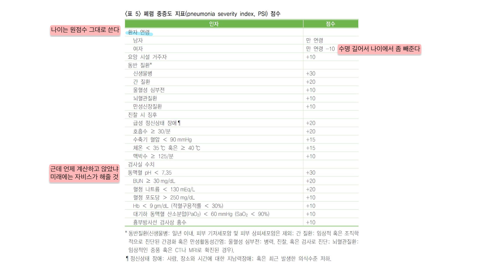{: style="width:94%"}

**PSI(Pneumonia Severity Index)**: 나이는 **원점수 그대로**(여자는 −10, 수명이 길어서), 요양시설 +10, 동반질환(신생물 +30, 간질환 +20, 심부전·뇌혈관·신질환 +10), 진찰(의식 장애 +20, 호흡수 ≥30 +20, 수축기 <90 +20, 체온 <35 또는 ≥40 +15, 맥박 ≥125 +10), 검사(pH <7.35 +30, BUN ≥30 +20, Na <130 +20 등). 계층 I–III 외래, IV 입원, V 중환자실 고려. "근데 언제 계산하고 앉았냐 — 미래에는 자비스가 해줄 것."

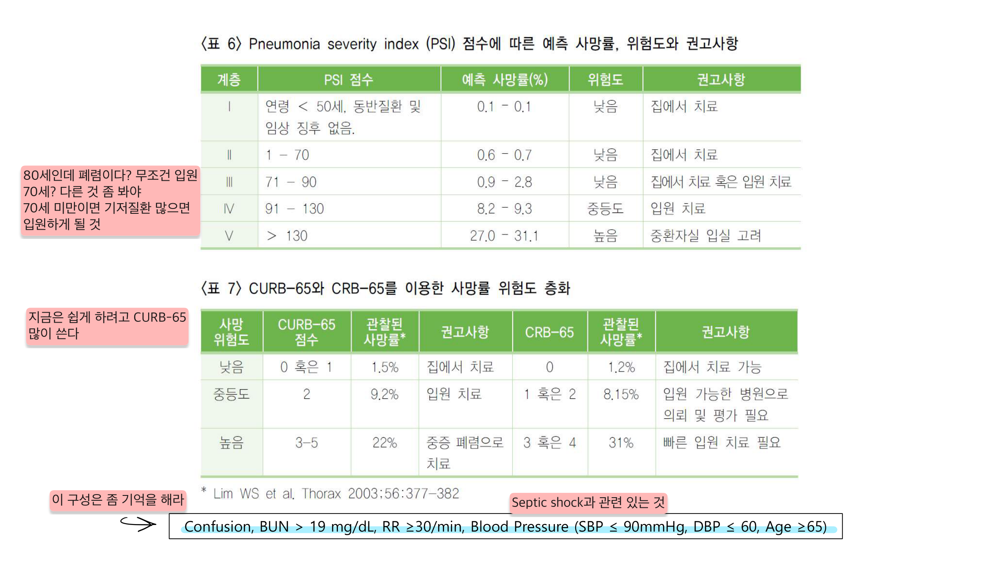{: style="width:94%"}

**CURB-65 — "이 구성은 좀 기억을 해라"** (지금은 쉽게 하려고 이걸 많이 쓴다)

| 항목 | 기준 |
|---|---|
| **C**onfusion | 의식 혼돈 |
| **U**rea | **BUN >19 mg/dL** |
| **R**espiratory rate | **≥30회/분** |
| **B**lood pressure | **수축기 ≤90** 또는 **이완기 ≤60** mmHg (패혈 쇼크와 관련) |
| **65** | **나이 ≥65** |

| CURB-65 | 사망률 | 권고 | CRB-65(BUN 빼고) | 사망률 |
|---|---|---|---|---|
| 0–1 | 1.5% | **집에서 치료** | 0 | 1.2% |
| 2 | 9.2% | **입원** | 1–2 | 8.15% |
| 3–5 | 22% | 중증 폐렴으로 치료(중환자실) | **3–4** | **31%** |

- 80세인데 폐렴이다? 무조건 입원. 70세? 다른 것도 봐야. 70세 미만이면 기저질환이 많을 때 입원.

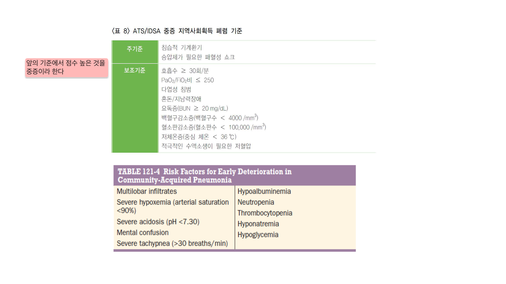{: style="width:94%"}

**중증 CAP(ATS/IDSA)** — 주기준: **침습적 기계환기, 승압제가 필요한 패혈 쇼크** / 보조기준: 호흡수 ≥30, PaO2/FiO2 ≤250, 다엽성 침범, 혼돈, BUN ≥20, 백혈구 <4,000, 혈소판 <100,000, 저체온(<36℃), 적극적 수액이 필요한 저혈압.

!!! exam "기출 포인트"
    - 2부 2번(2025): 입원이 필요한 환자 = **75세 + BUN 25**(CURB-65 2점). 나머지는 0–1점.
    - 2부 4번(2024): 70세 COPD 흡연자, 맥박 120 → 중증도 판단에 가장 중요한 것 = **70세 연령**(맥박·흡연·고혈압·COPD는 CURB-65 항목이 아님).
    - 2부 12번(2022): 75세 간암 여성 → 나쁜 예후에 가장 큰 인자 = **75세**.
    - 2부 9번(2022): 건강한 30세, 호흡수 20, 혈압 120/75, 의식 명료 → **CRB-65 0점, 집에서 치료**.
    - 2부 10번(2022): 75세 간암, 의식 혼탁, 호흡수 35, 혈압 80/40 → CRB-65 4점(사망률 약 30%, "10%"는 틀림), 정답은 **SARS-CoV-2를 원인으로 고려**(2022년 유행 중).

## 항생제 내성 — 항생제 선택의 또 하나의 요인

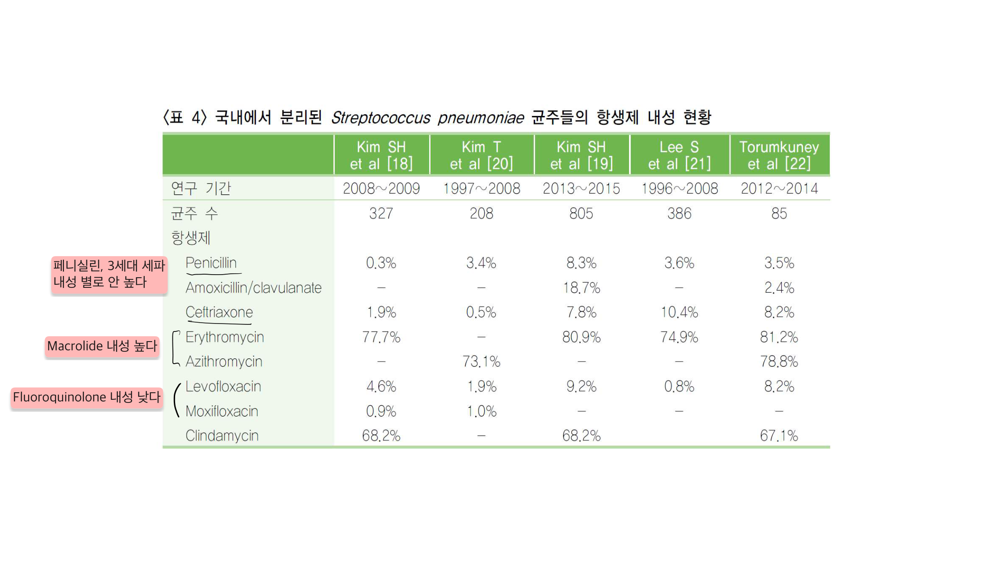{: style="width:94%"}

**폐렴알균(S. pneumoniae)**

- **β-lactam**: PBP 변이. 국내 내성률 50–80%로 보고됐지만 **2008년 CLSI 기준 변경 후 실제 내성 <5%**, 임상적 치료 실패는 드물다 → **페니실린·3세대 세팔로스포린 그냥 쓴다**.
- **Macrolide**: 전 세계 약 30%, **국내 erythromycin 약 80%, azithromycin 77%, clarithromycin 74%**(erm(B), mef(A)) → **단독으로는 못 쓴다 → 병합**. (macrolide는 비정형균에 잘 들어 하나로 둘 다 치료할 수 있지만 전형 폐렴에 안 들어서 β-lactam과 조합)
- **Fluoroquinolone**(levofloxacin, moxifloxacin): 내성 낮지만 증가 추세. **비정형·폐렴알균 둘 다 잘 들어 단독 사용 가능** — 단, **우리나라는 결핵을 가려 진단·치료가 늦어질 수 있어 결핵이 배제될 때까지는 β-lactam + macrolide**.
- 주요 위험인자: **최근 3개월 이내 항생제 사용**.

**그 밖의 균**

- **M. pneumoniae**: macrolide 내성 — 독일 3%, 일본 30%, **중국 95%, 한국 78.5%** → 국내는 fluoroquinolone을 많이 쓴다(소아에게 쓰면 안 되는데 예외적으로).
- **H. influenzae**: **β-lactamase 생성** 증가 → β-lactam 단독 X. Amoxicillin/clavulanate, cefotaxime, imipenem에는 감수성 → 경험적으로 헤모필루스까지 덮어야 하면 **β-lactamase 억제제를 붙인다**(경구 amoxicillin/clavulanate, 주사 ampicillin/sulbactam). 폐렴알균이 확인되면 페니실린 단독으로.
- 그람음성균(P. aeruginosa, E. coli, K. pneumoniae, 최근 Acinetobacter): 국내는 3차 병원 환자 비율이 높아 의료관련 폐렴과 경계가 모호하고, 내성 증가로 중증·기저질환자 예후가 나쁘다.

## 경험적 항생제 (국내 지침)

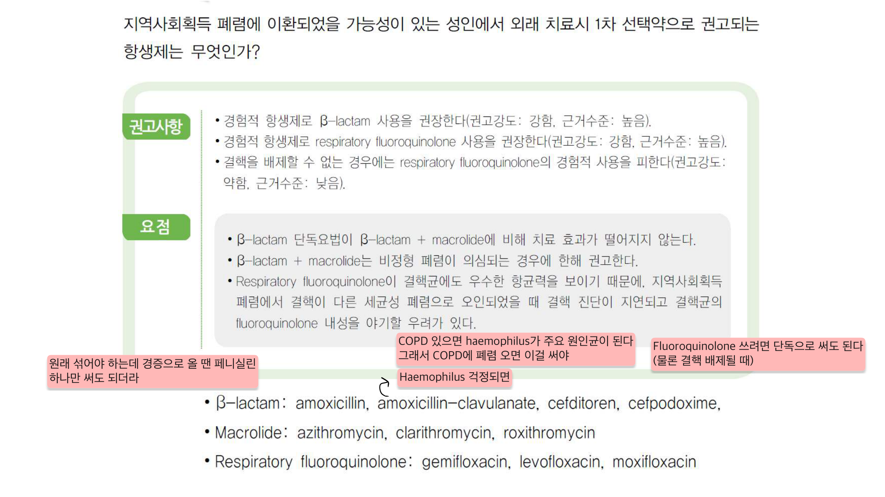{: style="width:94%"}

| 상황 | 국내 권고(질병관리청 2017) |
|---|---|
| **외래** | ① **β-lactam 단독**(원래 섞어야 하는데 경증은 페니실린 하나로 되더라) ② β-lactam + macrolide(비정형 의심) ③ **호흡기 fluoroquinolone 단독**(**결핵 배제**될 때) |
| **입원(경증·일반병동)** | **β-lactam 또는 호흡기 fluoroquinolone 단독** 권장. β-lactam + macrolide는 **비정형 의심 또는 중증**일 때 제한적으로(항생제 줄이자는 흐름이라 루틴 추가는 권하지 않는다) |
| **입원(중증)** | β-lactam + macrolide |
| **중환자실** | **처음부터 세게 — β-lactam + azithromycin 또는 + fluoroquinolone 병합**(단독보다 병합). **녹농균 의심(기관지확장증)이면 항녹농균 β-lactam 병합**, MRSA 의심이면 vancomycin·teicoplanin·linezolid |

- **COPD가 있으면 H. influenzae가 주요 원인 → amoxicillin/clavulanate**.
- 경구 β-lactam: **amoxicillin, amoxicillin/clavulanate**, cefditoren, cefpodoxime / macrolide: azithromycin, clarithromycin, roxithromycin / 호흡기 퀴놀론: **gemifloxacin, levofloxacin, moxifloxacin**(**ciprofloxacin은 빠진다** — 그람음성용이라 폐렴알균에 약하다).
- 주사 β-lactam: 항폐렴알균 — ampicillin/sulbactam, cefotaxime, **ceftriaxone** / 항녹농균 — cefepime, piperacillin/tazobactam, imipenem·meropenem.

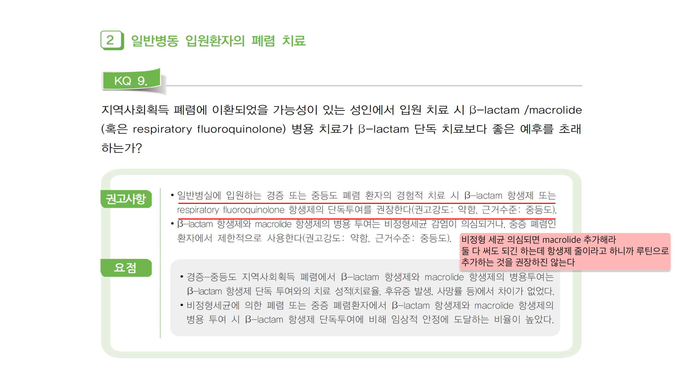{: style="width:94%"}

**녹농균 감염의 위험인자**: ① **기관지확장증** 같은 구조적 폐질환(중요) ② COPD 급성 악화가 반복돼 스테로이드를 자주 쓴 병력 ③ 최근 3개월 이내 항생제 → 이럴 땐 의료관련 감염처럼 약을 쓴다.

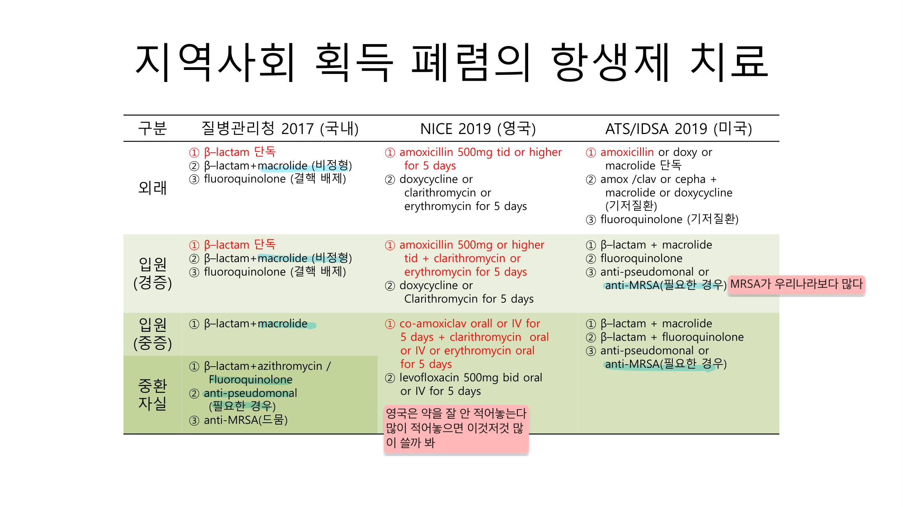{: style="width:94%"}

- 영국(NICE)은 약을 많이 적어 두면 이것저것 쓸까 봐 잘 안 적는다(외래 amoxicillin 5일). 미국(ATS/IDSA)은 MRSA가 우리나라보다 많아 anti-MRSA를 넣는다.

!!! exam "기출 포인트"
    - 2부 11·23·36번(2022·2021·2020): 건강한 30세 외래 CAP → **경구 amoxicillin/clavulanate**(2021은 + **경구 moxifloxacin**). 오답: 즉시 입원, 1세대 세팔로(cefadroxil), pip/tazo 주사, **azithromycin·doxycycline 단독**(국내 내성), ciprofloxacin(폐렴알균 약함), aminoglycoside, 침대 머리 올리기(VAP 예방).
    - 2부 3번(2024): 53세, 호흡 30, BUN 35(CURB-65 2점, 입원) → **ceftriaxone + azithromycin**. 녹농균 위험인자 없으므로 pip/tazo + cipro는 과함.
    - 2부 24번(2021): ceftriaxone + azithromycin 5일에도 열 지속 + X선 한쪽 흉수 → **농흉 병발**(배농해야 낫는다).

# 7. 예방 — 폐렴알균·인플루엔자 백신

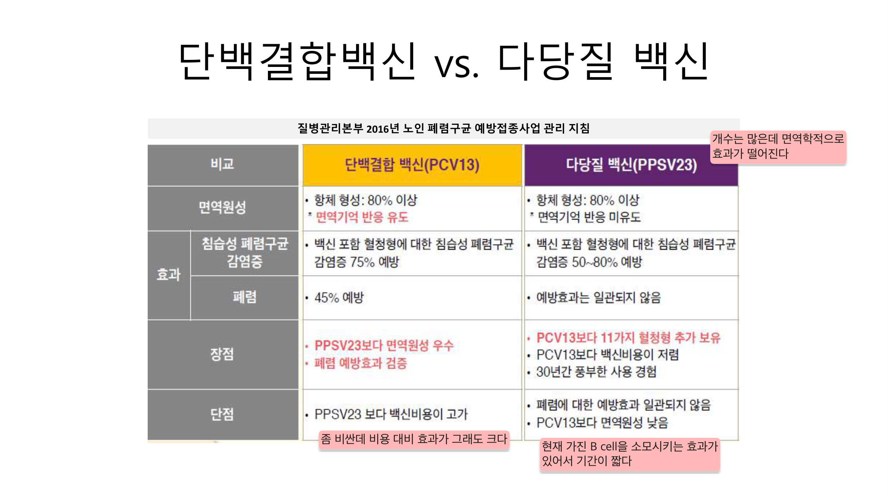{: style="width:94%"}

| | **단백결합 백신(PCV13 등)** | **다당질 백신(PPSV23)** |
|---|---|---|
| 혈청형 | 13개(지금은 20·21가, 31가 임상 중) | 23개 |
| 면역 | **T세포 의존**, **면역기억 유도**, 항체 형성 80% 이상 | **T세포 비의존**, 면역기억 X — 개수는 많은데 면역학적으로 효과가 떨어진다 |
| 효과 | 침습성 폐렴알균 감염 75% 예방, **폐렴 45% 예방**(검증) | 침습성 감염 50–80%, 폐렴 예방은 일관되지 않음 |
| 장점 | 면역원성 우수, **비인두 보균을 없애 백신 안 맞은 사람까지 보호**(소아 → 노인 전파 감소) | 11개 혈청형이 더 있음, 저렴, 30년 경험 |
| 단점 | 비싸다(그래도 비용 대비 효과가 크다), 비백신 혈청형으로 대체 | 현재 가진 B세포를 소모시켜 효과 기간이 짧다 |

- 단백결합 백신은 폐렴을 가장 많이 일으키는 혈청형을 골라 단백에 결합한 것 — 나오고 나서 침습성 폐렴알균 질환이 크게 줄었다. PCV 번호가 높아지면서 "이것 하나만으로도 되겠다"는 쪽으로 바뀌고 있다.
- **인플루엔자 백신**: 근육주사 불활성화 백신, 비강 약독화 생백신.

# 8. 기출에 나온 그 밖의 내용 (작년 필기에 없음)

**흡인성 폐렴·종격동염**

- 의사소통이 안 되는 진행된 치매 환자(연하장애)의 발열·저혈압 → **흡인성 폐렴**(2부 13번).
- 닭고기(뼈) 섭취 후 흉통 → 고열·호흡곤란·쇼크, CT 종격동 공기·액체 → **종격동염**, 가장 흔한 원인 = **식도 천공**(2부 14·26번).

**폐렴알균(S. pneumoniae)**: 그람양성 알균(쌍알균), α-용혈, **optochin 감수성**, **협막이 주요 병원성 인자**(협막을 잃으면 비병원성). 백신 주성분은 **협막 다당**(펩티도글리칸 X)(2부 15·29·45번).

**Mycoplasma pneumoniae**: **인공 배지에서 자라는 가장 작은 세균**, **세포벽이 없어** 다형태 → β-lactam 무효. 사람에만 병원성, 섬모상피 세포자멸사 → **오래가는 기침**, 젊은 층의 원발성 비정형 폐렴(2부 19·32·40번).

**Legionella pneumophila**: 자연에서 **아메바** 안에서 증식, 사람의 폐포 대식세포 포식소체 안에서 생존·증식(2부 38번).

**RSV**: 생후 6개월 미만 세기관지염·폐렴인데 세균이 안 나올 때(2부 33번). **Serratia marcescens**: 맥콘키 배지의 붉은 집락(2부 18번).

**인플루엔자**

- **HA(헤마글루티닌)**: 표적세포 부착 → **HA 특이 항체**가 부착을 막는다(중화항체).
- **NA(뉴라민분해효소)**: 감염세포에서 **바이러스 방출 촉진** → **oseltamivir(타미플루)**의 표적(방출 단계), **A·B형 모두** 치료.
- **아만타딘**: M2 이온통로 억제, **A형에만** 효과.
- **항원대변이(shift)**: 서로 다른 A형 아형이 한 숙주에서 분절 유전체를 **재조합** → HA·NA가 새 아형 → **대유행**(A형만). 항원소변이(drift)는 점돌연변이 → 계절 유행.
- 사망은 주로 폐렴·2차 세균 감염(바이러스혈증 X), 전신 증상은 사이토카인 때문, 백신은 A·B 모두 포함(2부 20·21·34·35·39·43·44번).

**결핵·나병**

- 결핵균: 세포벽 지질 60% 이상(주로 **mycolic acid**) → 항산성, **포식소체–리소좀 융합 억제**로 대식세포 안에서 생존, 육아종. 투베르쿨린(PPD) 48–72시간 **경결 ≥10 mm 양성**(활동성 결핵을 뜻하지 않음), **IGRA**는 결핵 특이 항원(ESAT-6)에 대한 T세포 IFN-γ — 다른 미코박테리아와 구별. 노출된 사람 **대부분은 잠복결핵**(평생 발병 약 10%), 원발 병터는 중하엽, **재활성화는 상엽**, **폐외 결핵은 혈행성 전파**, BCG가 감염을 완전히 막지는 못한다(2부 16·28·30·41번).
- 결핵이 명확해 보여도 **AFB 도말·배양, TB-PCR(리팜핀 내성), 감수성 검사는 반드시**(2부 27번). 2주 기침 + CT 미만성 작은 결절 = **속립결핵**(2부 25번).
- 한센균: **절대 세포내 세균**(체외 배양 X → 임상·조직 진단). **나종나병 = Th2 우세, 균 많음, 전염력 높음** / **결핵나병 = Th1 우세, 균 적음**(2부 17·31·42번).

!!! memo "암기"
    폐렴 = 하기도 증상 + 영상 침윤 · HAP = 입원 48시간 후, VAP = 삽관 48시간 후 · 외래 = 폐렴알균 + 마이코플라스마, 중환자실 = + S. aureus·Legionella·그람음성 · COPD = H. influenzae, 기관지확장증 = 녹농균, 알코올 = Klebsiella·혐기균, 인플루엔자 후 = S. aureus · CURB-65(의식, BUN >19, RR ≥30, SBP ≤90/DBP ≤60, ≥65): 0–1 집, 2 입원, 3+ 중증 · 국내 macrolide 내성 ~80% → 단독 X · 퀴놀론 단독 가능하지만 결핵 배제 먼저(cipro X) · 외래 = amoxicillin(/clav), 입원 = ceftriaxone ± azithromycin, 중환자실 = β-lactam + azithro/퀴놀론 병합 · 소변 항원 = 폐렴알균·Legionella 1 · PCV = T세포 의존, 기억, 보균 제거
