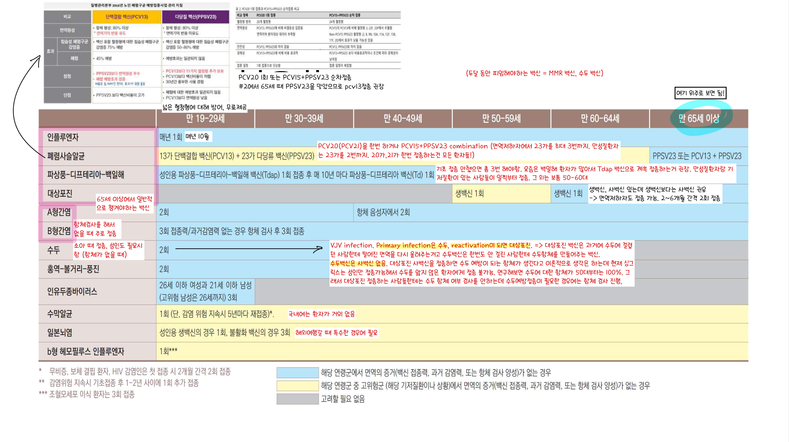
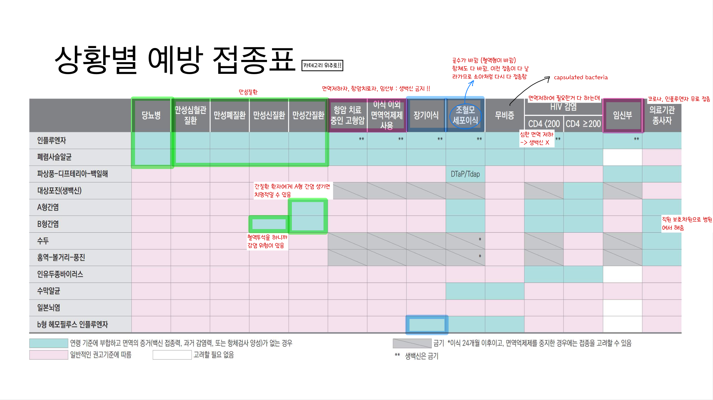

<!-- 필기본: 2025 -->
<!-- 단계: 수업 전 -->

# 0. 이 수업을 공부하는 법

CP-B2는 **성인 예방접종** 증례 토의다(감염내과 **권기태 교수님**). 다섯 증례를 조별로 발표했다.

| 증례 | 환자 | 생각할 것 |
|---|---|---|
| 1 | 18세 이후 접종력 없는 **건강한 65세** 남자 | 65세 이상 기본 백신 4가지 |
| 2 | 당뇨로 약 먹는 67세, **65세에 PPSV23** 맞음, 11월 방문 | 인플루엔자 시기, PPSV23 후 단백결합 백신 |
| 3 | 류마티스관절염으로 **고용량 MTX** 50세 | 면역억제 → 생백신 금기 |
| 4 | 한 달 전 교통사고로 **비장절제** 50세 여자 | 피막세균 백신 3가지 |
| 5 | **임신 28주**에 **야생 너구리**에게 물림 | 광견병 PEP + 파상풍 + 항생제 |

필기한 선배: "뒤에 두 장에 있는 **표(연령별·상황별 예방접종표)**만 이해하고 외우고 있으면 시험은 큰 문제 없을 것 같다. 개인적인 생각인데 **PPSV랑 PCV 비교**하는 걸 정말 정말 강조하신 것 같다."

기출 9문항은 거의 **두 가지 증례의 반복**이다: **비장절제 50세 여자**(1, 2, 8번)와 **동물 교상**(3, 4, 5, 9번). 나머지는 65세 건강인(6번)과 임신 30주(7번).

!!! key "핵심"
    - **PCV**(단백결합): T세포 의존 → **면역기억**, 혈청형은 좁음. **PPSV23**(다당): 혈청형 넓음, 기억 약함, 65세 이상 **무료**.
    - 현재 권고: **PCV20(또는 PCV21) 1회**, 또는 **PCV15 → (8주~1년 뒤) PPSV23**. 기출 시절 답은 PCV13 → PPSV23.
    - **비장절제**: 폐렴구균 + 수막구균 + **Hib** (+ 매년 인플루엔자). 수술 2주 전 또는 **2주 후**.
    - **야생동물 교상**: 상처 세척 + **광견병 면역글로불린 + 백신 4회** + **파상풍**(Td/Tdap ± TIG) + **amoxicillin-clavulanate**. 상처는 **일차 봉합하지 않는다**.
    - 면역저하자·항암·**임신부**: **생백신 금지**(MMR, 수두, 대상포진 생백신).

# 1. 성인 예방접종표 — 이 두 장을 외운다

{: style="width:100%"}

교수님 말씀(표 옆 필기)

- **인플루엔자**: 매년 1회, **매년 10월**.
- **폐렴사슬알균**: "**PCV20(PCV21)을 한 번** 하거나 **PCV15 + PPSV23** 조합. 면역저하자에서 23가를 **최대 3번**까지, 만성질환자는 23가를 **2번**까지. 20가·21가 한 번 접종하는 건 모든 환자들." 65세 이상이 일반적으로 챙겨야 하는 백신.
- **Tdap/Td**: 기초 접종을 안 했으면 총 3번. "요즘은 **백일해 환자가 많아서 Tdap 백신으로 계속** 접종하는 거 권장." 만성질환자·기저질환자는 일찍부터, 그 외는 보통 50~60대.
- **대상포진**: 생백신·사백신이 있는데 **사백신 권유** → 면역저하자도 가능, **2~6개월 간격 2회**.
- **A형·B형간염**: **항체 검사**를 해서 없을 때 주로 접종.
- **수두**: VZV — 처음 감염은 수두, 재활성화가 대상포진. 대상포진 백신은 과거에 수두 앓은 사람의 떨어진 면역을 올려 주는 것, 수두 백신은 한 번도 안 걸린 사람에게 항체를 만드는 것. **수두 백신은 사백신이 없다.** 수두 항체는 50대부터 거의 100%라 대상포진 접종 전에는 수두 항체 검사를 하지 않는다. 수두 접종이 필요한 경우에만 항체 검사.
- **두 달 동안 피임해야 하는 백신 = MMR, 수두**(생백신).
- 수막알균: 국내 환자가 거의 없다. 일본뇌염: 해외여행 갈 때 특수한 경우.
- 교수님: "**65세 이상 칸 위주로** 보면 된다."

{: style="width:100%"}

교수님 말씀 — "**카테고리 위주로!**"

- 당뇨, 만성심혈관·폐·신장·간질환 → 인플루엔자, 폐렴구균. **혈액투석**은 감염 위험이 있어 B형간염. **간질환** 환자에게 A형간염이 생기면 치명적일 수 있다 → A형간염.
- **면역저하자, 항암치료자, 임신부: 생백신 금지!**
- **조혈모세포이식**: 골수가 바뀐다(혈액형도 바뀜) → 항체도 다 바뀌고 이전 접종이 다 날아가므로 **소아처럼 다시 다** 접종.
- **무비증**: capsulated bacteria(피막세균) 백신.
- **HIV**: 면역저하에 필요한 것 다 하는데, **CD4 < 200**의 심한 면역저하면 **생백신 ×**.
- **의료기관 종사자**: 코로나·인플루엔자 무료 접종 — 직원 보호 차원으로 병원에서 해 준다.

# 2. 증례 1 — 건강한 65세 남자

18세 이후 접종력이 없는 건강한 65세. 나이가 들면 면역이 약해지고, 가족에게 옮기는 것도 막아야 한다(코쿤 전략).

| 백신 | 권장 | 일정 | 국가 지원 |
|---|---|---|---|
| **Tdap/Td** | Tdap 1회 먼저 | 이후 **10년마다 Td** | 미지원 |
| **폐렴구균** | PCV20 1회, 또는 PCV15 → 1년 뒤 PPSV23 | 1~2회 | **PPSV23만 무료** |
| **대상포진** | **재조합 백신(싱그릭스)** 2회 | 2~6개월 간격 | 미지원 |
| **인플루엔자** | 매년 1회 | 10~11월 | **무료** |

!!! exam "기출 포인트"
    6번(2020): 65세 건강인, 11월, **HBs 항체·HAV IgG 양성** → **인플루엔자, Tdap, 폐렴사슬알균, 대상포진** 4가지. 간염 항체가 있으니 A·B형간염 백신은 필요 없고, MMR·수두·HPV·수막구균·Hib은 해당 없음. (2020년 답에는 대상포진 **생백신**이 보기였다 — 지금은 재조합 백신 권장.)

# 3. 증례 2 — 당뇨 67세, 65세에 PPSV23

- 당뇨 → 면역저하, **감염 고위험군**. **11월 = 인플루엔자 유행 시기** → 인플루엔자 **즉시**.
- 65세에 보건소에서 **PPSV23**(무료)을 맞았다. PPSV23은 다당류 백신 → 혈청형은 넓지만 **면역기억 유도가 약하다**.
- 그래서 지금은 **단백결합 백신**을 추가: 발표에서는 PCV13, 필기 메모 "65세 때 PPSV23을 맞았으므로 PCV13 접종 권장". 두 백신은 기전이 달라 **1년 이상** 지난 뒤 추가하면 면역기억이 강화된다. (현재 권고로는 PCV20 또는 PCV21 1회.)
- **대상포진**: 50세 이상 세포면역 감소, 당뇨는 대상포진 후 신경통 위험 ↑ → **Shingrix** 2회(예방효과 90% 이상, 10년 이상 유지). 예전 생백신(Zostavax)은 면역저하자 금기.
- **Tdap** 1회, 이후 10년마다 Td/Tdap. 당뇨는 상처 치유가 늦어 파상풍 예방이 더 중요.

!!! memo "PCV와 PPSV — 교수님이 강조한 비교"
    | | PCV (단백결합: PCV13·15·20·21) | PPSV23 (다당) |
    |---|---|---|
    | 면역 | **T세포 의존** → 면역기억, 추가접종 반응 | T세포 비의존 → 기억 약함 |
    | 혈청형 | 좁음 | **넓음(23종)** |
    | 2세 미만 | 효과 있음 | 거의 없음 |
    | 국내 | 유료 | 65세 이상 **무료** |
    | 순서 | 먼저 PCV → **8주(~1년)** 뒤 PPSV23 | 먼저 PPSV23을 맞았으면 **1년 뒤** PCV |

# 4. 증례 3 — 고용량 MTX를 먹는 류마티스관절염 50세

- 류마티스 질환: 면역 조절장애로 인한 전신 염증성 질환. **MTX**는 dihydrofolate reductase를 억제해 DNA 합성을 막고 면역세포 증식을 억제 → **면역억제 상태**.
- 원칙: **생백신 투여 금지**, 사백신은 가능. 생백신이 꼭 필요하면 MTX를 중단하고 **4주 뒤**. 접종 **전후 1~2주** MTX를 쉬면 백신 효과가 더 좋다(독감 백신 반응률 75.5% vs 계속 복용 54.5%).
- 권장: **인플루엔자**(불활성화, 매년; 비강 생백신 금기), **폐렴구균**(PCV → 8주 후 PPSV23, 5년 뒤 PPSV23 1회), **B형간염**(항체 없으면 0·1·6개월), **A형간염**(항체 검사 후 음성이면 0, 6~12개월), **Tdap**(10년마다), COVID-19.
- 비권장: **MMR**(생백신), **HPV**(9~45세 대상이 아님), **대상포진 생백신**(금기; 재조합 백신은 고용량 MTX에서 근거 부족).
- 접종 일정 예: 오늘 인플루엔자·PCV·Tdap → 8주 후 PPSV23 → 항체 검사 후 A·B형간염 → 매년 인플루엔자.

# 5. 증례 4 — 비장절제 50세 여자 (기출 3문항)

> 한 달 전 교통사고로 비장절제술을 시행한 50세 여자가 예방접종을 위해 외과에서 의뢰되었다. 18세 이후 접종 이력 없음.

- 비장: 혈액 내 항원에 대한 적응면역(B·T세포 활성화)을 시작하는 장기. 절제하면 **혈중 Ig 생산 감소, T림프구 기능 감소** → **피막세균**(*S. pneumoniae*, *N. meningitidis*, *H. influenzae*) 감염에 취약. 비장 이외에서는 다당 항원에 대한 면역원성이 매우 낮다.
- 고려할 것 세 가지: **나이, 접종 이력, 비장절제**.

| 백신 | 일정 |
|---|---|
| **폐렴구균** | **PCV20 1회**(2024년 10월 국내 허가), 또는 PCV15 1회 → **최소 8주** 후 PPSV23. 5년 후 PPSV23 1회 재접종 |
| **수막구균** | **4가 단백결합(MCV4/MenACWY) 2회**(8~12주 간격), **5년마다** 재접종. **B혈청군** 백신도 함께(1개월 간격 2회, 이후 2~3년마다) |
| **Hib** | 접종력 없으면 **1회** |
| **인플루엔자** | **매년**(2차 세균감염 예방) |

- 시기: 계획된 수술이면 **수술 2주 전**, 이미 했으면 **수술 2주 후**.
- 그 밖에 50세 일반 성인 백신: 대상포진(RZV 2회), Tdap 1회 후 10년마다 Td, A형간염(40세 이상은 항체 검사 후), B형간염(0·1·6개월).

!!! exam "기출 포인트"
    - 1번(2023): 오늘 할 것 3가지 → **Hib 오늘, MCV4 오늘, PCV13 오늘**. PPSV23은 오늘이 아니라 PCV 8주 뒤, Hib은 성인 1회라 2개월 뒤 추가 없음.
    - 8번(2020): 비장절제와 관련해 권장할 백신 → **수막알균, 폐렴사슬알균, Hib**.
    - 2번(2022): 같은 증례를 그림(접종표)에서 고르는 문제.

# 6. 증례 5 — 임신 28주, 야생 너구리 교상 (기출 4문항)

- **야생 너구리 = 광견병 매개 동물**(국내 주요 매개). 교상은 dirty·major wound → **파상풍 예방**도 필요.
- 광견병: 바이러스가 **신경을 타고** 중추신경계로 올라간다. 잠복기 **20~90일**. 전구기는 비특이적, 급성 신경기는 날뛰거나(furious) 마비(paralytic). **증상이 나타나면 거의 치명적**, 특별한 치료가 없다.

**즉시 할 것: 상처 평가·세척·소독 → 광견병 PEP → 파상풍 → 예방적 항생제**

| 처치 | 내용 |
|---|---|
| 상처 | 비누와 물로 **15분** 충분히 세척, 소독. 교상은 **일차 봉합하지 않는다** |
| **광견병 면역글로불린 (HRIG)** | **20 IU/kg**, Day 0. **가능한 전량을 상처 안·주위에 침윤**, 남으면 백신과 다른 근육에. 백신 시작 후 7일 이내까지 가능. 과량은 능동면역 방해. **임신 중 사용 가능** |
| **광견병 백신** | PCECV 1.0 mL 또는 PVRV 0.5 mL **삼각근** IM(둔부 금지). **Day 0, 3, 7, 14** (면역저하 시 Day 28 추가). HRIG와 **같은 부위에 섞어 주사 금지**. 임신 중 가능 |
| **파상풍** | 접종력 없거나 불명 → **TIG 250 U** + **Td/Tdap**(임신 27~36주면 Tdap). 다른 부위에. 이후 4~8주, 6~12개월에 Td/Tdap 추가(총 3회) |
| **예방적 항생제** | *Pasteurella multocida*, *Capnocytophaga*, 연쇄상구균, 황색포도알균, 구강 혐기균 → **amoxicillin-clavulanate** PO q12h **3일**(감염 시 5~7일) |

- WHO 상처 분류: I(핥음·만짐 — PEP 불필요), II(가벼운 긁힘 — 백신), **III(피부를 뚫은 교상·점막 오염·박쥐 — 면역글로불린 + 백신)**.
- 개·고양이·페럿이 **10일간 건강**하면 광견병 위험 없음 → 관찰 가능하면 PEP 보류·중단 가능. 도망가서 관찰 못 하면 바로 시작.
- 설치류는 광견병을 거의 옮기지 않는다.

!!! exam "기출 포인트"
    - 5번·3번: 야생 너구리(5번), 강원도 길고양이(3번)에게 물렸는데 동물이 도망 → **광견병 백신 + 면역글로불린 + 파상풍 + amoxicillin-clavulanate 모두**.
    - 9번: 접종력 모르는 60세, 너구리 → **파상풍 면역글로불린, 광견병 면역글로불린, Td 백신, 광견병 백신** 4가지.
    - 4번: 들고양이 교상, 손목 2 cm 상처 — **"소독하고 일차 봉합"이 틀림**(교상은 열어 둔다). 면역글로불린은 가급적 교상 부위에 전량 ○.

# 7. 임신부 예방접종 (기출)

!!! exam "기출 포인트"
    7번(2020): 30세 **임신 30주**, 11월, HBs 항체·HAV IgG 양성 → **인플루엔자(불활성화) + Tdap** 두 가지. Tdap은 신생아 백일해 예방을 위해 **임신 27~36주**. MMR·수두·대상포진 생백신은 **임신 중 금기**.

# 암기 — CP-B2 요점

| 상황 | 꼭 기억할 것 |
|---|---|
| 65세 건강인 | 인플루엔자(매년 10월), 폐렴구균(PCV20 1회 또는 PCV15→PPSV23; PPSV23만 무료), 대상포진(재조합 2회), Tdap 1회→Td 10년마다 |
| PCV vs PPSV | PCV = 단백결합·T세포·기억 / PPSV23 = 다당·넓은 혈청형·기억 약함. PCV 먼저 → 8주 뒤 PPSV23 |
| 당뇨·만성질환 | 인플루엔자·폐렴구균 일찍부터. 투석 → B형간염, 간질환 → A형간염 |
| 면역억제(MTX) | 생백신 금지(필요하면 MTX 중단 4주 후). 접종 전후 1~2주 MTX 휴약 |
| 조혈모세포이식 | 소아처럼 처음부터 다시 |
| 비장절제 | 폐렴구균 + 수막구균(MCV4 2회, 5년마다; MenB) + Hib 1회 + 인플루엔자. 수술 2주 전/후 |
| 동물 교상 | 세척, 봉합 ×, HRIG 20 IU/kg 상처 주위 + 백신 Day 0·3·7·14 삼각근, TIG + Td/Tdap, amoxicillin-clavulanate 3일 |
| 임신부 | 불활성화 인플루엔자 + Tdap(27~36주). 생백신 금지. MMR·수두 후 2달 피임 |
