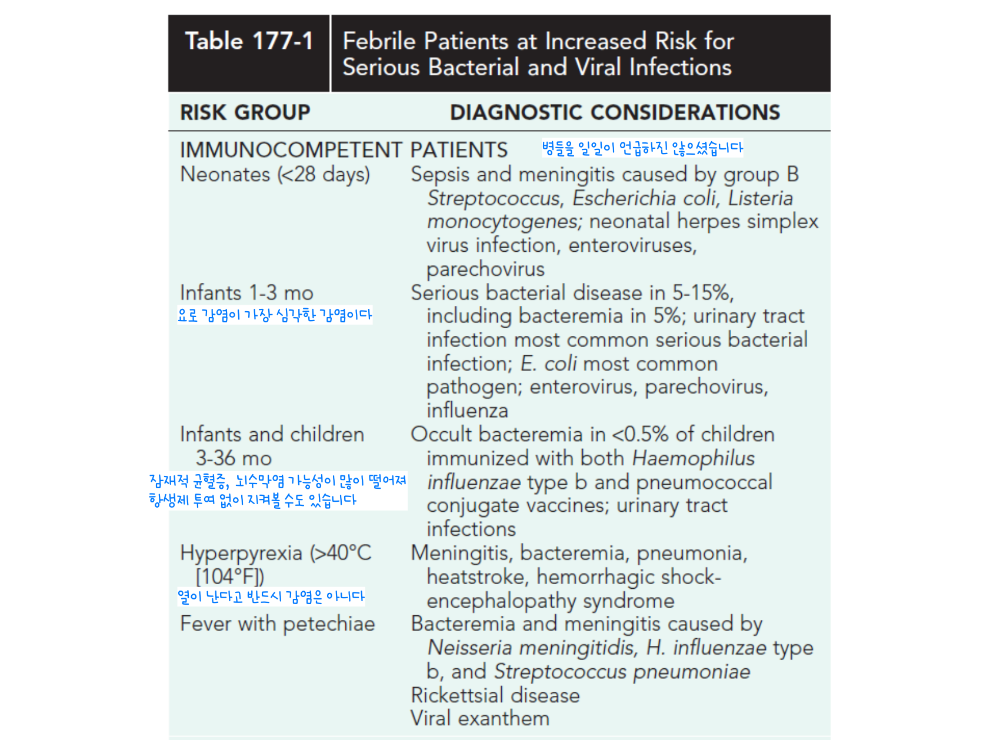
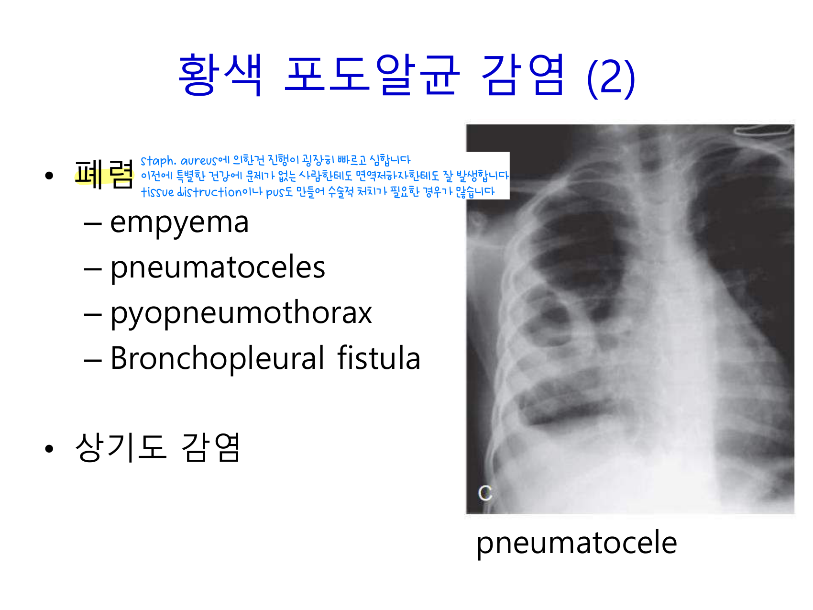
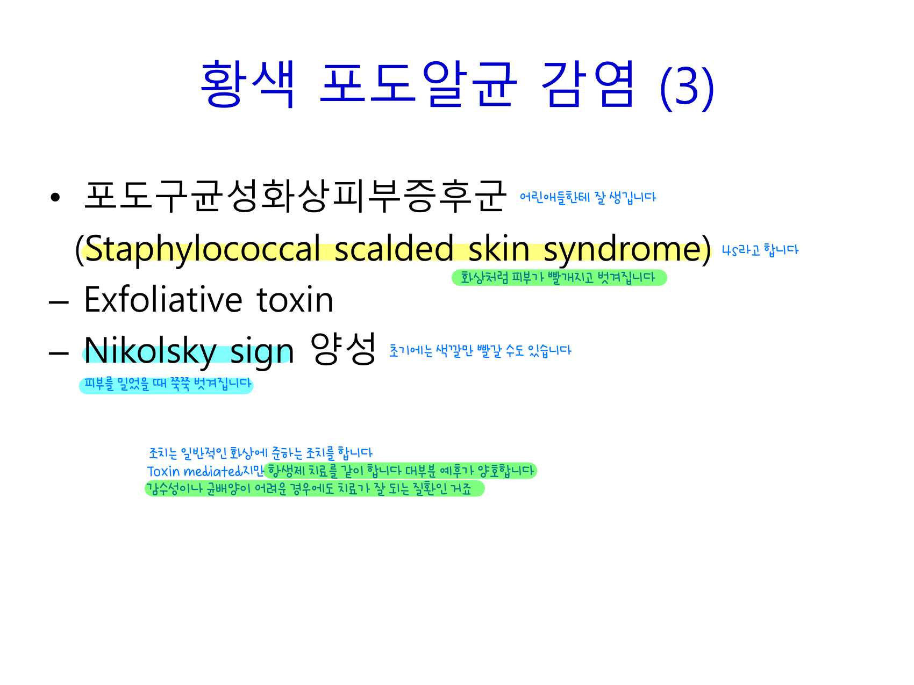
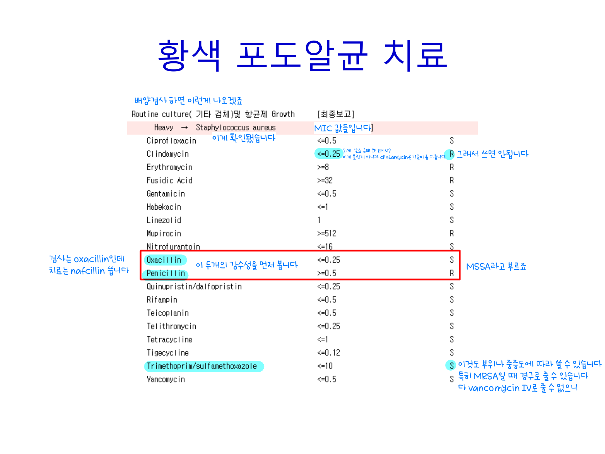
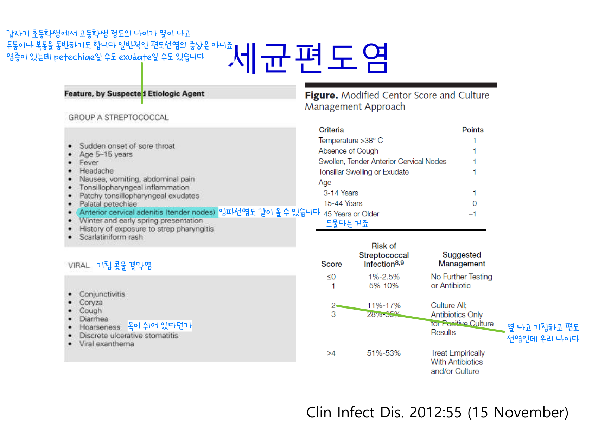
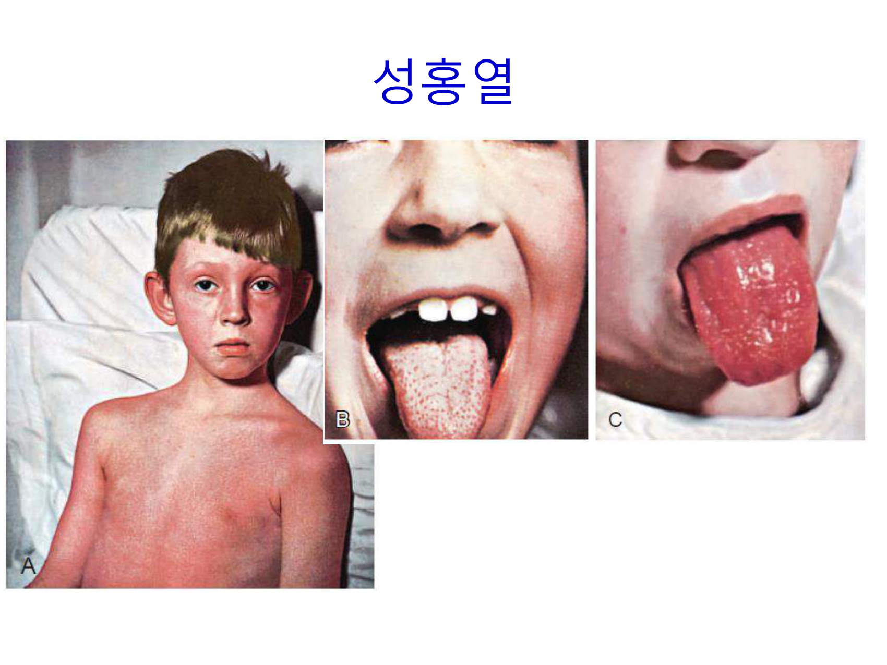
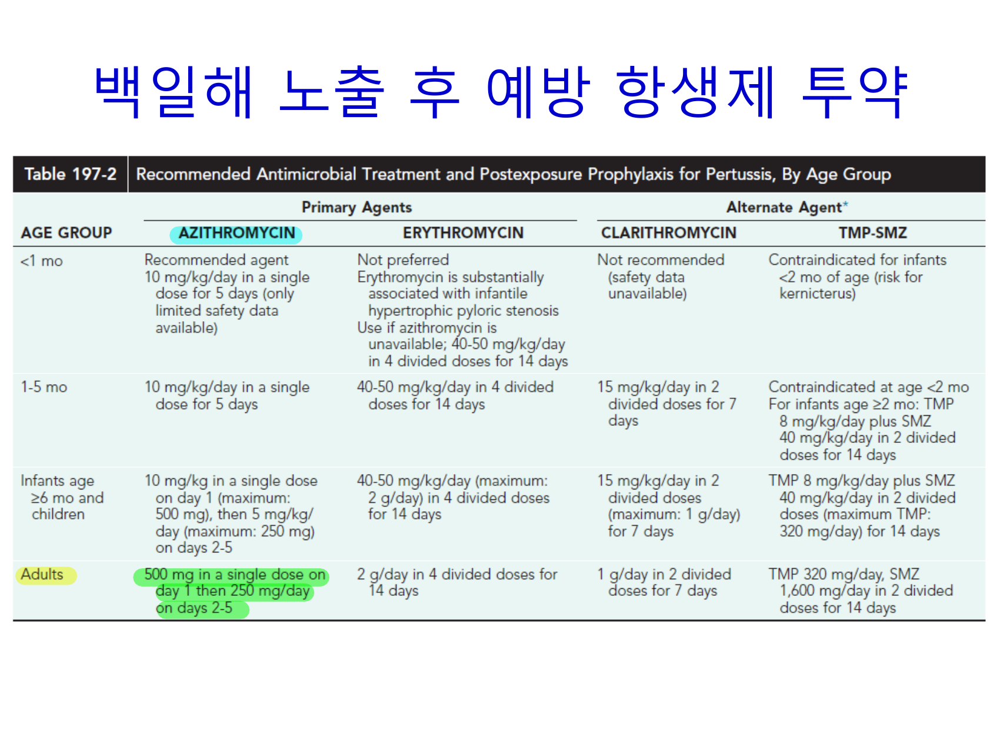
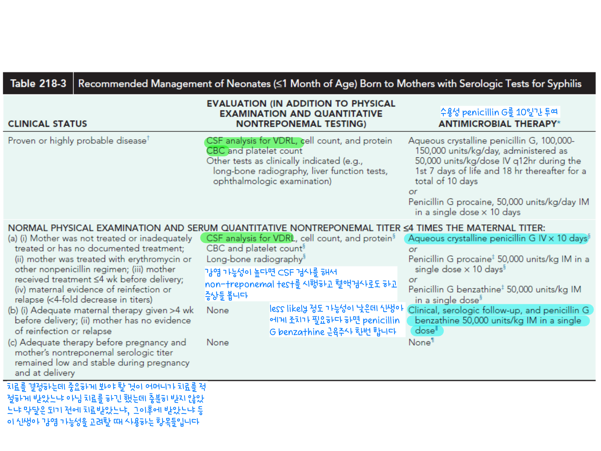

<!-- 필기본: 2025 -->
<!-- 단계: 수업 전 -->

# 0. 이 수업을 공부하는 법

소아청소년과 감염 **김동섭 교수님** 수업("소아청소년의 세균감염"). 어린이에게 영향을 주는 질병 위주로 균을 하나씩 다룬다.

필기 순서: 국소증상 없는 발열(신생아 / 1–3개월 / 3개월–3세) → 황색포도알균 → A군 사슬알균(세균 편도염, 성홍열) → B군 사슬알균 → 폐렴사슬알균 → 디프테리아 → 인플루엔자균 → 수막알균 → 백일해 → 클라미디아 → 선천매독

- 기출 22문항(2020–2025)은 사례 다섯 가지가 반복된다.
    1. **생후 3–6주, 발작성 기침 + 구토 + 무호흡 + 가족(아버지·형·누나)이 1–2개월 기침** → **백일해**(7번 출제).
    2. **비장절제한 3–4세 + 발열·두통·경부강직** → CSF 그람염색으로 가른다: **그람양성 쌍알균(lancet) → 폐렴사슬알균**, **그람음성 알균(+ 자반) → 수막알균**.
    3. **편도염**: 기침·콧물 없음 + 목 림프절 압통 → **신속항원검사**, 음성이면 **인후 배양**, 양성(사슬 그람양성균)이면 **amoxicillin**. **기침이 있으면 바이러스 → 항생제 없이 원인 조사.**
    4. **선천매독**: 산모가 **분만 1주 전**에 치료 + 신생아 간비종대·VDRL이 엄마의 4배 이상 → **aqueous penicillin G 10일 정주**.
    5. **신생아 발열**: 혈액·소변·CSF 배양 + ampicillin·cefotaxime(HSV 의심이면 HSV PCR·acyclovir).
    - 2025년: 소아 화농성 고관절염, MSSA → **cefazolin**.

!!! key "핵심"
    **36개월 미만의 국소증상 없는 발열**은 나이로 나눈다 — **신생아(<28일)는 무조건 입원 + 배양 3종 + ampicillin·gentamicin(cefotaxime)**, 1–3개월은 아파 보이면 입원 + ampicillin·cefotaxime, 3개월–3세는 Hib·PCV를 맞았으면 관찰 가능.
    **감수성 = 쓸 수 있다가 아니다** — 감염 부위에 도달하는 약(BBB·뼈)을 고른다. MSSA는 **nafcillin/cefazolin**, MRSA는 **vancomycin**.
    **편도염의 항생제는 합병증(류마티스열)을 막으려고** 쓴다 — 페니실린·amoxicillin **10일**.

# 1. 국소증상 없는 발열 (fever without focus)
- **36개월 미만** 영아·어린 소아에서 진찰로 열의 원인 부위를 찾지 못하는 발열. 성인에게는 이 말을 쓰지 않는다.
- **심각한 세균감염이 7–13%** 에 있을 수 있어 따로 구분한다.
- **Hib·폐렴사슬알균 백신** 덕에 두 균에 의한 감염은 현저히 감소.
- 36개월 아래에서도 나이에 따라 양상이 달라 다시 나눈다.

{: style="width:52%"}

## 신생아 (생후 28일까지)
- 진찰로 감별이 어렵고 면역이 미숙(면역저하자라고 하지는 않음) → **열이 나면 입원.**
- 위험 균: **B군 사슬알균(*S. agalactiae*), *E. coli*, *L. monocytogenes*, HSV.**
- **혈액·요·뇌척수액 배양** 후 **경험적 항생제**. **HSV·장바이러스 검사**도 고려 — 증상이 맞거나 **산모에게 성기 궤양**이 있었는지.
- **Ampicillin + gentamicin(또는 cefotaxime)**, **HSV 의심 시 acyclovir 추가**. 배양으로 확정되면 맞춤 치료로 전환(HSV 확진이면 항바이러스제만).

## 1–3개월
- **심하게 아파 보이면 입원** → 혈액·요·CSF 배양 후 항생제. 아파 보이지 않으면 통원도 가능할 수 있다(점수화는 쉽지 않다).
- 고려 균: GBS, *Listeria*, *Salmonella enteritidis*, ***E. coli***, 수막알균, 폐렴사슬알균, Hib, *S. aureus*.
- **신우신염이 이 연령의 가장 흔한 심한 세균 질환** → **소변검사 없이 외래에서 항생제를 주면 안 된다.**
- **Ampicillin + cefotaxime.** **수막염 의심 시** 배양·감수성 확인까지 **vancomycin 추가**(3세대 세파 내성 폐렴사슬알균).
- 그래서 3개월 미만은 보통 큰 병원으로 보낸다.
- 이전에 건강, **아파 보이지 않음, 백혈구 정상, 국소 감염 증거 없음, 정상 소변검사, 혈액·요 배양 음성**이면 심한 세균감염이 없을 가능성 **>98%**, 균혈증이 없을 가능성 **>99%**.

## 3개월–3세
- 심하게 아파 보이면 입원 → 배양 후 항생제.
- **Hib 백신과 폐렴사슬알균 단백결합백신을 맞았으면** 잠재 균혈증·수막염 가능성이 낮아 **항생제 없이 관찰**할 수 있다.
- 이 나이엔 **요로감염**이 가장 심각한 감염. 열이 난다고 반드시 감염은 아니다.
- 그 밖에 고열(>40℃)은 수막염·균혈증·폐렴·열사병·출혈성 쇼크–뇌병증 증후군, **점상출혈 + 발열**은 수막알균·Hib·폐렴구균 균혈증과 수막염, 리케차 질환, 바이러스 발진.

!!! exam "기출 포인트"
    21번: 생후 24일, 39℃·보챔·수유 1/3 감소, 원인 부위 없음 → **혈액·소변·CSF 배양** + **입원해 ampicillin·cefotaxime 정주**. 오답 — B형 간염 접종, 불명열 검사(결체조직·악성) 먼저, 해열제 주고 귀가. 16·19번(신생아 + 두피 수포/산모 외음부 궤양) → **배양 3종** + **피부 병변 HSV PCR**/**정주 acyclovir**(17강과 같은 사례). 함정 — 48시간 관찰 후 결정, 산모가 분만 시 항생제를 맞았으면 관찰, 경구 acyclovir.

# 2. 황색포도알균 (*Staphylococcus aureus*)
- **Coagulase 양성균.** **침윤 감염 + 독소 매개 질환**을 함께 일으킨다.
- **간헐적 보균율 70%까지**(일시적으로 갖고 있다 소실되는 경우 포함) — 일상에서 많은 사람이 가진 균, 특히 병원에서.
- 대개 **직접 접촉**으로 전파 → **철저한 손씻기**로 막는다.
- **반복 감염이면 면역기능 평가**(16강 CGD 등).

## 질환
- **피부·연조직**: 농가진, 모낭염, 종기(furuncle), 큰종기(carbuncle) — 딱 떨어지지 않는 경우도 많다.
- **폐렴**: **농흉, 폐기류(pneumatocele)**, 농기흉, 기관지흉막루. 진행이 **굉장히 빠르고 심하며**, 건강한 사람·면역저하자 모두. 조직 파괴·고름 → **수술적 처치**가 필요한 경우가 많다. 상기도 감염도.

{: style="width:58%"}

- **포도알균 화상피부증후군(SSSS, 4S)**: **exfoliative toxin**, **Nikolsky 징후 양성**(피부를 밀면 쭉쭉 벗겨짐). 어린아이에게 잘 생기고 화상처럼 빨개지며 벗겨진다(초기엔 색깔만 빨갈 수도). 독소 매개지만 **항생제를 같이** 주고 대부분 예후 양호 — 균배양이 어려워도 치료가 잘 된다. 조치는 **일반 화상에 준한다**.

{: style="width:58%"}

- **독성쇼크증후군(TSS)**: 고열, **저혈압**, 구토·설사, 근육통, 신경학적 이상, 결막충혈, **딸기혀**, **손발 홍반 발진 후 탈피**. **탐폰·질내 장치**와 연관. 의심하지 않으면 알기 힘들다.
    - 진단 기준 — **Major: 급성 발열, 발진, 저혈압** / Minor: 점막 염증, 구토·설사, 간·신장·근육·CNS 이상, 혈소판감소 / 배제: 다른 질환으로 설명 불가, 혈액배양 음성(*S. aureus*는 예외).

## 치료
- **감염원 제거가 필수**(복강내 농양 배액, 중심정맥관 같은 이물 제거).
- **위중한 감염**은 감수성 확인까지 **vancomycin + nafcillin(또는 cefazolin)** 병용(최근 권장).
- **MSSA**: amoxicillin/clavulanate, **1세대 세팔로스포린(cefazolin)**, **nafcillin**. 검사는 **oxacillin**으로 하고 치료는 nafcillin을 쓴다.
- **MRSA**: **glycopeptide(vancomycin, teicoplanin)** — **혈중 약물농도를 모니터링**(요즘은 AUC/MIC). 사람마다 다르다.
- **Clindamycin, ciprofloxacin, TMP/SMX**는 감수성이면 사용 — 특히 MRSA를 **경구**로 줄 때(다 vancomycin IV로 줄 수는 없으니).
- **더 중요한 것은 감염 부위에 도달하는 약인가.** **1세대 세파(cefazolin)·clindamycin은 BBB를 통과하지 못해 CNS 감염에 못 쓴다**(MSSA라 cefazolin을 쓰다 두통 → 뇌농양이면 바꿔야). 골수염도 뼈에 잘 가는 약이 정해져 있다.

{: style="width:58%"}

- 감수성 결과 읽기: **oxacillin과 penicillin** 감수성을 먼저 본다. Oxacillin S면 **MSSA**. Clindamycin은 MIC가 낮아 보여도 기준이 달라 R이면 쓰면 안 된다(유도 내성).
- 결과는 그람염색 → 균 동정 → 감수성 순으로 시간이 걸린다. 그동안 임상 경과를 보며 결정.
- 감수성 있는 약을 써도 안 좋아지면 **용량·용법, 치료 안 된 다른 균, 목표 부위 도달**을 확인한다. **nafcillin을 쓰는데 나빠진다고 vancomycin으로 바꾸면 안 된다** — vancomycin은 "뿅망치 같은 약", 범위는 넓지만 살균력이 약하다.

## 증례 — 9세 남자, 3일 발열 + 허벅지 통증
- 영상에서 좌측 관절에 무언가 차 있음(고름인지 알 수 없음), WBC·CRP 상승 → **화농성 관절염** 생각 → **혈액배양 + 병변 흡인 배양**.
- 처음엔 **vancomycin + nafcillin** → 배양에서 **oxacillin 감수성(MSSA)** → **nafcillin만**. 감수성이라도 **뼈·관절에 갈 수 있는 약**을 써야 한다.

!!! exam "기출 포인트"
    1번(2025): 6세, 허벅지·고관절 통증·발열 + MRI + 천자 배양(MSSA) → **cefazolin**. 함정 — vancomycin(MSSA에 열등), clindamycin, rifampin 단독, ampicillin(페니실린 내성).

# 3. A군 사슬알균 (*Streptococcus pyogenes*)
- 소아 **상기도·피부 감염**의 흔한 병원체: 급성 인두염(**세균 편도선염**)·폐렴, **성홍열**, 피부·연조직염, 중증 침습질환.

## 세균 편도염 — 사진만으로는 "알 수 없습니다"

{: style="width:66%"}

- **A군 사슬알균을 시사**: **갑작스러운 인후통**, **5–15세**(초등–고등학생), **발열**, 두통, 구역·구토·**복통**(일반 편도염 증상이 아님), 편도·인두 염증, **편도 삼출물** 또는 **구개 점상출혈**, **전경부 림프절 압통·종대**, 겨울–초봄, 노출력, 성홍열 발진.
- **바이러스를 시사**: **결막염, 콧물(coryza), 기침, 설사, 쉰 목소리**, 궤양성 구내염, 바이러스 발진 — "열 나고 기침하고 편도선염인데 우리 나이다"는 바이러스.
- 수정 Centor 점수: 체온 >38℃, **기침 없음**, 전경부 림프절 압통·종대, 편도 종창·삼출물, 나이 3–14세 +1 / 15–44세 0 / ≥45세 −1. 점수가 높을수록 배양·항생제.

## 진단
- **신속항원검사(rapid antigen test)**: **민감도 70–90%, 특이도 95%** → **양성이면 확실**, **음성이면 인후 배양으로 확인**(back-up culture). 임신 검사 같은 방식, 양성·음성만 안다.
- **인후 배양(throat swab culture)**: 민감도 **90–95%**, 항균제 감수성도 알 수 있다.
- **ASO, anti-DNase B**: **항체** 검사라 **급성기에는 보지 않는다**(합병증 진단용).

## 성홍열
- **발열외독소**를 만드는 A군 사슬알균 감염. 어린이에게 잘 생기고, 편도염이 주로 동반되지만 **독소 증상이 더 두드러진다**.
- 열, 두통, 구토, 복통, 오한, 인두염으로 시작 → **흰 딸기혀 → 붉은 딸기혀**(빨갛고 오돌토돌), **미만성 선홍색 구진 — 햇빛에 탄 피부에 소름이 돋은 듯**(사포 같은 발진), **손톱 끝·손바닥·발바닥 표피 탈락**.

{: style="width:60%"}

## 합병증
- 화농성: **경부 림프절염, 편도주위·인두뒤 농양**, 중이염, 꼭지돌기염, 부비동염, 폐렴, 수막염, 골수염, 화농관절염.
- **비화농성(아급성, 우리가 염려하는 부분)**: **급성 사구체신염, 류머티즘열**, 감염 후 반응성 관절염, **PANDAS**(소아 자가면역 신경정신 장애).
- **합병증을 막기 위해 진단하고 치료한다.**

## 치료
- **Penicillin, amoxicillin**(가장 기본), cephalosporin, clindamycin, macrolide.
    - 대부분의 β-lactam에 감수성이라 신속항원검사만 하고 써도 문제가 없다.
    - clindamycin·macrolide는 **약물 과민반응** 때문에 쓰는 약이지 내성 편도염이라 쓰는 게 아니다. 심각한 감염에 쓸 땐 내성을 봐야 한다.
- **대부분의 경구 항생제는 10일.** 보통 3일 안에 좋아진다.

!!! exam "기출 포인트"
    12번: 12세, 39℃, **기침·콧물 없음**, 경부 림프절 압통, 인두 충혈 → 진단 검사 **편도 세균 신속항원검사**. 9번: 신속검사 **음성** → **인후 세균배양**(ASO·anti-DNase B는 급성기 X). 7번: 8세, 기침·콧물 없음 + 림프절 압통 + 배양에서 **긴 사슬 그람양성균** → **amoxicillin**. 4번(2025): **2세**, 목 림프절 없음, **반복적 기침** + 신속항원 결과(음성) → **항생제 없이 추가 원인조사**(바이러스 가능성).

# 4. B군 사슬알균 (*Streptococcus agalactiae*)
- 신생아·어린 영아에게 문제. **조발형(생후 7일 이내, 대부분 48–72시간 내)** — 분만 과정에서 산모의 균을 얻은 것 → **패혈증, 폐렴, 수막염**. **지발형(그 이후)** — 균혈증, **수막염**, 골관절, 피부연조직, 요로·폐 감염.
- **예방: 집락화된 임산부에게 분만 중 항생제** → 미국에서 **조발형은 감소, 지발형은 변화 없음**. 제왕절개의 수술 예방 항생제가 GBS에 같이 듣기도 한다.
- **치료: penicillin G, ampicillin.** 감수성이 좋아도 빨리 진단해 치료하는데도 사망하기도 한다 — 감수성이 중증도를 말해주지 않는다.

# 5. 폐렴사슬알균 (*Streptococcus pneumoniae*)
- **상기도 정상 균총** — 소아 90% 이상에서 **6개월–4, 5세** 사이에 분리, **유아원** 다니는 아이 보균율이 높다(코·인후).
- **단백결합백신** 이후 침습감염 감소.
- 고위험군(발병도 많고 심함): **낫적혈구빈혈, 무비증(비장절제), 체액면역결핍, AIDS, 종양, 보체결핍, CSF 누출, 인공와우 이식**.
- 질환: 중이염, 부비동염, 폐렴, 패혈증 → 균혈증 후 **뇌수막염**, 골수염, 화농관절염, 심내막염, 뇌농양 / 농흉, 심막염, 유양돌기염, 경막외농양, 눈주위 연조직염 / **용혈요독증후군, DIC**. 상기도 감염보다 **침습 세균 감염**을 더 주시한다.
- 진단: 감염 부위·혈액·무균 체액에서 분리. **그람양성 쌍구균**(lancet 모양). 폐렴·수막염·관절염·골수염·복막염·심막염이면 **혈액배양 반드시** — 객담·CSF에서 안 나와도 혈액에서 나올 수 있다. Latex 응집검사는 예민도가 낮다.
- 치료: **페니실린 내성 증가**. 접종을 받은 합병증 없는 지역사회 폐렴은 **ampicillin·penicillin G**, 접종이 부족하거나 내성률이 높은 지역은 **3세대 세파**. **수막염이면 감수성 확인까지 3세대 세파 + vancomycin.**
- 국내 소아 침습 세균감염(1996–2020): 폐렴사슬알균·인플루엔자균은 계속 감소, ***S. aureus*는 증가**.

!!! exam "기출 포인트"
    **비장절제한 3세 + 발열·두통·경부강직 + WBC 25,000** → CSF 그람염색으로 가른다. **lancet 모양 그람양성 쌍알균 → 폐렴사슬알균**(2·5번). **그람음성 알균(+ 자반 발진) → 수막알균**(6·11·14번).

# 6. 디프테리아
- 예방접종 효과로 **국내엔 거의 없다.**
- 코·인두·편도·후두 주위에 **거짓막(pseudomembrane)**.
- 합병증: **심근염**, 신경계, 부종·단백뇨, 혈관중추 이상에 의한 저혈압·심부전.
- 치료: **디프테리아 항독소 + erythromycin.**
- 접촉자 예방: 잘 관찰, **5년 이내 추가접종을 안 했으면 DTaP/Tdap/Td 추가접종** + **erythromycin 7일 경구**.

# 7. 인플루엔자균 (*Haemophilus influenzae*) — "독감 아닙니다"
- 피막형·비피막형. 피막 다당 **PRP(polyribophosphate)** 가 발병에 중요. 건강한 소아의 60–90%에서 호흡기 정상 균총.
- 백신 전 침습감염의 주원인은 **b형(Hib)** → 백신 타겟. **단백결합백신 도입 후 Hib 침습감염 95% 이상 감소**(이제 b형 이외가 보고된다).
- 침습감염도 일으키지만 **중이염·부비동염** 같은 상기도 감염의 주요 원인균.
- 질환: **수막염(청각장애가 남을 수 있음)**, 연조직염, **급성 후두개염(갑작스러운 호흡 폐쇄)**, 폐렴, 화농관절염, 심막염, 균혈증, 목젖염, 골수염, 신생아 감염, 중이염, 부비동염, 결막염.
- 치료: ampicillin 감수성이면 ampicillin, **3세대 세파**, amoxicillin/clavulanate. **수막염에 dexamethasone을 항생제 직전·동시** → 청각장애 감소(Hib인 줄 알고 치료하는 건 아니고 결과는 나중에 나온다).
- 예방: 가족 내 **Hib 접종을 완전히 안 받은 48개월 미만 소아**가 있으면 중증 Hib 환자와 접촉 시 **온 가족 rifampicin(20 mg/kg/일, 최대 600 mg) 4일**.

# 8. 수막알균 (*Neisseria meningitidis*)
- 건강한 소아의 2–5% 비인두에. **보체결핍, 무비증**이면 위험 증가.
- 질환: 잠재 균혈증, **급성 수막알균혈증**, 수막염·뇌염, 만성 수막알균혈증, 폐렴·심내막염·화농 심낭염·관절염·안구염·골수염.
- **점상출혈**이 있으면서 빠르게 진행 + 고열 + 의식 저하 + 두통이면 **반드시** 생각. 눌러도 없어지지 않는다. 피부에서 배양해도 나올 수 있다.
- 진단: 혈액·CSF·관절액·피부에서 분리. **수막알균 감염이면 보체결핍(무비증도) 확인.**
- 치료: **penicillin G, ampicillin, 3세대 세파.**
- 예방: 밀접 접촉자(의료진인 경우가 많다) **rifampin 2일, ceftriaxone 1회, ciprofloxacin 1회**. **환자도 cefotaxime·ceftriaxone으로 치료받지 않았다면** 보균 제거 예방이 필요.

# 9. 백일해 (*Bordetella pertussis*) — "요즘에 많습니다"
- 소아 감염 중 **전염력이 가장 강한** 질환 중 하나, **1세 미만 사망률이 높다.** **사람이 유일한 숙주**, 직접 접촉·비말.
- **잠복기 평균 7일** → 6–8주간 3단계.
    - **카타르기(1–2주)**: 콧물, 결막염, 눈물, 경미한 기침 — 감기라 생각한다. **가장 전염력이 강한 시기.**
    - **경해기(발작기)**: 기침 시작 2주 말부터 **발작성 기침, whooping**(흡기 때 "웁" 소리), 2–4주 이상. 오래간다 — 뇌출혈이 생길 정도로.
    - 회복기.
- 영아는 whoop 없이 **발작성 기침 + 구토 + 무호흡(apnea)** 으로 오기도 한다.
- 진단: **접촉 병력 + 특징적 기침 + 절대 림프구 증가**, 배양, **PCR**(가장 많이 씀). 그래서 접촉력 조사를 같이 한다.
- 치료: 항생제 치료 **5일간 호흡기 격리**, 구토 관련 영양 공급(기침이 심하면 못 먹음), **macrolide(azithromycin, erythromycin, clarithromycin)**, TMP/SMX.
- 예방: 예방접종, **가족·밀접 접촉자 예방 항생제**.

{: style="width:66%"}

- **1개월 미만은 azithromycin**(10 mg/kg 5일)이 권장 — erythromycin은 **비후성 유문협착** 위험, clarithromycin은 자료 부족, TMP/SMX는 **2개월 미만 금기**(핵황달).

!!! exam "기출 포인트"
    **생후 3–6주 + 심한 발작성 기침 + 수유 감소 + 반복 구토 + 간헐적 무호흡 + 가족(아버지·형·누나)이 1–2개월 기침** → ***Bordetella pertussis***(8·10·13·17·20·22번). 15번: *B. pertussis* — 호기성 그람음성 짧은 막대균·비운동성, **PT 독소가 cAMP 증가**, **Regan-Lowe·Bordet-Gengou** 배지에 3일 뒤 **진주색** 작은 집락, **카타르기 전염성이 매우 높다** — 모두 맞음.

# 10. 클라미디아
- **트라코마(*C. trachomatis*)** — 산모가 감염된 경우가 많다.
    - **분만 5–14일 후 결막염** → 산모 치료가 중요.
    - **폐렴: 생후 1–3개월 서서히, 발열·천명음 없음**(무열성 폐렴, 스타카토 기침).
    - **erythromycin, azithromycin**(macrolide).
- ***Chlamydia pneumoniae***: 소아·성인 하기도 질환의 흔한 원인, **비정형 지역사회 폐렴**의 대표 원인 — *Mycoplasma*와 감별이 어렵다.

# 11. 선천매독
- 매독 임산부로부터 **태반 또는 출산 과정**에서 *Treponema pallidum* 감염. 국내엔 거의 없다(초기에 제대로 치료받지 못하면 생김).
- **조기(2세 전)**: 비염(snuffles), 피부·점막 증상, **간비장비대**, 뼈 변화(뼈연골염·뼈막염), CNS 이상.
- **만기(2세 이후)**: 간질성 각막염, 코 변화(안장코), 귀먹음, 치아 변화(Hutchinson 치아), 뼈막염.
- 진단: 병력·진찰, 골 X선, **현미경 암시야 검사, 매독 혈청검사**. 대부분 "**임산부가 매독 가능성이 있다**"에서 시작 — 임산부 정기검진 항목.
- CDC 4 시나리오: ① 확실/매우 가능성 높음 ② 가능성 있음 ③ 가능성 낮음 ④ 가능성 매우 낮음.

{: style="width:70%"}

## 치료
- **임산부는 출산 4주 이전에 치료 완료**해야 한다.
- 출생 후: **수용성(aqueous) 페니실린 G 100,000–150,000 U/kg/일 정주** 또는 procaine 페니실린 50,000 U/kg/일 근주 **10일**. 치료 후 **nontreponemal 역가 감소** 확인.
- **확실/매우 가능성 높음**(진찰 이상, 또는 신생아 nontreponemal 역가가 **엄마의 4배 이상**) → CSF VDRL·세포수·단백, CBC 등 검사 + **aqueous penicillin G 10일**.
- **가능성 낮음**인데 조치가 필요하면 **benzathine penicillin G 근주 1회**.
- 결정에 중요한 것: 엄마가 **적절하게** 치료받았는지, 충분히 받았는지, **분만 4주 전에** 받았는지.

## 증례 — 외국인 산모, 임신 초기 본국에서 치료(내역 확인 불가), 분만 직전 VDRL 1:16
- 분만 시 nontreponemal 역가가 양성이면 **신생아는 반드시 매독 확인**. 신생아 역가가 4배면 CBC부터 다 한다. "치료 이후에도 양성일 수 있다"고 그냥 보내면 안 된다.
- 이 증례는 **highly probable** → **aqueous penicillin G**. 감염 시기를 모르는 산모는 **benzathine penicillin G 1주 간격 3회**.

!!! exam "기출 포인트"
    3·18번: 임신 3분기 매독, **분만 1주 전 치료 완료**(4주 전이 아님 = 부적절), 엄마 VDRL 1:4, 신생아 **간비종대 + VDRL 1:32**(엄마의 8배) → **aqueous crystalline penicillin G 10일 정주**. 함정 — benzathine 1회 근주, ampicillin, erythromycin, 치료 없이 재검.

!!! memo "암기"
    **신생아 발열**: 입원, 배양 3종, ampicillin + gentamicin/cefotaxime (+ acyclovir) · **1–3개월**: 신우신염 최다, ampicillin + cefotaxime (+ vanco if 수막염) · **MSSA**: nafcillin/cefazolin, **MRSA**: vancomycin(농도 모니터링), cefazolin·clindamycin은 CNS X · **SSSS** = exfoliative toxin, Nikolsky · **편도염**: 기침 없음·림프절 압통 → 신속항원(특이도 95%) → 음성이면 배양 → amoxicillin **10일** · **성홍열**: 딸기혀, 사포 발진, 손발 탈피 · **GBS**: 조발형 7일 내, 분만 중 예방 · **비장절제 + 수막염**: 그람양성 쌍알균 = 폐렴구균, 그람음성 알균 = 수막알균 · **Hib 접촉**: 가족 rifampicin 4일 · **수막알균 접촉**: rifampin 2일/ceftriaxone 1회/cipro 1회 · **백일해**: 영아 무호흡·구토 + 가족 장기 기침, 카타르기 전염력 최고, azithromycin(1개월 미만도) · **선천매독**: 분만 4주 전 치료, 신생아 역가 4배 → aqueous penicillin G 10일.
