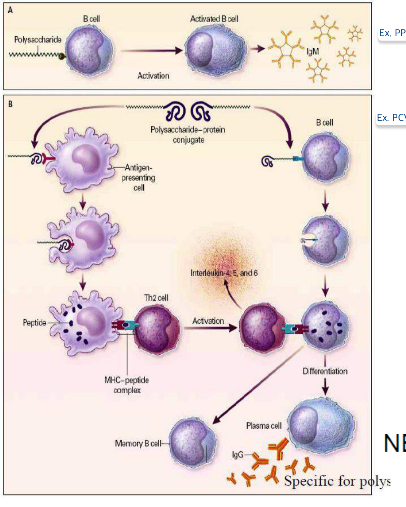
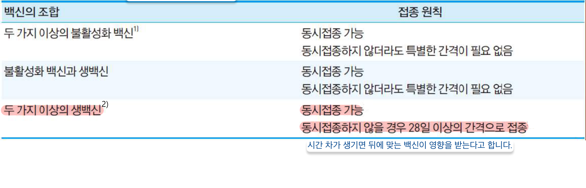
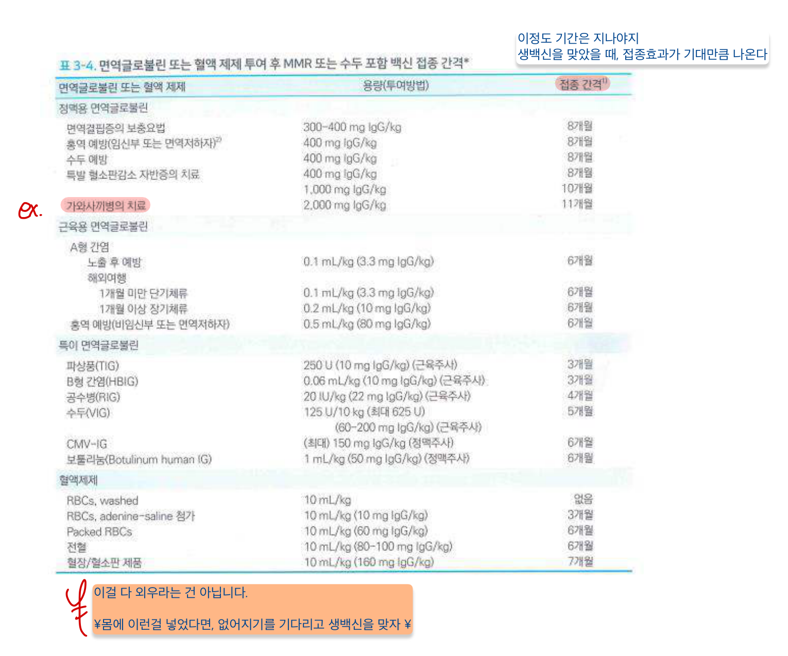
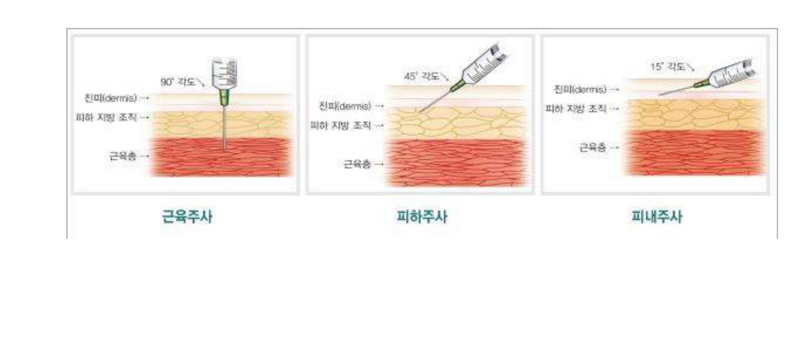
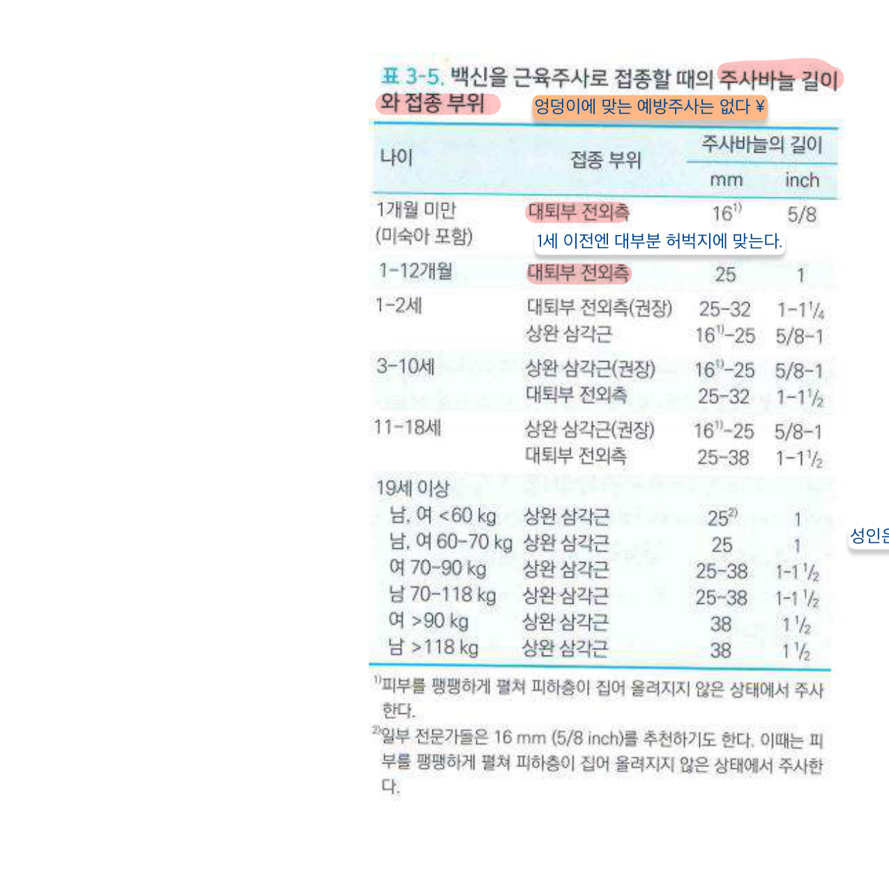
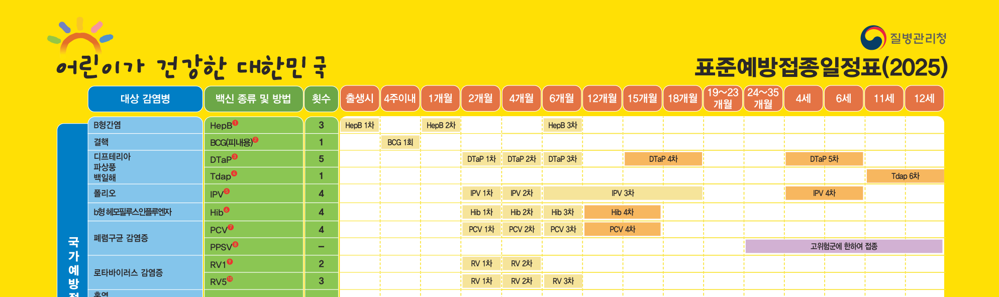

<!-- 필기본: 2025 -->
<!-- 단계: 수업 전 -->

# 0. 이 수업을 공부하는 법

**예방접종**(소아감염, **김동섭 교수님**) 강의다. 앞부분 **총론**(면역기전, 백신 종류, 일정·간격, 면역글로불린, 접종 방법, 금기)과 뒷부분 **각론**(백신별 대상·시기·이상반응·금기)으로 되어 있다. 다음 수업 **CP-C2(31번)**에서 이 내용을 증례로 다시 다룬다.

기출이 **66문항**으로 인체감염학에서 가장 많다. 2부를 풀어 보면 거의 같은 문제가 해마다 돌아온다.

| 반복 패턴 | 정답 방향 | 2부 문항 예 |
|---|---|---|
| 건강한 **N개월·N세** 아이가 **오늘** 맞을 접종 | 표준예방접종일정표에서 그 나이 칸 | 3, 9, 10, 17, 18, 28, 29, 36, 41, 49, 57 |
| **고용량 IVIG**(가와사키 2 g/kg) 후 접종 | MMR·수두는 **11개월** 연기, **사백신은 바로** | 16, 20, 30, 38, 50, 58 |
| **SCID**·장중첩증·계란 알레르기 — 금기는? | SCID → **생백신**(BCG·로타·수두) 금기, 장중첩증 → **로타** 금기, 계란 → 금기 아님 | 4, 12, 14, 21, 31, 39, 51, 59 |
| **범저감마글로불린혈증**(IVIG 정기 투여) | 생백신 금기, 다른 백신은 의미 적음 → **인플루엔자 사백신** | 15, 22, 32, 42, 54, 62 |
| **임신부**에게 권장 | **Tdap**(27~36주) | 6, 11, 23, 34, 37 |
| 영아의 발작성 기침 + 오래 기침하는 가족 | **백일해** → DTaP | 40, 52, 60, 66 |
| 암을 예방하는 백신 | **B형간염**(간암), **HPV**(자궁경부·항문·구인두암) | 24, 35, 43, 56, 64 |
| 비장절제·인공와우 | 2세 이후 **PPSV23**, 인플루엔자 | 25, 33, 44, 53, 61, 63 |

!!! key "핵심"
    - **생백신**: BCG, 로타, MMR, 수두, 일본뇌염 생백신(+ 대상포진 생백신, LAIV, 황열, 경구 장티푸스). **면역저하·임신에 금기.** 생백신끼리는 같은 날 또는 **28일 이상** 간격.
    - **면역글로불린**은 **MMR·수두·일본뇌염 생백신**만 방해한다(BCG·로타·황열·장티푸스·대상포진은 영향 없음). 고용량 IVIG 2 g/kg → **11개월**.
    - 모든 백신의 **영구 금기**: 같은 백신(성분)에 **아나필락시스**. 백일해 백신 후 **7일 이내 원인 모를 뇌증**. 로타: **SCID, 장중첩증**.
    - **계란 알레르기**: MMR은 그냥 맞히고, 인플루엔자도 금기 아님.
    - 근육주사는 **3세 미만 대퇴부 전외측, 3세 이상 삼각근**. **엉덩이 주사는 없다**.

# 1. 총론 — 백신의 원리

## 1-1. 좋은 백신의 조건

**예방효과**, **안전성**(이상반응이 병보다 심하면 쓸모없음), **유용성**(자연감염이 가볍거나 드물면 유용성 낮음), **비용-효과**(전 인구 대상은 분석 후 결정), **용이성**(투여 방법·횟수).

## 1-2. 수동면역과 능동면역

- **수동면역**: 이미 만들어진 항체를 받아 **즉시** 효과, 수개월 뒤 소실. 예) **경태반 항체**, IVIG, B형간염·파상풍·수두·공수병 면역글로불린, **RSV 단클론항체**.
    - 교수님: "임신 후반기에 태반을 통해 신생아가 항체를 받는다 → **미숙아는 좀 불리**."
- **능동면역**: 자신의 면역계로 방어 능력 → 오래가고 평생 면역도 기대. 방어 항체가 상승 **또는 세포독성 T세포 기억** 유지. 교수님: "**항체 효과만 기대하는 것이 아니다.**"

## 1-3. 백신 항원의 분류

| 종류 | 특징 | 예 |
|---|---|---|
| **약독화 생백신** | 몸 안에서 증식 → 소량으로 자연감염과 비슷한 면역. 숙주 면역에 이상이 있으면 **병을 일으킬 수 있음** | **BCG, 로타, MMR, 수두, 일본뇌염 생백신** |
| **불활성화 백신** | 증식 못 함, 대부분 체내 항체의 영향을 받지 않음. 항원 양이 많고 **여러 번** 맞아야 함 | DTaP, IPV, HepB, HepA, 인플루엔자 등 |
| └ **다당-단백 결합 백신** | **T세포 의존** 반응 → **2세 미만에서도** 충분한 면역과 항체가 상승 | **PCV20, Hib** |
| └ 다당 백신 | T세포 비의존, 2세 미만 반응 없음 | **PPSV23** |
| 핵산 기반 백신 | 항원을 만드는 유전물질 투여, 대량생산 쉬움 | SARS-CoV-2 mRNA·아데노바이러스 벡터 |

{: style="width:55%"}

교수님: 생백신은 "면역저하자에서는 (병을) 일으킬 수도 있습니다."

# 2. 총론 — 접종 일정과 간격

## 2-1. 일정을 정하는 원칙과 날짜 세기

- 백신의 성질, 나이에 따른 질환 위험도, 백신에 대한 반응, **모체 수동항체의 간섭**, 지역 역학.
- **권장 시기**: 월령 단위는 그 개월의 마지막 날까지, 연령 단위는 그 연령의 마지막 날까지.
    - 교수님: "만 1세 접종이면 만 1세 ~ **2세 되기 전날**까지. 2개월 접종이면 2개월째 되는 날부터 **3개월 되기 하루 전**까지."
- **최소 접종연령·최소 간격**: 1주 = 7일, 1개월 = 다음 달 같은 날짜의 하루 전까지. 최소보다 이르거나 간격이 짧으면 면역반응이 불충분할 수 있다.

## 2-2. 동시 접종과 간격

- 주사기와 **부위를 달리하면** 여러 백신을 동시에 접종할 수 있다 → 방문 횟수를 줄여 접종률을 높임. 교수님: "동시 접종해도 된다고 나온 건 동시 접종해도 된다(부작용 평가도 했으니 권장하겠죠)."

{: style="width:75%"}

| 조합 | 원칙 |
|---|---|
| 불활성화 + 불활성화 | 동시 가능, 따로 맞아도 간격 필요 없음 |
| 불활성화 + 생백신 | 동시 가능, 간격 필요 없음 |
| **생백신 + 생백신**(주사) | 동시 가능, 따로 맞으면 **28일 이상** 간격 |
| 경구 생백신(로타 등) | 무엇과든 동시 가능, 간격 필요 없음 |

교수님: "시간 차가 생기면 **뒤에 맞는 백신이 영향을 받는다**. 몇몇 예외가 있긴 한데 일단 기본 원칙은 이렇다."

## 2-3. 면역글로불린과 예방접종

- **MMR, 수두, 일본뇌염 생백신**은 면역글로불린 때문에 면역 형성이 떨어질 수 있다 → 백신 접종 후 **2주 지나서** 면역글로불린. **2주 안에** 맞았으면 일정 간격 뒤 **재접종**.
- **BCG, 로타, 황열, 장티푸스, 대상포진** 백신은 영향을 받지 않는다.
- 교수님: "가능하면 2주 뒤에 줘라. Ig를 무조건 줘야 하면 Ig를 주고, 이후에 접종을 또 하면 된다."

{: style="width:85%"}

교수님: "이걸 다 외우라는 건 아니다. **몸에 이런 걸 넣었다면 없어지기를 기다리고 생백신을 맞자.**" 기출은 거의 **가와사키병 IVIG 2 g/kg → 11개월**이다.

!!! exam "기출 포인트"
    가와사키병으로 IVIG 2 g/kg을 맞은 아이(16, 20, 30, 38, 50, 58번)
    - 아직 11개월이 안 됐으면 → MMR·수두 **×**, 대신 **사백신**(DTaP-IPV 추가접종, 인플루엔자, 일본뇌염 사백신)은 **오늘 가능**.
    - 11개월이 지났으면(30번: 12개월 경과) → 그 나이에 해야 할 **MMR 2차**를 오늘.

# 3. 총론 — 접종 방법

교수님: "**전문의 시험에 나오는 내용**이라고 하시네요."

| 경로 | 백신 | 부위 |
|---|---|---|
| **피내** | **BCG** | 상완 삼각근 |
| **피하** | MMR, 수두, 일본뇌염 생백신 등 | 12개월 미만 **대퇴부 전외측**, 12개월 이상 **삼두근 부위 상부 외측** |
| **근육** | DTaP, HepB, Hib, PCV 등 대부분 | **3세 미만 대퇴부 전외측**, **3세 이상 상완 삼각근** |
| 경구 | **로타바이러스**, 경구 장티푸스 | — |

{: style="width:62%"}

{: style="width:62%"}

교수님: "1세 이전엔 대부분 **허벅지**에 맞는다. **엉덩이에 맞는 예방주사는 없다.** 성인은 윗팔 **삼각근**에 맞는다." (먹는 백신도 있다 — 로타.)

# 4. 총론 — 금기, 주의, 이상반응

## 4-1. 금기사항

- **영구적 금기**
    - 이전 **같은 백신** 접종 후 **아나필락시스** 등 심한 알레르기
    - **백일해** 백신 후 **7일 이내** 다른 원인으로 설명할 수 없는 **뇌증** — 교수님: "열로 인한 열경련 같은 건 금기로 안 친다."
    - **로타바이러스** 백신: **중증복합면역결핍(SCID)**, **장겹침증(장중첩증) 병력** — 교수님: "SCID에서 금기!! 장중첩증은 백신과 관련 없이 **한 번이라도 있었으면** 금기."
- **생백신의 일시적 금기**: **임신, 면역억제 상태**.

## 4-2. 주의사항 (연기하거나 득실을 따져 신중히)

- **중등도~중증 급성 질환** — 교수님: "열나면 조금 있다 맞아라. 먹는 로타바이러스는 예정대로 준다."
- 주사용 생백신 접종 때 수동항체(면역글로불린)의 영향.

## 4-3. 과민반응과 이상반응

- 아나필락시스에 대비해 접종 후 **20~30분** 의료기관에 머물게 한다.
- **계란 단백** 알레르기: **MMR은 주의 없이 접종**(피부반응검사로 예측 불가). 교수님: "**계란 알러지 있어도 MMR은 냅다 맞추자.**" 계란으로 만든 인플루엔자 백신도 최신 지침은 금기 아님(교수님, 37쪽: "계란을 먹고 아나필락시스가 있던 환자는 금기가 아니니 맞아라").
- **젤라틴**(MMR, 수두, 황열, 대상포진, 일부 인플루엔자, 공수병 백신의 안정제), 효모, 라텍스 알레르기도 확인.
- 이상반응 범위는 넓다. 교수님: "맞고 가다가 넘어지는 것도, 불안해요 하는 것도 이상반응으로 친다." 인과성 평가(WHO 2019): 인과성 있음 / 판정 불가 / 없음 / 분류 불가.

!!! exam "기출 포인트"
    - 금기를 고르는 문제(4, 12, 21, 31, 39번): **장중첩증 병력 → 로타 금기**, **SCID → 생백신 금기**, 이전 접종 **아나필락시스** → 금기. 오답 보기: 계란 알레르기에 인플루엔자 사백신, 홍역 유행지 방문하는 6~11개월 MMR, HBsAg 양성 산모 신생아의 HBIG+백신.
    - 14, 51, 59번: SCID 환자에게 금기 → **BCG**(우리나라 거의 모든 신생아가 맞는 생백신), 수두.

# 5. 각론 — 백신별 정리

{: style="width:100%"}

## 5-1. BCG

- *M. bovis* 약독화 **생백신**, **피내** 접종. 대상: 금기 없는 **4주 이내**(생후 34일까지 — 교수님: "5주 되기 전까지") 영아. 교수님: "우리나라 어린이들이 대부분 **처음 맞는 생백신**."
- 이상반응: 지속적 국소 궤양, 국소 화농 림프절염, 국소 농양 / 드물게 **골염, 파종 BCG 감염**. 교수님: "이런 게 나타나면 **혹시 면역결핍?** 의심하자(예: SCID)."
- 금기: HIV·선천 면역결핍·백혈병·림프종·악성종양, 스테로이드·면역억제제·방사선 치료, **임산부**, 심한 피부질환·화상.

!!! exam "기출 포인트"
    8번(2025): BCG 맞은 영아의 **골염** — 배양에서 *M. tuberculosis* complex(BCG주). (CP-C2: PZA에만 내성이면 *M. bovis*.)

## 5-2. B형간염

- HBsAg 유전자재조합 백신. **0, 1, 6개월** 3회.
- 어머니 **HBsAg 양성**: 출생 직후(12시간 이내) **HBIG + 백신을 부위를 달리하여**. 음성이면 출생 24시간 이내.
- 6가 혼합백신(DTaP-IPV-Hib-HepB)을 쓰면 출생 때 단독 백신 → 2·4·6개월 6가. 교수님: "대부분 그냥 태어난 날에 맞는다. 이때는 B형간염을 **4번** 맞는 게 되네요."
- 교수님: "엄마가 환자인지 모르는 경우, 밖에서 낳고 갑자기 병원에 온 경우 → **양성처럼 대처**한다."

!!! exam "기출 포인트"
    - 건강한 아이가 "이미 **완료**한 접종"(10, 18, 29번) → **B형간염**(6개월에 끝남). 일본뇌염 사백신(12세까지), DTaP(4~6세, Tdap 11~12세), MMR 2차(4~6세), HPV(12세)는 아직 남음.
    - **암 예방 백신**(24, 35, 43번) → **B형간염**(대만 국가접종 후 소아 간세포암 감소).

## 5-3. 디프테리아·파상풍·백일해 (DTaP / Tdap / Td)

- 디프테리아 톡소이드 + 파상풍 톡소이드 + 백일해 균 성분. **대문자 = 항원량 많음**, 소문자 = 적음.
    - **DTaP**(어린이용, 7세 미만), **Tdap**(만 7세 이상 — 세 가지 모두 예방, 디프테리아·백일해 양이 적음), **Td**(**백일해 예방이 안 된다**).
- 기초: **2, 4, 6개월**(DTaP 포함 혼합백신). 추가: **15~18개월** DTaP, **4~6세** DTaP-IPV, **11~12세 Tdap**, 이후 **10년마다** Td 또는 Tdap.
- **Tdap 1회 권고**: 12개월 미만 영아와 같이 살거나 밀접 접촉할 청소년·성인, 파상풍 예방이 필요한 외상 환자, **임산부**(매 임신, **27~36주**, 못 하면 분만 직후). 교수님: "third-trimester 정도. 목적은 **신생아 생후 2개월 이내 백일해 예방**."
- 이상반응: 국소 통증·발적·부종, 기면·보챔·미열.
- 금기: 아나필락시스, **백일해 백신 후 7일 이내 원인 모를 뇌증**.
- 주의: 파상풍 톡소이드 백신 후 **6주 이내 길랑-바레**, 진행성·불안정 신경질환, 이전 **Arthus 반응**, 중등도 이상 급성 질환. 교수님: "확대 해석이 될 수 있는 부분. 절대 금기는 아니다."

!!! exam "기출 포인트"
    - **영아 백일해** 증례(40, 52, 60, 66번): 생후 3~7주, **발작성 기침·무호흡·청색증**, 몇 달째 기침하는 아버지·오빠 → 예방 백신은 **DTaP**(디프테리아·파상풍·백일해).
    - 45번 주관식: DTaP와 Tdap의 차이 → 항원 종류는 같고 **용량이 다름**(소문자 = 적은 양).
    - 41번: 12세 남아가 오늘 맞을 것 → **Tdap**.
    - 임신부(6, 11, 23, 34번) → **Tdap**.

## 5-4. 폴리오 (IPV)

우리나라는 **주사용 불활성화 백신(IPV)만** 사용. 기초 **2, 4, 6~18개월**, 추가 **4~6세**. 교수님: "대부분 2, 4, 6개월에 **6가 백신**으로 맞는다."

## 5-5. b형 헤모필루스 인플루엔자 (Hib)

- Hib 피막다당 **단백결합** 백신. 기초 **2, 4, 6개월**, 추가 **12~15개월** — 교수님: "건강한 애들은 **4번** 맞는다."
- 5세 이상이라도 고위험군(면역글로불린 결핍, **무비증**, 조혈모세포이식, 면역억제, HIV, 보체결핍)에서 미접종이면 접종.

## 5-6. 폐구균 (PCV / PPSV23)

- 단백결합 PCV15·PCV20, 다당 PPSV23. 기초 **2, 4, 6개월**, 추가 **12~15개월**.
- **고위험군**은 단백결합 완료 후 **2세 이상**, 마지막 PCV에서 **최소 8주** 뒤 **PPSV23 1~2회** 또는 **PCV20 1회**(PCV20 미접종자). 교수님: "(PPSV는) **2세가 넘어야 효과**가 있다. 2025년 10월부터 시작해서 거의 다 PCV20 미접종자."
- 고위험군: 만성 심·폐·간·신질환, 당뇨, **뇌척수액 누출**, **인공와우 이식**, **무비증**, HIV, 면역억제·방사선 치료, 선천면역결핍.

!!! exam "기출 포인트"
    - **인공와우** 이식(44, 61번) → 폐렴구균 수막염 위험 → 2세 이상이면 **PPSV23**. 12개월이면(53번) 일정대로 A형간염 1차 등.
    - **무비증**(63번) → PPSV23을 **5년 뒤 1회 재접종**(총 2회).
    - **18개월 비장절제** 아이(25, 33번): 10월이면 **인플루엔자** 사백신(25번), 아니면 **A형간염**(33번). PPSV23은 아직(2세 미만).

## 5-7. MMR

- **12~15개월 1차, 4~6세 2차**. 홍역 유행 시(유행 지역 방문 포함) **6~11개월**에 미리 맞을 수 있지만 → **12~15개월과 4~6세에 다시** 맞는다(교수님: "접종 효과가 좀 떨어진다 → 일반적인 접종 일정대로 맞춘다").
- 2차 접종의 의미 — 교수님: "1차 접종자 중 반응이 좀 약한 아이들이 2차까지 맞으면 효과가 좋다는 의미."
- 이상반응: 발열, 발진, 열성경련, **혈소판감소증**, 관절통, 림프절비대, 이하선염.
- 금기: 아나필락시스, **임신**, 면역저하·면역결핍(**HIV 제외** — 심하지 않으면 가능).

!!! exam "기출 포인트"
    - 1번(2025): MMR과 **자폐증**을 연결한 Wakefield 논문은 **조작으로 철회**되었다.
    - 2번(2025): 6개월 아기가 홍역 유행지에 가면 **MMR 조기 접종 가능**, **수두는 12개월부터**라 불가.

## 5-8. 수두

- 생백신(Oka주, MAV주). 수두 면역 없는 **12~15개월** 1회. **13세 미만 1회**, **13세 이상은 4~8주 간격 2회**.
- 이상반응: 발열, 수포 발진, 대상포진.
- 금기·주의: 아나필락시스, 중등도 이상 질환, 면역 이상, **임신**, 혈소판감소증, 면역글로불린·혈액제제 투여, **salicylate**(Reye 증후군). 교수님: "맞고 나서 **4주**간은 임신을 준비하지 말아 주세요."

## 5-9. 일본뇌염

| | 기초 | 추가 |
|---|---|---|
| **불활성화**(Vero 세포 베이징주) | **12~23개월**, 1개월 간격 2회 | 2차 후 11개월(1차 후 1년), **6세, 12세** — 총 5회 |
| **생백신**(키메라, 햄스터 신장세포) | 12~23개월 1회 | **12개월 후** 2차 — 총 2회 |

## 5-10. 인플루엔자

- 2025~26 시즌 국내는 **3가 백신**(**B/Yamagata 계통 제외** — 2020년 이후 전 세계에서 확인되지 않음).
- 대상: **6개월~13세**, 임신부, 고위험군과 그 가족·의료인 — 교수님: "쉽게, **6개월 이상의 모든 사람**."
- 매년, 유행 전. **9세 미만이 처음 맞는 해는 4주 간격 2회**.
- 금기: 이전 아나필락시스, 백신 성분 아나필락시스. 주의: 중등도 이상 급성 질환, 접종 **6주 이내 길랑-바레** 병력.

!!! exam "기출 포인트"
    - 5번(2025): 3가 백신으로 바뀐 이유 → **B/Yamagata 소멸**.
    - 6개월 아기, 10~11월(9, 17번) → **인플루엔자 사백신** 오늘(처음이면 4주 뒤 2차).
    - 범저감마글로불린혈증으로 **IVIG 정기 투여** 중(15, 22, 32, 42, 54, 62번) → 생백신은 금기, 다른 백신 항체는 IVIG로 받고 있어 의미가 적다 → 매년 균주가 바뀌는 **인플루엔자 사백신**을 권장.

## 5-11. A형간염

포르말린 불활성화 백신. **12~23개월** 1차, **6개월 이후** 2차 — 교수님: "**2회** 맞게 되어 있다."

## 5-12. 사람유두종바이러스 (HPV)

- 2가(16·18), 4가(6·11·16·18), 9가(+31·33·45·52·58). L1 캡시드 단백을 재조합해 스스로 모인 **바이러스 유사입자(VLP)** — 유전물질이 없다.
- 만 **11~12세 여아** 국가접종(2회). 처음 맞는 나이가 **9~14세면 2회**(0, 6~12개월), 그 이후는 **3회**. 13~26세 여성, **11~26세 남성**도 고려 — 교수님: "남성에게서 생길 수 있는 암을 예방하기 위해서."
- 이상반응: 통증·종창, 발열, 피로, **실신** — 교수님: "성분 때문이라기보다는 백신 맞는 상황 자체가 원인이지 않을까."

!!! exam "기출 포인트"
    - 7, 13번: HPV 백신은 **남성**에서 **항문암·항문 상피내종양·생식기 사마귀** 예방으로 허가.
    - 56, 64번: HPV가 예방하는 암 — 자궁경부암, **항문암, 구인두암**.
    - 65번: HPV 백신 = **VLP**(재조합 L1 단백).

## 5-13. 로타바이러스

- **경구** 생백신. **로타텍(RV5) 2·4·6개월 3회**, **로타릭스(RV1) 2·4개월 2회**.
- **1차는 생후 6주 0일부터, 14주 6일까지** 시작, **8개월 0일까지** 완료. 교수님: "생후 **15주가 넘으면 접종을 시작하지 않는다**."
- 이상반응: 매우 드물게 **장겹침증**. 금기: 심한 알레르기, **SCID**, **장겹침증**. 교수님: "로타텍 맞는 아이가 5개월에 장중첩증이 생기면 → **6개월 접종은 안 한다**."

## 5-14. 수막구균

- MCV4(A, C, Y, W-135 결합), MenB(B군 재조합).
- **건강한 영아·소아청소년 정기접종은 추천하지 않음.** 대상: **보체결핍**, **보체억제제**(eculizumab) 투여, **무비증**, HIV, **검사실 직원**(교수님: "진단검사의학과 쌤들"), **군대 신병**, 기숙생활·유학 국가가 요구할 때.

!!! exam "기출 포인트"
    55번: 수막구균 백신 권장 → 무비증·보체결핍·기숙사·군입대·실험실 종사자.

## 5-15. 공수병 (광견병)

- 국내는 정제 Vero 세포 백신. **노출 전 0, 7일 2회**. **노출 후 0, 3, 7, 14~28일 4회**(면역저하자 5회). 피부를 뚫었거나 타액으로 점막이 오염되면 **공수병 면역글로불린**을 함께.
- 교수님: "**감염의 원인이 되는 동물이 어떤 건지 찾아 보십시오.**" 개, 여우, **너구리**, 박쥐, 소 등 — 노출 위험이 있는 경우.

## 5-16. RSV 수동면역 (단클론항체)

- 교수님: "이거는 특이하게 **수동면역**."
- **Palivizumab**: 고위험 영유아에 RSV 시즌(국내 **10월~3월**) **월 1회씩 5회**. 대상: 시즌 시작에 생후 6개월 이하이면서 32주 미만 출생(4월 1일 이후 출생) 또는 시즌 중 36주 미만 출생, 최근 6개월 내 **기관지폐이형성증** 치료가 필요했던 2세 미만, 혈역학적으로 유의한 **선천성 심질환**(울혈성 심부전 약물치료, 중등도 이상 폐동맥고혈압, 청색증).
- **Nirsevimab**: 지속형, **1회** 투여. 미국 ACIP는 첫 RSV 시즌의 **8개월 미만 모든 영아**에 권고. 시즌 직전, 시즌 중 출생이면 가능한 빨리. 고위험군은 두 번째 시즌 직전 추가 고려. 교수님: "국내에선 **올해 도입**되어 쓰고 있다."

# 암기 — 나이별 "오늘 맞을 접종"

| 나이 | 접종 (표준예방접종일정표 2025) |
|---|---|
| 출생 | HepB 1차 (HBsAg 양성 모 → HBIG 함께, 12시간 이내) |
| 4주 이내 | **BCG** |
| 1개월 | HepB 2차 |
| 2개월 | DTaP·IPV·Hib·PCV 1차, 로타 1차 |
| 4개월 | DTaP·IPV·Hib·PCV 2차, 로타 2차 |
| 6개월 | DTaP 3차, IPV 3차(6~18개월), Hib·PCV 3차, **HepB 3차**, (로타텍 3차), **인플루엔자 시작** |
| 12~15개월 | Hib·PCV 4차, **MMR 1차, 수두**, (12~23개월) **A형간염 1~2차**, **일본뇌염** 시작 |
| 15~18개월 | DTaP 4차 |
| 4~6세 | **DTaP 5차, IPV 4차, MMR 2차** (일본뇌염 사백신 6세) |
| 11~12세 | **Tdap**, 일본뇌염 사백신 12세, **HPV**(여아 2회) |
| 매년(6개월~) | 인플루엔자 (9세 미만 첫해 2회) |
| 고위험 2세 이상 | PPSV23 (PCV 마지막 접종 8주 후) |
