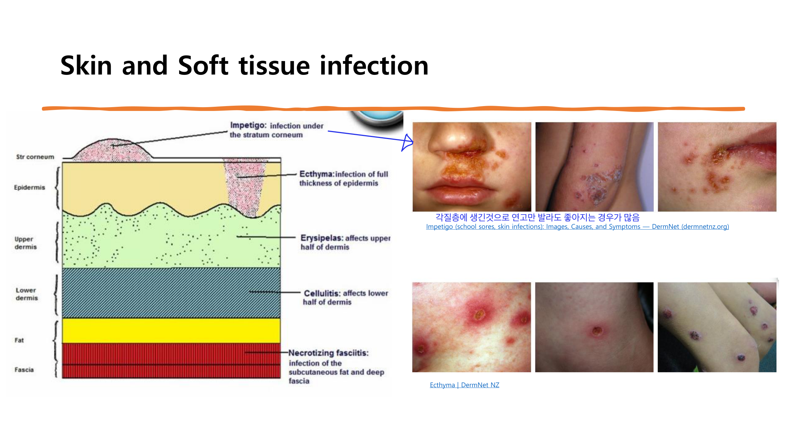
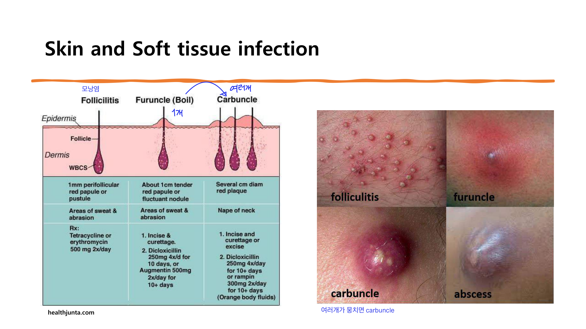
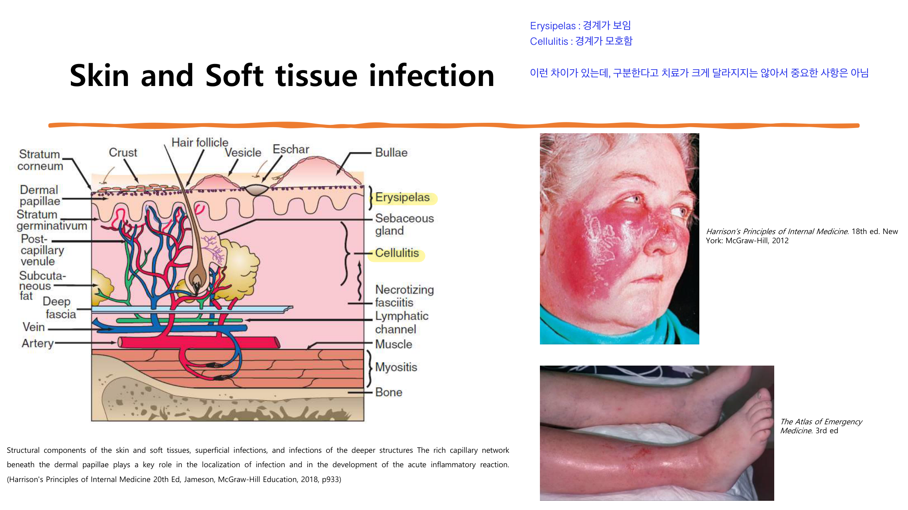
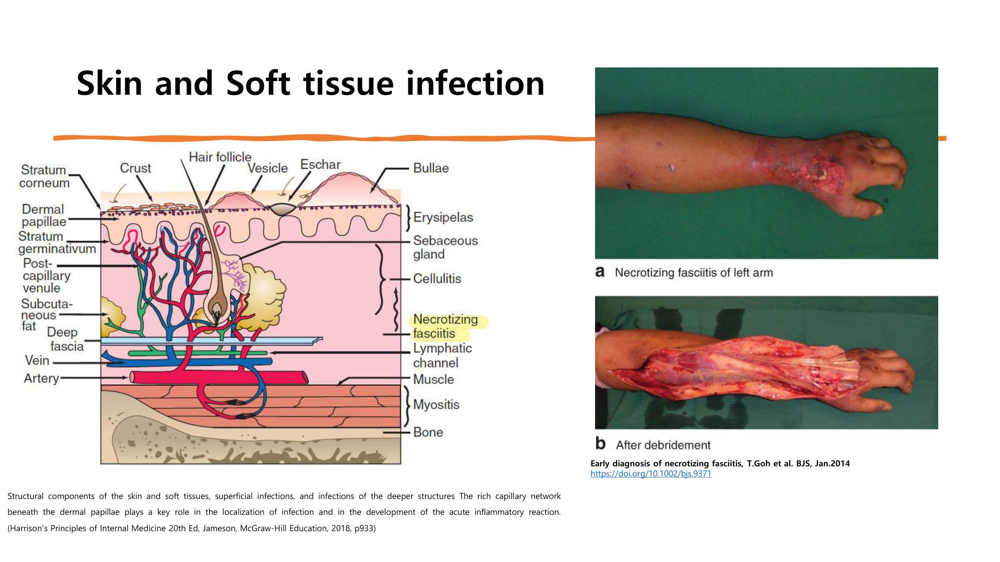
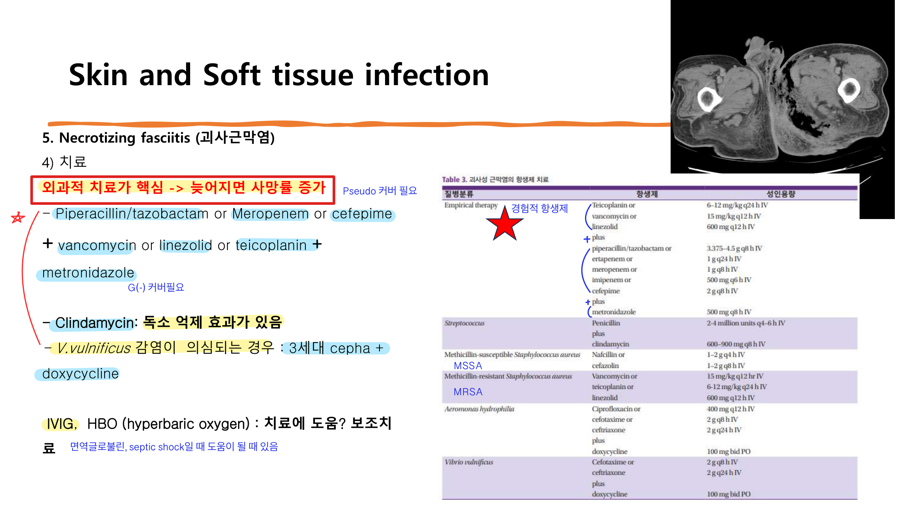
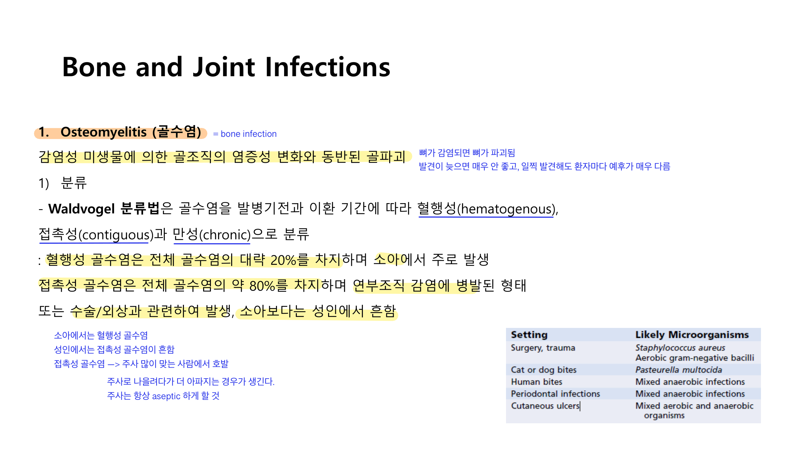
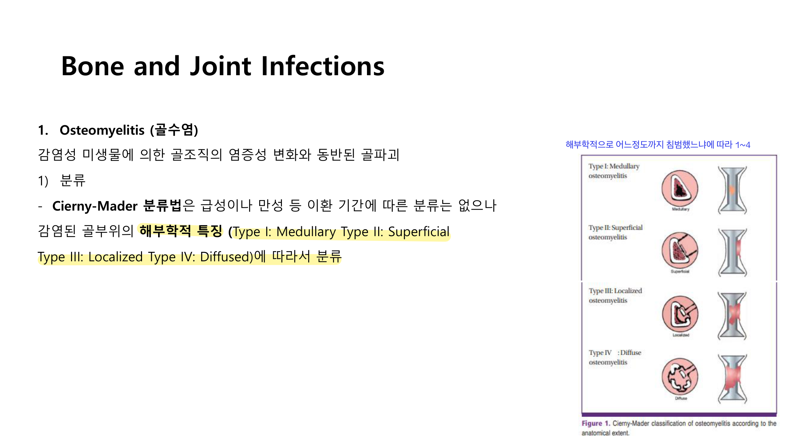
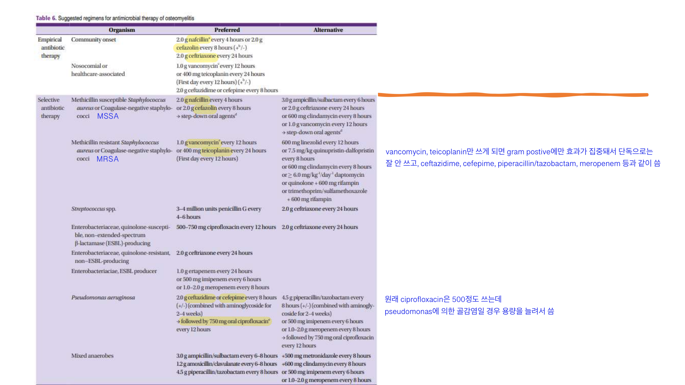
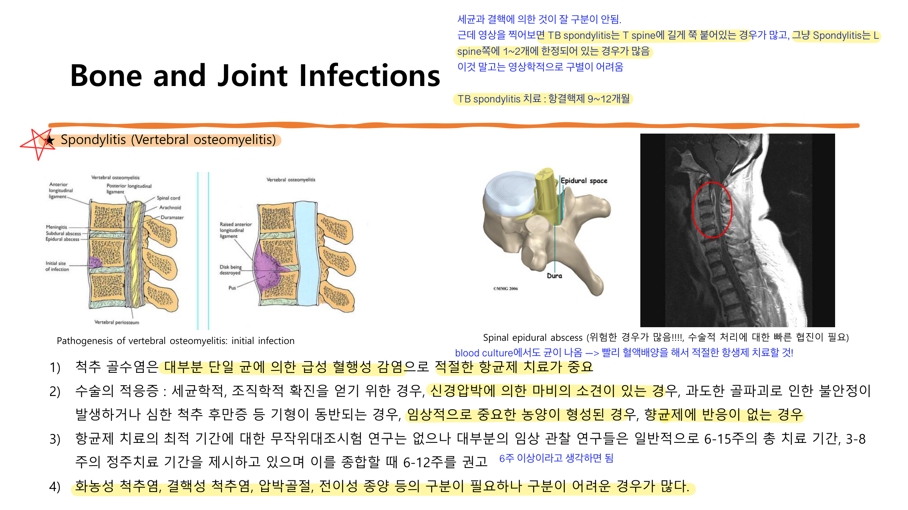
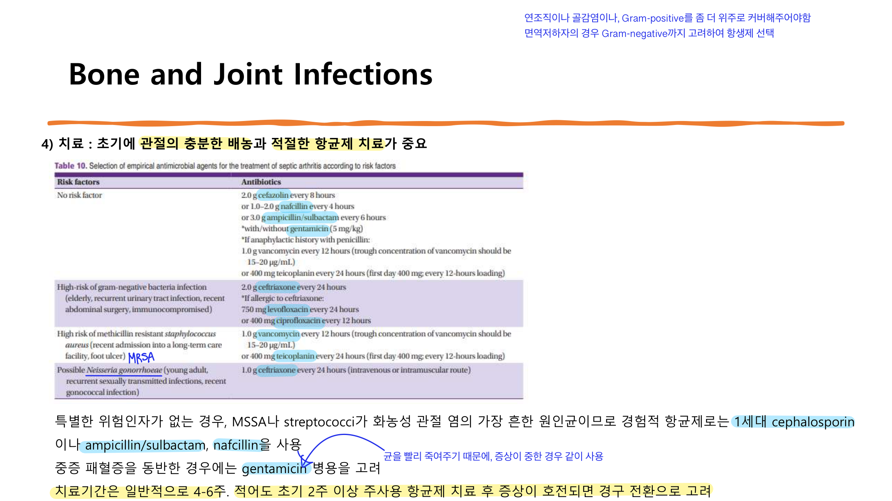

<!-- 필기본: 2025 -->
<!-- 단계: 수업 전 -->

# 0. 이 수업을 공부하는 법

감염내과 **황소윤 교수님** 수업. 필기본이 두 개다 — **피부·연조직 감염**(Skin and Soft tissue Infections)과 **뼈·관절 감염**(Bone and Joint Infections). 마지막에 증례 3개.

학습성과
- 피부·연조직: ① 피부감염과 연조직감염의 **증상과 진단** ② **원인균과 치료**
- 뼈·관절: ① **화농성 관절염과 세균성 골수염**의 흔한 원인과 치료 계획 ② **세균성 척추염과 결핵성 척추염의 구분**

- 기출 46문항(2020–2025), 황소윤 교수님 문항은 거의 **사진 + 상황 → 항생제** 하나로 반복된다. 핵심은 "**누구에게 생겼나**"다.
    - **건강한 사람의 연조직염** → **cefazolin**(혈액배양에서 MSSA여도 cefazolin)
    - **이식·당뇨 등 면역저하자의 연조직염** → **piperacillin/tazobactam**(+ vancomycin)
    - **반상출혈·수포 + 쇼크/회음부 = 괴사근막염** → **meropenem + vancomycin + metronidazole**, 외과적 치료가 핵심
    - **해산물·간질환 + 출혈성 수포 → *Vibrio vulnificus***, **개 교상 → ampicillin/sulbactam**
    - **화농성 관절염(관절액 WBC >50,000, 결정 없음)** → 건강하면 **nafcillin**
    - **척추염** → 검사는 **MRI**, 원인 ***S. aureus***, 치료 **cefazolin / ampicillin-sulbactam**
- 2020–22년 미생물학 문항(포도알균·사슬알균·*C. perfringens*·여드름균·무산소균·*Nocardia*)도 이 수업으로 분류되어 있다.

!!! key "핵심"
    **깊이로 나눈다**: 각질층(농가진) → 모낭(종기) → 진피 상층(단독) → 진피 하층·피하지방(연조직염) → 근막(괴사근막염). 깊을수록 위험하다.
    **번지는 붉은 피부 = 연쇄알균, 고름 잡힌 국소 덩어리 = 포도알균.** 경험적 항생제는 **그람양성 위주(cefazolin·nafcillin)**, 면역저하자는 **그람음성까지(pip/tazo)**.
    **뼈·관절은 오래**: 골수염 **4–6주 이상**(사실상 6주 이상), 척추염 **6–12주**, 화농성 관절염 **4–6주**, 결핵성 척추염 9–12개월.

# Part A. 피부·연조직 감염

{: style="width:76%"}

- 피부 전체가 **붓고 붉게 퍼지면 연쇄알균(streptococcal)**, **고름이 잡힌 국소 덩어리**면 **포도알균(staphylococcal)** 가능성이 높다.

## 1. 농가진(impetigo)과 대농포진(ecthyma) — 각질층의 감염
### 임상
- **β-용혈 연쇄알균과 황색포도알균**이 주원인인 피부의 **얕은 화농성 병변**. 대농포진은 깊게 생긴 궤양성 농가진(표피 전층).
- 열대·아열대, 경제적으로 열악한 환경의 **아이들**에게 호발(**전염성이 높아** 형제·친구에게). 호발 연령 **2–5세**지만 후기 아동·성인도.
- **얼굴과 사지**에 가장 흔하고, 국소적·흔히 다발성, 수포가 동반될 수 있다.
- 경과: 작은 반점·잔물집 → 고름물집 → 터진 뒤 장액성 분비물 → **황갈색(꿀색) 딱지**.
- ***S. pyogenes* 농가진은 급성 사구체신염**을 일으킬 수 있다(류마티스열은 X).
- 원인: 찰과상, 피부 외상, 곤충 교상으로 표재균이 들어감.

### 원인균·진단·치료
- **국내 가장 흔한 원인균: 황색포도알균**, 2000년대부터 **MRSA 증가**.
- 진단: 분비물·고름 그람염색·배양. 연고만 발라도 낫는 경우가 많아 보통 배양까지 안 간다.
- 치료: **항생제 연고(mupirocin) 국소 도포**, 심하면 경구 항생제(cephalexin, clindamycin, amoxicillin/clavulanate 등) — 대개 **1주일 이내**로 충분.
- 전염력이 매우 강하므로 **유치원 등에 가지 않게** 교육, 옷·수건 분리 소독.

## 2. 종기(furuncle)와 큰종기(carbuncle) — 모낭의 감염

{: style="width:70%"}

- **모낭의 감염으로 피하조직에 농양** — 표피에 농양이 생기는 **모낭염(folliculitis)** 보다 깊다. 털이 나는 부위의 염증성 결절 + 농포.
- **하나의 모낭 = furuncle**, **여러 모낭이 뭉치면 carbuncle** — carbuncle은 **목 뒤**, **당뇨 환자**에서 호발(조선시대 왕들에게 많았다).
- 원인: 부적절한 위생, 면역력, 종기 환자 노출. **원인균은 대부분 *S. aureus***. 재발하는 종기증의 선행 요인은 **앞콧구멍·회음부의 *S. aureus* 집락**.
- 진단: 고름 그람염색·배양(전형적이면 검사 없이 치료 가능, 큰 병원에선 배양을 반드시 한다).
- 치료
    - **Furuncle: 온찜질**(배농 촉진)
    - **Carbuncle: 절개와 배농**
    - **광범위 연조직염·발열·면역저하**면 항생제가 반드시 필요 — 경험적으로 **1세대 세파, amoxicillin/clavulanate, clindamycin**.
    - **MRSA 과거력·집락, 1차 치료 실패** → MRSA 약(vancomycin, teicoplanin, linezolid).
    - 재발성 *S. aureus* 농양: **비강 mupirocin 연고(매달 5일, 하루 2회)**, chlorhexidine 목욕, 개인 물품 세탁.

## 3. 단독(erysipelas)과 연조직염(cellulitis)

{: style="width:74%"}

| | 단독 | 연조직염 |
|---|---|---|
| 깊이 | **진피 상층부** | **진피 하층부 + 피하지방** |
| 경계 | **명확**, 병변이 **솟아 있음** | **모호**, 솟아 있지 않음 |
| 원인균 | **A군 연쇄알균(*S. pyogenes*)**, 드물게 *S. aureus* | 외국: 연쇄알균·*S. aureus* / **국내: *S. aureus* 44% > β-용혈 연쇄알균 27%**(원인균 확인 7.8%뿐) |
| 호발 | 영아·소아·고령, 예전엔 얼굴 → 최근 **하지** | **하지** |

- 교수님: 차이가 있지만 **구분한다고 치료가 크게 달라지지 않아** 중요한 사항은 아니다.

### 단독
- 진단: **임상 소견**(열감 동반 발적, 약간 솟아 있고 경계 명확).
- 치료: **penicillin, amoxicillin, ampicillin/sulbactam**. 포도알균을 배제할 수 없으면 **nafcillin이나 1세대 세파**. **페니실린 알레르기**: clindamycin, (원인 모르면) IV vancomycin, 경구 ciprofloxacin·levofloxacin, macrolide(내성률 10–35%, 감수성일 때).
- vancomycin 단독은 그람음성을 못 덮어 단독으로는 잘 안 쓰고, **경구 vancomycin은 흡수가 안 된다**.

### 연조직염
- 빠르게 퍼지는 **부종·발적·국소 열감**, 때로 소수포·수포·출혈반, 림프관염·국소 림프절 종대. 전신 증상은 심하지 않지만 심하면 발열·빈맥·의식 혼탁.
- **출혈반이 넓어지면서 전신 증상이 동반되면 괴사근막염**을 생각.
- 원인: 손상된 피부로 균 침투 — **비만, 피부 결손, 정맥·림프관 폐쇄로 인한 부종**(이전 림프절 절제 등).
- 진단: **임상 소견**. **혈액배양 양성률 <5%라 일반적으로 권장하지 않지만**, 교수님은 **열이 나면 혈액배양은 무조건**. 영상은 대부분 불필요 — **골수염 동반 의심, 괴사근막염과 구분이 어려울 때** 필요.
- 치료
    - **cefazolin 또는 nafcillin**(penicillinase 내성 penicillin), ampicillin/sulbactam도 가능.
    - **빠른 진행, 37.8℃ 초과 발열, 심한 전신 증상, 호중구감소, 림프부종, 간·심부전** → 초기 **정맥주사**.
    - 기간: 합병증 없으면 **5일**(매우 경한 경우), 심하면 1–2주.
    - **MRSA 과거력·집락 → vancomycin.**
    - **중증 면역저하자의 중증 연조직염 → pip/tazo + vancomycin 또는 meropenem + vancomycin.**
    - 하지는 **다리 올리기(leg elevation)**.

!!! exam "기출 포인트"
    건강한 사람의 하지 연조직염 → **cefazolin**(5·14번). 2번(2025): 32세 종아리 연조직염, 혈액배양에서 그람양성 알균(MSSA) → **cefazolin**. 연조직염의 원인 → ***S. pyogenes***(29·36번, 번지는 붉은 피부) / ***S. aureus***(38번, 고름). 19번: 연조직염 설명 중 옳지 **않은** 것 → "괴사근막염과 구분하기 어려우면 **혈액배양**이 필요"(필요한 건 **영상**). 12번: 하지 연조직염 + 서혜부 2 cm 압통 종괴 → 반응성 림프절 → **cefazolin 투여하며 관찰**. 18번: 입원 거부, 외래에서 하루 한 번 주사 → **ceftriaxone 2 g q24h**.
    **면역저하자**: 신장이식 + 당뇨 하지 연조직염 → **pip/tazo**(8번), 간이식 후 면역억제 + 발바닥 → **pip/tazo + vancomycin**(1번, 2025).

## 4. 괴사근막염 (necrotizing fasciitis)

{: style="width:72%"}

### 임상
- **근막과 연조직의 감염**으로 광범위한 괴사 + **쇼크·다발성 장기부전** 같은 전신 독성 → 치명적. 미국 연 500–1,500건, 사망률 **8–65%(평균 21.9%)**.
- 위험요인: **고령, 외상, 당뇨**, 말초혈관질환, 정맥 마약, 찰과상·열상·곤충교상, 만성 궤양, 화상, 수술창상감염, **면역저하**, 비만, 만성신부전, HIV, **알코올중독**.

### 원인균
| 유형 | 원인 |
|---|---|
| **1형(가장 흔함)** | **복합균**(호기성 + 혐기성), 대개 **장내세균총** → 그람음성 위주. 회음부(Fournier 괴저) |
| **2형** | 단일균 — **A군 연쇄알균**, *S. aureus*, 주로 **하지** |
| **3형** | **동아시아, 해산물 섭취** — ***Vibrio vulnificus***, *Aeromonas hydrophila*, *Clostridium* |

### 진단
- **심한 통증**(겉보기보다 아픔), **긴장성 부종, 반상출혈, 물집, 마찰음, 국소 무감각**, 전신 독성 — 초기에 다 나타나는 건 아니므로 **계속 관찰**.
- **X-ray**: 피하 가스(약 **13%**에서만, 대개 나빠진 뒤에).
- **CT**: 근막 부종·비후·조영증강, 농양, 가스(근육은 잘 안 보임).
- **MRI**: **민감도 90–100%, 특이도 50–85%로 가장 추천**. 하지만 시간이 걸려 **응급수술을 지연시킬 수 있다** → 육안으로 수술이 필요하면 바로 수술.

### 치료

{: style="width:72%"}

- **외과적 치료가 핵심** — 늦어질수록 사망률 증가.
- 경험적 항생제: **piperacillin/tazobactam 또는 meropenem 또는 cefepime**(그람음성·녹농균) **+ vancomycin 또는 linezolid 또는 teicoplanin**(MRSA) **+ metronidazole**(혐기균).
- **Clindamycin: 독소 억제 효과** → 연쇄알균 괴사근막염에 병용.
- ***V. vulnificus* 의심 → 3세대 세파 + doxycycline.**
- IVIG(패혈성 쇼크일 때 도움이 될 때가 있음), 고압산소(HBO): 보조치료.

!!! exam "기출 포인트"
    9번: 당뇨 70세, **회음부·하복부 극심한 통증 + 저혈압** + CT(가스) → **meropenem + vancomycin + metronidazole**. 23번: 당뇨 10년, 엉덩이 종기를 자가치료하다 의식저하 + CT → 주된 원인 **복합균(호기성 + 혐기성)**. 13번: 신장이식 + 당뇨 하지 **반상출혈·수포** → **meropenem**. 20번: 반상출혈·수포 하지 → **ampicillin/sulbactam + clindamycin**(독소 억제). 15번: 유리에 찔린 발 + 수포 → 가장 유용한 검사 **MRI**.
    *Vibrio*: 양측 발의 출혈성 수포 → ***Vibrio vulnificus***(17·28번). 35번: 반드시 물을 병력 → **간질환 및 술 섭취력**.

## 5. 교상 (bite wounds)
- 대부분 **개·고양이**. 주된 균은 **동물 구강 상재균**(*Pasteurella multocida* 등)과 **사람 피부 상재균**, 드물게 포도알균·연쇄알균 2차 감염.
- **교상 후 8시간 이내**: 상처 치료, **파상풍** 치료, 필요하면 **광견병** 치료.
- **8–12시간이 지나면 대부분 감염**(비화농성/화농성/농양).
- 항생제: **ampicillin/sulbactam(주사) 또는 amoxicillin/clavulanate(경구)**.

!!! exam "기출 포인트"
    37번: 당뇨·신부전 55세, 개에게 물린 다리 → **ampicillin/sulbactam 주사**.

## 6. 흔한 감염성 피부병변과 원인체 (해리슨 표)
- 수포: 수두·대상포진·단순포진·수족구 / **출혈성 수포 — *Vibrio vulnificus***, 괴사근막염 / 딱지: 농가진 / 모낭염: *S. aureus*, 녹농균(온탕) / 연조직염: 연쇄알균, *S. aureus* / 괴사: 괴사근막염, Fournier 괴저, 가스괴저(*C. perfringens*).

!!! exam "기출 포인트"
    10번: 당뇨 80세, 엉덩이·겨드랑이 통증 + 피절 따라 수포(대상포진) → **acyclovir**(이 강의 표의 "대상포진이 얼굴에 생긴 경우" 사진). 31번: 치매 와상 노인의 엉덩이 병변(욕창)과 같은 기전의 호발 부위가 **아닌** 곳 → **전흉부**(발뒤꿈치·후두·좌골결절·견갑골은 압박 부위).

# Part B. 뼈·관절 감염

## 1. 골수염 (osteomyelitis)
- 감염성 미생물에 의한 **골조직의 염증 + 골 파괴**. 발견이 늦으면 매우 안 좋고, 일찍 발견해도 예후가 사람마다 다르다.

### 분류

{: style="width:70%"}

- **Waldvogel**: 발병기전·기간 → **혈행성**(전체의 약 **20%**, **소아**에서 주로), **접촉성**(약 **80%**, 연부조직 감염에 병발하거나 수술·외상 관련, **성인**에서 흔함), **만성**.
    - 접촉성은 **주사를 많이 맞는 사람**에서 호발 — 낫자고 맞은 주사로 더 아파지는 경우. 주사는 항상 무균적으로.
    - 상황별 원인균: 수술·외상 *S. aureus*·호기성 그람음성 / **개·고양이 교상 *Pasteurella*** / 사람 교상·치주·피부궤양 — 혼합 혐기균.
- **Cierny-Mader**: 기간 구분 없이 **해부학적 침범 정도** — I 수질(medullary), II 표재(superficial), III 국소(localized), IV 미만(diffuse).

{: style="width:50%"}

### 원인균
- ***Staphylococcus aureus*가 가장 흔하다.** 장내세균, CoNS, 연쇄알균(교상·욕창·당뇨발)도 흔함.
- ***P. aeruginosa*는 원내 획득 골수염**의 흔한 원인.
- 결핵성 골수염은 AIDS 증가와 함께 최근 증가, 진균은 드묾.

### 진단
- 임상: **급성 혈행성** — 수일에 걸친 병변부 통증(매우 심함) + 발열 등 전신 증상 / **만성** — 경미한 전신 증상 + 오랜 통증 + **배농성 누공(sinus tract)**(인공관절 수술 등).
- 의심 시 문진·진찰 → **단순 X-ray** + CBC·ESR·CRP.
- **X-ray**: **만성** 골수염 진단에 유용(골피질 미란, 골막반응, 골투명화·경화). **급성 골수염은 X-ray로 절대 구분 못 한다.** 정밀검사는 CT·MRI.
- **MRI: 골수염 조기 진단에 가장 효과적.**
- **CT**: 골피질·골기둥 안정성, 골막 이상, 골내 가스.
- **Bone scan**: CT·MRI가 어려울 때. **민감도는 높지만 특이도가 낮다** — 골절·암·감염이 다 똑같이 나온다.
- 배양: 혈액·관절액·골조직을 **되도록 항균제 전에**(이미 투여했으면 48–72시간 끊고 채취하면 배양률↑). 다만 실제로는 항생제를 빨리 줘야 치료 확률이 올라가므로 **투여 후 검체 배양 → 결과로 조절**하는 경우가 더 많다.
- **혈액배양은 반드시** — 급성 골수염의 **50%에서 양성**(특히 척추·쇄골·치골의 혈행성).
- **누공 면봉 배양은 믿을 수 없다**(피부 상재균이 묻어 나옴) → **수술적·경피적 조직검사**(초음파·CT 유도)로 **골조직 배양 + 병리**를 함께.

!!! exam "기출 포인트"
    21번: 골수염 진단 설명 중 옳지 **않은** 것 → "**Bone scan은 특이도가 높지만** 조기 진단에는 유용하지 않다"(특이도가 **낮다**). 임상 소견 중요, X-ray는 만성에 유용, 항균제 전 배양, MRI가 조기 진단에 가장 효과적 — 모두 맞다.

### 치료
- **신속한 적절한 항균제**(균혈증·골 괴사 진행 억제).
- **급성**: 농양, 괴사의 영상 증거, 항균제 무반응 → **수술**.
- **만성**: **괴사조직 충분히 제거(debridement)**, 뼈 안정화, 사강(dead space) 처치 + 감수성 항생제 + 적절한 기간.
- 일반적으로 debridement 후 **추가 4–6주** 항균제(사실상 **6주 이상**으로 생각).

{: style="width:62%"}

| 상황 | 경험적 항생제 |
|---|---|
| **지역사회 획득** | 가장 흔한 **MSSA** → **nafcillin 또는 cefazolin** |
| 지역사회 + 그람음성 배제 불가 | **nafcillin/cefazolin + ceftriaxone** |
| **의료관련·원내, 인공삽입물 관련, 항포도알균 약에 무반응** | **MRSA** 고려 → **vancomycin 또는 teicoplanin** (+ 그람음성 약 ceftazidime·cefepime·pip/tazo·meropenem 병용 — 단독이면 그람양성만 덮음) |

| 균 확인 후 | 약 |
|---|---|
| **MSSA** | **nafcillin 또는 1세대 세파** — **vancomycin은 재발률이 높아 지양** |
| **MRSA** | **vancomycin 1차**(혈중농도 15–20), teicoplanin. **Quinolone은 단독 사용 시 내성균이 쉽게 생겨 실패** → 감수성이어도 단독 X(뼈 침투는 좋음) |
| 녹농균 | ciprofloxacin은 용량을 늘려(750 mg) 씀 |

## 2. 척추염 (spondylitis, vertebral osteomyelitis) ★

{: style="width:70%"}

1. 대부분 **단일균에 의한 급성 혈행성 감염** → 적절한 항균제가 중요. **혈액배양에서도 균이 나온다** → 빨리 혈액배양.
2. **척추 경막외 농양(spinal epidural abscess)**: 위험한 경우가 많다 → **수술 협진을 빨리**. 갑자기 다리를 못 올리거나 소변에 문제가 생기면 바로 신경외과.
3. **수술 적응증**: 세균학·조직학적 확진이 필요할 때, **신경 압박에 의한 마비**, 과도한 골 파괴로 **불안정**·심한 후만증, **임상적으로 중요한 농양**, **항균제에 반응 없음**.
4. 치료 기간: 총 6–15주, 정주 3–8주 → 종합하면 **6–12주** 권고(6주 이상으로 생각).
5. **화농성 척추염, 결핵성 척추염, 압박골절, 전이성 종양**의 구분이 필요하지만 어려운 경우가 많다.
    - 영상에서 **결핵성(Pott병)은 T spine(흉추)에 길게 쭉**, **세균성은 L spine(요추) 1–2개에 국한**되는 경우가 많다. 이것 말고는 영상으로 구별이 어렵다.
    - **결핵성 척추염 치료: 항결핵제 9–12개월.**

!!! exam "기출 포인트"
    척추염 검사 → **허리뼈 MRI**(6번 — 당뇨 60세, 허리 통증·발열, 하지로 뻗침), **척추 MRI로 추간판·경막외 농양 평가**(3번, 2025 — 한의원 침 여러 번 + 당뇨·CKD). 원인균 → ***S. aureus***(16·40번). 치료(신경학적 증상 없음, 73세) → **cefazolin**(22번 — 수술·cipro+vanco·결핵약 X), **ampicillin/sulbactam**(7번). 39번: 열 없는 35세, 경제 사정으로 지내다 체형 변화 + CT → **Pott disease**(결핵성 척추염).

## 3. 화농성 관절염 (septic arthritis)
- 관절을 침범하는 가장 대표적인 감염. 배농(I&D)이 필요해 주로 정형외과에서 본다.

### 역학
- 고위험군: **류마티스·퇴행성 관절염**, **인공관절**, **관절 내 주사·침 시술**, 낮은 사회경제적 수준, 주사 마약, 알코올중독, **당뇨**, 피부 궤양, **80세 이상**, HIV.
- **MRSA 위험**: 의료관련 시설 거주, 카테터, 족부 궤양, 주사 마약, 최근 정형외과 처치.

### 임상
- **관절 열감, 압통, 운동 제한**, 대개 내원 **2주 이내** 시작한 급성 경과(*S. aureus*는 1–2일 만에 빠르게 부어오름).
- 독력이 낮은 균·결핵성은 서서히.
- 열이 없을 수도 있지만 대부분 열이 나서 온다.
- 주로 **큰 관절** — **무릎·엉덩관절이 60%**.

### 진단
- **관절액 흡인을 항균제 전에 지체 없이** — 백혈구 수·분획(화농성은 보통 **>50,000, 호중구 우세**).
- 결핵을 배제 못 하면 AFB 도말·배양·PCR, 진균도.
- **편광현미경으로 결정(crystal) 확인**(통풍 감별) — **필수**.
- 혈액: **항균제 전 혈액배양**, WBC, ESR, CRP.
- 영상: MRI는 인접 골수염·연부조직 감염 확인, bone scan은 보조.
- 세척술·소파술 시 조직검사·배양.

### 치료

{: style="width:66%"}

- **초기에 충분한 배농 + 적절한 항균제.**
- 특별한 위험인자가 없으면 **MSSA·연쇄알균**이 가장 흔한 원인 → 경험적으로 **1세대 세파(cefazolin), ampicillin/sulbactam, nafcillin**.
- 그람음성 위험(고령, 요로감염, 복부 수술, 면역저하) → **3세대 세파(ceftriaxone)**, 알레르기면 levofloxacin. MRSA 위험 → vancomycin. 젊은 성활동기 → 임균(*N. gonorrhoeae*) — ceftriaxone.
- **중증 패혈증**이면 균을 빨리 죽이려고 **gentamicin 병용**.
- 기간: **4–6주**, 처음 **2주 이상 주사** 후 호전되면 경구로.
- 연조직·골 감염은 그람양성 위주로 덮고, 면역저하자는 그람음성까지.

!!! exam "기출 포인트"
    11번: 건강한 40세, 무릎 통증·39.2℃, 관절액 WBC 89,000(PMN 88%) → **nafcillin**. 4번(2025): 35세, 무릎, 2주 전 장염 병력(반응성 관절염 함정), 관절액 WBC 84,000(호중구 92%), **결정 없음** → **화농성 관절염**. 30번: 건강한 37세 무릎, 관절액·혈액 그람양성균 → ***S. aureus***.

# Part C. 증례
1. **신장이식(KT) 환자의 발 감염** — 병원을 다닌 이력이 있으니 **병원 내성균** 고려 → **pip/tazo 또는 meropenem + vancomycin**. 검사: MRI, 혈액배양, 고름 배양, CRP. 원인 *S. aureus*. 면역억제제를 먹고 있고 상처가 깊어 항생제가 듣지 않아 결국 **절단** 후 호전.
2. **이상지질혈증·고혈압 고령 환자의 발 감염** — 그냥 지역사회 감염이면 **cefazolin, ampicillin/sulbactam, nafcillin**이지만, 면역저하 기저질환은 없어도 **고령 + 발** 감염이라 **pip/tazo**. 검사: 혈액배양, CT 또는 MRI.
3. **장요근(psoas) 농양** — 요로감염에서 근육으로 들어가 척추로 잘 넘어간다. PCD를 꽂으면 좋지만 경로가 어려워 **항생제(ceftriaxone, pip/tazo)를 주고 경과를 보다 악화되면 PCD**. 뼈에도 감염이 생겼지만 pip/tazo로 좋아져 경구로 바꿔 퇴원.

# Part D. 미생물학 보충 (2020–22 기출)
- ***S. aureus* 병원성 인자**: **coagulase, protein A, catalase**(M protein은 *S. pyogenes*). 독소 — 식중독(장독소), **TSS(TSST-1, coagulase 아님)**, 중증 폐렴(**PVL**), **SSSS(표피탈락독소)**. 대부분 항생제에 감수성이 높아 치료가 쉽다는 말은 틀림(MRSA).
- ***S. aureus*와 *S. epidermidis* 공통**: **catalase 양성**(coagulase는 *S. aureus*만). *S. epidermidis* — coagulase 음성, 보철 장치 감염. *S. saprophyticus* — urease 양성, 젊은 여성 UTI. Mannitol salt agar에서 집락 색이 다름.
- **SSSS**: 표피탈락독소가 표피 과립층 세포 연결을 끊음, 국소형은 **수포성 농가진(bullous impetigo)**.
- **사슬알균**: 신생아 수막염 — ***S. agalactiae*, CAMP 양성**(*S. pyogenes*는 β용혈·bacitracin 감수성).
- ***C. perfringens***: 그람양성 아포형성 막대균(아포는 그람염색으로 잘 안 보임), 혈액배지 **이중 용혈**, alpha 독소가 주 치사독소, 연조직 감염·**가스괴저**.
- **여드름균**: *Propionibacterium acnes* → ***Cutibacterium acnes***, propionic acid, 피부 정상균, lipase.
- **무산소균**: 느리게 자라고 검체 수송 시 산소 노출 주의, 혐기 배양기 필요, **복합균 감염이 흔함**. *Veillonella* — 그람음성 알균, 구강·대장. *Actinomyces*(방선균증), *Lactobacillus*(심내막염), *Mobiluncus*(세균성 질염).
- ***Nocardia***: 발의 만성·무통성 감염(균종), 피하 부종·다발성 굴, 림프 따라 결절, **CNS 침범**.

!!! memo "암기"
    | 질환 | 깊이 | 원인균 | 치료 |
    |---|---|---|---|
    | 농가진 | 각질층 | *S. aureus*(국내 1위), GAS | mupirocin 연고, 심하면 경구 1주 |
    | 종기/큰종기 | 모낭 | *S. aureus* | 온찜질 / 절개배농, 재발 시 비강 mupirocin |
    | 단독 | 진피 상층, 경계 명확 | **GAS** | penicillin·amoxicillin |
    | 연조직염 | 진피 하층·피하지방, 경계 모호 | 국내 *S. aureus* 44% > 연쇄알균 | **cefazolin/nafcillin** 5일~, 면역저하 **pip/tazo(+vanco)** |
    | 괴사근막염 | 근막 | 1형 복합균, 2형 GAS·*S. aureus*, 3형 *Vibrio* | **수술** + pip/tazo·mero + vanco + metronidazole, clindamycin(독소), *Vibrio*는 3세대 세파 + doxy |
    | 교상 | | *Pasteurella*·구강균 | **amp/sulbactam, amox/clav**, 파상풍·광견병 |
    | 골수염 | | **S. aureus**, 원내 녹농균 | MSSA nafcillin/cefazolin, MRSA vanco, **6주+**, quinolone 단독 X, MRI |
    | 척추염 | | S. aureus(혈행성) | 혈액배양 + MRI, **6–12주**, 결핵성은 흉추 길게, 9–12개월 |
    | 화농성 관절염 | 무릎·고관절 60% | MSSA·연쇄알균 | 관절액(결정 확인) → cefazolin/nafcillin, **4–6주**, 패혈증 + gentamicin |
