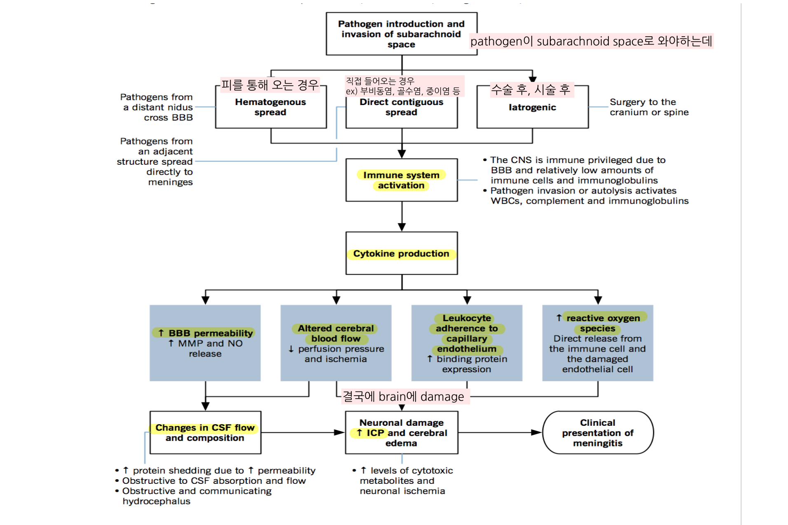
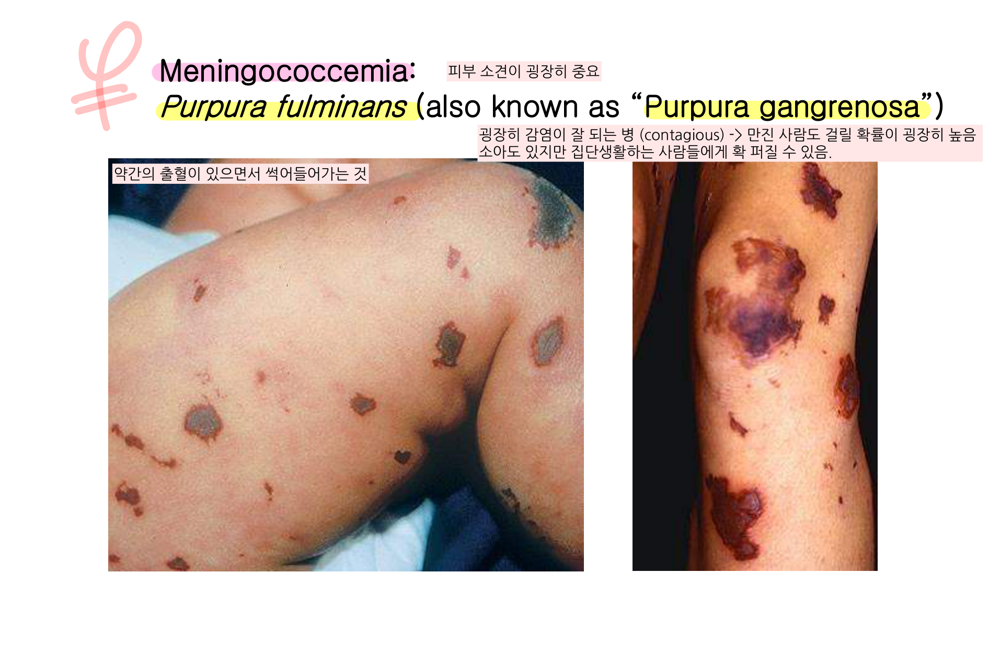
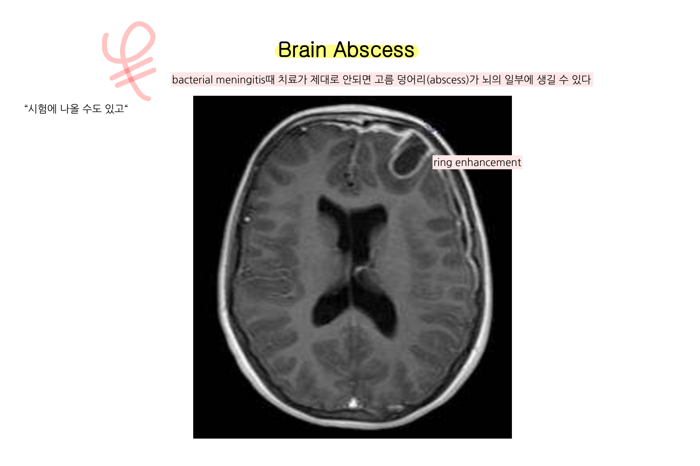
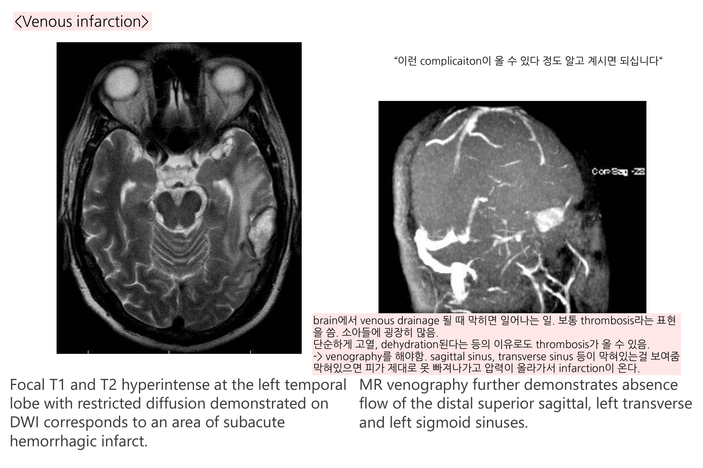
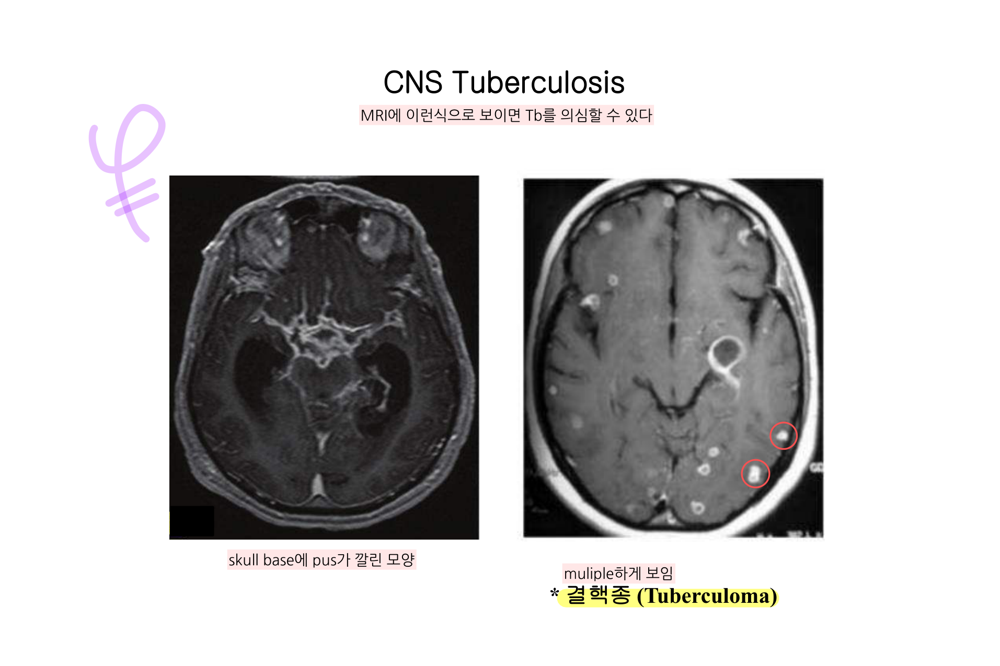
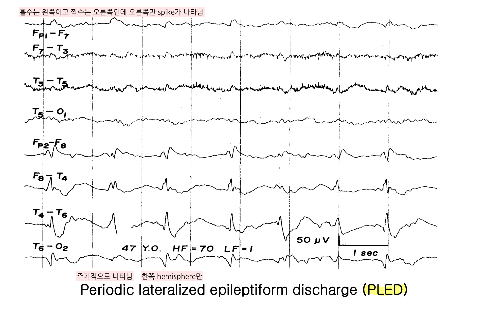
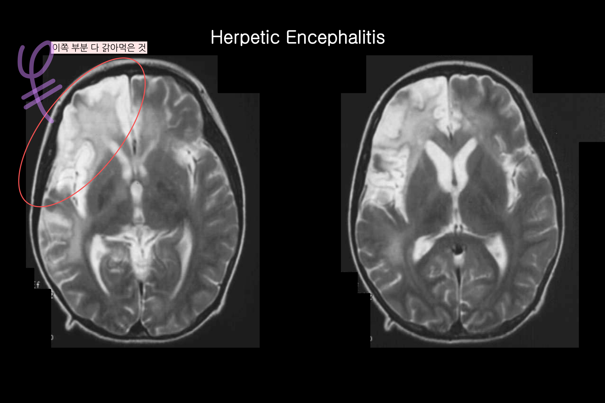

<!-- 필기본: 2025 -->
<!-- 단계: 수업 전 -->

# 0. 이 수업을 공부하는 법

경북대학교 어린이병원 소아청소년신경과 **권순학 교수님** 수업("중추신경계의 감염성 질환(소아)"). 성인 CNS 감염(21강)과 비슷한 부분이 많다.

교수님: "문제가 다 공개가 되니까… 전 주로 **케이스 형태**를 냅니다. 국시가 그렇게 나와서. 크게 차이 나지는 않아요. **3살이 5살 되고** 뭐 그 정도?" — 필기 작성자: 24년도와 22년도가 동일, 스타일은 매년 비슷하다. **수치(CSF)나 사진(MRI)을 보고 무슨 병인지 알고, 치료를 알기!**

필기 순서: 수막염 정의 → **세균성 수막염**(원인균·기전·임상·합병증·진단·CSF 감별·치료·예방) → 바이러스성 → 결핵성 → 진균성 → 뇌농양 → **단순포진 뇌염** → 일본뇌염

- 기출 19문항(2020–2025)의 네 가지 사례
    1. **영아(2–7개월), 고열·구토·대천문 팽팽, CSF WBC 1,800(다핵구 90–95%), 당 35–45** → 세균성 수막염 → **cefotaxime + vancomycin + dexamethasone**(2개월이면 **ampicillin + cefotaxime + dexamethasone**).
    2. **학동기, 고열 + 의식 변화(아픈 자극에도 계속 잠), CSF 림프구 우세·당 정상, MRI(측두엽)** → **HSV 뇌염 → acyclovir**(6번 출제).
    3. **고열·구토, 쳐졌지만 의사소통 양호, 국소 이상 없음, CSF 림프구·당 정상** → 바이러스성 수막염 → **보존적(supportive) 치료**.
    4. **2주 이상 미열·보챔·구토, 조부모 양육, CSF 당 낮음, MRI(뇌저부)** → **결핵성 → INH·RIF·PZA·ethionamide**. **MRI에 ring enhancement** → 뇌농양 → **vancomycin + cefotaxime + metronidazole**.

!!! key "핵심"
    **CSF 감별표가 문제의 열쇠**(정상: 세포 <5, 당 ≥50 또는 혈당의 2/3, 단백 20–45).
    세균성 = **>1,000, 다핵구, 당 <40(CSF/혈당 <0.4), 단백 >100** / 바이러스성 = **10–300, 림프구, 당 정상** / 결핵성 = **림프구, 당 감소, 단백 많이 증가** / 뇌농양 = 세포·당 거의 정상, 단백 증가.
    **의식 변화 + 경련 + 림프구 CSF → HSV 뇌염 = acyclovir**("각인시켜 놔야 해요").

# 1. 수막염 — 정의와 원인
- 여러 원인으로 뇌를 싸는 막(meninges)에 염증 → **고열, 두통, 구토, 의식변화**.
- 원인: **세균성, 바이러스성**(가장 주된 두 가지 — "이 정도 기억하시면"), 진균성, 미코플라스마성, 리케차성, 원충·기생충성 등 — 면역이 떨어지면 아래쪽 원인으로도.
- 경막·거미막·연막에 염증이 생기면 CSF에 염증이 생기고 거미막밑공간·뇌실에 영향.

# 2. 세균성 수막염
- 전 세계 연 100만 명 이상, **가장 흔한 감염성 사인 중 하나**. 치명적이라 중요. 못 사는 나라에 많지만 선진국에도 있다.

## 나이에 따른 원인균 — 항생제 선택의 기준
| 나이 | 원인균 |
|---|---|
| **신생아–첫 3개월** | **그람음성(특히 *E. coli*), GBS(*S. agalactiae*), *L. monocytogenes*** |
| **3개월–5세** | ***S. pneumoniae*, Hib(2세 이하), *N. meningitidis*(5세 이하)** — Hib는 접종으로 요즘 거의 없음 |
| **학동기** | ***S. pneumoniae*, *N. meningitidis*(15–24세 호발)** — 성인과 비슷 |

## 기전

{: style="width:62%"}

- 균이 거미막밑공간에 와야 한다 — ① **혈행성**(멀리서 피를 타고) ② **직접 인접 파급**(부비동염, 골수염, 중이염) ③ **의인성**(두개·척추 수술·시술 후).
- CNS는 BBB 때문에 면역세포·면역글로불린이 적은 면역 특권 부위 → 균·자가용해 산물이 면역계를 활성 → **사이토카인** → BBB 투과성↑, 뇌혈류 변화·허혈, 백혈구 부착, 활성산소 → CSF 변화(단백↑, 수두증) + **신경 손상·두개내압 상승·뇌부종** → 결국 뇌 손상.

## 임상 양상 — 나이에 따라 다르다
- **신생아–첫 3개월**: **모호하고 비특이적** → **패혈증 소견이 있으면 의심**. 고열, **체온조절 안 됨**, **무호흡, 청색증, 기면**, 보챔, 구토. 진찰: **대천문이 팽팽하거나 불룩(full, tense, bulging fontanelle)**, 불규칙 호흡, **황달**(황달만 있는 경우도). 표현을 못 하고 호흡기 문제로 보일 수 있다 → 조금이라도 감염이 의심되면 수막염도 같이 의심.
- **영아기**: 전형적 양상이 잘 안 보임 → 고열, 구토, 보챔, **high-pitched crying**, 때로 경련. 대천문 팽팽(아주 어릴 때 열려 있는 "숨골"을 만지면 탱탱하거나 불룩). 경부강직·Brudzinski·Kernig은 있을 수도 없을 수도.
- **소아·청소년**: 표현을 할 수 있어 진단이 쉽다. 전신 증상 — **발열, 오한, 구토, 두통, 보챔, 의식 변화**(청소년 2/3 — 자꾸 졸려하고 평소보다 더 자고 말을 안 함), 경련. **뇌막자극 증상** — **경부강직**(소아 1/3, 청소년 3/4), Brudzinski·Kernig(청소년·성인 5%), 요통, 후궁반장(opisthotonus). 특수 질환 동반 증상 — **점상출혈·자반(수막알균혈증)**.
- **Brudzinski**: 누운 상태에서 목을 수동 굴곡 → 고관절·무릎이 저절로 굽혀짐. **Kernig**: 고관절 90도 굴곡에서 무릎을 펴면 아파함. "뭔가가 뻣뻣하다고 생각하면."

{: style="width:60%"}

- **수막알균혈증: 전격성 자반(purpura fulminans, purpura gangrenosa)** — 출혈이 있으면서 썩어 들어감. 피부 소견이 굉장히 중요. **전염성이 매우 높아** 만진 사람도 걸릴 확률이 높고 집단생활에서 확 퍼진다.

!!! exam "기출 포인트"
    14·19번: 3세(비장절제) 발열·두통 + 자반 발진 + CSF **그람음성 알균** → ***N. meningitidis***. 9번: 수막알균의 병원성 인자 → **피막, 선모(pili), 지질올리고당(LOS)**(외독소 X).

## 합병증
- **신경학적**: **경련**, **두개내압 상승**, **유두부종**(시신경이 부음), **경막하 삼출·농흉**(경막하에 물/고름), **경색**(특히 **정맥동 혈전에 의한 정맥 경색**), **뇌신경병증 — 특히 청력 손상(8번)**, 그다음 6번(눈이 바깥으로 안 돌아감), 뇌탈출, **수두증**, 뇌농양.
- **전신**: **SIADH**(나트륨 120대로 떨어짐 → 토하고 머리 아픔), DIC, 쇼크, **지속되는 발열**(IV 부위 염증, 경막하 삼출, 부적절한 항생제, 다른 균), 관절염.
- 치료 중 열이 계속 나면 합병증을 생각하되 괄호 속 다른 이유도 생각한다.
- **정맥 경색**: 뇌의 정맥 배출이 막히면(혈전) 피가 못 빠져나가 압력이 올라 경색. 소아에 굉장히 많고, 단순 고열·탈수로도 올 수 있다 → **MR venography**로 상시상정맥동·횡정맥동 폐쇄를 확인. "이런 합병증이 올 수 있다 정도."
- **뇌농양**: 세균성 수막염 치료가 제대로 안 되면 고름 덩어리 → **ring enhancement**("시험에 나올 수도 있고").

{: style="width:46%"}

{: style="width:60%"}

## 진단 — 확진은 CSF
- **요추천자**가 가장 중요(L4–L5, Tuffier 선이 가장 안전). CSF가 떨어지기 전에 **압력을 먼저** 잰다(정상 20 cmH2O 이하). 심하면 찌르자마자 고름이 나온다.
- **세균성 CSF**: **백혈구 증가(대개 1,000 이상, 다핵구 75% 이상)** → 혼탁, **당 감소(80%에서 40 이하)**, **CSF/혈당 <0.4(2개월 이상)** — 절대치만 보지 말고 비율을 볼 것, **단백 증가(100–500, >200)**.
- 항원 검사(Latex 응집 — 폐렴구균·Hib·수막알균): 예전엔 빠른 진단에 썼지만 국내에선 거의 안 씀.
- **그람염색(80–90% 양성) & 배양(70–85%)** — 확진은 결국 배양.
- **Multiplex PCR(meningitis panel)**: 주요 병원체를 한 번에, 신속·정확 — **요즘 가장 많이 사용**(민감도 94.2%, 특이도 99.8%). 세균(*E. coli* K1, Hib, *Listeria*, 수막알균, GBS, 폐렴구균), 바이러스(CMV, 엔테로, HSV-1·2, HHV-6, 파레코, VZV), 효모(*Cryptococcus*).
- 기타: 혈액·비인두·인후 배양.
- **혼수, 종괴(SOL), 두개내압 상승이 의심되면 뇌 영상 먼저!** 진찰에서 국소 징후가 있는데 찌르면 **뇌탈출로 그 자리에서 사망(table death)** 할 수 있다.

## CSF 감별 — "잘 암기하고 계셔야 하는"
| 질환 | 세포(/mm3) | 당(mg/dL) | 단백(mg/dL) |
|---|---|---|---|
| **정상** | **<5** | **≥50**(혈당의 2/3 정도) | **20–45** |
| **세균성** | **100–5,000(보통 >1,000), 다핵구 >85%** → 혼탁 | **<40**, CSF/혈당 **<0.4** | **>100** |
| **바이러스성** | **10–300, 림프구** | **정상** | 정상 또는 약간 증가 |
| **결핵성** | 100–3,000(보통 50–500), **림프구** | **감소** | **많이 증가** |
| 뇌농양·뇌종양 | 정상 또는 약간 증가(림프구) | 정상 | 증가 |
| 납중독 | 정상 또는 약간 증가 | 정상 | 증가("한국엔 잘 없으니") |

- 5,000쯤 되면 고름이 그대로 나온다. 세균 같기도 바이러스 같기도 한 애매한 경우가 있다.

## 치료
### 항생제
| 나이 | 초기 경험적 항생제 |
|---|---|
| **신생아–3개월** | **ampicillin(또는 amp/sulbactam) + aminoglycoside(gentamicin)** 또는 **ampicillin + 3세대 세파** — ampicillin은 *Listeria*, 나머지는 그람음성 |
| **3개월–5세** | **3세대 세파(cefotaxime/ceftriaxone) + vancomycin**(폐렴구균 의심 시) |
| 소아·청소년 | **3세대 세파 + vancomycin** |

- 예전엔 3세대 세파가 넓어서 다 치료했는데 내성이 생겨 **vancomycin 추가** — 요즘은 세균성이 의심되면 **무조건 둘을 같이**.
- 대량으로 쓰고, 균 동정·감수성 결과로 조절. 내성이면 meropenem, fluoroquinolone(gatifloxacin·moxifloxacin).
- **치료 기간**: **그람음성 21일**, **GBS 14–21일**, ***Listeria* 21일**, **Hib 7–10일**, ***S. pneumoniae* 10–14일**, ***N. meningitidis* 7일** — 신생아는 오래, 경우에 따라 더 길게.

### Dexamethasone
- **TNF-α·IL-1β 억제**(사이토카인 염증을 줄임).
- **6주 이상 된 소아**가 세균성 수막염이 의심되면 **항생제 1–2시간 전 또는 동시에**(0.6–0.8 mg/kg/일 2일 ~ 1.0 mg/kg/일 4일) → **청신경 손상 감소**.
- 원래 Hib를 대상으로 만들었지만 요즘은 세균성이면 다 쓴다.

### 보존적 치료
- 탈수·전해질 이상 조절, 경련 조절, 뇌압 상승 처치(과호흡, 만니톨).

!!! exam "기출 포인트"
    **7개월** 영아, 고열·구토·대천문 팽팽, CSF WBC 1,800–1,850(다핵구 90–95%), 당 35–40, 단백 150–180 → **cefotaxime + vancomycin + dexamethasone**(3·7·11번). **2개월** 영아(CSF 1,180, 다핵구 80%) → **ampicillin + cefotaxime + dexamethasone**(18번 — 3개월 미만은 *Listeria* 때문에 ampicillin). 함정 — acyclovir 조합, ampicillin + gentamicin(신생아용), ciprofloxacin·tobramycin, **nafcillin**(BBB·폐렴구균 X).

## 예방
- **Hib**: 가족 내 **2세 이하 미접종 소아**나 면역결핍 소아가 있으면 → **rifampin 20 mg/kg/일, 하루 1회 4일** + 능동면역.
- **폐렴구균**: 고위험군(**무비증, 신증후군, 낫적혈구빈혈, AIDS**) → 경구 penicillin·amoxicillin·Bactrim 예방. 2세 미만과 2세 이상 고위험군 **PCV13**, 2세 이상 고위험군 **PPSV23**.
- **수막알균**: **나이·면역 상태와 관계없이 모든 접촉자** → **rifampin 10 mg/kg 12시간마다 2일**, ceftriaxone 125 mg(<15세)·250 mg 근주(>15세), ciprofloxacin 500 mg. 대상군에 4가 결합백신.
- **기본 접종이 가장 중요.**

# 3. 바이러스성 수막염
- **규명된 수막염 중 가장 많다.**
- 원인: **장바이러스(콕사키, 에코 등)가 80% 이상**, 아르보바이러스, 헤르페스, 볼거리(예방접종), 호흡기 바이러스.
- 경로: 혈행성(절지동물 매개), 신경성(HSV, 광견병), 자가면역(수두, 인플루엔자).
- 임상: 다양, **여름–가을**, 잠복기 4–6일, 세균성과 비슷하지만 **더 경하다**.
- 진단: CSF **백혈구 증가(대개 1,000 이하, 림프구)**, 단백 정상–증가(50–200), **당 정상** / CSF 항체가 증가 / 바이러스 분리 / **엔테로바이러스 multiplex PCR**(특히 심하면 **EV71** — 생명을 앗아갈 수 있음).
- 치료: 대개 **supportive care**.

!!! exam "기출 포인트"
    5·12번: **(초여름) 3–5세, 당일 아침부터 고열·구토**, 약간 쳐졌지만 **의사소통 양호, 국소 이상 없음**, CSF WBC 350–450(**림프구 92–95%**), **당 80–85**, 단백 90 → **보존적(supportive) 치료**. 의식 변화가 없다는 게 HSV 뇌염과의 차이.

# 4. 결핵성 수막염
1. 일차 감염 또는 늦은 재활성화, 흩어진 결핵 병소(tubercle).
2. **영양·환경이 나쁘거나 면역결핍(특히 암·HIV), 결핵 과거력**이 있으면 호발.
3. **1/3에서만 활동성 폐결핵**, **1/3에서 투베르쿨린 음성**.
4. **서서히(수 주에 걸쳐) 발병**, 초기 비특이적, 결핵종은 증상 미미, 진행하면 각종 신경 증상.
5. 원인: *Mycobacterium tuberculosis*.
6. 병리: **뇌저부(basal meninges) 삼출물**(단핵구) → **뇌신경 증상**이 잘 동반. 두개저에 고름이 깔린 모양.
7. 진단
    - **최근 결핵 노출**, 소아의 활동성 결핵 소견, **투베르쿨린 최근 양전** + 수막염 소견이면 강하게 의심. 가족 중 결핵 환자가 있는지.
    - CSF **백혈구 50–500(림프구)**, **단백 100–500**, **당 감소(45 이하)**.
    - CSF 침사 **AFB 염색**, **ADA(>4 U/L)**, 핵산증폭검사.
    - **배양 4–6주**(적어도 3회 연속 LP) — 한 달이 걸려 예전엔 진단이 어려웠다.
    - **PCR → 카트리지 기반 NAAT(CB-NAAT, Xpert)** — 한두 시간 만에 "있다/없다"가 나와 치료 방향을 빨리 잡는다. MRI.
- 기전: 비말 흡입 → 폐포 대식세포·림프절(일차 복합체) → 균혈증 → 연막하·뇌실막하 작은 병소 → 커져서 **거미막밑공간으로 터짐**.

{: style="width:58%"}

- MRI: **두개저에 고름이 깔린 모양(basal enhancement)**, 여러 개의 **결핵종(tuberculoma)**.
- 치료: 기본 **12개월**
    - **집중기 2개월(RIPE/RIPS)**: **isoniazid, rifampin, pyrazinamide** + aminoglycoside(streptomycin) 또는 ethambutol, **ethionamide(소아)**, fluoroquinolone(moxi·levo).
    - **유지기 10개월**: isoniazid + rifampin(± ethambutol).
    - **스테로이드**: dexamethasone IV 또는 prednisone 2 mg/kg/일 4–6주.
    - **결핵종이 있으면 18개월.**

!!! exam "기출 포인트"
    6번: **조부모 양육** 18개월, **2주 전부터** 미열·보챔·구토, 계속 자려 함, CSF WBC 250(다핵구 85% — 초기엔 호중구 우세일 수 있음), **당 40, 단백 180**, MRI(뇌저부) → **isoniazid, rifampin, pyrazinamide, ethionamide**.

# 5. 진균성 수막염
- **아급성**. 위험: **종양, 당뇨, 면역결핍, 장기간 항생제**, 아주 드물게 건강인. 면역저하·장기 입원이면 의심(성인에게 더 많다).
- 원인: ***Cryptococcus neoformans***, *Candida*, *Mucor*, *Aspergillus*.
- 임상은 결핵성과 비슷, CSF는 바이러스성과 비슷(*Aspergillus*는 다핵구 증가).
- 진단: 그람·AFB 도말, **India ink**(크립토코쿠스 피막), **크립토코쿠스 항원**, 배양(흔히 음성), 조직검사, MRI.
- 치료: **amphotericin B + flucytosine**(반응이 안 좋으면 fluconazole 추가).

# 6. 뇌농양
1. 초기 증상은 미미 → 시간이 지나면 **종괴 병변처럼**(부종, 두개내압 상승, 경련).
2. 선행 요인: **부비동염, 중이염, 청색증형 선천심질환**, 골수염, **관통성 두부 외상**(교통사고), 만성 폐감염 / **수막염의 합병증**. 인접 부위 감염이면 어디든.
3. 원인: 주로 **호기·혐기성 연쇄알균**, **그람음성 혐기균**(*Bacteroides, Fusobacterium, Prevotella*), 드물게 포도알균·기타 그람음성, **많은 경우 혼합균** — 모든 균주가 다 있다고 생각 → 치료가 굉장히 힘들다.
4. 진단: 초기 MRI(또는 핵의학), 나중에 **조영 CT·MRI → ring lesion**. **요추천자는 조심.**
5. 치료
    - **항생제**: 반합성 PCN(methicillin) 또는 **vancomycin + 3세대 세파 + metronidazole**(또는 chloramphenicol) **6–8주** — 그람양성·그람음성·혐기균.
    - **수술**: 항생제 무반응, 뇌 구조를 심하게 밀 때, 부비동염처럼 염증이 인접할 때.

!!! exam "기출 포인트"
    1번(2025): 5세, **일주일** 미열·간헐적 구토 → 전신 경련, CSF WBC 250(림프구 90%)·당 70·단백 170 + MRI(ring) → **vancomycin + cefotaxime + metronidazole**(뇌농양). CSF만 보면 바이러스성 같지만 MRI가 답을 정한다.

# 7. 단순포진 뇌염 (herpetic encephalitis)
- **수막염은 뇌의 커버에, 뇌염은 뇌 자체에.** 치료할 수 있는 약이 거의 유일해서 강조하는 병.
- **HSV-1**: 구강·안면 감염(입이 부르트는 것) → **영유아·소아·청소년의 원인**. **HSV-2**: 성기 감염(성병) → **신생아기의 주 원인**(엄마가 걸려 있으면 감염되어 태어남).
- 임상: 20%에서 일차 감염력. **급성 발열, 두통, 기면, 오심·구토, 경련, 국소 신경 결손, 행동 변화** — 수막염과 거의 흡사하지만 **가장 핵심적 변화 = 의식 변화**, 경련을 더 잘 한다. 급성기 약 1주, 회복은 수 주(대개 불완전).
- 진단
    - CSF: 백혈구 증가(**평균 130**, 바이러스라 세포 증가가 적음), **RBC 500개까지**(공격적인 균이라 혈관을 갉아먹음 — 피가 안 섞이게 뽑았는데도 RBC가 있으면 생각), 단백 약간 증가, **당 정상**.
    - **EEG: 서파 또는 PLED**(periodic lateralized epileptiform discharge — 한쪽 반구에서 주기적으로 나타나는 극파).
    - **MRI: 측두엽 또는 깊은 전두엽의 T2 신호 증가.**
    - **CSF PCR**(multiplex) — 하면 바로 진단, 바이러스 배양.
- 치료: **acyclovir 10 mg/kg/dose 8시간마다, 14–21일**(필요하면 더 많이, 더 오래). "**herpetic encephalitis면 acyclovir인 거 각인시켜 놔야 해요.**"
- 예후: **사망률 약 30%**, 대부분 정신지체·경련·행동장애 후유증 — 예전 모습으로 못 돌아갈 확률이 높다.

{: style="width:56%"}

{: style="width:58%"}

!!! exam "기출 포인트"
    **학동기(5–9세) + 2–3일 고열 + 의식 변화(아픈 자극에도 계속 잠)**(± 전신 경련, 심부건반사 증가·바빈스키 양성), CSF WBC 180–460(**림프구 80–95%**), **당 정상**, 단백 150–180, **MRI(측두엽)** → **acyclovir**(2·4·8·10·13·17번). 함정 — amphotericin B, ceftriaxone ± vancomycin, cefotaxime + vancomycin + dexamethasone, metronidazole.

# 8. 일본뇌염 (Japanese encephalitis)
1. **아르보바이러스 뇌염**(Flavivirus) — **모기(*Culex tritaeniorhynchus*, 작은빨간집모기)** 매개, 한국·일본 등 아시아.
2. 사람 외에 **말·돼지** 등 가축(**돼지가 증폭 숙주**) — 모기가 동물을 찌르고 사람을 찌르면 걸림(인수공통).
3. **대부분 무증상**, **8–9월**, **5–9세** 소아에 호발.
4. 임상: 잠복기 4–14일 → 전구기(2–3일, 고열·두통·구토·흥분) → 급성기(3–4일, **혼수를 포함한 의식장애, 경련**, 뇌막자극 증상) → 아급성기(7–10일, 신경 증상) → 회복기(4–7주). **의식 변화, 경련, 행동 변화**가 핵심.
5. 진단: CSF 바이러스 소견, 혈청검사(HI, CF, 중화, EIA, **IgM capture ELISA**) — **회복기 역가가 급성기의 4배 이상**이면 의의.
6. 치료: **보존적**, **예방접종 효과가 높다**(요즘은 접종해서 거의 없지만 여행 시 감염 가능).
7. 예후: 사망률 20–90%(대개 발병 10일 이내), 신경학적 후유증 5–70%.
- 전 세계 아르보바이러스 뇌염: 웨스트나일, 말뇌염(동부·서부·베네수엘라) 등.

# 9. 미생물학 보충 (2020–21 기출)
- **폴리오바이러스**: Picornaviridae, **단일가닥 양성 RNA**, 혈청형 **3종**, 마비형의 85% 이상이 **1형**. 감염의 1% 미만에서 CNS로 들어가 **척수 전각(anterior horn) 세포**에서 복제 → 운동 뉴런 파괴 → **급성 이완성 마비(flaccid paralysis)**.

!!! memo "암기"
    | 사례 | CSF | 치료 |
    |---|---|---|
    | 영아 세균성 수막염(대천문 팽팽) | >1,000 다핵구, 당 <40 | **3개월 이상: cefotaxime + vanco + dexa** / 3개월 미만: **ampicillin + cefotaxime(+ dexa)** |
    | 바이러스성 수막염(의사소통 양호) | 수백 림프구, 당 정상 | **supportive** |
    | HSV 뇌염(의식 변화·경련, 측두엽 MRI, PLED) | 수백 림프구, RBC↑, 당 정상 | **acyclovir 10 mg/kg q8h 14–21일** |
    | 결핵성(수 주, 결핵 노출, 뇌저부) | 림프구, 당↓, 단백↑↑ | **INH + RIF + PZA + ethionamide/EMB 2개월 → INH + RIF 10개월**, 스테로이드 |
    | 뇌농양(ring) | 거의 정상, 단백↑ | **vanco + 3세대 세파 + metronidazole 6–8주** ± 수술 |
    | 진균(크립토코쿠스) | 바이러스와 비슷 | amphotericin B + flucytosine |
    수막알균 접촉자 모두 rifampin 2일 · Hib 2세 이하 미접종 가족 rifampin 4일 · 6주 이상이면 dexamethasone을 항생제 1–2시간 전·동시에.
