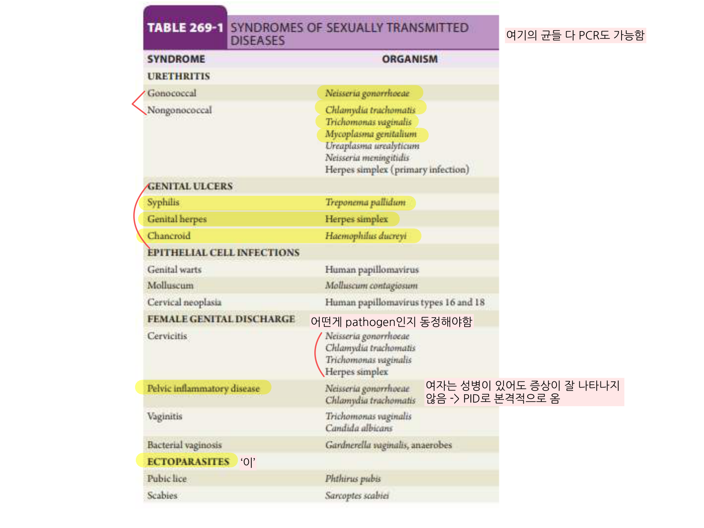
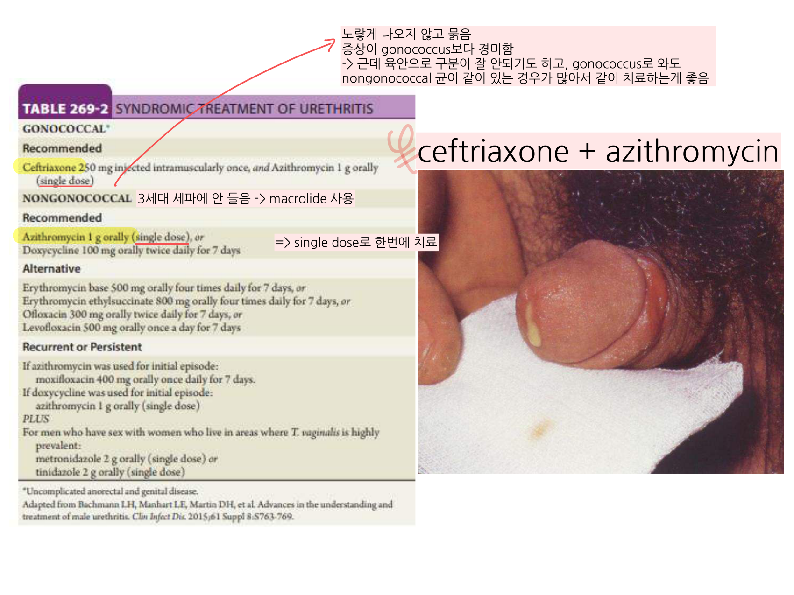
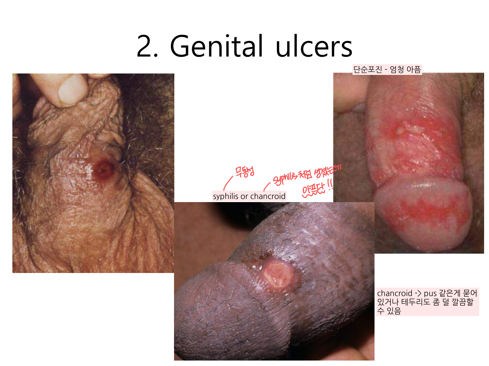
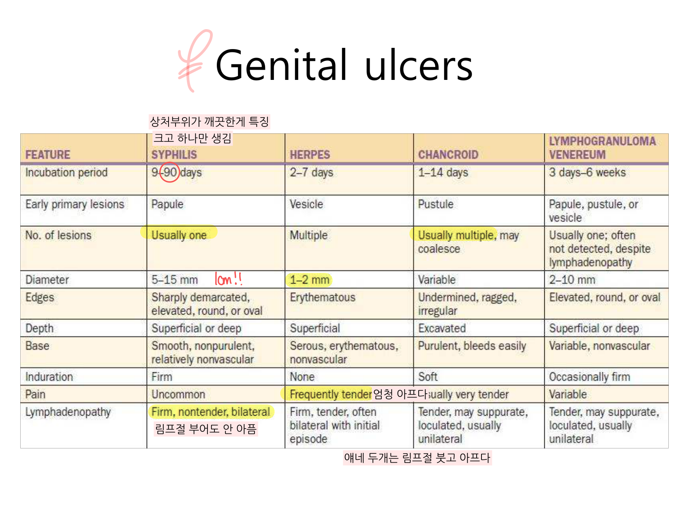
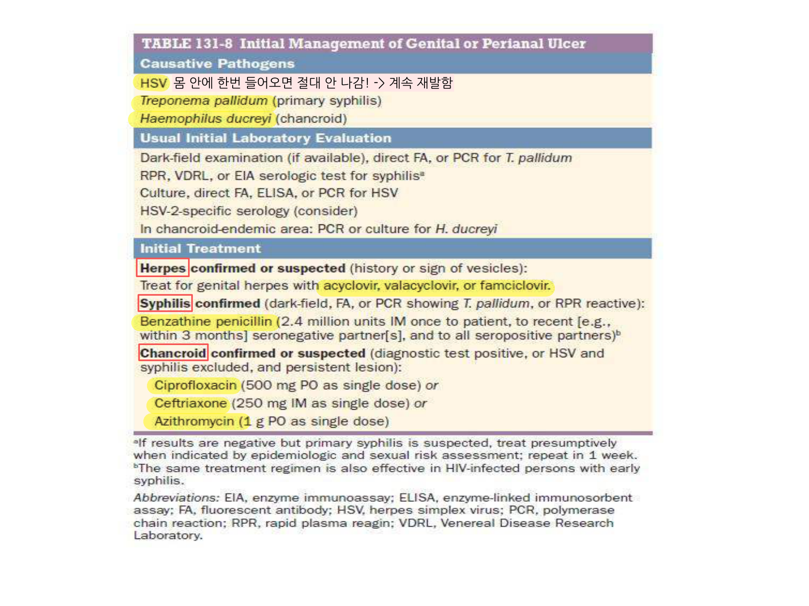
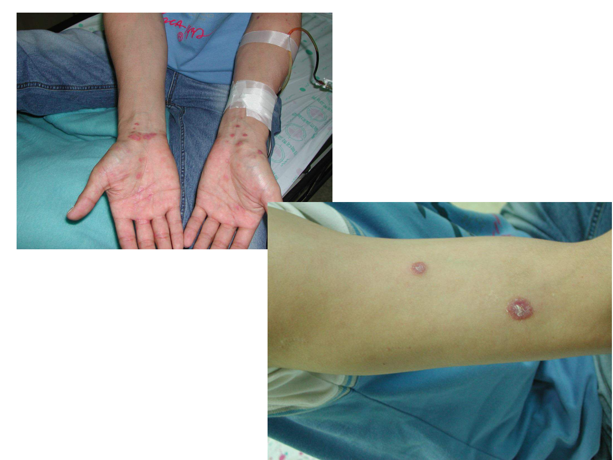
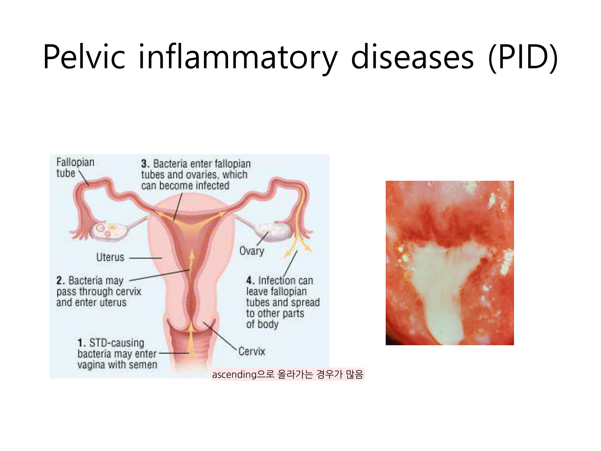
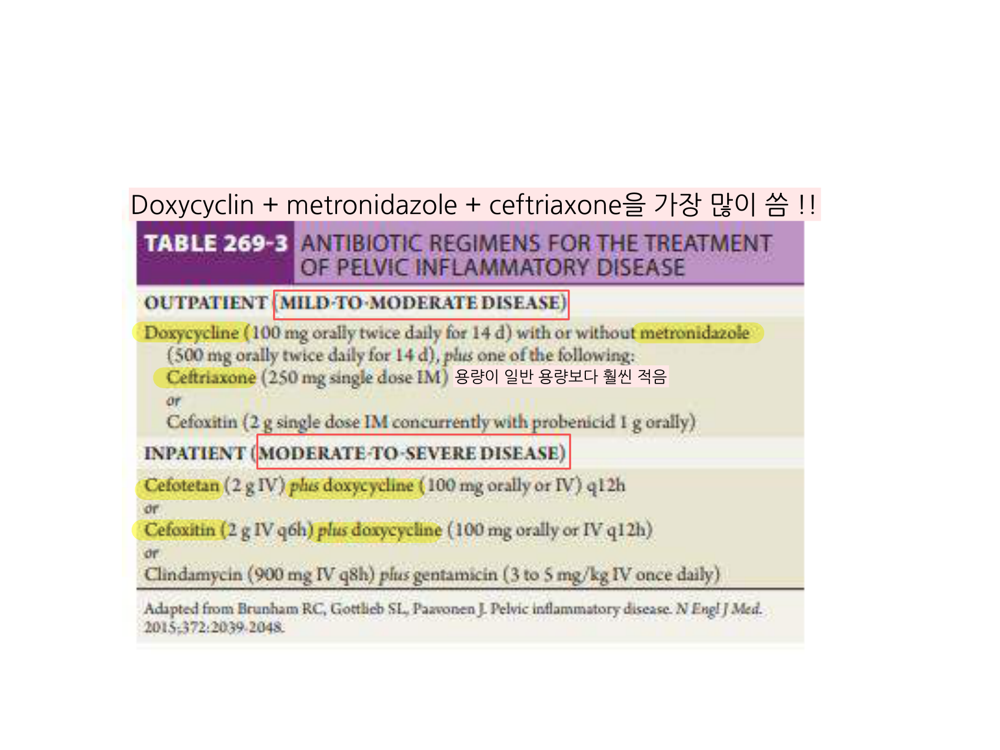

<!-- 필기본: 2025 -->
<!-- 단계: 수업 전 -->

# 0. 이 수업을 공부하는 법

**장현하 교수님** 수업("Approach to the patient with a sexually transmitted infection"). 필기본이 23쪽으로 짧고 대부분 교과서(해리슨) 표와 사진이다 — "다 메뉴얼에 있던 그림들입니다!!"

학습성과
1. 대표적인 성매개 감염병의 **원인균, 감염경로, 증상, 예방법**
2. **성별로 가능한 성매개 감염병과 치료법**

필기 순서: 증후군 접근과 역학 → **요도염** → **성기 궤양**(매독·헤르페스·연성하감) → **골반염(PID)** → 예방 → 포괄적 관리

- 기출 37문항(2020–2025). 장현하 교수님 문항은 **사진 한 장 + 아픈지 안 아픈지**로 원인을 고른다.
    - **통증 없는 궤양 1개(+ 단단하고 압통 없는 서혜부 림프절) → *T. pallidum*(매독)**
    - **매우 아픈 작은 수포 여러 개, 재발 → HSV-2 → acyclovir**
    - **요도 고름 → 임균 + 클라미디아 → ceftriaxone + azithromycin**, HIV 검사(내원 시 + 4–8주 후)
    - **손바닥·발바닥 발진 → 2기 매독 → benzathine penicillin G**
- 2020–22년 미생물학 문항(매독균 구조, 클라미디아 생활환, 임균·HSV·HPV)도 이 수업으로 분류되어 있다.

!!! key "핵심"
    **증후군 접근(syndromic approach)**: 원인균을 몰라도 증상(요도 분비물, 성기 궤양)으로 진단·경험적 치료 — 요도염·궤양은 잘 맞고, 질 분비물 증후군은 잘 안 맞는다.
    **STI는 같이 다닌다** — 하나가 있으면 다른 것(특히 **HIV, 매독**)도 검사하고 **성 파트너도 치료**한다.
    **매독 = 무통 궤양, 헤르페스 = 매우 아픈 다발 수포, 연성하감 = 아픈 궤양 + 아픈 림프절.** 매독은 **benzathine penicillin G**, 치료 반응은 **비트레포네마 검사(VDRL/RPR)** 역가로.

# 1. 증후군 접근과 역학
1. STI 병원체는 **전적으로 사람–사람 전파**에 의존(예외: *Trichomonas vaginalis*는 무생물을 통해서도).
2. STI는 **위험한 성행동의 표지** → **동시감염**이 흔하다. 매독에 잘 걸리는 사람이 임질도, HIV도 잘 걸린다.
3. **STI 병원체는 같이 다닌다** → 하나를 찾으면 **다른 검사**도. 예: 임질·클라미디아는 요도염을, 성기 궤양은 **HIV 감염 확률을 크게 높인다**.
4. **증후군 전략**: 증상·징후로 지표 증례를 경험적으로 치료 — 진단 자원·정확도·동시감염·추적 관리(완치 확인) 문제 때문. 알고리즘이 잘 정립되어 있어 **요도염이라고 하면 바로 경험적 항생제**를 시작해도 된다(추적 치료 기간을 최대한 줄임). **성기 궤양과 요도 분비물 증후군은 상당히 잘 맞고, 질 분비물 증후군은 잘 안 맞는다.** (여담: 피부과·비뇨기과는 눈으로 보고 진단하는데 산부인과는 배양해서 진단.)
5. **성 파트너 동시 치료**가 필수.
6. STI 진단 = 위험한 성행동과 콘돔 미사용의 증거 → **HIV의 표지** → **반드시 HIV 검사**.

## 증후군별 원인

{: style="width:58%"}

| 증후군 | 원인 |
|---|---|
| 요도염 — 임균성 | ***Neisseria gonorrhoeae*** |
| 요도염 — 비임균성 | ***Chlamydia trachomatis***, *Trichomonas vaginalis*, ***Mycoplasma genitalium***, *Ureaplasma urealyticum*, 수막알균, HSV(일차) |
| **성기 궤양** | **매독(*Treponema pallidum*)**, **성기 헤르페스(HSV)**, **연성하감(*Haemophilus ducreyi*)** |
| 상피세포 감염 | 성기 사마귀(HPV), 전염성 물렁종(molluscum), 자궁경부 신생물(HPV 16·18) |
| 여성 — 자궁경부염 | 임균, 클라미디아, 트리코모나스, HSV |
| 여성 — **PID** | **임균, 클라미디아** — 여자는 성병이 있어도 증상이 잘 안 나타나 **PID로 본격적으로** 온다 |
| 질염 | 트리코모나스, *Candida albicans* / 세균성 질증 — *Gardnerella vaginalis*, 혐기균 |
| 외부기생충 | 사면발이(*Phthirus pubis*), 옴(*Sarcoptes scabiei*) |

- 여기 균들은 다 PCR이 가능하다 — 어떤 게 원인인지 동정해야 한다.

!!! exam "기출 포인트"
    3번: 남성 요도염의 가장 흔하고 중요한 원인 2가지 → ***Chlamydia trachomatis*, *Neisseria gonorrhoeae***. 18번: 2020년 국내 가장 흔한 세균성 STI → **클라미디아 감염증**. 31번: 인공배지 배양 불가, 비임균성 요도염의 흔한 원인, 김자염색에서 보라색 봉입체 → ***C. trachomatis***.

# 2. 요도염 (urethritis)
## 진단 — 아래 4가지 중 1개 이상
1. **점액농성 또는 화농성 요도 분비물**
2. 요도 분비물 **그람염색**에서 유침시야당 **백혈구 2개 이상**
3. 첫 소변의 **백혈구 에스테라아제 양성**
4. 첫 소변 현미경에서 고배율시야당 **백혈구 10개 이상**

- **임균성 요도염이 확진돼도 클라미디아·마이코플라스마 동시감염을 배제할 수 없다** — 둘이 같이 다닌다.
- **핵산증폭검사(NAAT)**: 매우 민감·특이.

## 치료

{: style="width:70%"}

- **임균성**: **ceftriaxone 250 mg 근주 1회 + azithromycin 1 g 경구 1회**.
- **비임균성**: 3세대 세파가 안 듣는다 → **macrolide** — **azithromycin 1 g 1회**(single dose로 한 번에) 또는 doxycycline 100 mg 하루 2회 7일. 대안 erythromycin, ofloxacin, levofloxacin.
- 비임균성은 노랗지 않고 묽으며 증상이 임균보다 경미하지만, **육안으로 잘 구분되지 않고 임균에 비임균성이 같이 있는 경우가 많아 같이 치료하는 게 좋다** → **ceftriaxone + azithromycin**.
- 재발·지속: 처음 azithromycin이면 moxifloxacin 7일, doxycycline이었으면 azithromycin 1회 + 트리코모나스 유행 지역이면 metronidazole 2 g.

!!! exam "기출 포인트"
    요도 고름(사진) → **ceftriaxone + azithromycin**(12번), **ceftriaxone 250 mg IM 1회 + azithromycin 1 g PO 1회**(19번 — 2주 전 성관계, 노란 분비물, 소변 WBC ≥5). 6번: 요도염 환자 접근으로 옳은 것 → **내원 시 그리고 4–8주 후 anti-HIV 검사**. 오답 — 확진을 VDRL·TPHA로, 파트너 치료 불필요, meropenem 1회, metronidazole 7일.

# 3. 성기 궤양 (genital ulcers)

{: style="width:62%"}

{: style="width:76%"}

| | **매독** | **헤르페스** | **연성하감** | 성병성 림프육아종 |
|---|---|---|---|---|
| 잠복기 | 9–90일 | 2–7일 | 1–14일 | 3일–6주 |
| 초기 병변 | 구진 | **소수포** | 농포 | 구진·농포·소수포 |
| 개수 | **대개 1개** | **여러 개** | 대개 여러 개, 융합 | 대개 1개 |
| 크기 | **5–15 mm**(크다) | **1–2 mm** | 다양 | 2–10 mm |
| 가장자리 | **경계 뚜렷, 솟아 있음**, 둥근 | 홍반성 | 파고든·울퉁불퉁 | 솟아 있음 |
| 바닥 | **매끈, 깨끗**, 혈관 적음 | 장액성, 홍반 | **고름, 쉽게 출혈** | |
| 경결 | **단단함** | 없음 | **부드러움** | 가끔 |
| **통증** | **드묾(무통)** | **잦은 압통(엄청 아픔)** | **대개 매우 아픔** | 다양 |
| **림프절** | **단단, 압통 없음, 양측** | 단단, 압통, 양측 | **압통, 화농 가능, 편측** | 압통, 화농 가능 |

- 교수님 메모: **매독은 크고 하나만 생기고 상처 부위가 깨끗한 게 특징, 림프절이 부어도 안 아프다.** 헤르페스와 연성하감은 **림프절이 붓고 아프다.** 단순포진은 **엄청 아프다.** 연성하감은 고름 같은 게 묻어 있거나 테두리가 덜 깔끔할 수 있다.

## 초기 관리

{: style="width:62%"}

- 원인: **HSV**(몸에 한번 들어오면 절대 안 나간다 → 계속 재발), ***T. pallidum***(1기 매독), ***H. ducreyi***(연성하감).
- 검사: 암시야 검사·직접 형광항체·*T. pallidum* PCR, **RPR·VDRL·EIA 혈청검사**, HSV 배양·항원·PCR(HSV-2 혈청검사 고려), 유행 지역이면 *H. ducreyi* PCR·배양.
- **치료**
    - **헤르페스**(확진·의심 — 수포 병력이나 징후): **acyclovir, valacyclovir, famciclovir**.
    - **매독**(암시야·FA·PCR 양성, 또는 RPR 반응): **benzathine penicillin G 2.4 MU 근주 1회** — 최근(3개월 내) 혈청양성 파트너에게도.
    - **연성하감**(진단검사 양성 또는 HSV·매독 배제 + 지속 병변): **ciprofloxacin 500 mg 경구, ceftriaxone 250 mg 근주 1회, azithromycin 1 g 경구 1회**.
    - 검사가 음성이어도 1기 매독이 의심되면 추정 치료하고 1주 뒤 반복 검사. HIV 감염자에서도 같은 치료가 초기 매독에 효과적.

## 매독의 경과 (기출 보충)
- **1기**: **경성하감(hard chancre)** — 무통의 단단한 궤양, 단단하고 압통 없는 림프절. 저절로 없어진다.
- **2기**: 수 주–수 개월 뒤 **몸통·사지·손바닥·발바닥 발진**, 점막 병변, 콘딜로마 라타, 발열·림프절 비대.
- **3기**: **고무종(gumma)**, 심혈관·신경매독.
- 진단: 비트레포네마 검사(VDRL·RPR — **카디오리핀** 항원)로 선별하고 **치료 반응 판정**(역가 감소), 트레포네마 검사(TPHA·FTA-ABS)로 확진(평생 양성).

{: style="width:60%"}

!!! exam "기출 포인트"
    **통증 전혀 없는 음경 궤양** → ***T. pallidum***(1·11·30번). 9번: 2주 전 모르는 여자와 성관계, **1 cm 무통 궤양**, 양측 서혜부 림프절 **2 cm 단단·압통 없음** → ***T. pallidum***. **심한 통증 + 작은 다발 병변** → **HSV-2**(2·29번), **1–2 mm 수포 여러 개, 매우 아픔, 4년간 4번째 재발** → **HSV-2**(4번), 3개월 전과 같은 병변 재발 → **HSV**(8번), 1–2달마다 쓰리고 아픈 병변 재발 → **acyclovir**(7번).
    매독 치료제 → **benzathine penicillin G**(5·10·28번). 20번: 3개월 전 성관계 → 무통 궤양·사타구니 부음(저절로 없어짐) → 열·**손바닥** 발진 → **매독**. 13번: 몸통 발진 + **손·발바닥 병변** + 입안 불편, 열 없음 → ***T. pallidum***(콕사키 함정). 16번: 손바닥 병변 = **2기**, 치료 효과 판단은 treponemal 검사 → **False**(non-treponemal로 판단).

# 4. 골반염 (pelvic inflammatory disease, PID)

{: style="width:60%"}

## 정의와 발생 기전
- **자궁경부·질에서 자궁내막·난관으로 상행하는 감염**. 생식기를 넘어 **골반 복막염**, 전신 복막염, **간주위염(perihepatitis, Fitz-Hugh–Curtis)**, 비장주위염, 골반 농양까지.
    - 간 주위에 물이 고이거나 하면 간에 감염이 생겼다기보다 **PID가 올라간 것**.
- 발생 경로
    1. 인접 염증(충수염, 국소 회장염, 게실염) 또는 세균성 질증에서
    2. 혈행성 파종(결핵, 포도알균 균혈증)
    3. 열대 질환(주혈흡충증)의 합병증
    4. **자궁내 감염** — 일차(자발적, 대개 성매개) 또는 **침습적 자궁내 시술**(소파술, 임신중절, **자궁내 피임기구(IUD)** 삽입, 자궁난관조영술), 분만 후 — **이게 많다!**
    - 진행: ① 자궁내막염 → ② 난관염 → ③ 간주위염·충수주위염.

## 치료

{: style="width:62%"}

- **doxycycline + metronidazole + ceftriaxone을 가장 많이 쓴다!**
- **외래(경증–중등도)**: **doxycycline 100 mg 하루 2회 14일 ± metronidazole 500 mg 하루 2회 14일** + **ceftriaxone 250 mg 근주 1회**(용량이 일반 용량보다 훨씬 적음) 또는 cefoxitin 2 g 근주 + probenecid.
- **입원(중등도–중증)**: **cefotetan 2 g IV 12시간마다 + doxycycline** 또는 **cefoxitin 2 g IV 6시간마다 + doxycycline**, 또는 clindamycin + gentamicin.

# 5. 예방
## 전파의 결정 요인 — R0 = B × D × C
- **B**: 전파 효율, **D**: 감염 기간, **C**: 성 파트너 수. STI는 예방할 수 있다.

## CDC의 5가지 전략
1. 위험군 **교육과 상담**(안전한 성행동)
2. 증상이 없거나 치료를 찾지 않는 감염자 **발견**
3. 감염자의 **신속·효과적 진단과 치료**
4. **노출된 성 파트너**의 평가·치료·상담
5. 백신으로 예방 가능한 STI의 **노출 전 예방접종**(예: HPV)

## 예방 방법
1. **행동 중재**: 금욕, 감염되지 않은 상대와 장기적 일부일처. **상담이 필수**(RCT에서 STI 25–40% 감소).
2. **차단법**: **남성 라텍스 콘돔** — 점막 표면 체액으로 전파되는 감염(임질, 클라미디아, 트리코모나스, HIV)에 더 효과적이고, 피부 접촉으로 전파되는 것(HSV, HPV, 매독, 연성하감)에는 덜 효과적. 전체 표면을 다 덮지 못하고 잘못 쓰면 샌다 → 콘돔 사용자의 매독 방어율이 80% 정도뿐 → 교육.
3. **남성 포경수술**: HIV, HPV, HSV-2 감염 감소(감염될 수 있는 점막 조직 감소).
4. **파트너 서비스**: 두 사람 사이에서 핑퐁처럼 **재감염**되는 문제.
5. **노출 전 중재**: **HBV·HAV·HPV 백신**, HIV **노출 전 예방(PrEP)**. HBV·HCV도 요즘은 STI(혈행성으로는 전달이 잘 안 됨).
6. **노출 후 예방(PEP)**: **doxycycline**(100–200 mg)이 MSM의 매독·세균성 STI 전파를 줄인다. **HIV — 노출 72시간 이내 항레트로바이러스제 28일**(너무 걱정되면 약을 준다). 원래 성병이 있었는지 검사(VDRL/HIV/HCV/HBV — 증상이 없으니 PCR은 못 함).
7. **피임**: 모든 피임법이 STI 획득과 결과에 영향. 임신 자체도 STI 획득과 임신·신생아에 영향 → 두 파트너의 생식 건강과 가족계획을 고려(다방면·다학제적 접근). 경구피임약은 HIV 위험을 높이지 않음, 프로게스테론 단독 주사는 HIV 위험 증가와 관련 가능.

# 6. 포괄적 관리 전략
- 대부분의 STI는 자연 치유되거나 쉽게 치료되지만 제대로 관리하려면 상당한 기술이 필요하다.
1. **올바른 증후군**을 인식하고 진단 검사를 결정(환자의 증상이 정확히 뭔지).
2. 완치를 약속할 만큼 **충분히 넓은 경험적 치료**.
3. 공중보건·개인적으로 중요한 **다른 STI를 찾을 의무**.
4. **성 파트너를 다룬다**(의뢰 또는 신속 파트너 치료). 어떤 경우엔 정신과 상담도 필요.
5. **상담과 보조 예방 조치.**

# 7. 미생물학 보충 (2020–22 기출)
- **임균**: 남성은 **요도**, 여성은 **자궁경부(endocervix)** 에 주로 감염 → 여성 검체는 자궁경부에서(14·22번). 산모 감염은 **신생아 화농성 결막염**, 항원 다양성으로 **백신 없음**, 여성은 상행 감염으로 **불임**, 무증상 보균은 **여성**이 더 흔함(32번). **피막 없음**(국소 감염) vs 수막알균 **피막 있음**(항식세포, 혈류 전파)(21번).
- **매독균**: **축사(axial fibril, 내편모)가 세포질막과 외막 사이**에 있고, 병원성 균에는 협막 같은 **외피(outer sheath)** 가 있다(15·33번). 1기 병터에서 균이 잘 보이고, 그람염색 X(암시야), 인공배지 배양 불가. 뾰족한 끝이 **히알루론산** 기질로 내피에 결합, **hyaluronidase**가 혈관 주위 침윤 촉진(23번). 비트레포네마 항원 **cardiolipin**(24번). 1기 **경성하감**, 3기 **고무종**(34번).
- **클라미디아**: **기본소체(elementary body)** 가 감염 → 포식소체에서 **망상소체(reticulate body)** 로 전환해 증식 → 다시 기본소체로(25번).
- **HSV**: 크고 외피 있는 정이십면체 **이중가닥 DNA**, 조절에 **세포매개면역**, 치료제 **acyclovir**(ganciclovir·foscarnet은 CMV), 무증상 배출 가능(26·36번). HSV-1은 **episome**으로 잠복(17번). Acyclovir 선택성 = 바이러스 **thymidine kinase**(35번). 성기 헤르페스는 **평생 잠복**, 완치 불가, 계절 차이 없음(37번).
- **HPV**: **E6 → p53**, **E7 → pRB** 결합 → 자궁경부암(27번).

!!! memo "암기"
    **요도염**: 임균 + 클라미디아 → **ceftriaxone 250 IM 1회 + azithromycin 1 g 1회**, HIV·매독 검사, 파트너 치료 · **궤양**: 매독(무통·1개·깨끗·단단, 무통 림프절) → **benzathine PCN G 2.4 MU IM 1회** / 헤르페스(아픈 1–2 mm 다발 수포, 재발) → **acyclovir** / 연성하감(아픈 궤양 + 아픈 화농 림프절) → cipro·ceftriaxone·azithro · **2기 매독** = 손발바닥 발진, 치료 반응은 **VDRL/RPR** · **PID**: 상행 감염, IUD·시술, 간주위염 → **ceftriaxone 1회 + doxycycline 14일 ± metronidazole** · **R0 = B × D × C** · 국내 최다 세균성 STI = **클라미디아**.
