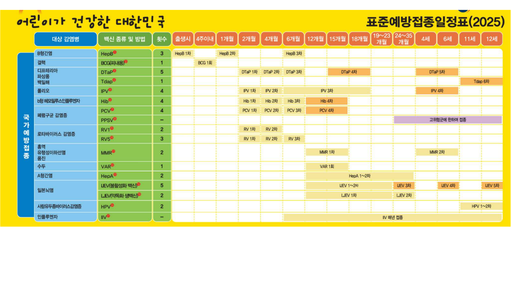
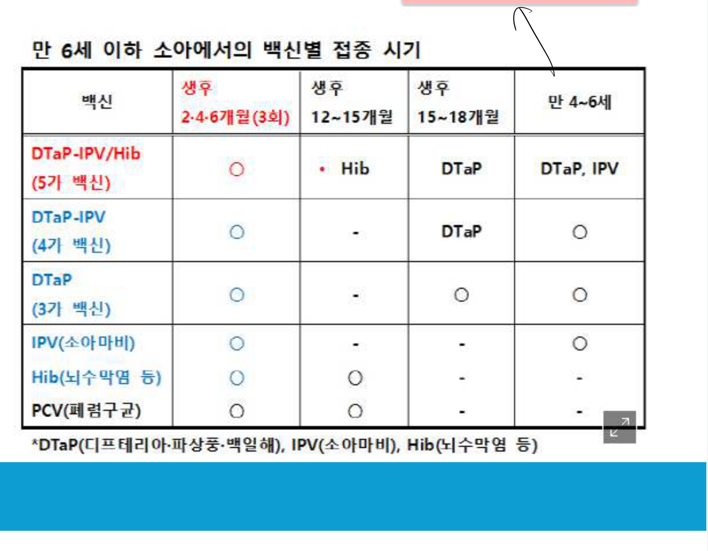

<!-- 필기본: 2025 -->
<!-- 단계: 수업 전 -->

# 0. 이 수업을 공부하는 법

CP-C2는 **예방접종 증례 질문**에 대한 **조별 발표** 시간이다(소아감염, 김동섭 교수님). 질문 14개를 조마다 하나씩 맡아 발표하고 교수님이 덧붙이셨다. 필기한 선배: "기본적인 내용은 **예방접종 수업(27. 소아감염 백신 CP-C1)** 내용 참고하시면 되겠습니다. 교수님 추가 언급 위주로 적었습니다."

**이 수업으로 분류된 기출은 없다**(2부 비어 있음). 예방접종 기출 66문항은 27번 수업 학습자료에 모여 있으니, 이 정리는 **27번과 함께** 본다. 아래에서 "교수님"으로 시작하는 말은 발표 중 교수님이 덧붙이신 말이다.

| Q | 질문 | 한 줄 답 |
|---|---|---|
| 1 | 건강한 6개월 소아의 오늘 접종 | DTaP·IPV·Hib·PCV·HepB 3차(+인플루엔자) — 혼합백신으로 주사 수 줄이기 |
| 2 | 건강한 4세 소아의 오늘 접종 | DTaP·IPV(4~6세), MMR 2차, 인플루엔자 — 5·6가 혼합백신은 안 됨 |
| 3 | BCG 안 맞은 1세 | 오늘은 안 됨 — **TST 음성** 확인 후 |
| 4 | BCG 금기 | 면역저하·임신 절대금기, 미숙아·피부질환 상대금기 |
| 5 | 독감 사백신 대상·금기 | 6개월 미만, 이전 백신 아나필락시스. 계란 알레르기는 금기 아님 |
| 6 | 비장절제 환자 | 폐렴구균·수막구균·Hib(+인플루엔자), **수술 2주 전** |
| 7 | 인공와우 이식 24개월 | 폐렴구균 **PPSV23** 추가, 인플루엔자 매년 |
| 8·9 | 고용량 면역글로불린과 생백신 | IG 후 생백신은 수개월 연기, MMR 후 2주 내 IG면 재접종 |
| 10 | SCID 어린이 | 생백신 절대금기, 조혈모세포이식 후 처음부터 다시 |
| 11 | 체액면역결핍 | 생백신 금기, 사백신 가능, IVIG |
| 12 | 임신부 권장 | **Tdap(27~36주)**, 불활성화 인플루엔자. MMR·수두·HPV 금기 |
| 13 | HPV 백신 효과 | 16·18형 감염 90~98% 예방, 자궁경부 전암병변 감소, 집단면역 |
| 14 | RSV 단클론항체 | **니르세비맙** — 첫 RSV 시즌 영아 1회, 둘째 시즌은 고위험군만 |

!!! key "핵심"
    - **생백신**(MMR, 수두, BCG, 로타, 일본뇌염 생백신, LAIV): 면역저하·임신에 금기. 생백신끼리는 같은 날 또는 **4주 간격**.
    - **면역글로불린**은 MMR·수두(·일본뇌염 생백신)의 효과를 떨어뜨린다. BCG·로타·황열·장티푸스는 영향 없음.
    - BCG는 원래 **생후 4주 이내**. 늦어지면 **TST 음성** 확인 후.
    - 비장이 없으면 **피막세균**(폐렴구균·수막구균·Hib) 백신, 가능하면 **수술 2주 전**.

{: style="width:90%"}

# 1. 영유아 정기 접종 (Q1·Q2)

## Q1. 건강한 6개월 소아가 오늘 맞을 수 있는 접종

- 6개월: **DTaP 3차, IPV 3차, Hib 3차, 폐렴구균(PCV) 3차, B형간염 3차**, 그리고 **인플루엔자 1차**(6개월부터).
- 교수님: "인플루엔자는 **유행하는 시기에 맞춰** 맞는다. 1년 내내 맞는 게 아니다. 우리나라는 빠르면 9월에 시작."
- 교수님: "**최소 주사 몇 대**인지 설명할 수 있겠나요? 최소한으로 찌르려면 — **혼합백신**으로 들어가 있는 게 있다." (예: DTaP-IPV-Hib-HepB 6가 혼합백신 Hexaxim)

## Q2. 건강한 4세 소아가 오늘 맞을 수 있는 접종

- 만 4~6세: **DTaP 5차, IPV 4차, MMR 2차**, 그리고 인플루엔자(유행 시기, 9세 미만 첫해는 4주 간격 2회).
- 교수님: "4~6세에게 **5가·6가 혼합백신**을 맞힐 수 있나? → **안 된다.** (Hib·HepB를 한 번 더 맞는 것이 된다.) 5·6가 말고 **그냥 DTaP**을 맞혀라. 특별한 이유 없이 맞히면 **청구 못 한다**."

{: style="width:62%"}

# 2. BCG (Q3·Q4)

## Q3. BCG를 맞지 않은 1세 남자 어린이 — 오늘 접종 가능한가?

- BCG: 결핵 예방용 **생백신**(*M. bovis* 약독화). 결핵성 뇌수막염·파종성 결핵 같은 **중증 결핵** 예방이 목적.
- 원칙: **생후 4주 이내** 접종. 결핵 유행국(우리나라 포함)에서는 놓쳤어도 12개월 이전에는 접종 가능.
- 생후 12개월이 넘으면 자연 감염·잠복결핵 가능성이 있으므로 **투베르쿨린 피부반응검사(TST)**를 먼저 한다 → **음성이면 BCG**, **양성이면 결핵 감염으로 보고 BCG 금기** → 활동성 여부 확인(흉부 X선·객담) 후 치료.
- **결론: 오늘 바로 맞을 수는 없다.**

교수님

- "특정 연령이 지나가면 — 개념 자체는 맞는데 — **연령 기준 3개월이 넘으면 결핵 감염을 배제하고** 접종하라."
- "생후 6개월 정도 되면(해외 살다가 온 경우) 결핵 노출 가능성을 생각해 보고 **TST**를 한다."
- "결과는 **48~72시간** 지난 시점에 본다. 해외로 바로 다시 나가야 한다면 (원칙대로라면) 접종을 할 수가 없다."

## Q4. BCG 접종 금기

| 절대금기 | 상대금기 (연기) |
|---|---|
| **선천성 면역결핍**(SCID, 만성육아종병, T세포 결함) | **미숙아**(체중 2 kg 미만) |
| **후천성 면역결핍**(HIV, 백혈병·림프종·악성종양) | 접종 부위 **피부질환**(습진·농가진·화상) |
| 스테로이드·면역억제제·방사선 치료 | **열성 질환**·급성 감염 |
| **임신부** | |
| 중증 질환으로 입원 중인 신생아 | |

- B형간염·DTaP 같은 불활성화 백신과는 함께 맞을 수 있지만, **다른 생백신과는 4주 간격**.
- 이전 BCG 흉터가 있거나, 투베르쿨린 양성이거나, 결핵이 의심되면 접종하지 않는다.

**BCG 골염 증례** (발표 자료): 팔꿈치·경골 X선에서 골파괴, bone scan에서 다발성 hot spot → 파종성 BCG 감염. 배양에서 *M. bovis* BCG — INH·RFP·EMB에는 감수성, **pyrazinamide에만 내성**.
교수님: "**PZA만 내성이면 *M. bovis*를 의심**(결핵균이 아니고)." 증례 아이는 BCG 맞은 부위 염증이 2년 가서 수술했고, 뼈 조직검사에서 암은 아니었다.

# 3. 인플루엔자 사백신 (Q5)

- 불활성화 백신 → 면역저하자·노인에게 비교적 안전. WHO가 매년 유행주를 예측해 새로 만든다. 항체는 2주부터 생겨 4주에 최고, 약 5개월 예방.
- **대상**: 65세 이상, **생후 6개월~13세**, **임신부**(국가 지원), 고위험군과 그 가족·의료인. 교수님: "독감은 **50세 이상이 고위험군**."
- **시기**: 매년, 유행 전. **9세 미만이 처음 맞는 해는 4주 간격 2회**, 이후 매년 1회. 교수님: "해마다 좀 다르다 — 예측하기 어렵기도 하고."
- **금기**: **생후 6개월 미만**, 이전 인플루엔자 백신에 **아나필락시스**, 백신 성분 알레르기.
- **주의**: 이전 접종 후 **6주 이내 길랭-바레 증후군** 과거력, 중증 급성 질환(호전될 때까지 연기).

교수님

- "개인 병원 자료는 각색하는 경우가 있으니 쓰지 말아라."
- 6개월 미만은 못 맞으니 "**산모가 임신 중에 맞고 출산하는 것이 좋다**(2~3개월 아이도 걸릴 수 있으니까). 근데 여름에 태어나면 잘 못 맞을 수도."
- "동일한 백신 접종 후 아나필락시스면 그냥 안 된다고 생각. 다른 접종은 맞을 수 있을 수도."
- **계란 알레르기**: "최근에는 먹어서 심각한 알레르기가 있어도 **접종엔 영향이 없다**는 것이 결론."
- 중증 급성 질환은 absolute contraindication은 아니지만 현실적으로 설득해서 맞히기 쉽지 않다(중환자실에 3개월 누워 있는 환자 등).
- "독감 **생백신**(비강형)도 있긴 한데 많이 안 쓰인다. 이것 역시 생백신 금기에는 쓸 수 없다."

# 4. 특수 상황의 예방접종 (Q6·Q7)

## Q6. 비장절제 환자

교수님: "선천적으로 비장이 없거나, 작거나, 이상한 위치에 있는 경우가 있다. 비장 **경색이 반복**되는 경우도 기능에 문제가 있다. 비장 모양·크기·위치를 고려한다."

- 비장은 **피막세균**을 대식세포 식균작용과 IgM·옵소닌으로 제거한다 → 비장이 없으면(asplenia, hyposplenia) **OPSI**(overwhelming post-splenectomy infection, 짧은 시간에 패혈증)의 위험.
- 대표 피막세균: **폐렴구균, 수막구균, Hib** → 세 가지 백신 + **매년 인플루엔자**(2차 세균감염 감소).
    - **폐렴구균**: 최우선. 예전에는 PCV13 → 8주 후 PPSV23 → 5년마다 PPSV23. 최근 **PCV20 단독** 또는 PCV15 + PPSV23 허용. 교수님: "이제 (PCV20이) **PPSV를 대체하는 중**. 다른 회사라 교차는 안 된다."
    - **수막구균**: MenACWY(5년마다 추가), 필요하면 MenB. 교수님: "(MCV4는) **5세 이상이 무조건 맞아야 한다는 건 아니다.** 비장 절제가 예상될 때 수막구균을 접종한다(건강한 아이에게는 권장사항이 아니니까)."
    - **Hib**: 접종력이 없으면 1회.
- **시기**: 가능하면 **수술 2주 전**에 완료, 응급수술이면 **수술 후 14일 이후**(회복된 뒤).
- 교수님: "수술은 굉장히 stressful한 상황. 접종하고 반응이 있을 때 수술하는 게 이상적(elective면 그렇게 한다). 이전에 몰랐다가 절제해야 하면 아무것도 안 했을 가능성이 있다 — **처음부터 시작**. 무비증은 의학적 **면역저하자**."

## Q7. 15개월에 인공와우 이식을 받은 24개월 소아

- 인공와우는 중이·내이 사이에 통로를 만들고 인공물(biofilm)이 들어간다. 내이 림프액이 cochlear aqueduct로 **CSF와 연결** → **세균성(폐렴구균) 수막염** 고위험군.
- 교수님: "인공와우 수술 후 두통이 있는데 이유를 잘 모르겠다면 **pneumococcal meningitis**를 생각해야 한다. 해부학적인 이유인 셈."
- 오늘 접종: 일본뇌염·A형간염 등 일정대로, 못 맞은 백신 따라잡기 + **인플루엔자 매년** + **폐렴구균 다당백신(PPSV23)** 추가(2세가 넘었으므로).
- 2세 미만은 B세포가 다당 항원을 잘 인식하지 못해 PPSV 효과가 거의 없다. 교수님: "2세 미만은 효과가 거의 없다고 생각해서."

# 5. 면역글로불린과 생백신 (Q8·Q9)

## Q8. 고용량 면역글로불린 투여 후 생백신 일정

- 영향을 **받는** 생백신: **MMR, 수두, 일본뇌염 생백신** → 고용량 IG 후에는 일시적으로 금기, **약 11개월** 뒤 접종.
- 영향을 **받지 않는** 생백신: **BCG, 로타바이러스, 황열, 장티푸스** → 일정 조정 필요 없음.
- 교수님: "IG 투여 후 생백신 투여는 **효과가 없으니까** 하지 말라는 것. MMR이 연구가 잘 되어 있고, 수두랑 뇌염은 그걸 따라가는 경향이 있다."

## Q9. MMR 접종 1주 후 고용량 IG를 맞았다면 — 재접종?

- 생백신은 접종 후 **2주**가 지나야 면역이 자극된다 → 접종 후 **2주 이내에 고용량 IG**를 맞았다면 **재접종이 필요**. 간격은 IG 종류·용량에 따라 **3~11개월**.
- 교수님: "MMR 생백신 접종 후 **혈소판이 줄어드는** 경우가 있다. 그때도 고용량 IG를 쓴다 → 백신 효과가 떨어진다고 생각 가능. MMR 1주 후 출혈로 중환자실에 가면 다시 접종하자고 하기 어렵다. 원칙대로 설명하고 맞힐 수도 있지만, **항체 검사를 먼저 해 보고 항체가가 충분하면 넘어가는 것**도 방법."

# 6. 면역결핍 어린이의 예방접종 (Q10·Q11)

## Q10. 중증복합면역결핍증(SCID)

- 선천 면역결핍 중 가장 심각 — 세균·바이러스·진균 모두에 취약.
- **생백신 절대 금기**(BCG, 로타, 일본뇌염 생백신, MMR, 수두). 사백신은 안전하지만 **효과가 없어** 권고되지 않음.
- 치료: 가능한 한 빨리(**생후 3개월 이내**) **조혈모세포이식**, IVIG.
- 교수님: "**진단 못 받고 (생백신) 접종 받는 것이 문제**다." (예: 로타·BCG 후 파종성 감염)
- 이식 후에는 이전 항체가 대부분 사라지므로 **생애 첫 예방접종처럼 처음부터 다시** 시작. 교수님: "이식 후 맞힐 수 있는 시기가 되면 접종한다. 독감은 유행 시기가 되면 빨리 맞힌다."
- **가족·보호자**: 표준 예방접종을 빠짐없이, 인플루엔자 매년. 교수님: "(가족은) **생백신 다 맞으라고 한다**."

## Q11. 체액면역결핍 환자

- 예: 범저감마글로불린혈증(X-linked agammaglobulinemia 등), **분류불능형 면역결핍(CVID)**, 선택적 IgA 결핍, IgG subclass 결핍. 교수님: "**범위가 넓다.** 연관된 질환도 많고."
- 원칙: **생백신(MMR·수두) 금기**(교수님: "일반적으로 금기가 맞다"), 사백신은 가능(T세포 반응으로 중증도 감소), IVIG, 정기적 항체 모니터링.
- 인플루엔자: 6개월부터 첫해 4주 간격 2회, 이후 매년 불활성화 백신.
- 폐렴구균: PCV 4회 → 8주 후 PPSV23 → 5년 후 PPSV23. 교수님: "**전형적인 X-linked 범저감마글로불린혈증이면 권장하지는 않는다.** 일부 B세포가 있거나 항체 생성 능력이 있다 싶으면 폐렴구균 백신을 권장."
- Hib: 4회 후 **5세 이상이면 2개월 간격 1~2회** 추가(면역저하자의 경우).

# 7. 임신부와 청소년 (Q12·Q13)

## Q12. 임신부에게 특별히 권장하는 예방접종

- 원리: **산모 보호 + 신생아 보호**(모체 IgG가 태반을 통해 전달). 불활성화 백신은 권장, 생백신은 금기.

| 백신 | 목표 | 시기·지침 |
|---|---|---|
| **Tdap** | 신생아 **백일해** 예방 — 첫 DTaP(2개월) 전 면역 공백기를 메움 | **임신 27~36주**, **매 임신마다** |
| **불활성화 인플루엔자** | 산모 중증 독감 + 6개월 미만 영아 보호 | 유행 시즌이면 **주수와 무관하게** 빨리. 비강형 생백신(LAIV)은 금기 |

- 상황에 따라: 코로나19(고위험군), B형간염(HBsAg·anti-HBs 음성 + 고위험), A형간염(만성 간질환·유행 지역 여행). 교수님: "필요하면 이해득실을 따져서 결정. 딱히 리스크 없으면 굳이 임신 기간에 맞을 필요가 있을까?"
- **금기**: **MMR·수두**(선천성 풍진·수두 증후군) — 가임기 여성은 임신 **1개월 전** 완료, 항체 없으면 **출산 직후 퇴원 전** 접종. **HPV**는 자료 부족으로 권장 안 함 — 도중 임신하면 중단, 출산 후 재개.
- **코쿤 전략**: 남편·형제 등 함께 사는 가족이 Tdap·인플루엔자를 맞아 신생아 주위에 보호막을 친다.
- 교수님: "신생아 질환 예방을 함께. 2개월 이전에 걸릴 수도 있어서 **시간을 버는 것**."

## Q13. 사람유두종바이러스(HPV) 백신의 기대 효과

- HPV: 피부·점막 상피의 DNA 바이러스. **저위험형 6·11**(생식기 사마귀, 후두유두종), **고위험형 16·18** 등(자궁경부암, 항문암, 구인두암). 교수님: "일반인은 자궁경부암 예방접종으로 알고 있다. **두경부암**이 중요한데, 그게 HPV에 의한 것인지 불분명하다."
- VLP 재조합 단백 백신: Cervarix(2가 16·18), Gardasil(4가 6·11·16·18), Gardasil 9(9가).
- 일정: **9~14세 2회**(0, 6~12개월), **15세 이상·면역저하자 3회**(0, 2, 6개월). 국가 무료접종: 만 12세 여아.
- 효과: **16·18형 감염 90~98% 예방**, 자궁경부 이형성증 80~90% 감소, 생식기 사마귀 예방, **집단면역**, 항체 10년 이상 유지. 교수님: "현재 **남성에게도 허가**가 나 있다." 남성 접종이 여성 자궁경부암 감소와 직접 연결된다는 근거는 아직 부족 — "추가 자료나 근거가 있으면 언제든 바뀔 수 있다."

# 8. RSV 단클론항체 (Q14)

- RSV: 외피 있는 단일가닥 RNA 바이러스(Pneumoviridae), A·B형. 영아는 기도가 좁고 면역이 미성숙해 **세기관지염·폐렴**. 교수님: "우리나라는 RSV 모세기관지염 — **호흡곤란으로 입원**하게 된다. 입원을 얼마나 줄이고 심해지는 경우를 얼마나 줄여 줄 거냐를 확인할 필요가 있다."
- **니르세비맙**(2024년 4월 국내 승인): RSV **F 단백**을 중화하는 장기작용 단클론항체, **시즌당 1회 근육주사**.
- 효과: 의료기관 방문을 동반한 RSV 하기도감염 **70% 이상 감소**, 미국 첫 시즌 입원 예방 효과 약 90%. 교수님: "수치에 대한 것은 근거자료를 바로바로 보여 줘야."
- 대상·시기 (CDC)
    - **첫 RSV 시즌 영아(8개월 미만)**: 산모가 RSV 백신을 안 맞았거나 불명, 또는 접종 후 14일 이내 출생이면 투여. 시즌 중 출생이면 **출생 1주 내**.
    - **둘째 시즌(8~19개월)**: **고위험군만**(미숙아 만성폐질환으로 최근 6개월 의료적 지지, 중증 면역저하, 낭포성섬유증 등).
- 교수님: "**첫 번째 RSV 시즌을 무사히 넘기려고** 맞는다. 매년 맞는 건 아니다(건강한 어린이). 시즌 중에 태어나면 바로, 시즌 전이면 시작 전에 한 번. 두 번째 시즌에도 맞는 것은 고위험군에 한해서. 우리나라는 아직 **산모 접종은 안 한다**(약은 있다 — 추후 도입될 듯)."

# 암기 — CP-C2 요점

| 주제 | 꼭 기억할 것 |
|---|---|
| 6개월 | DTaP·IPV·Hib·PCV·HepB 3차 + 인플루엔자(유행 시기). 혼합백신으로 주사 수 최소화 |
| 4~6세 | DTaP 5차·IPV 4차·MMR 2차. **5·6가 혼합백신 ×** |
| BCG | 4주 이내. 늦으면 TST 음성 확인 후(결과 48~72시간). 면역저하·임신 금기. PZA만 내성 → *M. bovis* |
| 독감 사백신 | 6개월 미만·이전 아나필락시스 금기. GBS 6주 이내 주의. 계란 알레르기 금기 아님. 9세 미만 첫해 2회 |
| 비장절제 | 폐렴구균·수막구균·Hib + 인플루엔자. 수술 2주 전, 응급이면 14일 후 |
| 인공와우 | 폐렴구균 수막염 위험 → 2세 이후 PPSV23, 인플루엔자 매년 |
| IG와 생백신 | MMR·수두·일본뇌염 생백신만 영향. 접종 2주 내 IG면 재접종(3~11개월 후) |
| SCID·체액면역결핍 | 생백신 금기. SCID는 이식 후 처음부터. 가족은 생백신 포함 모두 접종 |
| 임신부 | Tdap 27~36주 매 임신, 불활성화 인플루엔자. MMR·수두·HPV·LAIV 금기 |
| HPV | 9~14세 2회, 15세 이상 3회. 16·18형 90~98% 예방 |
| RSV | 니르세비맙, 첫 시즌 1회. 둘째 시즌은 고위험군만 |
