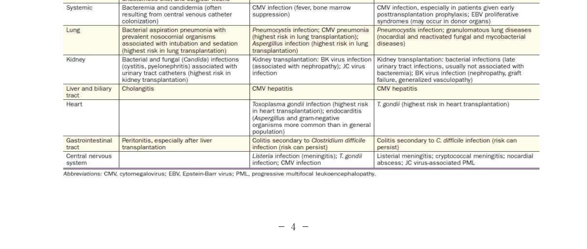
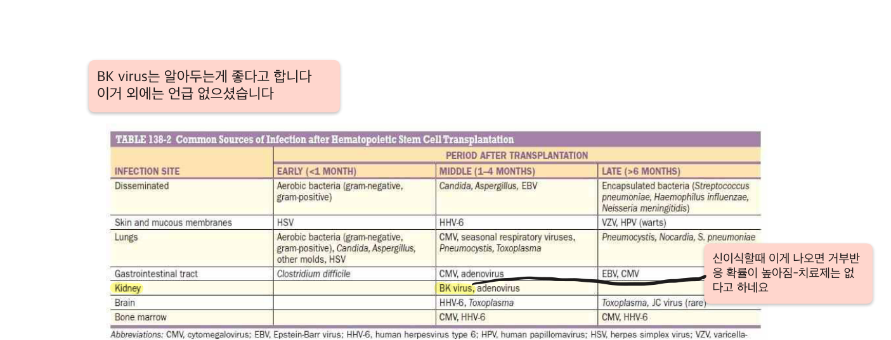
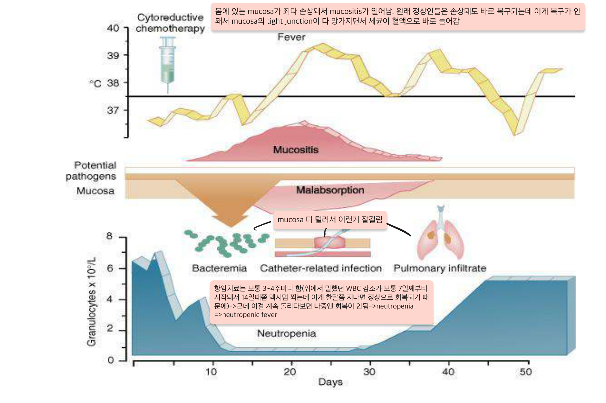
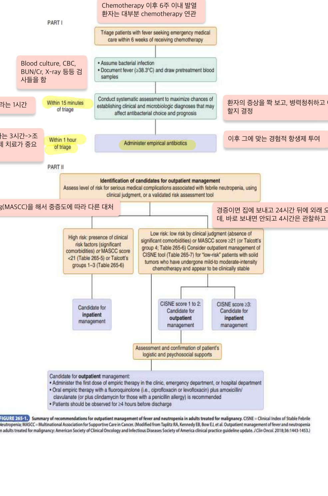
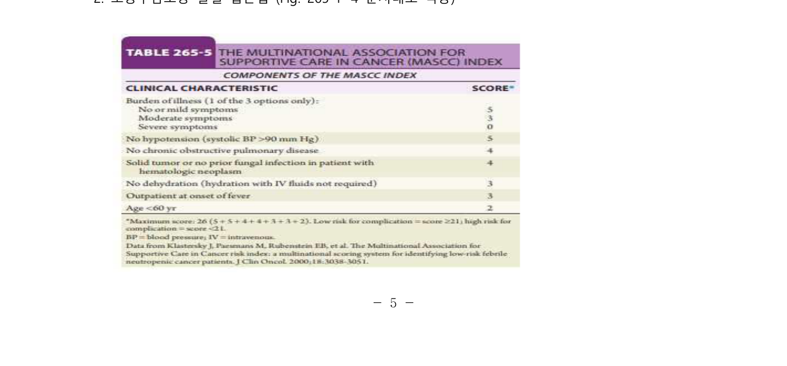
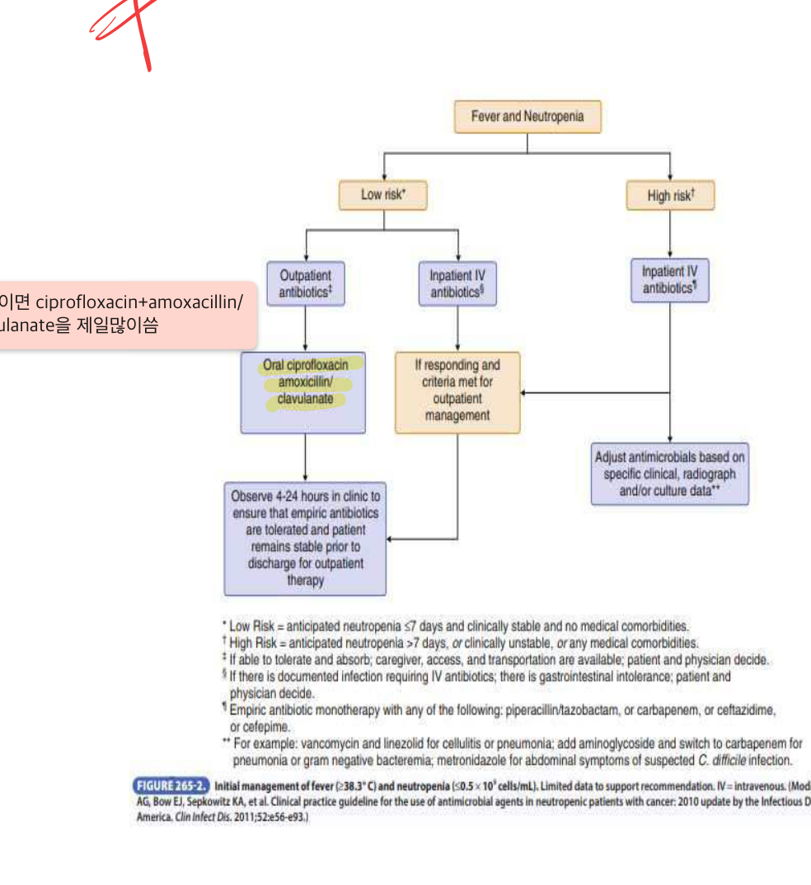
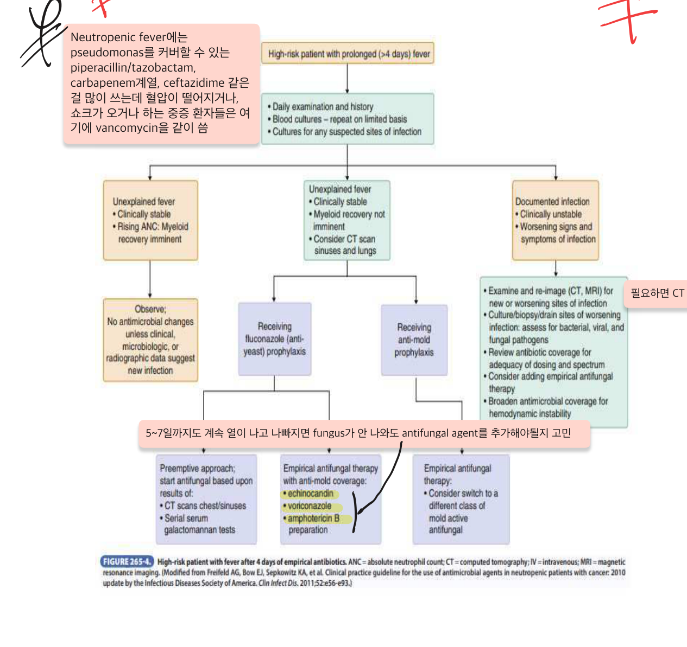

<!-- 필기본: 2025 -->
<!-- 단계: 수업 전 -->

# 0. 이 수업을 공부하는 법

**장현하 교수님** 수업("Approach to fever and suspected infection in the immunocompromised host"). 필기본은 16쪽이고 대부분 해리슨 표·흐름도다. 필기 작성자 말: 맨 뒤쪽(호중구감소열 흐름도) 하나 빼고는 딱히 강조하신 건 없는데, 언급 안 하신 데서도 좀 내신다.

학습성과
1. **방어기전이 손상된 환자**의 감염과 정상인의 감염을 비교한다.
2. **항암치료로 인한 호중구감소증 환자의 발열**과 감염의 진단·치료 특성.
3. **이식**으로 인한 면역저하 환자 감염의 진단·치료 특성.

- 기출 21문항(2020–2025)의 반복 유형
    - **면역저하자 감염의 특징으로 옳은 것** → **초기에 적절한 항생제**, **CT·MRI가 더 조기에 필요**(염증반응이 약해서).
    - **호중구감소열 설명으로 옳은 것** → "**약 2/3에서 감염이 진단되므로 경험적으로 항녹농균 penicillin**"(2번 출제).
    - **이식 후 1개월 이내 발열** → 수술 관련(창상·요로·간농양), 공여자 유래, 원래 있던 감염 — **EBV 폐렴은 가능성이 가장 낮다**.
    - **항암 중 발열의 중증도 판단** — 혈압, 탈수, 증상 중증도, 기저 폐질환(해외여행력·6개월 전 도뇨관은 X), **MASCC**로 외래/입원 결정, 저위험이면 **경구 항생제 + 다음날 외래**.

!!! key "핵심"
    **면역저하자는 균이 다양하고, 염증 반응이 약해 증상이 숨고, 늦게 발견되며, 치료가 길고 독성이 잦다** → **의심을 높이고(high index of suspicion), 영상을 일찍, 항생제를 빨리.**
    **장기이식 시기표**: **1개월 이내 = 수술·병원 감염(기회감염 거의 없음)**, **1–6개월 = CMV 등 바이러스 + 기회감염**, **6개월 이후 = 지역사회 호흡기 감염**(+ 일부는 평생 기회감염).
    **호중구감소열 = ANC <500 + 38.3℃(또는 38.0℃ 1시간 지속)** → 배양 후 **1시간 내 항녹농균 β-lactam**(pip/tazo, cefepime, carbapenem), 쇼크면 + vancomycin, **MASCC ≥21 저위험이면 경구 ciprofloxacin + amoxicillin/clavulanate**, 4–7일 열이 계속되면 **항진균제**.

# 1. 면역저하 숙주 (compromised host)

## 면역계와 기회감염
- 면역계 구성요소: 피부·점막 장벽(굉장히 중요), 식세포, 체액·세포 면역, 보체… 신장·간 같은 장기 기능도 면역에 중요하고, **나이는 면역의 가장 밑바닥**에 깔린 가장 중요한 요소. 장벽이 잘 깨지는 대표 질환이 **당뇨**.
- 세포 치료: 환자의 T세포를 뽑아 항원으로 자극해 늘린 뒤 다시 넣는다(CAR-T 등).
- **Post-antibiotic leukocyte effect(PALE)**: 균이 너무 많으면 백혈구가 일을 안 하다가, 항생제로 균이 깨지면 백혈구가 다시 살균한다 — 항생제가 제거된 뒤에도 백혈구 활성이 일시적으로 증가. 면역저하자는 이게 잘 안 일어나 **약을 끊으면 다시 나빠진다** → 항균제를 오래 써야 하고 문제가 생긴다(예: 정상인 APN은 1주 정도면 되는데).
- **기회감염(opportunistic infection)**: 정상인에서는 감염을 일으키지 않는 비병원체가 면역이 떨어진 틈에 침습 감염을 일으키는 것, 또는 정상인에서는 들어본 적 없는 형태·정도의 감염. 예: **PCP**(*Pneumocystis jirovecii*, 예전 *P. carinii* — HIV/AIDS에 잘 옴).

## 면역저하자를 볼 때 고려할 점
1. 감염을 일으키는 **균의 종류가 훨씬 다양**(*Aspergillus*, *Candida* 등).
2. **염증 반응이 변해 증상·징후가 잘 안 나타남** → **진단이 늦어짐**, 발견 당시 균량이 많고, 늦은 진단으로 **사람 간 전파**도 많다(PCP가 늦게 진단되면 면역저하자끼리 옮을 수 있음). 그래서 **MRI·CT를 조기에** 쓴다. 손이 베여도 빨개지지 않고 균이 바로 혈관·림프절로 간다.
3. **초기에 적절한 항균제**를 시작하는 것이 중요.
4. **치료 기간이 길고 독성이 잦다.** 대표: **TMP/SMX** — 면역저하자의 약 75%에서 발진·가려움(정상인은 5% 이하).
5. 균의 직접 효과뿐 아니라 감염으로 생긴 사이토카인·케모카인·성장인자의 변화로 **면역조절, 발암, GVHD 같은 간접 효과**가 더 빈번. 주로 바이러스가 문제 — CMV·EBV는 침습 자체보다 면역저하자에서 **다른 바이러스를 다 깨워서** 문제가 된다.
6. **환경 노출에 민감** → 병실 공기·급수 조절과 모니터링(공사 등).
7. **예방이 강조** — 필요하면 백신, 예방적 항균제(예: PCP 예방 TMP/SMX).
8. 한 가지 이유로만 면역저하가 생기지 않는다 — **Net state of immunosuppression**: 면역억제제 종류·기간(오래 쓸수록 더 떨어짐)·순서, 장벽 손상(카테터·점막), 호중구감소, 대사 상태(영양, 당뇨, 요독증), 가지고 있는 바이러스의 총합(CMV, EBV, HBV, HCV, HIV) 등.

## 면역저하의 원인
- 요즘은 **치료 때문에 이차적으로** 생기는 경우가 많다 — 면역억제제, **항암제**, 류마티스 치료, CAR-T 등.
- 종양·혈액암(골수·혈액 질환 자체 + 세포독성 항암), **조혈모세포 이식**, **고형장기 이식**, 자가면역질환(질환 자체와 그 치료로 인한 면역저하).

## 면역저하를 의심할 단서
1. **같은 균에 의한 반복 감염**
2. **흔치 않은 균에 의한 반복 감염**
3. 일반적인 치료에 잘 **반응하지 않음**
4. 치료가 끝난 뒤 잘 **재발**
5. 경험적으로 연관성이 잘 알려진 경우 → 검사해 봐야 할 환자

## 진단과 치료의 원칙
1. **기저질환 이해** — 이게 제일 중요.
2. 발열이 질병 자체(예: 암) 때문인지 감염 때문인지 구별 — **비감염성 원인도 흔하다**.
3. 확실한 균 동정·감수성, 면역학적 검사 — 초반에 꼬이면 문제가 커지니 처음에 정확히.
4. 염증 소견이 안 나타나는 경우가 많아 **high index of suspicion**.
5. 감염이 확인되면 **균 동정 전 경험적 치료(조기 치료)**, **살균** 항생제.
6. **만성·장기** 치료가 필요한 경우가 많다.
7. **불필요한 수기·침습 검사는 피한다**(그쪽으로 감염이 잘 됨).
8. 일반적으로 예방적 항생제는 쓰지 않지만 특수한 경우(PCP 등)엔 항생제·백신.

!!! exam "기출 포인트"
    면역저하자 감염의 특징 — 옳은 것: **초기에 적절한 항생제 치료**(19번), **염증반응이 뚜렷하지 않아 CT·MR이 더 조기에 필요**(17번), 영상이 정상인보다 조기에 필요(3·14번). 오답 — 균이 단순, 증상이 잘 나타나 조기 진단, 치료기간 짧고 독성 드묾, 발열 원인 명확, 항생제 시작 시기가 덜 중요, immune-modulating 효과가 더 적음, 환경 노출에 덜 민감, CRP가 일찍 나타남, 배양 결과까지 항생제 연기, 약열이 확실하니 검사 불필요.

# 2. 장기 이식 후 발열과 감염
- 감염을 평가할 때 **공여자(donor)와 수혜자(recipient) 모두**를 고려.
- 이식 후 감염은 이식 장기를 살리려고 쓰는 **면역억제제**와 관련이 크다.
- CMV·EBV·HSV는 한번 들어오면 절대 안 나간다. 우리나라 사람 약 80%가 CMV 노출력이 있어, 간이식 때 CMV 음성인 사람은 음성 간을 받아야 하지만 찾기가 쉽지 않아 여러 방법으로 조절한다. CMV·EBV는 20세 이전에 걸리면 별일 없이 지나가지만 나이 들어 걸리면 전염단핵구증(CMV·EBV 외에 HBV·HCV·HIV도).

## 이식 후 감염 시간표

{: style="width:80%"}

- 수술 당일부터 면역억제제를 쓰지만 **한 달은 지나야 full로 면역억제 효과**가 나타난다.

| 시기 | 감염 |
|---|---|
| **1개월 이내** | ① **이식 장기와 함께 온 감염**(공여자 유래) ② **수혜자에 원래 있던 감염**(잠복기 지나 나타남, 수술 전 완치 안 된 폐렴 등) ③ **수술·수술 후 관리와 관련된 해부학적·기술적 문제(>95%)** — **수술부위감염이 가장 흔함**, 요로도관, 간이식이면 **간농양(*E. coli*)**·담도, 장알균 ④ 과도한 환경 노출(천장 공사 등)이 아니면 **기회감염은 거의 없다** |
| **1–6개월** | **바이러스(CMV, HHV-6, EBV, 간염 바이러스, HIV)** + 지속적 면역억제 + 면역조절 바이러스(CMV)에 의한 **기회감염**(PCP, *Aspergillus*, *Listeria* 등). 신장이식은 **BK virus**(이식신 거부 위험↑, 치료제 없음 — "알아두는 게 좋다") |
| **6개월 이후** | ① **지역사회 호흡기 바이러스·세균 폐렴**(80%, 이식 결과가 좋은 군 — 이것만 잘 넘기면 약을 좀 줄여도 됨) ② 만성 B·C형 간염(10%) ③ 거부반응·GVHD로 면역억제제를 늘린 군(10%) — **PCP, 크립토코쿠스, 리스테리아** 등 주요 기회감염, **평생 예방** 필요, 예후가 안 좋다 |

- 1개월 이후부터 기회감염이 가능하지만 60–80%는 잘 넘어간다.

## 조혈모세포 이식 후 감염

{: style="width:78%"}

- **초기(<1개월, 생착 전)**: 호중구감소 → **호기성 세균**(그람음성·양성), **칸디다·아스페르길루스**, HSV, 위장관은 ***C. difficile***.
- **중기(1–4개월)**: 세포면역 저하·GVHD → **CMV**(폐렴·위장관), **아데노바이러스**, **BK virus**(출혈성 방광염), HHV-6, 아스페르길루스, PCP, 톡소플라스마.
- **후기(>4개월)**: 피막 세균(폐렴구균·Hib), VZV, EBV(PTLD), 노카르디아.

!!! exam "기출 포인트"
    간이식 **2주(1개월 이내)** 후 발열 — 가능성 **가장 낮은** 것 → **EBV 폐렴**(2·5번). 수술부위 창상감염, 요로도관 감염, 공여자 유래 감염, 수술 전 폐렴 재발은 모두 가능. 8번: 간이식 10일 후 고열 + 우상복부 통증 → ***E. coli* 간농양**. 15번: 신장이식 15일째 발열 → ***Enterococcus faecalis***(수술·요로 관련 세균; CMV·HHV-6·크립토코쿠스는 1–6개월 이후). 7번: 조혈모세포이식 **3주**(<1개월) 후 발열·설사 → ***C. difficile***. 9번: 조혈모이식 3달, GVHD로 면역억제제 증량 후 발열 → "**전신 파종 감염 원인으로 칸디다 등 진균, EBV도 고려**"(정답). 20번: 신이식 3년, 면역억제제, 대장염 + 시력 감소·비문증(망막염) → **CMV**. 12·13번: 골수이식 10일, ANC 10, 폐 CT(결절·halo) → **아스페르길루스증**, 치료 **voriconazole**.

# 3. 항암치료 후 호중구감소열 (chemotherapy-related neutropenic fever)

## 항암치료 후 무슨 일이 생기나

{: style="width:62%"}

- 항암제는 **정상세포보다 빨리 증식하는 세포**를 죽인다 → 암세포 외에 머리카락 빠짐, **점막염(mucositis)**, **골수 억제(백혈구 감소)**.
- 점막이 다 손상돼 복구되지 않고 tight junction이 망가지면 **세균이 혈액으로 바로** 들어간다 → 균혈증, 카테터 관련 감염, 폐 침윤.
- 백혈구는 보통 항암 **7일째부터 감소, 14일쯤 최저**, 한 달쯤 지나면 회복 → 그래서 항암을 **3–4주마다** 한다. 계속 돌리다 보면 회복이 안 된다 → 호중구감소 → **호중구감소열**.
- 호중구감소열의 **약 60–70%(2/3)만 감염** 때문. 나머지는 조직 손상·항암제·종양 세포 용해 잔해 등 비감염성.
- **ANC가 500 이하인지가 중요.** 500 이하면 **G-CSF**로 백혈구 생성을 돕는데, 안 먹히면(특히 백혈병 골수이식) ANC가 안 오르고 **한 달 이상 지속되면 치명적**.

## 임상적으로 고려할 점
- 면역결핍의 **종류와 기간**(호중구감소 지속 기간), 장기 기능 이상, 특이한 환경·역학 노출, 이전 감염과 집락균, 현재·최근 항균제(종류·기간), 특정 감염을 시사하는 증상·징후, 영양 상태.

## 접근 흐름

{: style="width:80%"}

1. **항암치료 6주 이내 발열** 환자는 대부분 항암치료 관련 → **세균 감염으로 가정**하고 발열(≥38.3℃)을 기록, **치료 전 혈액배양**.
2. **혈액배양, CBC, BUN/Cr, X-ray** 등과 함께 증상·병력으로 어디로 접근할지 결정.
3. **경험적 항생제**는 진료 시작 후 **1시간 이내**(IDSA 기준, 국내도 1시간; 필기에는 우리나라 3시간 표기도 있음 — 조기 항생제가 중요).
4. **위험도 평가(MASCC 등)** 로 외래/입원 결정.

## MASCC 점수 — 저위험 찾기

{: style="width:60%"}

| 항목 | 점수 |
|---|---|
| 질병 부담(증상) — 없거나 경미 / 중등도 / 심함 | 5 / 3 / 0 |
| **저혈압 없음(SBP >90)** | 5 |
| **만성폐쇄성 폐질환 없음** | 4 |
| 고형암 또는 이전 진균 감염이 없는 혈액암 | 4 |
| **탈수 없음**(수액 불필요) | 3 |
| 발열 시 외래 환자 | 3 |
| 나이 <60세 | 2 |

- **최대 26점, 21점 이상이면 저위험**(합병증 위험 낮음).
- 중증도 판단에 쓰는 것: **혈압 저하, 탈수, 증상 중증도, 폐질환·기저질환**, 고형암 여부, 외래/입원, 나이. **해외여행력·6개월 전 도뇨관은 해당 없음.**

## 저위험 vs 고위험

{: style="width:76%"}

- **저위험**(호중구감소 예상 ≤7일, 임상적으로 안정, 동반질환 없음): **외래 경구 항생제 — ciprofloxacin + amoxicillin/clavulanate**(가장 많이 씀). **첫 용량은 병원에서 주고 4–24시간 관찰**한 뒤(바로 보내면 안 되고 최소 4시간), 다음날 외래로 추적.
- **고위험**(호중구감소 >7일 예상, 불안정, 동반질환): **입원 정주 항생제** — **항녹농균 β-lactam 단독**: **piperacillin/tazobactam, cefepime, carbapenem(meropenem·imipenem), ceftazidime**.
- **vancomycin 추가**: 혈역학적 불안정·쇼크, 카테터 관련 감염 의심, 피부·연조직 감염, 폐렴, MRSA 집락, 그람양성 균혈증.

## 재평가 — 보통 72시간(2–4일)째
- 해열 + 배양 음성 + 안정 → 경구로 바꾸거나 ANC 회복까지 지속. 원인이 확인되면 부위·균에 맞게 조절.
- **열이 지속되지만 안정적이면 항생제를 바꾸지 않는다.** 불안정·악화되면 재평가(CT·MRI), 범위 확대.

## 지속되는 발열 — 항진균제

{: style="width:86%"}

- 고위험 환자가 **4–7일 이상** 경험적 항생제에도 열이 나고 나빠지면, 곰팡이가 안 나와도 **항진균제 추가**를 고민(경험적: echinocandin·voriconazole·amphotericin B, 또는 CT·galactomannan을 근거로 한 선제적 치료). 필요하면 CT.

!!! exam "기출 포인트"
    호중구감소열 설명 — 옳은 것: "**약 2/3에서 감염이 진단되므로 경험적으로 항녹농균 penicillin을 투여**"(1·4번). 오답 — 장알균·크립토코쿠스가 가장 흔함, ANC **50** 이하(500), 간농양·장요근 농양 같은 심부감염, 당뇨·영양실조가 선행요인. 21번: 호중구감소 발열에 가장 넓고 권장되는 세파 → **cefepime**.
    중증도 판단에 해당 **없는** 것 → **해외여행력**(6번), **6개월 전 도뇨관 삽입**(10번). 16번: 유방암 4차 항암 10일째 발열 → "**수축기 혈압 90 이하로 떨어지지 않는지가 치료 결정에 중요**"(정답). 오답 — 나이 무관, 병기·전이 무관, 림프구감소가 먼저, 1차 으뜸 vancomycin. 18번: 대장암 4차 10일째 발열, 안정 → "**기저질환과 MASCC로 외래/입원 판단**"(정답). 오답 — 혈액배양 안 함, 15분 안에 검사 전 항생제부터, 외래 azithromycin + metronidazole, 1일째 해열 안 되면 교체. 11번: 2차 항암, 안정, 수액 후 4시간 정상 → **저위험, 경구 항생제로 변경하고 다음날 외래**.

!!! memo "암기"
    **면역저하자** = 다양한 균, 증상 숨음, 영상 일찍, 항생제 빨리, 오래, 독성(TMP/SMX 발진 75%), 예방 강조, net state · **고형장기 이식** <1개월 수술·병원 감염(SSI·요로·간농양·장알균, 공여자 유래), 1–6개월 CMV·기회감염(BK virus), >6개월 지역사회 폐렴(일부 PCP·크립토·리스테리아 평생 예방) · **조혈모이식** <1개월 세균·칸디다·아스페르길루스·*C. difficile*, 1–4개월 CMV·아데노·BK · **호중구감소열** ANC <500, 2/3만 감염, 배양 후 1시간 내 **pip/tazo·cefepime·carbapenem**(+ vanco if 쇼크·카테터), **MASCC ≥21 저위험 → 경구 cipro + amox/clav**, 72시간 재평가, 4–7일 지속 발열 → 항진균제.
