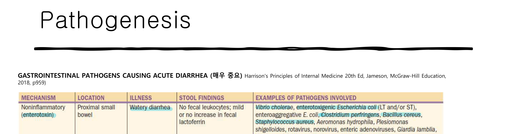
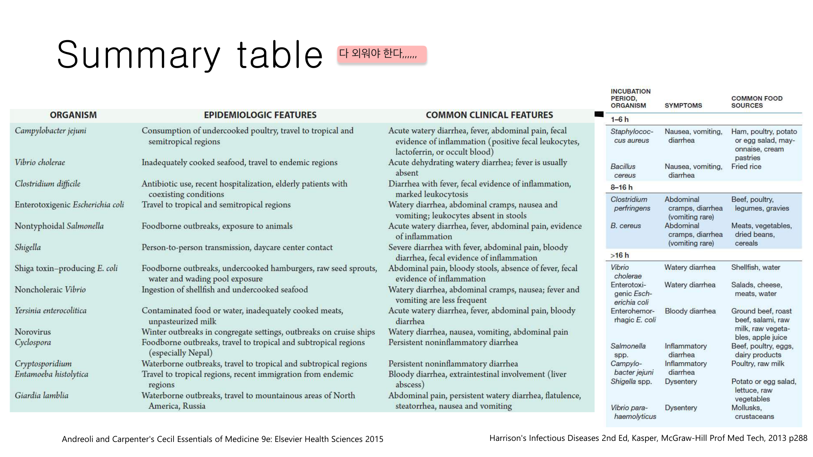
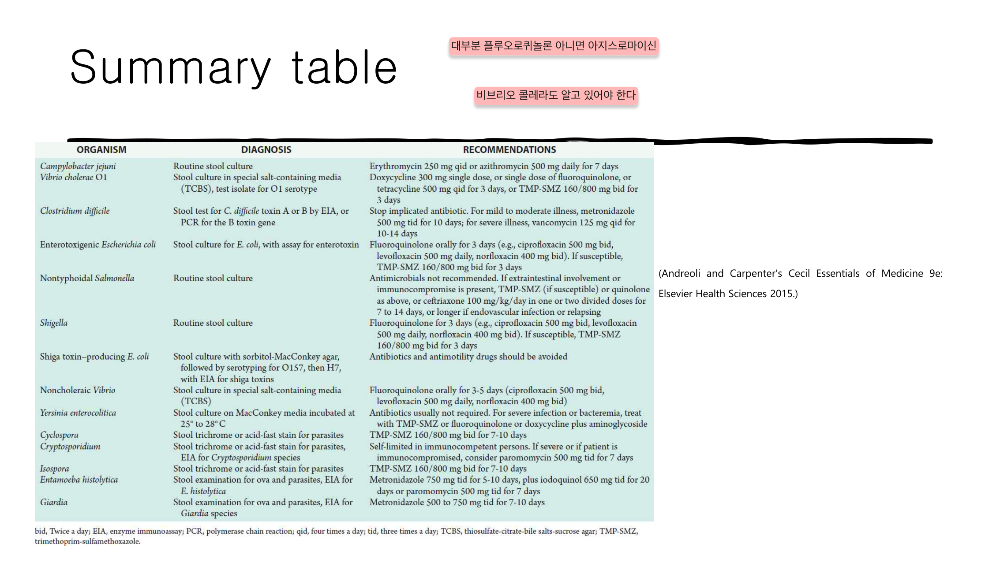

<!-- 필기본: 2025 -->
<!-- 단계: 수업 전 -->

# 0. 이 수업을 공부하는 법

감염내과 **황소윤 교수님** 수업. 네 덩어리다 — ① **수인성 감염**(총론: 기전·평가·치료·합병증) ② **대장균과 시겔라** ③ **살모넬라(장티푸스)** ④ **콜레라와 비콜레라 비브리오**. 마지막에 증례.

※ 필기본에서 대장균·시겔라·장티푸스·콜레라·비브리오 파트의 상당수 슬라이드가 **빈 쪽**으로 들어 있다(본문 없음). 그 부분은 각 파트의 학습성과와 기출을 기준으로 교과서 내용으로 채웠고, 그렇게 쓴 곳은 "(교과서 보충)"으로 표시했다.

학습성과(총론)
1. 독소에 의한 것과 **조직 침범**에 의한 것을 구별한다.
2. **항생제가 도움이 되는** 설사 질환을 열거한다.
3. 병원균별 감염성 설사의 **잠복기·발병기전·임상증상**을 비교한다.
4. **식중독**을 일으키는 병원체를 열거한다.
5. 식중독의 원인별 잠복기·기전·증상·치료 원칙을 비교한다.

- 기출 73문항(2020–2025)으로 인체감염학에서 가장 많다. 황소윤 교수님 문항의 반복 틀:
    - **볶음밥 먹고 1–5시간 뒤 구토** → ***Bacillus cereus***(신경독소/구토형), 도시락 8시간 뒤 설사 → *B. cereus*(설사형).
    - **햄버거 + 혈변 + 빈혈·혈소판감소·신부전(HUS)** → **장출혈성 대장균(EHEC O157:H7), Shiga-like toxin**, 필요한 검사 **대변배양**, **항생제는 되도록 안 씀**.
    - **발열 + 혈변 + 후중(tenesmus)** → ***Shigella dysenteriae***, 대변 메틸렌블루에 백혈구 → 염증성(*Shigella*·EHEC).
    - **바지락·조개 + 간경변·음주 + 저혈압 + 다리 출혈성 수포** → ***Vibrio vulnificus***, 치료 **ceftriaxone + doxycycline**.
    - **동남아, 물 같은 설사(쌀뜨물), 열 없음** → ***V. cholerae***.
    - **항생제 치료 후 설사** → ***C. difficile* → 경구 vancomycin**.
    - **장티푸스**: 고열 지속 + 장미진 + 상대서맥 → *S.* Typhi, 초기 진단은 **혈액배양**, **회장 천공**, 퀴놀론 내성이면 **ceftriaxone**.
    - **닭·소면 + 혈변 + 임신** → *Campylobacter* → **azithromycin**, 후유증 **길랭–바레**.
- 2020–22년 미생물학 문항(간염바이러스, 노로바이러스, *Clostridium*, 콜레라 독소, *H. pylori*)도 이 수업으로 분류되어 있다.

!!! key "핵심"
    **잠복기로 고른다**: **1–6시간 = 미리 만들어진 독소**(*S. aureus*, *B. cereus* 구토형 — 구토가 주, 열 없음) / **8–16(24)시간 = *C. perfringens*, *B. cereus* 설사형** / **16–72시간 이상 = 장에서 증식하는 균**(노로, ETEC, *Vibrio*, *Salmonella*, *Shigella*, *Campylobacter*, EHEC).
    **비염증성(소장, 장독소) = 물 설사, 대변 백혈구 없음, 열 거의 없음** / **염증성(대장, 세포독소·침습) = 혈변·점액변, 대변 백혈구, 열, 복통, 후중**.
    **대부분 수액이 치료.** 항생제는 **이질형(dysentery)·중증·면역저하·장티푸스·콜레라** — 성인 **fluoroquinolone**, 소아·임신 **azithromycin**. **EHEC는 항생제·지사제 금지(HUS)**, **C. difficile는 경구 vancomycin**.

# Part A. 수인성 감염 총론

## 1. 수인성 감염이란
1. 병원성 미생물이 **물(음료수, 음식 등)** 을 통해 전파되어 생기는 질병.
2. **설사와 구토**가 가장 흔한 증상.
3. 경한 복부 불쾌감부터 사망까지 다양(배가 아프지 않을 수도 있다).
4. **상기도 감염 다음으로 흔하다.**
5. 국내 증가 이유: **육류·회 소비 증가, 집단급식 보편화, 외식·배달 발달**.
6. 원인은 바이러스·세균·원충 — 하지만 임상에서 미생물이 확인되는 경우는 흔치 않다(얼마 지나면 self-limited).
7. 국내 세균성 원인 빈도: ***E. coli* > *S. aureus* > *Salmonella* > *V. parahaemolyticus* > *C. perfringens* > *B. cereus* > *C. jejuni* > *Shigella***(2012–2016 감시, 세균 분리율 11.5–34.7%).
8. **6–9월(여름)이 40%.**
9. 발생 장소는 **음식점·급식소 약 80%**, 주 감염원은 어패류, 물, 육류, 야채, 과일.
- 바이러스는 대부분 self-limited지만 **집단 발생**이 문제(예: 평창올림픽 노로바이러스 172명, 급식 초등학생 세균성이질 43명). 전파력이 강한 것은 나라가 관리한다.

## 2. 발병 기전
### 숙주 인자
1. **위산**: 정상(pH <4)이면 30분 안에 섭취한 세균의 99% 사멸. **로타바이러스는 산에 극히 강함.**
2. **장 운동**: 세균을 소장에서 대장으로 밀어냄 → **운동 저하(당뇨, 피부경화증)** 면 세균 과증식·감염 증가. ***Shigella*·살모넬라증에 지사제(antimotility drug)를 쓰면 균 배설 기간이 연장**된다 — 너무 심한 게 아니면 지사제를 안 준다(독소가 쌓임).
3. **정상 균총**: 대장 균총이 짧은사슬지방산 등을 만들어 *Shigella* 같은 병원균을 억제. **미숙한 영아·항생제 사용**은 균총을 바꿔 감염 증가.
4. **면역**: **분비형 IgA**가 *Shigella*·*V. cholerae* 감염 시 혈장 항체보다 먼저 장에 나타나 항원·내독소를 중화(점막 면역). **AIDS·고령**은 세균·바이러스·진균·기생충 감염 증가.

### 미생물 인자 — 감염용량(inoculum size)
| 감염에 필요한 균 수 | 균 |
|---|---|
| **10–100개** | ***Shigella*, EHEC, *Giardia*, *Entamoeba*** → **사람–사람 접촉만으로도 전파** |
| 102–105 | *Campylobacter* |
| 105–108 | *E. coli*(ETEC), ***V. cholerae***, ***Salmonella*** |

### 기전에 따른 분류

{: style="width:84%"}

| 기전 | 위치 | 질환 | 대변 | 병원체 |
|---|---|---|---|---|
| **비염증성(장독소)** | **근위 소장** | **물 설사** | **대변 백혈구 없음**, 락토페린 없음–경미 | ***V. cholerae*, ETEC**(LT·ST), EAEC, ***C. perfringens*, *B. cereus*, *S. aureus***, 로타·노로·장 아데노, *Giardia*, *Cryptosporidium* |
| **염증성(침습·세포독소)** | **대장·원위 소장** | **이질·염증성 설사** | **다형핵 백혈구**, 락토페린 크게 증가 | ***Shigella*, *Salmonella*, *Campylobacter*, EHEC**, EIEC, *Yersinia*, *Listeria*, *V. parahaemolyticus*, ***C. difficile***, *Entamoeba*, *Klebsiella oxytoca* |
| **관통(penetrating)** | 원위 소장 | **장열(enteric fever)** | 단핵구 | ***Salmonella* Typhi**, *Y. enterocolitica* |

#### 비염증성 설사
- 주로 **소장**. 점막 파괴·염증 없이 흡수·분비를 방해. 복통·구토·발열 같은 전신 증상이 드물고, **장독소**가 원인, **쌀뜨물 같은 수양성 설사, 대변 백혈구(−)**.
- ***V. cholerae***: 상피에 붙어 **콜레라 독소** 분비 → 세포 안으로 → **cAMP 증가** → Cl- 분비 촉진, Na·Cl 흡수 억제 → 수분·전해질 소실(균이 장벽을 침투하지 않아 대변에 염증세포가 거의 없음).
- **ETEC**: 소장에 집락하며 장독소 분비. ① **이열성(LT, 60℃ 10분이면 소멸)** — 콜레라 독소와 비슷(cAMP), 잠복기 10–12시간 ② **내열성(ST, 100℃ 30분에도 유지)** — **cGMP** 증가, 잠복기 24–72시간. 복통 + 물 설사, 열 없거나 미열. **여행자 설사의 가장 흔한 원인.**
- ***C. perfringens***: 그람양성 편성혐기 **아포형성** 간균, 아포는 100℃ 4분에도 안 죽음. **잠복기 8–20시간**, **설사·복통**이 주, 구토·발열은 거의 없음. **육류·가금류·가공품**, 기름에 튀긴 식품 등 **가열 조리 식품**, **집단급식**. 예방: 조리 후 바로 먹거나 빨리 냉각, 먹기 전 재가열.

#### 염증성 설사
- 주로 **회장 말단·대장**. 세포독소 또는 상피 침습으로 급성 염증.
    - 세포독소: 물 설사 + 혈변·점액변, 복통, 미열.
    - 침습: **혈변, 설사, 심한 복통, 고열**, 대변에 점액·적혈구·다형핵백혈구.
- ***Shigella***: 대장 상피로 침입해 세포 내 증식 → 이웃 세포로 침투 → **점막 파괴**.
- **EHEC(O157:H7)**: **Shiga-like toxin** → **출혈성 대장염 + HUS** — **항생제 금기**.
- ***Salmonella***: 주로 회장(가끔 대장). **Peyer 판의 M세포**를 통해 들어가 대식세포에 포식되지만 죽지 않고 림프관을 타고 온몸으로 → **전신 증상**.
- ***Campylobacter jejuni***: **가금류**가 주 병원소, 상피 괴사 → 염증성 설사.
- ***C. difficile***: **독소**에 의한 염증성 설사 — 상피에 붙어 들어가 단백합성 저해·세포 괴사. 항생제로 정상 균총이 줄어 생김 → **항생제 사용력이 있으면 위막성 대장염**을 생각. 치료 **1차 경구 vancomycin**(경구 metronidazole도 가능, 심하면 metronidazole 정주). **정주 vancomycin은 장에 도달하지 못해(신장 배설) 효과 없음.**

#### 신경독소 — 잠복기가 매우 짧다
- ***S. aureus*, *B. cereus***: **체외에서 이미 만들어진 독소**를 섭취 → 장 상피 파괴·분비 장애보다 **중추 자율신경계(구토중추)** 에 작용, 면역계에 독성(사이토카인). **열에 파괴되지 않아** 조리한 음식으로도 생긴다. 앞의 것들이 대개 48시간 잠복인 것과 달리 엄청 빨리 생긴다.
- ***S. aureus***: 포도송이 구균, **5–9월**. 장독소가 신경 수용체를 자극해 구토중추 → **구토** + 설사·복통. **잠복기 1–6시간(평균 3시간)**, 치사율 낮고 24–48시간 내 회복. 원인 식품: 육류·어패류 가공품, 두부, **김밥·도시락·떡** 같은 전분질. 장독소는 **100℃ 30분에도 안 파괴** → 원료를 위생적으로(조리하는 사람의 손).
- ***C. botulinum***: 그람양성 편성혐기 아포형성 간균(국내 2003년 이후 보고 없음). A·B형 72시간, E형 2–4시간에 위장 증상 후 **신경 증상(약시·복시·동공확대)**. 병조림·훈제·햄·소시지·통조림. 80℃ 30분 가열.
- ***B. cereus***: 그람양성 통성혐기 아포형성 간균. 가열 식품의 냉각·냉장이 부적절하면 증식.
    - **설사형**: **8–16시간** 후 물 설사·복통, 구토는 대개 없음 — **육류·채소 수프, 소시지, 푸딩**.
    - **구토형**: **1–5시간** 후 메스꺼움·**구토** — **볶음밥, 쌀밥** 같은 탄수화물.

!!! exam "기출 포인트"
    **볶음밥 → 3시간 → 구토** → ***Bacillus cereus***(5·7번), "가장 가능성이 높은 독소와 질환" → ***B. cereus*–Neurotoxin**(25번), 볶음밥 점심 → 오후 구토·설사 → ***S. aureus*–Neurotoxin**(21번 — 필기의 "신경독소" 분류). **편의점 도시락 8시간 뒤 설사, 열 없음** → ***B. cereus***(17번). 40번: 발열 가능성이 가장 **적은** 식중독 → ***S. aureus* 식중독**. 45번: **아메바 장염은 wet smear에서 WBC가 잘 안 보인다**(정답 — 아메바가 백혈구를 파괴). ETEC는 점막 손상 X, *C. difficile*이면 쓰던 항생제를 **끊는다**.

## 3. 임상 평가
1. **기간**: 2주 이상이면 만성(원인이 급성과 많이 다름 — 결핵 등).
2. **잠복기**: **6시간 이내 *S. aureus*, *B. cereus*** / **6–24시간 *C. perfringens*, *B. cereus*** / **16–72시간 노로바이러스, ETEC, *Vibrio*, *Salmonella*** 등.
3. **음식력**: 해산물·어패류(*Vibrio*, 노로, *Salmonella*), **가금류(*Campylobacter*, *Salmonella*)**, **육류(EHEC)**, 달걀(*Salmonella*).
4. **발열**: *Salmonella*·*Shigella*·*Campylobacter* 대부분, *Yersinia* 70%, EHEC 40%.
5. **대변 모양**: **혈변·점액변 = 대장 궤양**(혈변 — **EHEC 90%**, *Shigella* 50%, *Salmonella*·*Campylobacter*·*Yersinia* <30%) / **다량의 쌀뜨물 = 콜레라**.
6. 횟수: 탈수 정도 예측.
7. **복통**: 염증성일 때 심함(*Shigella*·*Campylobacter*·EHEC, *Salmonella*·*Yersinia* 50%).
8. **후중(tenesmus)**: 직장 염증 — ***Shigella*가 가장 뚜렷**(변을 봤는데도 또 보고 싶은 느낌).
9. **구토**: **독소 유발** 질환 의심.
10. 집단 발생 여부, 장소, 나이, **여행력**(여행자 설사는 **ETEC가 가장 흔함**). 숙주 인자도 중요 — 누구는 걸리고 누구는 안 걸린다.

### 검사
- **대변**: 도말(**백혈구 — 염증성 판단**), **배양**(*Salmonella*, *Shigella*, *Campylobacter*, *E. coli*), 잠혈, **독소**(*C. difficile*).
- **혈액**: 백혈구, CRP. 그 외 영상(심하면 CT), **PCR(GI FilmArray)** — 요즘 많이 하지만 죽은 균도 남아 있어 최근 감염인지 확실치 않다(위양성 구별).

## 4. 치료
1. **보존적 치료** — 주 치료
    - **수분 보충(hydration)** — 경구수액(물 + 소금 + 설탕)
    - **Bismuth subsalicylate**: 위에서 살리실산 + 비스무트염으로 분해 — 항균·항분비·항염증 효과, 정상 균총엔 거의 영향 없음. **여행자 설사에 유효**.
    - **장운동 억제제(codeine, loperamide, lomotil)**: 여행자 설사에 유효하지만 **염증성 질환에는 쓰지 말 것**.
2. **항생제**
    - 대부분의 단순 설사는 보존적 치료로 충분(심하면 고려).
    - **이질형(dysenteric) 질환 → 항생제: 성인 fluoroquinolone, 소아 azithromycin**(퀴놀론은 성장 중인 연골·관절 손상).
    - ***C. difficile* → 경구 vancomycin, metronidazole.**
3. **여행자 설사 예방**: **개인위생(특히 물·음식)이 가장 중요**, bismuth subsalicylate. **예방적 항생제는 권장하지 않음**(부작용·내성).
4. 필요하면 **백신**.
- **손위생이 가장 중요** — 특히 요리하는 사람.

{: style="width:84%"}

{: style="width:70%"}

- "다 외워야 한다…" — 대부분 **fluoroquinolone 아니면 azithromycin**, **비브리오 콜레라**도 알고 있어야 한다.

| 균 | 권장 치료 |
|---|---|
| *Campylobacter* | **erythromycin·azithromycin** 3–5일(심한 고열·혈변·1주 이상일 때만) |
| ***V. cholerae*** O1·O139 | **수액 + doxycycline 300 mg 1회**(또는 azithromycin 1 g, 퀴놀론) |
| ***C. difficile*** | 원인 항생제 중단 + **경구 vancomycin 125 mg 하루 4번 10일**, 경증 metronidazole |
| ETEC(여행자 설사) | levofloxacin 500 mg 1회 또는 **azithromycin 1 g 1회** |
| 비장티푸스 *Salmonella* | **원칙적으로 항생제 X** — 중증, 면역저하, **>50세, 인공물·판막질환·죽상경화·암·요독증**일 때만 퀴놀론 5–7일 또는 ceftriaxone |
| ***Shigella*** | **fluoroquinolone 3일**(ciprofloxacin), 대안 TMP/SMX·azithromycin |
| **EHEC(Shiga 독소)** | **항생제·지사제 피함** |
| 비콜레라 *Vibrio* | 퀴놀론 3–5일 |
| *Yersinia* | 중증·균혈증만 doxycycline + aminoglycoside |
| *Giardia* | tinidazole·metronidazole·nitazoxanide |
| *Entamoeba* | **metronidazole** 후 장내 약(paromomycin) |
| 로타·노로·*E. coli*(독소 없음) | 없음 |

## 5. 합병증
1. **만성 설사**: 여행자 설사의 ~1% — 유당분해효소 결핍, 소장 세균 과증식, 흡수장애.
2. 염증성 장질환의 첫 발현·악화.
3. **과민성 장 증후군**: 여행자 설사의 ~10%(IBS 있던 사람은 더 심하게).
4. **반응성 관절염(Reiter)**: **침습성 균 — *Shigella*, *Salmonella*, *Campylobacter*, *Yersinia***. 젊은 사람이 어깨·손목이 아프다고 오면 류마티스가 많지만 장염 후 반응성 관절염일 수도 — NSAID로 좋아진다.
5. **용혈요독증후군(HUS)**: **용혈성 빈혈 + 혈소판감소 + 신부전** — **Shiga 독소 생산균(*S. dysenteriae* type 1, EHEC)** 감염 후.
6. **길랭–바레 증후군**: 특히 ***Campylobacter*** 후.

# Part B. 대장균과 시겔라

학습성과: 장내세균의 감염·전파 경로 / **O157 대장균** 감염의 임상 / *Shigella* **4균종과 국내 최다 균종** / *Shigella* 병원성 인자 / 세균성 이질의 임상·합병증 / 진단·치료 — "이거 알면 문제 다 맞힌다."

## 대장균 (*Escherichia coli*)
- 사람·동물 **결장의 정상 균무리**. 위장관 안팎에서 병원성이 될 수 있고, 장 천공 시 복강 감염. **위장관염의 주요 원인균.**
- 장 병원성 대장균 병형(혈청형은 외우라는 건 아님): **EPEC**(장병원성), **ETEC**(장독소성), **EIEC**(장침습성), **EHEC**(장출혈성), **EAEC**(장응집성), DAEC(미만부착성).
- **병독력 인자**: 섬모(pili, fimbriae — **요로상피 부착 → 요로감염**), **CFA I/II**(장 상피 부착 → 설사), **장독소**(ST 내열성·LT 이열성 — 콜레라 독소와 같은 cAMP 기전, 강도는 1/100 이하), **세포독소(verotoxin, Shiga-like toxin — vero 세포(아프리카 녹색원숭이 신장 세포주)에 독성)**, 장관 투과성 증가.

### 장출혈성 대장균 (EHEC, O157:H7)
- **햄버거병.** 덜 익힌 쇠고기(간 고기), 생채소·싹, 오염된 물. **감염용량이 매우 적어** 사람–사람 전파도.
- **혈변**(90%), 심한 복통, **열은 없거나 미열**(40%).
- **HUS**: Shiga 독소가 **혈관 내피세포를 손상** → **미세혈관 혈전** → 적혈구 파괴(**용혈성 빈혈**), 혈소판 소모(**혈소판감소**), 신장 미세혈관 폐쇄(**급성 신부전**) — 3대 증상. **소아에게 위험.**
- **항생제를 쓰면 균이 파괴되며 Shiga 독소가 대량 방출** → 일반적으로 **항생제 권장 안 함**(특히 퀴놀론 — 어차피 소아는 못 씀). 지사제도 금지.
- 국내 발생은 증가 추세(2009년 62명 → 2020년 270명, 2022년 211명). **2급 감염병.**
- 진단: **대변배양**(sorbitol-MacConkey 배지, O157 혈청형·Shiga 독소 검사).

### 그 밖의 장 병원성 대장균
- **EIEC**: 많은 감염량(>108), 장 점막 침투, **이질과 비슷**.
- **EAEC**: 소아·성인 **지속성 설사**, 발열·구토·혈변보다 만성 설사.
- **DAEC**: 유아의 설사.
- **ETEC**: 여행자 설사(위 참조).

### 장외 병원성 대장균 (ExPEC)
- **요로감염 — 가장 흔한 원인(90%)**, 복부(복막염·복강내 농양·간농양·담도염·담낭염), **폐렴(사망률 20–60%)**, **신생아 수막염(약 75%가 K1 협막 항원)**, 피부연조직, 패혈증.

### 치료와 관리
- 원인 병형에 따라 항생제 고려(대부분 supportive, 균혈증이면 당연히 항생제). **백신·예방 약 없음.** 물·음식 조심, 사람 간 전파는 **손씻기·소독**.

!!! exam "기출 포인트"
    **햄버거 + 혈변 + 소변 감소 + 빈혈·혈소판감소·Cr 상승(HUS)** → **장출혈성 대장균**(14번), 원인균 설명 → "**shiga-like toxin이 장 혈관 내피를 손상**"(1번, 2025 — 항생제가 HUS 예방 X, 신경독소·통조림 X, 대식세포·림프절 X, 장 침범 없이 X), 필요한 검사 → **대변배양**(12·24번 — 골수생검·Widal X). 28번: 틀린 것 → "**제1급 법정전염병**"(EHEC는 2급). 61번: 유치원 집단 설사 + 신부전·용혈 → **EHEC**. 38·64번: HUS 일으키는 대장균 → **EHEC**, 독소 → **Shiga toxin-2(Stx2)**. 10·26번: 혈변 + 대변 메틸렌블루(백혈구) → **EHEC**.

## 시겔라 (*Shigella*) — 세균성 이질 (교과서 보충)
- **4균종**: ***S. dysenteriae*(A군)** — 가장 중증, type 1이 Shiga 독소·HUS / ***S. flexneri*(B군)** / ***S. boydii*(C군)** / ***S. sonnei*(D군)** — **국내·선진국에서 가장 흔함**, 가장 경함.
- **사람이 유일한 숙주**, **감염용량 10–100개** → **사람–사람 전파**(어린이집·보호시설), 분변-구강. **균혈증은 거의 일으키지 않는다.**
- 병원성: **대장 상피 침입(M세포) → 세포 내 증식 → 이웃 세포로 전파**(액틴), **Shiga 독소**(*S. dysenteriae* type 1).
- 임상: **고열, 복통, 수양성 → 혈변·점액변(이질), 후중(tenesmus)**, 대변에 백혈구·적혈구.
- 합병증: 탈수, **HUS**(*S. dysenteriae* 1), **반응성 관절염**, 경련(소아), 직장 탈출.
- 진단: **대변배양**.
- 치료: 수액 + **fluoroquinolone(ciprofloxacin) 3일**, 소아·임신 azithromycin, 대안 TMP/SMX·ceftriaxone. **지사제 금지**(균 배설 연장).
- 2급 감염병, 확진 후 격리(2회 연속 음성까지).

!!! exam "기출 포인트"
    **3일 복통·발열 + (혈변 동반) 수양성 설사 + 배변 후 후중** → ***Shigella dysenteriae***(6·11·27번). 43번: 대변에 백혈구가 많음 → ***Shigella***. 22번: 혈변 + 메틸렌블루 → ***S. dysenteriae***. 47번: 균혈증을 일으키지 **않는** 병원체 → ***Shigella sonnei***.

## 캄필로박터 (*Campylobacter*)
1. 전 세계 수인성·식품매개 설사의 **5–14%**, 선진국 여행자 설사의 원인, **5세 이하 소아·청년층**.
2. *C. jejuni*의 병원소: **가금류**, 개, 고양이, 양, 소.
3. 10,000마리 이상 섭취 시 발병, 공장·회장·대장 침범 → **침습성(염증성) 장염**.
- 전파: **익히지 않거나 덜 익힌 고기(닭)**, 오염된 우유, 사람–사람.
- 임상: **잠복기 1–7일**, 급성 장염(설사, **혈변**, 복통, 권태감, 발열, 오심·구토) 일주일까지. 치료 안 하면 **2–7주까지 균 배출**.
- "**국수면(나가시 소멘)을 기억하자**" — 일본 여행 흐르는 물 국수.
- 일반 배지에서 잘 안 자람(42℃ 미호기). 대장 내시경이 **궤양성 대장염**과 비슷. 합병증: **길랭–바레**, 반응성 관절염, HUS(드묾).
- 치료: 대부분 대증요법. 심하면 **macrolide(azithromycin·erythromycin)** — **퀴놀론 내성이 높다**.

!!! exam "기출 포인트"
    15번: 일본 여행 **나가시 소멘 + 닭고기** → 혈변·39℃, **임신 30주** → **azithromycin**. 34번: 양계장 맨손 작업, 그람음성 **만곡형** 막대균, catalase(+)·urease(−), **길랭–바레** → ***Campylobacter jejuni***. 39번: 옳은 것 → **polyneuritis·HUS·관절염 합병 가능**. 62번: 옳은 것 → "**합병증 없는 장염은 대증요법으로 호전**". 46번: 혈변 초기 내시경으로 감별이 어려운 것 → **궤양성 대장염**. 48·66번: *C. jejuni* — 길랭–바레, *C. fetus* — 균혈증·CNS.

# Part C. 살모넬라 — 장티푸스 (교과서 보충 포함)

학습성과: 장티푸스의 증상·증세 / 치료와 격리 / **보균자의 정의와 치료 약제** / 진단과 합병증 / 살모넬라증의 치료 원칙.

## 장티푸스 (*Salmonella* Typhi)
- **사람이 유일한 숙주.** 오염된 물·음식(보균자가 만든 음식) → 소장 **Peyer 판 M세포** → 대식세포 안에서 생존 → 림프관 → **간·비장·골수·담낭**(전신).
- 국내 2급 감염병(예전 1군에서 2급으로).
- **임상**: 잠복기 1–3주. **서서히 오르는 고열(계단식)**, 두통, 복통, **상대 서맥**, **장미진(rose spots — 몸통의 2–5 mm 연분홍 반점, 누르면 사라짐)**, 간비종대, 변비 또는 설사.
- **진단**: **초기 1주에는 혈액배양이 가장 민감**(골수배양이 가장 민감), 2–3주 이후 대변·소변 배양. Widal 검사는 민감·특이도가 낮다. *S.* Typhi의 **Vi 항원 = 협막**.
- **합병증**
    1. **장출혈·천공**(대개 **회장**) — 항생제 사용 후 크게 감소(각 3%, 1%). 입원 중 갑작스러운 복통·복부 강직.
    2. 드물게 간염, 수막염, 신염, 심근염, 골수염 등 **전이성 감염**(균혈증 → 어디든).
    3. **장기 무증상 보균자(2–5%)**: 감염의 근원, 대개 **담도계 이상(담석)** 과 관련 — 보균 장소 **담낭**. 식품위생업 종사자가 **보건증**을 만드는 주된 이유. **Typhoid Mary**(요리사로 일하며 51명 감염, 3명 사망, 30년 격리).
    4. **재발(5–10%, 1달 이내)** — chloramphenicol 사용 시 10–20%.
- **치료**: **fluoroquinolone**(감수성일 때), **퀴놀론 내성(동남아·인도)이면 ceftriaxone** 또는 azithromycin. 보균자는 퀴놀론 4주(담석이면 담낭절제).
- **예방**: 환경·개인위생, **만성 보균자의 발견·관리(주된 병원소)**, **백신은 고위험군만**(우리나라는 거의 안 함, 해외 여행 시).

## 비장티푸스 살모넬라증 (*S.* Enteritidis, Typhimurium)
- **인수공통**, 달걀·가금류·육류, 건조에도 살아남는다. 잠복기 6–72시간, 발열·복통·설사(염증성).
- **원칙적으로 항생제를 쓰지 않는다**(균 배출 기간 연장, 보균 증가). **중증, 면역저하, 50세 초과, 인공물·판막질환·죽상경화·암·요독증**일 때만 퀴놀론 또는 ceftriaxone.

## 증례 — 살모넬라 균혈증
- 고열, 혈액배양 *Salmonella*, 거의 모든 약에 내성 → **meropenem** 사용. 감염 병소를 다 긁어냄(수술적 제거).

!!! exam "기출 포인트"
    13·29번: 일주일 고열(40℃ 지속) + **누르면 소실되는 반구진(장미진)** → ***S.* Typhi**, 확진을 위한 가장 높은 검출률 → **혈액배양**. 3번(2025): 틀린 것 → "**감염 초기에는 대변 배양이 가장 민감**"(혈액배양). 20번: 인도네시아 근무 후 2주 열 + 간기능 이상 + 피부 소견 + 혈액 그람음성균 → 갑작스러운 복통·강직 → **회장 천공**. 18번: 동남아, 시프로플록사신 복용 중 고열, 혈액배양 *S.* Typhi(**ofloxacin 내성**) → **ceftriaxone**. 42번: 보건증의 이유, 만성보균자 → **장티푸스**. 49번: 보균 장소 → **담낭**. 63번: Vi 항원 → **협막**. 65번: 복통·설사 + 상복부 2–5 mm 구진 + 혈액배양 맥콘키 무색 집락 → ***S.* Typhi**. 58번: 동남아 귀국 설사 + CT → 적절하지 않은 항생제 → **경구 vancomycin**.

# Part D. 콜레라 (*Vibrio cholerae*) — 교과서 보충
학습성과: 콜레라의 **역학과 설사 기전** / **치료법과 예방법**.
- 조선시대엔 콜레라를 쥐가 기어다니는 느낌(근육 경련)이라 여겨 고양이 그림을 붙였다고 한다.
- 혈청형 **O1, O139**가 유행. 역사적으로 **7회의 세계적 대유행**. 오염된 물·해산물, 감염용량 105–108(위산이 줄면 감소). **NaCl 없이도 자란다**(*V. mimicus*도) — 다른 비브리오는 호염성.
- **기전 — 콜레라 독소(CT)**: **A 소단위 1개(A1·A2) + B 소단위 5개**. **B가 상피 표면 GM1 ganglioside에 결합** → **A1이 떨어져 들어가 adenylate cyclase 활성화** → **cAMP 축적** → **Cl-·K+·HCO3-와 물의 과분비** + Na 흡수 억제. 균은 침투하지 않는다(비염증성).
- **임상**: 잠복기 수 시간–5일. **복통·발열 없이 갑자기 다량의 쌀뜨물 같은 설사**(하루 수 L), 구토 → 심한 탈수·저혈량 쇼크·저칼륨·대사성 산증, 근육 경련.
- **치료**: **수액이 핵심** — 경구수액(ORS: 깨끗한 물 + 소금 + 설탕), 중증은 정맥 수액(Ringer). 항생제는 기간·균 배출을 줄임 — **doxycycline 300 mg 1회**, azithromycin 1 g(소아·임신), 퀴놀론.
- **예방**: 안전한 물·위생, 경구 백신(여행자).

!!! exam "기출 포인트"
    2번(2025): 동남아 배낭여행 해산물 → **물처럼 쏟아지는 설사 하루 8회 이상, 열 없음, 혈변 없음, 탈수** → ***V. cholerae***. 60번: 인도 여행 + 쌀뜨물 설사 사진 → ***V. cholerae***. 41번: 쌀뜨물 설사, 7회 대유행 → ***V. cholerae***. 44·57번: 오지 여행 설사의 음용수 → **끓인 물(생수) + 소금 + 설탕**. 50·67번: 콜레라 독소 기전(가–라 모두 맞음). 36번: NaCl 없이 자라는 비브리오 → ***V. cholerae*, *V. mimicus***.

# Part E. 비콜레라 비브리오 — 비브리오 패혈증 (교과서 보충)
학습성과: 비브리오 패혈증의 **임상증상과 위험인자** / **치료와 예방**.
- ***Vibrio vulnificus***: 따뜻한 바닷물(**여름–초가을**), **어패류(조개·굴·바지락) 생식** 또는 상처를 통한 바닷물 노출.
- **위험인자**: **만성 간질환(간경변), 알코올중독**, 철 과부하(혈색소증), 당뇨, 면역저하 — 사망률 50% 이상.
- **임상**: 섭취 후 1–2일, **발열·오한 + 저혈압(패혈성 쇼크)**, 다리에 **출혈성 수포 → 괴사**(괴사근막염).
- **치료**: **3세대 세파(ceftriaxone·cefotaxime) + doxycycline**(또는 퀴놀론), **빠른 외과적 괴사조직 제거**.
- **예방**: 고위험군은 **어패류 생식 금지**, 상처가 있으면 바닷물 접촉 피하기.
- ***V. parahaemolyticus***: **호염성**, 여름 **회·어패류** → 장염(복통·설사, 염증성), 대개 자연 치유. 국내 세균성 식중독의 주요 원인. 항생제가 필요하면 퀴놀론·doxycycline.

!!! exam "기출 포인트"
    **3일 전 바지락(바지락 칼국수) + 간경변·매일 소주 + 발열·저혈압 + 양측 발·다리 병변** → ***Vibrio vulnificus***(8·19·23번), 치료 → **ceftriaxone + doxycycline**(9번). 59번: 멍게비빔밥 후 복통·설사(*V. parahaemolyticus*) — 부적절한 항생제 → **clindamycin 주사**.

# Part F. *C. difficile* — 항생제 연관 설사
- 항생제로 정상 균총이 줄어 생김(clindamycin, 세팔로스포린, 퀴놀론). 독소 A·B → 염증성 설사, **위막성 대장염**(내시경에서 노란 위막).
- 치료: **원인 항생제 중단 + 경구 vancomycin**(또는 fidaxomicin), 경증엔 경구 metronidazole. **정맥 vancomycin은 장에 도달하지 않는다.** 전격성이면 경구 vancomycin + 정맥 metronidazole.
- 아포 → 알코올 손소독 무효, **비누·물**, 접촉주의.

!!! exam "기출 포인트"
    4번(2025): 폐렴으로 ceftriaxone 10일 후 점액·혈변·발열 → ***C. difficile* – 경구 vancomycin**. 16번: 요양병원 80세, 2주 전 폐렴 항생제 + 내시경(위막) → 1차 치료 **경구 vancomycin**.

# Part G. 미생물학 보충 (2020–22 기출)
- **노로바이러스**: **겨울철 식중독의 주된 원인**, 전염성 매우 높음, 열·건조에 강하고 60℃에도 안정, **10개 virion**으로도 발병, 혈변 없음, 발열 1/3. **담즙이 함유된 사람 장 줄기세포**에서 배양 가능(37·53·69번).
- ***Clostridium***: 아포형성 그람양성 혐기 막대균, 대부분 비병원성, 질환은 대부분 **독소** 때문(35번). *C. perfringens* — **비운동성**, 4개 주 치사독소(alpha·beta·epsilon·iota), 연조직 감염·식중독(68번).
- ***H. pylori***: **CagA**는 4형 분비계로 들어가 세포골격 손상, **urease**로 위산 중화(51번).
- **간염바이러스**
    - **HAV**(Picornaviridae, 엔테로바이러스 72형): 위산에 안정, **분변-구강**, 만성화 X, 소아는 대부분 무황달.
    - **HBV**(Hepadnaviridae, 부분 이중가닥 DNA, 역전사): **42 nm Dane 입자만 감염성**, 22 nm 구형·실 모양 입자(HBsAg)는 **백신 성분**. **HBeAg = 활발한 증식**. **신생아 감염의 90%가 만성**(어릴수록 만성화↑). Anti-HBs로 방어 면역 판단.
    - **HCV**(Flaviviridae): 수혈 후 간염의 주요 원인, **만성화 비율이 가장 높음**, **백신 없음**.
    - **HDV**: 결손 바이러스, **HBV** 감염자에서만.
    - **HEV**: 분변-구강(장관 전파 비A비B), **임산부에서 간부전 사망 20–30%**.
    - **HBV·HCV 공통**: 수직감염, 만성화, 성 접촉 전파, 간암 — **예방접종 권장은 HBV만**(30–33·52·54–56·70–73번).

!!! memo "암기"
    | 균 | 잠복기 | 특징 | 치료 |
    |---|---|---|---|
    | *S. aureus* | **1–6h** | 구토, 열 X, 김밥·도시락, 내열 장독소 | 대증 |
    | *B. cereus* 구토형 / 설사형 | **1–5h / 8–16h** | **볶음밥** / 수프·소시지 | 대증 |
    | *C. perfringens* | 8–20h | 설사·복통, 단체급식 육류 | 대증 |
    | 노로바이러스 | 1–2일 | 겨울, 집단, 10 virion | 대증 |
    | ETEC | 10–72h | 여행자 설사 1위, LT(cAMP)/ST(cGMP) | 수액 ± azithro/levo |
    | *V. cholerae* | 수 h–5일 | 쌀뜨물, 열·복통 X, CT→cAMP | **수액 + doxycycline 1회** |
    | *Shigella* | 1–3일 | 10–100개, 고열·혈변·**후중**, *S. sonnei* 국내 최다 | **cipro 3일**(소아 azithro) |
    | **EHEC O157:H7** | 3–4일 | **햄버거**, 혈변, 열 X, **HUS** | **항생제·지사제 X** |
    | *Campylobacter* | 1–7일 | 닭·소면, 혈변, **길랭–바레** | azithromycin |
    | 비장티푸스 *Salmonella* | 6–72h | 달걀·가금류 | 원칙적 X(고위험만) |
    | *S.* Typhi | 1–3주 | 고열·장미진·상대서맥, **혈액배양**, 회장 천공, 담낭 보균 | 퀴놀론, 내성이면 **ceftriaxone** |
    | *V. vulnificus* | 1–2일 | 조개 + **간경변·술**, 출혈성 수포·쇼크 | **ceftriaxone + doxycycline** + 수술 |
    | *C. difficile* | 항생제 후 | 위막성 대장염 | **경구 vancomycin** |
