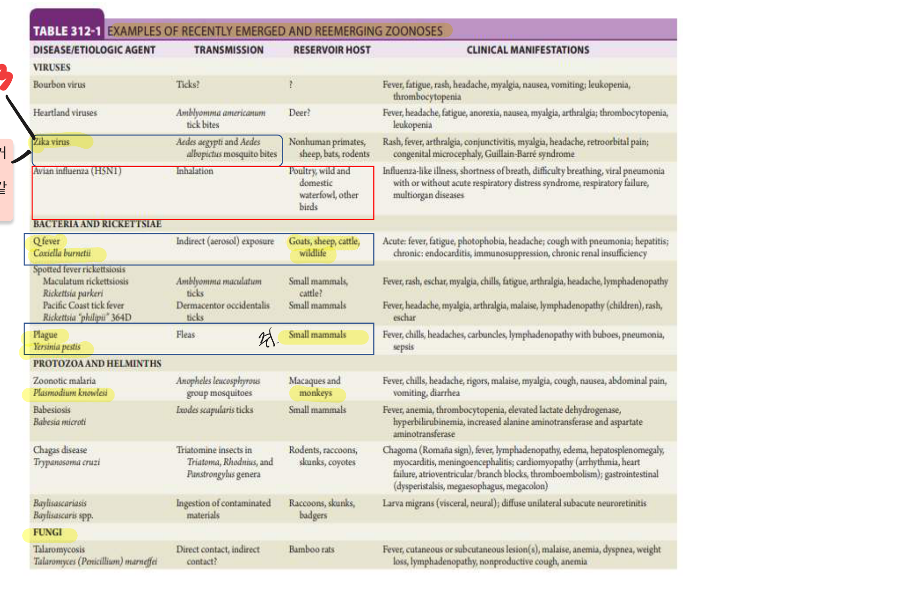
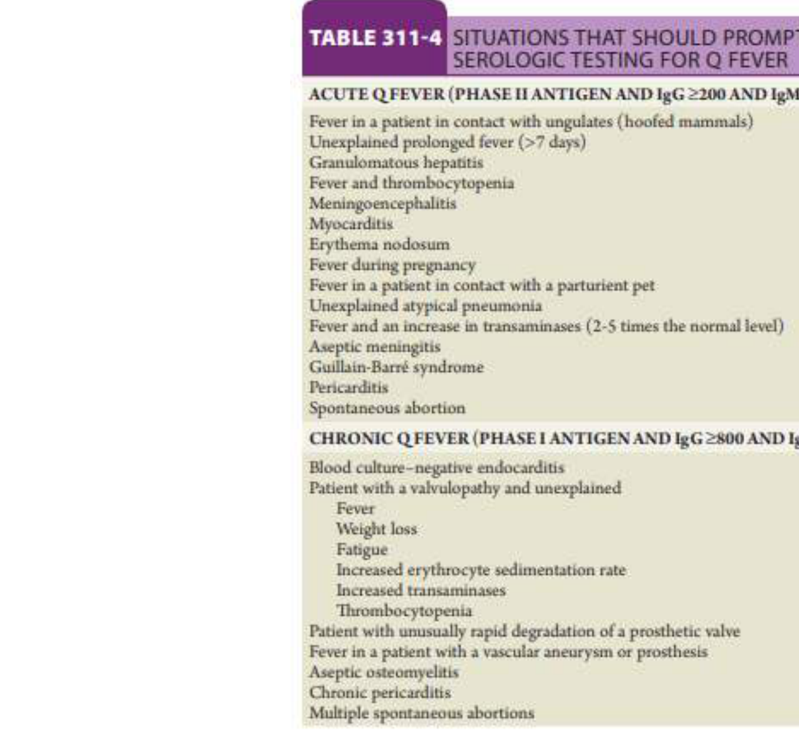
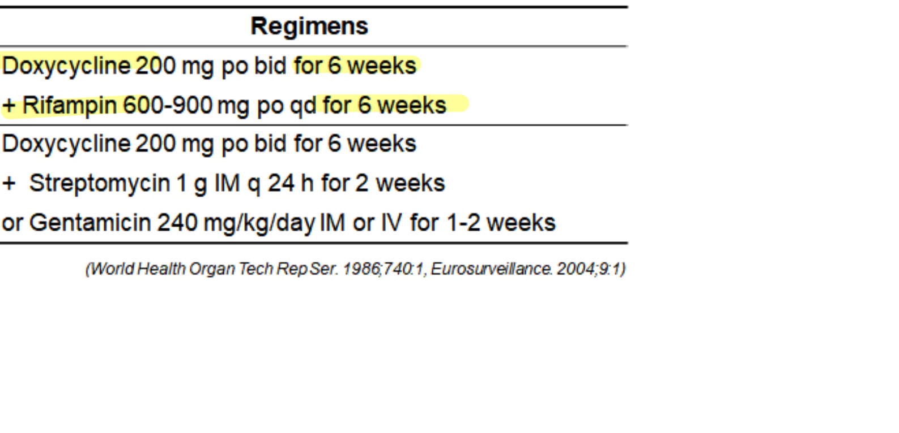
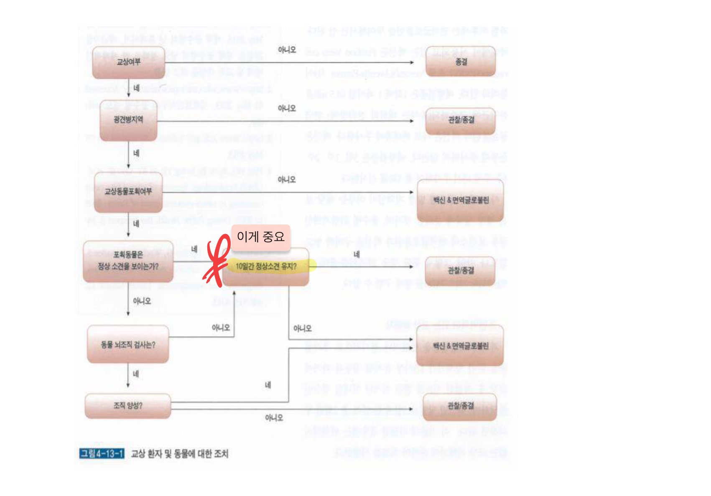

<!-- 필기본: 2025 -->
<!-- 단계: 수업 전 -->

# 0. 이 수업을 공부하는 법

**장현하 교수님** 수업. 필기 작성자 말: 교수님이 그냥 읽으신 부분은 밑줄, 중요한 부분에서만 내시는 듯하고, 작년까지 1시간짜리였다가 올해 2시간으로 바뀌어서 어떨지 모른다. 필기본의 "검정 별표" = 교수님 강조.

학습성과
1. 인수공통감염병에 해당하는 질환을 나열한다.
2. 걸릴 수 있는 **위험 상황과 동물**을 설명하고 감별진단한다.
3. **치료와 예후**를 설명한다.

필기 순서: 인수공통감염병 개요 → 리케치아 → 아나플라즈마증 → Q열 → **SFTS** → 브루셀라병 → **공수병(광견병)**

- 기출 25문항(2020–2025). 장현하 교수님 문항은 **공수병 교상 사례**가 매년 나온다("공수병 전체적으로 매년 내십니다").
    - **도망친 야생 너구리·오소리에게 물림, 10년간 백신 없음** → **공수병 백신 4회 + 면역글로불린 + amoxicillin/clavulanate + 파상풍 백신·면역글로불린 — 모두**(3번 출제).
    - **이웃의 개·고양이에게 물림** → **그 동물을 10일간 관찰**(2번 출제).
    - 병원체–매개체–숙주 연결: **Zika는 파충류가 아니다**(모기, 숙주는 영장류).
    - 브루셀라: 결핵과 매우 비슷(척추염), 국내 원인 ***B. abortus*(소)**.
- 2020–22년 미생물학 문항(탄저, 라임병, 보렐리아, 리케치아 매개체, Negri 소체)도 이 수업으로 분류되어 있다.

!!! key "핵심"
    **공수병 교상 = 상처 세척(비누·물 15분) + 항생제(amoxicillin/clavulanate) + 파상풍 + [동물을 잡으면 10일 관찰 / 못 잡으면 백신 + 면역글로불린]**. 면역글로불린 HRIG 20 IU/kg는 **상처 부위에**, 백신은 **0·3·7·14일 4회**(면역저하자 5회), 둘은 **반대쪽**에.
    **SFTS** = 진드기, **고열 + 위장관 증상 + 혈소판·백혈구 감소**, **CRP는 거의 안 오름**, **치료제 없음**, 치명률 10–30%, **의료진 혈액·체액 전파 주의**.
    **리케치아·아나플라즈마·Q열·브루셀라 = doxycycline**(브루셀라는 + rifampin 6주).

# 1. 인수공통감염병 개요
- **인수공통감염증(zoonoses)**: 원래 사람 이외의 **척추동물**을 감염시키는 병원체가 **이차적으로 사람에게** 전파된 감염병. 약 100가지.
- 국내 대표: **유행성출혈열(신증후군출혈열), 렙토스피라증, 쯔쯔가무시병, 살모넬라증, 광견병, 일본뇌염**.
- 새로운 인수공통감염병이 나타나는 요인("이게 중요"):
    1. 사람·동물 **집단의 크기와 밀도** 변화
    2. 사람·동물 **이동 증가**
    3. **축산물의 국제 거래**
    4. 인간 활동에 의한 **자연환경 변화**
    5. **문화적 규범·인류학적 양식**과 그 변화
- 박쥐는 종류·개체 수가 많고 날아다녀서 인수공통감염병에 자주 등장한다.
- 신종 인수공통감염병 발생 가능성이 높은 지역이 **아시아**에 주로 분포하고 교류가 많아, 국내 유입·발생 가능성이 높다.

{: style="width:80%"}

| 병원체 | 전파 | 숙주 |
|---|---|---|
| 부르봉 바이러스 | 진드기 | ? |
| 하트랜드 바이러스 | 진드기 | 사슴? |
| **Zika virus** | ***Aedes aegypti*·*albopictus* 모기** | **비인간 영장류**, 양·박쥐·설치류 — 신경학적 합병증(소두증, 길랭–바레). 최근 모기 개체 수가 줄어 같이 줄었다 |
| **조류인플루엔자(H5N1)** | **흡입** | **가금류**, 야생 물새 |
| **Q열(*Coxiella burnetii*)** | **간접(에어로졸) 노출** | **염소, 양, 소, 야생동물** |
| 홍반열 리케치아 | 진드기 | 소형 포유류 |
| **페스트(*Yersinia pestis*)** | **벼룩** | **소형 포유류** |
| 원숭이 말라리아(*P. knowlesi*) | 모기 | 마카크원숭이 |
| **바베시아(*B. microti*)** | ***Ixodes scapularis* 진드기** | 소형 포유류 |
| 샤가스병 | 침노린재 | 설치류·너구리 |
| 탈라로미세스증 | 직접·간접 접촉 | 대나무쥐 |

!!! exam "기출 포인트"
    6·8번: 연결이 **틀린** 것 → "**Zika virus – Aedes aegypti 모기 – 파충류**"(숙주는 영장류). 17번: 인수공통감염병 원인체 → ***Francisella tularensis*, *Salmonella* Enteritidis**(*Mycoplasma pneumoniae*·*C. trachomatis*는 사람만).

# 2. 리케치아 감염증
- *Rickettsiaceae*에 속하는 속: ***Rickettsia, Orientia*, *Ehrlichia, Anaplasma***, Neorickettsia, Candidatus Neoehrlichia, ***Coxiella***. 크기 0.3 × 1.0–2.0 μm, 광학현미경으로도 보이는 형태가 다양한 미생물.
- **세포 밖에서 오래 살지 못해** 다른 숙주로 옮겨 가려면 **매개충**(이, 벼룩, 진드기)이 필요. 매개충은 감염돼 죽기도 하고(이), 대개 평생 지니며, 어떤 것은 **알을 통해 다음 세대로**(털진드기, mite).
- 증세: **발열, 두통, 발진**(Q열 제외), 심하면 의식 저하. 리케치아가 들어간 피부에 **가피(eschar)** — **쯔쯔가무시병, 리케치아두, 북아시아 진드기티푸스**. **테트라사이클린(doxycycline)·클로람페니콜**을 쓰면 열이 극적으로 떨어진다.
- **발진열**: *R. typhi*, **쥐벼룩**(쥐), 치료 doxycycline. (발진티푸스 — *R. prowazekii*, 이 / 록키산홍반열 — *R. rickettsii*, 진드기 / 리케치아두 — *R. akari*, 쥐진드기 / 쯔쯔가무시 — *O. tsutsugamushi*, 털진드기 유충.)

!!! exam "기출 포인트"
    14번: 맞게 짝지은 것 → ***R. rickettsii* – 진드기(tick)**. 20번: 쥐벼룩 매개 → **발진열**.

# 3. 아나플라즈마증 (human granulocytic anaplasmosis, HGA)
1. 사람, 개, 소, 양, 염소, 말, 야생동물을 감염시키는 인수공통감염병, 원인 ***Anaplasma phagocytophilum***.
2. 동물 병원소: **사슴과 흰발생쥐**.
3. 발생 지역이 **라임병(*Borrelia burgdorferi*)** 과 매우 비슷.
4. **늦봄–가을**(약충·성충 진드기 활동기).
- 역학: 1994년 미국 첫 보고, 매개체 **참진드기(*Ixodes*)**. **국내 2014년 첫 환자**. 2002년 가을철 원인불명열 환자 항체보유율 1.8%, 2003년 진드기 9.9%에서 유전자 검출.
- 임상: 진드기에 물린 뒤 **잠복기 7–10일**, **39℃ 이상 고열**의 급성 열성 질환 — 오한, 근육통, 심한 두통, 식욕결핍, 관절통, 오심, 마른기침. 혈액: **림프구·호중구 감소를 동반한 백혈구감소**, 그보다 더 흔하게 **혈소판감소** → **SFTS와의 감별이 매우 중요**. 치료하지 않아도 치사율 1% 이하지만 패혈증 등 합병증 가능. 쯔쯔가무시와 비슷한데 좀 더 mild — 쯔쯔가무시 같은데 PCR이 안 나오면 의심.
- 진단: 세포배양, 간접면역형광항체·ELISA, **PCR**, 말초혈액 백혈구 안의 **오디 모양 봉입체(morulae)**.
- 치료: **doxycycline 100 mg 하루 2회 7–10일**. 임산부·소아는 **rifampin**(또는 azithromycin).

# 4. Q열 (Q fever)
1. 전 세계 인수공통감염, ***Coxiella burnetii***(그람음성).
2. 중증도·임상 양상·경과(급성/만성)가 다양.
3. **생물테러 무기** 후보.
4. **유제류(발굽 동물 — 양, 염소, 소)와 애완동물**이 주 감염원 — 분만 산물·에어로졸.
- 우리나라엔 거의 없다. 증상이 **결핵과 굉장히 비슷**.

{: style="width:52%"}

- **급성 Q열을 의심**(phase II IgG ≥200, IgM ≥50): 유제류 접촉자의 발열, 설명 안 되는 장기 발열(>7일), **육아종성 간염**, 발열 + 혈소판감소, 수막뇌염, 심근염, 결절홍반, 임신 중 발열, 분만하는 애완동물 접촉, 비정형 폐렴, 간효소 증가(2–5배), 무균성 수막염, 길랭–바레, 심낭염, 자연유산.
- **만성 Q열을 의심**(**phase I** IgG ≥800, IgA ≥100): **배양 음성 심내막염**, 판막질환자의 원인 모를 발열·체중감소·피로·ESR 상승·간효소 상승·혈소판감소, 인공판막 조기 퇴행, 혈관류·혈관 보형물 환자의 발열, 무균성 골수염, 만성 심낭염, 반복 유산.
- 진단: **혈청검사가 기본** — IFA, **phase I·II 항원**(급성은 phase II, 만성은 phase I이 높음). 판막·간·혈액 배양(BSL-3)·PCR·면역화학. **급성 Q열 환자 전원에게 심장초음파**(심내막염 약 3%).
- 치료: **급성 — doxycycline 2주**(새 macrolide도 듣는다), 간염 동반 시 짧은 스테로이드, **임신 — cotrimoxazole**, **심내막염 — hydroxychloroquine + doxycycline 18–36개월**(또는 doxycycline + ofloxacin 3년 이상).
- (18강 증례: 간 조직검사의 **도넛 육아종** + phase II IgM 1:512 → 급성 Q열, doxycycline 2주.)

# 5. 중증열성혈소판감소증후군 (SFTS) — "오늘 하는 것 중에 중요한 것"
## 발생 현황
1. **중국, 일본, 한국**에서 보고.
2. 국내 **2013년 5월 첫 사례**, 2015년까지 170명. 2013년 36명(17명 사망), 2014년 55명(16명), 2015년 79명(21명), 2016년 165명(19명) — **치명률이 굉장히 높다**.
3. **진드기 활동이 활발한 4–11월**.
4. 법정감염병(2013년 지정, 현재 3급).

## 병원체와 감염 경로
- **SFTS virus** — 음성 단일가닥 RNA, Bunyavirales(*Phlebovirus*, 현 *Bandavirus*).
- **SFTS 바이러스를 가진 진드기에 물려서**, 그리고 **환자 혈액·체액에 직접 노출**로도 전파 가능(호흡기 전파 가능성도).
- 주요 매개체: **작은소피참진드기(*Haemaphysalis longicornis*)**.

## 임상
- **잠복기 6–14일.**
- **1주 간격으로 발열기 → 다장기부전기 → 회복기.** 처음엔 열, 열흘쯤 다장기부전, 2주쯤 회복 또는 사망 — 사망은 주로 **14일 내**, 그때까지 살아 있으면 생존 확률이 높다.
- **38℃ 이상 고열 + 위장관 증상(오심·구토, 설사, 식욕부진)**이 주.
- **출혈 경향**(혈소판·백혈구 감소에 따른 혈뇨·혈변), **다발성 장기부전**, 사망.
- 피로감, 근육통, **신경학적 증상(말 어눌, 경련, 의식 저하 — 섬망이 잘 온다)**.
- 검사: **백혈구·혈소판 감소**, **AST·ALT·LDH·CK 상승**. 특이하게 감염인데 **CRP는 어지간하면 안 오른다**.

## 진단
- 임상적: 원인불명 발열 환자에서 **노출 가능성(야외활동력)** 과 맞는 임상 특성 평가 — 전국에서 발생 가능.
- 검사실: 급성기 확진은 **혈청 real-time RT-PCR**이 가장 적절, 바이러스 배양, **회복기/급성기 IgG 4배 이상 증가**. 임상 증상이 생기기 전에는 양성이 안 나온다.
- 감별: **아나플라즈마증, 에를리키아증**(임상이 비슷).

## 치료와 관리
- **효과적인 특이 치료제가 없다** → 대증요법. 치사율 **10–30%**.
- 환자 관리: **1인실 격리**, **혈액·체액 노출 주의**, 비말·공기 전파 주의(**의료진 전파 주의**). 접촉자 격리는 필요 없음. CPR처럼 기도에 직접 크게 노출되는 게 아니면 잘 안 옮지만, 의료진 감염 사례가 있어 주의가 중요하다.
- 예방: **진드기에 물리지 않기** — 풀밭에 옷을 벗어 두거나 눕지 않기, 돗자리 사용 후 세척·건조, 풀밭에서 용변 보지 않기, 작업복 구분 / 야외활동 후 옷 털고 세탁·샤워, 진드기가 붙었는지 확인 / 환자 혈액·체액 직접 노출 주의.

# 6. 브루셀라병 (brucellosis)
## 개요와 병원체
- 브루셀라균에 감염된 **동물로부터** 사람이 감염되는 인수공통감염증. 동물을 다루는 특정 직업인의 **직업병**. 국내 2000년 3급 전염병 지정(현재 3급 감염병).
- 국내에서 사람에게 전파하는 것은 거의 대부분 **소** → ***Brucella abortus***(경상도에 많다). 그 외 *B. melitensis*(양·염소), *B. suis*(돼지), *B. canis*(개).
- 발병기전: 주된 표적은 **대식세포**(세포 내 기생). 급성·만성 염증, **괴사·건락화를 동반하거나 안 하는 육아종** → 결핵과 비슷. 농양(특히 만성 국소 감염). 동물에선 **유산**을 잘 일으킨다.

## 역학
- 지중해 연안, 중동, 인도, 중남미, 최근 중앙아시아(몽골·카자흐스탄)와 유럽 일부에서 증가.
- 국내: **2002년 경기 파주**에서 첫 보고 이후 계속.
- **축산업자**가 가장 많고, 수의사, 축산 부산물 처리자, 도축업자, 인공수정사.
- 감염 경로: **경구(살균 안 된 우유·유제품), 흡입, 결막, 상처 난 피부**.
- **생물테러 무기**로 이용 가능.

## 임상
- 매우 다양: **발열(파상열, undulant fever), 오한, 식욕부진, 어지럼증, 관절통, 피로, 잦은 식은땀, 두통, 근육통.**
- 치료 반응이 사람마다 다르고(1주 안에 좋아지기도, 만성으로 지속되기도), 치료 후에도 관절통·만성 피로가 가장 오래 남는다.
- 합병증·재발: 거의 모든 장기에 — 흔한 것은 **근골격계**(**척추염**, 천장관절염), 약 1/4에서 **간비장비대**, **10–20%에서 급성 부고환고환염**(볼거리·고환염전과 감별), 전립선염, 정낭염, 난관염, 신우신염.

## 진단과 치료
- 임상이 뚜렷하지 않아 **감염 동물 노출력 + 맞는 임상 + 검사**로. (1) **혈청검사**(시험관 응집 ≥1:160) (2) **균 배양**(느림 — 오래 배양) (3) **PCR**. 셋 다 질병관리청에서.
- 동물·사람 모두 **보고 의무**(3급).

{: style="width:70%"}

- **1차: doxycycline 200 mg/일(100 mg 하루 2회) 6주 + rifampin 600–900 mg 하루 1회 6주.**
- 대안: doxycycline 6주 + streptomycin 1 g IM 2주 또는 gentamicin 1–2주.

!!! exam "기출 포인트"
    7번: 62세, 2달 미열·허리통증, L4–5 척추염, 혈액배양 음성, **Brucella 항체 1:640** → 옳은 것 "**임상증상이 모호하여 결핵 같은 만성감염병과 매우 유사**". 오답 — 비말전파 2급·격리, amphotericin B, 생식기 합병증 거의 없음, **어업** 종사력(→ 축산업). 13·22번: 국내 사람 브루셀라증의 가장 흔한 균종 → ***B. abortus***. 18번: 오염 음식, 대식세포에서 증식, 육아종·농양, **파상열** → ***Brucella abortus***.

# 7. 공수병 (광견병, rabies) ★ 매년 출제

## 개요
- **Rabies virus**(*Lyssavirus*) 감염에 의한 인수공통질환. 초기에 적절히 조치하지 않으면 **중추신경계 이상과 함께 치명적**으로 진행 — 발병하면 **사망률 거의 100%**.
- **우리나라는 너구리와 개**가 주요 감염원.
- 사람이 걸린 것을 **공수병**(물을 무서워함)이라 부른다. **3급 법정감염병 → 24시간 이내 신고**.

## 발병 기전
- 감염 경로: 감염 동물이 물어 **타액 속 바이러스가 교상**으로 들어가는 것이 가장 흔하다.
- 주요 병원소: **야생동물 — 너구리, 오소리, 여우, 박쥐**, 개, 고양이, 소(대부분의 포유류). **쥐·다람쥐·토끼 같은 설치류는 전염원이 아니다.**
- 병태생리: 교상 → 피부·점막 통과 → **물린 부위 근육에서 증식** → 인접 **말초신경**으로 → 신경섬유를 타고 **시간당 3 mm**로 중추신경까지 → **뇌 회색질**에서 증식, 신경세포 변성·괴사 → 증상. 이후 뇌에서 다른 장기로 — 특히 **타액선**(새로운 감염원 — 걸리면 사람도 다른 사람을 문다), 부신수질, 신장, 폐, 간, 근육, 피부, 심장.
- **잠복기: 물린 부위가 머리에 가까울수록 짧다.** 동물 2–12주, **사람 평균 20–90일**(수년까지 가능). 증상 전에는 PCR로 안 나온다.

## 역학
- 남극·뉴질랜드를 제외한 150개국 이상.
- 국내: **경기 연천·파주·포천, 강원 인제·양구·철원**에 집중, 점차 남하.
- 사람은 **2004년이 마지막** 환자 — 그러나 동물 광견병은 매년 발생해 위험은 항상 있다.

## 임상
1. **잠복기**: 통상 30–90일(30일 미만~1년 이상), 무증상.
2. **전구기(2–10일)**: 발열, 두통, 전신쇠약, 근육통, 식욕부진, 오심·구토, 인후통, 기침 — 감기와 비슷하지만 **물린 부위 주위의 마비감·미미한 경련**이 특징.
3. **급성 신경질환기(2–7일)**: 예민·불안, **빛·소음에 민감**, 환각, 공격적·이상 행동, 전신경직, 경련, 국소마비. 중간중간 멀쩡한 시기가 있지만 점점 짧아져 혼수로. 40℃ 이상 고열, 자율신경 이상(**침·눈물 과다**, 기립성 저혈압, 발한), 굳은 표정. 상위운동신경원 마비(DTR 증가, Babinski 양성), 성대 마비.
    - **격노형(furious, 뇌염형)** — 미치는 것, 물 공포(공수증)
    - **마비형(paralytic, dumb)** — 마비되는 것
    - 둘 다 결국 사망.
4. **사망 또는 회복기**: 보통 **4일 내 사망**, 길어야 14일. 기계환기 등으로 생존율을 높일 수 있으나 합병증. 회복은 극히 드물다(생존 사례 몇 건, 대부분 심한 후유증).

## 진단
1. **사람을 문 동물은 잡아 가두고 증상이 나타나는지 관찰** — 광견병이면 **10일 안에 무조건 죽으니, 10일 이상 잘 살아 있으면 문제없다.**
2. 문 동물을 모르면 임상 증상으로 의심 시 검사 — 혈청학적, 바이러스학적, **환자 침 PCR**, 뇌 조직 RT-PCR, **Negri 소체**(뇌 신경세포의 호산성 봉입체).
3. 국내 최종 진단: 사람 — 국립보건연구원, 동물 — 농림축산검역본부.
- 길고양이처럼 물고 도망가 잡아서 관찰할 수 없으면 의심되면 그냥 주사를 맞아야 한다.

## 치료 — 세 가지에 집중: 상처 처치, 예방주사, 면역글로불린

{: style="width:60%"}

"**이게 중요**" — 흐름: 고위험 동물인가 → 동물이 잡혔는가 → 10일 관찰 중 이상 증상이 생기는가 → 이상이면 **백신 + 면역글로불린**, 정상이면 관찰 종료. 동물을 못 잡았거나 확인할 수 없으면 **백신 + 면역글로불린**.

### 1) 물린 상처의 처치
- 물린 직후 **최대한 신속하게(가능하면 15분 내) 비누와 많은 물로 상처를 충분히 씻는다**, 이후 소독제.
- 의료기관에서 항바이러스 효과가 있는 소독제로 충분히 소독 + **항생제(amoxicillin/clavulanate 또는 ampicillin/sulbactam)** — dirty wound라 예방이 아니라 **치료적 항생제** + **파상풍 예방**.
- 교상 중 가장 예후가 안 좋고 치료가 어려운 것은 **사람 교상**.

### 2) 면역글로불린과 예방접종
**(1) 면역력이 없는 교상 피해자 — 백신 + 면역글로불린 둘 다**
- **HRIG(human rabies immune globulin) 20 IU/kg를 상처 부위에** 접종 — 백신으로 항체가 생길 때까지 보호. 상처가 여러 곳이면 나눠서, 가급적 교상 부위에 전량, 남으면 상처에서 떨어진 곳에 근주(예: 발목을 물렸으면 종아리·엉덩이 — 타고 올라오는 길목 차단). 반감기 약 21일, **과량이면 백신 면역 형성을 방해** → **백신 접종 1주가 지난 뒤에는 면역글로불린을 주지 않는다**(첫날 한 번).
- **백신**: 1회 1 바이알(0.5 mL)을 **삼각근**(유아는 대퇴 전외측)에 근주. **면역글로불린과 반대쪽**에, **둔부는 X**. 0일, 3일, 7일, 14일(, 28일) — 필기 원문은 총 5회지만 **최근 4회로 바뀜(면역저하자만 5회)**.
**(2) 면역력이 있는 교상 피해자**
- 과거 예방접종·정기 추가접종으로 **항체가 1:5 이상**이거나, 과거 교상 후 적절한 치료를 받은 지 **5년 이내**.
- **백신만 당일과 3일, 총 2회.** 미달이면 면역력 없는 사람에 준한다.

## 예방
- 동물 접촉이 잦은 **수의사, 동물실험실 종사자, 동물 조련사** 등에게 **노출 전 백신(PVRV)** — 0, 7, 21(또는 28)일(교수님은 0·7일 두 번이라고 하셨는데 찾아보면 세 번). 지속 위험군 6개월, 빈번한 위험군 24개월마다 항체 확인·추가.
- 광견병 고위험 지역 여행자도 접종.

!!! exam "기출 포인트"
    1·3·5번: 산림관리원·농부가 **도망친 야생 너구리·오소리**에게 다리를 물림, 10년간 백신 없음 → **가·나·다·라 모두**(공수병 백신 4회 + amoxicillin/clavulanate + 공수병 면역글로불린 + 파상풍 백신·면역글로불린). 2·4번: **이웃의 개·고양이**에게 손가락 물림 → "**교상 동물이 정상적으로 지내는지 10일간 관찰**". 오답 — 항생제로 완치, 바로 도살해 뇌조직검사, **면역글로불린을 물린 팔의 삼각근에**(상처 부위에 줘야 하고 백신과 반대쪽), ribavirin, 0·7·21일 3회(노출 전 일정). 12·21·23번: **Negri 소체** → **rabies virus**, 관찰하기 가장 적합한 장기 → **뇌 조직**.

# 8. 미생물학 보충 (2020–22 기출)
- **탄저(*Bacillus anthracis*)**: 그람양성 **아포형성** 막대균, 독소 = **부종독소(edema toxin) + 치명독소(lethal toxin)**(+ protective antigen). 자연감염의 대부분 = **피부탄저**(검은 가피). **흡입탄저**는 종격동 확장(출혈성 종격동염), 사람–사람 전파 없음 — 균이 기관지가 아니라 **종격동 림프절**에서 증식하므로. 혈액배지에서 비용혈성 회백색 **"메두사 머리"** 집락.
- **라임병**: 국내 가장 많이 분리되는 균종 ***Borrelia afzelii***. **보렐리아(재귀열)** 는 발열기 혈액 도말(Giemsa·Wright)에서 나선균이 보인다.

!!! memo "암기"
    | 질환 | 병원체 | 매개·숙주 | 특징 | 치료 |
    |---|---|---|---|---|
    | 쯔쯔가무시 | *O. tsutsugamushi* | 털진드기 유충 | 가피(eschar) | doxycycline |
    | 발진열 | *R. typhi* | **쥐벼룩** | 발진 | doxycycline |
    | 아나플라즈마증 | *A. phagocytophilum* | 참진드기, 사슴·흰발생쥐 | 혈소판↓(SFTS 감별), morulae | doxycycline 7–10일 |
    | Q열 | *C. burnetii* | 양·염소·소 에어로졸 | 결핵 유사, 육아종성 간염, 배양음성 심내막염 | doxycycline 2주 |
    | **SFTS** | SFTS virus(−ssRNA) | **작은소피참진드기**, 4–11월 | 고열 + GI + 혈소판·백혈구↓, CRP 정상, 14일 내 사망 | **대증**(치료제 없음), 혈액·체액 주의 |
    | 브루셀라 | ***B. abortus***(소) | 축산업, 생우유 | 파상열, 척추염, 부고환고환염, 결핵 유사 | **doxy + rifampin 6주** |
    | **공수병** | Rabies lyssavirus | **너구리·개**(설치류 X) | 잠복 20–90일, 공수증, Negri 소체, 치명률 ~100% | 세척 + amox/clav + 파상풍 + **HRIG 20 IU/kg 상처에 + 백신 0·3·7·14** / 동물 잡으면 **10일 관찰** |
