<!-- 필기본: 2025 -->
<!-- 단계: 수업 전 -->

# 0. 이 수업을 공부하는 법

담당: **장현하 교수님** (필기본 첫 장 메모: "2021은 교수님이 다릅니다 — 문제 참고만"). 수업은 네 덩어리다.

1. **쯔쯔가무시병** (Scrub typhus) — 털진드기 유충, 가피(eschar), doxycycline
2. **렙토스피라증** — 쥐 오줌 + 물(홍수·논), Weil 증후군, 시기별 검체
3. **신증후군출혈열**(HFRS, 한타바이러스) — 발열·출혈·신부전, 5병기, 대증치료
4. **진드기** 일반 — 진드기(tick)와 응애(mite), 물렸을 때 처치, SFTS

기출 47문항이 거의 같은 증례의 반복이다. 2부를 풀어 보면 아래 다섯 가지가 해마다 나온다.

| 반복 패턴 | 정답 방향 | 2부 문항 |
|---|---|---|
| 가을 야외작업 + 발진 + **가피** → 치료제 | **doxycycline** (임신부 → **azithromycin**) | 3, 5, 8, 10, 14, 18, 26, 38 |
| 홍수 난 논 + 결막충혈 + 황달·신부전·폐출혈 | 렙토스피라증·**Weil 증후군**, 중증은 penicillin/ceftriaxone | 2, 6, 15, 27 |
| 렙토스피라 발병 **2주 이후** 검체 | **소변** (1주 이내는 혈액·CSF) | 12, 17, 22, 33, 39 |
| 산지 야외취침 + 핍뇨 + 혈소판↓ + 혈액농축 | **HFRS → 보존적(대증) 치료** | 4, 9, 11, 16, 19, 21, 28, 40 |
| 진드기 노출 + 백혈구·혈소판↓ + 발진·가피 없음 | **SFTS → 대증치료**, 혈액 PCR, 1인실 격리 | 1, 7, 13, 30, 32, 41, 47 |

!!! key "핵심"
    - **가피 = 쯔쯔가무시 확진 소견**(교수님). 치료는 doxycycline, 임신부·소아는 azithromycin.
    - **렙토스피라**: 1주 이내 혈액·CSF → 2주 이후 **소변**. 사람 간 전파 없음, 격리 필요 없음.
    - **HFRS**: 발열 → 저혈압 → 핍뇨 → 이뇨 → 회복 **5병기**. 특이 치료 없음 → 대증치료(필요하면 투석).
    - **SFTS**: 치료제 없음 → 대증치료. 혈액·체액으로 사람 간 전파 → 1인실 격리.
    - 백혈구: 쯔쯔가무시·HFRS·SFTS는 **감소/정상**, 렙토스피라(Weil)는 **증가**.

# 1. 쯔쯔가무시병 (Scrub typhus)

## 1-1. 병원체와 역학

- 병원체: ***Orientia tsutsugamushi***. 균주(Karp, Gilliam, Kato, **Boryong**형 등)에 따라 항원성이 다르다. 우리나라 대표 균주는 Boryong형.
- 매개체: **털진드기(*Leptotrombidium*)의 유충**. 유충은 동물의 조직액을 먹어야 다음 단계로 자라고, 그 뒤에는 다시 동물을 물지 않는다. 그래서 사람을 무는 것은 유충 시기뿐이다.
- 교수님: "낮은 관목, 수풀 등에 살다가 포유류가 지나가면 감지해서 위로 떨어져 안착, 흡혈한다. **물어도 아프지 않아** 물린 줄 모르는 경우가 많다."
- 위험군: **농부, 군인, 야외활동**이 잦은 사람.
- 유행 시기: **9~11월** (교과서 표기 10~11월). 여름에 낳은 알이 초가을에 부화해 유충이 활발히 활동하기 때문이다. 우리나라 매개종 *L. pallium*, *L. scutellare*.

!!! exam "기출 포인트"
    - 가을에 많은 이유를 서술하라는 주관식이 나왔다(**25번**): 여름 산란 → 초가을 부화 → **유충이 동물 체액을 먹으며 자라는 시기**.
    - 34번 보기: 가을 최다 ○, **베타락탐에 내성** ○(세포벽이 거의 없음), 가피는 겨드랑이에 흔함 ○.
    - 31번: 목의 가피 사진 + 낚시 중 벌레 → 매개체는 **chigger**(털진드기 유충).

## 1-2. 발병기전과 증상

물린 자리에서 *O. tsutsugamushi*가 증식 → 구진 → 궤양 → **가피(까만 딱지, eschar)**. 이어서 그 부위의 소속 림프절이 붓고, 4~5일 내에 전신 림프절이 붓고 균혈증으로 전신에 퍼진다.

- 잠복기 **6~20일**(보통 10~12일).
- 갑자기 시작하는 두통·오한·고열(40℃ 전후 1~2주), 근육통.
- **가피**: 털이 많은 곳, 살이 겹치는 곳 — 머리카락 속, **겨드랑이, 사타구니, 가슴 아래, 배, 오금**. 교수님: "**가피가 쯔쯔가무시 확진 소견.** 하지에 물리면 inguinal LN이 붓고, 시간이 지나면 전신 림프절이 붓는다."
- **발진**: 발병 3~5일째 몸통에서 시작해 사지로 퍼진다(얼굴·**앞가슴**에 먼저 생기는 경우 많음). 크기가 다양하고 경계가 불분명한(**dirty margin**) erythematous **maculopapular rash**.
- 간질성 폐렴, 심근염, 수막염 등 혈관이 많은 장기는 어디든 침범 가능 → 2021년 92번(37번): Orientia는 **혈관 내피세포**를 파괴한다.

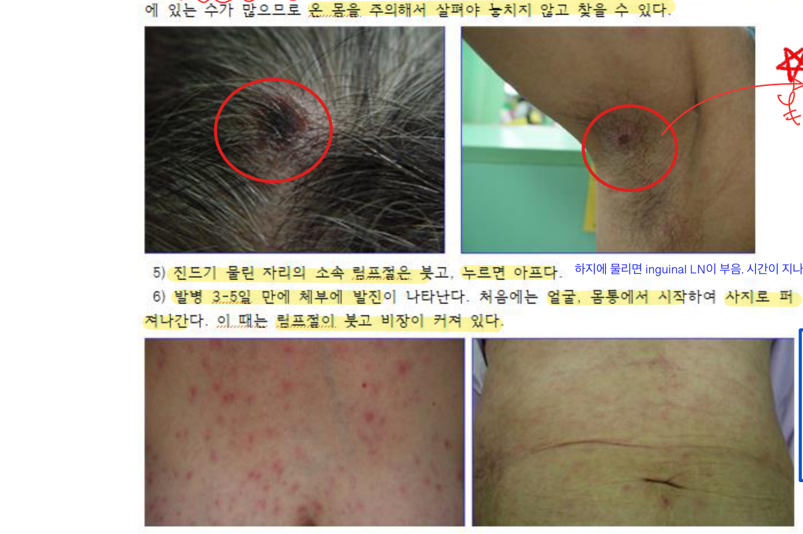{: style="width:80%"}

!!! memo "교수님 정리 — 가을철 열성질환의 공통 특징"
    몸통에 발진(앞가슴부터), dirty margin의 erythematous maculopapular rash, 혈관이 있는 곳이면 어느 장기든 침범.
    **이건 쯔쯔가무시만의 특징이 아니다 — 발진만으로는 확진 불가.** 그래서 가피를 온몸에서 찾아야 한다.

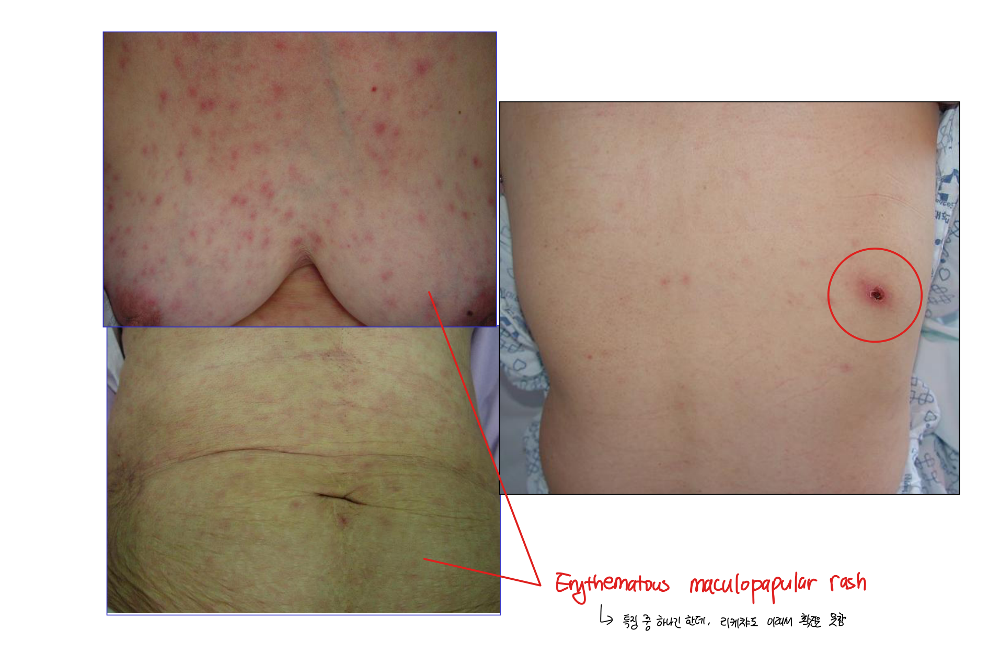{: style="width:60%"}

## 1-3. 진단

1. 갑자기 열이 나는 환자에서 **피부의 까만 딱지(가피)**, 소속 림프절 비대, 발진이 있으면 의심.
2. 특히 eschar는 pathognomonic. 최근에는 혈청검사보다 **PCR**로 확진하기도 한다(가피·혈액).
3. 혈청검사: Weil-Felix(proteus OX-K) — 민감도가 낮고 렙토스피라에서도 양성이 나와 쓰지 않는다. **간접면역형광항체법(IFA)**이 표준.

!!! exam "기출 포인트"
    - 43번: 가장 적합한 진단 검사 → **간접면역형광항체법**.
    - 44번: 사진·영문 설명 → **eschar** (가피, 괴사 딱지).
    - 42번: mite가 문 자리에 가피가 생기는 병 → **리케차 두창, 쯔쯔가무시병** (발진열·Q열은 아님).

## 1-4. 치료와 예방

교수님: "가을철 열성질환 **대부분의 치료 약제**가 doxycycline이다."

1. 클로람페니콜 — 과거엔 많이 썼지만 **혈액학적 부작용** 때문에 이제는 쓰지 않음.
2. **doxycycline 100 mg 1일 2회 7일** (권장).
3. **임신부·소아**처럼 tetracycline·chloramphenicol을 쓸 수 없을 때 → **azithromycin**.
4. doxycycline 내성 → rifampin 600 mg 1일 1회.
5. 백신은 없다. 매개충을 없애는 살충제, 물리지 않게 하는 구충제.
6. 창궐할 때는 doxycycline 200 mg을 1주에 1번 먹으면 먹는 동안 예방이 된다.

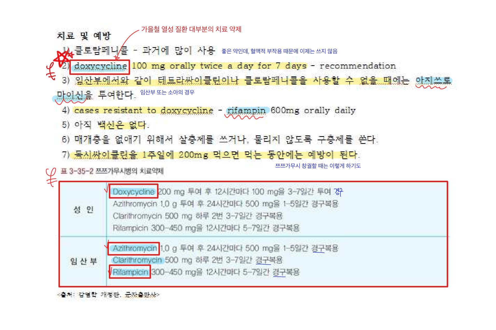{: style="width:75%"}

!!! exam "기출 포인트"
    - "가을 야외 작업 + 발진 + 가피 → 치료제?" 가 **매년** 나온다: 정답 **doxycycline** (3, 5, 14, 38번).
    - 같은 증례에 **임신부**가 붙으면 **azithromycin** (8, 10, 18번). 26번은 보기에 doxycycline이 없어 azithromycin이 정답.
    - β-lactam(ampicillin, cefazolin, ceftriaxone)·quinolone·amphotericin은 오답 보기로 나온다.

# 2. 렙토스피라증

## 2-1. 병원체와 역학

교수님: "**물과 관련.** 피부가 물에 불어 있을 때 균이 잘 침범한다. 호흡기로도 전염될 수 있다. **태풍, 홍수, 장마 이후** 잘 생긴다. 폐출혈, 객혈이 나타난다."

- 경증 감염부터 황달·신기능장애·출혈을 특징으로 하는 치명적인 **Weil 증후군**까지 다양하다.
- 길이 6~20 μm, 너비 0.1 μm의 스피로헤타. 꼬여 있고 **끝이 갈고리처럼 굽어** 있으며 활발히 움직인다. 병원성 *L. interrogans*(250개 넘는 serovar)와 비병원성 *L. biflexa*.
- 보유숙주: **쥐(설치류)**가 가장 중요. 개·소·돼지도. 균이 동물의 **신세뇨관**에 있다가 **오줌**으로 나와 흙과 물을 오염시키고, 사람의 피부·점막 상처로 들어온다.
- 교수님: "감염되면 균이 주로 신장으로 간다. tubular cell에서 증식해 소변으로 배출된다. **사람끼리의 감염은 일어나지 않는다 → 격리 필요 없다.**"
- 우리나라: 1975년 경기·충북에서 유행성 폐출혈열로 대유행, 1984년 렙토스피라증으로 증명. 유행은 **가을철 수수(벼 세우기 등)와 관계**.

!!! exam "기출 포인트"
    45번: 조밀하게 꼬인 나선균, **끝이 갈고리**, 일반 염색 안 됨 → 암시야현미경 → ***Leptospira***.

## 2-2. 병인과 임상양상

- 잠복기 2~20일(보통 1~2주).
- 상처·점막(결막, 구강, 비인두)·눈으로 침입 → 혈행으로 전신 → 혈관 내피세포 손상(**혈관염**) → 출혈. 교수님: "특히 **눈으로 잘 가서 눈이 충혈**되는 경우가 잘 나타난다."
- 급성 신부전 = 렙토스피라에 의한 **간질성 신염 + 세뇨관 괴사** + 모세혈관 투과성 증가.
- 간손상 = 중심소엽 괴사, Kupffer세포 증식.

**두 단계(biphasic)** 경과가 핵심이다.

| | 1단계 — 패혈증기 (septicemic, 3~7일) | 2단계 — 면역기 (immune) |
|---|---|---|
| 증상 | 갑작스런 발열, 두통, **심한 근육통**(걷지 못할 정도), 오심·구토, 기침·객혈, **결막충혈**(conjunctival suffusion) | 항체가 나오며 혈액·CSF에서 균이 사라짐. **수막염**, 포도막염, 발진, 열 |
| 균 있는 곳 | **혈액, 뇌척수액** | **소변** |

- **무황달형**(anicteric, mild) — 환자의 90% 이상.
- **Weil 증후군**(icteric, severe) — 5~10%. 황달(4~9일째), 신부전(2주째), **출혈**(hemoptysis, 점상출혈), 간부전, 쇼크, 의식장애, 심근염. 치사율 5~15%. **폐출혈은 우리나라에서 발생하는 렙토스피라증의 중요한 소견**.

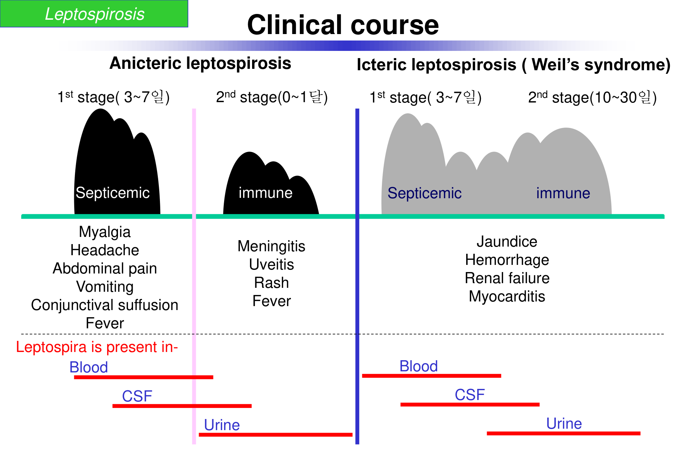{: style="width:80%"}

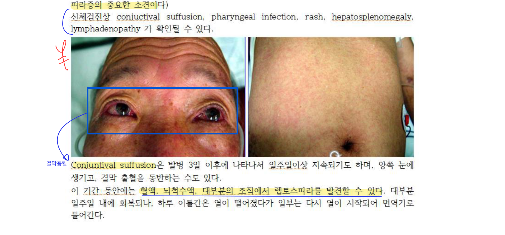{: style="width:62%"}

교수님 증례: 39세 남자, 5일간 발열·오한·**blood-tinged sputum**, 10일 전 강에서 낚시, BP 80/50, **conjunctival injection**, 양폐 crackle, 혈소판 58K, T-bil 3.0 → 렙토스피라증(폐출혈형).

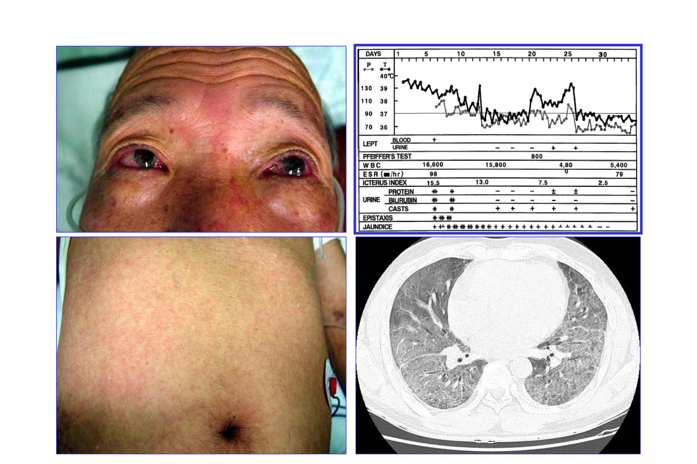{: style="width:62%"}

## 2-3. 검사실 소견

1. 요검사: 단백뇨, 백혈구·적혈구·유리양 과립원주 — 교수님: "신세뇨관 파괴로 요검사 수치가 비정상".
2. 말초혈액: ESR 상승, 백혈구 3,000~26,000/mm3 — **Weil 증후군에서는 현저한 백혈구 증가**, **혈소판 감소**.
3. 혈청 빌리루빈·ALP·간기능 상승, Weil 증후군에서 **PT 지연**, **CPK 상승**.
4. 척수액: 초기 PMN → 후기 **단핵구** 증가, **단백 상승·당 정상** — 교수님: "viral meningitis와 비슷한 소견."

!!! memo "백혈구 비교 (교수님)"
    쯔쯔가무시, 한탄바이러스, SFTS에서는 백혈구가 **감소**하는데, 렙토스피라에서는 **증가**한다.

## 2-4. 진단 — 시기별 검체

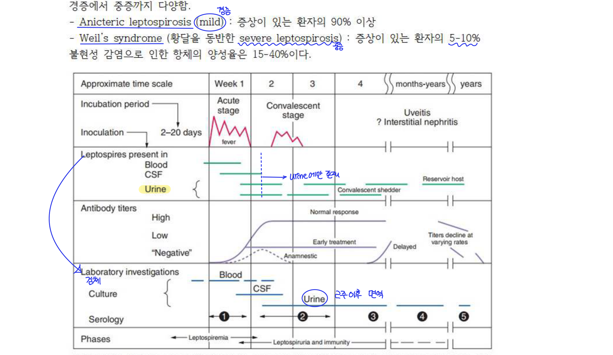{: style="width:70%"}

- **균 분리**: 병이 난 후 **첫 10일까지는 혈액·뇌척수액**, **제2주 이후에는 소변**. 특수 배지(Fletcher's, EMJH)에서 5~6주 걸려 결과는 치료에 도움이 안 된다 → 그래서 주로 **항체검사나 PCR**.
- **항체검사**: 현미경적 응집검사(MAT). 1주 간격으로 2회 검사해 항체가 **4배 이상** 오르면 확진.
- 감별: 말라리아, 장티푸스, 바이러스성 간염, 뎅기열, 한탄바이러스, 리케치아(쯔쯔가무시), 인플루엔자 등.

교수님: "**증상 시작 후 얼마나 지났느냐에 따라 검체가 달라진다.**"

!!! exam "기출 포인트"
    - **검체 문제가 5번 나왔다.** 발병 10일·2주·18일·3주 → 모두 **소변** (12, 17, 22, 39번).
    - 33번 주관식: (A) 1주 이내 → **말초혈액·뇌척수액**, (B) 1주 이후 → **소변**.

## 2-5. 치료와 예방

| 중증도 | 약제 |
|---|---|
| 경증(mild) | **doxycycline** 100 mg PO bid, amoxicillin, ampicillin |
| 중등증·중증 | **penicillin G** IV, **ceftriaxone**, cefotaxime, doxycycline IV |
| 화학예방 | doxycycline 200 mg 주 1회, azithromycin |

- 교수님: "penicillin 계열, 특히 **amino penicillin이 잘 듣는다**."
- 출혈 환자는 절대 안정, 호흡부전·신부전·저혈압에 대한 대증요법이 중요.
- 예방: 쥐 박멸, 오염된 물 피하기. 위험 기간(군인 등)에는 **doxycycline 200 mg 주 1회**. **사람 백신은 없다** — 교수님: "쥐 잡아 없애면 줄어든다."

!!! exam "기출 포인트"
    - 홍수 논 증례(2, 6번): "**Weil 증후군일 가능성이 높다**"가 정답. 오답: 1인실 격리 필요(×, 사람 간 전파 없음), 결막충혈이면 쯔쯔가무시 배제(×), 신부전은 예후와 무관(×), 항생제 없이 회복(×).
    - 치료제 문제: 중증 → **ceftriaxone**(15번), **penicillin**(27번).

# 3. 신증후군출혈열 (HFRS, 한타바이러스)

## 3-1. 원인과 역학

**발열·순환계 부전·출혈·신부전**을 특징으로 하는 병. 과거 유행성 출혈열·한국형 출혈열이라 불렀다. 교수님: "**신부전 + 출혈 + 발열 → HFRS.** 혈소판 수치가 많이 떨어진다."

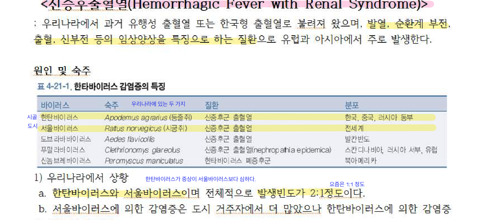{: style="width:75%"}

- 우리나라에 있는 두 가지: **한탄바이러스**(등줄쥐, *Apodemus agrarius*, 시골) — **서울바이러스**(시궁쥐, *Rattus norvegicus*, 도시). 한탄이 서울보다 증상이 심하다. 발생은 2:1이라 했지만 교수님: "요즘은 1:1 정도."
- 유럽은 **Puumala**(대개 경증), 미주 대륙은 **Hantavirus pulmonary syndrome**(급성 폐부종).
- 1951년 6·25 때 유엔군에서 처음 보고. **남자, 40~50대**에 호발. 1년 내내 있지만 **봄과 가을**에 많다. 교수님: "군인, 심마니들이 잘 걸린다." 설치류 밀도·추수기와 관련.
- 전파: 감염된 쥐의 **소변·대변·타액**으로 나온 바이러스가 마르면서 **호흡기로 흡입**. 사람 간 전파 없음.
- 분야바이러스목(Bunyavirales): 외피가 있는 음성가닥 RNA 바이러스, 표면 당단백 돌기(Gn·Gc), 유전체 **L·M·S 3분절**.

!!! exam "기출 포인트"
    - 36번 주관식: 감염 경로 → **들쥐(등줄쥐)의 소변·대변·타액 → 건조 → 호흡기** (채점: 들쥐·호흡기·배설물).
    - 23·35번: 바이러스 모식도 → **3분절 RNA + 외피 + 당단백 돌기** = 한타바이러스(Bunyavirus).
    - 46번: Bunyavirales — 외피·당단백 ○, 3분절 ○, HPS는 미주 ○. Nairovirus·Phlebovirus(SFTS)는 **진드기** 매개라 "쥐 배설물 비말"은 ×.
    - 24번: 유럽 = Puumala ○, 회복기 항체 4배 ○, "**4병기**"는 × (5병기).

## 3-2. 병태생리

- 기본 병변: **모세혈관 단위의 맥관계 병변** → 전신 세동맥 확장, 혈장 유출, 초점성 모세혈관 파열.
- 출혈: 혈소판 감소, 범발성 혈관내 응고, 모세혈관 취약성.
- 신부전: 혈류 변화에 의한 신전 질소혈증, 간질 부종·출혈로 인한 신수질 혈관 폐쇄 등.
- 체액성 면역보다 **세포 매개성 면역반응**(T세포 활성화)이 특징.

## 3-3. 임상양상 — 5병기

잠복기 **4~42일(2~3주)**. 무증상 감염도 꽤 있다. 3대 징후: **안면홍조, 결막충혈, 늑골척추각(CVA) 압통**(교수님: 신장과 등쪽 core muscle 출혈 때문).

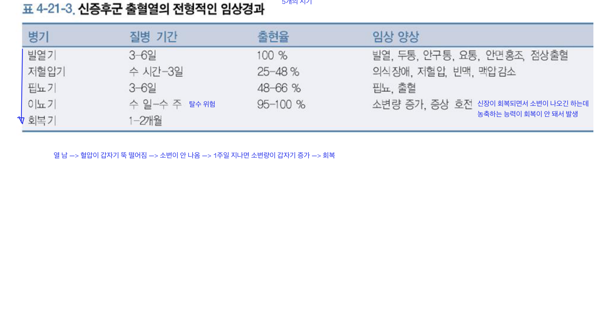{: style="width:85%"}

교수님: "**열남 → 혈압이 갑자기 뚝 떨어짐 → 소변이 안 나옴 → 1주일 지나면 소변량이 갑자기 증가 → 회복.**"

| 병기 | 기간 | 특징 |
|---|---|---|
| **발열기** | 3~4일 | 갑작스런 발열·오한·두통·근육통·요통, **안면홍조, 결막충혈**, 연구개·액와 점상출혈. 경한 범발성 혈관내 응고, 단백뇨 |
| **저혈압기** | 수 시간~3일 | 한탄 감염의 25~40%. 혈장 유출 → 쇼크. 상대 서맥이 빈맥으로. **헤마토크리트 상승**, 백혈구 증가, 혈소판 현저 감소, 단백뇨 |
| **핍뇨기** | 3~10일 | 입원 환자 절반. 혈압 오히려 상승(과혈량), 출혈 악화, **요독증**, 폐부종 |
| **이뇨기** | 수일~수주 | 교수님: "신장이 회복되면서 소변은 나오는데 **농축 능력이 회복이 안 돼서** 생긴다. 소변량이 **10 L**까지도 증가 → **탈수 주의**." |
| **회복기** | 1~2개월 | 이뇨 시작 후 1~2개월에 정상화. 다뇨·야뇨·빈혈이 남을 수 있음 |

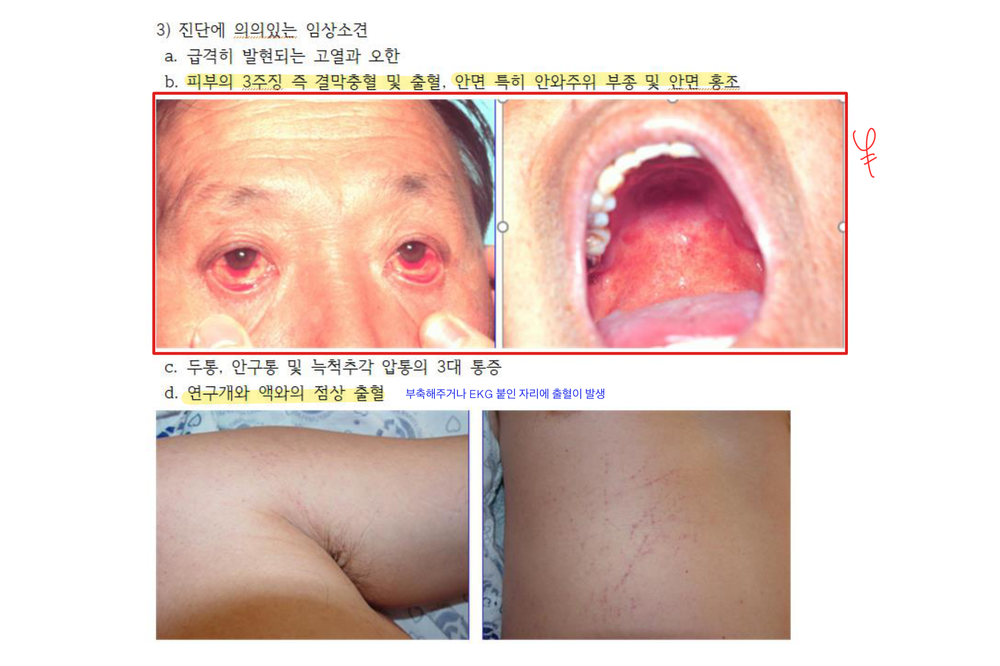{: style="width:62%"}

교수님: "부축해 주거나 **EKG 붙인 자리에 출혈**이 생긴다."

## 3-4. 검사실 소견과 진단

- 혈액: 혈색소는 저혈압기에 증가(**혈액농축**), 백혈구는 정상~증가(교수님: "leukocytosis 별로 없음"), **혈소판은 발병 3일부터 감소**해 3주 후 정상. PT·PTT 증가.
- 요검사: 핍뇨기 비중 1.010 이하(등장뇨). **단백뇨는 거의 전례**에서 발병 3~5일째, 5~10일 지속. 현미경적 혈뇨.
- 생화학: 고질소혈증(크레아티닌↑, 이뇨기 들어가면 감소), 신부전과 달리 **저칼슘혈증**이 심함, AST·ALT 상승(AST > ALT), **LDH 증가** — 교수님: "가을철 열성질환 공통이지만 HFRS에서 특히, **SFTS에서 매우 크게** 증가."
- 심전도: 동성서맥, T파·ST 변화 → myocarditis.
- 진단: 전형적인 경우 95% 이상이 임상소견만으로 가능. **병력청취**(여행력·거주지·활동지역)가 중요.
- 혈청학: 표준검사법은 **간접 면역형광법** — 1주 간격 2회, **4배 이상** 상승. 급성기는 **ELISA IgM**. PCR.
- 감별: **렙토스피라증과 쯔쯔가무시병**.

!!! exam "기출 포인트"
    - 21번: HFRS의 검사 소견이 **아닌** 것 → **Leukopenia** (단백뇨·혈뇨·크레아티닌 상승·혈소판감소는 맞음).
    - 28번: 등산 후 결막충혈 + 양쪽 **CVA 압통** + 혈소판↓ + 신부전 + 단백뇨 → **신증후군출혈열**.
    - 11번: 직업은 중요(×), 겨울철 호발(×), 중추신경 합병증 최다(×), 서울바이러스가 진단 쉬움(× 반대) → 정답 **"보존적 치료, 필요하면 투석"**.

## 3-5. 치료와 예후

교수님: "**따로 항바이러스제가 없다.** ribavirin을 써볼 수는 있는데 부작용으로 **hemolysis**. 그냥 대증치료. 한탄바이러스의 치료 = supporting care."

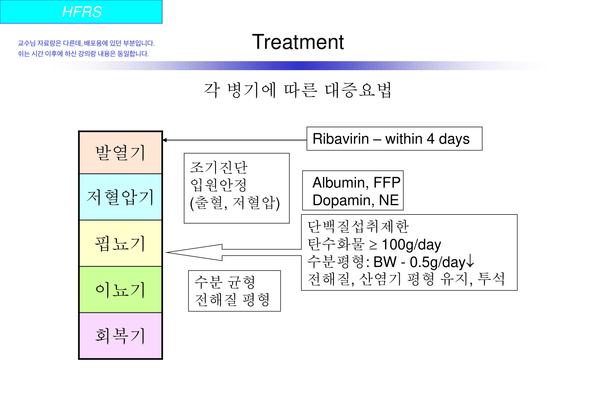{: style="width:65%"}

1. 발열기 후반·저혈압기 환자는 외상으로 혈종·장기출혈이 생길 수 있으므로 **조기진단해 입원 안정**.
2. 발열기 후반 갑작스런 혈압저하에 대비해 활력징후를 면밀히 관찰.
3. 저혈압기는 대부분 일과성이지만 **쇼크가 있으면** 혈장량 유지 위해 **알부민·혈장**, 반응 없으면 **dopamine·norepinephrine**.
4. **핍뇨기**: 단백질 섭취 제한, **탄수화물 하루 100 g 이상**, 하루 체중이 **0.5 kg** 정도 줄도록.
5. 보존적 요법으로 안 되면 **혈액투석**. 이 시기에 위장관 출혈·감염·뇌병증 합병.
6. **이뇨기**: 소변량이 다른 신부전보다 많고 오래 → **수분균형·전해질** 주의.
7. Ribavirin: 첫 4일 이내 투여 시 이환 기간 단축 보고가 있으나 흔히 쓰이지 않음.

- 합병증: 고혈압(핍뇨기 50%), 감염(20~35%, 주요 사망원인), 빈혈, 출혈, 뇌하수체 기능저하. 교수님: "가장 흔한 합병증은 **만성 신부전**. 대부분 정상으로 회복되지만 **20~30%**에서 신장 합병증이 남는다 → 추적관찰."
- 치사율 **2~7%**(교수님: 5%). 주된 사망원인은 성인 호흡곤란증후군과 폐출혈에 의한 폐부전증, 패혈증, 쇼크.

!!! exam "기출 포인트"
    - 버섯 채취·산지 야외취침 + 핍뇨 + 혈소판↓ 증례(4, 9, 16번): 정답 **"대부분 수액요법 등 보존적 치료가 중요"**. 오답: 투석 안 함(×), 1인실 격리(×), doxycycline 예방(×, 렙토스피라), oseltamivir(×).
    - 40번: 한탄 항체 양성 → **대증치료** (acyclovir·ganciclovir·foscarnet·ceftriaxone 아님).
    - 19번: "저혈압기는 일과성이므로 쇼크가 있어도 알부민·승압제 **필요 없다**" → **틀림**. 위의 1~6번 문장은 그대로 보기로 나왔다.

# 4. 진드기와 진드기 매개 질환

## 4-1. 진드기에 물렸을 때의 증상

교수님: "진드기에 물리면 대부분 **국소 증상이거나 증상이 없다.** 감염이 일어났을 때의 증상이 아니라 물렸다는 그 자체만으로 나타나는 증상."

- 국소: 붉은 두드러기, 피부내 출혈, 탈모, **이차세균감염**(긁다가), 반성 유주성 홍반, 만성 위축성 선단피부염.
- 전신(아주 드묾): 타액 독소에 의한 발열·마비 → **진드기 제거 후 신속히 소실**. 아나필락시스처럼 올 수도 있다.

## 4-2. 진드기란 — tick과 mite

- 곤충과 다르다: **다리 8개**, 두흉부와 복부가 하나로 융합. 알 → 유충(다리 3쌍) → 약충(님프) → 성충, 1개월.
- 사람에서는 노출 부위나 옷을 따라 이동하다 습기 많은 **사타구니, 목덜미, 겨드랑이, 엉덩이**에서 멈추고 흡혈. 흡혈하면 1 cm까지 커진다.

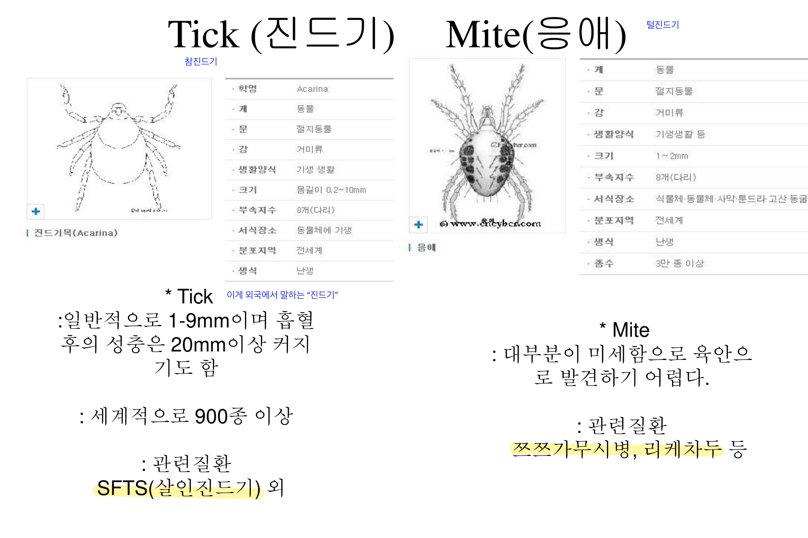{: style="width:70%"}

| | **Tick (참진드기)** | **Mite (응애·털진드기)** |
|---|---|---|
| 크기 | 1~9 mm, 흡혈 후 20 mm 이상 | 대부분 미세, 육안으로 찾기 어려움 |
| 관련 질환 | **SFTS**, 라임병, 홍반열, tularemia, 에를리히증·아나플라스마증, 바베시아증, Colorado tick fever, relapsing fever | **쯔쯔가무시병**, 리케차 두창 |

교수님: Tick이 "외국에서 말하는 진드기".

!!! exam "기출 포인트"
    29번: 참진드기(tick) 사진 → 생길 가능성이 **가장 낮은** 병 = **Scrub typhus** (쯔쯔가무시는 mite).

## 4-3. SFTS (중증열성혈소판감소증후군)

필기본에서 SFTS는 진드기 단원 안에서 짧게 다룬다. 기출에서는 비중이 크다(7문항).

- 작은소참진드기가 매개. 슬라이드: 바이러스를 가진 진드기는 1%도 안 된다, 치사율은 처음에 높게 나왔다. 교수님: "**요즘은 더 많다. 지역에 따라 25~50%까지** 높을 수도."
- "**치료제는 없지만 치료법은 있다**" → 대증치료. 백신도 없다.
- 특징: 고열, 위장관 증상, **백혈구·혈소판 감소**, 간효소·**LDH·ferritin 상승**. 가피·발진 없음. 의식저하·경련 같은 **신경학적 증상**은 흔하고 나쁜 예후 인자.
- 진단: **혈액** 실시간 RT-PCR. 호발 4~11월.
- **혈액·체액을 통한 사람 간 전파**(의료진 감염) → 확진 환자는 **1인실 격리**, 비말·체액 대비 보호장비, 심폐소생술·삽관 때 N95.

!!! exam "기출 포인트"
    - "등산 + 진드기 + 백혈구·혈소판↓ + 간효소·ferritin↑ + 발진 없음" 증례가 3번 똑같이 나왔다(1, 7, 41번) → 정답 **"대증치료로 충분한 경우가 많다"**. 오답: 소변 배양 확진, acyclovir, ampicillin, "1인실 격리 필요 없다".
    - 13번: SFTS 확진되면 **1인실 격리 필요** ○. 으뜸치료제 doxycycline(×), 인두도말 PCR(×, 혈액).
    - 30번: "신경학적 증상은 동반하지 않는 것이 특징"이 **틀림**.
    - 47번: 의료진 보호장비 → **비말전파에 대비한 장비**.
    - 32번: 7월 텃밭 + 백혈구·혈소판↓ + 혈액배양 음성 + 가피 없음 → **SFTS virus**.

## 4-4. 예방과 물렸을 때 처치

**예방**: 백신 없음 → **물리지 않는 것이 최선**. 유행 시기에 관목 숲 피하기, 긴 옷, 소매·바지 끝 여미기, 풀밭에 옷 벗어두거나 눕지 않기, 귀가 즉시 옷 털고 세탁·목욕, 기피제.

**진드기에 물렸을 때 할 일**

1. 진드기 충체를 제거한다.
2. 물린 자리 피부에 2차 변화가 생기는지 관찰한다.
3. **야외활동 후 1~3주 이내** 발열·오한·근육통 등이 생기는지 관찰한다. 교수님: "잠복기가 약 1~3주. **3주 넘어가서 아프면 이것 때문이 아니다.**"
4. 전신 피부 발진이 없는지 관찰한다.

남은 충체가 있거나 전신 증상이 생기면 병원에 온다.

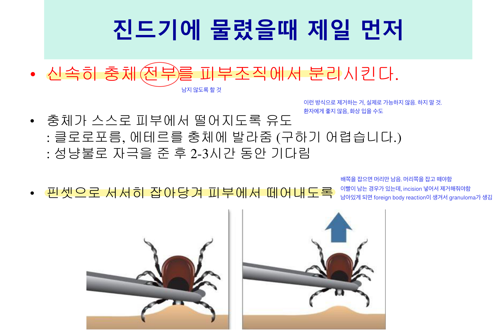{: style="width:55%"}

- 신속히 충체 **전부**를 분리한다(남지 않도록).
- 클로로포름·에테르·성냥불로 스스로 떨어지게 하는 방법 — 교수님: "**실제로 가능하지 않음. 하지 말 것.** 화상 입을 수도."
- **핀셋으로 머리 쪽을 잡고**, 배를 쥐지 말고 비틀지 말고 똑바로 당긴다. 교수님: "배 쪽을 잡으면 머리만 남는다. 이빨이 남으면 incision 넣어 제거해야 한다. 남아 있으면 **foreign body reaction → granuloma**."
- 떨어지지 않으면 병원에서 외과적으로 완전히 절제.
- 뺀 충체 보관은 요즘에는 굳이 하지 않아도 된다.
- 물린 곳: 물과 비누로 씻고, 자극 있으면 연고(교수님: "후시딘 같은 연고"), ice pack, 손 씻기.
- 그 다음 1~3주간 알레르기 반응, 감기 양 증상(발열·두통·오심·구토·근육통)을 관찰.

!!! exam "기출 포인트"
    20번: 목에 붙은 진드기를 발견하고 온 환자 — 머리 포함 제거, 2차 변화 관찰, 1~3주 증상 관찰, 발진 관찰은 모두 ○. **"예방 위해 doxycycline 7일 투약"이 틀림**.

# 암기 — 가을철 열성질환 한눈에

| | 쯔쯔가무시 | 렙토스피라 | HFRS | SFTS |
|---|---|---|---|---|
| 원인 | *Orientia tsutsugamushi* | *Leptospira interrogans* | 한탄·서울 바이러스 | SFTS virus (Bunyavirales) |
| 전파 | 털진드기 **유충**(mite) | 쥐 **오줌** → 물·흙 → 피부·점막 | 쥐 배설물 → 건조 → **흡입** | 작은소참진드기(tick), **사람 간 전파** |
| 노출 단서 | 가을 밭일·밤·감따기·벌초 | **홍수·논·장마**, 낚시 | 산지·야외취침, 군인·심마니 | 등산·텃밭 |
| 특징 소견 | **가피**, 발진, 림프절 | **결막충혈**, 근육통, 황달·신부전·**폐출혈**(Weil) | 안면홍조·결막충혈·**CVA 압통**, 5병기, 혈액농축 | 고열·위장관, 의식저하 |
| 백혈구 | 감소/정상 | **증가** | 정상~증가 | 감소 |
| 진단 | **IFA**, PCR | 1주 혈액·CSF → 2주 이후 **소변**, MAT | IFA 4배, ELISA IgM | **혈액 RT-PCR** |
| 치료 | **doxycycline** (임신부 azithromycin) | 경증 doxycycline / 중증 **penicillin G·ceftriaxone** | **대증치료**, 필요 시 투석 | **대증치료** |
| 격리 | 불필요 | 불필요 | 불필요 | **1인실** |
