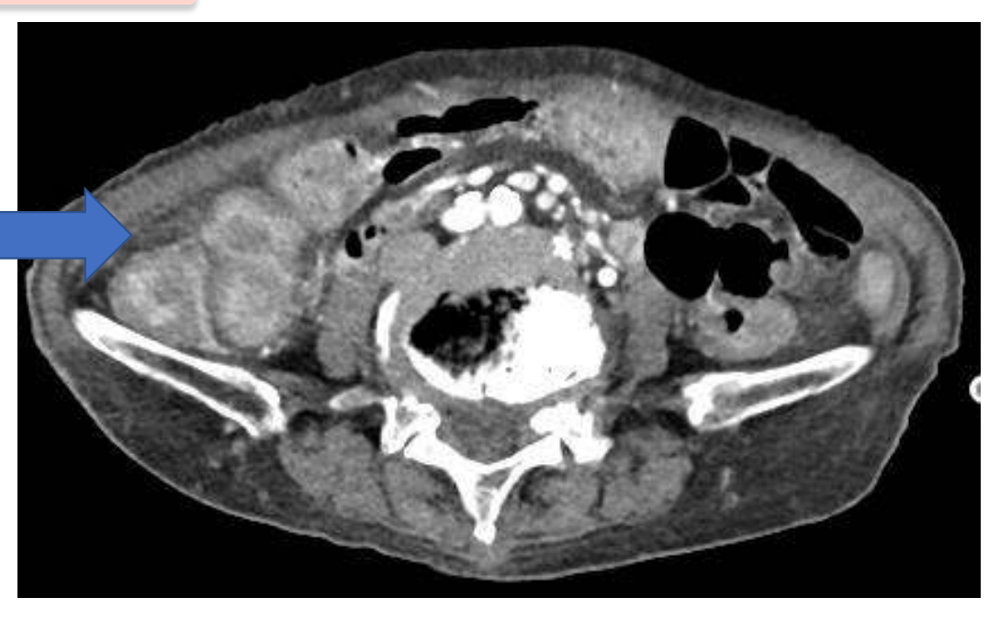
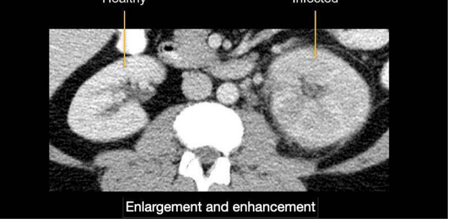

<!-- 필기본: 2025 -->
<!-- 단계: 수업 전 -->

# 0. 이 수업을 공부하는 법

CP-D2는 CP-D1과 같은 날(2025년 10월 20일) 진행된 **증례 토의**의 뒷부분으로, **6조부터 10조까지**의 증례를 다룬다. 학생마다 한 증례를 골라 A4 2장 이내 레포트를 LMS로 낸다.

필기한 선배의 메모: "시험에 나온 적 없는 것 같고 교수님도 엄청 빠르게 수업하고 끝내신 걸 보면 아마 나오지 않을 것 같다." 실제로 **이 수업으로 분류된 기출은 없다**(2부 비어 있음). 그래도 증례마다 생각의 흐름이 다른 수업(요로감염, 위장관 감염, 가을철 열성질환, 해외유입감염병, 호중구감소열)과 이어지므로 복습용으로 읽어 두면 좋다.

| 조 | 증례 | 이어지는 수업 |
|---|---|---|
| 6 | 와상 노인의 발열·설사, 대장 부종 | 성인 위장관 감염 (*C. difficile*) |
| 7 | 농부의 발열·설사 후 의식저하 | 가을철 열성질환 (SFTS) |
| 8 | 베트남 여행 후 발열·발진 | 신종감염병 및 해외유입감염병 (뎅기열·말라리아) |
| 9 | 급성신우신염, ceftriaxone에도 열 | 요로감염 |
| 10 | 항암치료 중 발열 | 기회감염과 호중구감소열 |

!!! key "핵심"
    - 누워 지내는 노인 → **요로감염**이 가장 흔하고, **흡인성 폐렴·욕창**도.
    - 입원·요양 환자의 설사 → 식중독보다 ***C. difficile*** (항원검사·PCR).
    - 신우신염의 열은 **5일 정도** 지나야 떨어진다. 그래도 안 떨어지면 **신농양·전이 감염**을 찾는다.

# 1. 6조 — 요양병원 와상 환자의 발열과 설사

> 80세 여자, 38.0℃ 발열과 설사로 응급실. 2년 전부터 뇌출혈로 요양병원에서 **침상 요양**, 대화 불가. 복부 CT에서 **대장의 전반적인 부종** → 대장염 의심.
> Q: 필요한 병력청취, 검사와 치료는?

{: style="width:50%"}

교수님 요점

- 이렇게 계속 누워 지내는 환자들에게 제일 잘 오는 것은 **UTI**. 고령 환자는 **흡인성 폐렴, 욕창**도 발생 가능성이 높다 → 설사가 있어도 다른 열의 원인을 같이 찾는다.
- 대장이 부어 있지만 **이게 정말 감염인지** 감별해야 한다(허혈성 대장염 등).
- 입원 환자들은 병원 식사만 하면 **식중독은 잘 안 걸린다** → ***C. difficile*** 을 의심: **antigen test(GDH), toxin, PCR**.

!!! memo "보충 정리 (교과서)"
    병력: 최근 **항생제** 사용(3개월 내), PPI, 경관영양, 요양병원 내 설사 유행. 치료: 원인 항생제 중단, 경구 **vancomycin 또는 fidaxomicin**, 접촉주의 격리, 손 씻기(알코올 손소독제는 아포에 효과 없음).

# 2. 7조 — 농부의 발열·설사 후 의식저하

> 71세 남자, 평소 건강, **농사**. 1주 전부터 감기 같은 오한·**설사**·발열, 대증치료에도 열이 심해져 39℃ 이상, 1일 전부터 사람을 알아보지 못함. 응급실에서 의식은 정상, BP 100/60, HR 118, RR 25, 39.2℃.
> Q: 필요한 병력청취, 신체검사, 혈액검사와 특수검사는?

교수님 요점

- **의식저하 + 바이탈이 좋지 않음.** 의식저하는 뇌 실질에 문제가 생긴 것일 수 있으므로 **brain imaging**을 해야 한다.
- **전형적인 SFTS 환자** 모습이다. 아닐 수도 있으니 brain imaging 이후 **인플루엔자, COVID-19** 등 비슷한 질환들도 감별을 위해 다 검사한다.

!!! memo "보충 정리 (교과서) — SFTS를 생각한다면"
    병력: 밭일·풀숲·**진드기** 노출, 반려동물, 같은 증상의 가족. 신체: **가피·발진**(쯔쯔가무시 감별), 림프절. 혈액: **백혈구·혈소판 감소**, AST·ALT·**LDH·CK·ferritin 상승**, 응고검사. 특수검사: 혈액 **SFTS RT-PCR**, 쯔쯔가무시·렙토스피라·한타 항체. SFTS는 혈액·체액으로 사람 간 전파 → **격리, 의료진 보호구**.

# 3. 8조 — 베트남 여행 후 발열과 발진

> 40세 여자, 3일간 38℃ 이상 발열과 **전신 피부 발진**. 2주 전 **베트남** 여행 10일, 3일 전 귀국.
> Q: 필요한 병력청취, 신체검사, 혈액검사와 특수검사는?

교수님 요점

- 동남아에 갔다 와서 열이 난다 → **백신**을 맞았는지 확인하고 **뎅기열, 말라리아** 검사 등을 한다.

!!! memo "보충 정리 (교과서)"
    병력: 여행 지역·도시/농촌, 모기 물림, 말라리아 예방약, 성 접촉·민물 노출, 동행자 증상, 예방접종(A형 간염·장티푸스). 잠복기로 거르기: 뎅기열은 **2주 이내**, 말라리아는 더 길 수 있다. 검사: CBC(혈소판↓·백혈구↓·헤마토크리트↑ → 뎅기), 말라리아 **도말·신속항원**, 뎅기 **NS1·IgM·PCR**, 혈액배양(장티푸스), 간기능. 뎅기 의심 시 **NSAID·아스피린 금지**.

# 4. 9조 — 급성신우신염인데 열이 계속될 때

> 82세 여자, 2일 전부터 발열·**좌측 옆구리 통증**. 의식 정상, BP 130/60, HR 116, RR 22, 39.4℃. 복부 CT에서 **신장 부종과 염증** → 급성신우신염 진단, **ceftriaxone** 시작.
> Q1: 치료 **2일째** 38℃ 발열 지속 — 조치는? Q2: **5일째** 지속 — 조치는?

{: style="width:42%"}

교수님 요점

- **합병증 없는(uncomplicated) APN은 CT가 정상**이다 — 신우에 생기는 염증이라 실질 자체는 정상. CT에서 이상하게 보이면 이미 **complicated APN** → 심해지면 **renal abscess**.
- **2일째**: 원래 2일 만에는 열이 잘 안 떨어진다(**5일은 지나야** 떨어진다) → 경과 관찰, 배양 결과·감수성 확인.
- **5일째**에도 안 떨어지면: 감염이 나빠지는 건 아닌지, **신농양**으로 진행하는 건 아닌지, 균이 **다른 곳으로 넘어가** 감염을 일으키는 건 아닌지 확인해야 한다.

!!! memo "보충 정리 (교과서) — 5일째 점검"
    소변·혈액배양과 감수성(ESBL이면 ceftriaxone 실패), 영상 재검(CT·초음파: 농양, **요로 폐쇄**·결석 → 배액), 전이 감염(심내막염·척추염), 약열·카테터 등 다른 열의 원인.

# 5. 10조 — 항암치료 중 발열

> 2달 전 위암 진단·수술 후 **항암치료** 중인 환자, 1일 전부터 38.6℃ 발열.
> Q: 필요한 병력청취, 신체검사, 혈액검사와 특수검사는?

교수님 요점

- **항암치료의 종류**(마지막 투여일) 확인, **CBC**(호중구 수), 점막염 확인을 위해 **입 안**을 본다.

!!! memo "보충 정리 (교과서) — 호중구감소열을 생각한다면"
    정의: 체온 38.3℃ 1회 또는 38.0℃ 1시간 이상 + ANC < 500/mm3(또는 곧 500 아래로 떨어질 것). 신체: 구강·인후, 중심정맥관 삽입부, 피부, 항문 주위(직장수지검사는 하지 않음), 폐. 검사: CBC·감별, 혈액배양 2세트(카테터와 말초), 소변 배양, 흉부 X선, 간·신기능. 고위험이면 즉시 **항녹농균 β-lactam**(cefepime, piperacillin-tazobactam 등)을 정맥으로.

# 암기 — CP-D2 요점

| 조 | 한 줄 요점 |
|---|---|
| 6 | 와상 노인의 열 → **UTI**·흡인성 폐렴·욕창. 입원 중 설사 → ***C. difficile*** 항원·PCR |
| 7 | 의식저하 → **brain imaging**. 농부 + 발열·설사 + 의식저하 → **SFTS**, 인플루엔자·COVID-19 감별 |
| 8 | 동남아 여행 후 발열·발진 → **뎅기열·말라리아**, 백신 확인 |
| 9 | Uncomplicated APN은 CT 정상. 열은 **5일**은 지나야 떨어진다 → 안 떨어지면 **신농양**·전이 감염 |
| 10 | 항암치료 중 발열 → 항암제 종류, **CBC**, **입 안(점막염)** |
