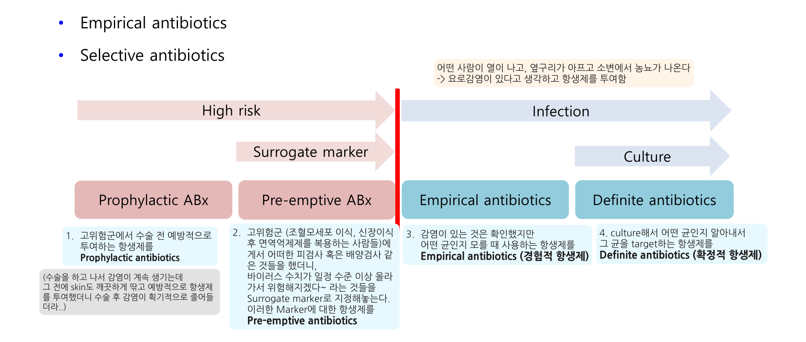
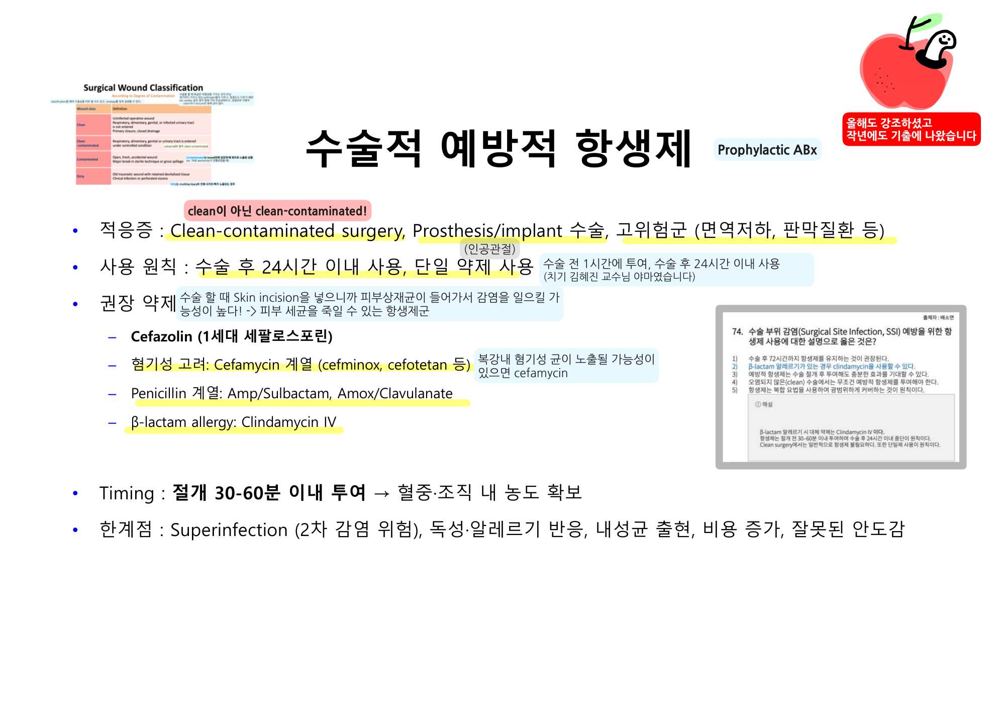
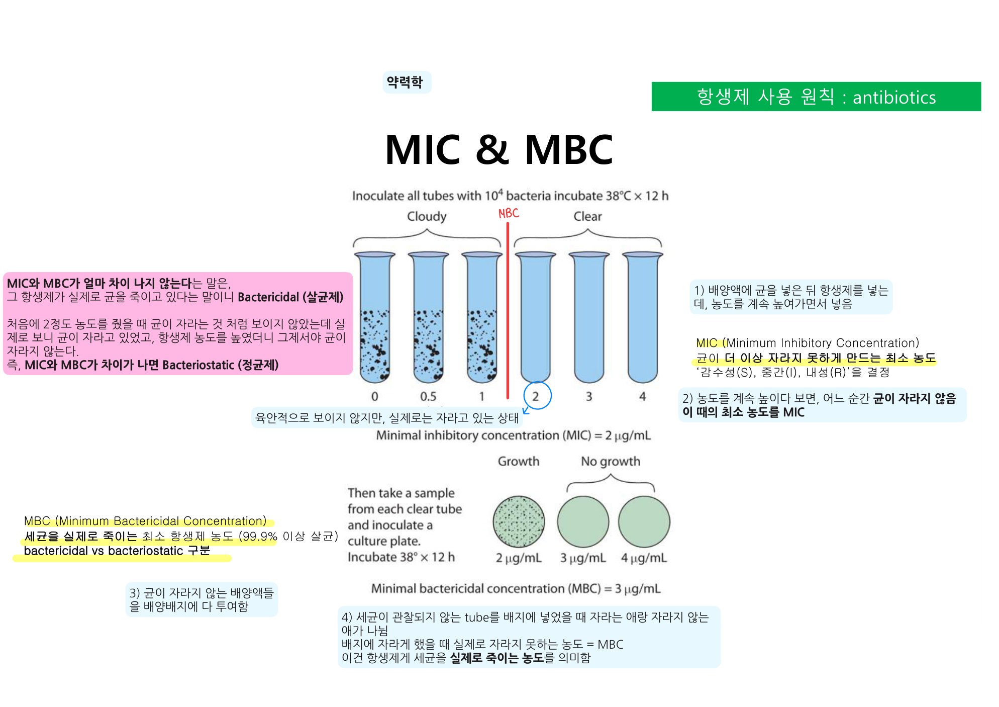
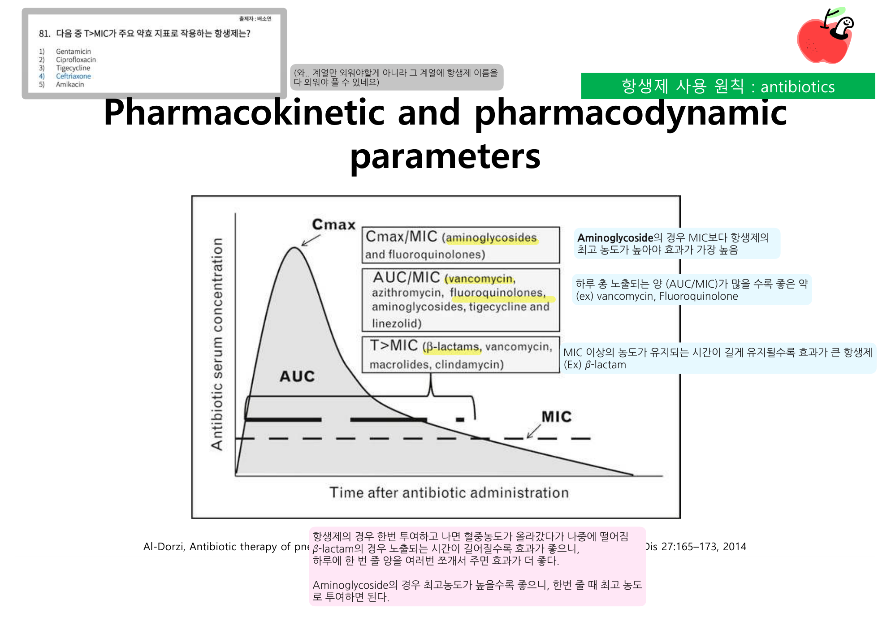
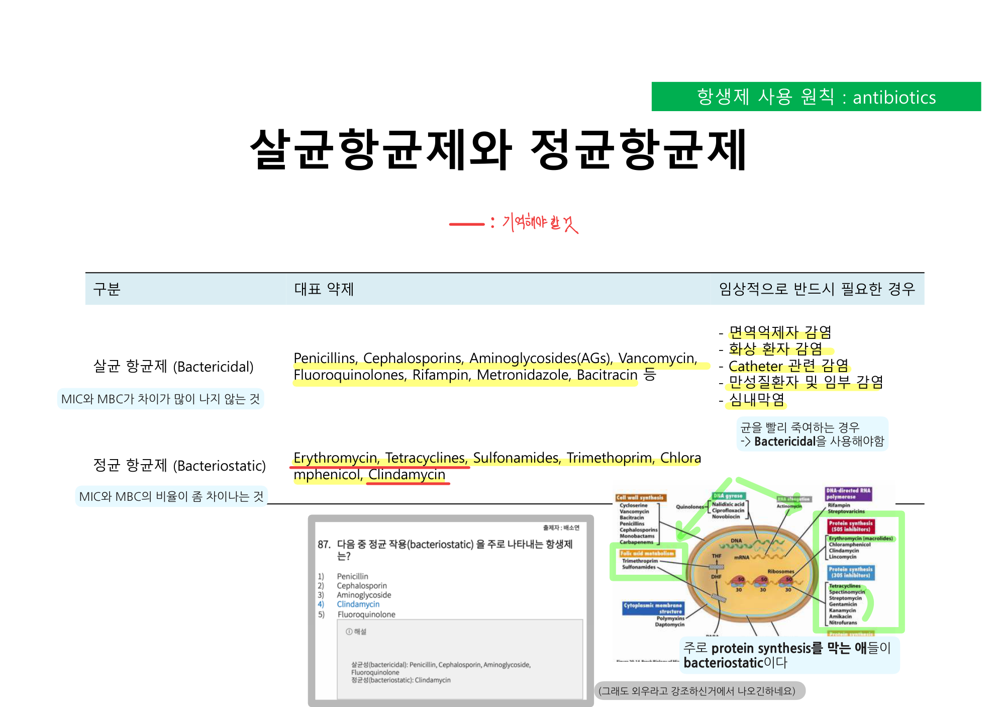
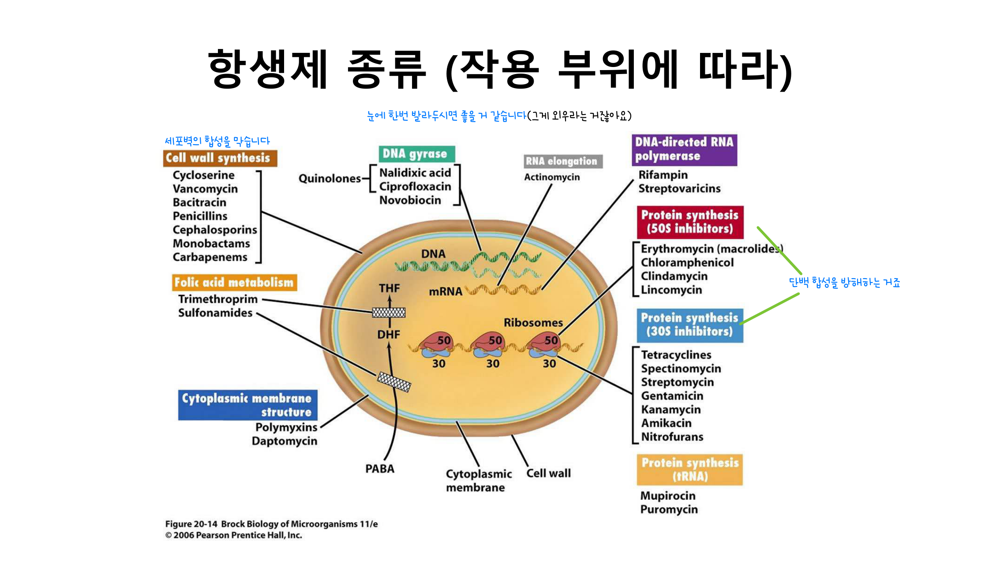
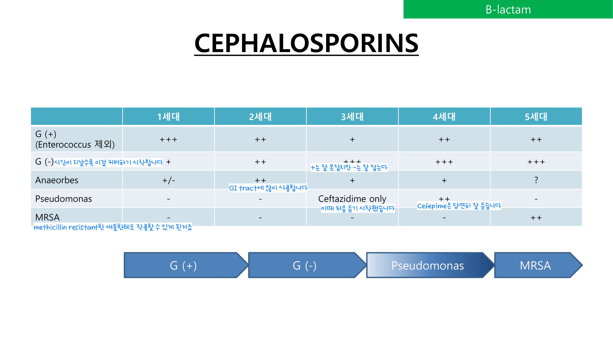

<!-- 필기본: 2026 · 2025 -->
<!-- 단계: 수업 후 -->

# 0. 이 수업을 공부하는 법

배소현 교수님의 항생제 총론이다(2025·2026년 배소현, 2022–2024년 김신우 교수님). 앞부분은 **항생제를 고르고 쓰는 원칙**(pathogen–antibiotics–host), 뒷부분은 **항생제 계열별 스펙트럼·부작용**이다. 필야의 말대로 "이 강의에서 항생제를 외워 둬야 각론에서 어떤 균에 어떤 약을 쓰는지가 이해된다."

- **올해(2026) 필기 표시**: 🍎 사과 = *이전 기출에 나온 페이지*, 분홍 꽃 = *교수님이 중요하다고 한 페이지*, 노란 형광펜 = *교수님이 읽은 부분*. 사과가 붙은 쪽은 수술 예방 항생제, PK/PD 지표, 자연내성, 세팔로스포린 세대, aminoglycoside 부작용이고, 꽃이 붙은 쪽은 **치료 실패 시 고려사항, 항생제 부작용, 세팔로스포린 세대, aminoglycoside 이독성, fluoroquinolone 세대**다.
- 작년 필기 표시는 별 뱃지·보라 형광펜이었다. 아래에서 "작년 필기"라고 쓴 것은 2025 필기본이다.
- 필야가 2025 족보를 정리하며 "족보에 배소연이라고 되어 있는데 작년과 똑같은 매뉴얼인 것으로 보아 오타"라고 적었다 — 2부의 2025년 출제자 「배소연」은 배소현 교수님이다.
- 필야 참고: 감염학은 2022년까지 본2 과목이었고(202203 이전 기출은 옛 교육과정, 병원체학과 같이 출제), 교수님들끼리 문제를 "돌려막기" 한다.
- 기출은 2부에 **38문항**(2020–2025). 최근 3년은 해마다 6–7문항으로 감염학 수업 중 가장 많다. 대부분 **한 줄짜리 암기형**이다.
- 해마다 나온 주제: **수술 전 예방적 항생제**, **자연내성(장구균–세팔로스포린)**, **aminoglycoside 이독성·신독성**, **경구 생체이용률**, **세팔로스포린 세대별 스펙트럼**, **살균 vs 정균**, **PK/PD 지표(T>MIC)**, **과민반응 예측(1형 과민반응 병력)**.

!!! key "핵심"
    "어떤 균에 안 듣는가(자연내성)", "어떤 부작용이 돌아오지 않는가(aminoglycoside 이독성)", "언제·얼마나 예방적으로 주는가(절개 30–60분 전, 수술 후 24시간 이내, 단일 약제)" — 이 세 가지가 매년 나온다.

!!! new "올해 필기에서 추가"
    필야가 정리한 **「항생제 각론: 항균 스펙트럼 정리」 AI 요약표**(필기본 4–6쪽)가 맨 앞에 붙었다. 작용 부위별로 약마다 G(+)·G(−)·혐기균·기타 내성균 포인트를 한 줄씩 정리한 표인데, 내용은 이 학습자료 3–8장과 같다. 마지막에 "Intrinsic resistance(강의 표)"와 "혐기균 커버 약제"도 모아 두었다 — 1회독 후 그 표로 빈칸 채우기 복습을 하면 좋다.

# 1. 항생제란

## 정의 — 넓은 의미와 좁은 의미
- 1942년 **왁스만(Selman Abraham Waksman)**의 정의: **미생물이 생성한 물질**로 **다른 미생물의 성장을 억제하거나 죽이는** 것.
- 지금은 미생물이 만든 물질뿐 아니라 **화학적으로 합성한 약**과 기존 항생제 구조를 변형한 **반합성 약**까지 포함한다.
- **항미생물제(antimicrobials)**가 더 큰 범위다: 미생물(세균·바이러스·진균·기생충)마다 antibacterial, antiviral, antifungal, antiparasitic agent가 있다. 우리가 보통 말하는 "항생제"는 **세균에 대한 좁은 의미의 항생제(antibacterial)** — 이 수업도 이것을 다룬다.

## 역사
| 시기 | 사람·사건 | 의미 |
|---|---|---|
| 고대 | 그리스: 나무 추출물, 프로폴리스 / 이집트: **곰팡이 핀 빵** | 상처(wound) 치료에 사용 |
| **1909** | **파울 에를리히(Paul Ehrlich)** — **arsphenamine**(비소 유도체, 최초의 합성 항감염 소분자) | **매독** 치료, "**마법의 탄환(magic bullet)**": 병원체만 골라 공격하고 숙주에는 무해 |
| 1928 | **알렉산더 플레밍** — 포도알균 배양접시에서 *Penicillium* 곰팡이 주변에 집락이 자라지 않는 것 발견 | 페니실린 발견(배지를 덮지 않고 외출했다가 발견) |
| 1940년대 | 페니실린 임상시험·대량 생산 성공, 2차 대전 부상병 치료 | 본격적인 항생제 시대 |

!!! diff "작년 필기와 다른 점"
    에를리히의 연도가 작년 필기에는 **1908년**, 올해 슬라이드에는 **1909년**이다(arsphenamine 606호는 1909년 합성, 1910년 발표). 작년 필기에는 "그전에는 수은 욕조로 매독을 치료하다 사람도 다쳤다"는 설명이 있었다.

- 1940–60년대(golden age)에 많은 계열이 나왔고 최근에는 새 계열이 거의 나오지 않는다(타임라인은 "다 외우라는 것은 아니다").
- **항생제 도입 후**: 사망률이 획기적으로 감소 — 조선시대 사망 원인 1위는 전염병, 지금은 암. 지역사회 폐렴(~35% → ~10%), 병원 폐렴, 심내막염(~100% → ~25%), 그람음성 균혈증(~70% → ~10%), 세균성 수막염(>80% → <20%), 연조직염 모두 크게 줄었다.
- **항생제의 한계**: 그래도 100% 치료는 못 한다 — 내성균 문제이기도 하고, 항생제만으로 감염병을 다 고칠 수 없다는 한계도 있다. 항생제를 개발하면 곧 내성균이 나타났다(penicillin, methicillin, vancomycin, linezolid, daptomycin… 모두).

## 내성 기전 4가지

{: style="width:70%"}

| 기전 | 내용 | 예 |
|---|---|---|
| 1. **약물 불활성화** | 들어온 약에 효소가 붙어(인산기 등) 약을 망가뜨림 | **β-lactamase**, aminoglycoside 변형효소(AME) |
| 2. **표적 변화** | 약이 붙어야 할 자리를 바꿈 | **PBP 변화 → MRSA**, *erm* 유전자(macrolide·clindamycin), *van* 유전자(**VRE**) |
| 3. **약물 유출** | 들어온 약을 efflux pump로 계속 퍼냄 | tetracycline(Tet)·macrolide efflux pump |
| 4. **투과성 감소** | porin을 줄이거나 바꿔 애초에 못 들어오게 | porin 감소·변형, **OprD 결손**(녹농균의 carbapenem 내성) |

!!! exam "기출 포인트"
    2021년(2부 34번, 주관식): MRSA는 SCCmec의 *mecA*가 친화성이 낮은 **PBP2a**를 만들어 methicillin에 내성(= 표적 변화), 지역사회 MRSA의 SCCmec은 대부분 **IV형**.

## 내성에 대한 대비 = 적절한 사용
"내성균이 나오면 새 항생제를 만들면 되지 않나?" → **어렵다**. 신약보다 내성이 빨리 생긴다. 그래서 **항생제를 적절하게 쓰는 것**이 내성을 줄이는 방법이다 — 간단한 감염에는 거기에 맞는 **최소한의 항생제**를 써서 균이 내성을 얻을 기회를 줄인다.

# 2. 항생제 사용 원칙

## 선택과 사용의 10단계
1. 임상 소견상 **항생제가 필요한가?** — 이것이 진짜 세균 감염인가?
2. 투여 **전에** 적절한 검체로 **배양**했는가? — 원인균을 찾으려는 노력.
3. 가장 가능성 있는 **원인균**은? (각론에서)
4. 그 균에 가장 좋은 항생제는? — 스펙트럼.
5. **병용**이 필요한가? — 한 개냐 두 개냐.
6. **환자 쪽**에서 고려할 것은?
7. 투여 **경로**는?
8. 적절한 **용량**은?
9. 배양 결과 후 **변경**이 필요한가?
10. **기간**은?

올해 슬라이드는 1–7번을 빨간 테두리로 묶고 1·2번을 굵게 강조했다.

!!! exam "기출 포인트"
    2022년(2부 26번)·2021년(2부 29번) 같은 문제: "항생제 선택 시 **가장 중요한** 질문" = **가장 가능성 있는 원인균은 무엇인가**. 경로·병용·기간은 그다음, "보험 처방이 가능한가"는 함정.

## Start smart — then focus
예전에는 병력청취·신체진찰밖에 없어 확신이 없으니 **가능성 있는 균을 다 덮는 약**을 썼다(경험적 치료). 이제는 검체에서 균을 배양하고 **감수성 결과**를 확인하면 쓸 항생제의 범위가 좁아진다: ① empiric therapy(예상 원인균·지역 내성 자료) → ② targeted therapy(균 동정) → ③ susceptibility-guided therapy(감수성 결과). 넓게 시작해서 좁혀 간다.

## 사용 목적에 따른 분류

{: style="width:80%"}

| 분류 | 언제 | 예 |
|---|---|---|
| **예방적(prophylactic)** | 감염 없음, **고위험**군 | 수술 전 예방 항생제(수술 전 피부를 닦고 항생제를 줬더니 수술 후 감염이 획기적으로 줄었다) |
| **선제적(pre-emptive)** | 고위험군(조혈모세포·신장이식 후 면역억제제)에서 증상 전 **surrogate marker**가 오를 때 | 피검사·배양에서 **바이러스 수치**가 일정 수준 이상 오르면 투여(예: CMV) |
| **경험적(empirical)** | 감염은 확인, 원인균 모름 | 열·옆구리 통증·농뇨 → 요로감염으로 보고 투여 |
| **확정적(definite)·선택적(selective)** | 배양으로 균 확인 후 | 그 균을 겨냥한 약 |

경계선(빨간 선)은 **감염(infection)**: 그 앞이 예방적·선제적, 그 뒤가 경험적·확정적이다.

## 수술 전 예방적 항생제 ★ (사과 — 해마다 기출)

{: style="width:78%"}

- **적응증**: **clean-contaminated** 수술(필기: "clean이 아닌 clean-contaminated!" — 예: 맹장처럼 균이 있는 장기를 여는 수술), **인공물·임플란트**(인공관절) 수술, **고위험군**(면역저하, 판막질환 등). 깨끗한 clean 수술은 원칙적으로 쓰지 않는다.
- **원칙**: 수술 후 **24시간 이내** 사용, **단일 약제**.
- **권장 약제**: 피부 절개 때 **피부 상재균**이 들어가 감염을 일으킬 가능성이 높으므로 피부균을 죽이는 약 →
    - **cefazolin(1세대 세팔로스포린)**
    - 혐기균 고려(복강 내 혐기균 노출 가능): **cefamycin 계열**(cefminox, cefotetan 등)
    - penicillin 계열: amp/sulbactam, amox/clavulanate
    - **β-lactam 알레르기: clindamycin IV**
- **시기**: **절개 30–60분 이내** 투여 → 수술 중 혈중·조직 농도 확보(너무 일찍 주면 떨어진다).
- **한계**: 균교대감염(superinfection), 독성·알레르기, 내성균, 비용 증가, **잘못된 안도감**.
- 필기: "수술 전 1시간에 투여, 수술 후 24시간 이내 사용" — 치료의 기본 김혜진 교수님 수업의 핵심이기도 했다. 올해도 강조했고 작년에도 기출에 나왔다.
- Harrison 표(필기본 20쪽, 수술 종류별 약)는 "다 외우긴 어렵다, **대원칙**(앞 페이지)을 기억하라".

!!! exam "기출 포인트"
    거의 매년 1문항. 2025년(2부 1번): 옳은 것 = **β-lactam 알레르기면 clindamycin**. 함정 — "72시간 유지"(→ 24시간 이내), "절개 후 투여해도 충분"(→ 절개 전), "clean 수술은 무조건"(→ 아님), "복합요법으로 광범위하게"(→ 단일 약제). 2023년(2부 16번): 틀린 것 = "심장 수술처럼 위험한 수술은 **3세대**가 더 효과적" — 권장은 1세대 cefazolin. 시점은 2022년(2부 22번)·2022년(2부 27번, 유방절제술) 모두 **피부 절개 30분 안**. 약 선택은 2021년(2부 31번) 대장암 수술 = **cefoxitin**(cefamycin, 혐기균), 2020년(2부 37번) 무릎관절 치환술 = **cefazolin**.

## 감염 치료에서 고려할 3요소
감염(infection)을 가운데 두고 **원인균(pathogen) – 항생제(antibiotics) – 숙주(host)**를 모두 본다. 강의도 이 순서로 진행한다.

### Pathogen — 대표 원인균과 지역 감수성
- 감염 부위마다 대표 원인균을 예측하고 약을 고른다(뇌수막염·중이염·폐렴·요로감염… 각론에서). 폐렴도 **지역사회 획득균**이냐 **병원 내 감염균**이냐에 따라 다르다.
- **Local antimicrobial susceptibility**: 지역사회 발생 요로감염 *E. coli*의 감수성 추이(2008–2017, 국내 3차 병원) — 파란선 = 지역사회 감염, 빨간선 = 병원 내(의료관련) 감염. **병원에서 획득된 균이 지역사회 균보다 감수성이 낮고**, 같은 균이라도 지역·나라마다 내성 정도가 다르다. 그래서 "원인균이 어디서 획득되었나, 어떤 약에 감수성이 떨어져 있을까"를 고민해야 한다.

!!! memo "암기 — 교수님: 수업이 끝날 때 이 표 정도는 알고 있어야"
    아래 감수성 개요표(필기본 24쪽)는 이 수업 전체의 요약이다. 열(균)마다 어떤 약 막대가 덮는지 보자.

{: style="width:88%"}

표 읽기(균 → 듣는 약):

| 균 | 듣는 약(표의 막대) |
|---|---|
| **MRSA** | clindamycin, rifampicin/fusidic acid(병용), **vancomycin/teicoplanin, linezolid, daptomycin** |
| MSSA | + flucloxacillin, cefazolin, amox/clav, pip/tazo, carbapenem, cefepime, moxifloxacin, ciprofloxacin |
| 연쇄구균 | penicillin, amoxicillin, cefazolin, ceftriaxone, cefuroxime, moxifloxacin 등 |
| *E. coli*·*Klebsiella*·*Proteus* | amoxicillin(일부), cefazolin(일부), trimethoprim, ciprofloxacin, gentamicin/tobramycin, aztreonam, 2·3·4세대 세팔로스포린, 억제제 복합제, carbapenem |
| **녹농균** | **ciprofloxacin, gentamicin/tobramycin, aztreonam, ceftazidime, cefepime, pip/tazo(ticarcillin/clav), meropenem·imipenem** — **ertapenem은 빠짐** |
| ESCAPPM(*Enterobacter, Serratia, Citrobacter, Aeromonas, Proteus, Providencia, Morganella*) | ciprofloxacin, AG, aztreonam, moxifloxacin, cefepime, carbapenem |
| **혐기균** | **clindamycin, metronidazole**, moxifloxacin, amox/clav, pip/tazo, carbapenem |

표 아래 주석: 굵은 글씨 약(penicillin, amoxicillin, vancomycin/teicoplanin·linezolid·daptomycin, amox/clav, pip/tazo)은 ***E. faecalis*도 덮는다**. **ESBL 생성균은 β-lactam 고리 약 대부분에 내성이고 carbapenem이 보통 선택약**이다.

!!! new "올해 필기에서 추가"
    필야가 1학년 병원체학 시간표에 균마다 **그람양성/음성**을 붙여 정리했다(필기본 25쪽): 포도알균·사슬알균·장알균·리스테리아·코리네박테리움·노카르디아·바실루스·클로스트리디움 = G(+), 나이세리아·장내세균과·비브리오·캄필로박터·헬리코박터·슈도모나스·헤모필루스·보르데텔라·프란시셀라·브루셀라·레지오넬라·클라미디아 = G(−), 트레포네마·보렐리아·렙토스피라 = G(−) 스피로헤타, 미코박테리움 = 항산성균, 미코플라스마 = 세포벽 없음, 리케치아 = G(−), 아포비형성 무산소균 = G(+)/G(−) 혼재. 포도알균은 coagulase (+) = *S. aureus*, 나머지(*S. epidermidis* 등)는 (−). **녹농균이 계속 나오는 이유 = 대표적인 병원 내성균이라 잘 안 죽기 때문**.

!!! exam "기출 포인트"
    2023년(2부 19번): 혈관 내 카테터 관련 균혈증의 가장 흔한 원인 = **응고효소음성 포도알균(CoNS)**(피부 상재균). 다른 수업 내용이지만 이 수업으로 분류돼 있다.

### Antibiotics — 고려할 것
- **항균 스펙트럼**: 어디까지 덮나.
- **표적 부위 농도**: 뇌–혈관장벽(BBB), **전립선, 안구, 심내막** — 이런 곳에 균이 있으면 같은 약을 줘도 혈중 농도가 조직까지 가며 떨어진다.
- **약동학/약력학, 용량, 경구 생체이용률(bioavailability), 단백결합**.
- **세포 내 침투**: *Legionella*, *Chlamydia*처럼 대식세포 안에 사는 **세포 내 균(intracellular organism)**은 약이 세포 안까지 들어가야 한다.
- **투여 경로·방법**(경구/주사), **병용 효과**(synergistic/antagonistic/indifference), **살균(bactericidal) vs 정균(bacteriostatic)** — 정균 = 죽이지는 못하지만 더 자라지 못하게 함, tolerance, **항생제 후 효과(postantibiotic effect)**, **부작용·금기**, **비용**, **순응도**.

!!! exam "기출 포인트"
    경구 생체이용률은 2023·2024년 연속 출제. 2023년(2부 14번) 정답 = **metronidazole**, 2024년(2부 11번) 정답 = **levofloxacin**. 둘 다 거의 100% 흡수되는 약이고, 오답은 cefuroxime·cefixime·ampicillin·amox/clav·erythromycin처럼 흡수가 낮은 경구 β-lactam·macrolide다. 올해 필기도 FQ에 "**경구 생체이용률과 bone penetration이 매우 좋다**"고 적었다(7장).

### 약동학(PK)·약력학(PD)
- 항생제·세균·사람의 삼각관계: 약 → 균 = **약력학**(효과), 균 → 약 = **내성**, 약 → 사람 = **독성**, 사람 → 약 = **약동학**(사람마다 체적·신장·간 기능이 달라 농도가 달라진다), 균 ↔ 사람 = **감염**과 **숙주 방어**(백혈구, 사이토카인).
- **약동학(pharmacokinetics)**: 약이 투여된 뒤 **ADME**(흡수 Absorption·분포 Distribution·대사 Metabolism·배설 Excretion)를 거쳐 감염 부위·혈중·조직에 **농도**가 어떻게 되는가 — concentration ~ time. 위장관에서 흡수 → 혈액으로 분포 → 각 조직에서 대사 → 담즙·소변으로 배설되며 농도가 정해진다.
- **약력학(pharmacodynamics)**: 감염 부위에 들어간 약이 균에 실제로 무엇을 하는가 — 균 수가 줄고 임상적으로 좋아지는지/실패하는지/사망하는지, effect ~ log(dose).

### MIC와 MBC

{: style="width:76%"}

- **MIC(minimum inhibitory concentration, 최소억제농도)**: 균이 **더 이상 자라지 못하게** 만드는 최소 농도 → **감수성(S)·중간(I)·내성(R)**을 정한다. 측정: 배양액에 균을 넣고 항생제 농도를 올려 가며 넣는다 → 어느 농도부터 눈에 보이게 자라지 않는다 = MIC(그림에서 2 µg/mL).
- **MBC(minimum bactericidal concentration, 최소살균농도)**: 균을 **실제로 죽이는**(99.9% 이상) 최소 농도. 맑아 보이는 튜브들을 배지에 다시 심으면 **자라는 것과 안 자라는 것이 나뉜다** — 눈에 안 보여도 살아 있던 것. 실제로 안 자라는 최소 농도 = MBC(그림에서 3 µg/mL).
- **해석**: MIC와 MBC가 **거의 같으면 살균제(bactericidal)**, **차이가 크면 정균제(bacteriostatic)** — 정균제는 MIC 농도에서 균이 "자라지 못할 뿐 죽지 않은" 상태이기 때문.

### PK/PD 지표 ★ (사과)

{: style="width:74%"}

| 지표 | 뜻 | 대표 약 | 투여 전략 |
|---|---|---|---|
| **Cmax/MIC** | 최고 농도가 MIC보다 높을수록 | **aminoglycoside, fluoroquinolone** | 한 번에 최고 농도로(하루 1회) |
| **AUC/MIC** | 하루 총 노출량 | **vancomycin**, azithromycin, **fluoroquinolone**, aminoglycoside, tigecycline, linezolid | 총량 |
| **T>MIC** | MIC 위에 머무는 시간 | **β-lactam**, vancomycin, macrolide, clindamycin | 하루 양을 **여러 번 쪼개서** 자주 |

필야: "계열만 외울 게 아니라 그 계열의 약 이름을 다 외워야 풀 수 있네요" — 보기에 계열 대신 약 이름(ceftriaxone, gentamicin, amikacin, tobramycin, meropenem…)이 나온다.

!!! exam "기출 포인트"
    2025년(2부 3번): T>MIC = **ceftriaxone**(β-lactam). 2022년(2부 20번): 약력학 패턴이 다른 것 = **tobramycin**(AG, 나머지 ceftriaxone·meropenem·ampicillin·pip/tazo는 T>MIC). 2021년(2부 30번): T>MIC가 **아닌** 것 = **amikacin**. → "보기에서 aminoglycoside를 골라내기"가 반복된다.

### 자연내성(intrinsic resistance) ★ (사과)
"태어날 때부터 내성" — 안 듣는 조합에 쓰면 안 된다. 교수님은 노란 밑줄 부분을 읽고 넘어갔다.

{: style="width:66%"}

| 항생제 | 자연내성 균 |
|---|---|
| Penicillins | *Pseudomonas* (ureidopenicillin = piperacillin 계열은 예외) |
| **Cephalosporins** | ***Enterococcus*** |
| **Vancomycin** | **모든 그람음성균** |
| Aminoglycosides | **혐기균**, *Enterococcus* |
| **Aztreonam** | **모든 그람양성균** |
| Macrolides | 장내세균(Enterobacterales) |
| **Tetracyclines** | ***Pseudomonas*** |

!!! exam "기출 포인트"
    "**세팔로스포린 – 장구균**"이 2025년(2부 2번), 2023년(2부 15번, *E. faecium*), 2020년(2부 36번, cefamycin인 cefminox에 안 듣는 균 = *E. faecium*)으로 세 번. 2022년(2부 21번): 그람음성균에 효과가 가장 없는 약 = **vancomycin**(분자가 커서 외막 porin을 못 지난다).

### 병용요법(combination therapy)
원칙은 **항생제 하나**. 간혹 두 개를 쓰는 경우가 아래다.

{: style="width:80%"}

| 목적 | 내용 | 대표 예 |
|---|---|---|
| 중증 감염 초기 경험적 치료 | 배양 전 원인균을 넓게 | 패혈증: broad β-lactam + aminoglycoside **(예전 방식)** |
| 다른 약에 감수성 확보 | 일부 내성이 있어도 다른 약 효과 기대 | CRE: carbapenem + colistin **(예전 방식)** — 어쩔 수 없이 독성이 높은 colistin을 같이 썼다 |
| 다균종(polymicrobial) 감염 | 호기성 + 혐기성 동시 | 복강 내 감염: β-lactam + **metronidazole** |
| 호중구감소 발열 | 면역저하 환자에서 경험적 광범위 | pip/tazo + aminoglycoside **(한정적)** |
| **시너지(synergy)** | 같은 경로의 다른 단계를 막아 살균력 증가 | **ampicillin + ceftriaxone (*Enterococcus* 심내막염)** |
| 내성 발현 억제 | 내성균 출현 방지 | 결핵 INH + RIF + EMB + PZA, HIV HAART(2제 혹은 3제) |
| 용량 관련 부작용 감소 | 각 용량을 줄여 독성 감소 | amphotericin B + flucytosine (크립토콕쿠스 수막염) |

단점: **길항**, 비용, 부작용, 알레르기, **균교대감염**.

!!! diff "작년 필기와 다른 점"
    - 시너지 예: 작년 **β-lactam + aminoglycoside (Enterococcus)** → 올해 **ampicillin + ceftriaxone (Enterococcus)**. 이유는 6장 aminoglycoside 필기: "예전에는 시너지 때문에 penicillin과 함께 심내막염에 썼지만 **신독성 때문에 매뉴얼이 바뀌어** 지금은 잘 병용하지 않는다."
    - 패혈증 β-lactam + AG, CRE의 carbapenem + colistin에 올해는 「**예전 방식**」, 호중구감소 발열의 pip/tazo + AG에 「**한정적**」이 붙었다.
    - HIV HAART: 작년 「3제 요법」 → 올해 「**2제 혹은 3제**」.
    - 작년에는 원칙으로 "기전이 같은 약끼리는 병용하지 않는다(상승효과도 기전이 달라서 생긴다)"를 여기서 말했다 — 올해는 "그 외 주의사항"에 있다.

### 시너지·길항 그래프 (필기본 35쪽)
세 그래프 모두 항생제가 없을 때(보라)는 균이 계속 자란다. **A 무관(indifference)**: 1번을 더해도 2번의 살균이 그대로. **B 시너지**: 1번을 억제 농도 이하로만 더해도 2번 단독보다 **훨씬 많이** 죽인다(예: 심내막염의 ampicillin + ceftriaxone). **C 길항(antagonism)**: 같이 썼더니 2번 단독보다 덜 죽인다 — "두 개를 같이 쓰니 역효과".

### 살균 vs 정균

{: style="width:76%"}

| 구분 | 약 | 반드시 살균제가 필요한 경우 |
|---|---|---|
| **살균**(MIC ≈ MBC) | penicillin, cephalosporin, **aminoglycoside**, vancomycin, fluoroquinolone, rifampin, metronidazole, bacitracin | **면역억제자**, **화상**, **카테터 관련 감염**, **만성질환자·임부**, **심내막염** — 균을 빨리 죽여야 할 때 |
| **정균**(MIC ≪ MBC) | erythromycin, **tetracycline**, sulfonamide, trimethoprim, chloramphenicol, **clindamycin** | |

외우는 요령(필기): **주로 단백 합성을 막는 약**(특히 50S)이 정균이다 — 단, 30S에 붙는 **aminoglycoside는 살균**(예외).

!!! exam "기출 포인트"
    2025년(2부 4번): 정균 = **clindamycin**. 나머지(penicillin, cephalosporin, aminoglycoside, FQ)는 모두 살균. 필야: "외우라고 강조한 데서 나오긴 하네요."

### 주사 항생제가 필요할 때
경구제는 위장관에서 흡수되고 간 대사를 거쳐야 하므로(생체이용률) 감염이 심하거나 경구 농도가 모자랄 감염병에서는 주사를 쓴다.
- **중증 감염**(패혈증, 호중구감소 패혈증) — 빠른 혈중 농도 확보.
- **수막염** — BBB 투과가 제한적 → 고농도.
- **심내막염** — 감염 부위 혈류가 적다 → 고농도 **살균제**.
- **골수염** — 뼈 침투가 어렵고 치료가 길다 → 고농도 유지(필기: 초기에 필요).
- **흡수 불량** — 위장관 흡수 장애, 쇼크 → 경구제로는 혈중 농도 도달 불가.

### 그 외 주의사항 — 약물 상호작용
- **작용기전이 같은 항생제 병용은 피한다**(길항이 있지 않은지).
- **제산제·철분 → tetracycline 흡수 장애**.
- β-lactam은 상호작용이 적다는 장점. **fluoroquinolone, macrolide, rifampin**은 상호작용 주의(rifampin은 CYP3A4 유도제).

### 치료 실패 시 고려할 것 ★ (꽃 — 교수님 중요)
사례: 입원 환자가 배가 아파 보니 장염 → 항생제를 실컷 줬는데 다시 열이 나고 염증 수치가 오른다. 왜?
- **약이 닿기 어려운 곳**: **배농 안 된 농양**(농양 자체가 약 침투를 떨어뜨려 조직 농도가 낮다), **이물**, **보호된 부위(CSF, 안구)** → 배농·이물 제거가 필요할 수 있다.
- **혼합 감염**을 다 못 덮음(inadequate coverage), **잘못된 약 선택**, **잘못된 투여 간격·용량 부족**.
- **균교대감염(superinfection)**.
- **떨어졌던 열이 다시 날 때** 두 가지를 먼저: **병원 내 감염**(입원 중 새 원내 감염 → 내성균 가능성), **약열(drug fever)**(과민반응 — 항생제 실패가 아니라 부작용).
- **오진**: 감염이 아닌 염증성 질환, 세균이 아닌 감염(바이러스), 세균이라도 **독소 매개 질환**(항생제 효과 없음).
- 동반된 비감염 질환, 심한 면역 저하, **치료 중 내성 출현**.

!!! exam "기출 포인트"
    2021년(2부 33번): ceftriaxone + azithromycin 7일째 폐렴은 좋아지는데 **발진·발열·호산구 증가** → **약열**, 동반될 수 있는 소견 = **백혈구 감소증**. 48시간 주기 발열(말라리아), ferritin 증가는 함정.

### 항생제 부작용 ★ (꽃 — 교수님이 밑줄 친 부분을 다 읽음)

{: style="width:76%"}

| 부작용 | 약 |
|---|---|
| 알레르기·피부 발진 | **β-lactam**(penicillin, cephalosporin), sulfonamide / **TMP-SMX → SJS, TEN** |
| ***C. difficile* 장염**(항생제 유발 설사) | **clindamycin**(유익균이 죽고 병원균이 활개), β-lactam, fluoroquinolone |
| 신독성(→ AKI) | **aminoglycoside, vancomycin**, amphotericin B |
| **이독성(비가역)** | **aminoglycoside** — 비가역이라 매우 주의 |
| QT 연장 | **macrolide**(erythro, clarithro, azithro), **fluoroquinolone** |
| 혈액 이상 | **linezolid(골수억제)**, **TMP-SMX(빈혈·호중구감소)**, chloramphenicol(재생불량빈혈) |
| 신경 이상 | **linezolid**(말초신경염·시신경염), **metronidazole(금속 맛)** |
| 기타 | vancomycin **red man syndrome**, rifampin **체액 오렌지색**, tetracycline **치아 변색·식도궤양**, daptomycin **근육통·CPK 상승**, ceftriaxone **담낭 슬러지(GB sludging — 급성 담낭염 비슷한 증상)** |

- **Red man syndrome**(vancomycin): 투여 후 **과립구에서 히스타민이 과다 분비**되어 얼굴·상체가 벌개진다. **아나필락시스가 아니라 아나필락시스 유사(anaphylactoid) 반응**. 첫 투여 때 너무 빨리 주면 생기고 속도를 늦추면 좋아진다.
- **퇴원 시 받은 항생제의 drug rash**: β-lactam·TMP/SMX가 흔하지만, 그 외 모든 항생제도 과민반응으로 발진을 일으킬 수 있다.

!!! exam "기출 포인트"
    aminoglycoside 부작용은 해마다 나온다. 2025년(2부 5번) 패혈증 치료 1주 후 **청력 저하** → aminoglycoside, 2024년(2부 8번) 주요 부작용 → **신독성과 이독성**, 2023년(2부 18번) 2주 투여 후 **영구적 평형장애**(소송 중) → gentamicin, 2022년(2부 23번) 뇌신경 장애·신독성 → gentamicin, 2022년(2부 24번) 2주 주사 후 **신기능 악화** → aminoglycoside.

### Host — 숙주 요인
- **감염 부위**: 추정 원인균, 필요한 치료 기간.
- **이물·조직 상태**: 이물질, 괴사 조직, 농양이 있는가.
- **면역 상태**: 호중구감소, 면역억제제.
- **장기 기능**: 신·간 기능 → **용량 조절**(대사에 문제가 생기거나 부작용이 커지지 않는가).
- **임신·수유**: 태아·신생아 안전성.
- **알레르기 병력**: 약 선택을 제한하는 요인.

!!! exam "기출 포인트"
    2020년(2부 38번): MSSA 균혈증 + **creatinine 2.5 mg/dL** → 선택하기 가장 어려운 약 = **amikacin**(신독성). 신기능(host)과 약 부작용을 함께 묻는 유형.

### 임신 중 주의할 항생제 ★

{: style="width:72%"}

| 약 | 태아·모체 독성 |
|---|---|
| **Aminoglycosides** | **제8뇌신경 손상 → 청각·평형 장애**(ototoxicity) |
| Chloramphenicol | **gray baby syndrome** |
| Clarithromycin | 자연유산 위험 ↑ |
| Erythromycin estolate | 모체 담즙울체성 간염 |
| Imipenem | 태아 독성 불명확(자료 제한적) |
| Linezolid | 다양한 태아 독성 가능성(자료 제한적) |
| Sulfonamides | G6PD 결핍 신생아 용혈 / **핵황달(kernicterus)** ↑ |
| **Tetracyclines** | 사지 기형, **치아 착색, 골 성장 억제** → **8세 미만 금기** |
| **Trimethoprim** | 엽산 대사 억제 → **신경관 결손** |
| **Quinolones** | **연골 손상**(관절·골격 이상) |
| **Vancomycin** | **청신경 독성** 가능성(ototoxicity) |

**비교적 안전: penicillin, cephalosporin** — 그래도 약마다 다르니 임부에게는 늘 부작용을 확인하고 쓴다.

!!! diff "작년 필기와 다른 점"
    작년 필기에는 "비교적 안전 / 주의(TMP-SMX, metronidazole, aminoglycoside) / 비교적 금기(tetracycline, erythromycin estolate, fluoroquinolone, chloramphenicol)" 3칸 표도 있었다. 올해는 위 표 하나와 "Relatively safe: penicillins, cephalosporins…"만 있다. metronidazole은 올해도 8장 슬라이드에 "임신(특히 1삼분기) 상대적 금기"로 남아 있다.

!!! exam "기출 포인트"
    2024년(2부 9번): 임신 중 가장 안전 = **ceftriaxone**. tetracycline, chloramphenicol, fluoroquinolone, streptomycin(AG)은 금기·주의.

# 3. 항생제 계열 — 작용 부위로 나누기

{: style="width:80%"}

| 작용 부위 | 약 |
|---|---|
| **세포벽 합성** | **β-lactam(penicillin, cephalosporin, monobactam, carbapenem)**, vancomycin, bacitracin, cycloserine |
| 세포막 | polymyxin(colistin), daptomycin |
| 단백 합성 50S | macrolide, chloramphenicol, clindamycin |
| 단백 합성 30S | **tetracycline, aminoglycoside**(streptomycin, gentamicin, amikacin) |
| tRNA | mupirocin |
| DNA gyrase | **quinolone** |
| RNA 중합효소 | rifampin |
| 엽산 대사 | trimethoprim, sulfonamide |

!!! exam "기출 포인트"
    2024년(2부 7번): β-lactam의 작용기전 = **세포벽 합성 억제**.

# 4. β-lactam 계열

## 공통점과 β-lactamase
penicillin, cephalosporin, monobactam, carbapenem은 모두 **β-lactam 고리**를 가진다. 세균은 **β-lactamase**로 이 고리를 부숴 내성을 얻고(약물 불활성화), 사람은 그 효소를 막는 **억제제(clavulanate, sulbactam, tazobactam)**를 붙여 맞섰다. 이름의 슬래시 뒤가 억제제다(예: piperacillin/**tazobactam**).

## Penicillins
| 종류 | 주사 | 경구 |
|---|---|---|
| 좁은 스펙트럼 | penicillin G | penicillin V |
| 장내세균까지 | ampicillin | amoxicillin, ampicillin |
| + 녹농균 | piperacillin, ticarcillin 등 | |
| 포도알균용(β-lactamase 저항) | methicillin, oxacillin, nafcillin | cloxacillin, dicloxacillin |
| 억제제 복합 | amp/sulbactam, **pip/tazo**, ticarcillin/clavulanate | **amox/clavulanate** |

- **Penicillin G**: 스피로헤타, 연쇄구균, *Neisseria*, 혐기균(*Bacteroides* 제외). **DOC: 매독**, 렙토스피라, 연쇄구균·폐렴구균, **방선균증**, 수막구균, 클로스트리듐(가스괴저, 파상풍), 탄저, 구강·치주 감염. 내성이 늘어 필기에는 "실제로는 **매독**에 주로 쓴다".
- **Ampicillin**: penicillin G 범위 + 일부 그람음성 막대균 → 실제 임상에서 penicillin G 대신 많이 쓴다.
- **Penicillinase 저항 penicillin**(nafcillin, oxacillin, methicillin …, 외우기: "I Met a Nasty Ox Digesting Clover"): **MSSA의 DOC**(methicillin에 듣는 황색포도알균).
- **항녹농균 penicillin**: 녹농균·*Acinetobacter*에 효과, piperacillin이 가장 강함. 실제로는 억제제와 함께 쓴다.

!!! exam "기출 포인트"
    2023년(2부 16번): 매독 치료제 = **benzathine penicillin G**.

## Cephalosporins
처음엔 그람양성 위주였고, 세대가 갈수록 **그람음성**을 더 잘 덮는다.

{: style="width:72%"}

| | 1세대 | 2세대 | 3세대 | 4세대 | 5세대 |
|---|---|---|---|---|---|
| 그람양성(장구균 제외) | +++ | ++ | + | ++ | ++ |
| 그람음성 | + | ++ | +++ | +++ | +++ |
| 혐기균 | ± | ++ | + | + | ? |
| **녹농균** | − | − | **ceftazidime만** | ++ | − |
| MRSA | − | − | − | − | **++** |

- 이름으로 세대 구분(필기 요령): 1세대 cefa-/cepha-/cephra- (cefazolin), 2세대 cefo-/cefu- (cefuroxime; cefaclor 포함), 3세대 -one/-ten/-ime/-nir (ceftriaxone, ceftazidime, cefixime; 단 cefuroxime·cefepime 제외), 4세대 -pi- (**cefepime**), 5세대 -rol- (ceftaroline·ceftobiprole, **MRSA**까지).
- 3세대는 그람음성을 잘 잡아 장 감염에 많이 쓴다. 녹농균은 3세대 중 **ceftazidime만**, 4세대 **cefepime**은 당연히 덮는다.

!!! exam "기출 포인트"
    2025년(2부 6번): 녹농균에 효과적인 **3세대** = **ceftazidime**. cefepime은 녹농균에 듣지만 4세대라 함정, cefazolin은 1세대.

## Monobactam
- **aztreonam**: 그람음성 장내세균 + **녹농균**(ceftazidime과 비슷), **그람양성·혐기균에는 효과 없음** → 정상 장내세균총 보존.
- **β-lactam 알레르기 환자에게 쓸 수 있다**(교차반응 거의 없음). 신기능이 나빠 aminoglycoside를 못 쓸 때 대신. 현재 국내 품절.

## ESBL과 carbapenem
- **ESBL**: 장내세균(*E. coli*, *Klebsiella*, *Proteus*)이 만드는 넓은 범위의 β-lactamase → **3세대 세팔로스포린과 aztreonam을 분해**, 억제제 복합제에도 내성인 경우가 많다 → **carbapenem**을 쓴다.
- **Carbapenem**(imipenem/cilastatin — cilastatin은 신장에서 빨리 분해되는 imipenem을 보호, meropenem, doripenem): 대부분의 그람양성·음성·혐기균을 덮는 "끝판왕". **예외: MRSA, *E. faecium*, *Stenotrophomonas***. 특정 감염의 1차 약(DOC)은 아니고, 중증 병원감염·다제내성균 의심·다른 치료 실패 때 쓴다. 한계: 낮은 혈중 농도, 짧은 반감기, **CNS 독성(경련)**, 병원 녹농균 내성 약 20%.
- **Ertapenem**: ESBL은 덮지만 **녹농균·*Acinetobacter*를 못 덮는다** → "ESBL인데 carbapenem 삼총사는 아끼고 싶을 때".
- **CRE**(carbapenem 내성 장내세균): 최후의 보루마저 뚫린 균. 새 약 — ceftolozane/tazobactam(다제내성 녹농균), **ceftazidime/avibactam**(CRE 일부, NDM·VIM·IMP 제외), meropenem/vaborbactam, imipenem/relebactam. 적응증: 복잡성 요로감염, 복잡성 복강 내 감염(**metronidazole 병용**), 병원·인공호흡기 폐렴.

!!! exam "기출 포인트"
    2024년(2부 12번): carbapenem의 특징 = **광범위 스펙트럼**. "MRSA에 가장 효과적"은 틀림(MRSA는 carbapenem 예외).

## 스펙트럼 그림으로 정리 (필기 요약)
| 약 | 덮는 것 | 못 덮는 것 |
|---|---|---|
| pip/tazo | 그람양·음성, 혐기, 녹농균 | ESBL, MRSA |
| ceftriaxone | 그람음성(3세대) | 장구균(자연내성), 녹농균·*Acinetobacter*, ESBL·CRE, MRSA |
| ceftazidime | 그람음성 + **녹농균** | |
| cefepime | 그람양·음성 + 녹농균 | 장구균, MRSA, ESBL·CRE |
| aztreonam | 그람음성 + 녹농균 | 그람양성·혐기 전부, ESBL·CRE |
| imipenem 등 | 거의 다 | MRSA, CRE |
| ertapenem | ESBL | 녹농균, *Acinetobacter* |

## β-lactam 부작용 — 과민반응
| 유형 | 예 |
|---|---|
| Type I (즉시형, IgE) | **아나필락시스** |
| Type II (세포독성) | 간질성 신염, Coombs 양성 용혈빈혈 |
| Type III (면역복합체) | 약열, 혈청병 |
| Type IV (세포매개) | 접촉피부염, SJS/TEN |

- **Type I 과거력이 가장 중요** — 있으면 같은 약을 다시 쓰지 않는다. 피부반응검사(AST)로 예측, 꼭 필요하면 **탈감작(desensitization)**. 세팔로스포린과의 **교차반응** 주의.
- 고용량·장기 사용 → 신독성, 혈액 이상.

!!! exam "기출 포인트"
    2023년(2부 17번): cefazolin을 피해야 할 "중대한 부작용 병력"이 **아닌** 것 = **백혈구 감소**(용량 관련). 혈관부종·쇼크·호흡곤란(Type I), SJS(Type IV)는 중대한 과민반응 병력.

# 5. 그람양성 내성균용 — glycopeptide, oxazolidinone

## Vancomycin, teicoplanin
- **그람양성 전용**(그람음성에는 자연내성). **DOC: MRSA**, ampicillin 내성 장구균, penicillin 알레르기 환자의 중증 그람양성 감염. **경구 vancomycin = *C. difficile*의 DOC**.
- 부작용: 정맥염, **신독성**, **red man syndrome**(첫 투여, 히스타민), 이독성(드묾), 빠른 주사 시 저혈압, 백혈구 감소, 발진.
- Teicoplanin: 하루 한 번, 근육주사 가능.
- 못 덮는 것: **VRE, VISA**(vancomycin 중간내성 황색포도알균 — 나오면 뉴스에 나오는 슈퍼박테리아).

!!! exam "기출 포인트"
    2024년(2부 10번): vancomycin 적응증 = **MRSA 감염증**.

## Linezolid, tedizolid
- 주요 그람양성(*E. faecium*, MRSA, 연쇄구균). **정균**.
- 쓰는 때: MRSA에서 vancomycin 실패·부작용, **VRE 혈류감염**, 다제내성 결핵. 순서는 "MRSA는 **vancomycin 먼저**, 안 되면 linezolid".
- 부작용: **골수억제(혈소판 감소)**, 말초·시신경염(비가역일 수 있음). Tedizolid는 효과는 비슷하고 부작용이 적다.

# 6. 단백 합성 억제제

## Aminoglycosides ★
- 이름: -mycin, -micin, -kacin (단, -mycin이라도 AG가 아닌 약이 있으니 보라색 표시한 것만 외우자).
- **살균**. 그람음성 통성 막대균 + 일부 포도알균. 혐기균·장구균에는 단독으로 안 듣는다(자연내성).
- 적응증: 그람음성 균혈증(특히 호중구감소), **상승효과**(+ penicillin: 포도알균·장구균·연쇄구균 심내막염, 그람음성 균혈증), 중증 요로감염, 녹농균(amikacin, tobramycin), **streptomycin**(야토병, 페스트, 브루셀라, 결핵).
- 부작용:
    - **신독성(가역적)**: 근위세관 손상, 10–14일 치료 중 5–10%. 위험인자 — 고령, 탈수, 기존 신질환, 신독성 약 병용. creatinine 0.5 이상 오르면 주의. **약 종류보다 사용 기간**이 중요.
    - **이독성(비가역적)**: 청신경·전정 손상 → 청력·평형 장애, **영구적일 수 있다** — 돌아오지 않으니 매우 주의.
    - **신경근 차단**: ACh 분비 억제. 위험 — 저칼슘혈증, 복강 내 투여, 근이완제 병용, 기존 호흡 억제. 치료: 칼슘, 환기 보조.

!!! memo "암기"
    AG = 살균 · Cmax/MIC · 신독성은 돌아오고 이독성은 안 돌아온다 · 임신 중 제8뇌신경 손상 · 혐기균·장구균 자연내성

## Tetracyclines
- -cycline. 그람양·음성 모두 + **비정형균(*Mycoplasma*, *Chlamydia*, *Rickettsia*)**에 특히 좋다.
- 부작용: 위장관(식도염·궤양, 흔함), 간독성(IV·임신), 광과민성, 질소혈증 악화(doxycycline), **전정 독성(minocycline, 여성에서 어지럼 최대 70%)**, **8세 미만 금기**(영구치 착색, 성장 억제).

## Tigecycline
- 3세대 tetracycline 유도체(glycylcycline), **정균** → 균혈증·중증 감염에는 한계(조직으로 너무 잘 가 혈중 농도가 낮다).
- 다제내성균(MRSA, VRE, CRE, carbapenem 내성 *A. baumannii*)까지 넓게. **예외: *Proteus*, 녹농균**.
- 복합 감염(복부, 피부·연조직), carbapenem 내성균에. MRSA도 덮으므로 vancomycin을 따로 붙일 필요 없다. 부작용: 위장관.

## Macrolides
- erythromycin, roxithromycin, clarithromycin, azithromycin. 그람양성 알균 + 비정형균. **DOC: *Legionella*, *Campylobacter*, *Mycoplasma***.
- 폐렴구균 폐렴, A군 연쇄구균 인두염, 피부·연조직(특히 penicillin 알레르기), NTM(clarithro, azithro).
- 부작용: **위장관이 가장 흔함**(최대 50%, erythromycin이 motilin 수용체 작용) → 그래서 실제로는 clarithromycin·azithromycin을 많이 쓴다. QT 연장, 고용량 IV erythromycin의 가역적 이독성(드묾).

## Lincosamide — clindamycin
- 혐기균 + 그람양성 알균(erythromycin과 비슷). **DOC: 순수 혐기균 감염**(구강·치과 감염, 흡인성 폐렴, 복강 내 농양) — 단, 통성 그람음성 장내세균에는 효과 없음.
- **penicillin 알레르기 환자의 그람양성 감염 대체약**. **정균**.
- 부작용: 위장관(가장 흔함, 설사 최대 20%), **위막성 대장염**.

## Chloramphenicol
- 넓은 스펙트럼이지만 내성(플라스미드)과 부작용으로 잘 안 쓴다. 부작용: 용량 관련 가역적 범혈구감소, 특이체질성 **비가역적 재생불량빈혈**(1/25,000–40,000), 미숙아·신생아의 **gray baby syndrome**(대사 못 함 → 청색증, 저혈압, 사망).

# 7. DNA·엽산 합성 억제제

## Fluoroquinolones
| 세대 | 약 | 특징 |
|---|---|---|
| 1 | nalidixic acid | 그람음성만 |
| 2 | norfloxacin, **ciprofloxacin**, ofloxacin | 그람음성 ++, **녹농균(ciprofloxacin)** |
| 3 | **levofloxacin** | 그람양성·비정형 강화 |
| 4 | **moxifloxacin**, gemifloxacin | 그람양성·비정형 ++, 혐기 + |

세대가 갈수록 그람음성 중심 → 그람양성까지.

- 그람음성 막대균(특히 장내세균)에 매우 좋다. **ciprofloxacin = 녹농균에 가장 강력한 경구제**. 포도알균 보통, 연쇄구균 약함.
- 복잡성 요로감염(최근 내성 증가로 제한), 세균성 장염·장티푸스(여행자 설사에 많이), **만성 골수염**(뼈 침투가 좋음), 성인 그람음성 중이염, **항결핵제(moxifloxacin, levofloxacin)**.
- 비교적 안전하지만 **임신 금기**(동물에서 연골 손상), **건염**이 잘 생긴다 → 생기면 FQ 사용 확인 후 중단.

## 엽산 합성 억제 — TMP/SMX, sulfonamide
- TMP/SMX: 단순 요로감염(장구균 제외; 국내는 내성으로 사용 감소), 호흡기(중이염, *H. influenzae*, *M. catarrhalis*), **DOC: *Stenotrophomonas maltophilia*(병원감염), AIDS의 PCP**.
- Sulfonamide: DOC — **노카르디아**, 나병(dapsone), 톡소플라즈마(sulfadiazine). 부작용: 알레르기 흔함, 결정뇨, 혈구감소, **신생아 금기(핵황달 — 빌리루빈 치환)**.

# 8. 그 외 항생제

필기: 보라색 형광 부분을 기억하면 되고, **metronidazole은 다 알아야 한다**.

## Rifampin
- **MRSA에는 반드시 다른 약과 병용**(단독이면 내성이 금방 생김). 수막구균 감염 **예방**, 레지오넬라, **바이오필름 효과**(MRSA 골수염처럼 바이오필름이 생긴 곳에도 들어간다), 결핵.
- 부작용: **간독성(INH 병용 시)**, 간헐 투여 시 독감 유사 증상·용혈·혈소판감소·급성신부전, 체액 주황색.

## Metronidazole
- nitroimidazole. DNA에 붙어 이중가닥 절단·합성 억제.
- **혐기균 전용**(산소가 있으면 비활성). **DOC: 혐기성 농양(폐, 뇌, 복강 내)**, 세균성 질염, 위막성 대장염. 복강 내 감염에서 세팔로스포린·억제제 복합제와 **병용**하는 이유.
- 부작용: 심각한 것은 드묾. 구역, **금속 맛**, 고용량·만성 간질환에서 경련·뇌병증.

## 요로 전용 약
- **Nitrofurantoin**: 세균 안에서 nitroreductase로 활성화 → DNA 손상, 대사 억제. 범위는 넓지만 부작용(장기 사용 시 **간독성, 폐섬유화, 말초신경병증**) 때문에 **단순 요로감염에만**.
- **Fosfomycin**: 신장으로 변하지 않고 배설 → 소변에 고농도. 그람양성(황색포도알균, VRE 포함 장구균)·음성(*E. coli*, *Klebsiella* 등, 녹농균), **대부분의 ESBL**에 효과. **단순 방광염** 치료·예방, **3 g 1회 경구**(소변 고농도 48시간 이상). **신우신염 의심 시 쓰지 않는다**.

## Colistin
- polymyxin 계열, 다시 꺼낸 약(resurrected). **다제내성 그람음성균(녹농균, *Acinetobacter*), CRE**까지. 그람양성·혐기균에는 효과 없음. 부작용: **신독성, 신경독성**.

## Daptomycin
- 세포막에 채널을 만들어 탈분극·누출 → 파괴. 그람양성 전반(특히 **MRSA, VRE**), VRE 균혈증, vancomycin 실패한 MRSA. 부작용: **CPK 상승, 근병증**. "colistin은 그람음성, daptomycin은 그람양성(linezolid와 비슷한 자리)".

## 국소제 — fusidic acid, mupirocin, bacitracin
- **Fusidic acid**: 포도알균(반합성 penicillin 내성 포함), **단독 사용 금지**, rifampicin과 상승효과, 국내 경구제 있음.
- **Mupirocin**: isoleucyl-tRNA 합성효소 억제. **연고만**(경구 없음). **비강 도포로 MRSA 제균(decolonization)** — 심장 수술 전 코 배양에서 MRSA가 나오면 제균, MRSA 집락 의료인에도. 농가진·모낭염 연고.
- **Bacitracin**: 국소, 그람양성.

필기: fusidic acid, mupirocin, bacitracin 세 개는 비중이 낮다고 했다. 다만 mupirocin 비강 제균은 다른 수업(CP)에서 기출이 있다.

## 혐기균을 덮는 항생제
amp/sulbactam·amox/clavulanate, **pip/tazo**, **metronidazole**(복강 내 *B. fragilis*), imipenem, meropenem, chloramphenicol, clinafloxacin(교수님은 "ciprofloxacin"이라고 말함 — ※ 확인 필요), **clindamycin**(폐), **cefamycin**(cefoxitin, cefminox, cefmetazole), 고용량 항녹농균 penicillin.

# 9. 항생제 스튜어드십

- **항생제는 재료일 뿐**: 좋은 결과는 요리사의 솜씨, 야구로 치면 배트·글러브는 도구이고 경기는 팀워크.
- 미국 자료: 항생제 처방의 **약 1/3은 불필요**.
- 우리는 **항생제 후 시대(post-antibiotic era)**로 들어가고 있다(WHO 경고).
- **한국의 항생제 소비량은 OECD 평균보다 많다** — 고령자가 많고 의료 접근성이 좋아서.
- CDC "Get Smart", **원헬스(One Health)** — 사람·동물·환경의 항생제 사용이 모두 내성에 영향.
- 질병관리청·대한항균요법학회·대한감염학회 유튜브(항생제 스튜어드십 27편)를 소개했다.

# 10. 정리 (학습목표)
- 항균제 사용 원칙과 쓰기 전 고려사항(배양, 원인균, 숙주, 약의 특성)을 설명할 수 있다.
- 항생제 선택 시 고려사항(스펙트럼, 표적 부위 농도, PK/PD, 살균/정균, 부작용, 임신·장기 기능)을 설명할 수 있다.
- 병용요법이 필요한 경우(중증 경험적, 다균종, 상승, 내성 억제, 독성 감소)를 말할 수 있다.
- 치료 실패 시 원인(약이 못 닿는 곳, 잘못된 약·용량, 균교대, 병원감염, 약열, 오진)을 분석할 수 있다.
- 페니실린의 종류·범위·임상 응용, 세팔로스포린의 세대별 범위, 아미노글리코사이드의 응용과 부작용을 말할 수 있다.
