<!-- 필기본: 2026 · 2025 -->
<!-- 단계: 수업 후 -->

# 0. 이 수업을 공부하는 법

배소현 교수님의 항생제 총론이다(2025·2026년 배소현, 2022–2024년 김신우 교수님). 앞부분은 **항생제를 고르고 쓰는 원칙**(pathogen–antibiotics–host), 뒷부분은 **항생제 계열별 스펙트럼·부작용**이다. 필야의 말대로 "이 강의에서 항생제를 외워 둬야 각론에서 어떤 균에 어떤 약을 쓰는지가 이해된다."

- **올해(2026) 필기 표시**: 빨간 사과 = *이전 기출에 나온 페이지*, 분홍 꽃 = *교수님이 중요하다고 한 페이지*, 노란 형광펜 = *교수님이 읽은 부분*. 사과가 붙은 쪽은 수술 예방 항생제, PK/PD 지표, 자연내성, 세팔로스포린 세대, aminoglycoside 부작용이고, 꽃이 붙은 쪽은 **치료 실패 시 고려사항, 항생제 부작용, 세팔로스포린 세대, aminoglycoside 이독성, fluoroquinolone 세대**다.
- 작년 필기 표시는 별 뱃지·보라 형광펜이었다. 아래에서 "작년 필기"라고 쓴 것은 2025 필기본이다.
- 필야가 2025 족보를 정리하며 "족보에 배소연이라고 되어 있는데 작년과 똑같은 매뉴얼인 것으로 보아 오타"라고 적었다 — 2부의 2025년 출제자 「배소연」은 배소현 교수님이다.
- 필야 참고: 감염학은 2022년까지 본2 과목이었고(202203 이전 기출은 옛 교육과정, 병원체학과 같이 출제), 교수님들끼리 문제를 "돌려막기" 한다.
- 기출은 2부에 **38문항**(2020–2025). 최근 3년은 해마다 6–7문항으로 감염학 수업 중 가장 많다. 대부분 **한 줄짜리 암기형**이다.
- 해마다 나온 주제: **수술 전 예방적 항생제**, **자연내성(장구균–세팔로스포린)**, **aminoglycoside 이독성·신독성**, **경구 생체이용률**, **세팔로스포린 세대별 스펙트럼**, **살균 vs 정균**, **PK/PD 지표(T>MIC)**, **과민반응 예측(1형 과민반응 병력)**.

!!! key "핵심"
    "어떤 균에 안 듣는가(자연내성)", "어떤 부작용이 돌아오지 않는가(aminoglycoside 이독성)", "언제·얼마나 예방적으로 주는가(절개 30–60분 전, 수술 후 24시간 이내, 단일 약제)" — 이 세 가지가 매년 나온다.

!!! new "올해 필기에서 추가"
    필야가 정리한 **「항생제 각론: 항균 스펙트럼 정리」 AI 요약표**(필기본 4–6쪽)가 맨 앞에 붙었다. 작용 부위별로 약마다 G(+)·G(−)·혐기균·기타 내성균 포인트를 한 줄씩 정리한 표인데, 내용은 이 학습자료 3–8장과 같다. 마지막에 "Intrinsic resistance(강의 표)"와 "혐기균 커버 약제"도 모아 두었다 — 1회독 후 그 표로 빈칸 채우기 복습을 하면 좋다.

# 1. 항생제란

## 정의 — 넓은 의미와 좁은 의미
- 1942년 **왁스만(Selman Abraham Waksman)**의 정의: **미생물이 생성한 물질**로 **다른 미생물의 성장을 억제하거나 죽이는** 것.
- 지금은 미생물이 만든 물질뿐 아니라 **화학적으로 합성한 약**과 기존 항생제 구조를 변형한 **반합성 약**까지 포함한다.
- **항미생물제(antimicrobials)**가 더 큰 범위다: 미생물(세균·바이러스·진균·기생충)마다 antibacterial, antiviral, antifungal, antiparasitic agent가 있다. 우리가 보통 말하는 "항생제"는 **세균에 대한 좁은 의미의 항생제(antibacterial)** — 이 수업도 이것을 다룬다.

## 역사
| 시기 | 사람·사건 | 의미 |
|---|---|---|
| 고대 | 그리스: 나무 추출물, 프로폴리스 / 이집트: **곰팡이 핀 빵** | 상처(wound) 치료에 사용 |
| **1909** | **파울 에를리히(Paul Ehrlich)** — **arsphenamine**(비소 유도체, 최초의 합성 항감염 소분자) | **매독** 치료, "**마법의 탄환(magic bullet)**": 병원체만 골라 공격하고 숙주에는 무해 |
| 1928 | **알렉산더 플레밍** — 포도알균 배양접시에서 *Penicillium* 곰팡이 주변에 집락이 자라지 않는 것 발견 | 페니실린 발견(배지를 덮지 않고 외출했다가 발견) |
| 1940년대 | 페니실린 임상시험·대량 생산 성공, 2차 대전 부상병 치료 | 본격적인 항생제 시대 |

!!! diff "작년 필기와 다른 점"
    에를리히의 연도가 작년 필기에는 **1908년**, 올해 슬라이드에는 **1909년**이다(arsphenamine 606호는 1909년 합성, 1910년 발표). 작년 필기에는 "그전에는 수은 욕조로 매독을 치료하다 사람도 다쳤다"는 설명이 있었다.

- 1940–60년대(golden age)에 많은 계열이 나왔고 최근에는 새 계열이 거의 나오지 않는다(타임라인은 "다 외우라는 것은 아니다").
- **항생제 도입 후**: 사망률이 획기적으로 감소 — 조선시대 사망 원인 1위는 전염병, 지금은 암. 지역사회 폐렴(~35% → ~10%), 병원 폐렴, 심내막염(~100% → ~25%), 그람음성 균혈증(~70% → ~10%), 세균성 수막염(>80% → <20%), 연조직염 모두 크게 줄었다.
- **항생제의 한계**: 그래도 100% 치료는 못 한다 — 내성균 문제이기도 하고, 항생제만으로 감염병을 다 고칠 수 없다는 한계도 있다. 항생제를 개발하면 곧 내성균이 나타났다(penicillin, methicillin, vancomycin, linezolid, daptomycin… 모두).

## 내성 기전 4가지

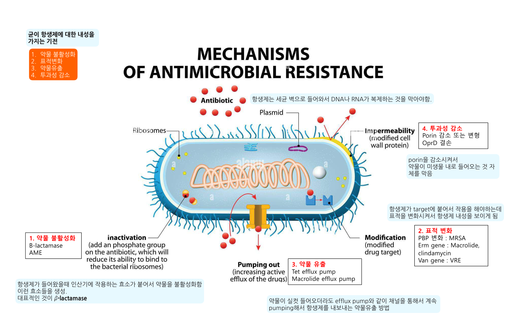{: style="width:80%"}

| 기전 | 내용 | 예 |
|---|---|---|
| 1. **약물 불활성화** | 들어온 약에 효소가 붙어(인산기 등) 약을 망가뜨림 | **β-lactamase**, aminoglycoside 변형효소(AME) |
| 2. **표적 변화** | 약이 붙어야 할 자리를 바꿈 | **PBP 변화 → MRSA**, *erm* 유전자(macrolide·clindamycin), *van* 유전자(**VRE**) |
| 3. **약물 유출** | 들어온 약을 efflux pump로 계속 퍼냄 | tetracycline(Tet)·macrolide efflux pump |
| 4. **투과성 감소** | porin을 줄이거나 바꿔 애초에 못 들어오게 | porin 감소·변형, **OprD 결손**(녹농균의 carbapenem 내성) |

!!! exam "기출 포인트"
    2021년(2부 34번, 주관식): MRSA는 SCCmec의 *mecA*가 친화성이 낮은 **PBP2a**를 만들어 methicillin에 내성(= 표적 변화), 지역사회 MRSA의 SCCmec은 대부분 **IV형**.

## 내성에 대한 대비 = 적절한 사용
"내성균이 나오면 새 항생제를 만들면 되지 않나?" → **어렵다**. 신약보다 내성이 빨리 생긴다. 그래서 **항생제를 적절하게 쓰는 것**이 내성을 줄이는 방법이다 — 간단한 감염에는 거기에 맞는 **최소한의 항생제**를 써서 균이 내성을 얻을 기회를 줄인다.

# 2. 항생제 사용 원칙

## 선택과 사용의 10단계
1. 임상 소견상 **항생제가 필요한가?** — 이것이 진짜 세균 감염인가?
2. 투여 **전에** 적절한 검체로 **배양**했는가? — 원인균을 찾으려는 노력.
3. 가장 가능성 있는 **원인균**은? (각론에서)
4. 그 균에 가장 좋은 항생제는? — 스펙트럼.
5. **병용**이 필요한가? — 한 개냐 두 개냐.
6. **환자 쪽**에서 고려할 것은?
7. 투여 **경로**는?
8. 적절한 **용량**은?
9. 배양 결과 후 **변경**이 필요한가?
10. **기간**은?

올해 슬라이드는 1–7번을 빨간 테두리로 묶고 1·2번을 굵게 강조했다.

!!! exam "기출 포인트"
    2022년(2부 26번)·2021년(2부 29번) 같은 문제: "항생제 선택 시 **가장 중요한** 질문" = **가장 가능성 있는 원인균은 무엇인가**. 경로·병용·기간은 그다음, "보험 처방이 가능한가"는 함정.

## Start smart — then focus
예전에는 병력청취·신체진찰밖에 없어 확신이 없으니 **가능성 있는 균을 다 덮는 약**을 썼다(경험적 치료). 이제는 검체에서 균을 배양하고 **감수성 결과**를 확인하면 쓸 항생제의 범위가 좁아진다: ① empiric therapy(예상 원인균·지역 내성 자료) → ② targeted therapy(균 동정) → ③ susceptibility-guided therapy(감수성 결과). 넓게 시작해서 좁혀 간다.

## 사용 목적에 따른 분류

{: style="width:80%"}

| 분류 | 언제 | 예 |
|---|---|---|
| **예방적(prophylactic)** | 감염 없음, **고위험**군 | 수술 전 예방 항생제(수술 전 피부를 닦고 항생제를 줬더니 수술 후 감염이 획기적으로 줄었다) |
| **선제적(pre-emptive)** | 고위험군(조혈모세포·신장이식 후 면역억제제)에서 증상 전 **surrogate marker**가 오를 때 | 피검사·배양에서 **바이러스 수치**가 일정 수준 이상 오르면 투여(예: CMV) |
| **경험적(empirical)** | 감염은 확인, 원인균 모름 | 열·옆구리 통증·농뇨 → 요로감염으로 보고 투여 |
| **확정적(definite)·선택적(selective)** | 배양으로 균 확인 후 | 그 균을 겨냥한 약 |

경계선(빨간 선)은 **감염(infection)**: 그 앞이 예방적·선제적, 그 뒤가 경험적·확정적이다.

## 수술 전 예방적 항생제 ★ (사과 — 해마다 기출)

{: style="width:78%"}

- **적응증**: **clean-contaminated** 수술(필기: "clean이 아닌 clean-contaminated!" — 예: 맹장처럼 균이 있는 장기를 여는 수술), **인공물·임플란트**(인공관절) 수술, **고위험군**(면역저하, 판막질환 등). 깨끗한 clean 수술은 원칙적으로 쓰지 않는다.
- **원칙**: 수술 후 **24시간 이내** 사용, **단일 약제**.
- **권장 약제**: 피부 절개 때 **피부 상재균**이 들어가 감염을 일으킬 가능성이 높으므로 피부균을 죽이는 약 →
    - **cefazolin(1세대 세팔로스포린)**
    - 혐기균 고려(복강 내 혐기균 노출 가능): **cefamycin 계열**(cefminox, cefotetan 등)
    - penicillin 계열: amp/sulbactam, amox/clavulanate
    - **β-lactam 알레르기: clindamycin IV**
- **시기**: **절개 30–60분 이내** 투여 → 수술 중 혈중·조직 농도 확보(너무 일찍 주면 떨어진다).
- **한계**: 균교대감염(superinfection), 독성·알레르기, 내성균, 비용 증가, **잘못된 안도감**.
- 필기: "수술 전 1시간에 투여, 수술 후 24시간 이내 사용" — 치료의 기본 김혜진 교수님 수업의 핵심이기도 했다. 올해도 강조했고 작년에도 기출에 나왔다.
- Harrison 표(필기본 20쪽, 수술 종류별 약)는 "다 외우긴 어렵다, **대원칙**(앞 페이지)을 기억하라".

!!! exam "기출 포인트"
    거의 매년 1문항. 2025년(2부 1번): 옳은 것 = **β-lactam 알레르기면 clindamycin**. 함정 — "72시간 유지"(→ 24시간 이내), "절개 후 투여해도 충분"(→ 절개 전), "clean 수술은 무조건"(→ 아님), "복합요법으로 광범위하게"(→ 단일 약제). 2023년(2부 16번): 틀린 것 = "심장 수술처럼 위험한 수술은 **3세대**가 더 효과적" — 권장은 1세대 cefazolin. 시점은 2022년(2부 22번)·2022년(2부 27번, 유방절제술) 모두 **피부 절개 30분 안**. 약 선택은 2021년(2부 31번) 대장암 수술 = **cefoxitin**(cefamycin, 혐기균), 2020년(2부 37번) 무릎관절 치환술 = **cefazolin**.

## 감염 치료에서 고려할 3요소
감염(infection)을 가운데 두고 **원인균(pathogen) – 항생제(antibiotics) – 숙주(host)**를 모두 본다. 강의도 이 순서로 진행한다.

### Pathogen — 대표 원인균과 지역 감수성
- 감염 부위마다 대표 원인균을 예측하고 약을 고른다(뇌수막염·중이염·폐렴·요로감염… 각론에서). 폐렴도 **지역사회 획득균**이냐 **병원 내 감염균**이냐에 따라 다르다.
- **Local antimicrobial susceptibility**: 지역사회 발생 요로감염 *E. coli*의 감수성 추이(2008–2017, 국내 3차 병원) — 파란선 = 지역사회 감염, 빨간선 = 병원 내(의료관련) 감염. **병원에서 획득된 균이 지역사회 균보다 감수성이 낮고**, 같은 균이라도 지역·나라마다 내성 정도가 다르다. 그래서 "원인균이 어디서 획득되었나, 어떤 약에 감수성이 떨어져 있을까"를 고민해야 한다.

!!! memo "암기 — 교수님: 수업이 끝날 때 이 표 정도는 알고 있어야"
    아래 감수성 개요표(필기본 24쪽)는 이 수업 전체의 요약이다. 열(균)마다 어떤 약 막대가 덮는지 보자.

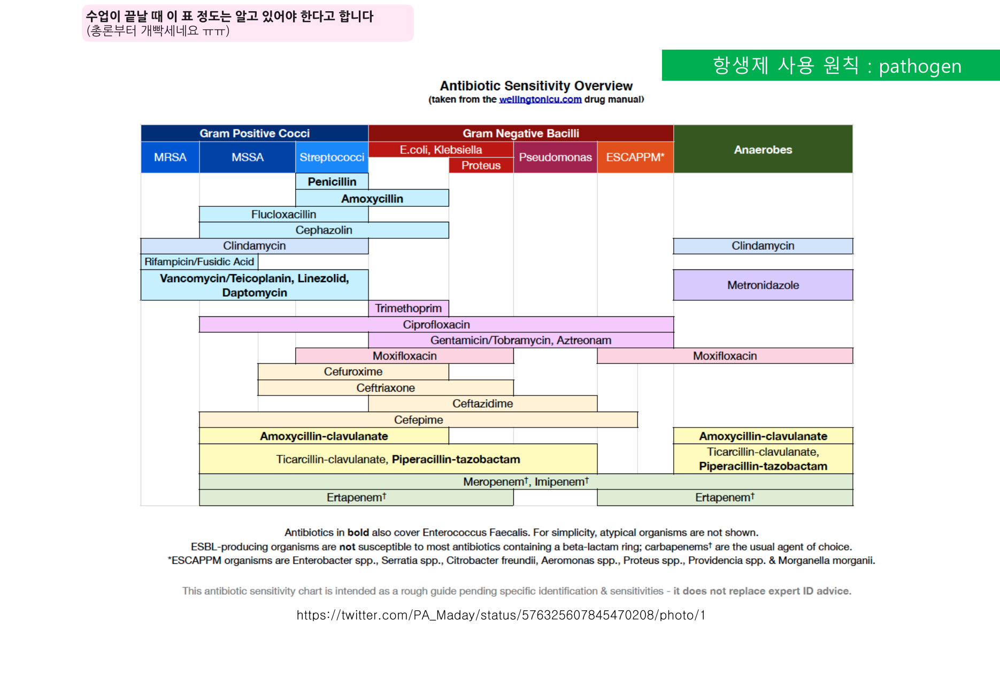{: style="width:88%"}

표 읽기(균 → 듣는 약):

| 균 | 듣는 약(표의 막대) |
|---|---|
| **MRSA** | clindamycin, rifampicin/fusidic acid(병용), **vancomycin/teicoplanin, linezolid, daptomycin** |
| MSSA | + flucloxacillin, cefazolin, amox/clav, pip/tazo, carbapenem, cefepime, moxifloxacin, ciprofloxacin |
| 연쇄구균 | penicillin, amoxicillin, cefazolin, ceftriaxone, cefuroxime, moxifloxacin 등 |
| *E. coli*·*Klebsiella*·*Proteus* | amoxicillin(일부), cefazolin(일부), trimethoprim, ciprofloxacin, gentamicin/tobramycin, aztreonam, 2·3·4세대 세팔로스포린, 억제제 복합제, carbapenem |
| **녹농균** | **ciprofloxacin, gentamicin/tobramycin, aztreonam, ceftazidime, cefepime, pip/tazo(ticarcillin/clav), meropenem·imipenem** — **ertapenem은 빠짐** |
| ESCAPPM(*Enterobacter, Serratia, Citrobacter, Aeromonas, Proteus, Providencia, Morganella*) | ciprofloxacin, AG, aztreonam, moxifloxacin, cefepime, carbapenem |
| **혐기균** | **clindamycin, metronidazole**, moxifloxacin, amox/clav, pip/tazo, carbapenem |

표 아래 주석: 굵은 글씨 약(penicillin, amoxicillin, vancomycin/teicoplanin·linezolid·daptomycin, amox/clav, pip/tazo)은 ***E. faecalis*도 덮는다**. **ESBL 생성균은 β-lactam 고리 약 대부분에 내성이고 carbapenem이 보통 선택약**이다.

!!! new "올해 필기에서 추가"
    필야가 1학년 병원체학 시간표에 균마다 **그람양성/음성**을 붙여 정리했다(필기본 25쪽): 포도알균·사슬알균·장알균·리스테리아·코리네박테리움·노카르디아·바실루스·클로스트리디움 = G(+), 나이세리아·장내세균과·비브리오·캄필로박터·헬리코박터·슈도모나스·헤모필루스·보르데텔라·프란시셀라·브루셀라·레지오넬라·클라미디아 = G(−), 트레포네마·보렐리아·렙토스피라 = G(−) 스피로헤타, 미코박테리움 = 항산성균, 미코플라스마 = 세포벽 없음, 리케치아 = G(−), 아포비형성 무산소균 = G(+)/G(−) 혼재. 포도알균은 coagulase (+) = *S. aureus*, 나머지(*S. epidermidis* 등)는 (−). **녹농균이 계속 나오는 이유 = 대표적인 병원 내성균이라 잘 안 죽기 때문**.

!!! exam "기출 포인트"
    2023년(2부 19번): 혈관 내 카테터 관련 균혈증의 가장 흔한 원인 = **응고효소음성 포도알균(CoNS)**(피부 상재균). 다른 수업 내용이지만 이 수업으로 분류돼 있다.

### Antibiotics — 고려할 것
- **항균 스펙트럼**: 어디까지 덮나.
- **표적 부위 농도**: 뇌–혈관장벽(BBB), **전립선, 안구, 심내막** — 이런 곳에 균이 있으면 같은 약을 줘도 혈중 농도가 조직까지 가며 떨어진다.
- **약동학/약력학, 용량, 경구 생체이용률(bioavailability), 단백결합**.
- **세포 내 침투**: *Legionella*, *Chlamydia*처럼 대식세포 안에 사는 **세포 내 균(intracellular organism)**은 약이 세포 안까지 들어가야 한다.
- **투여 경로·방법**(경구/주사), **병용 효과**(synergistic/antagonistic/indifference), **살균(bactericidal) vs 정균(bacteriostatic)** — 정균 = 죽이지는 못하지만 더 자라지 못하게 함, tolerance, **항생제 후 효과(postantibiotic effect)**, **부작용·금기**, **비용**, **순응도**.

!!! exam "기출 포인트"
    경구 생체이용률은 2023·2024년 연속 출제. 2023년(2부 14번) 정답 = **metronidazole**, 2024년(2부 11번) 정답 = **levofloxacin**. 둘 다 거의 100% 흡수되는 약이고, 오답은 cefuroxime·cefixime·ampicillin·amox/clav·erythromycin처럼 흡수가 낮은 경구 β-lactam·macrolide다. 올해 필기도 FQ에 "**경구 생체이용률과 bone penetration이 매우 좋다**"고 적었다(7장).

### 약동학(PK)·약력학(PD)
- 항생제·세균·사람의 삼각관계: 약 → 균 = **약력학**(효과), 균 → 약 = **내성**, 약 → 사람 = **독성**, 사람 → 약 = **약동학**(사람마다 체적·신장·간 기능이 달라 농도가 달라진다), 균 ↔ 사람 = **감염**과 **숙주 방어**(백혈구, 사이토카인).
- **약동학(pharmacokinetics)**: 약이 투여된 뒤 **ADME**(흡수 Absorption·분포 Distribution·대사 Metabolism·배설 Excretion)를 거쳐 감염 부위·혈중·조직에 **농도**가 어떻게 되는가 — concentration ~ time. 위장관에서 흡수 → 혈액으로 분포 → 각 조직에서 대사 → 담즙·소변으로 배설되며 농도가 정해진다.
- **약력학(pharmacodynamics)**: 감염 부위에 들어간 약이 균에 실제로 무엇을 하는가 — 균 수가 줄고 임상적으로 좋아지는지/실패하는지/사망하는지, effect ~ log(dose).

### MIC와 MBC

{: style="width:76%"}

- **MIC(minimum inhibitory concentration, 최소억제농도)**: 균이 **더 이상 자라지 못하게** 만드는 최소 농도 → **감수성(S)·중간(I)·내성(R)**을 정한다. 측정: 배양액에 균을 넣고 항생제 농도를 올려 가며 넣는다 → 어느 농도부터 눈에 보이게 자라지 않는다 = MIC(그림에서 2 µg/mL).
- **MBC(minimum bactericidal concentration, 최소살균농도)**: 균을 **실제로 죽이는**(99.9% 이상) 최소 농도. 맑아 보이는 튜브들을 배지에 다시 심으면 **자라는 것과 안 자라는 것이 나뉜다** — 눈에 안 보여도 살아 있던 것. 실제로 안 자라는 최소 농도 = MBC(그림에서 3 µg/mL).
- **해석**: MIC와 MBC가 **거의 같으면 살균제(bactericidal)**, **차이가 크면 정균제(bacteriostatic)** — 정균제는 MIC 농도에서 균이 "자라지 못할 뿐 죽지 않은" 상태이기 때문.

### PK/PD 지표 ★ (사과)

{: style="width:74%"}

| 지표 | 뜻 | 대표 약 | 투여 전략 |
|---|---|---|---|
| **Cmax/MIC** | 최고 농도가 MIC보다 높을수록 | **aminoglycoside, fluoroquinolone** | 한 번에 최고 농도로(하루 1회) |
| **AUC/MIC** | 하루 총 노출량 | **vancomycin**, azithromycin, **fluoroquinolone**, aminoglycoside, tigecycline, linezolid | 총량 |
| **T>MIC** | MIC 위에 머무는 시간 | **β-lactam**, vancomycin, macrolide, clindamycin | 하루 양을 **여러 번 쪼개서** 자주 |

필야: "계열만 외울 게 아니라 그 계열의 약 이름을 다 외워야 풀 수 있네요" — 보기에 계열 대신 약 이름(ceftriaxone, gentamicin, amikacin, tobramycin, meropenem…)이 나온다.

!!! exam "기출 포인트"
    2025년(2부 3번): T>MIC = **ceftriaxone**(β-lactam). 2022년(2부 20번): 약력학 패턴이 다른 것 = **tobramycin**(AG, 나머지 ceftriaxone·meropenem·ampicillin·pip/tazo는 T>MIC). 2021년(2부 30번): T>MIC가 **아닌** 것 = **amikacin**. → "보기에서 aminoglycoside를 골라내기"가 반복된다.

### 자연내성(intrinsic resistance) ★ (사과)
"태어날 때부터 내성" — 안 듣는 조합에 쓰면 안 된다. 교수님은 노란 밑줄 부분을 읽고 넘어갔다.

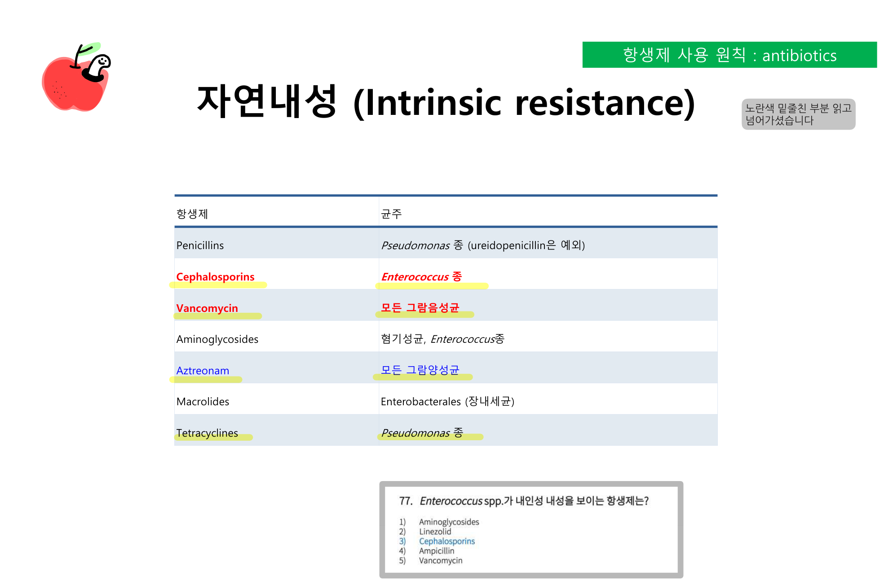{: style="width:66%"}

| 항생제 | 자연내성 균 |
|---|---|
| Penicillins | *Pseudomonas* (ureidopenicillin = piperacillin 계열은 예외) |
| **Cephalosporins** | ***Enterococcus*** |
| **Vancomycin** | **모든 그람음성균** |
| Aminoglycosides | **혐기균**, *Enterococcus* |
| **Aztreonam** | **모든 그람양성균** |
| Macrolides | 장내세균(Enterobacterales) |
| **Tetracyclines** | ***Pseudomonas*** |

!!! exam "기출 포인트"
    "**세팔로스포린 – 장구균**"이 2025년(2부 2번), 2023년(2부 15번, *E. faecium*), 2020년(2부 36번, cefamycin인 cefminox에 안 듣는 균 = *E. faecium*)으로 세 번. 2022년(2부 21번): 그람음성균에 효과가 가장 없는 약 = **vancomycin**(분자가 커서 외막 porin을 못 지난다).

### 병용요법(combination therapy)
원칙은 **항생제 하나**. 간혹 두 개를 쓰는 경우가 아래다.

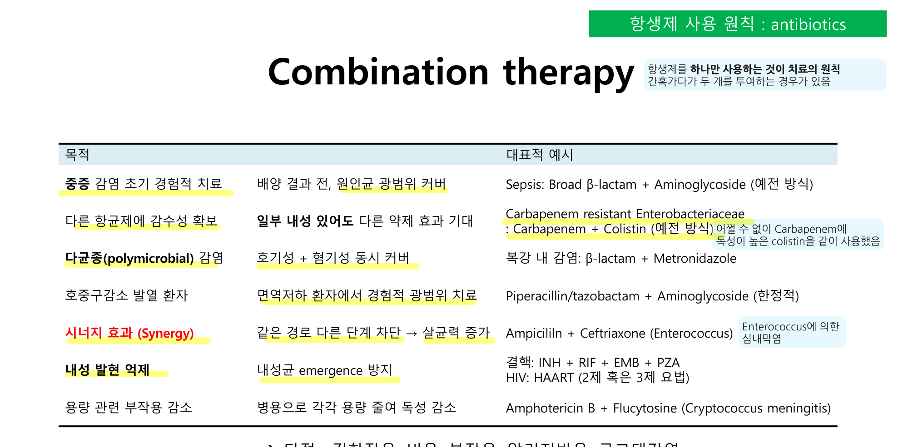{: style="width:80%"}

| 목적 | 내용 | 대표 예 |
|---|---|---|
| 중증 감염 초기 경험적 치료 | 배양 전 원인균을 넓게 | 패혈증: broad β-lactam + aminoglycoside **(예전 방식)** |
| 다른 약에 감수성 확보 | 일부 내성이 있어도 다른 약 효과 기대 | CRE: carbapenem + colistin **(예전 방식)** — 어쩔 수 없이 독성이 높은 colistin을 같이 썼다 |
| 다균종(polymicrobial) 감염 | 호기성 + 혐기성 동시 | 복강 내 감염: β-lactam + **metronidazole** |
| 호중구감소 발열 | 면역저하 환자에서 경험적 광범위 | pip/tazo + aminoglycoside **(한정적)** |
| **시너지(synergy)** | 같은 경로의 다른 단계를 막아 살균력 증가 | **ampicillin + ceftriaxone (*Enterococcus* 심내막염)** |
| 내성 발현 억제 | 내성균 출현 방지 | 결핵 INH + RIF + EMB + PZA, HIV HAART(2제 혹은 3제) |
| 용량 관련 부작용 감소 | 각 용량을 줄여 독성 감소 | amphotericin B + flucytosine (크립토콕쿠스 수막염) |

단점: **길항**, 비용, 부작용, 알레르기, **균교대감염**.

!!! diff "작년 필기와 다른 점"
    - 시너지 예: 작년 **β-lactam + aminoglycoside (Enterococcus)** → 올해 **ampicillin + ceftriaxone (Enterococcus)**. 이유는 6장 aminoglycoside 필기: "예전에는 시너지 때문에 penicillin과 함께 심내막염에 썼지만 **신독성 때문에 매뉴얼이 바뀌어** 지금은 잘 병용하지 않는다."
    - 패혈증 β-lactam + AG, CRE의 carbapenem + colistin에 올해는 「**예전 방식**」, 호중구감소 발열의 pip/tazo + AG에 「**한정적**」이 붙었다.
    - HIV HAART: 작년 「3제 요법」 → 올해 「**2제 혹은 3제**」.
    - 작년에는 원칙으로 "기전이 같은 약끼리는 병용하지 않는다(상승효과도 기전이 달라서 생긴다)"를 여기서 말했다 — 올해는 "그 외 주의사항"에 있다.

### 시너지·길항 그래프 (필기본 35쪽)
세 그래프 모두 항생제가 없을 때(보라)는 균이 계속 자란다. **A 무관(indifference)**: 1번을 더해도 2번의 살균이 그대로. **B 시너지**: 1번을 억제 농도 이하로만 더해도 2번 단독보다 **훨씬 많이** 죽인다(예: 심내막염의 ampicillin + ceftriaxone). **C 길항(antagonism)**: 같이 썼더니 2번 단독보다 덜 죽인다 — "두 개를 같이 쓰니 역효과".

### 살균 vs 정균

{: style="width:76%"}

| 구분 | 약 | 반드시 살균제가 필요한 경우 |
|---|---|---|
| **살균**(MIC ≈ MBC) | penicillin, cephalosporin, **aminoglycoside**, vancomycin, fluoroquinolone, rifampin, metronidazole, bacitracin | **면역억제자**, **화상**, **카테터 관련 감염**, **만성질환자·임부**, **심내막염** — 균을 빨리 죽여야 할 때 |
| **정균**(MIC와 MBC 차이 큼) | erythromycin, **tetracycline**, sulfonamide, trimethoprim, chloramphenicol, **clindamycin** | |

외우는 요령(필기): **주로 단백 합성을 막는 약**(특히 50S)이 정균이다 — 단, 30S에 붙는 **aminoglycoside는 살균**(예외).

!!! exam "기출 포인트"
    2025년(2부 4번): 정균 = **clindamycin**. 나머지(penicillin, cephalosporin, aminoglycoside, FQ)는 모두 살균. 필야: "외우라고 강조한 데서 나오긴 하네요."

### 주사 항생제가 필요할 때
경구제는 위장관에서 흡수되고 간 대사를 거쳐야 하므로(생체이용률) 감염이 심하거나 경구 농도가 모자랄 감염병에서는 주사를 쓴다.
- **중증 감염**(패혈증, 호중구감소 패혈증) — 빠른 혈중 농도 확보.
- **수막염** — BBB 투과가 제한적 → 고농도.
- **심내막염** — 감염 부위 혈류가 적다 → 고농도 **살균제**.
- **골수염** — 뼈 침투가 어렵고 치료가 길다 → 고농도 유지(필기: 초기에 필요).
- **흡수 불량** — 위장관 흡수 장애, 쇼크 → 경구제로는 혈중 농도 도달 불가.

### 그 외 주의사항 — 약물 상호작용
- **작용기전이 같은 항생제 병용은 피한다**(길항이 있지 않은지).
- **제산제·철분 → tetracycline 흡수 장애**.
- β-lactam은 상호작용이 적다는 장점. **fluoroquinolone, macrolide, rifampin**은 상호작용 주의(rifampin은 CYP3A4 유도제).

### 치료 실패 시 고려할 것 ★ (꽃 — 교수님 중요)
사례: 입원 환자가 배가 아파 보니 장염 → 항생제를 실컷 줬는데 다시 열이 나고 염증 수치가 오른다. 왜?
- **약이 닿기 어려운 곳**: **배농 안 된 농양**(농양 자체가 약 침투를 떨어뜨려 조직 농도가 낮다), **이물**, **보호된 부위(CSF, 안구)** → 배농·이물 제거가 필요할 수 있다.
- **혼합 감염**을 다 못 덮음(inadequate coverage), **잘못된 약 선택**, **잘못된 투여 간격·용량 부족**.
- **균교대감염(superinfection)**.
- **떨어졌던 열이 다시 날 때** 두 가지를 먼저: **병원 내 감염**(입원 중 새 원내 감염 → 내성균 가능성), **약열(drug fever)**(과민반응 — 항생제 실패가 아니라 부작용).
- **오진**: 감염이 아닌 염증성 질환, 세균이 아닌 감염(바이러스), 세균이라도 **독소 매개 질환**(항생제 효과 없음).
- 동반된 비감염 질환, 심한 면역 저하, **치료 중 내성 출현**.

!!! exam "기출 포인트"
    2021년(2부 33번): ceftriaxone + azithromycin 7일째 폐렴은 좋아지는데 **발진·발열·호산구 증가** → **약열**, 동반될 수 있는 소견 = **백혈구 감소증**. 48시간 주기 발열(말라리아), ferritin 증가는 함정.

### 항생제 부작용 ★ (꽃 — 교수님이 밑줄 친 부분을 다 읽음)

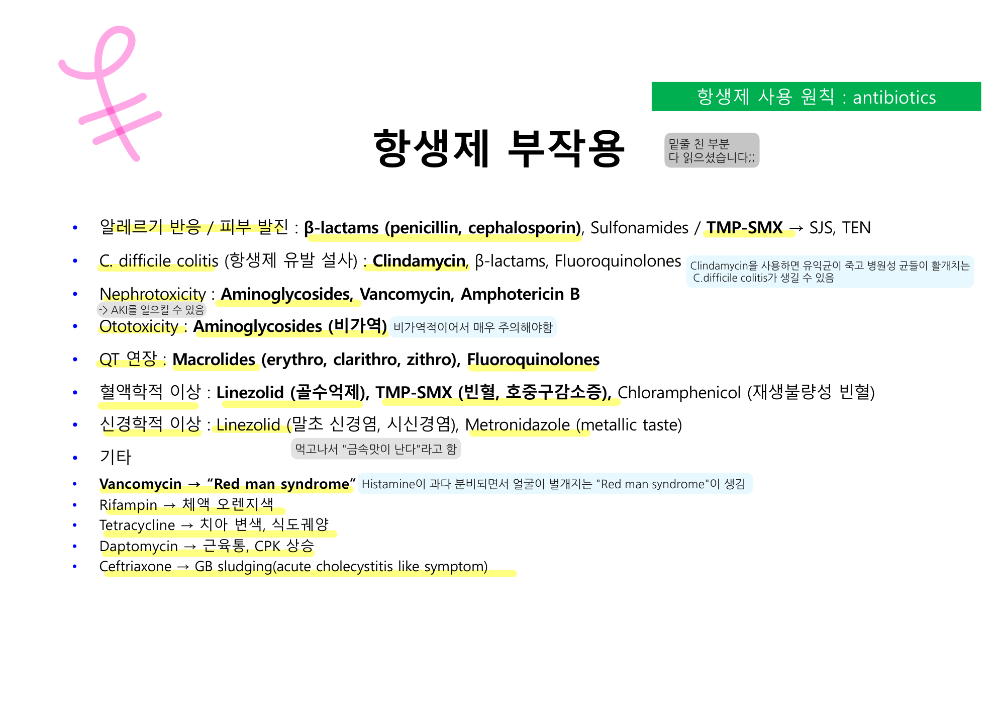{: style="width:76%"}

| 부작용 | 약 |
|---|---|
| 알레르기·피부 발진 | **β-lactam**(penicillin, cephalosporin), sulfonamide / **TMP-SMX → SJS, TEN** |
| ***C. difficile* 장염**(항생제 유발 설사) | **clindamycin**(유익균이 죽고 병원균이 활개), β-lactam, fluoroquinolone |
| 신독성(→ AKI) | **aminoglycoside, vancomycin**, amphotericin B |
| **이독성(비가역)** | **aminoglycoside** — 비가역이라 매우 주의 |
| QT 연장 | **macrolide**(erythro, clarithro, azithro), **fluoroquinolone** |
| 혈액 이상 | **linezolid(골수억제)**, **TMP-SMX(빈혈·호중구감소)**, chloramphenicol(재생불량빈혈) |
| 신경 이상 | **linezolid**(말초신경염·시신경염), **metronidazole(금속 맛)** |
| 기타 | vancomycin **red man syndrome**, rifampin **체액 오렌지색**, tetracycline **치아 변색·식도궤양**, daptomycin **근육통·CPK 상승**, ceftriaxone **담낭 슬러지(GB sludging — 급성 담낭염 비슷한 증상)** |

- **Red man syndrome**(vancomycin): 투여 후 **과립구에서 히스타민이 과다 분비**되어 얼굴·상체가 벌개진다. **아나필락시스가 아니라 아나필락시스 유사(anaphylactoid) 반응**. 첫 투여 때 너무 빨리 주면 생기고 속도를 늦추면 좋아진다.
- **퇴원 시 받은 항생제의 drug rash**: β-lactam·TMP/SMX가 흔하지만, 그 외 모든 항생제도 과민반응으로 발진을 일으킬 수 있다.

!!! exam "기출 포인트"
    aminoglycoside 부작용은 해마다 나온다. 2025년(2부 5번) 패혈증 치료 1주 후 **청력 저하** → aminoglycoside, 2024년(2부 8번) 주요 부작용 → **신독성과 이독성**, 2023년(2부 18번) 2주 투여 후 **영구적 평형장애**(소송 중) → gentamicin, 2022년(2부 23번) 뇌신경 장애·신독성 → gentamicin, 2022년(2부 24번) 2주 주사 후 **신기능 악화** → aminoglycoside.

### Host — 숙주 요인
- **감염 부위**: 추정 원인균, 필요한 치료 기간.
- **이물·조직 상태**: 이물질, 괴사 조직, 농양이 있는가.
- **면역 상태**: 호중구감소, 면역억제제.
- **장기 기능**: 신·간 기능 → **용량 조절**(대사에 문제가 생기거나 부작용이 커지지 않는가).
- **임신·수유**: 태아·신생아 안전성.
- **알레르기 병력**: 약 선택을 제한하는 요인.

!!! exam "기출 포인트"
    2020년(2부 38번): MSSA 균혈증 + **creatinine 2.5 mg/dL** → 선택하기 가장 어려운 약 = **amikacin**(신독성). 신기능(host)과 약 부작용을 함께 묻는 유형.

### 임신 중 주의할 항생제 ★

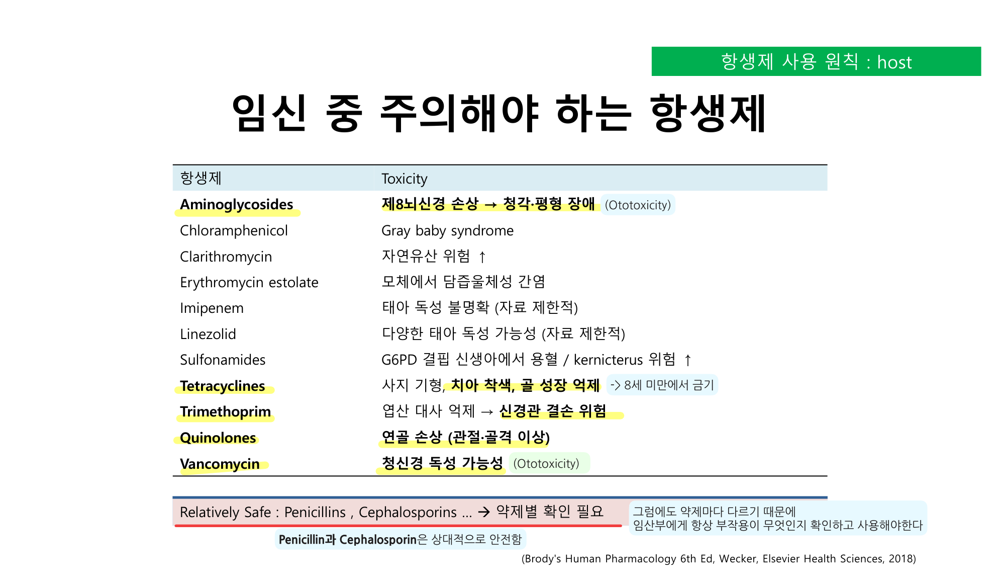{: style="width:72%"}

| 약 | 태아·모체 독성 |
|---|---|
| **Aminoglycosides** | **제8뇌신경 손상 → 청각·평형 장애**(ototoxicity) |
| Chloramphenicol | **gray baby syndrome** |
| Clarithromycin | 자연유산 위험 ↑ |
| Erythromycin estolate | 모체 담즙울체성 간염 |
| Imipenem | 태아 독성 불명확(자료 제한적) |
| Linezolid | 다양한 태아 독성 가능성(자료 제한적) |
| Sulfonamides | G6PD 결핍 신생아 용혈 / **핵황달(kernicterus)** ↑ |
| **Tetracyclines** | 사지 기형, **치아 착색, 골 성장 억제** → **8세 미만 금기** |
| **Trimethoprim** | 엽산 대사 억제 → **신경관 결손** |
| **Quinolones** | **연골 손상**(관절·골격 이상) |
| **Vancomycin** | **청신경 독성** 가능성(ototoxicity) |

**비교적 안전: penicillin, cephalosporin** — 그래도 약마다 다르니 임부에게는 늘 부작용을 확인하고 쓴다.

!!! diff "작년 필기와 다른 점"
    작년 필기에는 "비교적 안전 / 주의(TMP-SMX, metronidazole, aminoglycoside) / 비교적 금기(tetracycline, erythromycin estolate, fluoroquinolone, chloramphenicol)" 3칸 표도 있었다. 올해는 위 표 하나와 "Relatively safe: penicillins, cephalosporins…"만 있다. metronidazole은 올해도 8장 슬라이드에 "임신(특히 1삼분기) 상대적 금기"로 남아 있다.

!!! exam "기출 포인트"
    2024년(2부 9번): 임신 중 가장 안전 = **ceftriaxone**. tetracycline, chloramphenicol, fluoroquinolone, streptomycin(AG)은 금기·주의.

# 3. 항생제 계열 — 작용 부위로 나누기

필기: 「항생제 개별로 들어가기에 앞서.. **여기서부터 좀 빡입니다**」. 먼저 전체 스펙트럼 막대그림(필기본 47쪽, VRE·MRSA·그람양성·음성·녹농균·혐기균·비정형균 열)으로 한눈에 보고, 작용 부위 그림으로 계열을 나눈다. 교수님은 작용 부위 그림을 쭉 읽었다.

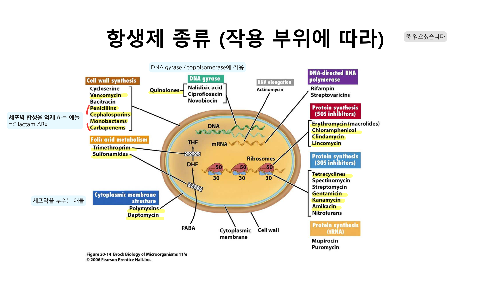{: style="width:80%"}

| 작용 부위 | 약 |
|---|---|
| **세포벽 합성** | **β-lactam(penicillin, cephalosporin, monobactam, carbapenem)**, vancomycin, bacitracin, cycloserine |
| **세포막** 파괴 | polymyxin(**colistin**), **daptomycin** |
| 단백 합성 **50S** | **macrolide**(erythromycin), **chloramphenicol, clindamycin**, lincomycin (+ linezolid) |
| 단백 합성 **30S** | **tetracycline**, spectinomycin, **aminoglycoside**(streptomycin, gentamicin, kanamycin, amikacin), nitrofurans |
| 단백 합성(tRNA) | **mupirocin**, puromycin |
| **DNA gyrase / topoisomerase** | **quinolone**(nalidixic acid, ciprofloxacin), novobiocin |
| DNA 의존 **RNA 중합효소** | **rifampin** |
| **엽산 대사** | **trimethoprim, sulfonamide** |

!!! exam "기출 포인트"
    2024년(2부 7번): β-lactam의 작용기전 = **세포벽 합성 억제**. 오답은 단백 합성(AG·macrolide), DNA gyrase(FQ), 엽산(TMP-SMX), RNA 합성(rifampin) — 위 표의 짝을 그대로 묻는다.

# 4. β-lactam 계열

## 공통점 — β-lactam 고리와 세포벽
- penicillin, cephalosporin, monobactam, carbapenem은 모두 **β-lactam 고리**를 가진다. **가장 많이 쓰는 항생제**이고 **세포벽 합성을 억제**한다.
- 세균은 **β-lactamase**로 이 고리를 끊어 내성을 얻고(약물 불활성화), 사람은 그 효소를 막는 **억제제(clavulanate, sulbactam, tazobactam)**를 붙여 맞섰다. 이름의 슬래시 뒤가 억제제다(piperacillin/**tazobactam**).

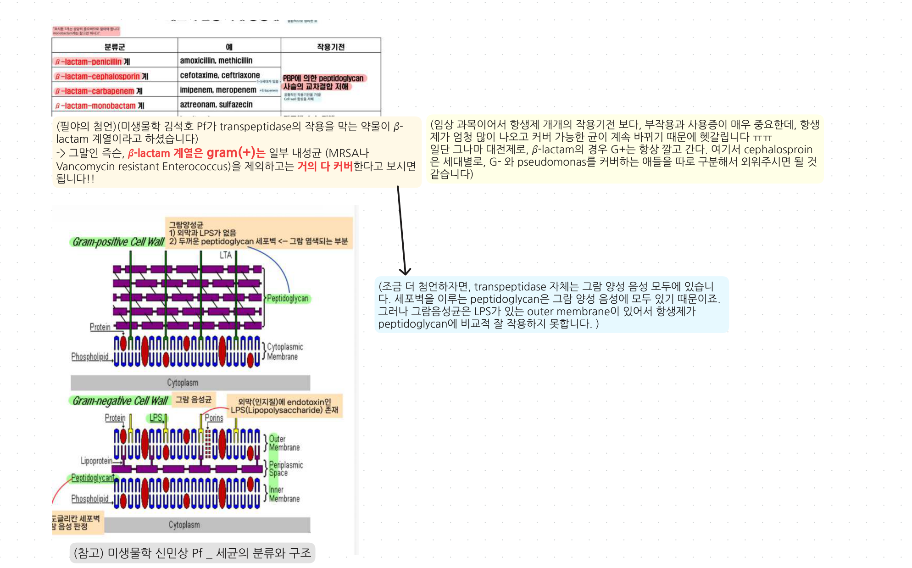{: style="width:84%"}

필야의 첨언(49쪽 보충본 기준):
- 미생물학 김석호 교수님: **transpeptidase(= PBP)의 작용을 막는 약물이 β-lactam** — PBP에 의한 펩티도글리칸 사슬 **교차결합을 저해**한다.
- 그래서 **β-lactam은 그람양성균을 일부 내성균(MRSA, vancomycin-resistant *Enterococcus*)을 빼면 거의 다 덮는다**고 보면 된다. 대전제: **β-lactam은 G(+)를 깔고 간다.** 여기서 세팔로스포린은 세대별로 **G(−)와 녹농균을 덮는 약**을 따로 구분해 외운다.
- 더 첨언: transpeptidase 자체는 **그람양성·음성 모두**에 있다(펩티도글리칸은 둘 다 있으니까). 그러나 그람음성균은 **LPS가 있는 외막(outer membrane)**이 있어 약이 펩티도글리칸에 비교적 잘 닿지 못한다. 그림: 그람양성 = 외막·LPS 없음, 두꺼운 펩티도글리칸(그람 염색되는 부분) / 그람음성 = 외막(인지질)에 내독소인 LPS, porin, 얇은 펩티도글리칸과 주변세포질 공간.
- 임상 과목이라 개별 작용기전보다 **부작용과 사용처**가 훨씬 중요하다.

!!! diff "작년 필기와 다른 점"
    올해 본 필기본 49쪽에는 괄호 안이 "(MRSA나 cephalosporin에 내성을 가지는 enterobacterales)"로 적혀 있었는데, 보충본에서 **"(MRSA나 Vancomycin resistant Enterococcus)"**로 고쳤다. 이 학습자료는 보충본을 따른다. (덧붙여: 장구균은 그 자체로 세팔로스포린 자연내성이니 "β-lactam이 G(+)를 다 덮는다"에서 **세팔로스포린–장구균**은 늘 예외다.)

## Penicillins
교수님: "이 페이지(필기본 50쪽, β-lactamase 감수성/저항성으로 나눈 표) 말고 **다음 페이지**를 보라" — 그래서 50쪽은 X 표시돼 있다.

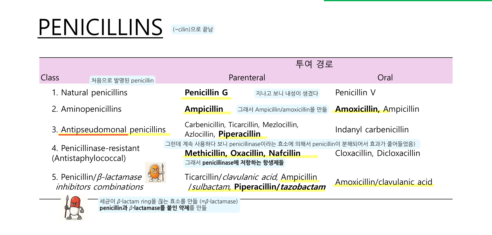{: style="width:76%"}

| 분류 | 주사 | 경구 | 왜 생겼나 |
|---|---|---|---|
| 1. **Natural** penicillins | **penicillin G** | penicillin V | 처음 발명된 penicillin |
| 2. **Amino**penicillins | **ampicillin** | **amoxicillin**, ampicillin | 내성이 생겨 범위를 넓힘 |
| 3. **Antipseudomonal** penicillins | carbenicillin, ticarcillin, mezlocillin, azlocillin, **piperacillin** | indanyl carbenicillin | 녹농균까지 |
| 4. **Penicillinase-resistant**(antistaphylococcal) | **methicillin, oxacillin, nafcillin** | cloxacillin, dicloxacillin | **penicillinase**에 분해되어 효과가 줄자, 그 효소에 저항하는 약 |
| 5. Penicillin/**β-lactamase inhibitor** 복합 | ticarcillin/clavulanic acid, ampicillin/sulbactam, **piperacillin/tazobactam** | **amoxicillin/clavulanic acid** | 세균이 β-lactam 고리를 끊는 효소를 만들자 억제제를 붙임 |

이름은 대부분 **-cillin**으로 끝난다.

- **1) Penicillin G**: 스피로헤타, 연쇄구균, *Neisseria*, 혐기균(*Bacteroides* 제외)에 효과. DOC — **매독**, 렙토스피라, 연쇄구균·폐렴구균, **방선균증**, 수막구균, 클로스트리듐(가스괴저, 파상풍), 탄저, 구강·치주 감염. **내성 증가** 때문에 필기: "**내성이 많아서 지금은 주로 매독에서만 쓴다**"(밑줄 친 것 정도만 외워라).
- **2) Ampicillin**(ampicillin, amoxicillin): penicillin G 범위 + 일부 **그람음성 막대균(장내세균)**까지 → 넓어서 실제 임상에서 penicillin G 대신 많이 쓴다.
- **3) Penicillinase 저항 penicillin**(nafcillin, oxacillin, methicillin, cloxacillin, dicloxacillin, flucloxacillin — 외우기: "**I Met a Nasty Ox Digesting Clover**"): penicillin을 분해하는 penicillinase에 대항하는 penicillin. **MSSA의 DOC**(전신·깊은 포도알균 감염). 이 약이 듣는 황색포도알균이 **MSSA**(methicillin-susceptible *S. aureus*) — 피부·연조직 감염, 균혈증을 일으킨다.
- **4) 항녹농균 penicillin**: 녹농균·*Acinetobacter*에 효과, 활성은 **piperacillin** > mezlocillin, ticarcillin > carbenicillin. 임상에서는 piperacillin을 많이 쓰고 **단독으로 쓰지 않고** β-lactamase 억제제와 함께(pip/tazo).

!!! diff "작년 필기와 다른 점"
    2023년 시험의 **매독 = benzathine penicillin G** 문제(작년 학습자료 2부 16번)는 정식 분류에서 **30. 성매개 감염** 수업으로 옮겨졌다. 이 수업 2부에는 없지만 내용은 그대로 알아 두자.

## Cephalosporins ★ (사과·꽃)
- 이름의 유래: cephalosporin은 ***Cephalosporium acremonium***(곰팡이)에서, **cephamycin은 *Streptomyces***에서 — 균에서 배출된 물질이라 균 이름을 땄다.
- **Cephamycin은 2세대 바로 옆** → **2세대 세팔로스포린과 커버 범위가 비슷**하다(혐기균까지: cefoxitin, cefotetan, cefmetazole, cefminox).
- 같은 세팔로스포린이어도 세대마다 커버가 다르다. **임상에서는 3세대를 많이 쓴다.**
- 이름으로 세대 구분(교수님이 밑줄 친 이름을 주르륵 다 읽음 — 필야: "다 외우기 힘들면 **접미사**를 외우시길"):

| 세대 | 접미사 규칙 | 예외 | 대표 |
|---|---|---|---|
| 1세대 | CEFA / CEPHA / CEPHRA | | **cefazolin**, cephalexin, cefadroxil |
| 2세대 | CEFO / CEFU | **cefaclor, cefamandole**는 CEFA로 시작해도 2세대 | **cefuroxime**, cefaclor |
| 3세대 | -ONE / -TEN / -IME / -NIR | -IME 중 **cefuroxime(2세대), cefepime(4세대)** 제외 | **ceftriaxone, cefotaxime, ceftazidime**, cefixime, cefdinir, cefditoren |
| 4세대 | -PI- | | **cefepime**, cefpirome |
| 5세대 | Cefta/Cefto -ROL- | | ceftaroline, ceftobiprole (MRSA까지) |

(Mandell 표에는 6번째 칸으로 cephalosporin–β-lactamase 억제 복합제(ceftolozane/tazobactam, ceftazidime/avibactam)와 siderophore cephalosporin(**cefiderocol**)도 있다 — 아래 CRE에서.)

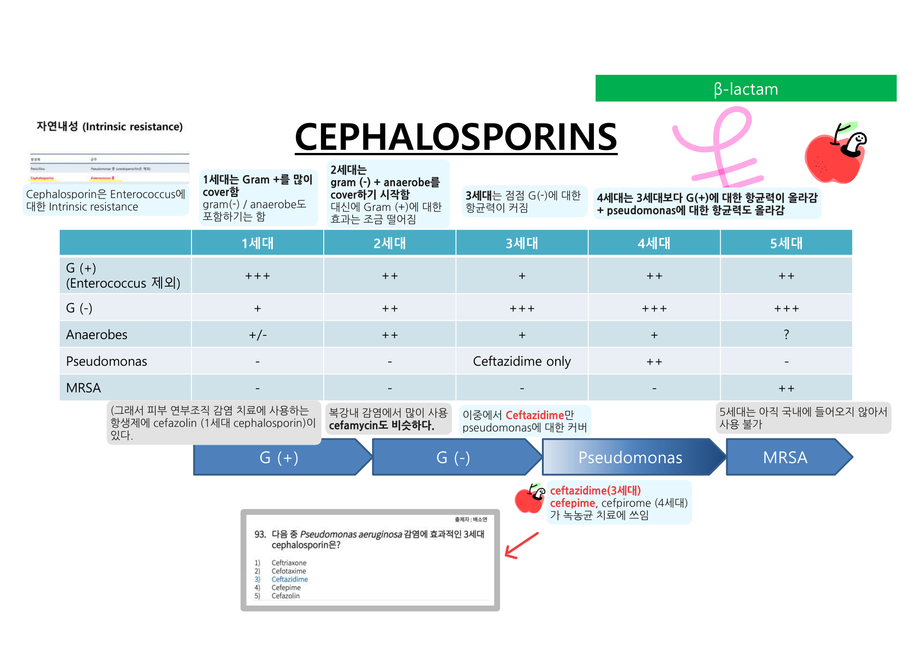{: style="width:78%"}

| | 1세대 | 2세대 | 3세대 | 4세대 | 5세대 |
|---|---|---|---|---|---|
| 그람양성(장구균 제외) | +++ | ++ | + | ++ | ++ |
| 그람음성 | + | ++ | +++ | +++ | +++ |
| 혐기균 | ± | ++ | + | + | ? |
| **녹농균** | − | − | **ceftazidime만** | ++ | − |
| MRSA | − | − | − | − | **++** |

- **1세대**: **그람양성**을 많이 덮고 그람음성·혐기균도 조금 → 그래서 **피부·연부조직 감염** 치료와 **수술 예방**에 cefazolin을 쓴다.
- **2세대**: **그람음성 + 혐기균**을 덮기 시작, 대신 그람양성 효과는 조금 떨어짐 → **복강 내 감염**에 많이 쓰고 cefamycin도 비슷하다.
- **3세대**: 그람음성 항균력이 점점 커짐. 이 중 **ceftazidime만 녹농균**을 덮는다.
- **4세대**: 3세대보다 **그람양성 항균력이 올라가고 + 녹농균 항균력도** 올라감. → 녹농균 치료: **ceftazidime(3세대), cefepime·cefpirome(4세대)**.
- **5세대**: MRSA까지 — 필기: "**아직 국내에 들어오지 않아 사용 불가**".
- 모든 세대가 **장구균에 자연내성**(표 왼쪽 위에 다시 표시).

!!! exam "기출 포인트"
    2025년(2부 6번): 녹농균에 효과적인 **3세대** = **ceftazidime**. cefepime은 녹농균에 듣지만 **4세대**라 함정, ceftriaxone·cefotaxime은 녹농균 ×, cefazolin은 1세대. 2023년(2부 16번): 피부만 = 1세대, 피부 + 장 = 2세대(혐기균) — 수술 예방도 세대 스펙트럼으로 이해하자.

## Monobactam
- **aztreonam**(carumonam도 있지만 "aztreonam 정도만 기억").
- **통성 그람음성 장내 막대균(Enterobacterales) + 녹농균** → **ceftazidime과 비슷한 커버**(G(−) + 녹농균).
- **그람양성·혐기균에는 효과 없음** → 정상 장내세균총 보존.
- **β-lactam 알레르기 환자에게 쓸 수 있다**(교차반응 거의 없음).
- **신기능 이상**이 있을 때 aminoglycoside 대신 흔히 쓴다(필기: aminoglycoside도 monobactam과 비슷한 커버를 보인다).

!!! diff "작년 필기와 다른 점"
    작년 필기에는 "aztreonam **현재 국내 품절**"이라는 말이 있었다. 올해 필기에는 없다.

## ESBL 균주

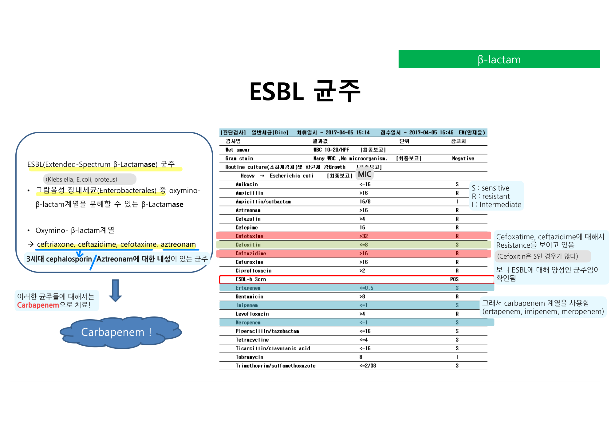{: style="width:80%"}

- **ESBL(extended-spectrum β-lactamase)**: 그람음성 장내세균(*Klebsiella, E. coli, Proteus*) 중 **oxyimino-β-lactam 계열**(**ceftriaxone, ceftazidime, cefotaxime, aztreonam**)을 분해하는 β-lactamase → **3세대 세팔로스포린과 aztreonam에 내성**.
- 이런 균주는 **carbapenem으로 치료**한다.
- 감수성 결과 읽기(57쪽 예): MIC에 따라 S(sensitive)·I(intermediate)·R(resistant). cefotaxime·ceftazidime이 R이고 **ESBL screen POS** → carbapenem(ertapenem, imipenem, meropenem)이 S라서 이를 쓴다. **cefoxitin(cefamycin)은 S인 경우가 많다**.

## Carbapenems
- 종류: **imipenem/cilastatin**(imipenem은 **신장에서 빨리 분해되고 독성**이 있어 늘 cilastatin을 붙여 나온다), **meropenem, doripenem**, (ertapenem).
- **Excellent**: 대부분의 **그람양성·음성·혐기균** — "아주 좋은 항생제다".
    - **제외: MRSA, *E. faecium*, *Stenotrophomonas*** (**ertapenem은 녹농균·*Acinetobacter*도 안 됨**)
- **Not DOC**(특정 감염의 1차 선택 아님) — 다 죽이기 때문에 아껴 쓴다.
- 적응증: **중증 병원 내 감염**, **다제내성균(MDRO) 의심**, **다른 항생제 치료 실패**.
- 한계: 상대적으로 낮은 혈중 농도, 짧은 반감기, **CNS 독성(경련)**, **병원 녹농균의 내성 약 20%**(일부 슈도모나스에 잘 안 듦).
- carbapenem 내성도 생겨서 최근에는 β-lactamase 억제제를 붙인 신약: **meropenem/vaborbactam, imipenem/relebactam**.

!!! exam "기출 포인트"
    2024년(2부 12번): carbapenem의 특징 = **광범위 스펙트럼**. "MRSA에 가장 효과적"은 틀림(MRSA는 carbapenem 예외), "진균에도 효과"도 틀림.

## CRE — 최후의 보루가 뚫렸다
- **CRE(carbapenem-resistant Enterobacterales)**: 장내세균 **목**(Enterobacterales: *E. coli, K. pneumoniae, Enterobacter* 등)인데 carbapenem에 내성. 감수성 결과를 보면 **안 듣는 약이 너무 많다**(ertapenem·imipenem·meropenem 모두 R).

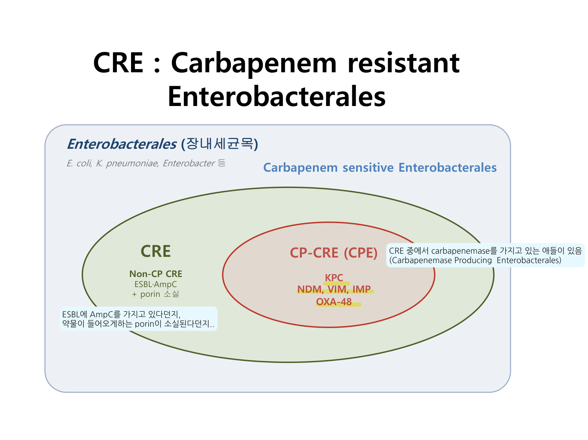{: style="width:66%"}

| | Non-CP CRE | **CP-CRE(= CPE)** |
|---|---|---|
| 기전 | **ESBL·AmpC + porin 소실**(약이 들어오는 문 소실) | **carbapenemase**를 만듦(Carbapenemase-Producing Enterobacterales) |
| 종류 | | **KPC**, **NDM·VIM·IMP**(MBL, 금속 β-lactamase), **OXA-48** |

!!! new "올해 필기에서 추가"
    CRE를 **non-CP CRE와 CPE**로 나누고 carbapenemase 종류(KPC / NDM·VIM·IMP / OXA-48)를 구분하는 그림이 새로 들어왔다. 아래 신약이 "어떤 carbapenemase까지 덮나"로 정리되기 때문이다.

## Cephalosporin/β-lactamase inhibitor
| 약 | 구성 | 커버 |
|---|---|---|
| **Ceftolozane/tazobactam** | 5세대 세팔로스포린 + β-lactamase 억제제 | **다제내성 녹농균**, 일부 CRE |
| **Ceftazidime/avibactam** | 3세대 세팔로스포린 + 새 **non-β-lactam** β-lactamase 억제제 | **CRE(NDM·VIM·IMP 제외)** = 필기: CPE 중 **KPC 정도만** 덮는다(NDM·VIM·IMP는 못 덮음), 녹농균(일부 내성균 포함) |

- 적응증: **복잡성 요로감염**, **복잡성 복강 내 감염(metronidazole 병용)**, **병원·인공호흡기 폐렴(HAP/VAP)**.
- 필기: 일반적으로 잘 쓰지는 않지만, 다제내성 녹농균·CRE처럼 **쓸 약이 없을 때** 쓴다. "이 정도 기억하면 될 것 같다."

## 신약(new drug)
| 약 | 덮는 carbapenemase·균 |
|---|---|
| **Cefiderocol** | **KPC, OXA-48, MBL(NDM, VIM, IMP)** — CPE 전부 |
| Meropenem/vaborbactam | KPC |
| Imipenem/relebactam | KPC |
| Aztreonam-avibactam | KPC, OXA-48, MBL(NDM, VIM, IMP) |
| Sulbactam-durlobactam | **carbapenem 내성 *Acinetobacter baumannii*** |

- 기억할 것: 세균은 살려고 **철을 받아들여야** 하는데, 철이 들어올 때 **cefiderocol이 같이 들어간다**(siderophore — **트로이 목마** 같다). CPE를 전부 덮어 **cefiderocol이 현재 최후의 보루**다.
- **국내에서 쓸 수 있는 것: ceftolozane/tazobactam, ceftazidime/avibactam, cefiderocol.** 나머지는 내년부터 단계적으로 쓸 수 있을 것 같다.

!!! new "올해 필기에서 추가"
    신약 페이지(cefiderocol, aztreonam-avibactam, sulbactam-durlobactam)와 "**cefiderocol = 트로이 목마, 현재 최후의 보루**", "국내 사용 가능 3가지"는 올해 새로 들어온 내용이다. 작년 필기는 meropenem/vaborbactam, imipenem/relebactam을 "새로 나올 신약"으로만 소개했다.

!!! memo "암기"
    ESBL → **carbapenem** / CPE 중 KPC → **ceftazidime/avibactam**(meropenem/vaborbactam, imipenem/relebactam도 KPC) / CPE 전부(MBL 포함) → **cefiderocol** / 다제내성 녹농균 → **ceftolozane/tazobactam** / CRAB → sulbactam-durlobactam

## 스펙트럼 그림으로 정리 (역삼각형)
역삼각형 왼쪽 위 = 그람양성, 오른쪽 위 = 그람음성, 아래 꼭짓점 = 혐기균, 바깥 = 고도 내성(MRSA·VRE / ESBL·CRE 등). **연두색이 그 약이 덮는 범위**.

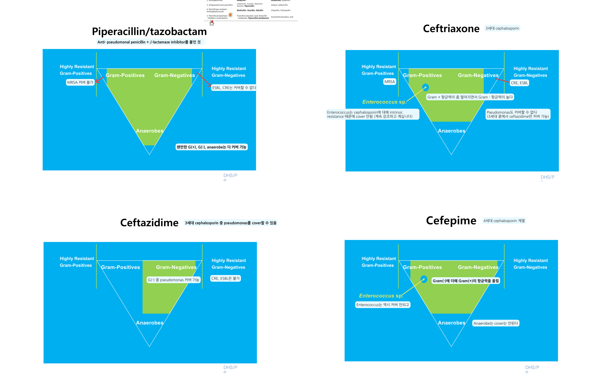{: style="width:88%"}

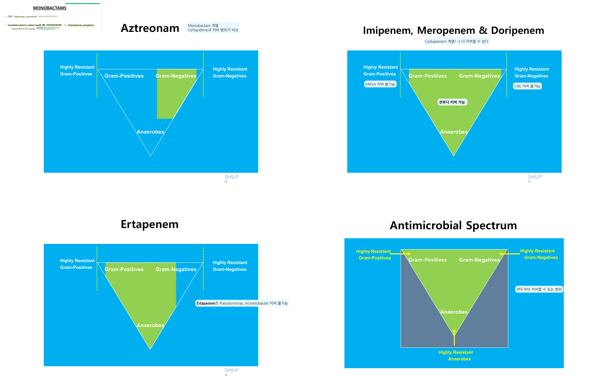{: style="width:88%"}

| 약 | 덮는 것 | 못 덮는 것 |
|---|---|---|
| **pip/tazo** (항녹농균 penicillin + 억제제) | 웬만한 그람양성·음성·**혐기균** 다, 녹농균 | **MRSA, ESBL, CRE** |
| **ceftriaxone** (3세대) | 그람음성 ↑(그람양성은 조금 떨어짐) | **장구균**(자연내성 — "계속 강조"), **녹농균**, MRSA, **CRE·ESBL** |
| **ceftazidime** (3세대) | 그람음성 중 **녹농균** | 그람양성 약함, CRE·ESBL |
| **cefepime** (4세대) | 그람음성 + **그람양성 항균력↑**, 녹농균 | **장구균**, **혐기균**, MRSA, ESBL·CRE |
| **aztreonam** (monobactam) | 그람음성 + 녹농균(ceftazidime과 비슷) | 그람양성·혐기 전부 |
| **imipenem·meropenem·doripenem** | **전부 다** | **MRSA, CRE** |
| **ertapenem** | 그람양성·음성·혐기, ESBL | **녹농균, *Acinetobacter*** |

## β-lactam 부작용 — 과민반응

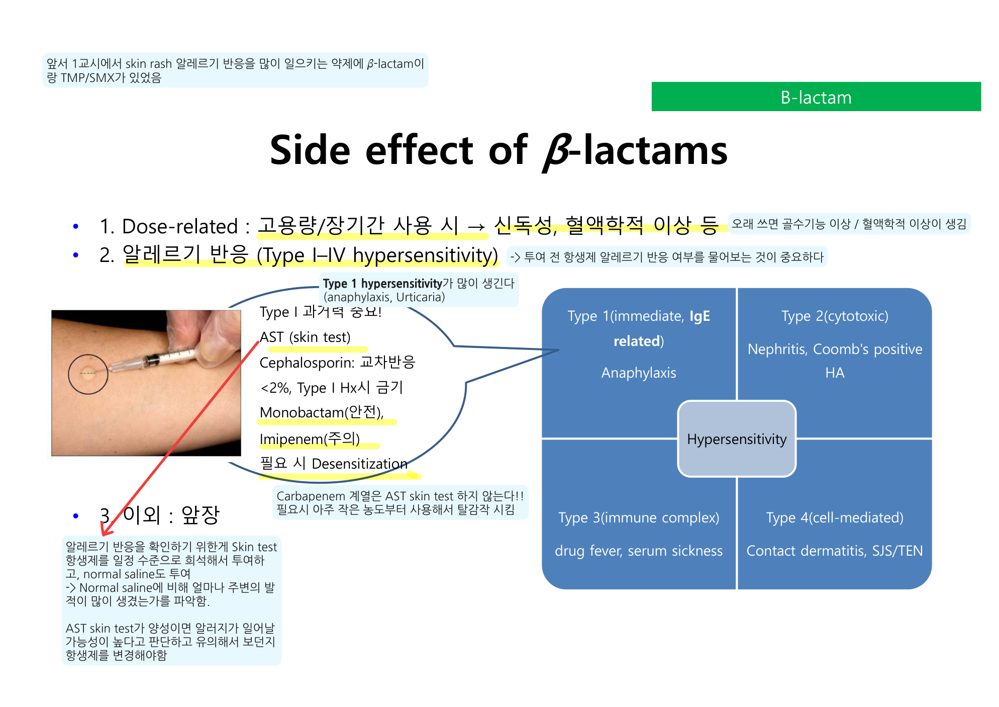{: style="width:76%"}

1. **용량 관련**: 고용량·장기 사용 → 신독성, **혈액학적 이상**(오래 쓰면 골수 기능 이상).
2. **알레르기 반응(type I–IV)** — 1교시에 말했듯 발진을 많이 일으키는 약이 β-lactam과 TMP/SMX.
3. 그 외: 앞 장(항생제 부작용 표).

| 유형 | 예 |
|---|---|
| Type I (즉시형, IgE) | **아나필락시스**, 두드러기 — β-lactam에서 가장 많이 생긴다 |
| Type II (세포독성) | 간질성 신염, Coombs 양성 용혈빈혈 |
| Type III (면역복합체) | 약열, 혈청병 |
| Type IV (세포매개) | 접촉피부염, SJS/TEN |

- **Type I 과거력이 가장 중요** → 투여 전에 항생제 알레르기 반응을 꼭 물어본다.
- **AST(피부반응검사)**: 항생제를 일정하게 희석해 피내 주사하고 생리식염수도 같이 → 식염수보다 주변 발적이 얼마나 큰지 본다. 양성이면 알레르기 가능성이 높다고 보고 주의하거나 약을 바꾼다.
- **세팔로스포린**: penicillin과 **교차반응 <2%**, 하지만 **type I 과거력이면 금기**. **monobactam은 안전**, **imipenem은 주의**.
- 필기: **carbapenem 계열은 AST를 하지 않는다!**
- 꼭 필요하면 아주 작은 농도부터 올리는 **탈감작(desensitization)**.

!!! exam "기출 포인트"
    2023년(2부 17번): cefazolin을 피해야 할 "중대한 부작용 병력"으로 보기 **어려운** 것 = **백혈구 감소**(용량 관련). 혈관부종·쇼크·호흡곤란(type I), SJS(type IV)는 중대한 과민반응. 2022년(2부 25번)·2021년(2부 32번): 아나필락시스 **예측력이 가장 좋은 것** = **과거 1형 과민반응 병력 청취** — skin test·IgE·호산구·음식 알레르기 병력은 함정.

# 5. 그람양성 내성균용 — glycopeptide, oxazolidinone

## Vancomycin, teicoplanin (glycopeptide)
- **그람양성 전용**(그람음성에는 자연내성).
- **DOC: MRSA**(methicillin-resistant *S. aureus*), **ampicillin 내성 장구균**, **penicillin 알레르기가 있는 심각한 그람양성 감염**. 필기: "아무 데나 쓰는 게 아니라 주로 penicillin이 잘 안 듣거나 알레르기가 있으면 쓴다."
- **경구 vancomycin = *C. difficile* 감염의 DOC**.
- 부작용: **정맥염**, **신독성**, **red man syndrome**(첫 투여, 히스타민 — 알레르기가 아니라 알레르기 유사반응), 이독성(드묾), 빠른 주사(bolus) 시 심한 저혈압, 백혈구 감소, 발진, 진짜 알레르기.
- **Teicoplanin**: **하루 한 번**, **근육주사 가능**, vancomycin보다 부작용이 적다. 커버 범위·부작용은 vancomycin과 비슷.

## Linezolid, tedizolid (oxazolidinone)
- **50S에 붙어** 단백 합성 억제 → **정균**(50S 억제제는 대부분 정균).
- 주요 그람양성: *E. faecium*, *S. aureus*(**MRSA 포함**), *S. agalactiae*, *S. pneumoniae*, *S. pyogenes*.
- Linezolid 쓰는 때: **MRSA에서 1차 치료(vancomycin) 실패·부작용**으로 못 쓸 때, **VRE 혈류감염**, **다제내성 결핵**.
- 부작용: **골수억제, 혈소판 감소**(골수의 미토콘드리아에 붙어 활성을 떨어뜨림), **말초신경염**(손발 저림) — **비가역일 수 있다**.
- **Tedizolid**: linezolid와 비슷, 효능 높고 부작용 낮음. 필기: **국내에서는 linezolid만 사용 가능**.

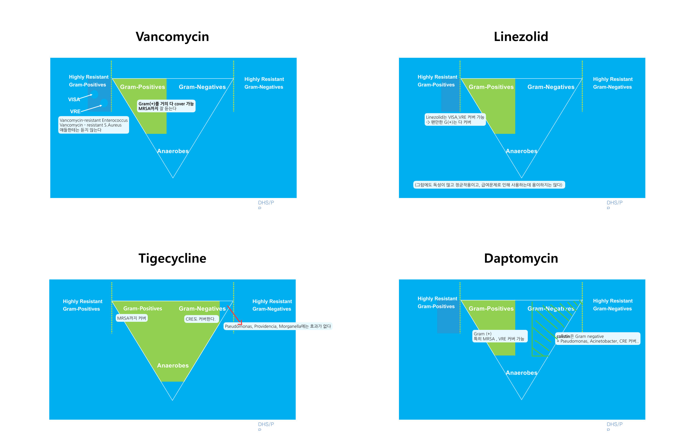{: style="width:88%"}

| 약 | 덮는 것 | 못 덮는 것 |
|---|---|---|
| **vancomycin** | 그람양성 거의 다, **MRSA**까지 | **VRE, VISA/VRSA**(vancomycin 내성 장구균·황색포도알균) |
| **linezolid** | 웬만한 그람양성 다 + **VRE, VISA** | 그람음성. 그래도 독성이 많고 정균이고 급여 문제로 쓰기 쉽지 않다 |

!!! exam "기출 포인트"
    2024년(2부 10번): vancomycin 적응증 = **MRSA 감염증**. 2022년(2부 23번)의 오답 보기로 vancomycin(신독성·red man), linezolid(골수억제)가 나왔다.

# 6. 단백 합성 억제제

## Aminoglycosides ★ (사과·꽃)
- 이름: **-mycin, -micin, -kacin** — *Streptomyces*에서 추출된 것이 많아 -mycin(streptomycin, neomycin, kanamycin, tobramycin, **gentamicin**, **amikacin** …). 단, -mycin이라도 AG가 아닌 약(erythromycin, clindamycin, vancomycin 등)이 있다.
- **30S**에 붙는데도 **살균**(농도 의존 — Cmax/MIC).
- 스펙트럼: **통성 그람음성 막대균**(Enterobacterales, **녹농균**까지) + 일부 포도알균. **혐기균·장구균에는 단독으로 안 듣는다**(자연내성).
- 주적응증:
    - **그람음성 균혈증**(특히 **호중구감소**) — 빠르게 살균해야 하니까.
    - **상승효과(+penicillin)**: 포도알균·장구균·연쇄구균 **심내막염**, 그람음성 균혈증.
    - 중증 요로감염.
    - **녹농균 → amikacin, tobramycin**.
    - **streptomycin → 야토병(tularemia), 페스트, 브루셀라, 결핵**.

!!! diff "작년 필기와 다른 점"
    올해 필기: "예전에는 시너지 효과 때문에 penicillin과 함께 심내막염에 쓰기도 했지만, **신독성 때문에 매뉴얼이 바뀌어 현재는 잘 병용하지 않는다**." 그래서 2장 병용요법의 시너지 예도 ampicillin + ceftriaxone으로 바뀌었다. 슬라이드의 적응증 목록 자체는 작년과 같다.

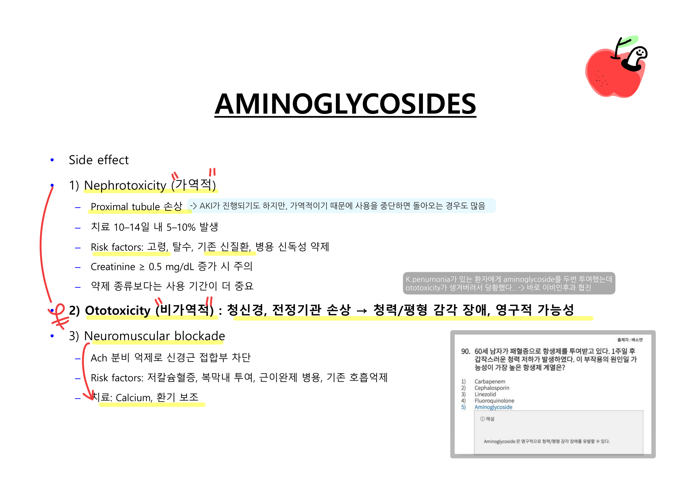{: style="width:76%"}

- 부작용:
    - **1) 신독성(가역적)**: 근위세관 손상 → AKI가 진행되기도 하지만 **가역적이라 중단하면 돌아오는 경우가 많다**. 10–14일 치료 중 5–10%. 위험인자 — 고령, 탈수, 기존 신질환, 신독성 약 병용. **creatinine ≥ 0.5 mg/dL 증가 시 주의**. **약 종류보다 사용 기간**이 중요.
    - **2) 이독성(비가역적)** ★(꽃): **청신경·전정기관 손상 → 청력·평형 감각 장애, 영구적일 수 있다**. 교수님 경험: *K. pneumoniae* 환자에게 aminoglycoside를 **두 번** 줬는데 이독성이 생겨 당황했다 → 바로 이비인후과 협진.
    - **3) 신경근 차단**: ACh 분비를 억제해 신경근 접합부 차단. 위험인자 — **저칼슘혈증**, 복막 내 투여, 근이완제 병용, 기존 호흡 억제. 치료: **칼슘**, 환기 보조.

!!! memo "암기"
    AG = 30S인데 살균 · Cmax/MIC(하루 1회) · **신독성은 돌아오고 이독성은 안 돌아온다** · 임신 중 제8뇌신경 손상 · 혐기균·장구균 자연내성 · 녹농균엔 amikacin·tobramycin

## Tetracyclines
- **-cycline**. 주로 쓰는 것: **doxycycline, minocycline**(long-acting), **tigecycline**(3세대).
- **넓은 스펙트럼**: 그람양성·음성 모두 + **비정형균(*Mycoplasma*, *Chlamydia*, *Rickettsia*)**에 특히 효과적(병원체학에서 배운 특이한 균들).
- 부작용:
    - **위장관 독성(흔함)** → **식도염·궤양**.
    - **간독성** → 특히 IV 투여, 임신 중.
    - **광과민성(phototoxicity)**.
    - **질소혈증 악화**.
    - **전정 독성** → **minocycline**, 여성에서 어지럼(vertigo) 최대 70%.
    - **치아·뼈** → **8세 미만 금기**, 영구치 착색(mottling), 성장 억제 — 영유아·임신 금기.

## Tigecycline
- **glycylcycline**: tetracycline 유도체, **3세대 tetracycline**.
- **정균** → **균혈증·중증 감염**처럼 빨리 없애야 하는 경우 효과가 떨어진다. 이유: **지용성**이라 **혈중 농도는 낮고 조직·지방세포에 잘 달라붙는다** → 균혈증에 잘 안 듣는다.
- 넓은 그람양성·음성, 특히 **다제내성균(MRSA, VRE, CRE, carbapenem 내성 *A. baumannii*)**.
- **예외: *Proteus*, 녹농균, *Providencia*, *Morganella* → 효과 없음**.
- **복합 감염(복부, 피부·연조직)**과 **carbapenem 내성 균주**에 쓴다. **MRSA도 덮으므로 vancomycin을 따로 붙일 필요가 없다**.
- 부작용: **위장관**(구토, 췌장염, 황달).

!!! diff "작년 필기와 다른 점"
    효과 없는 균: 작년 「*Proteus*, *P. aeruginosa*」 → 올해 「*Proteus*, *P. aeruginosa*, ***Providencia*, *Morganella***」로 늘었다(스펙트럼 그림에도 표시).

## Macrolides (50S)
- **erythromycin, roxithromycin, clarithromycin, azithromycin**.
- 주로 그람양성 알균 + **비정형균**(*Legionella, Mycoplasma, Campylobacter*, 일부 *Chlamydia*) — **세포 내 균(intracellular organism)** 치료에 많이 쓰인다(그람양성은 잘 듣는 약이 많으므로).
- **DOC: *Legionella*, *Campylobacter*, *Mycoplasma***.
- 폐렴구균 폐렴, A군 연쇄구균 인두염, 피부·연조직 감염(**특히 penicillin 알레르기 환자**), **NTM(비결핵 마이코박테리아)**(clarithromycin, azithromycin).
- 부작용:
    - **위장관이 가장 흔함**(최대 50%) — **erythromycin이 motilin 수용체를 자극** → 장운동 증가.
    - **간독성(담즙정체성 황달)**.
    - **이독성(가역적)**: 고용량 IV erythromycin(4 g/일)에서 드물게.
    - (1교시 부작용 표) **QT 연장**.

## Lincosamide — clindamycin (50S)
- **혐기균 + 그람양성 알균** — erythromycin과 비슷(스펙트럼·내성).
- **DOC: 순수 혐기균 감염(strict anaerobic infections)** — 단, **통성 그람음성 장내 막대균에는 효과 없음** → 필기: "**복강 내 감염에는 효과가 없다**." 혐기균이 많은 부위에 쓴다: **구강·치과 감염, 피부·연조직 감염**.
- **항독소 효과(antitoxin effect)**: **괴사성 근막염, 독성쇼크증후군** — 독소 단백 합성을 막는다.
- **penicillin 알레르기 환자의 그람양성 감염 대체약**. **정균**.
- 부작용: **위장관(가장 흔함)**, 설사(최대 20%), **위막성 대장염**(0.01–10%, = *C. difficile* 장염), 드물게 발진·발열·간독성·호중구감소.

!!! diff "작년 필기와 다른 점"
    작년 적응증은 「구강·치과 감염, **흡인성 폐렴(aspiration pneumonia), 복강 내 농양**」이었고, 올해는 「구강·치과 감염, **피부·연조직 감염**」 + **항독소 효과(괴사성 근막염, TSS)**가 새로 들어왔다. 올해 필기는 오히려 "그람음성 장내 혐기균에 효과가 없어 **복강 내 감염에는 효과가 없다**"고 적었다. 흡인성 폐렴(폐 위쪽 혐기균)은 8장 "혐기균을 덮는 항생제"에 「clindamycin (for lung)」으로 남아 있다.

!!! exam "기출 포인트"
    2024년(2부 13번): **독성쇼크증후군**의 특징적 피부 소견 = **미만성 반점 홍반(diffuse macular erythroderma)**. 이 수업으로 분류된 문제다 — clindamycin의 항독소 효과와 함께 기억하자.

## Chloramphenicol (50S)
- 그람양성·음성에 넓은 스펙트럼이지만, **플라스미드 매개 내성**과 **부작용** 때문에 쓰임이 줄었다. 필기: "현재는 사용이 중단된 약, **특별히 기억할 것은 없다**."
- 부작용:
    - **골수억제**: 용량 관련 **가역적** 범혈구감소 / 특이체질성 **비가역적 재생불량빈혈**(1/25,000–40,000) — 이것 때문에 퇴출.
    - **Gray baby syndrome**: 미숙아·신생아가 chloramphenicol을 **대사하지 못해** → 청색증, 저혈압, 사망(회색빛으로).

# 7. DNA·엽산 합성 억제제

## Fluoroquinolones ★ (꽃 — "중요한 항생제다")
**topoisomerase(DNA gyrase)**를 억제한다.

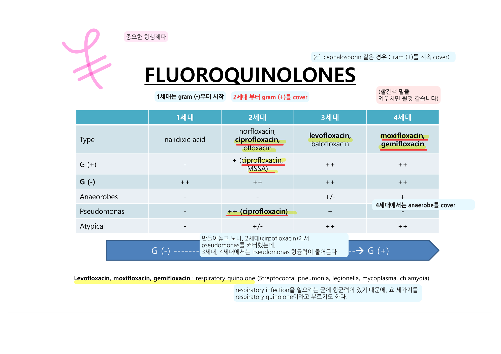{: style="width:76%"}

| | 1세대 | 2세대 | 3세대 | 4세대 |
|---|---|---|---|---|
| 약 | nalidixic acid | norfloxacin, **ciprofloxacin**, ofloxacin | **levofloxacin**, balofloxacin | **moxifloxacin**, gemifloxacin |
| 그람양성 | − | + (ciprofloxacin, MSSA) | ++ | ++ |
| 그람음성 | ++ | ++ | ++ | ++ |
| 혐기균 | − | − | ± | **+** |
| **녹농균** | − | **++ (ciprofloxacin)** | + | − |
| 비정형균 | − | ± | ++ | ++ |

- **1세대는 그람음성부터** 시작, **2세대부터 그람양성**을 덮고, **4세대에서 혐기균**까지. 세대가 갈수록 G(−) → G(+).
- 만들어 보니 **2세대 ciprofloxacin이 녹농균을 덮었는데 3·4세대에서는 녹농균 항균력이 줄었다**. (cf. 세팔로스포린은 세대가 갈수록 그람음성 ↑ — 방향이 반대!)
- **levofloxacin, moxifloxacin, gemifloxacin = respiratory quinolone**: 폐렴구균 폐렴, *Legionella*, *Mycoplasma*, *Chlamydia* 등 호흡기 감염 균에 항균력이 있어서.
- **그람음성 막대균에 매우 좋다**(특히 장내세균). **녹농균: ciprofloxacin이 가장 강력한 경구제** — FQ가 중요한 이유는 **주사뿐 아니라 경구로도** 쓸 수 있어서다. 포도알균 보통, 연쇄구균 약함.
- **DOC: 복잡성 요로감염** → 최근 내성률 증가로 제한적 사용.
- 세균성 장염, 장티푸스(enteric fever).
- **만성 골수염**, 성인 그람음성 중이염 — **경구 생체이용률과 뼈 침투가 매우 좋아서**.
- **항결핵제: moxifloxacin, levofloxacin**.
- 부작용: **건염·힘줄 파열**, **QT 연장**. **금기: 임신**. **18세 이하 주의**: 교과서적으로는 아직 금기(동물에서 자라는 연골 손상), 사람에서는 증명 안 됨 → 연골 생성에 문제가 될 수 있어 18세 이하에서 거의 안 쓴다.

!!! memo "암기"
    세팔로스포린: 세대↑ = **그람음성↑**(녹농균은 3세대 ceftazidime·4세대) / FQ: 세대↑ = **그람양성·비정형·혐기↑**, 녹농균은 **2세대 ciprofloxacin**이 최강

## 엽산 합성 억제 — TMP/SMX, sulfonamide
- **TMP/SMX(trimethoprim/sulfamethoxazole)**:
    - **단순 요로감염**(장구균 제외) → 국내는 **내성 문제로 사용 감소**.
    - 호흡기: 중이염, *H. influenzae*, *M. catarrhalis*.
    - **DOC: *Stenotrophomonas maltophilia*(병원 내 감염)** — 이 균은 **carbapenem이 잘 안 들어서** TMP/SMX를 쓴다 / **AIDS 환자의 PCP(*Pneumocystis jirovecii* 폐렴)**.
    - 부작용: **골수억제, 고칼륨혈증, 피부 발진**.
- **Sulfonamide**(잘 쓰지 않는다): DOC — **노카르디아**, 나병(dapsone, a sulfone), 톡소플라즈마(sulfadiazine). 부작용이 크다: **알레르기 흔함**(발진 ~ Stevens-Johnson), 신독성(**결정뇨**), 혈구감소, **신생아 금기(핵황달 — 빌리루빈 치환)**.

!!! new "올해 필기에서 추가"
    TMP/SMX 부작용(**골수억제, 고칼륨혈증, 발진**)이 슬라이드에 새로 들어왔다. 1교시 부작용 표의 "TMP-SMX → 빈혈·호중구감소, SJS/TEN"과 함께 외우자.

# 8. 그 외 항생제

## Rifampin
- 항결핵제. **그 자체로는 항균력이 떨어진다** → **MRSA에는 반드시 다른 약과 병용**(단독이면 내성이 금방 생김).
- **수막구균 감염 예방(chemoprophylaxis)**, ***Legionella* 폐렴**.
- **항바이오필름 효과**: 균이 감염되면 내뿜는 물질로 얇은 막(biofilm)이 생겨 항생제 효과가 떨어지는데, rifampin을 병용하면 효과가 좋을 때가 있다(예: 인공물·골수염).
- **약물 상호작용 ↑: CYP3A4 유도제** — 간 대사가 너무 잘 되게 만들어 다른 약 농도를 떨어뜨린다.
- 부작용: **간독성(특히 INH 병용)**, 간헐 투여 시 독감 유사 증상·용혈·혈소판감소·급성신부전, (1교시 표) 체액 **오렌지색**.

!!! new "올해 필기에서 추가"
    「**Drug interaction ↑: inducer of CYP3A4**」가 새로 들어왔다(2장 상호작용 주의 약 — FQ, macrolide, **rifampin**).

## Metronidazole
- **nitroimidazole** 계열. **DNA에 결합해 이중가닥 절단·합성 억제**.
- **혐기균 감염에 한정**(산소가 있으면 비활성) → 혐기균에 제한적으로 쓴다.
- **DOC: 혐기성 농양(폐, 뇌, 복강 내)**. 세균성 질염, 위막성 대장염(드물게)에도 유용.
- 부작용: 심각한 것은 드묾. **구역, 금속 맛**(신경독성 — "쇠맛이 난다"), 고용량·만성 간질환에서 **경련·뇌병증**, **변이원성? → 임신(특히 1삼분기) 상대적 금기**.

!!! exam "기출 포인트"
    2022년(2부 28번)·2021년(2부 35번) 주관식: 부분 환원되어야 DNA를 망가뜨리는 약 = **metronidazole**, 이 환원은 (A) **혐기성 세균·원생생물**에서만 일어나 사람 세포나 (B) **호기성** 세균에는 거의 영향이 없다. 경구 생체이용률도 거의 100%(2023년 2부 14번).

## 요로 전용 약
- **Nitrofurantoin**: 5-nitrofuran 유도체. 기전은 정확히 규명되지 않음 — 세균 안에서 **nitroreductase**로 활성화 → 반응성 중간물질 → DNA 손상, acetyl-CoA 관련 효소 억제 → 탄수화물 대사·단백 합성 방해. 범위는 넓지만 **부작용이 강하고**, 소변 농도로 **단순 요로감염에만** 쓴다 — **혈중 감염이 있을 때는 사용 불가**. 부작용: 급성 — 위장관, 발진, 두통 / 만성·장기 — **간독성, 폐섬유화, 말초신경병증**.
    - ※ 확인 필요: 필기에 "50S를 막는 애"라는 필야 메모가 있는데, 슬라이드 자체는 "기전이 정확히 규명되지 않음"이고 작용 부위 그림에서 nitrofurans는 **30S 억제제** 칸에 있다. 시험에서는 슬라이드(nitroreductase 활성화 → DNA 손상)를 기준으로 하자.
- **Fosfomycin**: 인산(phosphonic acid) 계열 — **pH가 낮으면 비이온화되어 세포막 투과력 증가**. 신장으로 **변하지 않고 배설** → **소변에 고농도**. 그람양성(*S. aureus*, **VRE 포함 장구균**)·그람음성(*E. coli, Klebsiella, Enterobacter, Serratia*), **대부분의 ESBL 생성 장내세균**에 효과. 적응증: **단순 방광염** 치료·예방. **신우신염 의심 시 사용 ×**(조직 침투·혈중 농도가 낮아서). 용법: **3 g 단회 경구 → 소변 내 48시간 이상 고농도**.

!!! diff "작년 필기와 다른 점"
    작년 필기에는 fosfomycin 그람음성 커버에 **녹농균**도 적혀 있었는데(작년 학습자료), 올해 슬라이드는 *E. coli, Klebsiella, Enterobacter, Serratia*만 적혀 있다. 시험은 올해 목록 기준으로.

## Colistin
- **polymyxin** 계열, **resurrected antibiotic** — 부작용이 많아 사용이 중단되었다가 **내성균의 등장으로 다시** 쓴다.
- 기전(올해 추가): **양이온성 cyclic decapeptide** → 그람음성 외막의 **LPS·lipid A(음전하)**에 결합 → Ca2+·Mg2+를 치환 → **세포막 투과성 증가·파괴**(세포막을 약화시킨다).
- **다제내성 그람음성균(녹농균, *Acinetobacter*)**, CRE까지. (슬라이드에는 "그람양성·혐기균에는 효과 없음"이 줄로 지워져 있지만 스펙트럼 그림대로 **그람음성 전용**이다.)
- FDA 적응증: 다제내성 그람음성균, IV·IM 2.5–5 mg/kg/일(colistin base activity 기준)을 2–4회 분할(최대 5 mg/kg/일), 낭성섬유증의 폐 감염.
- 부작용: **신독성, 신경독성** — 신독성이 너무 강하다(**50% 이상**에서 보고).

## Daptomycin
- **세포막에 채널**을 만들어 **막 탈분극·누출(leakage)** → 파괴. colistin과 비슷한 기전이지만 colistin은 그람음성이었던 것과 달리 —
- **그람양성 전반**(특히 **MRSA, VRE**). **VRE 균혈증** 치료 가능, **MRSA에서 vancomycin 치료 실패 시 대체약**(보험 적용 가능).
- 부작용: **CPK 상승, 근병증(myopathy)**.
- 스펙트럼 그림(위 그림의 오른쪽 아래): daptomycin = 그람양성 + MRSA·VRE / colistin = 그람음성 + 녹농균·*Acinetobacter*·CRE(빗금).

!!! new "올해 필기에서 추가"
    daptomycin의 **스펙트럼 그림**(colistin과 나란히 비교)이 새로 들어왔다. "**colistin은 그람음성 내성균, daptomycin은 그람양성 내성균**"으로 짝지어 외우자.

## 국소제 — fusidic acid, mupirocin, bacitracin
필기: "눈에 그냥 간단히 보고 넘어가면 됩니다."
- **Fusidic acid**(후시딘에 들어가는 것 — 상처에 바르니까): **포도알균** 감염(G+), 특히 **반합성 penicillin이나 다른 약에 내성인 포도알균**. 잘 통제된 비교연구는 없다. **단독 사용 금지**, **rifampicin과 병용 시 상승효과**.
- **Mupirocin**: **isoleucyl-tRNA 합성효소**를 막아 단백 합성 차단. **국소 피부 연고**로만(경구 없음).
    - **MRSA 예방적 처리**: **비강 내 도포**(glycerol 연고) → **수술 전 MRSA 감염 감소**. MRSA outbreak가 있어 수술 전 MRSA를 없애고 싶으면 수술 전에 예방적으로 바른다. **MRSA 비강 집락 의료인의 제균(decolonization)**에도.
    - 국소 피부 감염(**농가진, 모낭염**) → 연고.
- **Bacitracin**: 국소(연고), **그람양성균**.

!!! diff "작년 필기와 다른 점"
    fusidic acid 슬라이드는 작년·올해 모두 "**경구용은 국내 사용 가능**"인데, 올해 필기에는 그 옆에 손글씨로 「**불가능**」이 적혀 있다. 교수님이 말로 정정했을 가능성이 있다. ※ 확인 필요 — 시험에 나오면 문장 그대로("국내 사용 가능")인지 정정된 것인지 동기와 확인하자.

## 혐기균을 덮는 항생제
| # | 약 | 필기 |
|---|---|---|
| 1 | amp/sulbactam, amox/clavulanate | aminopenicillin 계열 |
| 2 | **piperacillin/tazobactam** | β-lactamase 억제제를 붙인 것 |
| 3 | **metronidazole** (*B. fragilis* — 복강 내) | 산소가 있으면 비활성 → 혐기균에서 사용, 특히 복강 내 |
| 4–6 | **imipenem, meropenem, ertapenem** | carbapenem 계열 |
| 7 | **moxifloxacin** | FQ 중 **4세대** |
| 8 | **clindamycin (for lung)** | MRSA 대체요법 + **폐 위쪽의 혐기균**에서 사용 |
| 9 | **cefamycin**: cefoxitin, cefminox, cefmetazole | 2세대 세팔로스포린과 비슷(**cefaclor도 혐기균에 효과**) |
| 10 | 고용량 항녹농균 penicillin | |
| 11 | chloramphenicol | |

!!! diff "작년 필기와 다른 점"
    작년 목록에는 **clinafloxacin**(교수님은 "ciprofloxacin"이라고 말함)이 있었는데, 올해는 빠지고 **ertapenem**과 **moxifloxacin(4세대 FQ)**이 들어갔다. ciprofloxacin은 혐기균을 덮지 않는다(FQ 표에서 혐기균은 4세대만 +).

# 9. 항생제 스튜어드십

- **항생제는 재료일 뿐**: 좋은 결과는 요리사가 있는 식재료를 얼마나 잘 쓰느냐에 달렸다(「냉장고를 부탁해」). 야구로 치면 배트·글러브가 항생제, 경기는 내 하기 나름 — 단 **팀워크**가 좋아야 한다. 제한된 항생제로 적응증에 맞춰 감염을 치료하는 능력이 필요하다 → 필야: "**앞에 내용 다 외워야 한다**".
- **불필요한 항생제 사용**: 미국 자료로 **1/3은 불필요**(외래 처방 70% 필요, 최소 30% 불필요). 균이 항생제에 노출되며 내성이 생기면 정작 치료해야 할 사람을 치료하지 못한다.
- 우리는 **항생제 후 시대(post-antibiotic era)**로 들어가고 있다(WHO 경고) — 이미 만든 약에 내성이 생기고 새 약은 잘 안 나온다.
- **한국의 항생제 소비량은 OECD 평균보다 많다** — **고령자가 많고 의료 접근성이 좋아서**, + **방어진료**(올해 필기 추가).
- CDC **Get Smart**(현명해지기)·U.S. Antibiotic Awareness Week — 감염학회는 환자에게도 항생제가 불필요한 경우, 부작용, 필요한 곳을 교육한다.
- **원헬스(One Health)**: 항생제는 사람보다 **농수산(동물·환경)**에 더 많이 쓰인다 → 이것까지 관리해야 한다.
- 질병관리청·대한항균요법학회·대한감염학회 **유튜브 항생제 스튜어드십 27편**(일반인 5, 의료인 기본 8, 의료인 심화 8, 지침 설명 2, KONAS 설명 4 등) — 학회장을 했던 김신우 교수님이 스튜어드십에 관심이 많고, 칠곡경북대병원에서는 권기태 교수님이 노력하고 있다.

!!! exam "기출 포인트"
    필기본 3쪽 족보에 붙은 2022년 45번(스튜어드십 핵심 다학제 팀 구성원으로 가장 먼 것 = **병원장**)은 **13. 의료관련감염 및 감염관리** 수업으로 분류돼 이 2부에는 없다. 팀 = 감염전문 임상의사·항생제 전담 약사·임상미생물학 전문가·정보전산 전문가 등의 **다학제 팀**이고 병원장은 포함되지 않는다.

# 10. 정리 (Take home message)
- **항균제 사용 원칙**을 설명할 수 있다 — 10단계, start smart then focus, 예방적·선제적·경험적·확정적.
- **항생제를 쓰기 전에 고려할 것**(배양, 원인균, 숙주)을 기술할 수 있다.
- **항생제를 고를 때 고려할 것**(스펙트럼, 표적 부위 농도, PK/PD, 살균/정균, 자연내성, 부작용, 임신·장기 기능)을 설명할 수 있다.
- **병용요법**이 필요한 경우(중증 경험적, 감수성 확보, 다균종, 시너지, 내성 억제, 독성 감소)를 말할 수 있다.
- **치료 실패** 시 원인(약이 못 닿는 곳, 혼합 감염, 잘못된 약·용량, 균교대, 병원감염, 약열, 오진)을 분석하고 대책을 세울 수 있다.
- **페니실린**의 종류·범위·임상 응용, **세팔로스포린**의 세대별 범위·임상 응용, **아미노글리코사이드**의 응용과 부작용을 말할 수 있다.
