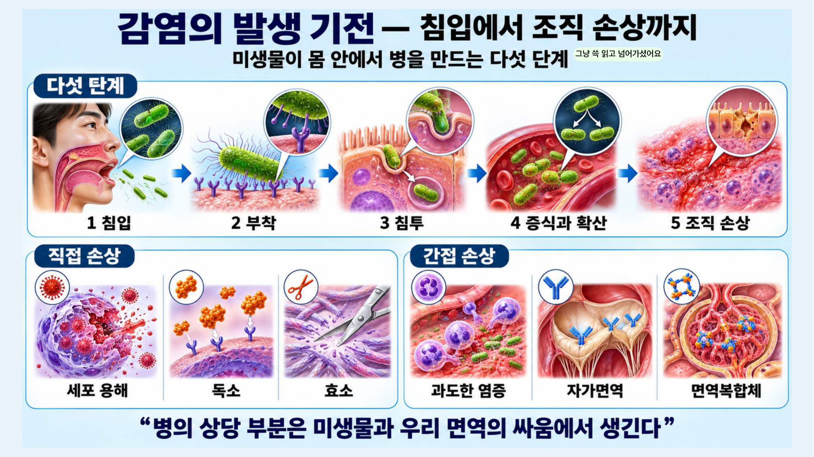
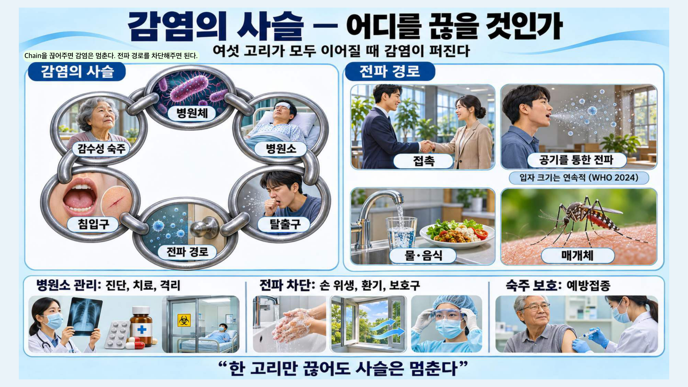
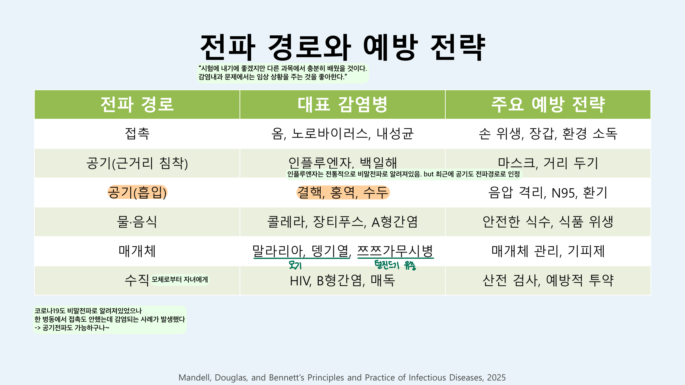
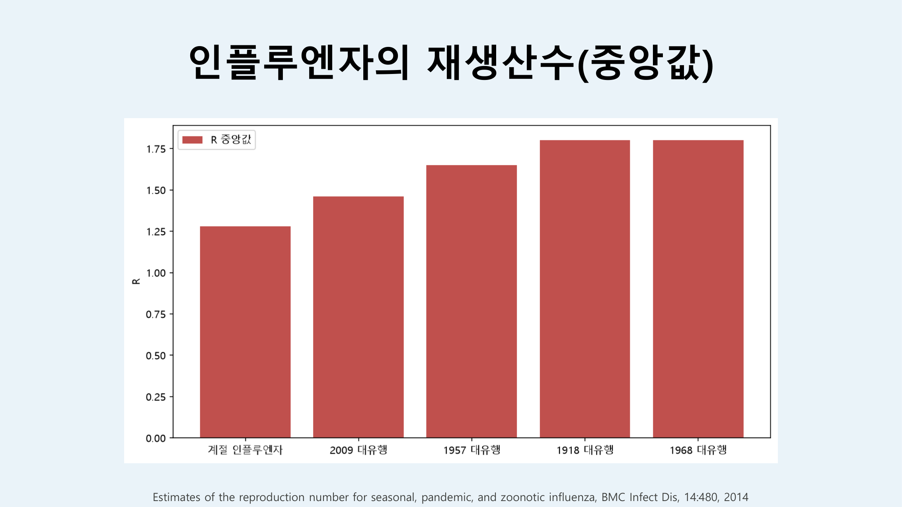
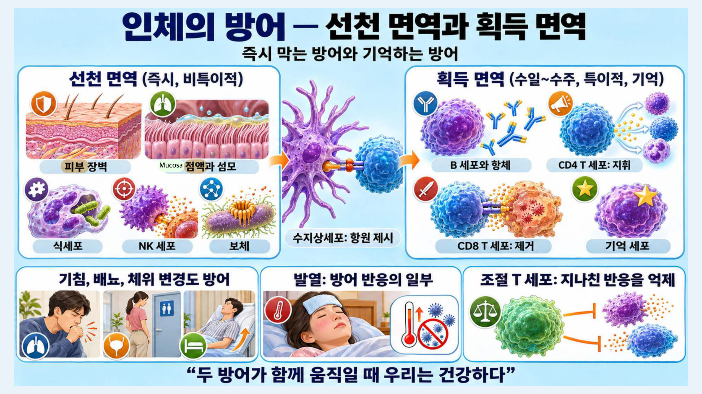
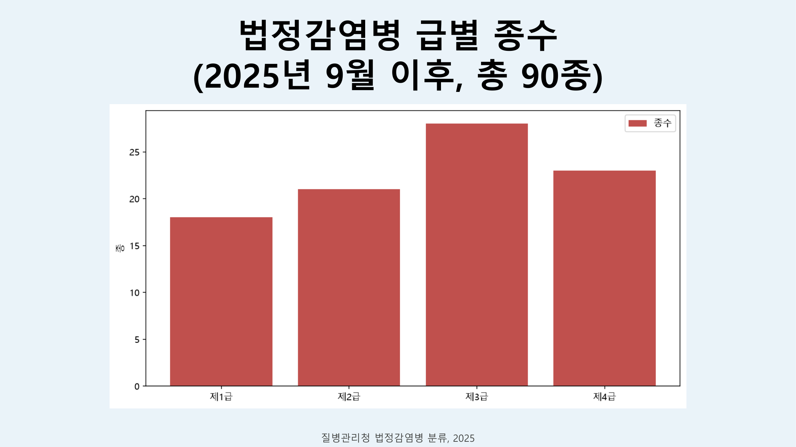
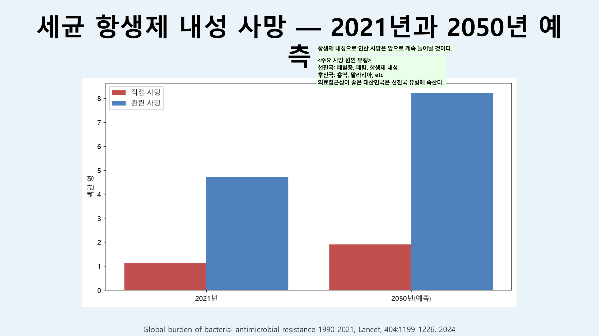
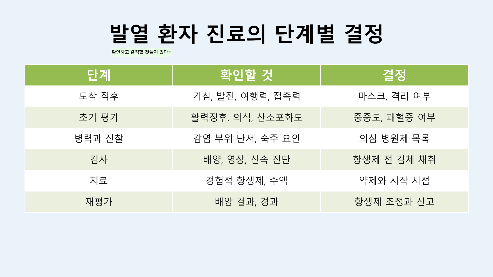

<!-- 필기본: 2026 · 2025 -->
<!-- 단계: 수업 후 -->

# 0. 이 수업을 공부하는 법

김신우 교수님의 감염학 첫 수업으로, 감염학 전체의 지도를 그려 주는 강의다. 2026년 강의는 슬라이드가 새로 만들어져(목차: 서론 → 역사 → 감염의 성립과 발생 기전 → 전파와 인체 방어 → 예방과 관리·현대의 과제 → 임상 사례 → 진료 현장 → 요약) 작년과 순서·내용이 꽤 다르다. 이 1부는 **올해 필기 순서**를 따르고, 작년에만 있던 내용(기출이 나온 곳이 많다)은 `작년 필기와 다른 점` 상자로 남겨 두었다.

- 교수님이 강의 첫머리(필기본 2–3쪽)에 **2022–2025년 이 수업 족보**를 직접 띄워 보여 주셨다: 25년 결핵 미생물 요인·NMS, 24년 예방 전략·과제–대응 전략, 23년 노인 발열·tropism, 22년 방어벽(NK)·베이즈 정리. → 2부 1–9번. 매년 1–2문항, **표 한 칸이나 정의 하나를 그대로 묻는** 쉬운 문제다.
- 교수님 말씀: "감염내과 문제에서는 **임상 상황을 주는 것**을 좋아한다." 올해는 임상 사례(사례 1–3, 응급실)가 새로 들어왔으니 사례형으로 나올 수 있다.
- 2부 10–29번은 옛 본2 감염학(2020–2022) 면역·병원체 문항으로, 이 수업의 "인체 방어" 단원과 겹쳐서 여기 모였다. 개념 정리용으로 풀어 보면 된다.

!!! key "핵심"
    올해 필기의 뼈대는 맺음말 한 문장이다 — **어떤 병원체가, 어떤 숙주에, 어떤 경로로 — 그리고 어느 고리를 끊을 것인가.** 3요소(병원체·숙주·환경) → 오염·집락·감염 구별 → 감염의 사슬 → 예방·관리 순으로 이 질문에 답해 가며 읽자.

# 1. 서론

## 감염과 감염병의 정의
- **감염(infection)**: 병원체가 조직에 **침입해 증식**하는 것. 필기: "증식 = 번식한다와 같은 표현". 감염이 있어도 증상이 있을 수도, 없을 수도 있다 → 증상이 있으면 **clinical infection**, 없으면 **subclinical(불현성) infection**.
- **감염병(infectious disease)**: 감염의 결과 **증상과 징후가 나타난 상태**. 즉 "감염 ⊃ 감염병" — 감염이 있다고 다 병은 아니다.
- **병원체**: 세균, 바이러스, 진균, 원충, 연충, **프리온**. 필기: 기생충(원충·연충)까지 병원체에 포함된다.
- **핵심 특성: 전파 가능성** — 감염병이 다른 병과 구별되는 점은 사람에서 사람(또는 동물·환경에서 사람)으로 **옮겨 갈 수 있다**는 것.
- **불현성 감염과 보균 상태도 전파의 원천**: 증상이 없어도 균을 내보낼 수 있다(예: 장티푸스 보균자). 그래서 증상 있는 환자만 격리해서는 유행을 다 막지 못한다.

## 오염, 집락, 감염 — "미생물이 있다고 모두 감염은 아니다"

| 구분 | 정의 | 숙주 반응 |
|---|---|---|
| **오염(contamination)** | 표면에 **단지 존재** | 없음 |
| **집락(colonization)** | 붙어서 **증식하지만** | **숙주 반응 없음** |
| **감염(infection)** | **조직 침범** | **숙주 반응 있음**(염증, 증상) |

- 필기 그림 메모: 집락 = "번식을 하여 자녀를 낳으면", 감염 = "안으로 파고 들어가면". "감염되면 무조건 증상이 있냐? → X"(불현성 감염).
- **임상 예(필기)**: 두통 환자의 뇌척수액(CSF) 검사에서 **coagulase 음성 포도알균(CoNS)**이 배양되었다. 그런데 CSF **세포 수(cell count)가 정상**이다 → 숙주 반응이 없으므로 감염도 집락도 아니고, 피부 상재균이 천자(tapping) 과정이나 실험실에서 섞여 들어간 **오염균**일 것이다. 두통은 포도알균 때문이 아니다.
- 교수님: "All that glitters is not gold(반짝이는 것이 모두 금은 아니다)" — 배양에서 균이 나왔다고 모두 원인균은 아니다. 요약 슬라이드에도 "오염·집락·감염 구별"에 형광펜과 **"잘 구별하십시오"**.

!!! memo "암기"
    오염 = 있기만 함 / 집락 = 증식 O, 숙주 반응 X / 감염 = 조직 침범 + 숙주 반응. 배양 양성 ≠ 감염 → 세포 수·염증 소견 같은 **숙주 반응**으로 판단.

!!! new "올해 필기에서 추가"
    **감염병의 무게 — 코로나19 초과사망(2020–2021)**. 보고된 코로나19 사망은 약 540만 명이지만, WHO가 추정한 **초과사망**은 약 1,490만 명으로 3배 가까이 된다. 초과사망 = 코로나19로 집계되지는 않았지만 코로나19가 영향을 주었을 것으로 보이는 사망(심근경색, COPD, 넘어져서 생긴 고관절 골절, 수술 중 사망 등).

{: style="width:66%"}

- 교수님 comment: 사망 통계에는 암·심혈관 질환이 많게 나오지만, 실제로는 면역저하·패혈증(sepsis)·폐렴 같은 **감염이 원인인 경우가 더 많다**. 사망 신고 때 **사망 직전 원인**을 적기 때문에 실제 원인과 보고된 원인이 어긋나고, 감염으로 인한 사망은 **적게 보고되는 경향**이 있다.

!!! diff "작년 필기와 다른 점"
    작년(2025) 필기는 "감염학의 정의와 중요성"으로 시작했다 — 감염학은 미생물과 숙주의 상호작용, 감염병의 발생 기전·예방·진단·치료·관리를 연구하는 학문이고, 세균학·바이러스학·진균학·기생충학을 포함하며 면역학·역학·공중보건학과 밀접하다. 중요성의 예로 COVID-19 팬데믹. 교육 성과는 "감염병의 **발생과 방어, 예방, 관리**를 설명할 수 있다". 올해는 이 슬라이드 대신 위의 정의·오염/집락/감염·초과사망으로 바뀌었다.
    또 작년에는 오염·집락·감염 예로 "B형간염 바이러스가 오랫동안 증상 없이 있다가 간암(hepatoma)으로 나타나기도 한다"(subclinical infection)가 있었다.

# 2. 감염학의 역사

교수님: "의학의 역사에서 배웠겠지만 감염학의 역사만 가볍게 보고 넘어가겠습니다." 연도와 인물을 **"누가 – 무엇을 – 왜 의미 있나"** 짝으로 기억하면 충분하다.

## 근대 이전의 역병
- **기원전 430년 아테네 역병**: 항구 **피레우스**로 들어왔다. 감염병은 예전부터 역병(plague)이라는 이름으로 있었고, **항구 도시를 중심으로** 많은 사람이 갑자기 죽었다 → 사람·물자의 이동이 감염 확산의 통로.
- **1346–1353년 흑사병(Black death, 페스트)**: 유럽 인구의 **1/3–1/2** 사망 추정.
- **1520년 아스텍의 두창(천연두)**: 'Columbian exchange' — 콜럼버스 이후 유럽인이 신대륙에 두창을 퍼뜨렸고, 칼에 찔려 죽은 사람보다 두창으로 죽은 사람이 더 많았다.
- **미아스마(miasma) 이론**: 오랜 정설은 "나쁜 공기가 병을 일으킨다"였다. 말라리아(mal + aria = 나쁜 공기)라는 이름도 여기서 왔다.
- **1546년 프라카스토로**: 병을 옮기는 **보이지 않는 씨앗**(contagion) 개념.
- **1676년 레이우엔훅**: 직접 만든 현미경으로 **미생물을 처음 관찰**. 필기: 프라카스토로–레이우엔훅을 묶어 "전파되는 something이 있다!"

## 예방의 발견
- **1796년 제너**: **우두 접종** → **예방접종의 시작**. 교수님: "전 세계에서 가장 많은 사람을 살린 사람을 고르라면 제너."
- **1847년 제멜바이스**: **손 씻기로 산욕열 감소** → 병원감염 예방의 시초. 처음 주장했을 때는 미친 사람 취급을 받았지만 훗날 옳다는 것이 입증되었다.
- **1854년 (존) 스노**: 런던 **브로드가 펌프**와 콜레라 — 펌프 손잡이를 떼어 내자 콜레라가 잦아들었다(오염된 물이 원인) → **상하수도를 분리**하는 계기, **근대 역학의 출발**.
- **1867년 리스터**: **석탄산(페놀)**으로 수술 부위·상처를 소독하는 **방부 수술**.

## 원인의 증명
- **1860년대 파스퇴르**: **자연발생설 반박** — "생명은 생명으로부터 나온다"(쓰레기 더미에서 갑자기 쥐가 생기는 게 아니다). **1885년 광견병 백신**을 사람에게 사용.
- **코흐**: **탄저균 1876, 결핵균 1882, 콜레라균 1883** 발견. **코흐의 공준(가설)** — 특정 병원체가 특정 질병의 원인임을 증명하는 기준(병변에서 늘 발견 → 순수 분리·배양 → 접종하면 같은 병 → 다시 분리). → 세균학의 확립.
- **1892년 이바노프스키**: 세균 여과기를 통과하는 **여과성 병원체** = 바이러스("눈에 보이지 않지만 여과되는 병원체가 있다").

## 치료의 시대와 신종 감염병
- **1928년 페니실린**(Alexander Fleming, 1·2차 세계대전에 사용), **1930년대 설파제**, **1940년대 스트렙토마이신**(최초의 아미노글리코사이드계 항생제, 결핵 치료).
- **1980년 두창 근절 선언** — 사람 감염병 가운데 **근절된 유일한 사례**.
- **AIDS 1981**(폐포자충 폐렴 환자 5명에서 처음 발견), **SARS 2003**(홍콩에서 시작해 전 세계로), **신종 인플루엔자 2009**(지금 도는 H1N1이 2009년형).
- **메르스 2015(한국)**: 사망률 약 20%, 지금은 사우디아라비아의 풍토병. **코로나19 2020**: 2020년 2월 대구 신천지에서 국내 대유행 시작(이때 교수님이 무척 바쁘셨고, '번아웃'이라는 말도 이때 나왔다고).

## 감염학 역사의 주요 사건 (표)

{: style="width:70%"}

| 연도 | 사건 | 의의 |
|---|---|---|
| 1676 | 레이우엔훅의 미생물 관찰 | 미생물학의 시작 |
| 1796 | 제너의 우두 접종 | **예방접종의 시작** |
| 1847 | 제멜바이스의 손 씻기 | **병원감염 예방의 시초** |
| 1854 | 스노의 콜레라 조사 | **근대 역학의 출발** |
| 1882 | 코흐의 결핵균 발견 | 세균학의 확립 |
| 1928 | 플레밍의 페니실린 발견 | 항생제 시대의 개막 |
| 1980 | 두창 근절 선언 | **유일하게 근절된 사람 감염병** |
| 2020 | 코로나19 대유행 | 세계 보건 체계의 재정비 |

요약 슬라이드의 한 줄: **1676 미생물 → 1796 백신 → 1928 페니실린 → 1980 두창 근절**. 교수님: "미지의 시대에서 지금은 PCR의 시대가 되었다."

!!! diff "작년 필기와 다른 점"
    - 레이우엔훅 미생물 발견 연도: 작년 연표 **1683** → 올해 **1676**(첫 관찰 연도로 통일).
    - 작년 연표에만 있던 것: 히포크라테스 『전염병에 관하여』(BC 400년경), 파스퇴르 발효 이론(1861, germ theory의 기초), 코흐 탄저균(1876, 분리·배양 기술), 폰 베링 디프테리아 **혈청요법**(1891), 도마크 설파제(1935, 화학요법제의 시작), 왁스만 스트렙토마이신(1944, 결핵 치료의 혁명), WHO 천연두 퇴치 프로그램(1967), HIV 발견(1983), **WHO DOTS**(1995, 결핵 관리의 세계 표준), SARS·H1N1·COVID-19(국제 협력, 팬데믹 대응체계).
    - 작년 인물 이야기: 매독(페니실린 전까지 수은 치료), 아스돗 역병, 레벤후크(현미경 400개 이상, 의미는 몰랐다), 산토리오(체온계·맥박계로 정량 측정), 나이팅게일(위생·환기, 현대 간호학), 파스퇴르의 저온살균.

# 3. 감염의 성립과 발생 기전

## 감염의 3요소 — 역학적 삼각형
감염병은 **병원체(pathogen) · 숙주(host) · 환경(environment)** 세 요소가 만나서 생기고, 셋의 **균형이 병원체 쪽으로 기울 때** 발병한다. 슬라이드 제목의 '감염의 3요소'와 세 요소 이름에 모두 형광펜.

| 요소 | 올해 필기에 적힌 것 | 무엇을 뜻하나 |
|---|---|---|
| **병원체** | **감염력, 병원성, 독력, 항원성, 내성** | 감염력 = 숙주에 들어가 자리 잡는 능력, 병원성 = 병을 일으키는 능력, 독력 = 병의 중증도, 항원성 = 면역반응을 일으키는(또는 피하는) 성질, 내성 = 약에 견디는 성질 |
| **숙주** | 나이, 영양, 기저질환, 면역저하 (+ **유전**) | 같은 균에 노출돼도 누가 앓는지를 정한다 |
| **환경** | 기후, 밀집, 위생, **의료 접근성** | 노출 기회와 전파를 정한다 |

- **유전 — CCR5**: HIV는 CD4와 함께 **CCR5**(보조수용체)를 통해 세포에 들어간다. **CCR5 결손(Δ32) 동형접합자**는 이 문이 없어 HIV(CCR5 친화형)에 **저항**한다 — 숙주 요인 중 유전의 대표 예.
- 헷갈리는 포인트: "노령·면역저하로 방어력이 떨어짐"은 **숙주**, "과밀 주거·대기오염·의료 접근성"은 **환경**이다. **균 자체의 성질**(잠복 능력, 내성, 변이, 독소)만 **병원체(미생물)** 요인이다.

{: style="width:74%"}

그림 정리: 삼각형(병원체–숙주–환경) / 오염 → 집락("번식을 하여 자녀를 낳으면") → 감염("안으로 파고 들어가면"; 감염되면 무조건 증상이 있냐? → X) / 병원체의 성질 4가지 = 감염력·병원성·독력·항원성 / "감염병은 미생물 하나가 아니라 세 요소의 만남에서 생긴다".

!!! exam "기출 포인트"
    2부 1번(2025): 결핵 환자에서 **미생물 요인** = **결핵균의 잠복 능력**. 함정은 숙주의 면역저하·노령(숙주), 사회적 과밀환경·대기오염(환경). 올해 필기 기준으로는 감염력·병원성·독력·항원성·**내성**이 병원체 요인이니, "항생제 내성"이 보기로 나와도 병원체 요인이다.

!!! diff "작년 필기와 다른 점"
    작년에는 미생물 요인을 "병원성, 감염력, 항생제 내성, 유전적 변이", 숙주 요인에 "유전적 감수성", 환경 요인을 "기후, 인구 밀도, 위생 상태, 사회경제적 조건"으로 적었다(올해는 독력·항원성 추가, 환경에 의료 접근성). 작년에만 있던 표 두 개:

    | 감염병 | 숙주 요인 | 미생물 요인 | 환경 요인 |
    |---|---|---|---|
    | COVID-19 | 연령, 기저질환, 면역 상태 | 전파력, 변이 능력 | 인구 밀도, 거리두기 정책 |
    | 결핵 | HIV 감염, 영양 상태, 흡연 | **항생제 내성, 잠복 능력** | 빈곤, 과밀 주거 |
    | 말라리아 | 겸상적혈구 유전자, 임신 | 약제 내성 | 기후, 모기 서식 환경 |
    | 콜레라 | 혈액형, 위산 분비 능력 | 독소 생산, 바이오필름 | 수질 오염, 위생 시설 부족 |
    | 인플루엔자 | 연령, 만성 질환 | 항원 변이, 전파력 | 계절성, 글로벌 이동 |

    | 상호작용 | 예시 | 영향 |
    |---|---|---|
    | 숙주–미생물 | HIV와 CCR5 유전자 변이 | 변이 보유자는 HIV 저항성 ↑ |
    | 미생물–환경 | 인플루엔자와 습도 | **낮은 습도**에서 바이러스 생존 ↑ |
    | 숙주–환경 | 대기오염과 호흡기 감염 | 호흡기 감염 위험 ↑ |
    | 3요소 복합 | 기후변화와 말라리아 | 위험 인구 증가 |

## 정상 미생물총과 기회감염
!!! new "올해 필기에서 추가"
    - 몸속 세균은 약 **38조 개(3.8×1013)**로, 사람 세포 약 **30조 개와 비슷한 수**다. 예전에 흔히 말하던 **"세균이 사람 세포의 10배"는 2016년 연구로 바로잡혔다**(PLoS Biol 2016).
    - 대부분 무해하고, 오히려 **병원균이 자리 잡는 것을 막는다**(자리·영양 경쟁 — 집락 저항성). 필기: 정상 미생물총은 우리 몸을 보호하고 **비타민 K를 합성**하기도 한다.
    - **자리 이탈·면역 저하 → 기회감염**: 세균은 원래 자리에 있으면 괜찮지만 다른 장기로 가면 문제가 된다. 예: 장의 **대장균**이 요로로 들어가면 **요로감염**, 거기서 혈액으로 들어가면 **대장균 패혈증**.

작년 필기에도 같은 뜻의 내용이 있었다 — 감염 치료로 항생제를 쓰면 원인균뿐 아니라 정상균무리도 영향을 받고 그 과정에서 **내성균이 선택**되므로, 감염–원인체–숙주–내성은 서로 얽혀 있다. 비멸균 부위(피부, 구강·인두, 대장, 질)에는 정상균무리가 산다.

## 병원체의 종류와 특성

{: style="width:70%"}

| 병원체 | 크기 | 증식 | 대표 질환 | 치료제 |
|---|---|---|---|---|
| 프리온 | 단백질 | 단백질 형태 전환 | 크로이츠펠트-야콥병 | **없음** |
| 바이러스 | 20–300 nm | **세포 안에서만** 복제 | 인플루엔자, 코로나19 | 항바이러스제 |
| 세균 | 0.2–10 μm | **이분열** | 결핵, 폐렴, 요로감염 | 항생제 |
| 진균 | 수–수십 μm | 출아, 균사, 포자 | 칸디다증, 아스페르길루스증 | 항진균제 |
| 원충 | 수–수십 μm | 복잡한 생활사 | 말라리아, 톡소플라스마증 | 항원충제 |
| 연충 | mm–수 m | 숙주 안팎 생활사 | 회충, 간흡충, 조충 | 구충제 |

- 필기: 아래로 갈수록 **크기가 커진다**(화살표), 종류가 다양하다.
- **프리온**: 핵산 없이 비정상 접힘 단백질이 정상 단백질의 형태를 바꾸며 늘어난다 → 치료제가 없다.
- **바이러스**는 세포 밖에서는 증식하지 못한다(비세포성). **세균**은 세포벽이 있는 원핵세포, 진균·원충·연충은 진핵생물이라 사람 세포와 비슷해 약 개발이 어렵다.
- 필기(다음 그림 쪽): 세균은 분열할 수 있다 — **30분 정도 만에 두 배**로 번식.

교수님 비유(그림 쪽 손글씨): **"감염은 화재와 같다."** 화재 위험을 가능한 한 없애야 하고, 감염내과 의사는 불을 끄는 **소방수**다. 불이 옆집으로 번지면 더 커지듯 감염병도 두면 계속 심해진다. 그림 아래 문구: "병원체를 아는 것이 치료의 첫걸음이다."

!!! diff "작년 필기와 다른 점"
    작년 표는 "프리온·바이러스·세균·진균·**원생동물·기생충**" 6가지를 특징과 예(바이러스: 홍역·수두·에볼라 / 세균: 콜레라·페스트·디프테리아 / 진균: 백선·무좀 / 기생충: 조충(무구·유구조충), 선충(회충·편충·요충), 흡충(간·폐흡충))로 정리했다. 올해는 원충·연충으로 이름을 바꾸고 **크기·증식 방식·치료제** 칸이 생겼다. 작년 필기: 바이러스·세균은 미생물학, 원생동물·기생충은 기생충학, 프리온은 신경과에서 자세히 배운다.

!!! exam "기출 포인트"
    2부 18번(2021): 병원체–치료제 짝 — **Pneumocystis jirovecii – pentamidine**이 맞는 짝. HBV는 entecavir·tenofovir, CMV는 ganciclovir, HSV는 acyclovir, 아스페르길루스는 voriconazole(cefepime은 항생제라 진균에 안 듣는다). 위 표의 "병원체마다 치료제가 다르다"를 구체적으로 물은 문제.

## 침입과 부착
- **침입 경로**: 호흡기, 소화기, 피부·점막, 성접촉, **수직**(수직감염 = 모체에서 태아·자녀로, mother to child).
- **부착소(adhesin)가 숙주 수용체에 결합**한다(형광펜). 예: **요로병원성 대장균의 1형 섬모(type 1 pili, FimH) ↔ 요로상피의 만노스**.
- **이 짝짓기가 조직 친화성(tropism)을 정한다** — 병원체가 아무 조직이 아니라 특정 조직만 감염시키는 이유.
- 필기 예:
    - **폐렴구균(Pneumococcus)**: 귀에서는 **중이염**, 폐에서는 **폐렴**, 뇌에서는 **뇌수막염**을 일으키지만 **편도(tonsil)에서는 아무것도 일으키지 않는다** → 조직 친화성.
    - **HIV**는 **CD4 T 세포**를 찾아간다.
    - **살모넬라**는 장 상피세포를 뚫고 들어간다.
    - **B형간염 바이러스**는 바로 **간**을 찾아 들어간다 = 친화성(tropism).

작년 필기의 tropism·접착 표(기출이 나온 곳)를 그대로 남긴다.

!!! diff "작년 필기와 다른 점"
    작년에는 접착 기전을 표 두 개로 자세히 다뤘다(올해는 대장균 1형 섬모–만노스 한 줄로 줄었다).

    | 접착소 | 예 | 수용체 |
    |---|---|---|
    | Type I pili (Fim) | 요로병원성 *E. coli* | 요로상피 uroplakin의 mannose |
    | Type P pili (Pap) | 요로병원성 *E. coli* | galactose 이당류 |
    | Type IV pili (Tfp) | *N. gonorrhoeae* | CD46, CR3, integrin |
    | MSCRAMM (SdrC) | *S. aureus* | β-neurexin |
    | Opa | *N. meningitidis* | CEACAMs |
    | Flagellum (FliC) | *P. aeruginosa* | asialo-GM1 ganglioside |

{: style="width:72%"}

| 미생물 | 질환 | 접착 기전 |
|---|---|---|
| ***Neisseria gonorrhoeae*** | 임질 | **fimbriae가 생식기 상피에 붙음** |
| *E. coli* | 설사 | fimbrial adhesin |
| *Shigella* | 이질 | fimbriae가 장 상피에 붙음 |
| *Mycoplasma* | 폐렴 | 끝의 특수 돌기가 폐 상피에 융합 |
| *P. aeruginosa* | 화상·폐 감염 | fimbriae + slime layer |
| *S. pyogenes* | 인두염, 농가진 | lipoteichoic acid와 협막 |
| *S. mutans* | 충치 | dextran slime layer로 치아에 붙음 |
| 인플루엔자 / 폴리오 | 인플루엔자 / 소아마비 | spike / capsid 단백질이 수용체에 |
| HIV | AIDS | spike가 **백혈구** 수용체에 |
| *Giardia* | 지아르디아증 | 아래쪽 흡반으로 장 표면에 |

작년 필기 메모('23 기출' 표시): 임질균은 **생식기 점막**을 좋아하고, *Shigella*는 **대장**, 폴리오바이러스는 **말초 신경**을 좋아한다.

!!! exam "기출 포인트"
    2부 6번(2023, 교수님 족보): "fimbriae attach to genital epithelial cells" = **임질균(*N. gonorrhoeae*)**. *E. coli*(장·요로), *S. pyogenes*(인두), *S. mutans*(치아), HIV(CD4 세포)는 친화 부위가 다르다. 올해 필기의 tropism 예(폐렴구균·HIV·살모넬라·HBV)로 바꿔 물을 수도 있다.

## 침투, 증식, 확산
- **침투**: 세포 **안으로** 들어가거나, **리스테리아**처럼 **세포에서 세포로** 직접 옮겨 다니며 항체를 피한다. 필기: 리스테리아는 **세포내 병원체(intracellular pathogen)**, **살모넬라도** intracellular pathogen.
- **증식**: **대장균**은 최적 조건에서 **약 20분마다 분열**(필기 다른 쪽 손글씨는 "30분 정도 만에 두 배" — 시험에는 슬라이드의 20분을 기준으로). **HIV**는 **하루 약 100억 개(1010)** 생산.
- **확산**: **혈행성**(패혈증, HIV), **림프계**(결핵의 폐 외 전파), **신경계**(광견병), **직접 확산**(피부 감염).

!!! exam "기출 포인트"
    세포 안에 사는 균은 항체가 닿지 않아 **세포성 면역**이 주된 방어다 — 2부 20번(리스테리아·결핵균 = 세포성), 29번(리스테리아 증식 억제 = 세포성 면역), 27번(결핵균 = 세포성 면역). 15번(2022): 대식세포 안에서 사는 *Francisella tularensis*·결핵균은 **육아종**을 만든다(Anaplasma = 호중구 안, Rickettsia = 혈관 내피).

## 숙주 조직 손상의 기전
필기에서 직접/간접 사이에 초록 선을 그어 나눴다.

| | 기전 | 예 |
|---|---|---|
| **직접** (균이 망가뜨림) | **세포 용해** | 인플루엔자 |
| | **독소** | 디프테리아 |
| | **효소** | 연쇄구균의 **히알루로니다아제** |
| **간접** (우리 몸의 반응이 망가뜨림) | **과도한 염증** | 폐렴(사이토카인 폭풍, ARDS) |
| | **자가면역** | **류마티스열의 판막 손상** |
| | **면역복합체** | **만성 B형간염의 신장**(사구체신염) |

- 필기: "간접 손상은 직접 손상으로 인한 여러 반응 중 일부이다" — 균이 들어와 손상을 주면 몸이 반응하고, 그 반응이 지나치면 또 손상이 생긴다.
- 작년 필기 보충: B형간염이 **간암**을 일으키는 것도 간접 손상 — 몸이 바이러스를 없애려고 **염증 → 재생을 반복**하다가 재생 과정의 오류로 암이 된다.

{: style="width:70%"}

이 그림은 교수님이 "그냥 쓱 읽고 넘어가셨다". 요약 슬라이드의 한 줄로 외우면 된다: **침입 → 부착 → 침투 → 증식·확산 → 조직 손상**. 그림 아래 문구 "병의 상당 부분은 미생물과 우리 면역의 싸움에서 생긴다"가 간접 손상을 말한다.

!!! exam "기출 포인트"
    바이러스가 **세포주기 조절 단백질**과 복합체를 만들어 암을 일으키는 예 — 2부 16번: **HPV**(E6–p53, E7–pRB). 2부 25번: 사람에서 종양을 일으키는 바이러스 = **EBV, HHV-8**(HEV·아데노바이러스는 아님). 만성 감염 → 암은 위의 HBV–간암과 같은 맥락.

## 감염병의 단계

| 단계 | 내용 | 예 |
|---|---|---|
| **잠복기** | 노출 ~ 증상 발현 | HIV 2–4주 |
| **전구기** | 비특이적 초기 증상 | 인플루엔자: 피로, 미열 |
| **질병기 → 회복기** | 병이 완전히 나타남 → 회복 | COVID-19 발열·기침 → 회복 |
| **보균 상태** | **증상 없이 배출** | **장티푸스 보균자** |

- **잠복기를 알면 → 노출 시점을 거꾸로 추정**하고(언제 어디서 옮았나), **격리 기간을 정한다**(최장 잠복기만큼 지켜본다). 올해 새로 들어간 줄.
- 필기: 보균자를 **빨리 찾아서 근절**하는 것이 중요하다. 누가 조사하나? **역학조사관**.

!!! exam "기출 포인트"
    2부 7번(2022): 결핵에 노출·감염된 뒤 자연 경과 — 평생 약 **10%만 활동성 결핵**으로 진행하고(그중 절반은 1–2년 안), 약 **90%는 잠복 상태**로 지낸다(A 10, B 90). "결핵균의 잠복 능력"(1번)이 미생물 요인인 이유도 이것.

!!! diff "작년 필기와 다른 점"
    작년에만 있던 표 — 병원체별 침입 경로와 확산 방식: 인플루엔자(호흡기 → 직접 확산), HIV(성접촉·혈액 → 혈행성), 결핵균(호흡기 → 림프계), 살모넬라(소화기 → 혈행성), 광견병(피부·동물 교상 → 신경계). 감염병 단계 예시(HIV 잠복기 2–4주, 간염 회복기 등)도 작년 표.

# 4. 전파와 인체 방어

## 감염의 사슬
!!! new "올해 필기에서 추가"
    **여섯 고리 가운데 하나만 끊어도 전파는 멈춘다**("사슬을 끊으면 감염이 일어나지 않는다").
    **병원체 → 병원소 → 탈출구 → 전파 경로 → 침입구 → 감수성 숙주**. 모든 감염관리 수단은 이 중 **한 고리**를 겨냥한다.

{: style="width:72%"}

| 고리 | 뜻 | 끊는 방법(그림 아래 칸) |
|---|---|---|
| 병원체 | 원인 미생물 | 진단·치료(항생제) |
| **병원소(reservoir)** | 병원체가 살고 늘어나는 곳(사람·동물·환경) | **병원소 관리: 진단, 치료, 격리** |
| **탈출구** | 병원소에서 나가는 길(기침, 대변, 혈액) | 기침 예절, 마스크 |
| **전파 경로** | 접촉, 공기, 물·음식, 매개체 | **전파 차단: 손 위생, 환기, 보호구** |
| 침입구 | 새 숙주로 들어가는 길(호흡기, 상처, 점막) | 상처 관리, 보호구 |
| **감수성 숙주** | 면역이 없는 사람 | **숙주 보호: 예방접종** |

- 필기: "Chain을 끊어 주면 감염은 멈춘다. **전파 경로를 차단**해 주면 된다." 요약에도 "감염의 사슬: **한 고리만** 끊어도 멈춘다".
- 작년 필기 교수님 강조도 같다: **경로를 차단하면 병을 컨트롤할 수 있다.**

!!! exam "기출 포인트"
    2부 14번(2022): **사람에게만** 감염되는(병원소가 사람뿐인) 병원체 = *Shigella sonnei*, *Salmonella* Typhi, *Chlamydia trachomatis*. *Francisella tularensis*(야토병)는 토끼·설치류가 병원소인 인수공통감염병이다. 병원소가 사람뿐이면 사람만 관리하면 되므로 근절이 쉽다(두창이 근절된 이유도 같다).

## 공기를 통한 전파 — 새로운 용어
!!! new "올해 필기에서 추가"
    - **전통적 구분**: 입자 크기 **5 μm**를 기준으로 **비말(droplet, > 5 μm)** vs **비말핵(< 5 μm, 공기 전파 air)**. 손글씨로 >5 μm 위에 droplet, <5 μm 위에 air.
    - **코로나19**: 작은 입자로 **멀리서도 감염된 근거**가 쌓였다 — 한 병동에서 접촉하지 않았는데 감염된 사례 → "공기 전파도 가능하구나".
    - **WHO 2024**: 새 용어 **"감염성 호흡기 입자(infectious respiratory particles)"**. 입자 크기는 **연속적**이라 **단일 기준이 없다**. 공기 전파는 **흡입 + 근거리 직접 침착**을 모두 포함한다.
    - 그러나 **병원 격리 지침은 아직 비말주의·공기주의를 구분**한다.
    - 필기: 이 밖에 접촉 전파, 매개체 전파, 성매개 전파 등이 있다. **결핵, 홍역, 수두는 공기 전파**에 속한다.

## 전파 경로와 예방 전략

{: style="width:70%"}

| 전파 경로 | 대표 감염병 | 주요 예방 전략 |
|---|---|---|
| 접촉 | 옴, 노로바이러스, 내성균 | 손 위생, 장갑, 환경 소독 |
| 공기(근거리 침착) | **인플루엔자**, 백일해 | 마스크, 거리 두기 |
| **공기(흡입)** | **결핵, 홍역, 수두** | **음압 격리, N95, 환기** |
| 물·음식 | 콜레라, 장티푸스, A형간염 | 안전한 식수, 식품 위생 |
| 매개체 | 말라리아(**모기**), 뎅기열, 쯔쯔가무시병(**털진드기 유충**) | 매개체 관리, 기피제 |
| 수직(모체 → 자녀) | HIV, B형간염, 매독 | 산전 검사, 예방적 투약 |

- 형광펜: **공기(흡입) – 결핵, 홍역, 수두**. 이 셋은 음압 격리실과 N95가 필요하다.
- 필기: 인플루엔자는 전통적으로 **비말 전파**로 알려졌지만 **최근에는 공기도 전파 경로로 인정**한다(그래서 '공기(근거리 침착)' 칸에 있다).
- 교수님: "시험에 내기에 좋겠지만 다른 과목에서 충분히 배웠을 것이다. **감염내과 문제에서는 임상 상황을 주는 것을 좋아한다.**" → 표를 외우되, "이 환자를 어디에 격리하나/무엇을 쓰나" 식의 사례로 대비하자.

!!! diff "작년 필기와 다른 점"
    작년에는 전파 경로를 **직접 / 간접(매개물 fomite — 키보드·전화기, 식품, 물) / 공기(비말핵, 결핵) / 매개체(모기·진드기·빈대) / 수직(태내·분만 중·모유)** 다섯으로 나눴다. 올해는 접촉 / 공기(근거리 침착) / 공기(흡입) / 물·음식 / 매개체 / 수직 여섯 칸으로 바뀌었다(공기를 둘로 나눔).

    | 감염병(작년 표) | 직접 | 간접 | 공기 | 매개체 | 수직 |
    |---|---|---|---|---|---|
    | 인플루엔자 | ○ | ○ | ○ | | |
    | 결핵 | | | ○ | | |
    | 노로바이러스 | ○ | ○ | | | |
    | 말라리아 | | | | ○ | |
    | HIV, B형간염 | ○ | | | | ○ |

    작년 예방 전략: 직접 = 손 위생·보호구·격리, 간접 = 환경 소독·식품 안전·안전한 물, 공기 = 환기·**음압 격리·N95**, 매개체 = 매개체 관리·살충제·예방적 약물, 수직 = 산전 검사·예방적 약물·제왕절개. 예: 여름·가을 SFTS(진드기)를 피하려면 야외 활동을 줄인다.

## 전파력의 지표 R₀
!!! new "올해 필기에서 추가"
    - **R₀(기초감염재생산수)**: **완전 감수성 집단**(아무도 면역이 없는 집단)에서 **환자 1명이 감염시키는 사람 수**.
    - **R₀ > 1이면 확산, R₀ < 1이면 소멸**.
    - **집단면역 문턱 ≈ 1 − 1/R₀** (빨간 네모). 면역인 사람이 이 비율을 넘으면 한 환자가 평균 1명 미만에게 옮겨 유행이 꺼진다.
    - **홍역: R₀ 흔히 12–18 → 약 92–94% 면역 필요**(1 − 1/12 ≈ 0.92, 1 − 1/18 ≈ 0.94를 백분율로). 우리나라는 대부분 홍역 백신을 맞아 홍역이 **사실상 퇴치**된 상태.
    - 실제 추정값은 더 넓게 분포한다(2017 체계적 고찰). 요약: "집단면역에서는 R₀ 값이 중요하다."

{: style="width:62%"}

그래프 정리: 인플루엔자의 R 중앙값은 **계절 인플루엔자 약 1.3**, 2009 대유행 약 1.5, 1957 약 1.65, 1918·1968 약 1.8 — 모두 **2 미만**. 홍역(12–18)과 비교하면 전파력이 훨씬 낮은데도 유행이 큰 것은 잠복기가 짧고 증상 전·경증에도 퍼지며 해마다 항원이 바뀌기 때문이다. R₀가 작을수록 필요한 집단면역 비율도 낮다(R 1.8 → 1 − 1/1.8 ≈ 44%).

!!! memo "암기"
    집단면역 문턱 = **1 − 1/R₀** / 홍역 R₀ **12–18 → 92–94%** / 인플루엔자 R **< 2** / R₀ > 1 확산, < 1 소멸.

## 선천 면역 — 즉시, 비특이적
교수님: "미생물학, 면역학에서 배운 내용들일 테니 빠르게 넘어가겠습니다." (선천 면역 = 비특이적 면역)

- **물리적 장벽**: **피부**, **점액과 섬모**(mucosa), **기침**, **배뇨**. 작년 교수님: **"피부가 가장 중요하다!"**
- **화학적 방어**: **디펜신**(항균 펩타이드), **30여 단백질의 보체계**. 위산(pH 2–4)에 대부분의 세균이 죽는다.
- **세포**: **호중구·대식세포의 식균 작용**(찾기 → 인식 → 삼키기 → 파괴), **NK 세포**(바이러스 감염 세포·암세포 제거).
- **염증**: 혈관 확장, IL-1, TNF-α.
- **장벽 손상 = 감염 위험**: **기침 불능**(흡인성 폐렴), **배뇨 장애**(역행성 요로감염), **욕창**.

작년 필기의 설명(일상의 방어): 기침·재채기도 방어지만 재채기는 폭발적으로 퍼져 호흡기 전파는 통제가 어렵다. **소변을 비우지 못하면 역행성 감염** → 간헐적 도뇨. **움직이지 못하면 욕창**(경추 손상 환자 등) — 눌린 피부가 무너지고 그리로 균이 들어간다. 잘 때 뒤척이는 것도 방어기전이다.

!!! exam "기출 포인트"
    2부 8번(2022, 교수님 족보): "Anatomical and physico-chemical barriers"에 **해당하지 않는 것 = NK cell activity**(세포성 선천면역). 기침, 위산, 피부 연속성, 장 연동운동·배변은 모두 장벽. 2부 24번(2020): 철·아연 같은 **금속을 병원체가 못 쓰게 묶는 방어 = 영양면역(nutritional immunity)**.

## 획득 면역 — 특이적, 기억
- **수지상세포의 항원 제시가 두 체계(선천·획득)를 연결**한다.
- **체액성**: B 세포·형질세포 → **IgG**(형광펜), IgM, IgA, IgE, IgD.
- **세포성**: **CD4 T 세포가 조율**(지휘), **CD8 T 세포가 제거**(감염 세포를 죽임).
- **기억 세포**(형광펜): 같은 항원을 다시 만나면 **빠른 2차 반응** → 백신의 원리.
- **조절 T 세포**: 지나친 반응 억제(자가면역 예방).

## 선천 면역과 획득 면역의 비교

| 특성 | 선천 면역 | 획득 면역 |
|---|---|---|
| 특이성 | 비특이적 | 특이적 |
| 반응 속도 | **즉각** | **수일–수주** |
| 기억 | 없음 | **있음** |
| 주요 구성 | 장벽, 보체, 식세포, **NK 세포** | T 세포, B 세포, 항체 |

{: style="width:70%"}

그림 정리: 선천(피부 장벽, 점액과 섬모 mucosa, 식세포, NK 세포, 보체) → **수지상세포: 항원 제시** → 획득(B 세포와 항체, CD4 T 세포: 지휘, CD8 T 세포: 제거, 기억 세포). 아래 칸: **기침·배뇨·체위 변경도 방어**, **발열도 방어 반응의 일부**, 조절 T 세포는 지나친 반응을 억제. "두 방어가 함께 움직일 때 우리는 건강하다."

!!! exam "기출 포인트"
    - 2부 17번: 획득 면역 = **B lymphocyte**(점막·섬모·식세포·사이토카인은 선천).
    - 2부 19번(주관식): 선천–획득을 잇는 다리 = **대식세포와 수지상세포** → **CD4+ T 세포**에 항원 제시.
    - 2부 22번(주관식): 내인성 항원은 **세포질**에서 처리 → MHC I → CD8+ / 외인성 항원은 **엔도좀** → MHC II → CD4+.
    - 2부 10번: NK 세포 = ADCC, granzyme·perforin, FasL/Fas, 바이러스 감염 세포 살해 — **모두**.
    - 병원체별 주된 방어: 세균 선천면역 = **대식세포·호중구**(11번, 호산구·I형 IFN 아님) / 바이러스 = **NK·I형 IFN·CD8**(12번), **초기에는 I형 IFN**(28번) / **협막 세균 = 체액성(항체)**(26번) / 세포내 세균(결핵·리스테리아) = **세포성**(20·27·29번) / 연충 = Th2·호산구·비만세포·IgE(21번).
    - 2부 13번(면역회피): **CMV – 항원 처리 억제**, **HIV – 면역세포 감염**이 맞는 짝(항원 대변이·소변이는 인플루엔자, 포식리소좀 형성 억제는 결핵균). 2부 23번: 항바이러스제 표적 — 인터페론(단백 합성), heparan·dextran sulfate(부착), 뉴클레오사이드 유사체(DNA 중합효소), oseltamivir(neuraminidase) 모두 맞다.

!!! diff "작년 필기와 다른 점"
    작년에만 있던 면역 내용: 항원 제시 **MHC I = 모든 유핵세포 → CD8+ T / MHC II = 전문 APC → CD4+ T**, 획득 면역은 척추동물에 한정(진화적 보존: 선천 높음). 면역 세포 표 — 호중구(급성 염증·식균), 대식세포(식균·항원 제시·사이토카인), 수지상세포(항원 제시·T 세포 활성화), NK(바이러스 감염 세포·암세포 제거), B 세포(항체·항원 제시), CD4+ T(조절)/CD8+ T(감염 세포 제거), 조절 T(면역 억제). 이런 세포에 결함이 있으면 보통 어릴 때 사망한다(→ 선천성 면역결핍 수업). 면역 조절: 전염증성(IL-1, TNF-α, IL-6) vs 항염증성(IL-10, TGF-β) 사이토카인, 면역 관용(중심 = 흉선, 말초).

## 발열 — 감염의 가장 흔한 신호
감염내과 환자들은 **발열이 주요 증상**이다.

- **사이토카인이 시상하부 설정점(set-point)을 올린다**(형광펜). 병원체 → IL-1·IL-6·TNF-α → 시상하부에서 PGE2 → 설정점 ↑ → 몸이 "춥다"고 느껴 떨고(오한) 혈관을 수축해 체온을 새 설정점까지 올린다. 그래서 **해열제(PGE2 합성 억제)가 듣는다.**
- **19세기 분더리히**: **체온 기록지(열 곡선)** 도입 — X·Y축 그래프에 체온 변화를 기록.
- **건강한 성인 구강 체온 평균 약 36.8℃**.
- **수은 체온계 퇴출 → 전자·적외선 체온계**.
- **고체온(hyperthermia)**(형광펜): **설정점은 정상**, **해열제 무효**, **물리적 냉각**으로 치료. 필기: (생산된 열) > (내보낸 열)이라 여러 문제가 생기는 상황. **다발성 장기부전, 열사병** 등이 고체온에 의한다. 고체온은 발열과 달리 **설정점이 달라지지 않는다.**

!!! diff "작년 필기와 다른 점"
    - 정상 체온: 작년 필기는 건강인 구강 체온 기준을 **약 37℃**(건강한 지원자 148명 자료)로, 올해는 **평균 약 36.8℃**로 적었다.
    - 작년에만 있던 것: 체온 측정법(구강 — 혀 밑·입 다물고 3분 / 직장 — 영유아 / 겨드랑이 약 5분 / 이마·고막 — 적외선), 치명 체온(하한 약 26℃, 상한 약 43℃), 열형 표:

    | 열형 | 정의 | 예 |
    |---|---|---|
    | Sustained | 큰 변화 없이 계속 높음 | 장티푸스 |
    | Remittent | 오르내리지만 정상 아래로는 안 내려감 | 결핵 |
    | Intermittent | 하루 한 번은 정상으로 | 결핵, 농양 |
    | Hectic (septic) | 변동이 크고 불규칙(1.4℃ 초과) | 패혈증 |
    | Relapsing | 경과 중 하루 이상 정상 | 말라리아 |

    작년의 **발열 vs 고체온** 표(기출 근거):

    | 항목 | 발열 | 고체온 |
    |---|---|---|
    | 빈도 | **가장 흔한** 징후 | **비교적 드묾** |
    | 느낌 | 춥다, 피부 차갑다 | 덥다, 피부 건조·홍조 |
    | 체온 | 보통 38–41℃ | 42℃를 넘을 수 있음 |
    | 치료 | 해열제 | 물리적 냉각 |
    | 중추 조절 | 있음(set-point **상승**) | 없음(set-point **정상**) |
    | 사망률 | 드묾 | 높음 |

    고체온의 예: **열사병, 아트로핀, 갑상선중독, 신경이완제 악성증후군(NMS), 악성 고체온증**. 작년 필기: "발열과 고체온이 다르다는 것을 아는지" 묻는 문제가 있었다.

!!! exam "기출 포인트"
    2부 5번(2023, 교수님 족보): 노인 발열의 임상상으로 **적절하지 않은 것 = "고체온증이 흔하게 발생한다"**(고체온은 드묾). 노인은 **열이 없을 수도** 있고, 섬망(→ 낙상 주의)·보행장애·배뇨장애로 나타난다.

## 해열의 원칙 — "열을 내리기 전에 원인을 찾는다"
- **열 자체는 해롭지 않다** — 열은 방어 반응의 일부다. **불편하거나 심폐 부담**이 클 때(심부전, 호흡부전 등) 해열한다.
- **아세트아미노펜 먼저**(형광펜, '타이레놀'). **소아는 아스피린 금지 — 라이 증후군**(바이러스 감염 소아에서 아스피린 → 급성 간부전·뇌병증).
- **감별**: 감염만이 아니다 — **약열, 중추성 발열, 종양, 자가면역**(류마티스 질환 등). 감기? 패혈증? 폐렴? → 원인을 감별해야 한다.
- 교수님: "열 나는 것이랑 배 아픈 것 원인 찾는 게 제일 곤란하다. **모든 가능성을 열어 두어야 한다.**"

!!! diff "작년 필기와 다른 점"
    작년에는 해열 방법(미온수·알코올 스펀지·선풍기 = 물리적 / NSAIDs·아스피린은 효과 좋지만 혈소판·위장 부작용 → 보통 **아세트아미노펜 우선** / 아스피린 + 아세트아미노펜 병용이 단독보다 효과적)과 함께, 아래 감별 내용이 자세히 있었다(기출 2부 2번 근거).

    | | Serotonin syndrome | NMS |
    |---|---|---|
    | 발생 | **24시간 이내** | **수일–수주** |
    | 신경근 소견 | 과반응(떨림, **클로누스**, 반사 항진) | **반사 저하, 심한 근육 강직** |
    | 원인 약 | 세로토닌 작용제 | **도파민 길항제(항정신병약)** |
    | 치료 | 벤조디아제핀, cyproheptadine | **bromocriptine** |
    | 회복 | 24시간 이내 | 수일–수주 |

    - 작년 필기: 도파민 길항제·**정신과 약**을 먹던 사람이 **41℃, 횡문근융해(CK 상승)** → NMS.
    - **중추성 발열**: 시상하부 설정점이 사이토카인으로 오르거나 시상하부가 직접 손상·압박된 경우. 단서 — 다른 설명이 없음, **plateau 열 곡선**, 해열제 반응 나쁨, **상대적 서맥**, **땀이 줄어듦**(땀 없이 41–42℃).
    - **약열**: 흔한 원인은 **베타락탐(페니실린, 세팔로스포린)**, 흔하진 않지만 꼭 기억 — **allopurinol, carbamazepine, lamotrigine**.

!!! exam "기출 포인트"
    2부 2번(2025, 교수님 족보): 항정신병약 복용 + 고열 + 근육강직 + CK 상승 → **NMS**. 세로토닌 증후군(24시간 내, 클로누스·반사 항진), 악성 고체온증(흡입마취제·succinylcholine), 중추성 발열, 약열과 구별. 올해 슬라이드의 "감별: 약열, 중추성 발열" 줄이 이 문제의 보기와 겹친다.

!!! memo "암기"
    발열 = 설정점 ↑, 해열제 효과 / 고체온 = 설정점 정상, 해열제 무효, 물리적 냉각(열사병·NMS·악성 고체온증) / 해열은 **아세트아미노펜 먼저, 소아 아스피린 금지(라이)** / NMS = 도파민 길항제 + 강직 + CK ↑ + 수일에 걸쳐.

# 5. 예방과 관리, 현대의 과제

## 예방 전략
- **손 위생**(형광펜): **비누와 물로 20초 이상** 또는 **알코올 손소독제**. 필기: 손 위생이란 대개 **손 씻기 또는 손 소독, 두 가지**를 뜻한다(수술실에서는 항목이 더 붙지만 일단 두 개만 알면 된다).
- **기침 예절**(입과 코를 모두 가리기), **마스크**, **개인보호구(PPE)**. 필기: 사회적 거리두기 개념이 없던 시절의 **스페인 독감(1918)은 약 5천만 명**이 사망했지만 **코로나19는 600–700만 명 선**에서 그쳤다.
- **백신**: **생백신, 불활성화, 아단위·접합, 톡소이드, mRNA**(올해 mRNA 추가).
- **집단면역**(빨간 글씨): 인구의 충분한 비율이 면역이면 **접종 못 한 사람도 간접 보호**된다. 필요한 비율은 **1 − 1/R₀**로 계산(4단원).
- **환경**: 식수, 하수 처리, 식품 위생, 매개체 관리.

!!! exam "기출 포인트"
    2부 3번(2024, 교수님 족보): 옳은 예방 전략 = **손 소독제는 알코올 기반 제품**. 함정: 손 씻기 "10초"(→ **20초 이상**), 마스크는 "증상 있을 때만"(→ 예방적으로), 호흡기 에티켓 "입만"(→ **입과 코 모두**), 일회용 보호구 "재사용"(→ 재사용하지 않음). 올해 슬라이드 첫 줄이 정답 문장 그대로다.

## 한국의 법정감염병
!!! new "올해 필기에서 추가"
    | 급 | 신고 | 관리 | 예 |
    |---|---|---|---|
    | **제1급** | **즉시 신고** | **음압격리 수준** | **에볼라**, 페스트, 메르스 (+ 니파바이러스감염증) |
    | **제2급** | **24시간 내** 신고 | **격리** | 결핵, 홍역, 콜레라 |
    | **제3급** | **24시간 내** 신고 | (격리 불필요) | 파상풍, 일본뇌염, **엠폭스** |
    | **제4급** | **표본감시** | | 인플루엔자, **코로나19** |

    **최근 변화**(괄호로 묶어 강조): **2025.9.8 니파바이러스감염증 제1급 추가**, **코로나19 → 4급(2023.8.31)**, **엠폭스 → 3급(2024.1.1)**.

{: style="width:60%"}

그래프 정리: 제1급 약 18종, 제2급 약 21종, **제3급 약 28종(가장 많다 — 필기 "3급이 제일 많다")**, 제4급 약 23종 → **총 90종**(2025.9 기준).

- 1·2급의 차이는 **신고 시점(즉시 vs 24시간)과 격리 수준(음압격리 vs 격리)**, 2·3급의 차이는 **격리 필요 여부**(둘 다 24시간 내 신고), 4급은 개별 신고가 아니라 지정 기관의 **표본감시**.

## 감시와 유행 대응
- **감시(surveillance)**: 자료의 **지속적 수집·분석·해석**.
- **능동 감시**: 보건당국이 찾아 나섬 — **정확**하지만 **비용·인력이 크다**(예: 메르스 접촉자 전수조사).
- **수동 감시**: 의료기관 신고를 기다림 — **넓게** 보지만 **보고 지연·누락**(예: 법정감염병 신고). 필기: 보고를 미루거나 누락하면 벌금 — **의사가 발견하고 보고 안 하면 200만 원**.
- **격리(isolation) = 환자**, **검역(quarantine) = 노출자**(아직 증상 없는 접촉자). 헷갈리기 쉬운 짝.
- **접촉자 추적과 역학조사**.

!!! diff "작년 필기와 다른 점"
    작년에는 관리 전략을 장단점 표로 정리했다: 능동적 감시(정확·포괄적 / 비용·인력 / 메르스 접촉자 전수조사), 수동적 감시(적은 비용으로 넓게 / 보고 지연·누락 / 법정감염병 보고), 격리(확산 차단 / 자유 제한·경제 영향 / COVID-19 확진자), 접촉자 추적(조기 발견 / 개인정보·노동집약 / 결핵 접촉자 조사), 매개체 관리(전파 사슬 차단 / 환경 영향·내성·지속 관리 / 말라리아 모기 방제). 감시 체계는 능동·수동·**전자** 감시, 조기 경보·신속 진단·보고 체계도 있었다.

## 세균 항생제 내성 사망 — 2021년과 2050년 예측
!!! new "올해 필기에서 추가"
    {: style="width:62%"}

    그래프 정리(Lancet 2024): 항생제 내성 **직접 사망**(빨강) 2021년 약 **114만 명** → 2050년 약 190만 명, **관련 사망**(파랑) 약 470만 명 → 약 820만 명. 필기: 내성으로 인한 사망은 **앞으로 계속 늘어날 것**이다.

    - 주요 사망 원인 유형: **선진국 = 패혈증, 폐렴, 항생제 내성** / 후진국 = 홍역, 말라리아 등. 의료 접근성이 좋은 **대한민국은 선진국 유형**.
    - ※ 확인 필요: 요약 쪽 손글씨는 "2050년에는 **1000만 명**이 될 것이다"인데, 슬라이드 그래프의 2050년 값은 직접 사망 약 190만·관련 사망 약 820만이다(1000만 명은 2016년 영국 O'Neill 보고서의 예측치로 흔히 인용되는 숫자). 숫자를 묻는다면 슬라이드 요약의 **"내성 직접 사망 114만 명(2021)"**이 기준.

## 항생제 내성에 대한 대응
- **5세 미만** 내성 사망은 **절반 넘게 감소**, **70세 이상**은 **80% 넘게 증가**(1990–2021) → 고령화와 함께 노인이 내성균의 주 피해자.
- **항생제 적정 사용 관리(antibiotic stewardship)**: 자원을 효율적으로, **정량껏** 쓴다 — 꼭 필요할 때, 맞는 약을, 맞는 용량·기간으로.
- **감염 예방으로 항생제 사용 자체를 줄임**(감염이 안 생기면 항생제도 안 쓴다).
- **새 항생제 개발**, **원헬스(One Health) 접근** — 사람·동물·환경을 함께 본다.

!!! diff "작년 필기와 다른 점"
    작년에는 **현대 감염학의 과제 ↔ 대응 전략** 표가 있었다(기출 2부 4번 근거). 올해는 이 표 대신 내성·신종 감염병·신기술 슬라이드로 나뉘었다.

    | 과제 | 대응 전략 |
    |---|---|
    | **항생제 내성** | 적정 사용 관리, 새 항생제 개발, **대체 치료(박테리오파지 등)** |
    | **신종 감염병** | **조기 경보 시스템**, 신속 진단, 플랫폼 백신 |
    | **기후변화** | **매개체 감시 강화**, 기후–감염병 연구, 적응 전략 |
    | **의료관련감염** | 감염관리 프로그램, **의료진 교육**, 새 소독·멸균 기술 |

    작년 필기: 항생제를 만들면 내성이 생기고 또 만들면 또 생긴다 → 꼭 필요할 때만, 적재적소에. **"항필제사"**(항생제는 필요할 때만 제대로 사용하자 — 교수님이 대한항균요법학회장 때 만든 말). 올해 맺음말의 "항생제는 꼭 필요한 만큼"과 같은 뜻.

!!! exam "기출 포인트"
    2부 4번(2024, 교수님 족보): 옳은 짝 = **항생제 내성 – 박테리오파지 연구**. 나머지는 칸을 바꿔 놓은 함정 — 신종 감염병의 짝은 조기 경보(항생제 사용 제한 X), 기후변화는 매개체 감시(백신 개발 X), 의료관련감염은 감염관리·교육(국제 협력 X), 조기경보는 신종 감염병 쪽. 올해 슬라이드 기준으로 낸다면 "내성 – stewardship·감염 예방·새 항생제·원헬스", "신종 감염병 – 국제 공조·개정 IHR" 짝을 기억.

## 신종 감염병과 국제 공조
- 신종 감염병 **다수가 인수공통감염병**(동물 → 사람).
- **기후변화, 생태계 훼손, 세계화**가 위험을 키운다.
- **개정 국제보건규칙(IHR) 발효: 2025.9.19**. 새 단계 **"팬데믹 긴급상황(pandemic emergency)"** 신설.
- **팬데믹 협정 채택 2025.5.20** — 부속서 합의·비준 후 발효(아직 발효 전).
- 필기: **WHO를 필두로 전 세계가 함께 협력**해 피해를 최소화해야 한다.

## 감염병 관리의 신기술
- **유전체 분석**: 신속 동정, **전파 추적**, **내성 유전자** 확인.
- **하수 감시**(형광펜): 하수 속 병원체 유전자로 **지역사회 유행을 조기 포착**(증상자가 병원에 오기 전에).
- **신속 분자 진단**(PCR 등).
- **빅데이터·인공지능**: 유행 예측, 신약 탐색.
- **플랫폼 백신(mRNA)**: 필기 — 원래 **암 치료** 목적으로 개발되었는데 코로나19 대유행으로 여러 mRNA 백신(화이자, 모더나 등)이 만들어졌다. 부작용 보고가 많아, 코로나19 때문인지 mRNA 때문인지 더 확인할 부분이 있다.

!!! diff "작년 필기와 다른 점"
    작년 신기술 목록: 빅데이터·AI(유행 예측, 내성 패턴, 신약), 유전체 분석(병원체 동정, 경로 추적, 내성 유전자), **모바일 헬스**(접촉자 추적, 증상 모니터링), **원격 의료**(감염 위험 감소, 격리 환자 관리). 올해는 모바일 헬스·원격 의료가 빠지고 **하수 감시, 신속 분자 진단, 플랫폼 백신**이 들어왔다. 신종 감염병 대응으로 조기 경보, 국제 협력, 신속 진단, 유연한 백신 플랫폼, 원헬스를 들었다.

## 예방과 관리 — 개인에서 지구까지
그림 슬라이드(개인 → 예방접종과 집단면역 → 감시와 대응 → 항생제 내성 → 원헬스)의 필기:

- **개인**: 손 위생, 기침 예절. **예방접종과 집단면역**: 홍역은 인구의 약 92–94% 면역 필요. **감시와 대응**: 감시·역학조사·격리와 검역 — 보건 체계를 통한 **monitoring**. **항생제 내성**: 항생제 적정 사용.
- **원헬스(사람·동물·환경)**: 필기 — **동물도 항생제 내성균을 전파할 수 있다.** 무항생제 닭고기·계란·광어는 비싼 돈 주고라도 사 먹어야 한다(교수님). 요약: "항생제 내성에 사람, 동물, 환경 다 관여".
- 아래 칸: 법정감염병 제1–4급, **국제보건규칙 개정 2025: 팬데믹 긴급상황**. "예방은 가장 싸고 가장 확실한 치료다."

# 6. 임상 사례

!!! new "올해 필기에서 추가"
    올해 새로 생긴 단원이다. 교수님이 "감염내과 문제는 임상 상황을 주는 것을 좋아한다"고 하셨으니, 각 사례에서 **어느 개념이 쓰였는지**(R₀·집단면역 / 3요소 / 감별·결정)를 짝지어 두자.

## 사례 1 — 홍역 노출과 집단면역
- **24세 간호대학생**, 해외 연수 후 **발열·기침·결막염**(홍역의 전구기 3C: cough, coryza, conjunctivitis).
- **5일째 발진**, **코플릭 반점**(볼 점막의 흰 반점, 홍역에 특징적), **홍역 IgM 양성** → 홍역 확진.
- **증상 전날 수업에 참석** → 같은 강의실 **60명 조사**(홍역은 발진 전후 4일씩 전염력이 있다 — 증상 전에도 옮긴다).
- **면역 근거가 없는 4명: 72시간 내 MMR 접종**(노출 후 예방).
- 핵심: **공기 전파 + 높은 R₀(12–18) → 90%가 넘는 면역률이 필요**. 공기 전파라 같은 공간에 있던 사람은 모두 노출자로 본다.

## 사례 2 — 고령 환자의 요로감염과 패혈증
- **82세 남성, 유치도뇨관 2주**.
- **38.9℃, 혈압 88/50, 의식 저하** → 패혈성 쇼크가 의심되는 중증.
- 혈액·소변 배양: **ESBL 생성 대장균**(광범위 베타락탐분해효소 → 3세대 세팔로스포린에 내성).
- **3요소로 분석**: 숙주(**고령**) + 병원체(**내성**) + 환경(**도뇨관**).
- 치료: **카바페넴**(ESBL에 듣는 약), **도뇨관 교체**, 도뇨관 **제거 가능성 재평가**(원인 장치를 없애는 것이 근본).
- 필기: 요로감염·패혈증·폐렴 등은 **선진국 유형**의 사망 원인.

## 사례 3 — 해외여행 뒤 발열에서의 결정
- **45세, 서아프리카 출장 10일 뒤 40℃ 발열**, **말라리아 예방약 복용 안 함**.
- **분기점**: 해열제 주고 귀가 vs **즉시 말라리아 확인** → 정답은 즉시 확인(열대열 말라리아는 빠르게 중증·사망으로 간다).
- **말초혈액 도말**: **열대열원충(*P. falciparum*) 3%**.
- 입원, **정맥 항말라리아제**로 회복.
- 필기: 해외여행 가서 말라리아, 뎅기열, 광견병 등에 걸릴 수 있다 → 발열 환자에게 **여행력**을 꼭 묻는다.

# 7. 진료 현장

!!! new "올해 필기에서 추가"
    교수님이 말씀한 감염내과의 특징(손글씨 8가지):

    1. 감염병은 계속 **갱신**된다 — 감염내과는 병도 엄청 많고 약도 엄청 많다.
    2. **emergency는 적지만 urgency가 많다** — 둘 다 빨리 조치해야 하지만, urgency는 생명에 즉각적 지장은 없고 emergency는 생명에 즉각적 위협.
    3. **감염관리**를 한다 — 소독은 어떻게 하는지 등 policy를 직접 만든다.
    4. **항생제 관리**를 한다 — overdose(과다 사용)를 적극적으로 감시한다.
    5. **Reasoning**, 합리적인 판단 — 셜록 홈즈처럼 주어진 단서로 잘 판단해야 한다.
    6. 수술·술기보다 **진단의 비중**이 크다 — 왜 열이 나는지 병명을 진단해 줘야 한다.
    7. **소송 위험이 적다**(보통 응급실·수술방에서 소송이 많다).
    8. **살리는 사람의 비중**이 유독 크다.

!!! exam "기출 포인트"
    2부 9번(2022, 교수님 족보): 임상 의사결정에 쓰는 P(H|E) = P(E|H)·P(H)/P(E) = **베이즈 정리** — 검사 전 확률(사전 확률)에 새 단서(검사 결과)를 더해 검사 후 확률을 구한다. "셜록 홈즈처럼 단서로 판단하기(reasoning)"가 바로 이것. 오답: 오컴의 면도날(가장 단순한 하나의 설명), 몬테카를로 시뮬레이션, 특이도, random forest.

## 발열 환자 진료의 단계별 결정

{: style="width:66%"}

| 단계 | 확인할 것 | 결정 |
|---|---|---|
| 도착 직후 | 기침, 발진, **여행력, 접촉력** | **마스크, 격리 여부** |
| 초기 평가 | 활력징후, 의식, 산소포화도 | **중증도, 패혈증 여부** |
| 병력과 진찰 | 감염 부위 단서, 숙주 요인 | 의심 병원체 목록 |
| 검사 | 배양, 영상, 신속 진단 | **항생제 전 검체 채취** |
| 치료 | 경험적 항생제, 수액 | 약제와 시작 시점 |
| 재평가 | 배양 결과, 경과 | **항생제 조정과 신고** |

- 순서의 이유: **남에게 옮기지 않게(격리) → 죽지 않게(중증도) → 무엇인지(병원체) → 증거 확보(배양은 항생제 전에) → 치료 → 결과 보고 좁히기(de-escalation)·법정 신고**.
- 가장 자주 틀리는 곳: 배양은 **항생제를 주기 전에** 받는다(항생제 후에는 균이 안 자라 원인을 놓친다).

## 2026년 겨울, 대학병원 응급실
- **선별**: 발열·기침·발진·**여행력**·접촉력 질문, 마스크.
- **79세 요양병원 환자**: 38.6℃, SpO2 91%, 수축기 혈압 96 → 중증 의심.
- **항생제 전 혈액배양 2쌍**과 소변 배양.
- **인플루엔자 A 양성 → 1인실**, 보호구.
- **1시간 내 치료**(패혈증 의심 시 빠른 항생제), **요양병원·감염관리실에 보고**.

위 단계별 결정 표를 그대로 적용한 예다: 도착 직후(선별·마스크) → 초기 평가(활력징후) → 검사(항생제 전 배양) → 격리(1인실) → 치료(1시간 내) → 보고.

!!! diff "작년 필기와 다른 점"
    작년의 발열 환자 접근: 먼저 **감염 vs 비감염**, 감염이면 **국소 감염**(중추신경계, 호흡기 …) vs **비국소 감염**(말라리아, HIV …)으로 나누고, 신체검진으로 국소 증상을 찾아 증후군을 생각한다. "감염질환은 **탐정의 마음으로**" — 올해의 "셜록 홈즈처럼 reasoning"과 같은 말.

# 8. 결론과 요약

## 요약 (1)
- 감염병: **전파 가능한 질환**, **오염·집락·감염 구별**("잘 구별하십시오").
- 역사: **1676 미생물 → 1796 백신 → 1928 페니실린 → 1980 두창 근절**(미지의 시대에서 지금은 PCR의 시대).
- 감염: 병원체·숙주·환경 **균형의 붕괴**.
- 몸속 세균 약 **38조 개**, 기회감염의 원천.
- **침입 → 부착 → 침투 → 증식·확산 → 조직 손상**.

## 요약 (2)
- 감염의 사슬: **한 고리만 끊어도 멈춘다**.
- WHO 2024: 호흡기 입자는 **연속체**.
- 홍역 R₀ **12–18 → 약 92–94% 면역**(집단면역에서는 R₀ 값이 중요).
- 법정감염병 **4개 급 90종**(2025.9).
- 내성 직접 사망 **114만 명**(2021).
- **적정 사용, 감염 예방, 원헬스, 개정 IHR**(항생제 내성에는 사람·동물·환경이 다 관여).

## 맺음말
**어떤 병원체가, 어떤 숙주에, 어떤 경로로 — 그리고 어느 고리를 끊을 것인가.** 감염학의 모든 강의는 이 질문에서 시작한다. **항생제는 꼭 필요한 만큼.**

!!! key "핵심"
    시험 직전 확인: ① 3요소에서 **미생물 요인 = 균 자체의 성질** ② 오염·집락·감염 구별(숙주 반응) ③ tropism = 부착소–수용체 짝(임질균 → 생식기 상피) ④ 공기(흡입) = 결핵·홍역·수두 → 음압·N95 ⑤ 집단면역 = 1 − 1/R₀ ⑥ 발열(설정점 ↑) vs 고체온(설정점 정상, 해열제 무효), NMS ⑦ 손 위생 20초·알코올 ⑧ 법정감염병 급별 신고 시점 ⑨ 내성 대응 = stewardship·예방·원헬스(박테리오파지는 대체 치료).
