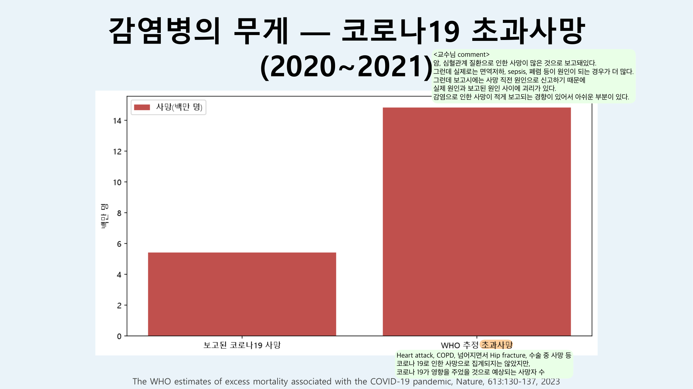
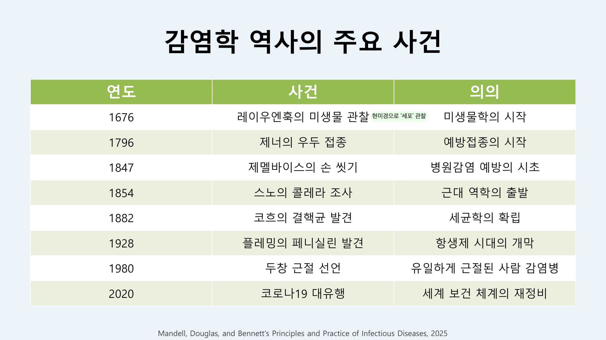

<!-- 필기본: 2026 · 2025 -->
<!-- 단계: 수업 후 -->

# 0. 이 수업을 공부하는 법

김신우 교수님의 감염학 첫 수업으로, 감염학 전체의 지도를 그려 주는 강의다. 2026년 강의는 슬라이드가 새로 만들어져(목차: 서론 → 역사 → 감염의 성립과 발생 기전 → 전파와 인체 방어 → 예방과 관리·현대의 과제 → 임상 사례 → 진료 현장 → 요약) 작년과 순서·내용이 꽤 다르다. 이 1부는 **올해 필기 순서**를 따르고, 작년에만 있던 내용(기출이 나온 곳이 많다)은 `작년 필기와 다른 점` 상자로 남겨 두었다.

- 교수님이 강의 첫머리(필기본 2–3쪽)에 **2022–2025년 이 수업 족보**를 직접 띄워 보여 주셨다: 25년 결핵 미생물 요인·NMS, 24년 예방 전략·과제–대응 전략, 23년 노인 발열·tropism, 22년 방어벽(NK)·베이즈 정리. → 2부 1–9번. 매년 1–2문항, **표 한 칸이나 정의 하나를 그대로 묻는** 쉬운 문제다.
- 교수님 말씀: "감염내과 문제에서는 **임상 상황을 주는 것**을 좋아한다." 올해는 임상 사례(사례 1–3, 응급실)가 새로 들어왔으니 사례형으로 나올 수 있다.
- 2부 10–29번은 옛 본2 감염학(2020–2022) 면역·병원체 문항으로, 이 수업의 "인체 방어" 단원과 겹쳐서 여기 모였다. 개념 정리용으로 풀어 보면 된다.

!!! key "핵심"
    올해 필기의 뼈대는 맺음말 한 문장이다 — **어떤 병원체가, 어떤 숙주에, 어떤 경로로 — 그리고 어느 고리를 끊을 것인가.** 3요소(병원체·숙주·환경) → 오염·집락·감염 구별 → 감염의 사슬 → 예방·관리 순으로 이 질문에 답해 가며 읽자.

# 1. 서론

## 감염과 감염병의 정의
- **감염(infection)**: 병원체가 조직에 **침입해 증식**하는 것. 필기: "증식 = 번식한다와 같은 표현". 감염이 있어도 증상이 있을 수도, 없을 수도 있다 → 증상이 있으면 **clinical infection**, 없으면 **subclinical(불현성) infection**.
- **감염병(infectious disease)**: 감염의 결과 **증상과 징후가 나타난 상태**. 즉 "감염 ⊃ 감염병" — 감염이 있다고 다 병은 아니다.
- **병원체**: 세균, 바이러스, 진균, 원충, 연충, **프리온**. 필기: 기생충(원충·연충)까지 병원체에 포함된다.
- **핵심 특성: 전파 가능성** — 감염병이 다른 병과 구별되는 점은 사람에서 사람(또는 동물·환경에서 사람)으로 **옮겨 갈 수 있다**는 것.
- **불현성 감염과 보균 상태도 전파의 원천**: 증상이 없어도 균을 내보낼 수 있다(예: 장티푸스 보균자). 그래서 증상 있는 환자만 격리해서는 유행을 다 막지 못한다.

## 오염, 집락, 감염 — "미생물이 있다고 모두 감염은 아니다"

| 구분 | 정의 | 숙주 반응 |
|---|---|---|
| **오염(contamination)** | 표면에 **단지 존재** | 없음 |
| **집락(colonization)** | 붙어서 **증식하지만** | **숙주 반응 없음** |
| **감염(infection)** | **조직 침범** | **숙주 반응 있음**(염증, 증상) |

- 필기 그림 메모: 집락 = "번식을 하여 자녀를 낳으면", 감염 = "안으로 파고 들어가면". "감염되면 무조건 증상이 있냐? → X"(불현성 감염).
- **임상 예(필기)**: 두통 환자의 뇌척수액(CSF) 검사에서 **coagulase 음성 포도알균(CoNS)**이 배양되었다. 그런데 CSF **세포 수(cell count)가 정상**이다 → 숙주 반응이 없으므로 감염도 집락도 아니고, 피부 상재균이 천자(tapping) 과정이나 실험실에서 섞여 들어간 **오염균**일 것이다. 두통은 포도알균 때문이 아니다.
- 교수님: "All that glitters is not gold(반짝이는 것이 모두 금은 아니다)" — 배양에서 균이 나왔다고 모두 원인균은 아니다. 요약 슬라이드에도 "오염·집락·감염 구별"에 형광펜과 **"잘 구별하십시오"**.

!!! memo "암기"
    오염 = 있기만 함 / 집락 = 증식 O, 숙주 반응 X / 감염 = 조직 침범 + 숙주 반응. 배양 양성 ≠ 감염 → 세포 수·염증 소견 같은 **숙주 반응**으로 판단.

!!! new "올해 필기에서 추가"
    **감염병의 무게 — 코로나19 초과사망(2020–2021)**. 보고된 코로나19 사망은 약 540만 명이지만, WHO가 추정한 **초과사망**은 약 1,490만 명으로 3배 가까이 된다. 초과사망 = 코로나19로 집계되지는 않았지만 코로나19가 영향을 주었을 것으로 보이는 사망(심근경색, COPD, 넘어져서 생긴 고관절 골절, 수술 중 사망 등).

{: style="width:66%"}

- 교수님 comment: 사망 통계에는 암·심혈관 질환이 많게 나오지만, 실제로는 면역저하·패혈증(sepsis)·폐렴 같은 **감염이 원인인 경우가 더 많다**. 사망 신고 때 **사망 직전 원인**을 적기 때문에 실제 원인과 보고된 원인이 어긋나고, 감염으로 인한 사망은 **적게 보고되는 경향**이 있다.

!!! diff "작년 필기와 다른 점"
    작년(2025) 필기는 "감염학의 정의와 중요성"으로 시작했다 — 감염학은 미생물과 숙주의 상호작용, 감염병의 발생 기전·예방·진단·치료·관리를 연구하는 학문이고, 세균학·바이러스학·진균학·기생충학을 포함하며 면역학·역학·공중보건학과 밀접하다. 중요성의 예로 COVID-19 팬데믹. 교육 성과는 "감염병의 **발생과 방어, 예방, 관리**를 설명할 수 있다". 올해는 이 슬라이드 대신 위의 정의·오염/집락/감염·초과사망으로 바뀌었다.
    또 작년에는 오염·집락·감염 예로 "B형간염 바이러스가 오랫동안 증상 없이 있다가 간암(hepatoma)으로 나타나기도 한다"(subclinical infection)가 있었다.

# 2. 감염학의 역사

교수님: "의학의 역사에서 배웠겠지만 감염학의 역사만 가볍게 보고 넘어가겠습니다." 연도와 인물을 **"누가 – 무엇을 – 왜 의미 있나"** 짝으로 기억하면 충분하다.

## 근대 이전의 역병
- **기원전 430년 아테네 역병**: 항구 **피레우스**로 들어왔다. 감염병은 예전부터 역병(plague)이라는 이름으로 있었고, **항구 도시를 중심으로** 많은 사람이 갑자기 죽었다 → 사람·물자의 이동이 감염 확산의 통로.
- **1346–1353년 흑사병(Black death, 페스트)**: 유럽 인구의 **1/3–1/2** 사망 추정.
- **1520년 아스텍의 두창(천연두)**: 'Columbian exchange' — 콜럼버스 이후 유럽인이 신대륙에 두창을 퍼뜨렸고, 칼에 찔려 죽은 사람보다 두창으로 죽은 사람이 더 많았다.
- **미아스마(miasma) 이론**: 오랜 정설은 "나쁜 공기가 병을 일으킨다"였다. 말라리아(mal + aria = 나쁜 공기)라는 이름도 여기서 왔다.
- **1546년 프라카스토로**: 병을 옮기는 **보이지 않는 씨앗**(contagion) 개념.
- **1676년 레이우엔훅**: 직접 만든 현미경으로 **미생물을 처음 관찰**. 필기: 프라카스토로–레이우엔훅을 묶어 "전파되는 something이 있다!"

## 예방의 발견
- **1796년 제너**: **우두 접종** → **예방접종의 시작**. 교수님: "전 세계에서 가장 많은 사람을 살린 사람을 고르라면 제너."
- **1847년 제멜바이스**: **손 씻기로 산욕열 감소** → 병원감염 예방의 시초. 처음 주장했을 때는 미친 사람 취급을 받았지만 훗날 옳다는 것이 입증되었다.
- **1854년 (존) 스노**: 런던 **브로드가 펌프**와 콜레라 — 펌프 손잡이를 떼어 내자 콜레라가 잦아들었다(오염된 물이 원인) → **상하수도를 분리**하는 계기, **근대 역학의 출발**.
- **1867년 리스터**: **석탄산(페놀)**으로 수술 부위·상처를 소독하는 **방부 수술**.

## 원인의 증명
- **1860년대 파스퇴르**: **자연발생설 반박** — "생명은 생명으로부터 나온다"(쓰레기 더미에서 갑자기 쥐가 생기는 게 아니다). **1885년 광견병 백신**을 사람에게 사용.
- **코흐**: **탄저균 1876, 결핵균 1882, 콜레라균 1883** 발견. **코흐의 공준(가설)** — 특정 병원체가 특정 질병의 원인임을 증명하는 기준(병변에서 늘 발견 → 순수 분리·배양 → 접종하면 같은 병 → 다시 분리). → 세균학의 확립.
- **1892년 이바노프스키**: 세균 여과기를 통과하는 **여과성 병원체** = 바이러스("눈에 보이지 않지만 여과되는 병원체가 있다").

## 치료의 시대와 신종 감염병
- **1928년 페니실린**(Alexander Fleming, 1·2차 세계대전에 사용), **1930년대 설파제**, **1940년대 스트렙토마이신**(최초의 아미노글리코사이드계 항생제, 결핵 치료).
- **1980년 두창 근절 선언** — 사람 감염병 가운데 **근절된 유일한 사례**.
- **AIDS 1981**(폐포자충 폐렴 환자 5명에서 처음 발견), **SARS 2003**(홍콩에서 시작해 전 세계로), **신종 인플루엔자 2009**(지금 도는 H1N1이 2009년형).
- **메르스 2015(한국)**: 사망률 약 20%, 지금은 사우디아라비아의 풍토병. **코로나19 2020**: 2020년 2월 대구 신천지에서 국내 대유행 시작(이때 교수님이 무척 바쁘셨고, '번아웃'이라는 말도 이때 나왔다고).

## 감염학 역사의 주요 사건 (표)

{: style="width:70%"}

| 연도 | 사건 | 의의 |
|---|---|---|
| 1676 | 레이우엔훅의 미생물 관찰 | 미생물학의 시작 |
| 1796 | 제너의 우두 접종 | **예방접종의 시작** |
| 1847 | 제멜바이스의 손 씻기 | **병원감염 예방의 시초** |
| 1854 | 스노의 콜레라 조사 | **근대 역학의 출발** |
| 1882 | 코흐의 결핵균 발견 | 세균학의 확립 |
| 1928 | 플레밍의 페니실린 발견 | 항생제 시대의 개막 |
| 1980 | 두창 근절 선언 | **유일하게 근절된 사람 감염병** |
| 2020 | 코로나19 대유행 | 세계 보건 체계의 재정비 |

요약 슬라이드의 한 줄: **1676 미생물 → 1796 백신 → 1928 페니실린 → 1980 두창 근절**. 교수님: "미지의 시대에서 지금은 PCR의 시대가 되었다."

!!! diff "작년 필기와 다른 점"
    - 레이우엔훅 미생물 발견 연도: 작년 연표 **1683** → 올해 **1676**(첫 관찰 연도로 통일).
    - 작년 연표에만 있던 것: 히포크라테스 『전염병에 관하여』(BC 400년경), 파스퇴르 발효 이론(1861, germ theory의 기초), 코흐 탄저균(1876, 분리·배양 기술), 폰 베링 디프테리아 **혈청요법**(1891), 도마크 설파제(1935, 화학요법제의 시작), 왁스만 스트렙토마이신(1944, 결핵 치료의 혁명), WHO 천연두 퇴치 프로그램(1967), HIV 발견(1983), **WHO DOTS**(1995, 결핵 관리의 세계 표준), SARS·H1N1·COVID-19(국제 협력, 팬데믹 대응체계).
    - 작년 인물 이야기: 매독(페니실린 전까지 수은 치료), 아스돗 역병, 레벤후크(현미경 400개 이상, 의미는 몰랐다), 산토리오(체온계·맥박계로 정량 측정), 나이팅게일(위생·환기, 현대 간호학), 파스퇴르의 저온살균.

<!-- 아래는 수업 전판(작년 필기) — 올해 필기로 고쳐 쓰는 중 -->

# 3. 감염의 3요소

## 숙주 · 미생물 · 환경
감염병은 세 요소의 **균형이 깨질 때** 생긴다.

| 요소 | 포함되는 것 |
|---|---|
| **숙주 요인** | 유전적 감수성, 연령, 면역 상태, 영양 상태, 기저 질환 |
| **미생물 요인** | 병원성, 감염력, **항생제 내성**, 유전적 변이 (+ 잠복 능력, 독소 생산 등) |
| **환경 요인** | 기후, 인구 밀도, 위생 상태, 사회경제적 조건 |

헷갈리기 쉬운 포인트: "노령으로 방어력이 떨어짐", "면역저하"는 **숙주** 요인이고, "과밀한 주거", "대기오염"은 **환경** 요인이다. **균 자체의 성질**(잠복할 수 있는 능력, 내성, 변이, 독소)만 미생물 요인이다.

!!! exam "기출 포인트"
    2부 1번(2025): 결핵 환자에서 "미생물 요인"을 고르는 문제 — 보기 중 균의 성질은 **결핵균의 잠복 능력** 하나뿐이고, 면역저하·노령(숙주), 과밀환경·대기오염(환경)은 함정이다.

## 3요소 분석 사례

| 감염병 | 숙주 요인 | 미생물 요인 | 환경 요인 |
|---|---|---|---|
| COVID-19 | 연령, 기저질환, 면역 상태 | 전파력, 변이 능력 | 인구 밀도, 거리두기 정책 |
| 결핵 | HIV 감염, 영양 상태, 흡연 | **항생제 내성, 잠복 능력** | 빈곤, 과밀 주거 |
| 말라리아 | 겸상적혈구 유전자, 임신 | 약제 내성 | 기후, 모기 서식 환경 |
| 콜레라 | 혈액형, 위산 분비 능력 | 독소 생산, 바이오필름 | 수질 오염, 위생 시설 부족 |
| 인플루엔자 | 연령, 만성 질환 | 항원 변이, 전파력 | 계절성, 글로벌 이동 |

## 3요소의 상호작용

| 유형 | 예시 | 영향 |
|---|---|---|
| 숙주–미생물 | HIV와 **CCR5 유전자 변이** | 변이 보유자는 HIV에 저항성 ↑ |
| 미생물–환경 | 인플루엔자와 습도 | **낮은 습도**에서 바이러스 생존 ↑ |
| 숙주–환경 | 대기오염과 호흡기 감염 | 호흡기 감염 위험 ↑ |
| 3요소 복합 | 기후변화와 말라리아 | 말라리아 위험 인구 증가 |

# 4. 병원체의 종류와 감염 발생 기전

## 감염·원인체·숙주·내성의 관계
감염을 치료하려고 항생제를 쓰면 원인균뿐 아니라 **정상균무리(normal flora)**도 영향을 받는다. 이 과정에서 내성균이 선택되므로, 감염–원인체–숙주–내성은 서로 얽혀 있다.

## 병원체 여섯 가지

| 병원체 | 특징 | 예 |
|---|---|---|
| 프리온 | 비정상 단백질 입자 | 크로이츠펠트-야콥병 (신경과에서) |
| 바이러스 | 세포 안에서만 증식하는 비세포성 | 인플루엔자, 코로나, 홍역, 수두, 에볼라 |
| 세균 | **세포벽**이 있는 원핵세포 | 결핵, 콜레라, 페스트, 디프테리아 |
| 진균 | 균사·포자, 진핵세포 | 칸디다증, 백선, 무좀 |
| 원생동물 | 단세포 진핵생물 | 말라리아, 톡소플라즈마증 (기생충학에서) |
| 기생충 | 다세포, 숙주에 기생 | 조충(무구·유구조충), 선충(회충·편충·요충), 흡충(간·폐흡충) |

필기에는 바이러스·세균은 미생물학에서, 원생동물·기생충은 기생충학에서, 프리온은 신경과에서 자세히 배운다고 적혀 있다.

## 미생물의 침입: 침입 경로 → 부착 → 침투
1. **침입 경로**: 호흡기, 소화기, 피부, 성접촉, 수직 감염.
2. **부착(adhesion)**: 미생물 표면의 **접착소(adhesin)**가 숙주 세포의 **수용체**에 결합한다.
3. **침투(invasion)**: 세포 안으로 들어가(세포 내 기생) 또는 세포 사이로 이동해(예: 리스테리아) 면역을 피한다.

## 오염 → 집락 → 감염
- **오염(contamination)**: 균이 그냥 존재.
- **집락(colonization)**: 균이 붙어서 번식.
- **감염(infection)**: 균이 조직으로 침범. 증상이 있으면 clinical infection, 없으면 **subclinical infection**.
- 필기 예: B형간염 바이러스가 오랫동안 증상 없이 있다가 간암(hepatoma)으로 나타나기도 한다.

## Tropism(친화성)과 접착 기전
병원체가 특정 조직만 감염시키는 이유는 **어떤 접착소가 어떤 수용체에 붙는가**로 설명된다 — 그래서 tropism은 "감염병 병원체 해석의 열쇠".

| 접착소 | 예 | 수용체 |
|---|---|---|
| Type I pili (Fim) | 요로병원성 *E. coli* | 요로상피 uroplakin의 mannose |
| Type P pili (Pap) | 요로병원성 *E. coli* | galactose 이당류 |
| Type IV pili (Tfp) | *N. gonorrhoeae* | CD46, CR3, I domain 포함 integrin |
| MSCRAMM (SdrC) | *S. aureus* | β-neurexin |
| Opa | *N. meningitidis* | CEACAMs |
| Flagellum (FliC) | *P. aeruginosa* | asialo-GM1 ganglioside |

{: style="width:78%"}

미생물별 접착 특성(위 표)도 그대로 정리하면:

| 미생물 | 질환 | 접착 기전 |
|---|---|---|
| ***Neisseria gonorrhoeae*** | 임질 | **fimbriae가 생식기 상피에 붙음** |
| *E. coli* | 설사 | fimbrial adhesin |
| *Shigella* | 이질 | fimbriae가 장 상피에 붙음 |
| *Mycoplasma* | 폐렴 | 끝의 특수 돌기가 폐 상피에 융합 |
| *P. aeruginosa* | 화상·폐 감염 | fimbriae + slime layer |
| *S. pyogenes* | 인두염, 농가진 | lipoteichoic acid와 협막 |
| *S. mutans* | 충치 | dextran slime layer로 치아 표면에 붙음 |
| 인플루엔자 | 인플루엔자 | 바이러스 spike가 세포 수용체에 |
| 폴리오 | 소아마비 | capsid 단백질이 수용체에 |
| HIV | AIDS | spike가 **백혈구** 수용체에 |
| *Giardia* | 지아르디아증 | 아래쪽 흡반으로 장 표면에 |

필기 메모(필기에 '23 기출' 표시): 임질균은 **생식기 점막**을 좋아하고(근육은 안 좋아함), *Shigella*는 **대장(colon)**을, 폴리오바이러스는 **말초 신경**을 좋아한다 — tropism의 예. 형광펜: 임질균, *E. coli*, 녹농균, *S. pyogenes*, 폴리오.

!!! exam "기출 포인트"
    2부 6번(2023): "fimbriae attach to genital epithelial cells"에 해당하는 미생물 — 표에서 **임질균(*N. gonorrhoeae*)** 줄. *E. coli*(장/요로), *S. pyogenes*(인두), *S. mutans*(치아)는 부착 부위가 다르다.

## 정상균무리와 침입 경로별 확산
- 사람의 **비멸균 부위**(피부, 구강·인두, 대장, 질 등)에는 정상균무리가 산다. 혀 표면에도 여러 종류의 세균이 정상적으로 있다.

| 병원체 | 주요 침입 경로 | 주요 확산 방식 |
|---|---|---|
| 인플루엔자 | 호흡기 | 직접 확산 |
| HIV | 성접촉, 혈액 | 혈행성 |
| 결핵균 | 호흡기 | 림프계 |
| 살모넬라 | 소화기 | 혈행성 |
| 광견병 | 피부(동물 교상) | 신경계 |

## 감염병의 단계

| 단계 | 설명 | 예 |
|---|---|---|
| 잠복기 | 노출 ~ 증상 발현 | HIV 2–4주 |
| 전구기 | 초기 비특이 증상 | 인플루엔자: 피로, 미열 |
| 질병기 | 질병이 완전히 나타남 | COVID-19: 발열, 기침, 호흡곤란 |
| 회복기 | 회복 | 간염: 간 기능이 점차 회복 |
| 보균 상태 | 증상 없지만 전염성 있음 | 장티푸스 만성 보균자 |

## 증식과 확산
- **증식**: 세균은 이분열(대장균 약 20분마다), 바이러스는 숙주 세포의 기구를 이용(HIV는 하루 1010개), 진균은 비교적 느리다.
- **확산**: 혈행성(패혈증, HIV), 림프계(결핵의 폐 외 전파), 신경계(광견병), 직접 확산(피부 감염).

# 5. 숙주 조직 손상 기전

## 직접적 손상 — 균이 직접 망가뜨림
1. **세포 용해**: 바이러스가 숙주 세포를 터뜨림(인플루엔자).
2. **독소 생산**: 세균 독소가 세포를 손상(디프테리아 독소).
3. **효소 생산**: 조직 분해 효소(연쇄구균의 히알루로니다아제).

## 간접적 손상 — 우리 몸의 반응이 망가뜨림
1. **염증 반응**: 과도한 면역 반응(폐렴의 폐 손상, cytokine storm, ARDS).
2. **자가면역 반응**: 감염 후 자가항체(류마티스열의 심장 판막 손상).
3. **면역복합체**: 항원–항체 복합체가 조직에 쌓임(만성 B형간염의 신장 손상).

필기 보충: B형간염이 간암을 일으키는 것도 간접 손상이다. 몸이 바이러스를 계속 죽이려 하며 **염증 → 재생(regeneration)을 반복**하다가 재생 과정에서 오류가 생겨 암이 된다.

# 6. 감염 경로

## 다섯 가지 전파 경로
| 경로 | 내용 | 필기 예 |
|---|---|---|
| 직접 전파 | 신체 접촉, 체액, 호흡기 비말 | |
| 간접 전파 | 매개물(**fomite**), 식품, 물 | 키보드·전화기 같은 공용 물품 |
| 공기 매개 | **비말핵** | 결핵 |
| 매개체 전파 | 절지동물, 척추동물 | 모기, 진드기, 빈대 |
| 수직 전파 | 태내, 분만 중, 모유 | 엄마 → 아이 |

## 주요 감염병의 전파 경로
| 감염병 | 직접 | 간접 | 공기 | 매개체 | 수직 |
|---|---|---|---|---|---|
| 인플루엔자 | ○ | ○ | ○ | | |
| 결핵 | | | ○ | | |
| 노로바이러스 | ○ | ○ | | | |
| 말라리아 | | | | ○ | |
| HIV | ○ | | | | ○ |
| B형간염 | ○ | | | | ○ |

교수님 강조: **경로를 차단하면 병을 컨트롤할 수 있다.**

## 경로별 예방 전략
| 경로 | 예방 전략 |
|---|---|
| 직접 | 손 위생, 개인보호구, 격리 |
| 간접 | 환경 소독, 식품 안전, 안전한 물 |
| 공기 | 환기, **음압 격리, N95 마스크** |
| 매개체 | 매개체 관리, 살충제, 예방적 약물 |
| 수직 | 산전 검사, 예방적 약물, 제왕절개 |

예: 여름·가을 SFTS(진드기 매개)를 피하려면 야외활동을 줄이는 등 매개체 노출을 줄인다.

# 7. 인체 방어기전

## 선천성 면역
1. **물리적 장벽**: 피부(각질층, 지방산), 점막(점액, 섬모 운동). 교수님: **피부가 가장 중요하다!**
2. **화학적 방어**: 항균 펩타이드(디펜신, 카텔리시딘), 보체(30여 가지 단백질). 위산(pH 2–4)에 대부분의 세균이 죽는다.
3. **세포성 방어**: 식세포(대식세포, 호중구), NK 세포, 수지상세포(항원 제시).
4. **염증 반응**: 혈관 확장, 투과성 증가, 백혈구 침윤, IL-1·TNF-α.

## 일상의 방어: 기침, 배설, 체위 변경
- 기침·재채기·침 흘리기 같은 물리적 배출도 방어다. 다만 **재채기는 폭발적으로 퍼져** 호흡기 전파는 통제가 어렵다 — 약이 나오기 전까지는 사회적 거리두기 말고는 할 수 있는 게 없었다(1918 스페인 독감, 코로나).
- **소변을 비우지 못하면** 역행성(retrograde) 감염이 잘 생긴다 → 이런 환자는 도뇨관(간헐적 도뇨)을 쓴다.
- **움직이지 못하면 욕창**이 생긴다(경추 손상 환자 등): 눌린 피부가 무너지고 그리로 균이 들어간다. 잘 때 움직이는 것도 방어기전이다.
- 식세포 작용은 찾기 → 인식 → 삼키기 → 파괴의 단계로 진행된다.

## 획득성 면역
- **체액성**: B 림프구 → 항체(IgG, IgM, IgA, IgE, IgD), 형질세포가 대량 생산, 기억 B 세포가 2차 반응.
- **세포성**: CD4+ T(조절), CD8+ T(감염 세포 제거), 기억 T 세포.
- **항원 제시**: MHC I = 모든 유핵세포 → CD8+ T / MHC II = 전문 APC → CD4+ T.

| 특성 | 선천성 | 획득성 |
|---|---|---|
| 특이성 | 비특이적 | 특이적 |
| 반응 속도 | 즉각 | 지연(수일–수주) |
| 기억 | 없음 | 있음 |
| 구성 | 장벽, 보체, 식세포 | T·B 세포, 항체 |
| 진화적 보존 | 높음 | 척추동물에 한정 |

## 주요 면역 세포와 조절
| 세포 | 기능 |
|---|---|
| 호중구 | 급성 염증, 식균 |
| 대식세포 | 식균, 항원 제시, 사이토카인 |
| 수지상세포 | 항원 제시, T 세포 활성화 |
| NK 세포 | 바이러스 감염 세포·암세포 제거 |
| B 세포 | 항체, 항원 제시 |
| CD4+ T / CD8+ T | 다른 면역세포 조절 / 감염세포 제거 |
| 조절 T 세포 | 면역 억제, 자가면역 예방 |

필기: 이런 세포에 결함이 있으면 보통 어릴 때 사망한다(→ 선천성 면역결핍 수업).

- 조절: 전염증성(IL-1, TNF-α, IL-6) vs 항염증성(IL-10, TGF-β) 사이토카인, 조절 T 세포, 면역 관용(중심 = 흉선, 말초).

# 8. 감염병 예방과 관리

## 예방 전략
1. **개인 위생**: **손 씻기 20초 이상**, **알코올 기반 손 소독제**, 호흡기 예절(기침·재채기 때 **입과 코를 모두** 가리기), 마스크 착용(호흡기 감염 **예방**), 개인보호구.
2. **예방 접종**: 생백신, 불활성화 백신, 아단위 백신, 톡소이드 → 개인 보호 + **집단 면역**.
3. **환경 위생**: 식품 안전, 수질(식수·하수), 공공장소 소독·환기, 매개체·폐기물 관리.

!!! exam "기출 포인트"
    2부 3번(2024): 옳은 예방 전략 = **알코올 기반 손 소독제**. 함정은 손 씻기 "10초"(→ 20초), 마스크는 "증상 있을 때만"(→ 예방적으로), 호흡기 에티켓 "입만"(→ 입과 코), 일회용 보호구 재사용.

## 관리 전략
1. **감시 체계**: 능동적, 수동적, 전자 감시.
2. **조기 발견·보고**: 조기 경보, 신속 진단, 보고 체계.
3. **격리와 차단**: 격리(isolation, 환자), 검역(quarantine, 노출자), 사회적 거리두기 — 결핵·코로나처럼 호흡기로 퍼지는 병.
4. **접촉자 추적·관리**.
5. **매개체 관리**.

| 전략 | 장점 | 단점 | 사례 |
|---|---|---|---|
| 능동적 감시 | 정확·포괄적 | 비용·인력 큼 | 메르스 접촉자 전수조사 |
| 수동적 감시 | 적은 비용으로 넓게 | 보고 지연·누락 | 법정감염병 보고 |
| 격리 | 확산 차단 효과적 | 자유 제한, 경제 영향 | COVID-19 확진자 격리 |
| 접촉자 추적 | 조기 발견·확산 방지 | 개인정보, 노동집약 | 결핵 접촉자 조사 |
| 매개체 관리 | 전파 사슬 차단 | 환경 영향, 내성, 지속 관리 | 말라리아 모기 방제 |

# 9. 현대 감염학의 과제와 신기술

## 과제 ↔ 대응 전략
| 과제 | 대응 전략 |
|---|---|
| **항생제 내성** | 적정 사용 관리, 새 항생제 개발, **대체 치료(박테리오파지 등)** |
| **신종 감염병** | **조기 경보 시스템**, 신속 진단, 플랫폼 백신 |
| **기후변화** | **매개체 감시 강화**, 기후–감염병 연구, 적응 전략 |
| **의료관련감염** | 감염관리 프로그램, **의료진 교육**, 새 소독·멸균 기술 |

!!! exam "기출 포인트"
    2부 4번(2024): 옳게 연결된 것 = **항생제 내성 – 박테리오파지 연구**. 나머지는 칸을 바꿔 놓은 함정(신종 감염병 – 조기 경보가 맞고, "항생제 사용 제한"은 내성 쪽; 기후변화 – 매개체 감시; 의료관련감염 – 교육·감염관리).

## 항생제 내성 관리
- 항생제를 만들면 내성이 생기고, 또 만들면 또 생긴다 → **꼭 필요할 때만, 적재적소에** 써야 한다.
- 관리: 적절한 사용, 새 항생제, **항생제 스튜어드십**, 의료진·대중 교육, 감염 예방으로 사용 자체를 줄이기.
- "**항필제사**" — 항생제는 필요할 때만 제대로 사용하자(교수님이 대한항균요법학회장 때 만든 말). 제한된 자원을 아껴 쓰자는 뜻.

## 신종 감염병 대응과 신기술
- 대응: 조기 경보, **국제 협력**, 신속 진단, 유연한 백신 플랫폼, **원헬스(One Health)**(사람–동물–환경을 함께 봄).
- 신기술: 빅데이터·AI(유행 예측, 내성 패턴, 신약), 유전체 분석(병원체 동정, 경로 추적, 내성 유전자), 모바일 헬스(접촉자 추적, 증상 모니터링), 원격 의료(감염 위험 감소, 격리 환자 관리).

# 10. 발열

## 체온의 기록과 정상 체온
- **분더리히**(19세기 중반): 수천 명의 체온을 기록하며 **체온표(열 곡선)**를 처음 썼다 — "열 잰 사람".
- 건강인 구강 체온의 기준은 약 **37℃**(건강한 지원자 148명 측정 자료). 사람마다, 하루 중에도 조금씩 다르다.
- 측정: 구강(혀 밑, 입 다물고 코로 숨, 3분), 직장(영유아), 겨드랑이(팔로 눌러 약 5분), 이마(적외선), 고막(적외선). 환자에게는 "집에서 재서 기록해 오세요".

## 열형(fever pattern)
| 열형 | 정의 | 예 |
|---|---|---|
| Sustained | 큰 변화 없이 계속 높음 | 장티푸스 |
| Remittent | 오르내리지만 정상 아래로는 안 내려감 | 결핵 |
| Intermittent | 하루 한 번은 정상으로 | 결핵, 농양 |
| Hectic (septic) | 변동이 크고 불규칙, 1.4℃ 초과 | 패혈증 |
| Relapsing | 경과 중 하루 이상 정상 | 말라리아 |

## 발열 환자 접근
- 먼저 **감염 vs 비감염**, 감염이면 **국소 감염**(중추신경계, 호흡기 …) vs **비국소 감염**(말라리아, HIV …)으로 나눈다.
- 신체검진으로 국소 증상을 찾고, 발열 + 국소 소견으로 증후군을 생각한다. "감염질환은 **탐정의 마음으로**" — 단서로 합리적 시나리오를 상상한다.

## 열의 효과와 조절
- 열은 **방어기전**이다(항균·항바이러스·항종양). 열 자체가 몸을 해치지 않으면 굳이 떨어뜨릴 필요가 없고, 해로운 특수한 경우에만 해열제를 쓴다.
- 치명 체온: 하한 약 26℃, 상한 약 43℃.
- 해열 방법: 미온수·알코올 스펀지·선풍기·샤워(물리적), NSAIDs·아스피린(효과 좋지만 혈소판·위장 부작용) → 그래서 보통 **아세트아미노펜**을 우선. 아스피린 + 아세트아미노펜 병용이 단독보다 효과적.

## 발열 vs 고체온 (hyperthermia)
| 항목 | 발열 | 고체온 |
|---|---|---|
| 빈도 | 가장 흔한 징후 | 비교적 드묾 |
| 느낌 | 춥다, 피부 차갑다 | 덥다, 피부 건조·홍조 |
| 체온 | 보통 38–41℃ | 42℃를 넘을 수 있음 |
| 치료 | 해열제 | 물리적 냉각 |
| 중추 조절 | 있음 (set-point **상승**) | 없음 (set-point **정상**) |
| 사망률 | 드묾 | 높음 |

- 고체온의 예: **열사병**, 아트로핀, 갑상선중독, **신경이완제 악성증후군(NMS)**, 악성 고체온증.
- 필기: 고체온은 체온 조절 중추가 고장나 열이 빠져나가지 못하는 상태 — 발열과 다르다. "발열과 고체온이 다르다는 것을 아는지" 묻는 문제가 있었다.

!!! exam "기출 포인트"
    2부 5번(2023): 노인 발열의 임상상 — 노인은 **열이 없을 수도** 있고 섬망(낙상 주의)·보행장애·배뇨장애로 나타난다. **"고체온증이 흔하다"는 틀린 말**(고체온은 비교적 드묾).

## Serotonin syndrome vs NMS
| | Serotonin syndrome | NMS |
|---|---|---|
| 발생 | 24시간 이내 | 수일–수주 |
| 신경근 소견 | 과반응(떨림, **클로누스**, 반사 항진) | **반사 저하, 심한 근육 강직** |
| 원인 약 | 세로토닌 작용제 | **도파민 길항제(항정신병약)** |
| 치료 | 벤조디아제핀, cyproheptadine | **bromocriptine** |
| 회복 | 24시간 이내 | 수일–수주 |

필기: 도파민 길항제나 **정신과 약을 먹던 사람이 41℃, 횡문근융해(CK 상승)**를 보이면 NMS를 생각한다.

!!! exam "기출 포인트"
    2부 2번(2025): 항정신병약 복용 + 고열 + 근육강직 + CK 상승 → **NMS**. 세로토닌 증후군(클로누스·반사 항진, 빠른 발생), 악성 고체온증(마취제), 약열과 구별.

## 중추성 발열과 약열
- **중추성 발열**: 시상하부 set point가 사이토카인으로 올라가거나 시상하부가 직접 손상·압박된 경우. 의심 단서 — ① 다른 설명이 없음 ② **plateau 열 곡선** ③ 해열제에 반응이 나쁨 ④ **상대적 서맥** ⑤ **땀이 줄어듦**. 필기: 중추가 고장나 땀 없이 41–42℃까지 오른다.
- **약열**: 흔한 원인은 항생제 중 **베타락탐(페니실린, 세팔로스포린)**. 흔하진 않지만 꼭 기억할 것 — **allopurinol, carbamazepine, lamotrigine**. 약을 오래 쓰면 면역계가 이물로 인식해 열이 날 수 있다.

!!! memo "암기"
    발열 = set-point ↑, 해열제 효과 / 고체온 = set-point 정상, 물리적 냉각 / NMS = 도파민 길항제 + 강직 + CK ↑ / 약열 = 베타락탐, allopurinol·carbamazepine·lamotrigine

# 11. 요약
- 감염학은 미생물–숙주 상호작용과 감염병의 발생·예방·진단·치료·관리를 다룬다. 숙주·미생물·환경 **3요소의 균형이 깨지면** 감염병이 생긴다.
- 병원체(프리온·바이러스·세균·진균·원생동물·기생충)마다 침입 경로와 발생 기전이 다르고, 잠복기 → 전구기 → 질병기 → 회복기(→ 보균)를 거친다. 전파 경로와 조직 손상 기전을 알아야 예방·치료할 수 있다.
- 방어는 선천성(장벽·화학·세포·염증) + 획득성(체액성·세포성) 면역이 사이토카인과 면역 관용으로 조절되며 함께 일한다.
- 예방은 개인 위생 + 예방 접종 + 환경 관리, 관리는 감시·조기 발견·격리·접촉자 추적. 현대의 과제는 **항생제 내성, 신종 감염병, 기후변화, 의료관련감염**.
