<!-- 필기본: 2026 · 2025 -->
<!-- 단계: 수업 후 -->

# 0. 이 수업을 공부하는 법

**감염병학 증례토의 CP-1**(감염내과 **김신우 교수님**). 조별로 증례를 발표하고 교수님이 영상·사진을 보며 설명하셨다. 슬라이드마다 증례 → 영상 → 질문 3개(①②③) → 답 두 장 → 질환 요약 → **진단 표** → **치료 표** → **From Clue to Cure 그림 요약** 순서로 되어 있다.

필기한 선배(2026): "모든 페이지를 일일이 다 설명하신 건 아니기에 필기나 부연설명이 없는 페이지들도 있습니다." "**올해 케이스가 바뀌었어요!! 문제 유형 등만 참고하시면 되겠습니다.**"

!!! new "올해 필기에서 추가 — Case 1~10이 모두 새 증례"
    2026년 필기는 작년(2025) 증례를 하나도 다시 쓰지 않았다. 올해 증례는 아래 10개이고, 시험 문제도 이 증례들에서 새로 나올 가능성이 높다. 슬라이드에 **진단·치료 표**와 **그림 요약**이 새로 들어갔으니 표 속 수치(약 용량·기간)까지 본다.

| Case | 환자 | 진단 | 핵심 치료 |
|---|---|---|---|
| 1 | 42세 여, **복막투석**, 2개월 마른기침·미열 | **속립성 결핵** | 공기주의, **2HRZE/4HR**, PZA·EMB 간격 연장, pyridoxine |
| 2 | 75세 여, 한쪽 턱·입 주위 통증성 수포 + 같은 쪽 구강 병변 | **삼차신경 V3 대상포진** | **valacyclovir 1 g 하루 3회 7일**, 파종·면역저하면 **정맥 acyclovir** |
| 3 | 84세 여, 3일 상복부 통증, CT 담낭 벽 비후·결석 | **급성 담낭염** | ceftriaxone(또는 cefotaxime) ± metronidazole + **조기 복강경 담낭절제술**(고위험 PTGBD) |
| 4 | 74세 남, 악화된 요통 + 대퇴 방사통, L1–2 | **화농성 척추염** | 안정하면 생검까지 보류, 표적 치료 **6주**(2주 주사 + 4주 경구) |
| 5 | 77세 남, 심부전 입원 중 발열 + 손목·손 종창 | **통풍 vs 감염성 관절염** | **관절천자**(결정 + 배양), NSAID 피하기, 저용량 colchicine·스테로이드 |
| 6 | 55세 여, 우측 고관절 부위 통증, **열 없음**, 혈액배양 GBS | **GBS 감염성 천장관절염** | **penicillin G**·ampicillin, 총 4~6주 |
| 7 | 78세 남, 치매·폐기종, 열·기침 | **흡인성 폐렴 + 가성 기흉(피부 주름)** | **ampicillin-sulbactam**, 혐기균 전용약 불필요 |
| 8 | 51세 여, 인플루엔자 B 양성 5일째 폐렴 | **인플루엔자 폐렴 ± 세균 동반감염** | 48시간 지나도 **oseltamivir** + 경험적 항생제 |
| 9 | 21세 여, 7일 발열·인후통, 양측 편도 삼출 | **EBV 감염성 단핵구증** | 대증, 항생제 재평가, **접촉 스포츠 3~4주 금지** |
| 10 | 72세 남, 1개월 요통, 무열, CRP 3.2 | **결핵성 장요근 농양** | **HRZE**, 골관절 결핵 **9~12개월**(필기 손글씨), 큰 농양은 CT 유도 배액 |

!!! diff "작년 필기와 다른 점 — 2025년 증례는 올해 빠졌다"
    작년(2025) Case 1~10은 VP shunt 감염, 선천 림프부종 봉와직염, IUD 방선균증, 간질, 뎅기열, 독성쇼크증후군, 기쿠치병, 수족구병, 폐렴구균 폐렴, 당뇨발이었다. 올해 필기에는 하나도 없지만 **2부 기출 23문항은 전부 이 작년 증례들에서 나왔다**(같은 증례가 해마다 반복 출제). 그래서 지우지 않고 이 문서 뒤쪽 **11~20단원**에 그대로 두었다. 올해 필기본 2~8쪽에도 선배가 2022~2025년 기출을 모아 붙여 두었다.

!!! key "핵심 — 올해 증례에서 반복되는 원칙"
    - **검체 먼저, 그다음 항생제**: 혈액배양 2세트·관절액·생검을 확보하고 시작한다. 단, **쇼크·패혈증·진행성 신경 결손**이면 기다리지 않는다(Case 4).
    - **감염원 조절**(source control)이 항생제보다 중요: 담낭절제·배액(Case 3), 관절 세척(Case 5), 농양 배액(Case 6, 10).
    - **열이 없다고 감염을 배제하지 않는다**(Case 6 천장관절염, Case 10 결핵 농양). 반대로 **열의 원인이 감염만은 아니다**(Case 5 통풍).
    - 우리나라 감염내과 습관: 관절·척추 감염에 MRSA 위험이 없으면 **vancomycin을 처음부터 쓰지 않는다**(교과서는 vancomycin 포함).
    - **결핵**이 두 번(Case 1 폐·속립, Case 10 폐외) 나온다 — HRZE, 기간, 투석 용량, pyridoxine을 묶어서 외운다.

# 1. Case 1 — 복막투석 환자의 속립성 결핵

> 42세 여자. **말기신장병으로 복막투석** 중. **2개월 전부터 마른기침과 미열**이 반복되었고, 최근 1주 동안 전신 쇠약과 식사량 감소가 심해졌다. 결핵 과거력은 없다.

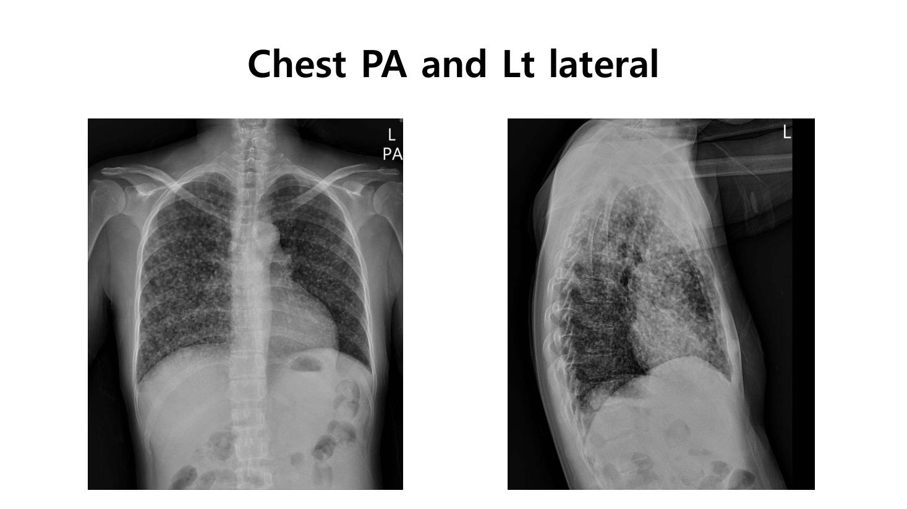{: style="width:62%"}

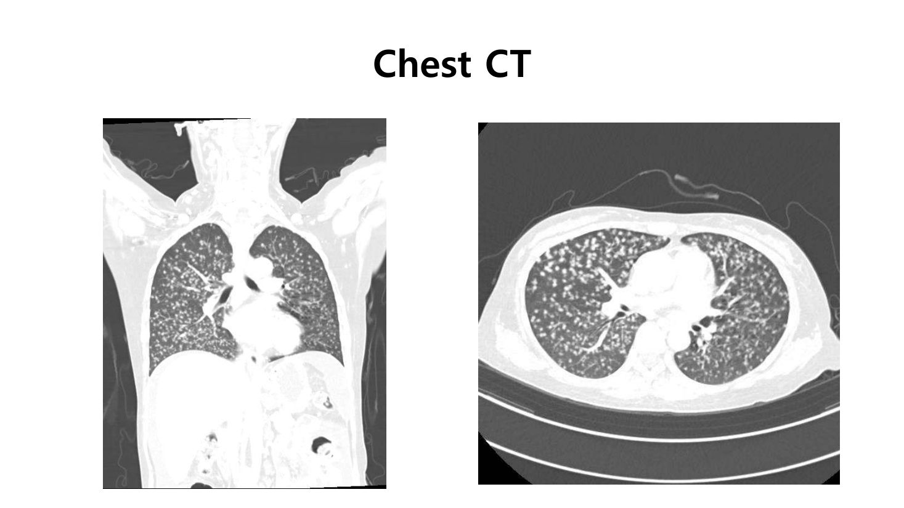{: style="width:62%"}

질문: ① 가장 의심되는 진단과 중요한 감별진단? ② 확진에 필요한 검사와 결과 확인 전 필요한 격리 조치? ③ 치료 계획과 복막투석 환자에서 치료약 투여 시 주의점?

## ① 진단 — 무작위 미세결절의 해석

- **속립성 결핵**(miliary tuberculosis, 粟粒 = 좁쌀): 결핵균이 **혈류를 타고 온몸에 퍼져**(혈행성 파종, hematogenous spread) 폐에 **1~3 mm 미세결절**이 **무작위(random)**로 깔린 상태. 2개월간의 기침·미열과 영상이 이를 시사한다.
- **왜 "무작위"가 중요한가**: 결절이 **흉막과 엽간열(fissure)까지 고르게** 분포하면 혈관을 따라 균이 뿌려졌다는 뜻(혈행성). 기도를 따라 퍼지는 결핵(소엽중심성·나무싹 모양)과 분포가 다르다.
- **감별진단**: 같은 무작위 분포를 만드는 **혈행성 폐전이**(갑상선암·신세포암 등)와 **파종성 진균감염**(히스토플라스마 등). 슬라이드: "분포 양상으로 병원체를 확정할 수는 없다" → 결국 균을 찾아야 한다.
- 손글씨: 결핵균이 폐포에 도달해 감염을 일으키고 혈행성 전파가 이루어진 것으로 보인다.

## ② 검사와 격리

- **즉시 공기주의**(airborne precaution): 음압 1인실, N95. 손글씨: "**공동성 폐결핵(cavitary)이 있는 사람보다는 전염성이 낮지만 그래도 공기주의는 필요**하다. cf) 공동성 폐결핵은 결핵균을 기도로 많이 배출해서 전염력이 높다."
- **객담 항산균(AFB) 도말·배양 + 결핵 핵산증폭검사**(NAAT, Xpert MTB/RIF). 객담이 안 나오면 **유도객담**을 먼저, 필요하면 **기관지내시경**(세척액·조직검사).
- 손글씨(진단 표 위): "**결핵의 확진은 두 가지 방식으로! 배양 양성 or PCR 양성. 근데 AFB 도말 양성으로는 확진할 수 없다.**" — 도말 양성은 항산균이 있다는 뜻일 뿐 결핵균인지 비결핵항산균(NTM)인지 구별하지 못하기 때문.

## ③ 초기 치료 — 복막투석 환자

- **검체를 확보한 뒤** 활동성 결핵 가능성이 높으면 **배양 결과를 기다리지 않고 HRZE 시작**(그림 요약 띠: "Do not wait for culture: start HRZE after specimens if suspicion is high").
- 약제감수성이 확인되고 특별한 장기 침범이 없으면 **2HRZE/4HR**: isoniazid(H)·rifampin(R)·pyrazinamide(Z)·ethambutol(E) 2개월 → isoniazid·rifampin 4개월, 총 6개월.
    - 손글씨: 초기 감염 조절을 위해 **ethambutol(포함 4제)을 2개월** 투여한 다음, 남은 결핵균 제거·재발 방지를 위해 isoniazid·rifampin을 투여.
- **복막투석에서 용량 조정**:
    - **Isoniazid·rifampin**: 간에서 대사 → **통상 용량**.
    - **Pyrazinamide·ethambutol**: 콩팥으로 배설 → **축적 위험** → **투여 간격을 늘린다**. 손글씨: "**PZA와 EMB는 투석 환자에게 주 최대 3회** 투여한다. **Ethambutol은 optic neuropathy(시신경병증)**를 일으킬 수 있어서 특히 주의해야 한다."
    - 복막투석 약동학 자료는 제한적이다.
- **치료 중 확인**: **pyridoxine(비타민 B6) 병용**, **시력·색각**(ethambutol), **간기능**(H·R·Z 간독성), **약물 상호작용**(rifampin은 CYP 강력 유도제). 신경계 증상이 있으면 **중추신경계(수막) 침범** 평가.

## 속립성 결핵 정리

| 항목 | 내용 |
|---|---|
| 정의 | 결핵균의 혈행성 파종, 1~3 mm **무작위 미세결절** |
| 위험군 | 면역저하, **말기신장병·투석**, 고령, 영유아 |
| 증상 | 수주~수개월의 발열·기침·체중감소 — 비특이적 |
| 침범 | 간·비장·골수·**수막** 등 다장기 → **결핵성 수막염 동반 확인** |
| 진단 | 객담 도말·배양·핵산증폭, 필요 시 기관지내시경·조직검사 |
| 치료 | **2HRZE/4HR**, 수막 침범이면 **9~12개월** |
| 감염관리 | 활동성 폐결핵을 배제하기 전까지 **공기주의 격리** |

{: style="width:72%"}

- 임상: 발열·기침·식욕부진·체중감소, 간비장 비대, **맥락막 결절**(안저에서 보이는 결핵 결절) — 증상이 모호할 수 있다.
- 흉부 영상: X선의 **좁쌀 모양 미세결절**, CT의 무작위 분포 미세결절. **초기 X선은 정상일 수 있다**.
- 미생물: 객담·유도객담 **AFB 도말**, 배양, Xpert. **도말 음성이 흔하고, 배양은 최대 8주** 걸린다(빨간 글씨).
- 추가: 기관지내시경, 간·골수 조직검사(**육아종** 확인), 두통·의식 변화 시 **뇌척수액**(수막염 배제).

{: style="width:72%"}

- 표준: HRZE 2개월 → HR 4개월, 감수성 확인 후 조정.
- 복막투석: H·R 통상 용량 / Z·E 투여 간격 연장.
- 부작용 감시: 간기능, 시력·색각, **pyridoxine 병용**(손글씨: isoniazid가 비타민 B6 대사를 방해해 **말초신경병증**이 생길 수 있어 함께 준다), rifampin 상호작용, 매달 증상 확인.
- 기간 연장: **수막 침범 9~12개월 + 스테로이드**, **골관절 침범 6~9개월**(※ Case 10 치료 표에는 손글씨로 골관절 결핵 "6~9 → **9~12개월**"로 고쳐 적혀 있다 — 10단원 참고).

{: style="width:80%"}

!!! memo "암기"
    속립 = 혈행성 = **무작위 1~3 mm** · 공기주의 · 확진 = **배양 or PCR**(도말 ×) · 2HRZE/4HR · 투석: **Z·E 주 3회**, H·R 그대로 · **B6** · 수막이면 9~12개월 + 스테로이드.

# 2. Case 2 — 삼차신경 하악분지(V3) 대상포진

> 75세 여자. **한쪽 턱과 입 주변의 통증성 피부병변**으로 진료. **구강 안에서도 병변**이 관찰된다.

{: style="width:62%"}

질문: ① 가장 의심되는 진단? ② 확인해야 할 합병증과 적절한 항바이러스제? ③ 통증 조절과 전파 예방 계획?

## ① 진단 — 얼굴과 구강 병변을 함께 보는 이유

- **삼차신경 하악분지(V3) 대상포진**(herpes zoster): 어릴 때 걸린 수두 바이러스(VZV, varicella-zoster virus)가 **감각신경절(여기선 삼차신경절)에 잠복**해 있다가, 나이·면역저하로 **세포매개면역이 떨어지면 재활성화**되어 그 신경이 맡은 **피부분절(dermatome)을 따라 한쪽에만** 군집 수포를 만든다.
- **같은 쪽 구강 점막 병변**이 단서: 삼차신경 V2(상악)·V3(하악)는 피부뿐 아니라 **구강 점막까지** 감각을 맡는다. V1(안분지)은 눈.
- 손글씨(그림 요약): "**이렇게 rash가 얼굴 한쪽으로만 나는 것이 중요한 clue**."
- 진단을 보강하려면 피부·구강 병변의 **편측 분포** 확인. **단순포진(HSV)**과 구별이 어렵거나 비전형적이면 **수포 바닥 또는 가피의 VZV PCR**(직접형광항체·배양보다 민감).

## ② 합병증 평가와 항바이러스제

- 확인할 합병증: **눈 통증·시력 변화**(안부 대상포진), **이통·안면마비**(Ramsay Hunt 증후군 — 안면신경 슬상신경절 침범), **의식 변화**(뇌수막염·뇌염), **피부분절 밖 병변**(파종).
- **안구 증상은 긴급 안과 평가**(표의 형광펜: "안구 증상은 안과 협진"). 손글씨: "Trigeminal herpes zoster는 **안구의 증상을 조심**해야 한다. **Corneal haziness(각막 혼탁)**가 오면 시력 회복이 불가능하다." 그림 요약 손글씨: "**안구 상태 반드시 확인!** 빛이 비추는 것처럼 느껴지지는 않는지?"(눈부심 = 각막·포도막 침범 신호). 코끝 병변(Hutchinson 징후, 비모양체신경)도 눈 침범을 시사한다.
- **항바이러스제**: 국소 병변 경구 치료 예 = **valacyclovir 1 g 하루 3회, 7일**(또는 famciclovir 500 mg 하루 3회 7일). **신기능에 따라 감량**.
- **파종 또는 내장·신경계 침범, 중증 면역저하**가 의심되면 **정맥 acyclovir 10 mg/kg 8시간마다**(수분 공급, 신독성 감시 — acyclovir 결정이 세뇨관에 침착).
- 손글씨: "환자가 **stable하다면 valacyclovir**를 투여하지만 그렇지 않다면 **정맥 acyclovir**를 투여한다. **Case 2의 환자에게도 실제로 정맥 acyclovir를 투여했다.**"

## ③ 통증 조절·치료 시점·전파 예방

- **가능한 빨리** 치료한다 — 원칙은 발진 **72시간 안**. 그러나 **72시간이 지났어도 새 수포가 생기거나 합병증이 있으면** 치료한다.
- 통증: 급성기 acetaminophen, NSAID, 단기 opioid → 신경병성 통증이 지속되면 **gabapentin·pregabalin**(고령자는 진정·낙상 주의). 가장 흔한 합병증은 **대상포진 후 신경통**(그림 요약 띠: "Postherpetic neuralgia is the most common complication – treat early").
- **전파 예방**:
    - 면역정상자의 **가릴 수 있는 국소 병변** → **덮고 표준주의**.
    - **파종성**, 또는 파종을 배제하지 못한 **면역저하자의 국소 대상포진** → **공기·접촉주의**. 손글씨: "**파종(dissemination)성 대상포진이 일어났고, 공기전파를 의심**해 보아야 한다."
- 예방: **50세 이상 재조합 대상포진 백신 2회**(회복 후 접종).

## 삼차신경 대상포진 정리

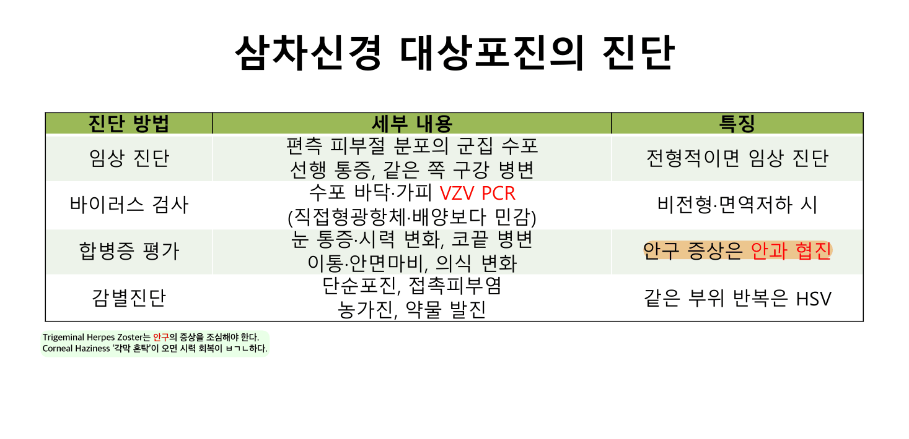{: style="width:72%"}

| 진단 방법 | 내용 | 특징 |
|---|---|---|
| 임상 진단 | 편측 피부분절의 군집 수포, **선행 통증**, 같은 쪽 구강 병변 | 전형적이면 임상 진단 |
| 바이러스 검사 | 수포 바닥·가피 **VZV PCR** | 비전형·면역저하 시 |
| 합병증 평가 | 눈 통증·시력 변화, 코끝 병변, 이통·안면마비, 의식 변화 | **안구 증상은 안과 협진** |
| 감별 | 단순포진, 접촉피부염, 농가진, 약물 발진 | **같은 부위 반복 = HSV** |

{: style="width:72%"}

- 경구: **valacyclovir 1 g 하루 3회 7일**, famciclovir 500 mg 하루 3회 7일 — 신기능 감량.
- 정맥: 파종, 내장·신경계 침범, **중증 면역저하** → **acyclovir 10 mg/kg 8시간마다**.
- 통증: acetaminophen·NSAID·단기 opioid → gabapentin·pregabalin.
- 감염관리·예방: 국소 = 덮기 + 표준주의 / 파종·면역저하 = 공기·접촉주의 / 회복 후 **재조합 백신**.

{: style="width:80%"}

!!! memo "암기"
    VZV는 **감각신경절**에 잠복 · V1 = 눈, **V2·V3 = 구강 점막까지** · 같은 부위 **반복이면 HSV** · valacyclovir **1 g × 3회 × 7일** · 정맥 acyclovir **10 mg/kg q8h** · **파종 = 공기 + 접촉주의** · 50세 이상 재조합 백신 2회.

# 3. Case 3 — 고령 환자의 급성 담낭염

> 84세 여자. **3일간의 상복부 통증**으로 내원.

- 흉부 X선(AP): 손글씨 "X-ray 상에서는 **심장이 좀 커 보인다는 것 말고는 특이사항 없다**." — 상복부 통증에서 폐렴·심장 원인을 배제하는 의미.

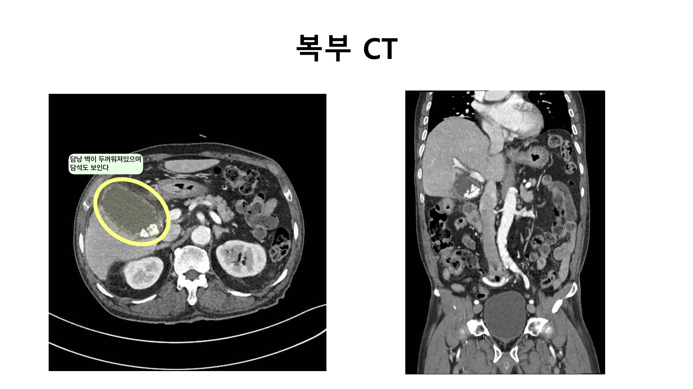{: style="width:62%"}

- 손글씨: "**담낭 벽이 두꺼워져 있으며 담석도 보인다**."

질문: ① 복부 CT에서 의심되는 진단과 이를 뒷받침할 진찰·검사 소견? ② 경험적 항생제? ③ 수술 또는 배액술의 결정 기준?

## ① 진단

- **급성 담낭염**(acute calculous cholecystitis): CT에서 **담낭 팽창 + 결석으로 보이는 고음영**. 여기에 **우상복부 압통, 발열·염증지표(WBC, CRP), 담낭벽·주변 염증 소견**을 종합해 평가한다.
- **기전**: **담낭관(cystic duct)에 결석이 끼어 막힘** → 담낭 팽창·염증 → **이차 세균감염**(빨간 글씨). 손글씨(그림 요약): "이렇게 담석이 끼이면 담낭이 붓고 아프다." 즉 처음엔 화학적 염증이고 감염은 뒤따라온다.
- **원인균**: 장내균 — *E. coli*, *Klebsiella*, *Enterococcus*, 혐기성균.
- **다음 검사 = 복부 초음파**(1차 검사): 결석, 벽 비후, 담낭 주변 액체, **초음파 Murphy 징후**.
    - 손글씨: "**우측 상복부를 누르면 압통(tenderness)이 발생**하고, **그 압통 때문에 숨을 들이마시지 못하면 Murphy's sign 양성**이다."
    - 손글씨: "교과서적으로는 **초음파가 1순위**이나, **밤 시간에 의료인력이 부족하거나 하면 CT**를 찍는다."
    - 손글씨(그림 요약): "담석은 초음파를 잘 통과시키지 못해서 **뒤쪽에 음영(shadowing)**이 생긴다 ↔ cf. 담즙은 초음파를 더 잘 통과시켜서 뒤가 밝게 보인다(후방 증강). 액체와 고체의 차이!"
- **담낭 팽창·결석만으로 활동성 감염을 확정하기는 어렵다.**
- **담관염을 의심할 단서**(형광펜): **황달, bilirubin·ALP 상승**, 총담관 확장 또는 담관 결석. 손글씨: "**+AST/ALT 상승도 담관염을 나타내는 단서**이다." 담관 폐쇄가 동반되면 **담관 감압**(ERCP 등) 여부를 따로 판단.
- **고령**: 증상이 약해도 **괴저·천공 위험이 높다** — 84세 환자에서 "덜 아파 보인다"고 안심하면 안 된다.

## ② 경험적 항생제

- **지역사회획득 비중증**: **ceftriaxone 또는 cefotaxime ± metronidazole** 기반(빨간 글씨).
    - 손글씨: "**Ceftriaxone 단독** 요법으로 해결되는 경우도 있고 병용하는 경우도 있다. **감염내과에서는 cefotaxime + metronidazole 병용요법 많이 이용**." 그림 요약에도 손글씨로 "(or Cefotaxime)"을 덧붙였다.
- **중증·의료관련 감염**: piperacillin-tazobactam 등 — **과거 배양, 최근 항생제, 기관 감수성 자료**로 범위를 정한다.
- **혈액·담즙 배양**을 확보한다.

## ③ 수술·배액 결정

- 수술을 감당할 수 있으면 **조기 복강경 담낭절제술**(형광펜) 우선 — 표: **입원 7일·발병 10일 이내**, **고령도 수술 우선**.
- 수술이 당장 어렵고 감염 조절이 필요하면 **담낭 배액**: **경피 경간 담낭배액술(PTGBD)**(빨간 글씨) 또는 내시경 초음파 유도 배액.
    - 손글씨: "수술 위험도가 높으면 **PCD(경피적 담낭배액술)로 염증을 조절**하고, 그다음에 필요에 따라 **second operation**을 진행한다."
- **감염원 조절 후 항생제**: 합병증 없는(단순) 담낭염에서 담낭절제로 감염원이 조절되면 **수술 후 항생제를 일률적으로 연장할 필요가 없다**. **복잡 담낭염은 감염원 조절 후 4~7일**. **천공·농양·균혈증**은 따로 판단.
- 그림 요약 띠: "**Source control matters most: surgery or drainage, not antibiotics alone**."

## 급성 담낭염 정리

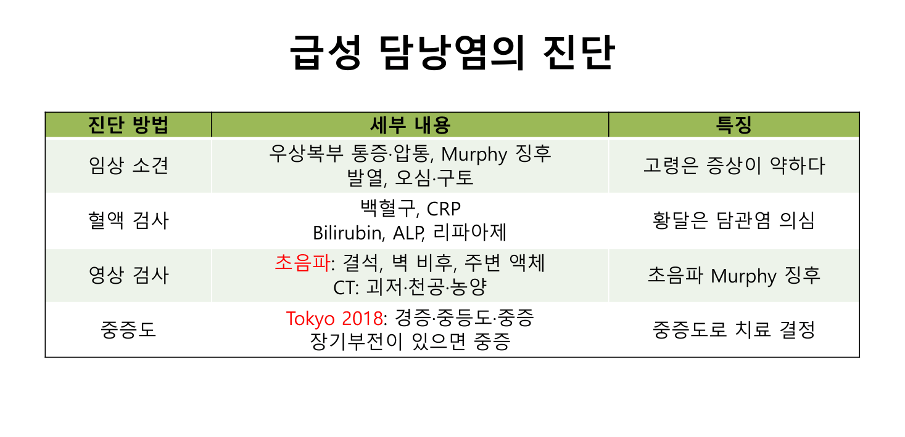{: style="width:72%"}

| 진단 방법 | 내용 | 특징 |
|---|---|---|
| 임상 | 우상복부 통증·압통, Murphy 징후, 발열, 오심·구토 | **고령은 증상이 약하다** |
| 혈액 | 백혈구, CRP, bilirubin, ALP, 리파아제 | **황달은 담관염 의심** |
| 영상 | **초음파**: 결석·벽 비후·주변 액체 / CT: 괴저·천공·농양 | 초음파 Murphy 징후 |
| 중증도 | **Tokyo 2018**: 경증·중등도·중증 | **장기부전이 있으면 중증**, 중증도로 치료 결정 |

- Tokyo 기준은 **국소 소견(Murphy, 우상복부 종괴·압통) + 전신 소견(열, CRP, WBC) + 영상**으로 진단한다.

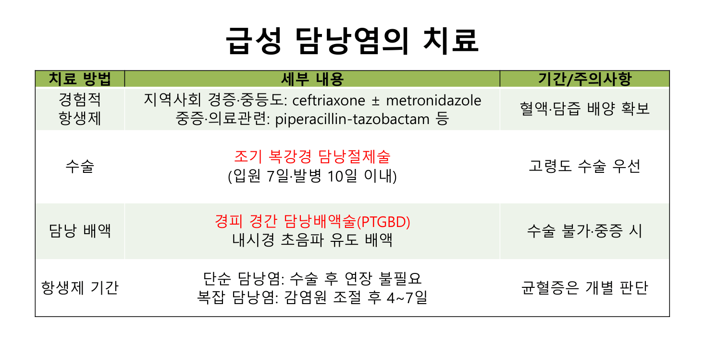{: style="width:72%"}

| 치료 | 내용 | 주의 |
|---|---|---|
| 경험적 항생제 | 지역사회 경증·중등도: ceftriaxone ± metronidazole / 중증·의료관련: piperacillin-tazobactam | 혈액·담즙 배양 |
| 수술 | **조기 복강경 담낭절제술**(입원 7일·발병 10일 이내) | 고령도 수술 우선 |
| 담낭 배액 | **PTGBD**, 내시경 초음파 유도 배액 | 수술 불가·중증 |
| 항생제 기간 | 단순: 수술 후 연장 불필요 / 복잡: 감염원 조절 후 **4~7일** | 균혈증은 개별 |

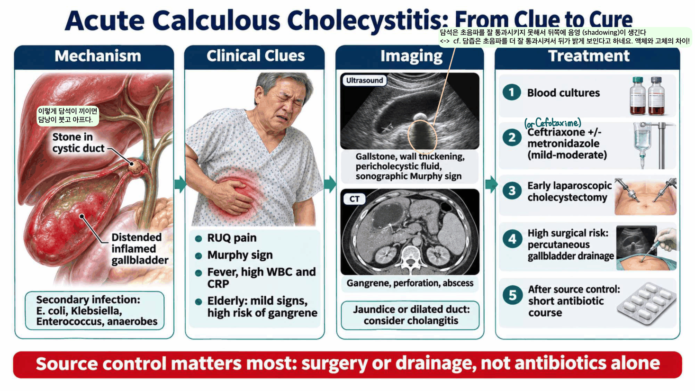{: style="width:80%"}

!!! memo "암기"
    담낭관 결석 → 팽창 → **이차** 세균감염 · 1차 검사 **초음파**(Murphy, 결석 뒤 **shadowing**) · 황달·bilirubin·ALP(+AST/ALT)↑ = **담관염** 의심 · ceftriaxone/**cefotaxime** ± metronidazole · **조기 복강경 담낭절제**(7일/10일) · 고위험 = **PTGBD** · 단순 담낭염은 수술 후 항생제 연장 ×.

# 4. Case 4 — 화농성 척추염 (L1–2)

> 74세 남자. **5년 전부터 간헐적 허리통증**으로 약물치료와 **침치료**를 받아 왔다. **최근 7일 동안 통증이 심해지고**(형광펜) **우측 대퇴부 방사통**이 생겼다. 외부 검사에서 **L1–2 척추 감염**이 의심되어 전원, **L2 조직생검** 시행. 체온 38℃.

- 손글씨: "**Spondylitis(척추염)는 TB(결핵균)에 의한 것과 Pyogenic(화농성, 일반 세균)에 의한 것 두 가지.** **CRP 수치가 높거나 기간이 상대적으로 짧으면 pyogenic**으로 보는 게 맞다."
- 손글씨: "**감염 부위가 L, T, C level로 올라갈수록 더 위험**하다는 것 — **'꼭 기억해 주시길 바랍니다'**." (위로 갈수록 척수가 있고, 경추는 호흡까지 위협)
- 요추 단순 X선 — 손글씨: "앞쪽에서 보면 **bowel gas** 등으로 보려는 것이 방해받을 수 있기 때문에 **AP·lateral 다 확인**해야 한다."

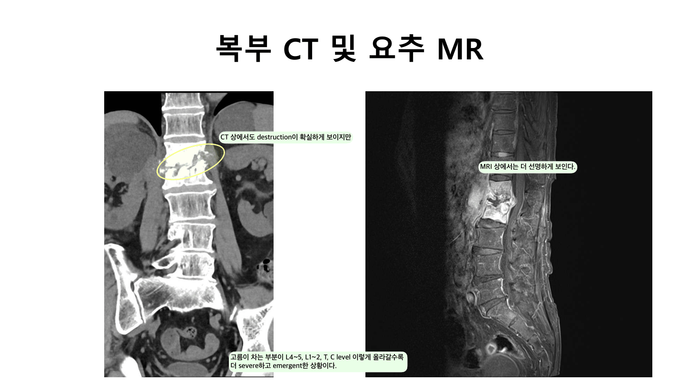{: style="width:66%"}

- 손글씨: "CT 상에서도 **destruction이 확실하게** 보이지만 **MRI 상에서는 더 선명**하게 보인다." "**고름이 차는 부분이 L4~5 → L1~2 → T → C level 이렇게 올라갈수록 더 severe하고 emergent**한 상황이다."

질문: ① 요추 MRI를 보고 가장 가능성 높은 진단과 응급 척추외과 평가가 필요한 신경학적 소견? ② 항생제 투여 전 어떤 검체를 확보하고, 조직생검 검체에 어떤 검사를 의뢰? ③ 어떤 환자는 원인균 확인까지 항생제를 보류할 수 있고, 어떤 환자는 즉시 시작해야 하는가?

## ① 진단과 신경학적 응급

- 발열 + 최근 악화된 요통·방사통 + **L1–2 종판(endplate)과 인접 추체 이상** → **감염성 척추염·추간판염**(vertebral osteomyelitis·discitis). 손글씨: "요추 MR 상에서 감염성 척추염이 확실하게 잘 보였다."
- 감별: **화농성 감염, 결핵, 종양**.
- **응급 척추외과 평가**: 하지 근력·감각, **회음부(안장) 감각**, **배뇨·배변 기능**을 확인. **진행성 근력저하, 요폐, 회음부 감각저하** → 신경(척수·마미) 압박 가능성 → **응급 평가**(빨간 글씨). 그림 요약 띠: "**Neurologic deficit = emergency spine surgery consult**."

## ② 검체

- **혈액배양 2세트**(형광펜) + **ESR·CRP**.
- **생검 검체** → **세균배양 + 조직병리**, 임상·영상 위험에 따라 **항산균 배양·결핵 핵산검사, 진균검사** 추가(국내는 결핵성 척추염이 흔하다).
- 표: **혈액배양에서 *S. aureus* 양성이면 생검 생략 가능**(원인균이 이미 나왔으므로). 위험 시 **Brucella 혈청, IGRA**.

## ③ 항생제를 언제 시작하나

- **안정 환자**(혈역학·신경학적으로 안정): 미생물학적 진단을 확보할 때까지 **경험적 항생제를 보류**할 수 있다(빨간 글씨) — 먼저 항생제를 쓰면 생검 배양이 음성이 되어 6주 치료의 표적을 잃는다.
- **즉시 치료할 환자**: **패혈증·쇼크** 또는 **진행성 신경학적 이상** → 배양을 신속히 확보하고 **즉시 치료**. **생검 일정 때문에 항생제나 감압을 지연하지 않는다.**
- 원인 확인 후: 대부분의 세균성 척추염은 **표적 치료 약 6주**. 통증·신경기능·**CRP**로 반응을 보고, 호전 중이면 **추적 MRI를 일률적으로 반복할 필요 없다**(MRI 소견은 늦게 좋아진다).
- 손글씨(경험적 항생제): "***S. aureus*를 target**으로 하여 경험적 항생제를 투여한다. 경험적 **vancomycin**을 학우분께서 언급해 주셨는데, **한국에서는 MRSA 고위험군이 아니라면 vancomycin을 투여하지는 않는다.** cf. MRSA 위험군이 아니라면 **cefazolin**을 이용합니다. (교수님께서 언급하지 않으셨기에 몰라도 될 것 같습니다.)"

## 화농성 척추염 정리

| 항목 | 내용 |
|---|---|
| 경로 | 대부분 **혈행성**, 척추 수술·시술 후 직접 접종 |
| 원인균 | ***S. aureus*가 가장 흔함**, 연쇄구균, 그람음성균 — 손글씨: 조직검사와 배양 결과로 확인 |
| 감별 | 결핵·브루셀라·진균, 종양 — **국내는 결핵성 척추염 중요** |
| 증상 | 수주에 걸쳐 악화하는 요통, **발열은 약 절반**, 방사통 |
| 진단 | 혈액배양 + **MRI**, 원인균 미확인 시 **영상유도 생검** |
| 치료 | 원인균에 맞춘 항생제 **6주** |
| 응급 | 신경학적 결손·**경막외 농양** → 즉시 척추외과 |

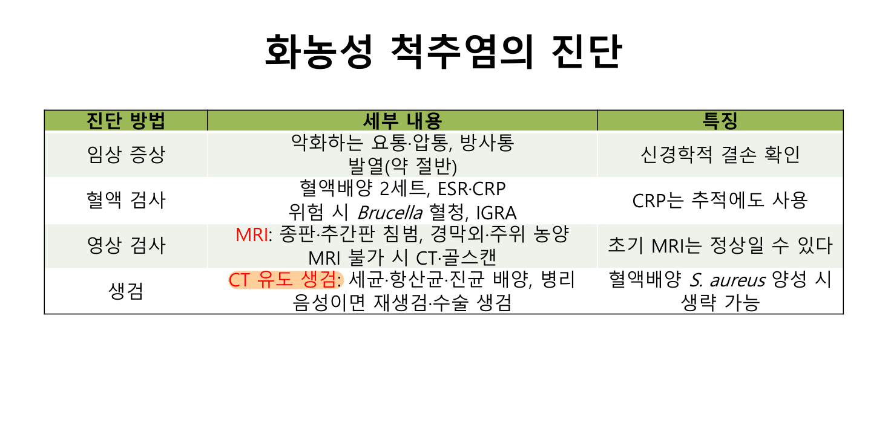{: style="width:72%"}

- 임상: 악화하는 요통·압통, 방사통, 발열(약 절반) — 신경학적 결손 확인.
- 혈액: 혈액배양 2세트, ESR·CRP(**추적에도 사용**), 위험 시 Brucella 혈청·IGRA.
- 영상: **MRI**(조영 MRI가 최선) — 종판·추간판 침범, 경막외·주위 농양. MRI 불가 시 CT·골스캔. **초기 MRI는 정상일 수 있다.**
- 생검: **CT 유도 생검**(형광펜) — 세균·항산균·진균 배양, 병리. 음성이면 재생검·수술 생검.

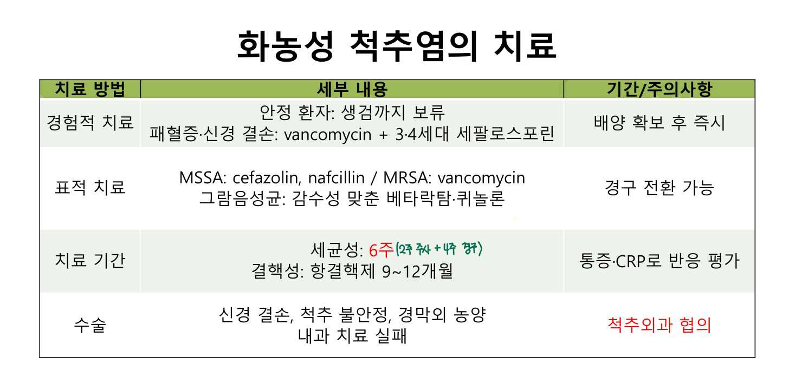{: style="width:72%"}

| 치료 | 내용 | 주의 |
|---|---|---|
| 경험적 | 안정: **생검까지 보류** / 패혈증·신경 결손: **vancomycin + 3·4세대 세팔로스포린** | 배양 확보 후 즉시 |
| 표적 | **MSSA: cefazolin, nafcillin** / MRSA: vancomycin / 그람음성: 감수성 맞춘 β-lactam·퀴놀론 | 경구 전환 가능 |
| 기간 | **세균성 6주**(손글씨: **2주 주사 + 4주 경구**) / 결핵성: 항결핵제 9~12개월 | 통증·CRP로 반응 평가 |
| 수술 | 신경 결손, 척추 불안정, 경막외 농양, 내과 치료 실패 | **척추외과 협의** |

{: style="width:80%"}

- 손글씨: "**통증의 시작은 endplate**." "**겁나 아프다.** 환자들이 통증만 없앨 수 있다면 무엇이든 하겠다고 한다."
- 화농성 vs 결핵성 감별은 10단원(장요근 농양) 끝에서 다시 정리한다.

!!! memo "암기"
    척추염 = 화농성(*S. aureus*) vs 결핵성 · **CRP 높고 기간 짧으면 화농성** · **위로(L→T→C) 갈수록 위험** · 혈액배양 2세트 + MRI + CT 유도 생검 · **안정하면 항생제 보류**, 쇼크·신경 결손이면 즉시 · 6주(**2주 IV + 4주 PO**) · MSSA는 cefazolin(국내 MRSA 위험 없으면 vancomycin ×).

# 5. Case 5 — 열나는 급성 관절염: 통풍인가, 감염인가

> 77세 남자. **호흡곤란(심부전)**으로 입원. 치료 중 열(38.3℃). 입원 중 **손목과 손의 통증성 종창**.

{: style="width:62%"}

- 손글씨: "**Gout는 굉장히 흔하다.** 한 군데 또는 여러 군데에 joint swelling이 있으며 누르면 압통이 있다. **응급실에 이런 환자 왔는데 감별 못 해내면 돌팔이다.**"

질문: ① 열과 사진 병변의 감별 진단? ② 관절액에 어떤 검사를 의뢰? 요산결정이 확인되면 감염성 관절염을 배제할 수 있는가? ③ 감염 가능성이 충분히 낮아졌다면 심부전과 신기능을 고려해 급성 통풍 치료제를 어떻게 고르나?

## ① 감별 — 감염성 관절염부터

- **원칙**: 발열 + 급성 관절 종창이면 **감염성(화농성) 관절염을 먼저 평가**(빨간 글씨) — 놓치면 며칠 만에 연골이 파괴된다.
- 감별: **통풍**(요산 결정), **CPP 결정관절염**(가성통풍, 칼슘 피로인산), **연조직염**(봉와직염). **수동 관절운동 시 통증**(관절 안 병변)과 **관절액 유무**를 확인 — 연조직염은 관절을 움직여도 덜 아프다.
- 손글씨: "**감염이 동반되기도 하지만 감염 없이 gout 단독인 경우가 더 많다.**"
- 결정관절염은 **고령·입원 중**에 흔하다(이뇨제, 탈수, 수술·스트레스가 발작을 유발 — 이 환자는 심부전 치료 중).

## ② 관절천자 — 결정이 보여도 배양한다

- **관절천자**(빨간 글씨): **그람염색·세균배양, 백혈구 수·분획, 편광현미경 결정검사**. 발열·균혈증 의심 시 **혈액배양**도. 항생제 **전에** 채취.
    - 손글씨: "**Aspiration해서 cell count 등을 확인**한다."
- **편광현미경**: 요산(통풍) = **바늘 모양, 음성 복굴절**(negatively birefringent) / CPP = **마름모꼴, 약한 양성 복굴절**(그림 요약).
- **결정이 있어도 배양이 필요한 이유**: 요산결정이 확인돼도 **감염성 관절염이 함께 있을 수 있다**(빨간 글씨). 그림 요약: "**Crystals do not exclude infection**."
- **정상 혈청 요산, 낮은 관절액 백혈구 수, 그람염색 음성 — 각각 하나만으로 배제할 수 없다.** 급성 발작 중에는 혈청 요산이 정상일 수 있다.
- 관절액 **백혈구 > 50,000/μL**는 감염 가능성이 높지만 결정관절염에서도 나올 수 있다.

## ③ 심부전 환자의 급성 통풍 치료

- **NSAID**: 비보상성 심부전·신기능 저하에서는 **체액 저류와 신기능 악화** 위험 → **가급적 피한다**(빨간 글씨).
- **Colchicine**: **저용량** 요법(1.2 mg → 1시간 뒤 0.6 mg). **신기능과 기존 복용량** 확인, **CYP3A4·P-gp 억제제**(clarithromycin, 일부 칼슘통로차단제·항진균제 등)와 상호작용 → 감량 또는 회피.
- **Glucocorticoid**: 감염 가능성이 충분히 낮아졌다면 **단기 전신**(경구 prednisolone) 또는 **관절강 내** 투여. 혈당·체액 감시.
- **감염이 의심되는 관절에는 스테로이드를 주사하지 않는다**(빨간 글씨). 그림 요약 띠: "**Never inject steroids into a joint that may be infected**."
- 손글씨: "급성 통풍은 colchicine, glucocorticoid 투여하면 괜찮아진다(근데 감염내과에서 투여하지는 않는다). **열의 원인에 감염만 있는 게 아니다.** 이렇게 **통풍이나 류마티스 질환 등에 의해서도 발열** 증상이 나타난다."
- 손글씨(급성 관절염 요약): "감염성 관절염이 배제되어 **결정관절염인 것이 확인되면 통풍에 대해서만 집중적으로 치료**한다."

## 급성 관절염(septic vs crystal) 정리

| 항목 | 내용 |
|---|---|
| 원칙 | 열나는 급성 관절염은 **감염성 관절염부터 배제** |
| 원인균 | ***S. aureus*가 가장 흔함**, 연쇄구균, **젊은 성인은 임균** |
| 결정관절염 | **통풍(요산)**(형광펜), CPP(가성통풍) — 고령·입원 중 흔함 |
| 핵심 검사 | **관절천자** — 백혈구, 그람염색, 배양, **편광현미경** |
| 공존 | 결정이 보여도 감염이 함께 있을 수 있다 |
| 관절액 WBC | > 50,000/μL = 감염 가능성 높음(결정관절염도 가능) |
| 통풍 치료 | 동반 질환에 맞춰 colchicine·스테로이드·NSAID 선택 |

{: style="width:72%"}

- 임상: 급성 통증·종창·열감, 운동 제한(관절 내 병변 시사), **발열은 감염·통풍 모두 가능**.
- 관절천자: 백혈구 수·분획, 그람염색, 배양, **편광현미경**(형광펜) — 항생제 전 채취.
- 혈액: 혈액배양, CRP, 혈청 요산(**급성기 정상 가능** → 요산 정상도 통풍 배제 못 함).
- 영상: 단순 X선 — **연골석회화**(CPP), 미란 / 초음파 — 관절액, **double contour 징후**(연골 표면 요산 침착, 통풍), 초음파 유도 천자.

{: style="width:72%"}

| 치료 | 내용 | 주의 |
|---|---|---|
| 감염 의심 | 배양 후 경험적 항생제, **관절 세척·배액**(천자·관절경·수술) | 감염 배제 전 **관절 내 스테로이드 금지** |
| Colchicine | 저용량 1.2 mg, 1시간 뒤 0.6 mg | 신기능·CYP3A4·P-gp 확인, 신기능 저하 시 감량 |
| 스테로이드 | 경구 prednisolone 단기, 또는 관절강 내(감염 배제 후) | 혈당·체액 감시 |
| **NSAID** | **심부전·신기능 저하에서는 피한다** | 체액 저류, 신기능 악화 |

{: style="width:80%"}

- 손글씨: "**가장 먼저 통풍을 앓았던 적이 있는지 반드시 물어본다. 통풍은 한 번 걸려 본 사람들이 더 잘 걸린다.**" "주로 **엄지발가락** 쪽에 생기지만 **무릎, 팔꿈치** 관절 등 다양하게 생긴다."

!!! memo "암기"
    열 + 급성 관절염 → **감염 먼저 배제** · 관절천자 = cell count·그람·배양·**편광현미경** · 요산 = **바늘·음성** 복굴절, CPP = 마름모·약양성 · **결정이 있어도 감염 공존 가능** · 심부전·CKD: **NSAID ×**, 저용량 colchicine(CYP3A4·P-gp) 또는 스테로이드 · **감염 의심 관절에 스테로이드 주사 ×** · 통풍 과거력 먼저 묻기.

# 11~20. 작년(2025) 증례 — 기출이 나온 곳

!!! diff "작년 필기와 다른 점"
    아래 10개 증례는 **2025년 필기본**의 Case 1~10이다. 올해 강의에서는 바뀌었지만, 2부 기출 23문항(2020~2025)은 모두 여기서 나왔다. 작년 선배 메모: "기출문제를 보면 **사진을 보고 무슨 질환인지 알고, 원인균이 뭔지, 무슨 항생제로 치료하는지** 이 정도를 중심으로 보면 될 것 같습니다."

| 작년 Case | 진단 | 기출(2부 번호) |
|---|---|---|
| 1 | VP shunt 감염 + shunt 신염 | 1, 7 |
| 2 | 선천 림프부종 + 반복 봉와직염 | — |
| 3 | IUD 골반 방선균증 | 2, 5, 14, 21, 22 |
| 4 | 간질(fascioliasis) | 3, 9, 15, 23 |
| 5 | 뎅기열 | 4, 11, 18 |
| 6 | 독성쇼크증후군 | 10 (+17 SJS 감별) |
| 7 | 기쿠치병 | 13, 20 |
| 8 | 수족구병 | 8, 16, 19 |
| 9 | 폐렴구균 폐렴 | 필기본 수록 2022 38번 |
| 10 | 당뇨발 감염 | 6, 12 |

# 11. 작년 Case 1 — VP shunt 감염과 shunt 신염

!!! diff "작년 필기와 다른 점 — 올해 필기에는 없는 증례"
    2025년 필기 Case 1. 올해(2026) 강의에서는 다루지 않았지만 2부 기출이 이 증례에서 나왔으므로 그대로 둔다.

> 62세 남자. 1년 전 뇌혈관질환과 관련된 수두증으로 **VP shunt**. 1주간 **우하복부(RLQ) 통증**, 압통, 38.5℃. **Cr 1.8**, 소변 500 mL/일, **단백뇨·혈뇨**. 복부 CT.

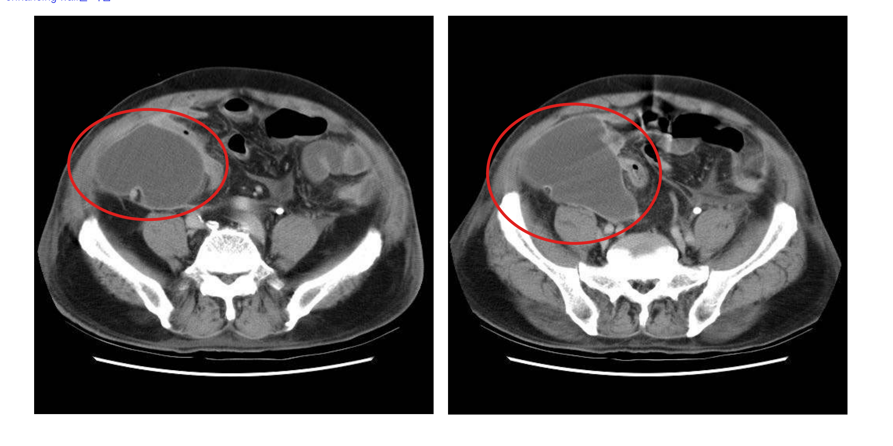{: style="width:62%"}

질문: 복부 병변으로 의심할 감염병? 신기능·소변 이상으로 의심할 신장질환? 조영제를 썼는데 향후 조치는?

- **VP shunt**: 뇌실의 CSF를 복강으로 빼 주는 관. 성인에서 CSF 흐름이 막히는 가장 흔한 이유는 **출혈**(지주막하출혈 등).
- 교수님: "**shunt의 distal 부분**에서 감염이 잘 생긴다(CSF가 위에서 아래로 흐르니까 — 댐 마지막에 때가 잘 끼는 것처럼)." → **복강 농양**(벽이 조영됨).
- 이물을 넣을 때 감염: **피부상재균**(**CoNS**, *S. aureus*)이 가장 많다. *E. coli*, *Klebsiella*도 가능.
- **Shunt 신염**: shunt 감염 → 면역반응 → **면역복합체**가 사구체에 침착 → **면역복합체 사구체신염**(단백뇨·혈뇨·신기능 저하). 교수님: "감염후 사구체신염의 special form. 이물을 넣을 때 피부상재균 감염이 **다른 장기에 영향**을 줄 수 있다는 것을 알고 있을 것." (편도염 뒤 PSGN과 같은 원리)
- 치료 — 교수님: "**제거하는 것이 가장 좋은 치료**, 이물 제거 없이는 치료가 어렵다. 그런데 이 환자는 shunt가 필요하므로 치료 뒤 다시 shunt를 넣고, 그동안은 **lumbar drain**(뇌실외배액) 등으로 CSF를 뺀다."
- 조영제: 신기능이 나쁜 환자 → 수액(0.9% NS)으로 신장 보호, **신독성 약물(NSAID, vancomycin 등) 중단**, Cr·소변량 모니터링, AKI면 투석.

!!! exam "기출 포인트"
    1번(2025): VP shunt 환자의 단백뇨·혈뇨·신기능 저하 → **shunt 신염(면역복합체 사구체신염)**. 7번(2024): VP shunt 감염 치료 → **감염된 shunt 제거**(필요하면 뇌실외배액) + 항생제.

# 12. 작년 Case 2 — 선천 림프부종과 반복되는 봉와직염

!!! diff "작년 필기와 다른 점 — 올해 필기에는 없는 증례"
    2025년 필기 Case 2. 올해(2026) 강의에서는 다루지 않았지만 2부 기출이 이 증례에서 나왔으므로 그대로 둔다.

> 16세 여자. 1년 전부터 **왼손 감염이 잦다**(작년 3번 항생제 주사). **어릴 때부터 왼팔 전체가 컸다.** 37.8℃.

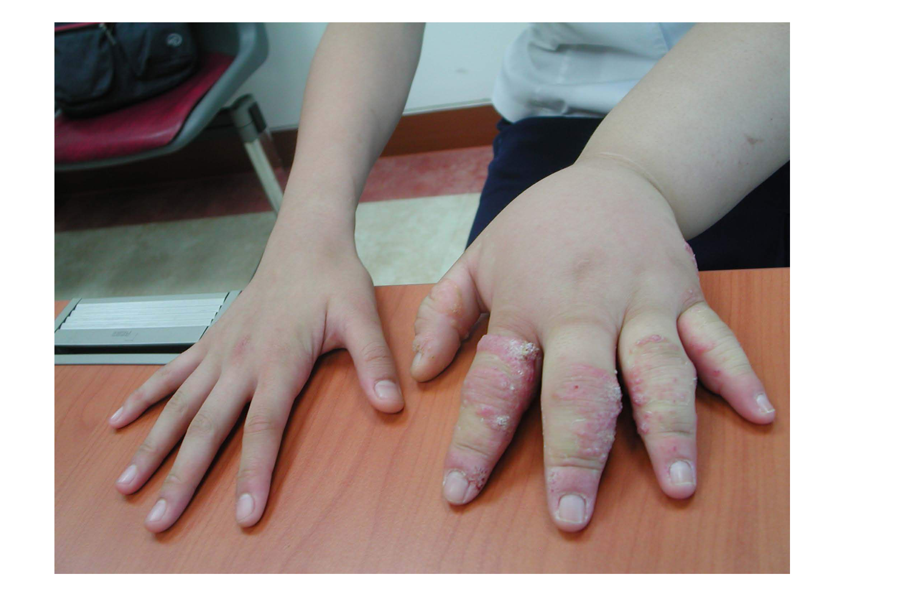{: style="width:50%"}

- 원 질환: **선천 림프부종**(primary lymphedema). 림프 순환장애 → 국소 면역 저하 → **반복 봉와직염**(피부상재균: β-용혈 연쇄상구균, *S. aureus*). 감별: lymphangioma, Klippel-Trenaunay 증후군(혈관기형 동반).
- 교수님: "림프부종은 주로 **하지**에 많다. 우리나라에서 가장 흔한 림프부종은 **자궁경부암 치료 이후** 림프 배액이 막혀 생기는 후천성." 선천성은 양쪽에 다 생길 수 있다. 아프리카의 후천 림프부종은 **사상충증(filariasis)** 의심.
- 치료: 급성기 **ampicillin/sulbactam, cefazolin**. 교수님: "penicillin V·G를 쓸 수 있으나 **국내에서 쓸 수가 없다**. 국내에 있는 약을 쓰자."
- 예방: 반복되면 득실을 따져 **평상시 항생제** — 1세대 cephalosporin(**cefadroxil**)을 장기 처방(교과서: 경구 penicillin V, 2~4주마다 benzathine penicillin G 근주). 림프부종 관리(압박, 배액, 운동, 피부 위생).

# 13. 작년 Case 3 — IUD와 골반 방선균증

!!! diff "작년 필기와 다른 점 — 올해 필기에는 없는 증례"
    2025년 필기 Case 3. 올해(2026) 강의에서는 다루지 않았지만 2부 기출이 이 증례에서 나왔으므로 그대로 둔다.

> 58세 여자, 우측의 2달간 불편감. 젊을 때부터 **IUD** 사용, 결핵 과거력 없음, 체중감소 없음. 복부 CT에서 골반 종괴. 37.6℃. 조직검사를 원하지 않아 경험적 치료 **7개월** 후 CT에서 종괴가 사라짐.

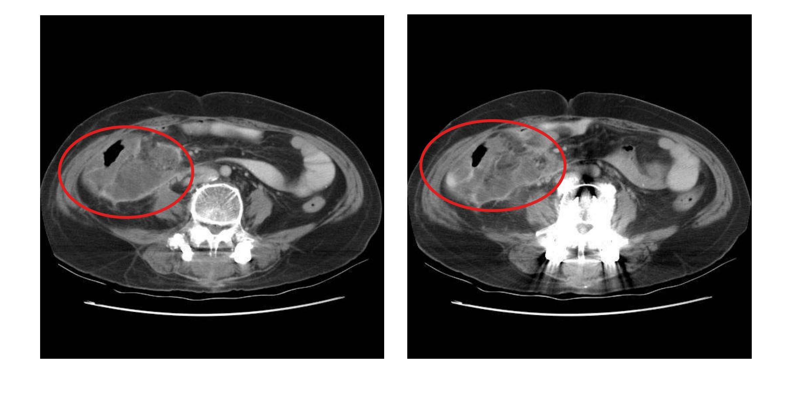{: style="width:62%"}

- 교수님: "IUD는 **폐경이 되면 제거**해야 하는데 안 하면 감염의 원인이 된다. 자궁·질의 정상균 중 ***Actinomyces***가 이물을 먹이 삼아 천천히 자란다. **암으로 오인**할 수 있다." "IUD가 있는데 골반 종괴로 왔다 → **방선균 감염을 의심할 수 있어야** 한다."
- *Actinomyces*: **혐기성** 그람양성, 균사 같은 가지 모양, 구강·장·질의 정상균. 점막 손상(치과·내시경·IUD)으로 침투 → 만성 화농성 염증, 누공. 조직에서 **유황과립(sulfur granule)**.
    - 대비: ***Nocardia***는 **호기성**, 토양, 흡입 → 폐 농양·피부 감염(같은 방선균류).

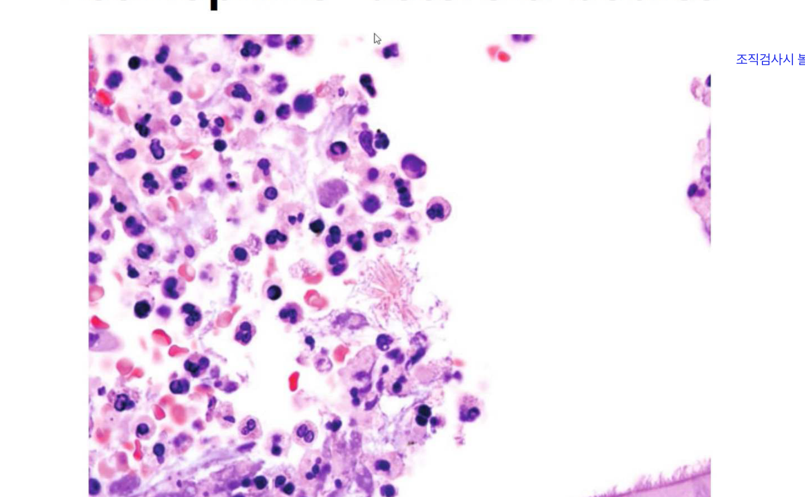{: style="width:42%"}

- 치료: **penicillin 계열**. 교수님: "penicillin V·G는 국내에 없으니 **ampicillin, ampicillin/sulbactam, piperacillin/tazobactam, amoxicillin/clavulanate**." 원칙: **penicillin G(또는 ampicillin) 정맥 2~6주 → 경구 penicillin V·amoxicillin 6~12개월**.

!!! exam "기출 포인트"
    5번 출제(2, 5, 14, 21, 22번): IUD 오래 쓴 여성의 골반 종괴, 유황과립·가지 친 그람양성 필라멘트 → **방선균증** → **penicillin 계열 장기 치료**. metronidazole·aminoglycoside는 효과 없음.

# 14. 작년 Case 4 — 간질증 (fascioliasis)

!!! diff "작년 필기와 다른 점 — 올해 필기에는 없는 증례"
    2025년 필기 Case 4. 올해(2026) 강의에서는 다루지 않았지만 2부 기출이 이 증례에서 나왔으므로 그대로 둔다.

> 45세 남자, 건강검진 초음파에서 간 종양 의심. HBsAg/Ab 음성, HCV Ab 음성, 술 안 마심. **건강에 관심이 많아 아내가 매일 아침 녹즙**을 준다. 37.0℃.

{: style="width:42%"}

- 교수님: "사진만 보면 **hepatoma**를 의심한다. 하지만 **간암이 될 요인이 없다**. 병력청취 결과 **녹즙** — 이것이 원인!"
- ***Fasciola hepatica***(간질): 초식동물의 기생충. 제1중간숙주 **물달팽이**, 제2는 **수생식물**. 피낭유충이 붙은 **미나리·물냉이**를 날로 먹거나 감염된 소의 간을 날로 먹으면 감염 → 유충이 소장벽을 뚫고 복강 → **간 피막을 뚫고 간실질을 이동**(터널 모양 병변) → 담관에서 성충.
- **호산구 증가** — 교수님: "간 종괴에 호산구가 올라가 있으면 **Löffler 병**(호산구 침윤성 질환)으로 착각할 수 있다. **병력청취로 감별**해서 제대로 치료해야."
- 치료: **triclabendazole**(WHO 권고). 교수님: "유통되는 약이 아니라 처방해도 살 수 없다. 희귀의약품센터 같은 곳에서 구해야 한다." (다른 흡충은 praziquantel.) 내시경에서 담관으로 나오는 충체를 볼 수도 있다.

!!! exam "기출 포인트"
    3, 15, 23번: 녹즙 + 간에 **터널 모양** 저음영 병변 + 호산구 증가 → **간질** → **triclabendazole**. 9번: 감염 경로 → **미나리·물냉이 등 수생식물** 생식(날생선은 간흡충 *Clonorchis*).

# 15. 작년 Case 5 — 뎅기열

!!! diff "작년 필기와 다른 점 — 올해 필기에는 없는 증례"
    2025년 필기 Case 5. 올해(2026) 강의에서는 다루지 않았지만 2부 기출이 이 증례에서 나왔으므로 그대로 둔다.

> 27세 여자, **필리핀 배낭여행 2주**. 대구 도착 때부터 다리에 소견(그림 1), BP 90/50, 37.5℃. 3일 뒤 다리(그림 2).

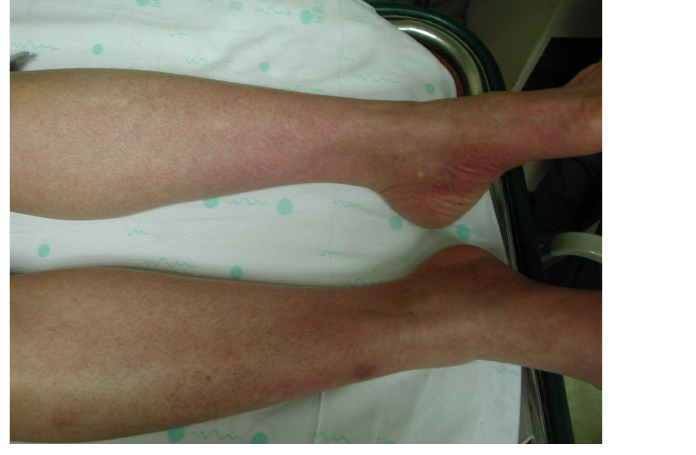{: style="width:50%"}

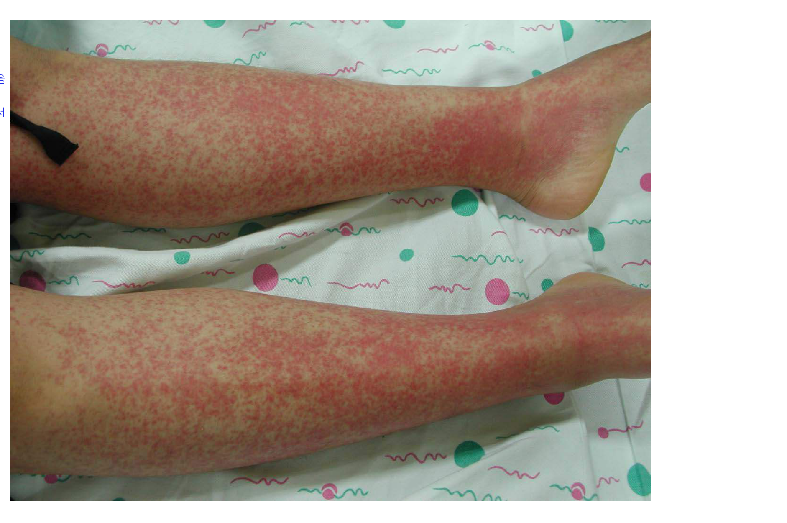{: style="width:50%"}

- 교수님: "**혈압을 재려고 토니켓을 묶거나 심전도 커핑한 자리를 따라** 출혈이 쭉 생긴다." 손을 댔다 떼면 하얗게 되며 **손자국**이 남는다. 회복기 발진 = **white islands in a sea of red**.
- 매개: 낮에 무는 **Aedes 모기**(이집트숲모기·흰줄숲모기). 지구온난화로 발생 지역이 넓어지는 중.
- **4가지 혈청형(DENV-1~4)**: 한 혈청형에 걸리면 그 형에만 면역. 교수님: "뎅기열에 여러 번 걸리면 면역반응이 심해져 사망할 수 있다 — **ADE**(antibody-dependent enhancement). 현지인은 재감염 위험이 높다."
- 병태: 면역반응 → **혈관 투과성 증가** → 모세혈관 누출, **혈액농축**, 저혈압 → 뎅기 출혈열·**쇼크 증후군**. 혈소판 감소, 간효소 상승.
- 진단: 잠복기 3~14일. **NS1 항원**(발병 5일 이내), IgM·IgG, PCR. 교수님: "**항원검사**로 진단. 얘도 **의심하는 것**이 중요."
- 치료: 특이 치료제 없음 → **수액**(링거젖산·NS), **acetaminophen**(교수님: "타이레놀 먹다 보면 좋아짐"), 중증은 ICU·수혈. **NSAID·아스피린 금지**(출혈 위험).
- 예방: 긴 옷·모기장·기피제, **귀국 후 2주 이내** 증상이면 병원.

!!! exam "기출 포인트"
    4, 11, 18번: 필리핀 여행 + 점상출혈 → 회복기 "붉은 바다의 흰 섬" + 저혈압·혈소판 감소 → **뎅기열**. 매개체 **Aedes**, 진단 NS1, 치료 수액.

# 16. 작년 Case 6 — 독성쇼크증후군 (TSS)

!!! diff "작년 필기와 다른 점 — 올해 필기에는 없는 증례"
    2025년 필기 Case 6. 올해(2026) 강의에서는 다루지 않았지만 2부 기출이 이 증례에서 나왔으므로 그대로 둔다.

> 50세 남자, 발열·의식 변화. 3일 전 갑자기 발열·오심·구토·설사. **저혈압**, AST/ALT 65/80, BUN/Cr 39/2.1. **혈액·소변 배양 음성**. 38.1℃. 입원 1일, 4일, 14일 사진.

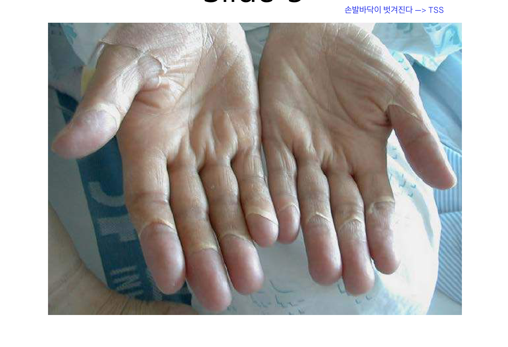{: style="width:42%"}

- 교수님: "보통 배양을 하면 확진으로 이어지는 줄 아는데 실제로는 그 비율이 생각보다 낮다. **TSS의 특징이 '균이 안 잡히는데 환자가 엄청 아프다'**는 것. 세균의 **독소**에 의한 증상이라 혈류에는 균이 별로 없다."
- 패혈증과 다른 점 두 가지(교수님): **피부가 벗겨진다**(얼굴은 비늘처럼 dandruff-like, 손발은 **두껍게 full-thickness**), **딸기혀**. 1일째 손바닥 홍반 → 4일째 결막충혈·구강 병변 → 14일째 **손발바닥 박리**.

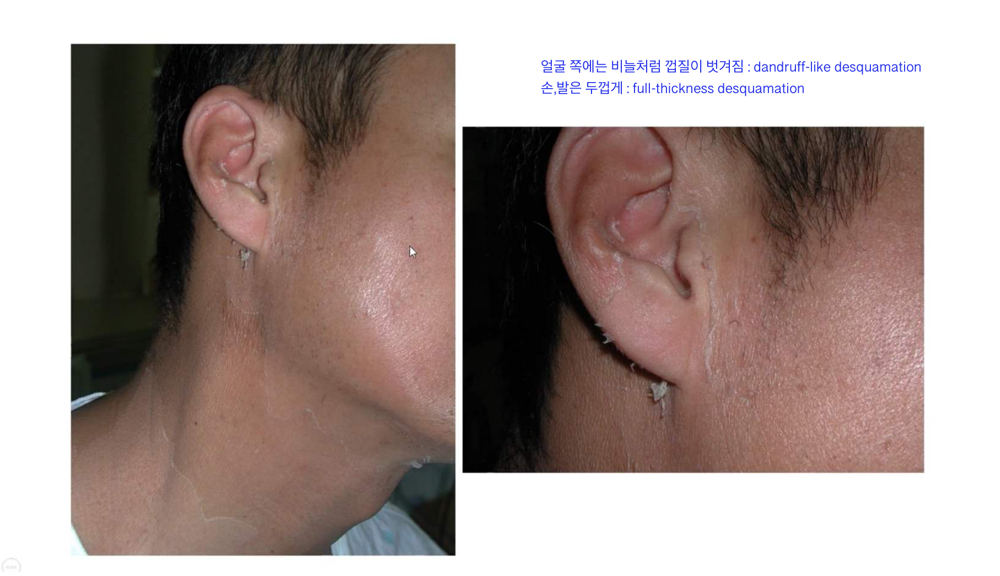{: style="width:50%"}

- **초항원(superantigen)**: TSST-1(*S. aureus*), SpeA·SpeC(*S. pyogenes*)가 항원 처리 없이 **MHC II와 TCR Vβ를 비특이적으로 연결** → T세포 대량 활성화 → **사이토카인 폭풍** → 발열·혈관확장·쇼크·다장기 부전.
- 교수님: "**연쇄상구균 TSS가 포도알균 TSS보다 더 심각.**" 처음 알려진 계기는 **탐폰**.
- CDC 기준: 발열 ≥ 38.9℃, 수축기 ≤ 90 mmHg, 발진 + 박리, **3장기 이상** 침범, 배양 음성(다른 원인 배제).
- 감별: 패혈증, SJS/TEN(약물력, 쇼크는 드묾), **포도알균 화상양 피부 증후군(4S)** — 아이들, 표피박리 독소(ETA·ETB), 점막 침범 없음. 같은 독소가 국소면 수포성 농가진.
- 치료: 감염원 제거(탐폰·농양·이물), 수액·승압제, **clindamycin**(독소 생성 억제) + **β-lactam** ± vancomycin, 중증이면 **IVIG**(2 g/kg). 교수님: "TSS는 antitoxin therapy로 **immunoglobulin & clindamycin**. (septic shock은 β-lactam 위주)"

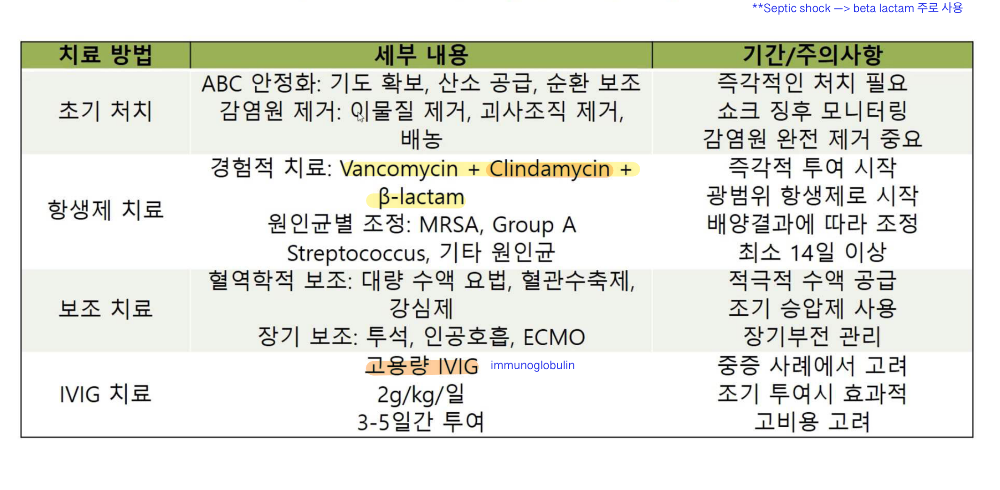{: style="width:85%"}

!!! exam "기출 포인트"
    10번(2023): 급성 발열·구토·설사, 저혈압, 간·신 이상, **배양 음성**, 2주 뒤 손발바닥 박리 → **독성쇼크증후군**. 17번(2022): 약 복용 후 발열·발진·**구강 점막 침범**·간효소 상승 → **SJS**(눈 점막 → 각막 손상).

# 17. 작년 Case 7 — 기쿠치병

!!! diff "작년 필기와 다른 점 — 올해 필기에는 없는 증례"
    2025년 필기 Case 7. 올해(2026) 강의에서는 다루지 않았지만 2부 기출이 이 증례에서 나왔으므로 그대로 둔다.

> 54세 여자, 한 달간 열감과 목 불편. 유양돌기염으로 항생제, 소아과에서 **ceftriaxone**·소염제를 써도 간헐적 고열(39℃). 목 양쪽에 **0.5 cm 압통 있는 여러 림프절, 움직임**. 흉부 X선 정상, CRP 3.0, **WBC 3,400**.

- 교수님: "**백혈구 감소**가 단서. 열 + 림프절이면 ① lymphoma ② TB ③ Kikuchi ④ viral illness를 감별."
    - 림프종: 악성은 **움직이지 않는다**. 결핵: 움직이지 않고 영상에서 **중심 괴사**. 바이러스: 이렇게 오래가지 않는다.
    - "**림프절이 부었다, 움직인다, 열이 난다, 한 달 됐다 → 기쿠치!!**"
- **조직구성 괴사성 림프절염**: 피질 주변부의 조직구 증식, **핵 파편(karyorrhexis)**을 동반한 괴사, **호중구 없음**, 초승달 모양 핵의 조직구. **아시아의 젊은 여성**에 가장 흔하다.

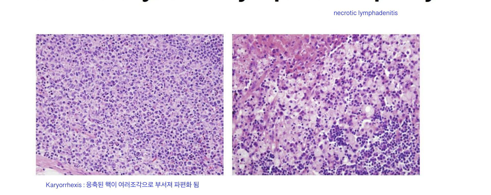{: style="width:62%"}

- 감별: Kimura병(조직 호산구, IgE 매우 높음), 결핵, 반응성. 진단은 **림프절 생검**.
- 치료(교과서 보충): 대개 **1~4개월에 저절로** 좋아진다 → 해열진통제 등 대증, 심하면 스테로이드. 일부는 SLE로 진행하므로 추적.

!!! exam "기출 포인트"
    13, 20번: 젊은~중년 여성의 지속 발열 + 압통 있는 작은 경부 림프절 + **백혈구 감소** + 항생제 무반응, 조직에서 **핵 파편 괴사·조직구(호중구 없음)** → **기쿠치병**.

# 18. 작년 Case 8 — 수족구병

!!! diff "작년 필기와 다른 점 — 올해 필기에는 없는 증례"
    2025년 필기 Case 8. 올해(2026) 강의에서는 다루지 않았지만 2부 기출이 이 증례에서 나왔으므로 그대로 둔다.

> 15세 남자, 2일간 입 병변·통증, 열감·무력. **같은 반에 비슷한 증상의 아이를 7일 전**에 봄. 38.8℃.

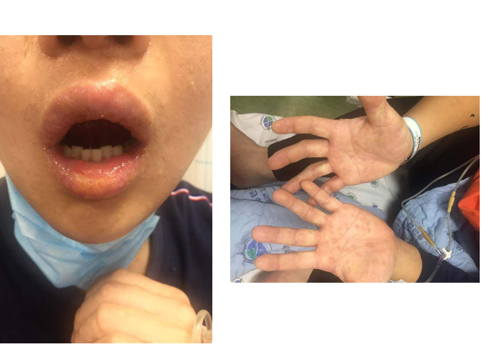{: style="width:50%"}

- **수족구병**: 장바이러스 — 주로 **콕사키바이러스 A16**, **엔테로바이러스 71**. 입·인두의 궤양, 손·발의 수포성 발진. 나이가 들어도 생기지만 **아이에게 더 잘**. 고름이 차는 경우도 있다.
- 대부분 **저절로 낫는다** → 대증(입 통증 때문에 못 먹어 **탈수** 주의). 교수님: "**수막염**이 간혹 생겨 사망할 수도 있다(EV71) — 수막염이 생기면 **신고**."

!!! exam "기출 포인트"
    8, 16, 19번: 구강 궤양·발열 + 같은 반 친구 → **수족구병·포진성 구협염** → 원인 **콕사키 A16·EV71**, 대부분 저절로 낫지만 탈수·드물게 뇌수막염·뇌염.

# 19. 작년 Case 9 — 지역사회획득폐렴 (폐렴구균)

!!! diff "작년 필기와 다른 점 — 올해 필기에는 없는 증례"
    2025년 필기 Case 9. 올해(2026) 강의에서는 다루지 않았지만 2부 기출이 이 증례에서 나왔으므로 그대로 둔다.

> 65세 여자, 5일간 가래·기침·열. 기침할 때와 **자세를 바꿀 때 우측 흉통**(흉막성). 38.5℃.

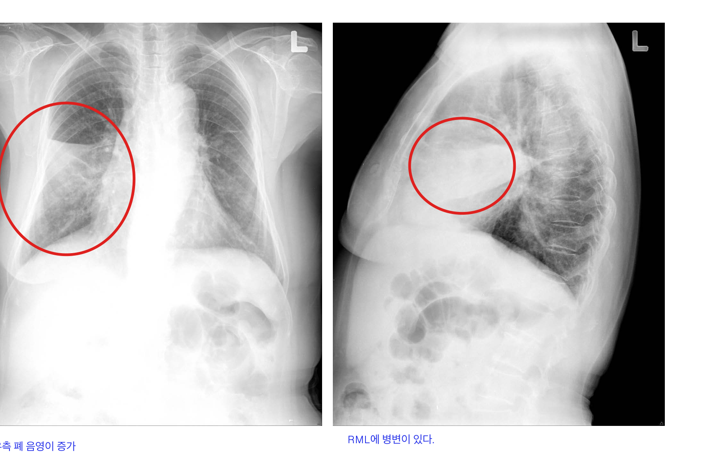{: style="width:55%"}

- 진단: **우중엽 엽성 폐렴**. 교수님: "lobe를 침범하는 **lobar pneumonia는 거의 대부분 폐렴구균**." 고열 + 화농성 가래 + 엽성 = **전형 폐렴**, 벗어나면 비전형.
- 원인균 변화: 예전엔 *S. pneumoniae* 비율이 더 높았지만 **백신**과 **고령화**로 다른 균 비율이 늘었다. "X선만으로 균을 알기는 어렵다. 고령이면 **Legionella**도 고려."
- 객담 그람 염색에서 **그람양성 쌍알균(diplococci)** → 폐렴구균. (짧은 사슬도 가능)

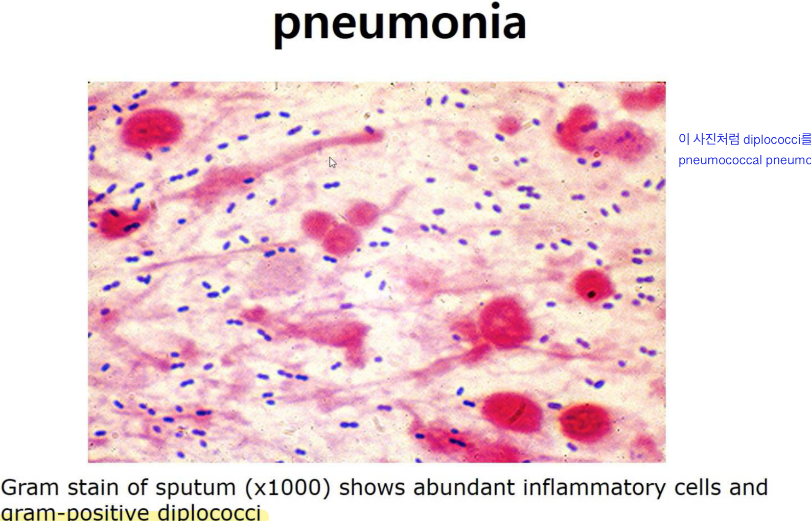{: style="width:42%"}

- 치료 장소별 원인균이 다르다(외래 / 입원 / 중환자실 — 중환자실은 MRSA, *Pseudomonas*, 그람음성균 추가).

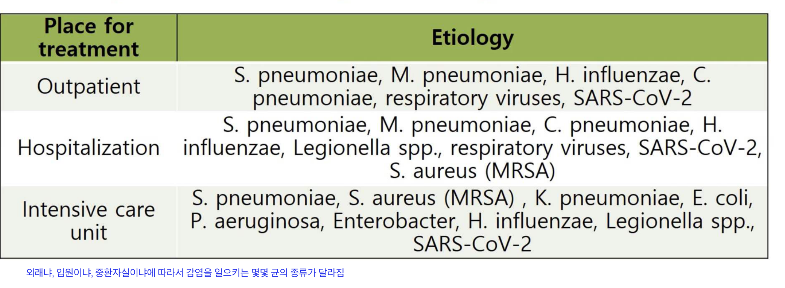{: style="width:70%"}

- 경험적 항생제: 외래 amoxicillin/clavulanate 5~7일, 입원 **β-lactam + macrolide** 또는 **호흡기 fluoroquinolone** 7~10일, 중환자실 β-lactam + azithromycin 또는 β-lactam + FQ. 교수님: "**결핵이 의심되면 FQ는 쓰지 않는다**(결핵을 가린다)." ceftriaxone을 많이 쓴다.
- 입원·외래 결정: **CURB-65**(의식저하, BUN, RR ≥ 30, 저혈압, 65세 이상) 또는 PSI(교과서 보충).

!!! exam "기출 포인트"
    필기본 8쪽에 실린 2022년 38번(2부에는 없음): 65세 여자, 기침·가래·열 + 자세를 바꿀 때 우측 흉통, X선 **엽성 폐렴** → 양성이 나올 가능성이 가장 큰 검사 = **소변 폐렴구균 항원**(오답노트: "Lobar 폐렴은 폐구균 가능성이 크다"). 오답: COVID-19 PCR, Mycoplasma IgM, 혈액 Aspergillus 항원, 소변 Legionella 항원.

# 20. 작년 Case 10 — 당뇨발 감염

!!! diff "작년 필기와 다른 점 — 올해 필기에는 없는 증례"
    2025년 필기 Case 10. 올해(2026) 강의에서는 다루지 않았지만 2부 기출이 이 증례에서 나왔으므로 그대로 둔다.

> 67세 남자, 2년 전 당뇨를 알았지만 종교 수련을 하며 약을 전혀 먹지 않음. 6개월 전 발 궤양을 스스로 치료, 2주 전부터 악화. BP 160/125, HR 115, 38.5℃.

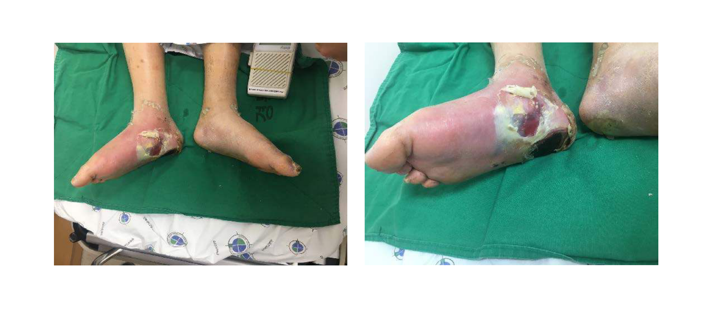{: style="width:62%"}

- 교수님: "**교수님 같으면 발을 자르자고** 한다. 빨리 자르고 재활하는 게 더 좋을 것." "**썩으면 절대 돌아오지 않는다.**" 새카매지면 mummification시켜 저절로 떨어지게 할 때도 있다. "딱 보면 알아야 한다."
- **혼합감염**(그람양성·그람음성·혐기균). 교수님: "MRSA가 나오긴 하지만 처음부터 배양되는 게 아니고, 계속 치료하다 보면 검출되기 시작." 열린 상처라 겉에만 있는 균인지 안까지 들어간 균인지 판단이 어려워 **치료 반응을 보며** 판단.
- 치료: **piperacillin/tazobactam, ampicillin/sulbactam** → 안 들으면 **carbapenem**, MRSA 나오면 **vancomycin** 추가. 무엇보다 **괴사조직 제거(변연절제)·배농**, 혈류 평가·재관류, 절단. 교수님: "일찍 잘 판단해야. 의족 차고 재활하는 게 훨씬 빠를 수도."

!!! exam "기출 포인트"
    6번: 당뇨발 감염에서 가장 중요한 것 → 적절한 항생제와 함께 **괴사조직 제거·배농**. 12번: 당뇨발은 대개 **다균 혼합 감염**, 열린 상처 **표면 배양**은 원인균을 반영하지 못한다.

## 작년(2025) 증례 한 줄 요점
| Case | 한 줄 요점 |
|---|---|
| 1 VP shunt | distal 쪽 감염·복강 농양, CoNS·*S. aureus*. **shunt 신염**(면역복합체). **제거** + lumbar drain |
| 2 림프부종 | 선천 림프부종의 반복 봉와직염. amp/sulbactam·cefazolin, 예방 cefadroxil(국내 penicillin V 없음) |
| 3 방선균증 | IUD + 골반 종괴(암 오인). 유황과립. **penicillin 계열 6~12개월** |
| 4 간질 | 녹즙(미나리) + 간 터널 병변 + 호산구. **triclabendazole** |
| 5 뎅기열 | 필리핀, Aedes, 점상출혈 → 붉은 바다의 흰 섬. NS1, 수액·acetaminophen, **NSAID 금지**, ADE |
| 6 TSS | 배양 음성 + 쇼크 + 손발 박리·딸기혀. 초항원. **clindamycin + β-lactam ± IVIG**, 감염원 제거 |
| 7 기쿠치 | 아시아 젊은 여성, 움직이는 압통 림프절, **백혈구 감소**, 괴사(호중구 없음). 대증 |
| 8 수족구 | 콕사키 A16·EV71. 대부분 자연 치유, 탈수·수막염 주의 |
| 9 폐렴구균 폐렴 | 엽성 → 폐렴구균, 그람양성 쌍알균. β-lactam + macrolide 또는 FQ(결핵 의심 시 FQ ×) |
| 10 당뇨발 | 혼합감염. pip/tazo → carbapenem, MRSA면 vancomycin. **변연절제·절단** |
