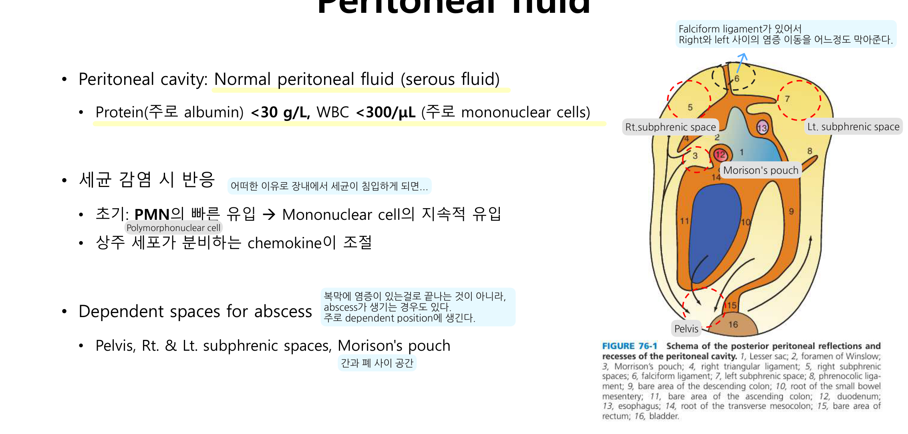

<!-- 필기본: 2026 · 2025 -->
<!-- 단계: 수업 후 -->

# 0. 이 수업을 공부하는 법

올해(2026) 강의는 **배소현 교수님**(경북대병원 감염내과)이 했다. 작년까지 이 수업은 장현하 교수님이었고, 기출 18문항(2020–2025)은 모두 그때 나온 것이다. 슬라이드 뼈대는 작년과 같이 Harrison 내과학 "Intraabdominal Infections and Abscesses" 장이지만, 올해는 **한국어 요약 + Harrison 표(Table 76-1, 76-4, 77-3)** 를 많이 넣었고 해부, SBP 기전, 2차 복막염 진단 흐름도, CAPD 진단 기준, 간농양 원인균 표가 새로 생겼다.

필기본 표지 메모: "이전 족보는 싹다 다른 교수님이 하셔서 족보는 붙이지 않았다. 다만 **case 형식으로 비슷하게** 나올 듯하다." → 작년 기출의 **사례형 틀**(간경변+복수+발열, 충수 천공+복막염, 간농양 CT, 비장농양 CT)은 그대로 익히고, 올해 새로 강조된 숫자·기준을 더해 공부한다.

필기본 표시 읽는 법: 분홍 「족보」 표시 = **교수님이 중요하다고 한 곳**, 노란 형광펜 = 교수님이 읽은 부분.

- 분홍 표시가 붙은 곳: **① 1차 vs 2차 복막염 구분**(11쪽), **② 복강내 농양 진단 = 복부 CT**(28쪽), **③ 항생제는 배액의 보조 요법일 뿐**(29쪽).
- 별표(★): **SBP 진단 = 복수 PMN >250/μL**(16쪽), **2차 복막염에서 복수천자는 일차 검사가 아니다**(21쪽).
- 교수님 말: 2차 복막염 항생제 표는 "**대표적인 원칙 정도만** 기억하시면 되겠습니다".

학습 목표(올해)

1. 복강내 감염의 발생 과정(복막염, 농양)을 설명할 수 있다.
2. 일차성, 이차성, CAPD 관련 복막염을 구분하고 진단 및 치료 원칙을 설명할 수 있다.
3. 복강내 농양의 발생 기전과 진단, 치료 원칙을 설명할 수 있다.
4. 간, 비장, 신장 및 신주위, 요근 농양의 원인균, 임상양상, 치료를 설명할 수 있다.

!!! diff "작년 필기와 다른 점"
    작년 학습 목표는 3개(감염진단명 / 복막염의 원인·진단·경로·증상·치료 / 농양의 원인·진단·치료)였다. 올해는 **"CAPD 관련 복막염을 구분"** 과 **"간·비장·신장·요근 농양 각각의 원인균"** 이 목표에 명시됐다 — 이 두 곳이 작년보다 자세해졌다.

필기본 4쪽에는 필기한 학생이 만든 **복막염 4분류 요약표**가 있다. 처음에 한 번 보고, 다 읽은 뒤 다시 보며 빈칸 없이 말할 수 있는지 확인하자.

{: style="width:86%"}

| 분류 | 원인·배경 | 원인균 | 진단 | 치료 |
|---|---|---|---|---|
| 1차(SBP) | 뚜렷한 외부 요인 없음, 간경변 + 기존 복수, 혈행성 추정 | **단일균**, E. coli(최다), 사슬알균·장알균·폐렴알균 | 복수천자 **PMN >250/μL**, 복수 10 mL 혈액배양병 + 혈액배양 | 빠른 경험적 항생제, **3세대 세팔로스포린** 또는 pip/tazo, 혐기균 커버 불필요 |
| 2차 | 장기 천공·파열 → 복강 오염 | **다균**: 통성 GNB + **혐기균(B. fragilis)** | 안정 → 응급 복부 CT / 불안정 → 영상 없이 수술 | **Source control**(수술·배액) + GNB·혐기균 동시 커버 |
| CAPD | 카테터 → **피부균** | 포도알균 ~45%(CoNS, S. aureus) | 투석액 **WBC >100/μL, PMN >50%** | cefazolin(또는 vancomycin) + ceftazidime 또는 AG, **복강내(IP) 투여** |
| 결핵성 | 림프절·장기 결핵의 직접 전파, 혈행성 | M. tuberculosis | 삼출액, **림프구 우세**, 도말·배양 낮음 → **복막 생검** | 항결핵제 **9–12개월** |

!!! key "핵심"
    **1차 복막염 = 간경변 + 복수 PMN >250, 단일 장내세균(E. coli), 수술 X, 3세대 세팔로스포린, 혐기균 커버 X.**
    **2차 복막염 = 장 천공, 혼합균(+혐기균 B. fragilis), 안정하면 CT·불안정하면 바로 수술, 혐기균까지 덮는 항생제 + source control.**
    **농양 = 진단은 CT, 치료의 핵심은 배액(PCD) — 항생제는 보조. 배액 실패 → 수술.**

# 1. 복강의 구조와 복강내 감염의 발생

## 복강(peritoneal cavity)의 구조

!!! new "올해 필기에서 추가"
    작년에는 없던 해부 슬라이드(7쪽)가 새로 들어갔다. 복막염·농양이 "어디에" 생기고 왜 그 장기가 복막 뒤(후복막)인지 이해하는 바탕이다.

{: style="width:90%"}

- **복막(peritoneum)** 은 두 겹이다. 배벽 안쪽을 덮는 **벽측 복막(parietal peritoneum)** 과 장기 표면을 덮는 **장측 복막(visceral peritoneum)**. 장기들은 복막 주머니 안으로 풍선처럼 밀고 들어가 **복막내(intraperitoneal) 장기**가 되고, 어떤 장기는 복막 **뒤**에 머물러 **후복막(retroperitoneal) 장기**가 된다.
- 두 복막 사이(복강)에는 정상적으로 **약간의 장액(serous fluid)** 이 있다 → 다음 소단원의 정상 복수.
- **횡행결장간막(transverse mesocolon)**: 복강을 **위(결장간막 상부, supracolic)·아래(결장간막 하부, inframesocolic)** 로 나눈다. 고름이 위·아래로 퍼지는 길을 어느 정도 막는다.
- 후복막 장기 (필기: 둘 다 「Retroperitoneal organ」)
    - **앞쪽 후복막(anterior retroperitoneum)**: **췌장, 십이지장, 상행·하행결장**
    - **뒤쪽 후복막(posterior retroperitoneum)**: **신장, 요관, 부신**
- 임상에서: 췌장염·십이지장 천공은 복막 "뒤"에서 시작해 복강으로 샐 수 있고(→ 1절 원인 ③), 신장·요근 농양은 후복막 농양이다(→ 9절).

## 복수(peritoneal fluid)와 농양이 잘 생기는 곳

{: style="width:86%"}

- **정상 복수**(장액): 단백질(주로 albumin) **<30 g/L**, 백혈구 **<300/μL**(주로 **단핵구**, mononuclear cell). 윤활 역할.
- **세균 감염 시 반응**: 장에서 어떤 이유로 세균이 들어오면 **초기에는 PMN(다형핵백혈구 = 호중구, polymorphonuclear cell)이 빠르게 유입** → 이후 **단핵구가 지속적으로 유입**. 이 흐름은 복막의 상주 세포가 분비하는 **chemokine** 이 조절한다.
    - 그래서 "급성 세균성"이면 PMN, "만성(결핵 등)"이면 림프구·단핵구가 우세하다 → SBP는 PMN, 결핵성은 림프구(6절)와 연결된다.
- **농양이 생기는 의존 공간(dependent spaces)**: 복막에 염증이 있는 것으로 끝나지 않고 농양이 생길 수 있는데, 주로 누웠을 때 액체가 고이는 **의존 부위(dependent position)** 에 생긴다.
    - **골반(pelvis)** — 가장 낮은 곳
    - **우·좌 횡격막하 공간(Rt. & Lt. subphrenic space)** — 필기: "간과 폐 사이 공간"(횡격막 바로 아래)
    - **Morison's pouch**(간신 오목, hepatorenal recess) — 누운 자세에서 상복부의 가장 낮은 곳
- 필기: **겸상인대(falciform ligament)** 가 있어서 오른쪽과 왼쪽 사이 염증 이동을 어느 정도 막아 준다.

!!! diff "작년 필기와 다른 점"
    작년에는 농양 호발 부위를 "우횡격막하, 간하, 양쪽 결장옆고랑, 골반"으로 적었다. 올해 슬라이드는 **골반, 좌·우 횡격막하, Morison's pouch** 네 곳을 명시한다(간하 공간 = Morison's pouch 쪽). 숫자는 그대로다(albumin <30 g/L, WBC <300).

## 복강내 감염의 원인과 두 단계

**원인 — 정상 해부학적 장벽(normal anatomic barrier)의 파괴**

1. **충수·게실·궤양의 파열(rupture)** — 그 자리에 염증이 생기고 터져서.
2. **허혈(ischemia)·종양·염증으로 약해진 장** — 혈류 공급 장애(허혈), 암, 염증성 장질환(IBD)으로 장벽이 약해진다. 필기: "**대장(colon)은 원래 균이 바글바글하다**. 정상인은 면역과 점막 장벽으로 문제가 없지만 위험군은 문제가 될 수 있다."
3. **인접한 염증이 복강으로 새는 것** — 췌장염, **골반염(PID, pelvic inflammatory disease)**.

**두 단계(2 stages)** — 각 단계에서 우세한 균이 다르다.

| 단계 | 우세한 균 | 특징 |
|---|---|---|
| 1. **복막염(peritonitis)** | **통성 그람음성 막대균(E. coli)** | 그람음성균 **패혈증과 내독소(endotoxin)** 로 **초기 사망** |
| 2. **농양(abscess)** | **혐기균(B. fragilis)** 우세 | 복막염에서 살아남았지만 치료되지 않은 경우 |

- 필기: 복막염이 **국한(localized)** 되고, 복통이 심하지 않고 **천천히 진행**되면 그 부분이 농양이 된다.
- 필기: **농양 속은 혐기균이 자라기 좋은 환경**이다(산소가 안 들어가는 닫힌 공간) → 그래서 1단계는 E. coli, 2단계는 B. fragilis.
- 이 두 단계 모델은 2차 복막염 치료에서 왜 **그람음성균과 혐기균을 둘 다** 덮어야 하는지의 근거다.

!!! new "올해 필기에서 추가"
    두 단계 각각의 **대표균**(복막염 = E. coli, 농양 = B. fragilis)이 올해 슬라이드에 명시됐다. 작년에는 "각 단계에서 우세한 균이 양상을 결정한다"까지만 있었다.

!!! diff "작년 필기와 다른 점"
    작년 교수님 설명: 농양은 면역이 정상인 사람이 나쁜 것을 한곳에 몰아넣는 **방어기전**이기도 해서, 동원할 T 세포가 없는 **면역저하자는 농양이 잘 생기지 않는다**. 허혈은 나이가 많을수록(동맥경화) 잘 생긴다. 췌장염으로 앞쪽 십이지장이 상해 새는 경우를 예로 들었다.

!!! exam "기출 포인트"
    2부 10번(2022): 장천공 복막염 고름에서 나온 대장균 = **commensal pathogen**(평소 장의 정상세균총이지만 무균 부위에 들어가면 병을 일으킨다). 오답: obligate(항상 병원성, 결핵균), zoonotic(동물), environmental(레지오넬라), nosocomial(병원 획득).

# 2. 복막염의 정의와 분류

## 복막염의 CT

{: style="width:80%"}

- 원래 체액은 CT에서 **까맣게(저음영)** 보이는데, 정상인은 복수가 거의 없어 잘 안 보인다.
- **간경화, 심부전, 만성콩팥병** 환자는 여러 이유로 복수가 찬다. 원래 있던 복수에 **세균이 침입**하면 화학적 자극과 염증이 일어난다 → 그것이 복막염.
- **복막염 CT 소견 3가지** (필기 분홍 상자)
    1. **복막의 비후(thickening)**
    2. **조영증강(enhance)** — 복막이 약간 빛난다
    3. **주변 지방 침윤(peripheral fat infiltration)** — 약간 지저분해 보인다
- 사진에서 신장·부신은 대표적인 **후복막 장기**로 표시돼 있다.

!!! new "올해 필기에서 추가"
    복막염 CT의 3가지 소견(비후·조영증강·지방 침윤)은 올해 새로 적힌 내용이다. 사진형 문제로 나오기 좋다.

## 분류

- **복막염(peritonitis)** = 복막(peritoneum)의 염증(-itis). 복강이 **미생물, 자극성 화학물질, 또는 둘 다**에 오염되어 생긴다.
- 나누는 축: **국한성/미만성(localized/diffuse), 급성/만성(acute/chronic), 감염성/무균성(infective/aseptic)**. 무균성은 감염이 아닌 다른 화학물질(담즙, 위산, 췌장효소 등) 때문이지만, 필기: "**복막염은 주로 감염에 의해서이다**".
- **감염성 복막염(infective peritonitis) 4가지** — 분류에 따라 **원인균과 임상양상이 달라지므로 분류가 중요**하다(필기 상자: *Types of organism, clinical presentation 달라짐*).
    1. **1차 = 자발성 세균성 복막염(SBP)** — 외부 요인이 뚜렷하지 않은데 **저절로** 생긴 세균성 복막염
    2. **2차(secondary)** — 장기의 **파열·천공**으로 구조가 바뀌어 생긴 복막염
    3. **CAPD 관련**(continuous ambulatory peritoneal dialysis, 지속적 외래 복막투석)
    4. **결핵성 복막염(tuberculous peritonitis)**
- 분홍 「족보」 괄호가 **1차와 2차**에 붙어 있다 — 둘의 구분이 이 수업의 첫째 시험 포인트다.

!!! exam "기출 포인트"
    2부 11번(2022): 1차성 복막염에 해당하는 것 = **간경변 환자의 복막염**. 충수·게실·위궤양 천공은 모두 2차, 결핵성은 따로 분류.
