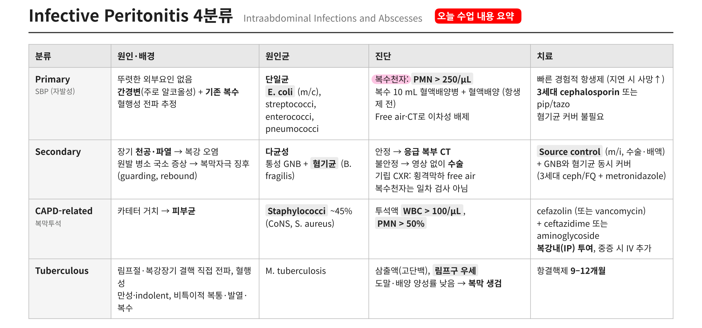
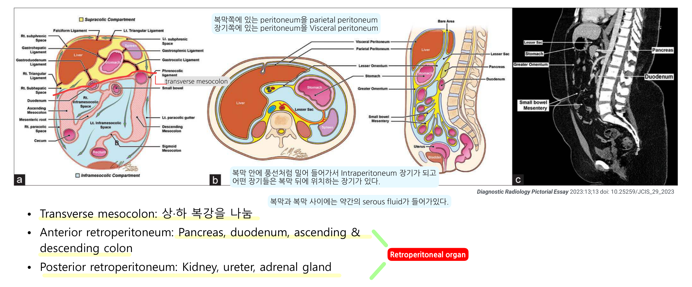
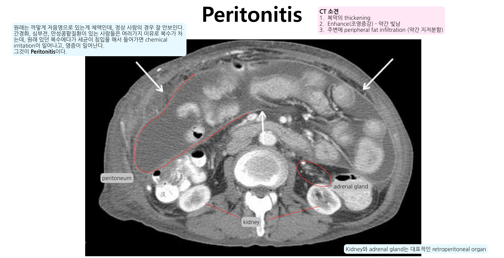
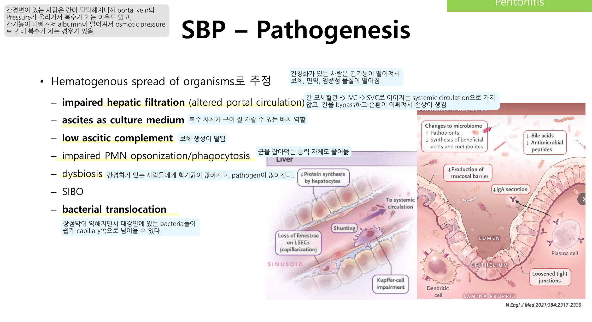
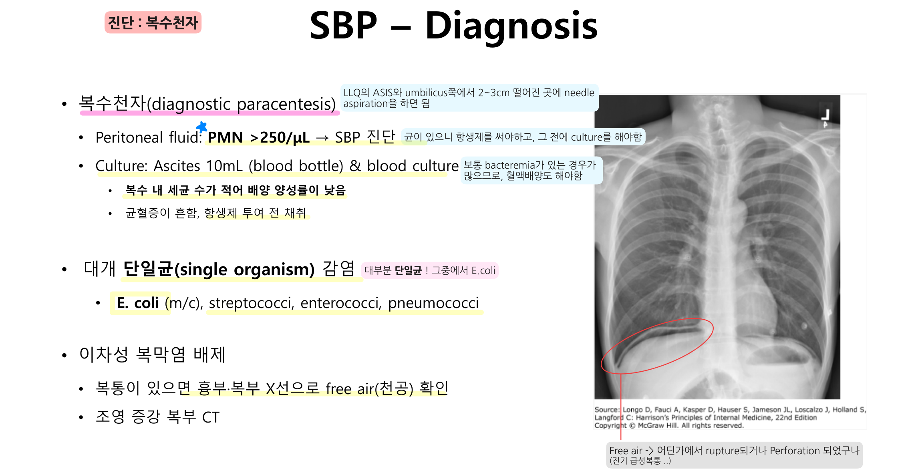
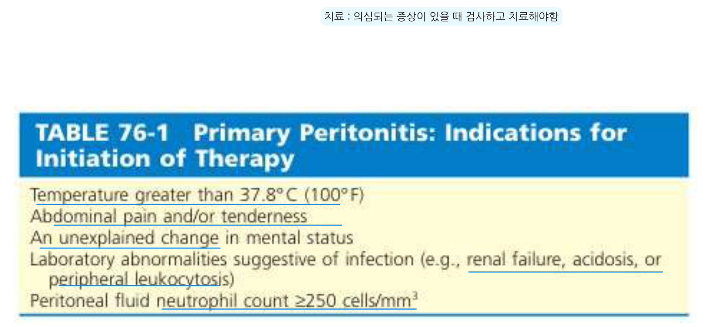
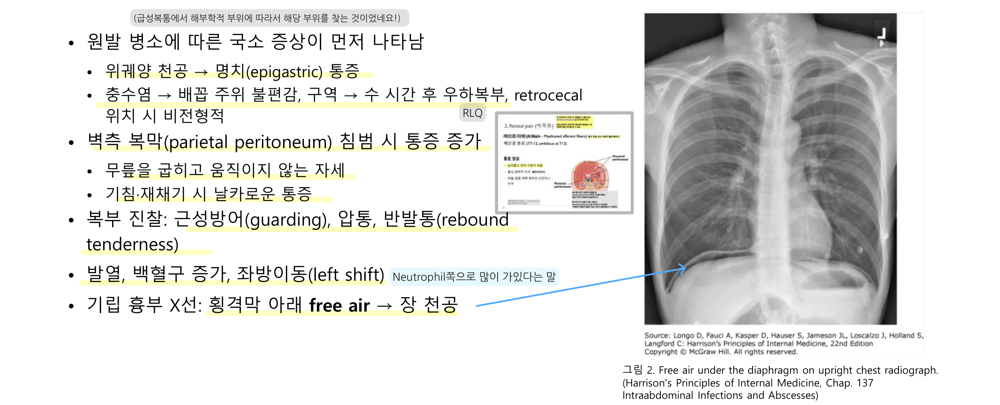
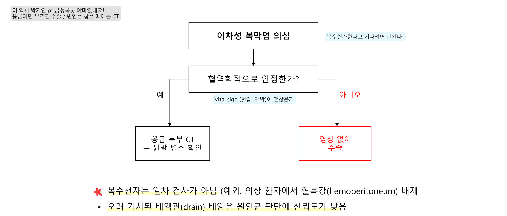
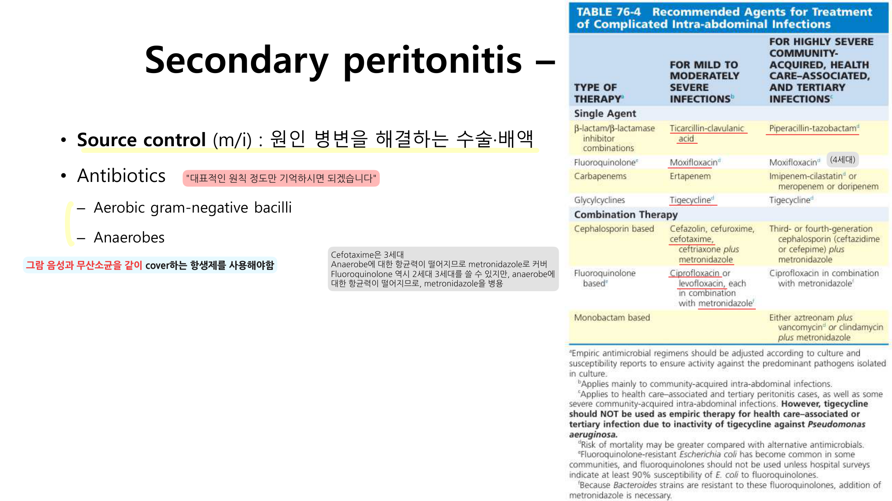
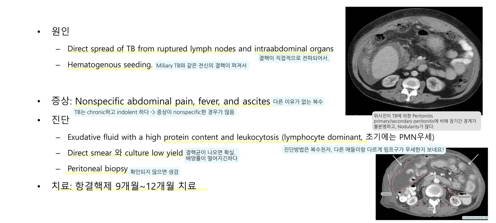

<!-- 필기본: 2026 · 2025 -->
<!-- 단계: 수업 후 -->

# 0. 이 수업을 공부하는 법

올해(2026) 강의는 **배소현 교수님**(경북대병원 감염내과)이 했다. 작년까지 이 수업은 장현하 교수님이었고, 기출 18문항(2020–2025)은 모두 그때 나온 것이다. 슬라이드 뼈대는 작년과 같이 Harrison 내과학 "Intraabdominal Infections and Abscesses" 장이지만, 올해는 **한국어 요약 + Harrison 표(Table 76-1, 76-4, 77-3)** 를 많이 넣었고 해부, SBP 기전, 2차 복막염 진단 흐름도, CAPD 진단 기준, 간농양 원인균 표가 새로 생겼다.

필기본 표지 메모: "이전 족보는 싹다 다른 교수님이 하셔서 족보는 붙이지 않았다. 다만 **case 형식으로 비슷하게** 나올 듯하다." → 작년 기출의 **사례형 틀**(간경변+복수+발열, 충수 천공+복막염, 간농양 CT, 비장농양 CT)은 그대로 익히고, 올해 새로 강조된 숫자·기준을 더해 공부한다.

필기본 표시 읽는 법: 분홍 「족보」 표시 = **교수님이 중요하다고 한 곳**, 노란 형광펜 = 교수님이 읽은 부분.

- 분홍 표시가 붙은 곳: **① 1차 vs 2차 복막염 구분**(11쪽), **② 복강내 농양 진단 = 복부 CT**(28쪽), **③ 항생제는 배액의 보조 요법일 뿐**(29쪽).
- 별표(★): **SBP 진단 = 복수 PMN >250/μL**(16쪽), **2차 복막염에서 복수천자는 일차 검사가 아니다**(21쪽).
- 교수님 말: 2차 복막염 항생제 표는 "**대표적인 원칙 정도만** 기억하시면 되겠습니다".

학습 목표(올해)

1. 복강내 감염의 발생 과정(복막염, 농양)을 설명할 수 있다.
2. 일차성, 이차성, CAPD 관련 복막염을 구분하고 진단 및 치료 원칙을 설명할 수 있다.
3. 복강내 농양의 발생 기전과 진단, 치료 원칙을 설명할 수 있다.
4. 간, 비장, 신장 및 신주위, 요근 농양의 원인균, 임상양상, 치료를 설명할 수 있다.

!!! diff "작년 필기와 다른 점"
    작년 학습 목표는 3개(감염진단명 / 복막염의 원인·진단·경로·증상·치료 / 농양의 원인·진단·치료)였다. 올해는 **"CAPD 관련 복막염을 구분"** 과 **"간·비장·신장·요근 농양 각각의 원인균"** 이 목표에 명시됐다 — 이 두 곳이 작년보다 자세해졌다.

필기본 4쪽에는 필기한 학생이 만든 **복막염 4분류 요약표**가 있다. 처음에 한 번 보고, 다 읽은 뒤 다시 보며 빈칸 없이 말할 수 있는지 확인하자.

{: style="width:86%"}

| 분류 | 원인·배경 | 원인균 | 진단 | 치료 |
|---|---|---|---|---|
| 1차(SBP) | 뚜렷한 외부 요인 없음, 간경변 + 기존 복수, 혈행성 추정 | **단일균**, E. coli(최다), 사슬알균·장알균·폐렴알균 | 복수천자 **PMN >250/μL**, 복수 10 mL 혈액배양병 + 혈액배양 | 빠른 경험적 항생제, **3세대 세팔로스포린** 또는 pip/tazo, 혐기균 커버 불필요 |
| 2차 | 장기 천공·파열 → 복강 오염 | **다균**: 통성 GNB + **혐기균(B. fragilis)** | 안정 → 응급 복부 CT / 불안정 → 영상 없이 수술 | **Source control**(수술·배액) + GNB·혐기균 동시 커버 |
| CAPD | 카테터 → **피부균** | 포도알균 ~45%(CoNS, S. aureus) | 투석액 **WBC >100/μL, PMN >50%** | cefazolin(또는 vancomycin) + ceftazidime 또는 AG, **복강내(IP) 투여** |
| 결핵성 | 림프절·장기 결핵의 직접 전파, 혈행성 | M. tuberculosis | 삼출액, **림프구 우세**, 도말·배양 낮음 → **복막 생검** | 항결핵제 **9–12개월** |

!!! key "핵심"
    **1차 복막염 = 간경변 + 복수 PMN >250, 단일 장내세균(E. coli), 수술 X, 3세대 세팔로스포린, 혐기균 커버 X.**
    **2차 복막염 = 장 천공, 혼합균(+혐기균 B. fragilis), 안정하면 CT·불안정하면 바로 수술, 혐기균까지 덮는 항생제 + source control.**
    **농양 = 진단은 CT, 치료의 핵심은 배액(PCD) — 항생제는 보조. 배액 실패 → 수술.**

# 1. 복강의 구조와 복강내 감염의 발생

## 복강(peritoneal cavity)의 구조

!!! new "올해 필기에서 추가"
    작년에는 없던 해부 슬라이드(7쪽)가 새로 들어갔다. 복막염·농양이 "어디에" 생기고 왜 그 장기가 복막 뒤(후복막)인지 이해하는 바탕이다.

{: style="width:90%"}

- **복막(peritoneum)** 은 두 겹이다. 배벽 안쪽을 덮는 **벽측 복막(parietal peritoneum)** 과 장기 표면을 덮는 **장측 복막(visceral peritoneum)**. 장기들은 복막 주머니 안으로 풍선처럼 밀고 들어가 **복막내(intraperitoneal) 장기**가 되고, 어떤 장기는 복막 **뒤**에 머물러 **후복막(retroperitoneal) 장기**가 된다.
- 두 복막 사이(복강)에는 정상적으로 **약간의 장액(serous fluid)** 이 있다 → 다음 소단원의 정상 복수.
- **횡행결장간막(transverse mesocolon)**: 복강을 **위(결장간막 상부, supracolic)·아래(결장간막 하부, inframesocolic)** 로 나눈다. 고름이 위·아래로 퍼지는 길을 어느 정도 막는다.
- 후복막 장기 (필기: 둘 다 「Retroperitoneal organ」)
    - **앞쪽 후복막(anterior retroperitoneum)**: **췌장, 십이지장, 상행·하행결장**
    - **뒤쪽 후복막(posterior retroperitoneum)**: **신장, 요관, 부신**
- 임상에서: 췌장염·십이지장 천공은 복막 "뒤"에서 시작해 복강으로 샐 수 있고(→ 1절 원인 ③), 신장·요근 농양은 후복막 농양이다(→ 9절).

## 복수(peritoneal fluid)와 농양이 잘 생기는 곳

{: style="width:86%"}

- **정상 복수**(장액): 단백질(주로 albumin) **<30 g/L**, 백혈구 **<300/μL**(주로 **단핵구**, mononuclear cell). 윤활 역할.
- **세균 감염 시 반응**: 장에서 어떤 이유로 세균이 들어오면 **초기에는 PMN(다형핵백혈구 = 호중구, polymorphonuclear cell)이 빠르게 유입** → 이후 **단핵구가 지속적으로 유입**. 이 흐름은 복막의 상주 세포가 분비하는 **chemokine** 이 조절한다.
    - 그래서 "급성 세균성"이면 PMN, "만성(결핵 등)"이면 림프구·단핵구가 우세하다 → SBP는 PMN, 결핵성은 림프구(6절)와 연결된다.
- **농양이 생기는 의존 공간(dependent spaces)**: 복막에 염증이 있는 것으로 끝나지 않고 농양이 생길 수 있는데, 주로 누웠을 때 액체가 고이는 **의존 부위(dependent position)** 에 생긴다.
    - **골반(pelvis)** — 가장 낮은 곳
    - **우·좌 횡격막하 공간(Rt. & Lt. subphrenic space)** — 필기: "간과 폐 사이 공간"(횡격막 바로 아래)
    - **Morison's pouch**(간신 오목, hepatorenal recess) — 누운 자세에서 상복부의 가장 낮은 곳
- 필기: **겸상인대(falciform ligament)** 가 있어서 오른쪽과 왼쪽 사이 염증 이동을 어느 정도 막아 준다.

!!! diff "작년 필기와 다른 점"
    작년에는 농양 호발 부위를 "우횡격막하, 간하, 양쪽 결장옆고랑, 골반"으로 적었다. 올해 슬라이드는 **골반, 좌·우 횡격막하, Morison's pouch** 네 곳을 명시한다(간하 공간 = Morison's pouch 쪽). 숫자는 그대로다(albumin <30 g/L, WBC <300).

## 복강내 감염의 원인과 두 단계

**원인 — 정상 해부학적 장벽(normal anatomic barrier)의 파괴**

1. **충수·게실·궤양의 파열(rupture)** — 그 자리에 염증이 생기고 터져서.
2. **허혈(ischemia)·종양·염증으로 약해진 장** — 혈류 공급 장애(허혈), 암, 염증성 장질환(IBD)으로 장벽이 약해진다. 필기: "**대장(colon)은 원래 균이 바글바글하다**. 정상인은 면역과 점막 장벽으로 문제가 없지만 위험군은 문제가 될 수 있다."
3. **인접한 염증이 복강으로 새는 것** — 췌장염, **골반염(PID, pelvic inflammatory disease)**.

**두 단계(2 stages)** — 각 단계에서 우세한 균이 다르다.

| 단계 | 우세한 균 | 특징 |
|---|---|---|
| 1. **복막염(peritonitis)** | **통성 그람음성 막대균(E. coli)** | 그람음성균 **패혈증과 내독소(endotoxin)** 로 **초기 사망** |
| 2. **농양(abscess)** | **혐기균(B. fragilis)** 우세 | 복막염에서 살아남았지만 치료되지 않은 경우 |

- 필기: 복막염이 **국한(localized)** 되고, 복통이 심하지 않고 **천천히 진행**되면 그 부분이 농양이 된다.
- 필기: **농양 속은 혐기균이 자라기 좋은 환경**이다(산소가 안 들어가는 닫힌 공간) → 그래서 1단계는 E. coli, 2단계는 B. fragilis.
- 이 두 단계 모델은 2차 복막염 치료에서 왜 **그람음성균과 혐기균을 둘 다** 덮어야 하는지의 근거다.

!!! new "올해 필기에서 추가"
    두 단계 각각의 **대표균**(복막염 = E. coli, 농양 = B. fragilis)이 올해 슬라이드에 명시됐다. 작년에는 "각 단계에서 우세한 균이 양상을 결정한다"까지만 있었다.

!!! diff "작년 필기와 다른 점"
    작년 교수님 설명: 농양은 면역이 정상인 사람이 나쁜 것을 한곳에 몰아넣는 **방어기전**이기도 해서, 동원할 T 세포가 없는 **면역저하자는 농양이 잘 생기지 않는다**. 허혈은 나이가 많을수록(동맥경화) 잘 생긴다. 췌장염으로 앞쪽 십이지장이 상해 새는 경우를 예로 들었다.

!!! exam "기출 포인트"
    2부 10번(2022): 장천공 복막염 고름에서 나온 대장균 = **commensal pathogen**(평소 장의 정상세균총이지만 무균 부위에 들어가면 병을 일으킨다). 오답: obligate(항상 병원성, 결핵균), zoonotic(동물), environmental(레지오넬라), nosocomial(병원 획득).

# 2. 복막염의 정의와 분류

## 복막염의 CT

{: style="width:80%"}

- 원래 체액은 CT에서 **까맣게(저음영)** 보이는데, 정상인은 복수가 거의 없어 잘 안 보인다.
- **간경화, 심부전, 만성콩팥병** 환자는 여러 이유로 복수가 찬다. 원래 있던 복수에 **세균이 침입**하면 화학적 자극과 염증이 일어난다 → 그것이 복막염.
- **복막염 CT 소견 3가지** (필기 분홍 상자)
    1. **복막의 비후(thickening)**
    2. **조영증강(enhance)** — 복막이 약간 빛난다
    3. **주변 지방 침윤(peripheral fat infiltration)** — 약간 지저분해 보인다
- 사진에서 신장·부신은 대표적인 **후복막 장기**로 표시돼 있다.

!!! new "올해 필기에서 추가"
    복막염 CT의 3가지 소견(비후·조영증강·지방 침윤)은 올해 새로 적힌 내용이다. 사진형 문제로 나오기 좋다.

## 분류

- **복막염(peritonitis)** = 복막(peritoneum)의 염증(-itis). 복강이 **미생물, 자극성 화학물질, 또는 둘 다**에 오염되어 생긴다.
- 나누는 축: **국한성/미만성(localized/diffuse), 급성/만성(acute/chronic), 감염성/무균성(infective/aseptic)**. 무균성은 감염이 아닌 다른 화학물질(담즙, 위산, 췌장효소 등) 때문이지만, 필기: "**복막염은 주로 감염에 의해서이다**".
- **감염성 복막염(infective peritonitis) 4가지** — 분류에 따라 **원인균과 임상양상이 달라지므로 분류가 중요**하다(필기 상자: *Types of organism, clinical presentation 달라짐*).
    1. **1차 = 자발성 세균성 복막염(SBP)** — 외부 요인이 뚜렷하지 않은데 **저절로** 생긴 세균성 복막염
    2. **2차(secondary)** — 장기의 **파열·천공**으로 구조가 바뀌어 생긴 복막염
    3. **CAPD 관련**(continuous ambulatory peritoneal dialysis, 지속적 외래 복막투석)
    4. **결핵성 복막염(tuberculous peritonitis)**
- 분홍 「족보」 괄호가 **1차와 2차**에 붙어 있다 — 둘의 구분이 이 수업의 첫째 시험 포인트다.

!!! exam "기출 포인트"
    2부 11번(2022): 1차성 복막염에 해당하는 것 = **간경변 환자의 복막염**. 충수·게실·위궤양 천공은 모두 2차, 결핵성은 따로 분류.

# 3. 1차(자발성) 세균성 복막염 — SBP

## 정의와 기저질환
- **1차 세균성 복막염(primary bacterial peritonitis) = 자발성 세균성 복막염(SBP, spontaneous bacterial peritonitis)**. 천공·허혈 같은 **눈에 보이는 오염원 없이** 생긴다.
- **기저질환** — 필기: "대부분 기저질환이 있는 사람에게서 발생"
    - 성인에서는 대부분 **간경변(cirrhosis)**, 흔히 **알코올성**.
    - 그 외: **전이성 암, 만성 간염, 급성 바이러스 간염, 심부전, 전신홍반루푸스(SLE), 림프부종**.
    - **드물게 기저질환 없이도** 발생.
- **거의 항상 기존 복수(ascites)가 있는 환자**에서 생긴다 — 복수가 없으면 SBP를 먼저 떠올리지 않는다.
- **간경변 환자의 10% 이하**에서 발생.

!!! new "올해 필기에서 추가"
    "**간경변 환자의 10% 이하**에서 발생"이라는 빈도가 새로 들어갔다.

!!! exam "기출 포인트"
    2부 2번(2024): SBP의 특징으로 옳은 것 = **전이성 암이나 조절되지 않는 자가면역질환에서도 발생 가능** — 위 "그 외" 목록(전이성 암, SLE) 그대로다. 오답: 심한 오한·복통이 진단적 특징(X, 없는 경우가 많다), 주로 혐기균(X), 응급수술(X), 균혈증 <5%(X, 흔하다).

## 기전 (Pathogenesis)

{: style="width:90%"}

SBP는 **균의 혈행성 전파(hematogenous spread)** 로 생긴다고 추정한다. 간경변이 이 과정의 거의 모든 단계를 망가뜨린다.

- 복수가 차는 이유(필기, 왼쪽 위): ① 간이 딱딱해져 **문맥압(portal pressure)이 올라가서**, ② 간기능이 나빠져 **albumin이 떨어지고 삼투압(osmotic pressure)이 낮아져서**.
- 간경화 환자는 간기능이 떨어져 **보체·면역·염증성 물질**이 모두 줄어든다.

| 기전 | 무엇인가 / 필기 설명 |
|---|---|
| **간 여과 장애**(impaired hepatic filtration, altered portal circulation) | 장에서 들어온 균은 원래 문맥 → 간에서 걸러진다. 간경변에서는 혈액이 **간을 우회(shunting)** 해 간 모세혈관 → IVC가 아닌 전신순환으로 바로 가서 균이 걸러지지 않는다(그림: Kupffer 세포 장애, 굴모세혈관 창 소실) |
| **배지로서의 복수**(ascites as culture medium) | 복수 자체가 균이 잘 자라는 배지 |
| **복수 보체 감소**(low ascitic complement) | 보체 생성이 덜 됨 |
| **PMN 옵소닌화·탐식 장애** | 균을 잡아먹는 능력 자체가 줄어듦 |
| **장내세균 불균형(dysbiosis)** | 간경화 환자에서 혐기균·병원균(pathobiont)이 많아진다 |
| **SIBO**(small intestinal bacterial overgrowth, 소장 세균 과증식) | 소장에 세균이 지나치게 늘어남 |
| **세균 전위(bacterial translocation)** | 장점막이 약해져(점막 장벽·IgA·tight junction 감소) 대장 안 세균이 모세혈관 쪽으로 쉽게 넘어온다 |

!!! new "올해 필기에서 추가"
    작년에는 "문맥 순환이 바뀌어 간에서 걸러지지 않는다" 한 줄이었다. 올해는 **7가지 기전**(여과 장애, 배지, 보체↓, 탐식↓, dysbiosis, SIBO, bacterial translocation)과 NEJM 그림이 들어갔다. "기전으로 옳지 않은 것" 형으로 나오기 좋다 — 함정은 "천공", "췌장 직접 침범", "심내막염" 같은 2차·다른 경로.

## 임상양상 (Clinical manifestation)
- **발열(fever)** — **가장 흔하다(~80%)**. 필기: "대부분 열!"
- **복수는 감염 전부터 존재** — 복수가 많아졌다는 것만으로는 SBP를 감별하기 어렵다.
- **복통, 급성 발병, 복막자극 징후**는 있으면 진단에 도움이 되지만 **없는 경우도 많다**(굵게 강조). 2차 복막염처럼 배가 딱딱하고 아픈 그림을 기대하면 놓친다.
- **비특이적 증상**(대부분 비특이적)
    - 권태감(malaise), 피로, **간성뇌증(hepatic encephalopathy)**
    - **설명되지 않는 황달, 급성 신손상(AKI)** — 혈액 검사의 이상: **빌리루빈 증가, 크레아티닌 증가**
- 빨간 글씨 결론: **복수와 발열이 있는 간경변 환자에서는 복수천자(paracentesis)를 시행한다.**

!!! new "올해 필기에서 추가"
    발열 빈도(**~80%**), **설명되지 않는 황달·급성 신손상**, 그리고 "복수 + 발열 간경변 환자 → 복수천자" 원칙이 새로 적혔다.

## 진단 (Diagnosis) — 복수천자

{: style="width:86%"}

- **진단적 복수천자(diagnostic paracentesis)** — 필기본 15쪽은 복수천자 시술 사진(Z-track). 필기: **좌하복부(LLQ)에서 위앞엉덩뼈가시(ASIS)와 배꼽 사이, 2–3 cm 떨어진 곳**에 바늘을 넣는다.
- ★ **복수 PMN >250/μL → SBP 진단.** 균이 있으니 항생제를 써야 하고, **그 전에 배양**을 해야 한다.
    - 계산법: 복수 PMN 수 = 복수 WBC × PMN 비율. 예) WBC 310 × 67% ≈ 208(→ 기준 미달, 아래 기출 포인트).
- **배양**: **복수 10 mL를 혈액배양병(blood bottle)에** 넣고 + **혈액배양**.
    - **복수 내 세균 수가 적어 배양 양성률이 낮다**(굵게) — 혈액배양병에 바로 넣는 이유.
    - **균혈증이 흔하다** → 혈액배양도 함께, **항생제 투여 전** 채취.
- **대개 단일균(single organism)** — 필기: "대부분 단일균! 그중에서 E. coli"
    - **E. coli(가장 흔함, m/c)**, 사슬알균(streptococci), 장알균(enterococci), 폐렴알균(pneumococci).
    - 여러 균, 특히 혐기균이 나오면 SBP가 아니라 **2차 복막염**을 의심한다.
- **2차 복막염 배제**
    - **복통이 있으면 흉부·복부 X선으로 free air(천공)** 확인 — 필기: "free air → 어딘가에서 rupture되거나 perforation 되었구나"(진단학 급성복통과 연결).
    - **조영증강 복부 CT**.

!!! diff "작년 필기와 다른 점"
    작년 교수님은 원인균으로 "E. coli, **요즘은 Klebsiella가 더 우세**"라고 했다. 올해 슬라이드는 **E. coli가 가장 흔하다(m/c)** 로 적었다 — 시험에는 올해 기준(E. coli)으로 답하고, Klebsiella도 그람음성 장내세균으로 SBP 원인이 된다는 것만 기억한다. 작년에는 "진단이 쉽지 않다(배양 음성이 흔함)"를 강조했는데 올해는 그 이유(세균 수가 적음 → 혈액배양병 10 mL)를 구체적으로 적었다.

!!! exam "기출 포인트"
    - 2부 1·17번(2025·2020, 같은 문제): 간경화 + 복수 + 복통 없는 1주 발열, 복수 WBC 310(PMN 67%) → 옳은 것 = **수술 없이 3세대 cephalosporin**. 함정: 심내막염이 원인(X), B. fragilis가 가장 흔함(X, 혐기균은 2차), **균혈증 <5%(X, 흔하다)**, 췌장 염증의 직접 침범(X). ※ 310×0.67≈208로 엄밀히는 기준(>250) 미달 — 출제 의도는 SBP.
    - 2부 13번(2021): SBP 복수에서 *Enterococcus faecalis* → 감수성 가능성이 낮은 약 = **Cefotaxime**. 장알균은 **모든 세팔로스포린에 자연 내성** — SBP 원인균 목록에 장알균이 있는 이유, 그리고 경험적 3세대 세팔로스포린을 쓰다가 배양 결과에 따라 바꿔야 하는 이유.

## 치료 (Treatment)

{: style="width:70%"}

필기: "**의심되는 증상이 있을 때 검사하고 치료해야 함**". 아래 중 하나라도 있으면 치료를 시작한다(Harrison Table 76-1).

| 치료 시작 적응증 | 기억법 |
|---|---|
| 체온 **>37.8°C**(100°F) | 열 |
| **복통 및/또는 압통** | 배 |
| **설명되지 않는 의식 변화**(mental status change) | 간성뇌증과 겹침 |
| 감염을 시사하는 검사 이상 — **신부전, 산증, 말초 백혈구 증가** | 혈액검사 |
| 복수 **호중구 ≥250 cells/mm³** | 복수천자 |

- **항생제가 늦으면 사망률이 높아진다**(delayed antibiotic therapy → mortality↑). 배양 채취 후 바로 시작.
- **경험적 항생제(empirical)**
    - 겨냥: **그람음성 호기성 막대균**(E. coli, Klebsiella) + **그람양성 알균**(사슬알균, 장알균)
    - **혐기균을 경험적으로 커버할 필요는 없다**(굵게) — 필기: "primary peritonitis의 경험적 항생제에서 혐기균을 꼭 커버할 필요는 없다".
    - **3세대 세팔로스포린**(cefotaxime, ceftriaxone)
    - 또는 **penicillin/β-lactamase 억제제 병합**(예: **piperacillin/tazobactam**)
- **확정적 항생제(definite)**: 균과 감수성이 확인되면 그에 맞춰 바꾼다.
- **치료 후에도 복수 WBC가 지속되면 → 다른 진단을 찾는다**(search for additional diagnoses). 필기: "항생제를 투여하고 나서도 neutrophil이 많다 → 추가로 해야 하는 것이 있는지 확인" — 대표적으로 숨은 **2차 복막염**(미세천공), 결핵성, 악성.
- **수술하지 않는다** — SBP는 항생제 질환이다.

!!! new "올해 필기에서 추가"
    **Table 76-1 치료 시작 적응증**(37.8°C, 복통, 의식 변화, 검사 이상, PMN ≥250)과 "**항생제 지연 = 사망률 증가**"가 새로 들어갔다. 경험적 항생제 겨냥 균에 **그람양성 알균(사슬알균·장알균)** 이 명시됐다.

!!! diff "작년 필기와 다른 점"
    작년에는 "항생제로 치료하면 **3일(72시간) 이내 좋아진다**, 3일이 지나도 호전이 없으면 1차가 아니다(→ 수술)", "치료기간 **최소 5일~2주**"라고 했다. 올해 슬라이드에는 날짜가 없고 "치료 후 복수 WBC 지속 → 추가 진단 탐색"만 있다. 원칙은 같다(좋아지지 않으면 2차를 의심).

!!! memo "암기"
    SBP = 간경변 + **기존 복수** + **열(80%)**, 복통 없을 수 있음 → **복수천자 PMN >250** → 복수 10 mL 혈액배양병 + 혈액배양 → **단일균 E. coli** → **3세대 세팔로 / pip-tazo**, 혐기균 X, 수술 X → 안 떨어지면 다른 진단.

# 4. 2차 복막염 (Secondary peritonitis)

## 원인과 균
필기: "**정해진 원인이 있는 것**".

- **원인**: 복강 내 장기에서 내용물이 쏟아져(**spillage from an intra-abdominal viscus**) 복강이 세균에 오염되면서 시작된다.
- **다균성(polymicrobial)**: **통성 그람음성 막대균 + 혐기균**이 우세 — 천공됐기 때문에 단일균이 아니라 여러 균이 섞여 있고, 특히 **혐기균이 우세(predominant)** 하다.
- **초기**: 숙주가 감염을 국한하려 한다 → **섬유소(fibrin)와 PMN을 포함한 삼출물**.
- **초기 사망**: **그람음성 막대균 패혈증, 내독소(endotoxin)**.
    - 혈액에서는 **E. coli가 흔하지만 B. fragilis(혐기균) 균혈증도** 생긴다.
- **천공 부위에 따라 임상양상이 다르다**

| 천공 부위 | pH·세균 | 결과 |
|---|---|---|
| **위·십이지장 궤양 천공** | **낮은 pH, 세균 수 적음** | 위액이 산성이라 균이 잘 못 자라 배양될 가능성이 적다(초기엔 화학적 복막염) |
| **대장** | **pH 7–8, 세균량 많고 혼합** | 균 억제 능력이 없고 원래 균이 많아 심한 다균 감염 |

!!! new "올해 필기에서 추가"
    **위 천공 vs 대장 천공**의 pH·세균량 비교가 새로 생겼다. "어느 천공이 더 심한 세균성 복막염을 일으키나" → 대장.

!!! diff "작년 필기와 다른 점"
    작년 교수님 설명: 초기 삼출액이 PMN인 것은 단핵구로 바뀔 시간이 없어서(그 전에 사망할 수 있어서)이고, 그래서 **바로 외과로 가야 한다**. 2차 복막염은 **복부 수술 후 병원감염**(예: 비만 수술 후)으로 오는 경우도 흔하다고 했다.

## 임상양상

{: style="width:86%"}

필기: "급성복통에서 해부학적 부위에 따라 해당 부위를 찾는 것이었네요!"(진단학 급성복통과 같은 내용)

- **원발 병소에 따른 국소 증상이 먼저** 나타난다.
    - **위궤양 천공 → 명치(epigastric) 통증**
    - **충수염 → 배꼽 주위 불편감, 구역 → 수 시간 후 우하복부(RLQ)**. 맹장 뒤(retrocecal) 위치면 비전형적.
- **벽측 복막(parietal peritoneum)을 침범하면 통증이 커진다**(벽측 복막은 체성 신경 — 정확히 어디가 아픈지 알 수 있고 날카롭다).
    - **무릎을 굽히고 움직이지 않는 자세**
    - **기침·재채기 시 날카로운 통증**
- **복부 진찰: 근성방어(guarding), 압통, 반발통(rebound tenderness)**
- **발열, 백혈구 증가, 좌방이동(left shift)** — 필기: "neutrophil 쪽으로 많이 가 있다는 말"(미성숙 호중구 증가).
- **기립 흉부 X선: 횡격막 아래 free air → 장 천공**.

SBP와의 차이를 한 문장으로: **SBP는 "열은 있는데 배는 조용하다", 2차 복막염은 "배가 판자처럼 아프고 반발통이 있다".**

## 진단

{: style="width:76%"}

- **2차 복막염 의심 → 혈역학적으로 안정한가?**(필기: vital sign, 혈압·맥박이 괜찮은가)
    - **예 → 응급 복부 CT → 원발 병소 확인**
    - **아니오 → 영상 없이 수술**
- 필기: "이 역시 박지연 교수님 급성복통 야마였네요! **응급이면 무조건 수술 / 원인을 찾을 때에는 CT**"
- ★ **복수천자는 일차 검사가 아니다** — 필기: "복수천자한다고 기다리면 안 된다!" (예외: **외상 환자에서 혈복강(hemoperitoneum) 배제**)
- **오래 거치된 배액관(drain) 배양은 원인균 판단에 신뢰도가 낮다** — 관에 집락한 균이 자란다.

!!! new "올해 필기에서 추가"
    **혈역학 안정 여부로 갈리는 흐름도**, "**복수천자는 일차 검사가 아님**"(★), "오래된 배액관 배양은 믿기 어렵다"가 올해 새로 강조됐다. SBP(복수천자가 진단의 전부)와 정반대라는 점이 함정이 되기 좋다.

## 치료

{: style="width:94%"}

교수님: "**대표적인 원칙 정도만 기억하시면 되겠습니다.**"

1. **원인 병소 조절(source control) — 가장 중요(m/i)**: 원인 병변을 해결하는 **수술·배액**.
2. **항생제**: **호기성 그람음성 막대균 + 혐기균을 같이 커버**(빨간 글씨: "그람음성과 무산소균을 같이 cover하는 항생제를 사용해야 함").

Table 76-4 정리 (경증~중등도 / 중증·병원 관련)

| 종류 | 경증~중등도 | 중증·의료관련 |
|---|---|---|
| β-lactam/β-lactamase 억제제 | ticarcillin-clavulanate | **piperacillin-tazobactam** |
| Fluoroquinolone 단독 | moxifloxacin | moxifloxacin(4세대) |
| Carbapenem | ertapenem | imipenem-cilastatin, meropenem, doripenem |
| Glycylcycline | tigecycline | tigecycline |
| 세팔로스포린 병합 | cefazolin·cefuroxime·**cefotaxime·ceftriaxone + metronidazole** | 3·4세대(ceftazidime, cefepime) **+ metronidazole** |
| Fluoroquinolone 병합 | ciprofloxacin 또는 levofloxacin **+ metronidazole** | ciprofloxacin + metronidazole |
| Monobactam | — | aztreonam + vancomycin 또는 clindamycin + metronidazole |

- 필기: **Cefotaxime은 3세대 — 혐기균에 대한 항균력이 떨어지므로 metronidazole로 커버.** Fluoroquinolone도 2·3세대를 쓸 수 있지만 혐기균에 약해 **metronidazole을 병용**(Bacteroides는 이 FQ에 내성). Moxifloxacin(4세대)은 혐기균까지 어느 정도 덮어 단독 가능.
- 표 주석: **tigecycline은 Pseudomonas aeruginosa에 효과가 없어** 의료관련·3차 복막염의 경험적 치료로 쓰지 않는다. 일부 지역은 FQ 내성 E. coli가 흔해 감수성 90% 이상일 때만 FQ를 쓴다.
- 한 줄 원칙: **"혐기균 커버가 안 되는 약(3세대 세팔로·cipro·levo·aztreonam)에는 metronidazole을 붙인다. pip/tazo·carbapenem·tigecycline·moxifloxacin은 혼자서 혐기균까지 덮는다."**

!!! diff "작년 필기와 다른 점"
    작년에는 표 대신 목록이었다: pip/tazo·ticarcillin/clavulanate, **cefoxitin**, FQ 또는 3세대 세팔로 + metronidazole, carbapenem(**imipenem 500 mg q6h, meropenem 1 g q8h IV**), ampicillin + metronidazole + ciprofloxacin. 용량은 올해 빠졌다(외울 필요 낮음). 올해는 **source control이 m/i**로 먼저 적혔고, 수술이 안 되면 경피적 배액이라도 한다는 작년 설명과 같은 뜻이다.

!!! exam "기출 포인트"
    - 2부 5번(2023): 충수 천공 + 범발성 복막염(빈맥 130·빈호흡 37·배 전체 압통·반발통) → **응급 수술**(source control). 함정: meropenem이 으뜸(X), fluconazole·vancomycin 바로 추가(X), 혈당 조절 불필요(X).
    - 2부 14번(2021): 천공성 충수염(늦게 발견된 조현병 환자) 경험적 항생제 = **Piperacillin/tazobactam**(GNB + 혐기균). Ceftriaxone·ciprofloxacin **단독**은 혐기균 X, clindamycin·vancomycin은 GNB X.
    - 2부 9번(2022): 매운탕(생선 가시) 후 연하곤란·흉막성 흉통·발열 → 식도 천공·종격동염 → **Piperacillin/tazobactam**(구강 혐기균 포함 혼합균). 같은 "천공 → 혼합균 → 혐기균까지" 원리.

# 5. CAPD 복막염 (Peritonitis in CAPD)

**CAPD**(continuous ambulatory peritoneal dialysis, 지속적 외래 복막투석) 환자는 배에 투석 카테터가 늘 꽂혀 있다.

- **SBP·2차 복막염과 달리 피부균이 원인인 경우가 많다** — **카테터가 거치되어 있기 때문**(피부 → 관 → 복강).
- **포도알균(staphylococci) 약 45%**: **CoNS**(coagulase-negative staphylococci, 코아굴라제 음성 포도알균), **S. aureus**.
- **진단**: **투석액 WBC >100/μL, PMN >50%**(필기: neutrophil이 50% 이상). — 노란 상자로 강조.
- **치료**: **cefazolin(또는 vancomycin) + ceftazidime 또는 aminoglycoside** 등
    - 앞의 약 = 그람양성(포도알균, MRSA 의심 시 vancomycin), 뒤의 약 = 그람음성(녹농균 포함).
    - **복강내(intraperitoneal, IP) 투여**가 원칙, **중증이면 IV 추가**. 투석액에 항생제를 섞어 넣으면 감염 부위에 바로 고농도로 간다.

| 비교 | SBP | CAPD 복막염 |
|---|---|---|
| 균 | 장내 GNB(E. coli) | 피부 GPC(CoNS, S. aureus) |
| 진단 기준 | 복수 PMN **>250/μL** | 투석액 WBC **>100/μL** + PMN **>50%** |
| 항생제 | 3세대 세팔로 IV | cefazolin/vanco + ceftazidime/AG, **IP 투여** |

!!! new "올해 필기에서 추가"
    작년에는 "피부 상재균(CNS, S. aureus)" 한 줄이었다. 올해는 **45%**, **진단 기준(WBC >100, PMN >50%)**, **치료(cefazolin/vanco + ceftazidime/AG, IP 투여)** 가 모두 새로 생겼고 학습 목표에도 들어갔다 — 올해 새로 낼 만한 곳 1순위. **SBP의 250과 CAPD의 100을 바꿔 치는 함정**에 주의.

# 6. 결핵성 복막염 (Tuberculous peritonitis)

{: style="width:86%"}

- **원인**
    - **터진 림프절이나 복강 내 장기에서 결핵균이 직접 전파**(direct spread)
    - **혈행성 파종(hematogenous seeding)** — 필기: 속립결핵(miliary TB)처럼 전신에 퍼진 결핵에서.
- **증상**: **비특이적 복통, 발열, 복수** — 필기: "다른 이유가 없는 복수". 결핵은 **만성(chronic)·완만(indolent)** 해서 증상이 비특이적인 경우가 많다.
- **CT**(필기): 1차·2차 복막염에 비해 **장기간 경계가 불분명하고 결절(nodularity)이 많다**.
- **진단** — 필기: "진단 방법은 복수천자, 다른 애들이랑 다르게 **림프구가 우세**한지 보네요!"
    - **삼출액(exudate)**: 단백질 높음 + 백혈구 증가, **림프구 우세(초기에는 PMN 우세)**
    - **직접 도말과 배양은 양성률이 낮다(low yield)** — 결핵균이 나오면 확실하지만 배양률이 떨어진다.
    - 확인되지 않으면 **복막 생검(peritoneal biopsy)**.
- **치료**: **항결핵제 9–12개월**.

!!! diff "작년 필기와 다른 점"
    작년 교수님 예: **여성 생식기 결핵**이 터져 복강으로 나오는 경우, "복수 양이 많을수록 검출률이 오른다", 생검은 **복강경(내시경)** 으로. 올해는 속립결핵(혈행성)을 예로 들었고 CT 소견(경계 불분명, 결절)을 새로 적었다.

!!! key "핵심"
    복수 세포로 구분: **SBP = PMN >250 / 결핵성 = 림프구 우세(초기 PMN) / CAPD = WBC >100 + PMN >50% / 정상 = <300, 단핵구.**
