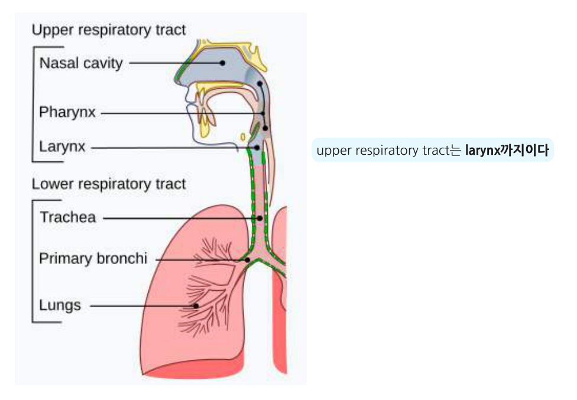
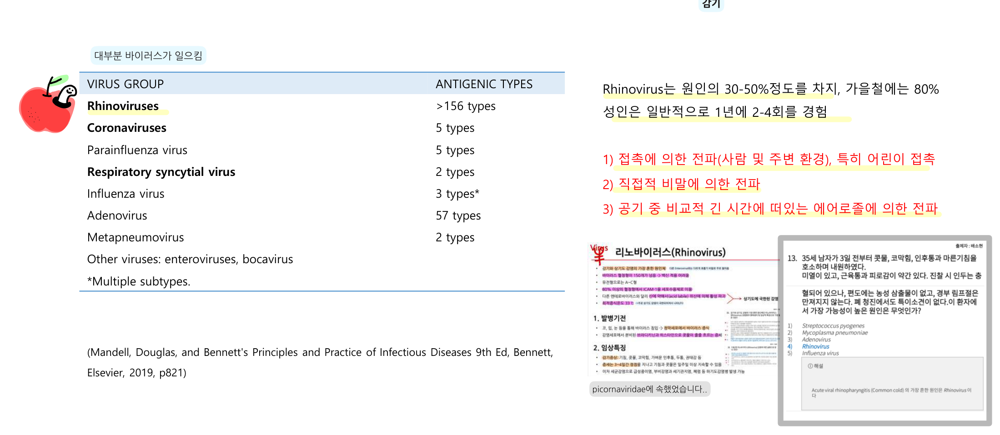

<!-- 필기본: 2026 · 2025 -->
<!-- 단계: 수업 후 -->

# 0. 이 수업을 공부하는 법

경북대병원 감염내과 **배소현 교수님** 수업(2025, 2026 모두). 2020–2024년 기출은 김신우 교수님 출제라 문체가 조금 다르다.
올해 필기 정리자의 한 줄 평: "**내용도 아주 적고, 외울 것도 정해져 있는 아주 좋은 수업**". 필기에는 🍎(이전 기출에 나온 쪽), 분홍 「족보」 표시(교수님이 중요하다고 한 쪽), 노란 형광펜(교수님이 읽은 부분)이 있다. 🍎·족보가 붙은 곳은 **감기 원인 바이러스(7쪽), Modified Centor score(18쪽), 인두편도염 항생제 표(21쪽)** 이고, 족보는 Centor 표와 항생제 표 두 곳에만 붙었다 — 시험의 중심이다.

학습목표

1. 상기도감염의 **임상적 진단**을 할 수 있다.
2. 상기도감염의 **대증적 치료**를 알고, **불필요한 항생제를 쓰지 않는 것의 중요성**을 설명할 수 있다.

!!! key "핵심 (올해 필기 마지막 쪽 정리)"
    "상기도감염은 **대부분 바이러스가 원인**이므로 무분별한 항생제 사용은 금기다. 다만 **급성 인후편도염에서는 드물게 group A streptococcus가 후기 합병증**을 일으키므로, **criteria 점수(Modified Centor)** 로 판단하자."

!!! diff "작년 필기와 다른 점"
    작년 표지에는 교수님 말씀 "가장 중요한 건, 상기도감염의 원인은 바이러스가 많다. 그래서 **항생제를 적절하게** 쓰는 것이 중요하다 — 항생제를 **언제, 무엇을** 쓰는지 봐 두라"가 적혀 있었다. 올해는 같은 내용이 마지막 쪽 정리로 옮겨졌다. 메시지는 같다.

- 기출 23문항(2020–2025). 압도적으로 많은 주제는 **A군 연쇄구균(GAS) 인두편도염 — Modified Centor score, 검사, amoxicillin 10일**(약 13문항). 그다음이 **감기 = rhinovirus, 대증치료(항생제 X)**, **세균성 부비동염 = 폐렴알균, amoxicillin(/clavulanate)**.
- 2025년(배소현 교수님) 문항은 사례형 두 개: GAS 편도염 → amoxicillin 10일(2부 1번), 감기 → rhinovirus(2부 2번). 올해 필기에도 두 문항이 해당 쪽에 그대로 붙어 있다 — 올해도 같은 꼴(사례 → 원인/치료)을 예상하자.

# 1. 상기도감염 개요

## 상기도감염의 종류 (Acute upper respiratory infection)

{: style="width:52%"}

**상기도(upper respiratory tract)** = 비강(nasal cavity) → 인두(pharynx) → **후두(larynx)까지**. 기관(trachea)부터 아래가 하기도다. 상기도감염은 부위에 따라 이름이 붙는다.

| 질환 | 영어 | 부위 |
|---|---|---|
| 급성 비인후염(감기) | acute rhinopharyngitis, common cold | 코 + 인두 |
| 급성 부비동염 | sinusitis | 부비동 |
| 급성 인후염 | pharyngolaryngitis | 인두 + 후두 |
| 급성 편도염 | tonsillitis | 편도 |
| 급성 후두개염 | epiglottitis | 후두개 |

!!! new "올해 필기에서 추가"
    "이름에서 알 수 있듯이, 어디 딱 한 군데에만 감염이 일어나는 것이 아니라 **통로로 이어져 있기 때문에 여러 군데에 걸쳐 비특이적인 증상**이 나타난다." — 그래서 감기에서 코·목·기침이 같이 오고, 감기 뒤에 부비동염·중이염이 이어진다. 상기도 = **후두까지**라는 경계도 올해 필기에서 강조했다.

## 왜 중요한가
- **성인이 의료기관을 찾는 가장 흔한 질환**이다. 발생 건수가 워낙 많아 **사회경제적 부담이 매우 크다**(세계 인구의 약 70%가 매년 한 번 이상 경험).
- **대부분의 급성 상기도감염은 바이러스가 원인 → 대증치료.** 성인에서 가장 흔한 원인은 바이러스다.
- **일부 인두염·후두개염·부비동염**만 경우에 따라 항생제가 필요하다(→ 각 단원에서 "언제"를 배운다).
- 불필요한 항생제는 **항생제 내성세균 증가, 약제 알레르기 반응, 부작용, 약제 상호작용, 추가 비용**을 일으킨다. 바이러스에는 항생제가 듣지 않으니 득은 없고 해만 남는다.
- **감별진단**: 하기도감염을 포함해 알레르기성 비염, 혈관운동성 비염(vasomotor rhinitis — 온도·냄새 자극에 콧물), 기도 내 이물, 약물에 의한 비염(비충혈제거 스프레이 남용 등).

# 2. 급성 바이러스성 비인두염 (감기, Common cold)

## 원인 바이러스 🍎

{: style="width:94%"}

감기는 **대부분 바이러스**가 일으킨다.

| 바이러스 | 항원형 |
|---|---|
| **Rhinovirus** | >156형 — **가장 많다** |
| Coronavirus | 5형 |
| Parainfluenza virus | 5형 |
| RSV(respiratory syncytial virus) | 2형 |
| Influenza virus | 3형(아형 다수) |
| Adenovirus | 57형 |
| Metapneumovirus | 2형 |
| 기타 | enterovirus, bocavirus |

- **Rhinovirus가 원인의 30–50%, 가을철에는 80%** — 계절성이 있다.
- 성인은 보통 **1년에 2–4회** 감기를 앓는다.
- **전파 경로**(올해 필기에서 빨간 글씨로 강조):
    1. **접촉**에 의한 전파(사람 및 주변 환경), 특히 **어린이와의 접촉**
    2. 직접적 **비말**에 의한 전파
    3. 공기 중에 비교적 오래 떠 있는 **에어로졸**에 의한 전파
- 왜 손씻기가 중요한가: 1순위가 **접촉** — 코를 만진 손 → 문고리 → 다른 사람 손 → 코·눈. "감기의 주된 전파는 공기"는 틀린 말이다(2부 8번 오답 보기).

!!! new "올해 필기에서 추가 — Rhinovirus 미생물 (미생물 수업 필기 연결)"
    - **Picornaviridae**(피코르나바이러스과)에 속한다(현재는 Enterovirus 속으로 묶임).
    - 혈청형이 **150개가 넘어 백신을 만들기 어렵다** → 감기를 평생 반복해서 걸리는 이유.
    - 80% 이상의 혈청형이 **ICAM-1**을 세포 수용체로 쓴다.
    - 다른 enterovirus와 달리 **산에 약해(acid labile) 위산에 파괴**되고, **최적 증식 온도가 33℃** → 위장관이 아니라 **(체온보다 차가운) 상기도에만 국한된 감염**을 일으킨다.

!!! exam "기출 포인트"
    2부 2번(2025, 배소현): 35세, 콧물·코막힘·인후통·마른기침, 미열·약간의 근육통, 편도 삼출물 없음, 경부 림프절 안 만져짐, 폐 청진 정상 → **Rhinovirus**. 함정: S. pyogenes(삼출물·림프절이 없으니 아님), adenovirus(인두결막열), influenza(고열·심한 근육통), Mycoplasma(지속 기침·폐렴). 올해 필기 7쪽에 이 문제가 그대로 붙어 있다.

## 임상양상
- **잠복기는 다양**하다(rhinovirus: 2–4일).
- 열, 오한, 근육통, 두통, 기침, 콧물, 코막힘, 재채기, 인후통, 쉰 목소리 같은 급성 증상 — **코 증상이 가장 흔하다.** 올해 필기: "**매우 비특이적이다!**"
- 성인은 소아와 달리 **전신증상과 귀 통증(이통)을 잘 동반하지 않는다.** 소아는 이관이 짧고 수평이라 중이염이 잘 따라온다.
- 증상은 **2–3일에 절정 → 6–7일에 걸쳐 저절로 회복.** 이보다 **길어지면 세균 감염이 동반됐는지 감별**한다(→ 세균성 부비동염의 "10일 이상" 기준과 연결).
- **주요 합병증: 중이염과 부비동염.**
- **감별진단**: 급성 인두염, 급성 후두염, 급성 기관지염, 크룹, 세기관지염 — 이 감별이 결국 **항생제를 쓸지** 판단과 연결된다.
- **COPD(만성폐쇄성폐질환) 악화의 가장 흔한 원인이 바이러스성 급성 상기도감염**이다. 올해 필기: "감기 걸리면 (기저 폐질환이 있는 사람은) 보통 사람보다 호흡기 질환이 더 심해진다."

!!! new "올해 필기에서 추가"
    "**항생제를 사용할 필요는 없다!** — '감기에 항생제를 쓰면 일주일이고, 쓰지 않으면 7일이다.'" 항생제를 쓰든 안 쓰든 자연 경과(6–7일)는 같다는 말이다.

## 치료 — 증상에 따른 대증치료

{: style="width:94%"}

- **화농성 콧물·가래나 흡연력이 세균 감염을 뜻하지 않는다!!** 올해 필기: "화농성 콧물은 viral infection에서도 충분히 나타날 수 있다." 누런 콧물 = 호중구가 모인 것이지 세균의 증거가 아니다.
- **항생제는 대부분 효과가 없다.** 폐렴이 생길 수는 있지만 **항생제가 폐렴을 예방하지는 못한다**(슬라이드에서 굵은 글씨).
- **항바이러스제도 필요 없다.**

| 증상 | 원인·기전 | 치료 | 예 |
|---|---|---|---|
| 인후통(sore throat) | Bradykinin? | 진통제, 국소마취제 | Acetaminophen, NSAIDs, benzocaine 트로키(lozenge) |
| 콧물(rhinorrhea) | 코 분비샘 분비 | **항콜린제(anticholinergic)** | Diphenhydramine, doxylamine(1세대 항히스타민), ipratropium 비강 분무 |
| 코막힘(nasal obstruction) | 코 정맥동 충혈(engorgement) | **아드레날린 작용제(adrenergic)** | **Pseudoephedrine**, oxymetazoline 스프레이 |

- 왜 1세대 항히스타민이 콧물에 듣나: 콧물을 줄이는 것은 항히스타민 작용보다 **항콜린(부교감 차단) 작용** 덕분이다. 그래서 항콜린 작용이 없는 2세대 항히스타민은 감기 콧물에 효과가 적다.
- 왜 pseudoephedrine이 코막힘에 듣나: α 아드레날린 작용 → 코 점막 혈관 수축 → 충혈이 빠진다. Oxymetazoline 스프레이는 오래(3일 넘게) 쓰면 반동성 충혈(약물성 비염)이 온다 — 감별진단의 "약물에 의한 비염"이 이것.
- 기침에는 진해제(dextromethorphan), 가래에는 거담제(guaifenesin)도 대증적으로 쓴다(필기에는 없지만 기출 보기에 나온다).

!!! diff "작년 필기와 다른 점"
    작년 필기 메모: "**약을 쓰나 안 쓰나 큰 차이가 없다 — 증상에 따라 대증치료.**" 올해는 같은 뜻을 "일주일 vs 7일"로 적었다.

!!! exam "기출 포인트"
    - 2부 5번(2023)·10번(2022): 감기에 쓰는 약이 **아닌** 것 = **Cefaclor**(2세대 세팔로스포린 항생제). Pseudoephedrine, guaifenesin, chlorpheniramine, dextromethorphan, acetaminophen, 1세대 항히스타민은 모두 대증치료제.
    - 2부 8번(2022): 근거중심으로 옳은 것 = **세균성 편도염에 페니실린계 사용은 류마티스열 위험을 줄인다**. "감기는 만병의 근원", "감기를 두었더니 폐렴이 됐다"(항생제가 폐렴을 예방하지 못함), "주된 전파는 공기"(접촉·비말), "콧물이면 항생제"는 모두 틀림.
