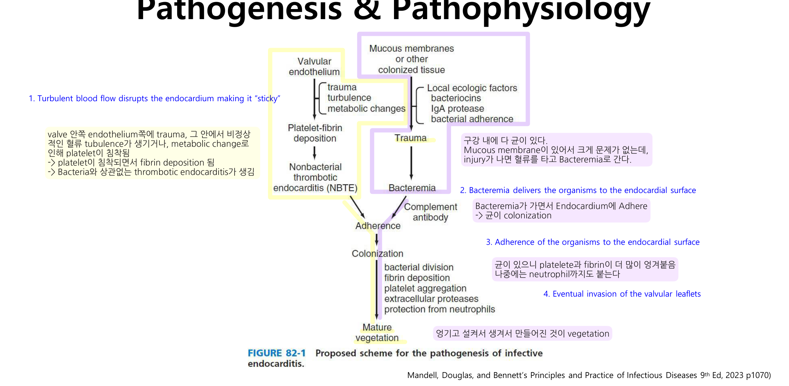
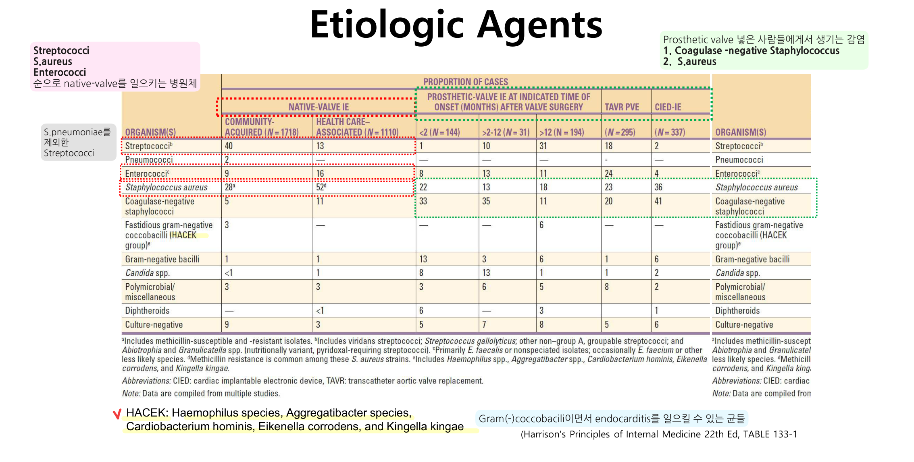
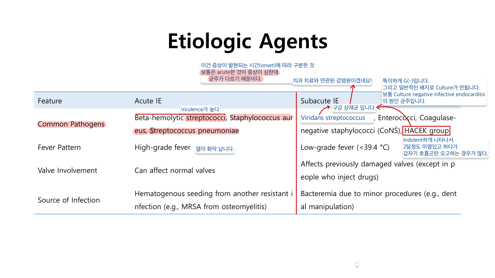

<!-- 필기본: 2026 · 2025 -->
<!-- 단계: 수업 후 -->

# 0. 이 수업을 공부하는 법

경북대병원 감염내과 **배소현 교수님** 수업(2025·2026 같은 교수님). 올해 필기는 Harrison 22판(2025) 표로 슬라이드가 거의 다 바뀌었고, 필기자가 앞에 기출 모음과 「**야마페이지 정리**」(2023 Duke-ISCVID 진단 기준 한 장 요약)를 붙여 두었다. 필기 표시는 🍎 = 이전 기출에 나온 쪽, 🌿(손으로 그린 표시) = 교수님이 중요하다고 한 쪽, 노란 밑줄 = 교수님이 읽은 부분이다.

학습목표

1. 심내막염을 의심하고 진단할 수 있다.
2. 심내막염의 **경험적 항생제**를 선택할 수 있다. — "경험적 항생제가 계속 (시험에) 나오고 있어서 일단 Harrison 기준으로 설명하겠다."

필기자가 꼽은 중요 순서 (2026 필기 1쪽)

1. **진단 기준 — major / minor criteria 암기**
2. **초음파(sono) 사용 알고리즘** — "여기까지는 야마였고…"
3. major criteria에도 들어 있는 **typical한 균주 외우기**
4. 경험적 항생제 — 단, Harrison(미국) 기준이라 한국과 맞지 않는다고 하셔서 애매하다.

- 출제 기록: 2025년만 배소현 교수님, 2020–2024년은 김신우 교수님 출제. 그래도 **major vs minor 구분** 문제와 원인균·예방이 해마다 나왔다(기출 12문항 중 Duke 5문항).
- 2025년 배소현 교수님 두 문항: 주요 기준 = **인공판막 탈락(dehiscence)**, 인공판막 + S. aureus 균혈증 + TTE 음성 → **TEE**. 필기자는 이 두 문항을 해당 슬라이드(21·24쪽) 옆에 붙여 두고 "진단기준에서 설명을 아주 오래 하셨다", "알고리즘을 잘 외우고 계셔야 할 것 같다"고 적었다.

!!! key "핵심"
    **주요 기준 = A. 미생물(전형적 균 2세트 / 비전형 균 3세트 / Coxiella·Bartonella PCR·항체) + B. 영상(심초음파·심장 CT의 증식체·농양·천공, 새 판막 역류, 새 인공판막 탈락, FDG-PET/CT 이상) + C. 수술 소견.** 발열·소인·혈관 현상·면역 현상·미흡한 배양·청진상 새 잡음은 모두 **부 기준**. 확진 = 주요 2 / 주요 1 + 부 3 / 부 5, 가능성(possible) = 주요 1 + 부 1 / 부 3.

!!! new "올해 필기에서 추가"
    올해는 진단 기준이 **2023 Duke-ISCVID**(국제 심혈관감염학회 개정판)로 바뀌었다고 강조했다("진단기준이 바꼈다!"). 그 밖에 판막별 빈도, Harrison 22판 원인균 표(TAVR·CIED), **경험적 항생제 표**, 원인균별 확정 치료 표, 부분 경구 치료(POET), 인공판막 심내막염 사망률, 예방 항생제 변경(clindamycin 삭제·doxycycline 추가)이 새로 들어왔다.

# 1. 심내막염이란

## 심장의 구조와 심내막
슬라이드 "Heart"는 심장 네 방(우심방·우심실·좌심방·좌심실)과 판막, 심장벽 층(심외막–심근–심내막), 조직 사진을 보여 준다. 조직 사진에서 **심내막(endocardium) = 내피(endothelium) + 결합조직**이고, 그 아래에 심내막하층(subendocardium, Purkinje 섬유가 지나감)과 심근(myocardium)이 있다.

- 감염성 심내막염(infective endocarditis)은 말 그대로 **감염 때문에 심내막에 염증**이 생긴 것이고, **세균**에 의한 경우가 가장 많다.
- 판막도 심내막으로 덮인 구조이므로 심내막염의 주무대가 된다.

## 정의
감염성 심내막염(IE)은 다음 중 하나에 **미생물 감염**이 생긴 것이다.

1. **심장 판막**(자기 판막 native 또는 인공판막 prosthetic) — **가장 흔한 호발 부위는 판막**
2. 심방·심실 내벽이나 혈관의 **안쪽 막(lining)**
3. **선천 기형 부위**(예: 중격 결손)

원인은 보통 **세균**이지만 리케차(rickettsia), 클라미디아(chlamydia), **진균(fungus)**도 가능하다. (2025 필기자: 병명에 "infective"가 붙는 거의 유일한 질환.)

## 어느 판막에 잘 생기나

{: style="width:58%"}

| 순위 | 판막 | 혈류 |
|---|---|---|
| 1 | **승모판(mitral)** — 가장 흔함 | 좌심방 → 좌심실 |
| 2 | **대동맥판(aortic)** | 좌심실 → 대동맥 |
| 3 | 삼첨판(tricuspid) | 우심방 → 우심실 |
| 4 | 폐동맥판(pulmonary) — 가장 드묾 | 우심실 → 폐동맥 |

- 왜 좌심(승모판·대동맥판)이 많은가: 좌심은 압력차가 커서 **난류와 판막 손상**이 잘 생기기 때문이다(아래 병태생리).
- 예외: **정맥주사 약물 사용자(IVDU)**는 주사로 들어간 균이 먼저 오른쪽 심장에 닿으므로 **삼첨판**이 잘 침범된다(교과서 지식).

!!! new "올해 필기에서 추가"
    판막별 빈도(승모판 > 대동맥판 > 삼첨판 > 폐동맥판)는 올해 슬라이드에 새로 들어왔다.

## 병태생리 (Pathogenesis & Pathophysiology)

{: style="width:84%"}

그림은 두 갈래(노란 길 = 판막 쪽, 보라 길 = 균 쪽)가 만나 증식체가 되는 과정이다.

1. **난류(turbulent blood flow)가 심내막을 손상시켜 "끈끈하게(sticky)" 만든다.**
    - 판막 안쪽 내피에 외상(trauma), 비정상 혈류(turbulence), 대사 변화가 생기면 → **혈소판이 침착** → 그 위에 **섬유소(fibrin)가 침착**된다.
    - 이 단계는 아직 균과 상관없는 **비세균성 혈전성 심내막염(nonbacterial thrombotic endocarditis, NBTE)** 이다.
2. **균혈증이 균을 심내막 표면으로 나른다.**
    - 구강 등 점막에는 원래 균이 많다. 평소에는 점막이 막아 주지만, **점막이 다치면(치과 시술 등)** 균이 혈류를 타고 들어가 **균혈증(bacteremia)**이 된다.
3. **균이 심내막 표면에 부착(adherence)한다** → 집락(colonization).
    - 섬유소·혈소판 덩어리는 균이 붙기 좋은 자리다. 균이 붙으면 혈소판과 섬유소가 더 엉겨 붙고, **나중에는 호중구까지** 붙는다.
4. **결국 판막엽을 침범**한다.
    - 균 분열, 섬유소 침착, 혈소판 응집, 세포 밖 단백분해효소, 그리고 **호중구로부터 보호**받는 과정을 거쳐 → **성숙한 증식체(mature vegetation)**. "엉기고 설켜서 만들어진 것이 vegetation."

즉 **① 판막 내피 손상(→ NBTE) + ② 균혈증** 두 가지가 합쳐질 때 생긴다.

- 정상 혈류는 **층류(laminar)**라 세포가 혈관 가운데로 흐르고 벽과 잘 만나지 않는다. 판막 질환 등으로 **난류**가 되면 혈액 성분이 벽과 자주 부딪쳐 손상·침착이 생긴다. (병리학 "혈류역동장애"의 NBTE와 연결.)
- 증식체 안의 균은 섬유소·혈소판에 둘러싸여 **호중구와 항생제가 잘 닿지 않는다** → 치료가 길고 수술이 필요한 이유(5단원).

## 위험인자 (Risk factors)

1. **정맥주사 약물 사용(injection drug use)**
2. **퇴행성 판막 질환** — 판막도 오래 쓰면 퇴화한다(석회화 대동맥판 협착, 역류를 동반한 승모판 탈출증 등).
3. **인공판막(TAVR 포함)** — 그래서 판막을 교체한 사람들이 위험군이다.
4. **심장 내 기구(CIED**, cardiac implantable electronic device: 심박조율기·삽입형 제세동기)
5. **선천성 심장질환**
6. **의료 노출** — 혈관 내 카테터
7. **류마티스 심장질환** — 개발도상국에서 많다.

- 선진국에서는 자기 판막 심내막염(NVE)의 **25–35%가 의료 관련(health care–associated)**, 전체 심내막염의 **16–30%가 인공판막 감염(PVE)**이다. 나이 들어 인공판막을 넣고 카테터를 넣다가 생기는 경우다. ("전체 endocarditis의 30%는 prosthetic valve에 의한 것.")
- **인공판막 심내막염 위험은 판막 교체 후 첫 1년에 가장 높다** ("집어넣고 1년 이내에 잘 생긴다").
- 사진: 승모판의 viridans 연쇄구균 증식체(화살표) — 원래 판막은 매끈한데 혈소판·호중구·섬유소가 붙어 증식체가 만들어졌다.

!!! diff "작년 필기와 다른 점"
    2025 위험인자는 IVDU, 인공판막·심박조율기, 후천성 판막질환(석회화 대동맥판 협착, 역류 동반 승모판 탈출증), 선천성 심장 기형, 혈관 내 카테터의 다섯 줄이었다. 올해는 **퇴행성 판막 질환, TAVR, CIED, 류마티스 심장질환**을 따로 적고 의료 관련·PVE 비율(25–35%, 16–30%)이 추가되었다.

## 균이 들어오는 길 (Portals of entry)

주로 **점막을 뚫고 들어온 균**이 혈류를 타고 **균혈증**을 일으킨 뒤 손상된 판막에 달라붙는다.

1. **치과 감염·치과 치료** — 가장 전형적(typical). 구강 내 세균이 점막이 노출되는 시술 뒤 균혈증을 일으켜 판막으로 퍼진다.
2. 비뇨생식기계 감염
3. 피부 감염
4. 호흡기(폐) 감염

그림 아래쪽의 잘 걸리는 바탕 병변(common predisposing lesions): 가벼운 류마티스 승모판 질환, 이첨 대동맥판(bicuspid aortic valve), 팔로 4징(tetralogy of Fallot), 작은 심실중격결손(구멍 맞은편 벽에 "jet lesion"), 대동맥 축착·동맥관 개존.

# 2. 원인균

## Harrison 22판 원인균 표

{: style="width:96%"}

| 원인균 (%) | 지역사회 NVE | 의료 관련 NVE | PVE <2개월 | PVE 2–12개월 | PVE >12개월 | TAVR-PVE | CIED-IE |
|---|---|---|---|---|---|---|---|
| 연쇄구균* | **40** | 13 | 1 | 10 | **31** | 18 | 2 |
| 폐렴구균 | 2 | — | — | — | — | — | — |
| 장알균 | 9 | 16 | 8 | 13 | 11 | **24** | 4 |
| **S. aureus** | 28 | **52** | 22 | 13 | 18 | 23 | 36 |
| **CoNS** | 5 | 11 | **33** | **35** | 11 | 20 | **41** |
| HACEK | 3 | — | — | — | 6 | — | — |
| 그람음성 막대균 | 1 | 1 | 13 | 3 | 6 | 1 | 6 |
| Candida | <1 | 1 | 8 | 13 | 1 | 1 | 2 |
| 배양음성 | 9 | 3 | 5 | 7 | 8 | 5 | 6 |

\* viridans 연쇄구균, S. gallolyticus, 다른 비A군 연쇄구균, Abiotrophia·Granulicatella 포함. CoNS = 응고효소음성 포도알균(coagulase-negative staphylococci).

필기 정리

- **자기 판막(NVE)**: **연쇄구균(폐렴구균 제외) → S. aureus → 장알균** 순. 의료 관련 NVE는 S. aureus가 52%로 1위다.
- **인공판막(PVE)**: **1. CoNS 2. S. aureus** — 초기 1년 동안은 CoNS·S. aureus 순이었다가 시간이 지나면 **자기 판막과 비슷한 균**(연쇄구균)으로 바뀐다.
- **HACEK** = *Haemophilus*, *Aggregatibacter*, *Cardiobacterium hominis*, *Eikenella corrodens*, *Kingella kingae* — **그람음성 구간균(coccobacilli)이면서 심내막염을 일으킬 수 있는 균들**. 일반 배지에서 잘 자라지 않아 배양음성 심내막염의 원인이 된다.
- 그람음성 막대균(대장균 등)은 자기 판막에서 1% — **심내막염의 흔한 원인이 아니다**(기출 함정).

## Cecil 원인균 빈도 표 (작년에도 있던 표)

{: style="width:84%"}

| 자기 판막 | % | 인공판막 조기 | % | 인공판막 후기 | % | 약물주사자(IVDU) | % |
|---|---|---|---|---|---|---|---|
| **Streptococci** | **50** | **CoNS** | **33** | **Streptococci** | **36** | **S. aureus** | **60** |
| Enterococci | 10 | S. aureus | 15 | CoNS | 29 | Streptococci | 13 |
| **S. aureus** | **20** | 그람음성 막대균 | 17 | S. aureus | 11 | 그람음성 막대균 | 8 |
| HACEK | 5 | 진균 | 13 | 그람음성 막대균 | 11 | Enterococci | 7 |
| 배양음성 | 5 | Streptococci / diphtheroids | 9 / 9 | 진균 | 5 | 진균·다균·배양음성 | 각 5 |

- 필기자는 자기 판막에 **1등 연쇄구균, 2등 S. aureus, 3등 장알균**, 인공판막 조기에 **1등 CoNS, 2등 S. aureus**라고 손으로 적었다.
- ※ 확인 필요: 이 Cecil 표만 보면 인공판막 조기 2위는 그람음성 막대균(17%)이고 S. aureus(15%)는 3위다. 필기의 "2등 S. aureus"는 위 Harrison 표(<2개월: CoNS 33, S. aureus 22)를 따른 것이다. 시험에서는 **조기 PVE = CoNS가 1위**만 확실히 잡아 두면 된다.
- **TAVR-PVE·TAVI-PVE**(경피적 대동맥판 치환술 후 인공판막 심내막염)에서는 **장알균(enterococci)이 증가**한다. 카테터로 판막을 넣어 바꾸는 시술이다(15쪽 사진: 카테터 끝의 접힌 판막을 대동맥판 자리에서 펼치는 장면).

!!! exam "기출 포인트"
    - 2부 11번(2020): 승모판 인공판막 4주 후 발열, 판막 여닫이 악화·역류, 혈액배양 3쌍 모두 양성 → **Coagulase negative staphylococcus**(조기 PVE). Viridans·HACEK·Coxiella는 후기 또는 배양 어려운 균.
    - 2부 8번(2021): 1주 만에 심잡음 + 심한 폐부종, 그람양성균 → **S. aureus**. S. oralis·E. faecalis는 아급성, S. epidermidis는 인공판막.

## 급성 vs 아급성

!!! diff "작년 필기와 다른 점"
    2025 필기에는 급성·아급성 비교 슬라이드가 따로 있었고, 올해는 그 슬라이드가 빠지고 **경험적 항생제 표(5단원)의 "Acute IE / Subacute NVE"** 로만 나온다. 기출(6·8·10번)은 이 구분을 물었으므로 그대로 둔다.

{: style="width:80%"}

| | 급성 IE | 아급성 IE |
|---|---|---|
| 흔한 원인균 | **S. aureus**, β-용혈 연쇄구균, S. pneumoniae — **독성이 높다** | **Viridans streptococci**(구강 상재균 → 치과 치료), 장알균, CoNS, **HACEK** |
| 열 | **고열** | 미열(<39.4℃) |
| 판막 | **정상 판막도 침범** | 이미 손상된 판막(약물주사자는 예외) |
| 감염원 | 다른 부위 감염에서 혈행성 파종 | 사소한 시술(치과 처치)에 의한 균혈증 |
| 경과 | 며칠–몇 주, 빠르고 심하다(판막 파괴 → 급성 심부전) | **수개월(한 달 이상)** 미열이 있다가 갑자기 호흡곤란 |

- 증상 시작 시간으로 나눈 것이고, 급성이 더 심한 것은 **균주가 다르기 때문**이다. 올해 필기: "Acute냐 subacute냐에 따라서 균주가 다를 수 있다", "증상이 수개월(한 달 이상) → S. viridans인 경우가 많다".
- 작년 필기의 좌·우심 구분: **좌심(MR, AR)** → 폐정맥압 ↑ → **폐울혈·호흡곤란**, **우심(TR, PR)** → 대정맥압 ↑ → **경정맥 확장·간울혈·하지부종**.

!!! exam "기출 포인트"
    2부 6·10번(2022·2020): 1주의 고열 + 손발 병변(Janeway) + 대동맥판 역류 → **S. aureus**. 빠른 경과(1주)·고열·정상 판막 파괴 = 급성 = S. aureus로 읽는다.
