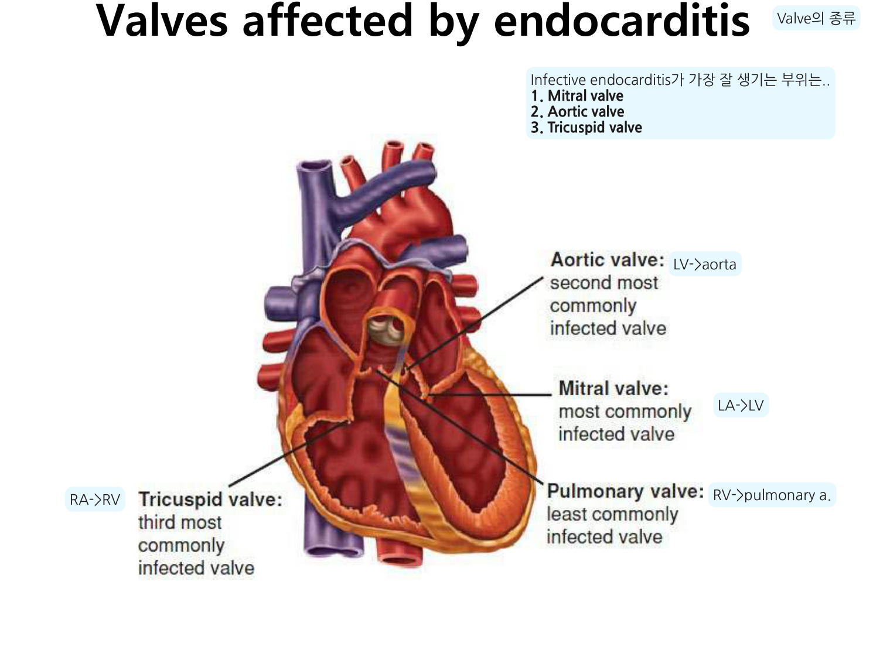
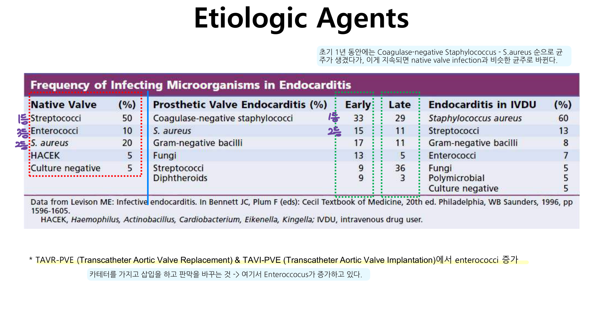
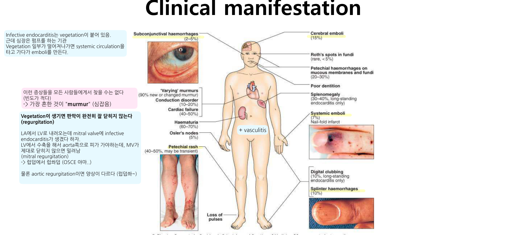
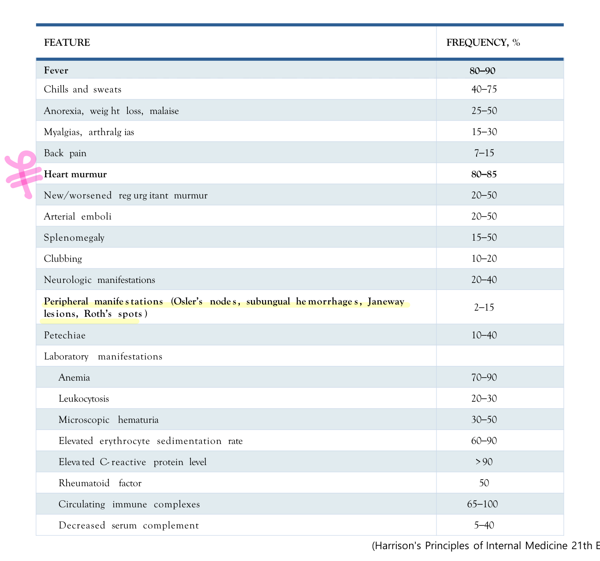
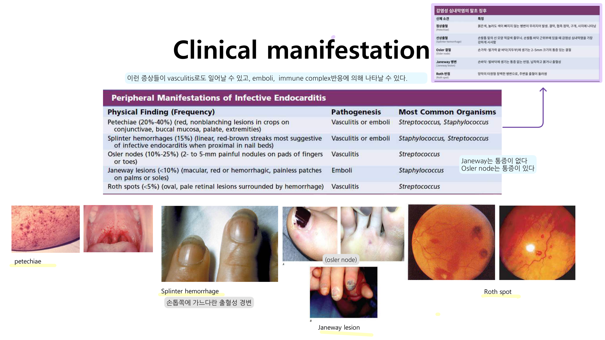
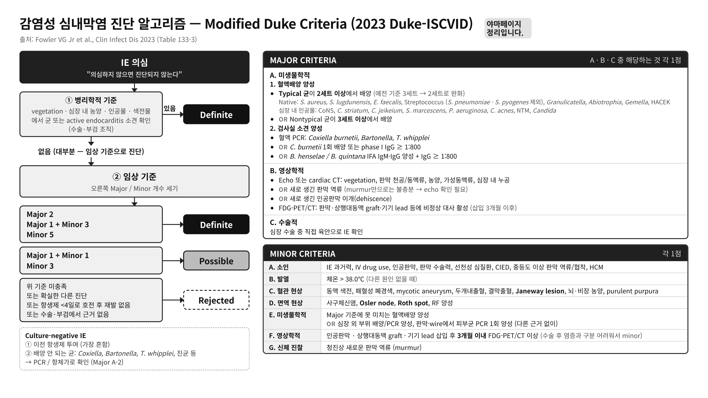
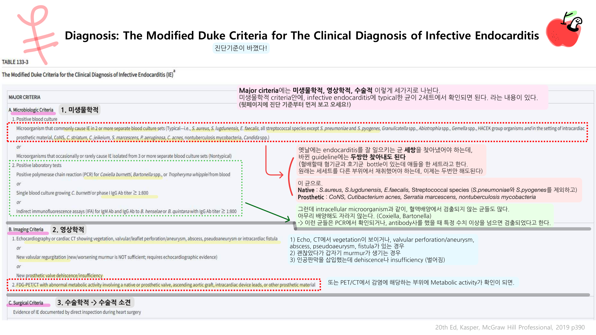
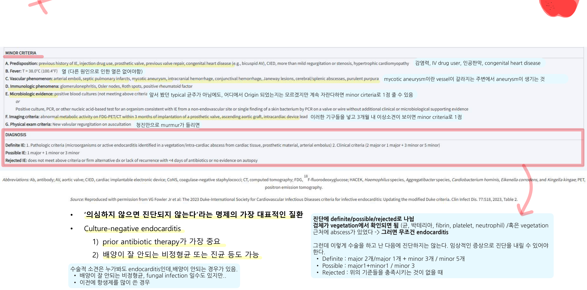
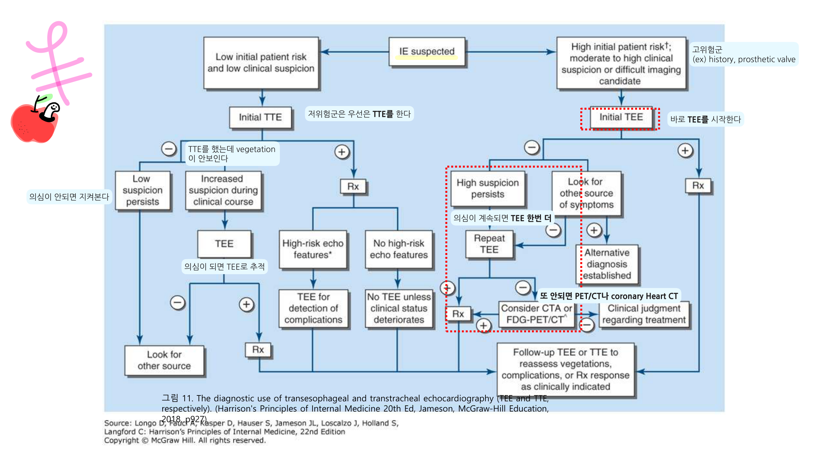
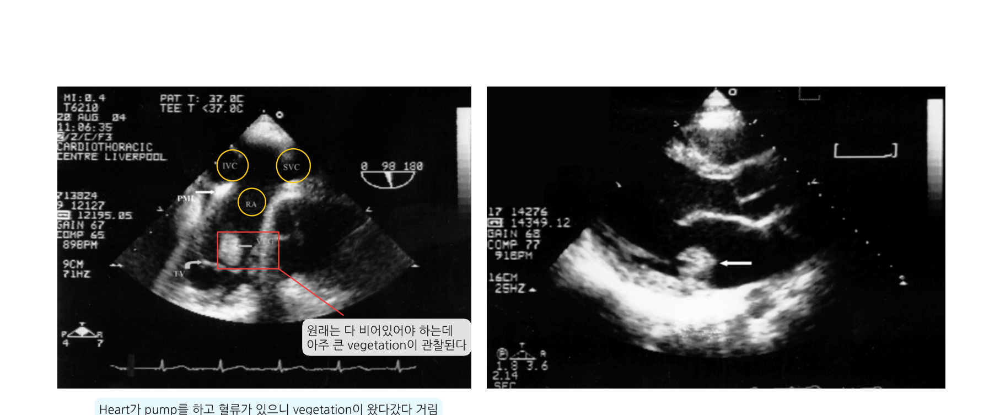

<!-- 필기본: 2026 · 2025 -->
<!-- 단계: 수업 후 -->

# 0. 이 수업을 공부하는 법

경북대병원 감염내과 **배소현 교수님** 수업(2025·2026 같은 교수님). 올해 필기는 Harrison 22판(2025) 표로 슬라이드가 거의 다 바뀌었고, 필기자가 앞에 기출 모음과 「**야마페이지 정리**」(2023 Duke-ISCVID 진단 기준 한 장 요약)를 붙여 두었다. 필기 표시는 🍎 = 이전 기출에 나온 쪽, 🌿(손으로 그린 표시) = 교수님이 중요하다고 한 쪽, 노란 밑줄 = 교수님이 읽은 부분이다.

학습목표

1. 심내막염을 의심하고 진단할 수 있다.
2. 심내막염의 **경험적 항생제**를 선택할 수 있다. — "경험적 항생제가 계속 (시험에) 나오고 있어서 일단 Harrison 기준으로 설명하겠다."

필기자가 꼽은 중요 순서 (2026 필기 1쪽)

1. **진단 기준 — major / minor criteria 암기**
2. **초음파(sono) 사용 알고리즘** — "여기까지는 야마였고…"
3. major criteria에도 들어 있는 **typical한 균주 외우기**
4. 경험적 항생제 — 단, Harrison(미국) 기준이라 한국과 맞지 않는다고 하셔서 애매하다.

- 출제 기록: 2025년만 배소현 교수님, 2020–2024년은 김신우 교수님 출제. 그래도 **major vs minor 구분** 문제와 원인균·예방이 해마다 나왔다(기출 12문항 중 Duke 5문항).
- 2025년 배소현 교수님 두 문항: 주요 기준 = **인공판막 탈락(dehiscence)**, 인공판막 + S. aureus 균혈증 + TTE 음성 → **TEE**. 필기자는 이 두 문항을 해당 슬라이드(21·24쪽) 옆에 붙여 두고 "진단기준에서 설명을 아주 오래 하셨다", "알고리즘을 잘 외우고 계셔야 할 것 같다"고 적었다.

!!! key "핵심"
    **주요 기준 = A. 미생물(전형적 균 2세트 / 비전형 균 3세트 / Coxiella·Bartonella PCR·항체) + B. 영상(심초음파·심장 CT의 증식체·농양·천공, 새 판막 역류, 새 인공판막 탈락, FDG-PET/CT 이상) + C. 수술 소견.** 발열·소인·혈관 현상·면역 현상·미흡한 배양·청진상 새 잡음은 모두 **부 기준**. 확진 = 주요 2 / 주요 1 + 부 3 / 부 5, 가능성(possible) = 주요 1 + 부 1 / 부 3.

!!! new "올해 필기에서 추가"
    올해는 진단 기준이 **2023 Duke-ISCVID**(국제 심혈관감염학회 개정판)로 바뀌었다고 강조했다("진단기준이 바꼈다!"). 그 밖에 판막별 빈도, Harrison 22판 원인균 표(TAVR·CIED), **경험적 항생제 표**, 원인균별 확정 치료 표, 부분 경구 치료(POET), 인공판막 심내막염 사망률, 예방 항생제 변경(clindamycin 삭제·doxycycline 추가)이 새로 들어왔다.

# 1. 심내막염이란

## 심장의 구조와 심내막
슬라이드 "Heart"는 심장 네 방(우심방·우심실·좌심방·좌심실)과 판막, 심장벽 층(심외막–심근–심내막), 조직 사진을 보여 준다. 조직 사진에서 **심내막(endocardium) = 내피(endothelium) + 결합조직**이고, 그 아래에 심내막하층(subendocardium, Purkinje 섬유가 지나감)과 심근(myocardium)이 있다.

- 감염성 심내막염(infective endocarditis)은 말 그대로 **감염 때문에 심내막에 염증**이 생긴 것이고, **세균**에 의한 경우가 가장 많다.
- 판막도 심내막으로 덮인 구조이므로 심내막염의 주무대가 된다.

## 정의
감염성 심내막염(IE)은 다음 중 하나에 **미생물 감염**이 생긴 것이다.

1. **심장 판막**(자기 판막 native 또는 인공판막 prosthetic) — **가장 흔한 호발 부위는 판막**
2. 심방·심실 내벽이나 혈관의 **안쪽 막(lining)**
3. **선천 기형 부위**(예: 중격 결손)

원인은 보통 **세균**이지만 리케차(rickettsia), 클라미디아(chlamydia), **진균(fungus)**도 가능하다. (2025 필기자: 병명에 "infective"가 붙는 거의 유일한 질환.)

## 어느 판막에 잘 생기나

{: style="width:58%"}

| 순위 | 판막 | 혈류 |
|---|---|---|
| 1 | **승모판(mitral)** — 가장 흔함 | 좌심방 → 좌심실 |
| 2 | **대동맥판(aortic)** | 좌심실 → 대동맥 |
| 3 | 삼첨판(tricuspid) | 우심방 → 우심실 |
| 4 | 폐동맥판(pulmonary) — 가장 드묾 | 우심실 → 폐동맥 |

- 왜 좌심(승모판·대동맥판)이 많은가: 좌심은 압력차가 커서 **난류와 판막 손상**이 잘 생기기 때문이다(아래 병태생리).
- 예외: **정맥주사 약물 사용자(IVDU)**는 주사로 들어간 균이 먼저 오른쪽 심장에 닿으므로 **삼첨판**이 잘 침범된다(교과서 지식).

!!! new "올해 필기에서 추가"
    판막별 빈도(승모판 > 대동맥판 > 삼첨판 > 폐동맥판)는 올해 슬라이드에 새로 들어왔다.

## 병태생리 (Pathogenesis & Pathophysiology)

{: style="width:84%"}

그림은 두 갈래(노란 길 = 판막 쪽, 보라 길 = 균 쪽)가 만나 증식체가 되는 과정이다.

1. **난류(turbulent blood flow)가 심내막을 손상시켜 "끈끈하게(sticky)" 만든다.**
    - 판막 안쪽 내피에 외상(trauma), 비정상 혈류(turbulence), 대사 변화가 생기면 → **혈소판이 침착** → 그 위에 **섬유소(fibrin)가 침착**된다.
    - 이 단계는 아직 균과 상관없는 **비세균성 혈전성 심내막염(nonbacterial thrombotic endocarditis, NBTE)** 이다.
2. **균혈증이 균을 심내막 표면으로 나른다.**
    - 구강 등 점막에는 원래 균이 많다. 평소에는 점막이 막아 주지만, **점막이 다치면(치과 시술 등)** 균이 혈류를 타고 들어가 **균혈증(bacteremia)**이 된다.
3. **균이 심내막 표면에 부착(adherence)한다** → 집락(colonization).
    - 섬유소·혈소판 덩어리는 균이 붙기 좋은 자리다. 균이 붙으면 혈소판과 섬유소가 더 엉겨 붙고, **나중에는 호중구까지** 붙는다.
4. **결국 판막엽을 침범**한다.
    - 균 분열, 섬유소 침착, 혈소판 응집, 세포 밖 단백분해효소, 그리고 **호중구로부터 보호**받는 과정을 거쳐 → **성숙한 증식체(mature vegetation)**. "엉기고 설켜서 만들어진 것이 vegetation."

즉 **① 판막 내피 손상(→ NBTE) + ② 균혈증** 두 가지가 합쳐질 때 생긴다.

- 정상 혈류는 **층류(laminar)**라 세포가 혈관 가운데로 흐르고 벽과 잘 만나지 않는다. 판막 질환 등으로 **난류**가 되면 혈액 성분이 벽과 자주 부딪쳐 손상·침착이 생긴다. (병리학 "혈류역동장애"의 NBTE와 연결.)
- 증식체 안의 균은 섬유소·혈소판에 둘러싸여 **호중구와 항생제가 잘 닿지 않는다** → 치료가 길고 수술이 필요한 이유(5단원).

## 위험인자 (Risk factors)

1. **정맥주사 약물 사용(injection drug use)**
2. **퇴행성 판막 질환** — 판막도 오래 쓰면 퇴화한다(석회화 대동맥판 협착, 역류를 동반한 승모판 탈출증 등).
3. **인공판막(TAVR 포함)** — 그래서 판막을 교체한 사람들이 위험군이다.
4. **심장 내 기구(CIED**, cardiac implantable electronic device: 심박조율기·삽입형 제세동기)
5. **선천성 심장질환**
6. **의료 노출** — 혈관 내 카테터
7. **류마티스 심장질환** — 개발도상국에서 많다.

- 선진국에서는 자기 판막 심내막염(NVE)의 **25–35%가 의료 관련(health care–associated)**, 전체 심내막염의 **16–30%가 인공판막 감염(PVE)**이다. 나이 들어 인공판막을 넣고 카테터를 넣다가 생기는 경우다. ("전체 endocarditis의 30%는 prosthetic valve에 의한 것.")
- **인공판막 심내막염 위험은 판막 교체 후 첫 1년에 가장 높다** ("집어넣고 1년 이내에 잘 생긴다").
- 사진: 승모판의 viridans 연쇄구균 증식체(화살표) — 원래 판막은 매끈한데 혈소판·호중구·섬유소가 붙어 증식체가 만들어졌다.

!!! diff "작년 필기와 다른 점"
    2025 위험인자는 IVDU, 인공판막·심박조율기, 후천성 판막질환(석회화 대동맥판 협착, 역류 동반 승모판 탈출증), 선천성 심장 기형, 혈관 내 카테터의 다섯 줄이었다. 올해는 **퇴행성 판막 질환, TAVR, CIED, 류마티스 심장질환**을 따로 적고 의료 관련·PVE 비율(25–35%, 16–30%)이 추가되었다.

## 균이 들어오는 길 (Portals of entry)

주로 **점막을 뚫고 들어온 균**이 혈류를 타고 **균혈증**을 일으킨 뒤 손상된 판막에 달라붙는다.

1. **치과 감염·치과 치료** — 가장 전형적(typical). 구강 내 세균이 점막이 노출되는 시술 뒤 균혈증을 일으켜 판막으로 퍼진다.
2. 비뇨생식기계 감염
3. 피부 감염
4. 호흡기(폐) 감염

그림 아래쪽의 잘 걸리는 바탕 병변(common predisposing lesions): 가벼운 류마티스 승모판 질환, 이첨 대동맥판(bicuspid aortic valve), 팔로 4징(tetralogy of Fallot), 작은 심실중격결손(구멍 맞은편 벽에 "jet lesion"), 대동맥 축착·동맥관 개존.

# 2. 원인균

## Harrison 22판 원인균 표

{: style="width:96%"}

| 원인균 (%) | 지역사회 NVE | 의료 관련 NVE | PVE <2개월 | PVE 2–12개월 | PVE >12개월 | TAVR-PVE | CIED-IE |
|---|---|---|---|---|---|---|---|
| 연쇄구균* | **40** | 13 | 1 | 10 | **31** | 18 | 2 |
| 폐렴구균 | 2 | — | — | — | — | — | — |
| 장알균 | 9 | 16 | 8 | 13 | 11 | **24** | 4 |
| **S. aureus** | 28 | **52** | 22 | 13 | 18 | 23 | 36 |
| **CoNS** | 5 | 11 | **33** | **35** | 11 | 20 | **41** |
| HACEK | 3 | — | — | — | 6 | — | — |
| 그람음성 막대균 | 1 | 1 | 13 | 3 | 6 | 1 | 6 |
| Candida | <1 | 1 | 8 | 13 | 1 | 1 | 2 |
| 배양음성 | 9 | 3 | 5 | 7 | 8 | 5 | 6 |

\* viridans 연쇄구균, S. gallolyticus, 다른 비A군 연쇄구균, Abiotrophia·Granulicatella 포함. CoNS = 응고효소음성 포도알균(coagulase-negative staphylococci).

필기 정리

- **자기 판막(NVE)**: **연쇄구균(폐렴구균 제외) → S. aureus → 장알균** 순. 의료 관련 NVE는 S. aureus가 52%로 1위다.
- **인공판막(PVE)**: **1. CoNS 2. S. aureus** — 초기 1년 동안은 CoNS·S. aureus 순이었다가 시간이 지나면 **자기 판막과 비슷한 균**(연쇄구균)으로 바뀐다.
- **HACEK** = *Haemophilus*, *Aggregatibacter*, *Cardiobacterium hominis*, *Eikenella corrodens*, *Kingella kingae* — **그람음성 구간균(coccobacilli)이면서 심내막염을 일으킬 수 있는 균들**. 일반 배지에서 잘 자라지 않아 배양음성 심내막염의 원인이 된다.
- 그람음성 막대균(대장균 등)은 자기 판막에서 1% — **심내막염의 흔한 원인이 아니다**(기출 함정).

## Cecil 원인균 빈도 표 (작년에도 있던 표)

{: style="width:84%"}

| 자기 판막 | % | 인공판막 조기 | % | 인공판막 후기 | % | 약물주사자(IVDU) | % |
|---|---|---|---|---|---|---|---|
| **Streptococci** | **50** | **CoNS** | **33** | **Streptococci** | **36** | **S. aureus** | **60** |
| Enterococci | 10 | S. aureus | 15 | CoNS | 29 | Streptococci | 13 |
| **S. aureus** | **20** | 그람음성 막대균 | 17 | S. aureus | 11 | 그람음성 막대균 | 8 |
| HACEK | 5 | 진균 | 13 | 그람음성 막대균 | 11 | Enterococci | 7 |
| 배양음성 | 5 | Streptococci / diphtheroids | 9 / 9 | 진균 | 5 | 진균·다균·배양음성 | 각 5 |

- 필기자는 자기 판막에 **1등 연쇄구균, 2등 S. aureus, 3등 장알균**, 인공판막 조기에 **1등 CoNS, 2등 S. aureus**라고 손으로 적었다.
- ※ 확인 필요: 이 Cecil 표만 보면 인공판막 조기 2위는 그람음성 막대균(17%)이고 S. aureus(15%)는 3위다. 필기의 "2등 S. aureus"는 위 Harrison 표(<2개월: CoNS 33, S. aureus 22)를 따른 것이다. 시험에서는 **조기 PVE = CoNS가 1위**만 확실히 잡아 두면 된다.
- **TAVR-PVE·TAVI-PVE**(경피적 대동맥판 치환술 후 인공판막 심내막염)에서는 **장알균(enterococci)이 증가**한다. 카테터로 판막을 넣어 바꾸는 시술이다(15쪽 사진: 카테터 끝의 접힌 판막을 대동맥판 자리에서 펼치는 장면).

!!! exam "기출 포인트"
    - 2부 11번(2020): 승모판 인공판막 4주 후 발열, 판막 여닫이 악화·역류, 혈액배양 3쌍 모두 양성 → **Coagulase negative staphylococcus**(조기 PVE). Viridans·HACEK·Coxiella는 후기 또는 배양 어려운 균.
    - 2부 8번(2021): 1주 만에 심잡음 + 심한 폐부종, 그람양성균 → **S. aureus**. S. oralis·E. faecalis는 아급성, S. epidermidis는 인공판막.

## 급성 vs 아급성

!!! diff "작년 필기와 다른 점"
    2025 필기에는 급성·아급성 비교 슬라이드가 따로 있었고, 올해는 그 슬라이드가 빠지고 **경험적 항생제 표(5단원)의 "Acute IE / Subacute NVE"** 로만 나온다. 기출(6·8·10번)은 이 구분을 물었으므로 그대로 둔다.

{: style="width:80%"}

| | 급성 IE | 아급성 IE |
|---|---|---|
| 흔한 원인균 | **S. aureus**, β-용혈 연쇄구균, S. pneumoniae — **독성이 높다** | **Viridans streptococci**(구강 상재균 → 치과 치료), 장알균, CoNS, **HACEK** |
| 열 | **고열** | 미열(<39.4℃) |
| 판막 | **정상 판막도 침범** | 이미 손상된 판막(약물주사자는 예외) |
| 감염원 | 다른 부위 감염에서 혈행성 파종 | 사소한 시술(치과 처치)에 의한 균혈증 |
| 경과 | 며칠–몇 주, 빠르고 심하다(판막 파괴 → 급성 심부전) | **수개월(한 달 이상)** 미열이 있다가 갑자기 호흡곤란 |

- 증상 시작 시간으로 나눈 것이고, 급성이 더 심한 것은 **균주가 다르기 때문**이다. 올해 필기: "Acute냐 subacute냐에 따라서 균주가 다를 수 있다", "증상이 수개월(한 달 이상) → S. viridans인 경우가 많다".
- 작년 필기의 좌·우심 구분: **좌심(MR, AR)** → 폐정맥압 ↑ → **폐울혈·호흡곤란**, **우심(TR, PR)** → 대정맥압 ↑ → **경정맥 확장·간울혈·하지부종**.

!!! exam "기출 포인트"
    2부 6·10번(2022·2020): 1주의 고열 + 손발 병변(Janeway) + 대동맥판 역류 → **S. aureus**. 빠른 경과(1주)·고열·정상 판막 파괴 = 급성 = S. aureus로 읽는다.

# 3. 임상양상

## 증식체가 일으키는 문제 — 색전과 혈관염

{: style="width:90%"}

증식체(vegetation)는 판막에 붙어 있는데 **심장은 펌프**다. 그래서

- **색전(emboli)**: 증식체 일부가 떨어져 나가 전신 순환을 타고 가다 막힌다 → 뇌색전(15%), 전신 색전(손톱 주름 경색), 비장비대, 혈뇨.
- **혈관염(vasculitis)·면역복합체**: 증식체는 항원 덩어리이므로 면역복합체가 생겨 작은 혈관에 박힌다 → Osler 결절, Roth 반점, 사구체신염.

그림의 소견과 빈도: 결막하 출혈(2–5%), 뇌색전(15%), 안저의 Roth 반점(드묾, <5%), 점막·안저 점상출혈(20–30%), 나쁜 치아 상태(poor dentition), 비장비대(30–40%, 오래된 경우만), 전신 색전(7%, 손톱 주름 경색), 변하는 심잡음(90%가 새 잡음이거나 바뀐 잡음), 전도 장애(10–20%), 심부전(40–50%), 혈뇨(60–70%), Osler 결절(5%), 점상 발진(40–50%, 일시적일 수 있음), 곤봉지(10%, 오래된 경우만), 손톱 밑 선상 출혈(10%), 맥박 소실.

## 가장 흔한 신체 소견 = 심잡음

"이런 증상들을 모든 사람에게서 찾을 수는 없다(빈도가 적다) → **가장 흔한 것이 murmur(심잡음)**."

- 증식체가 생기면 판막이 **완전히 닫히지 않아 역류(regurgitation)**가 생긴다.
- 예: 승모판에 심내막염 → 좌심실이 수축해 피를 대동맥으로 보내야 하는데, 승모판이 덜 닫혀 피가 좌심방으로 밀려 올라간다(**승모판 역류, MR**) → 수축기 잡음: "럽덥"이 "**럽쏴덥**"으로 (OSCE 야마).
- 대동맥판 역류(AR)이면 이완기에 피가 거꾸로 새므로 "**럽덥쏴~**"로 들린다.

## 증상과 검사 소견의 빈도

{: style="width:62%"}

| 소견 | 빈도(%) |
|---|---|
| **발열** — 가장 흔한 증상 | **80–90** |
| 오한·발한 | 40–75 |
| 식욕부진·체중감소·권태 | 25–50 |
| 근육통·관절통 / 요통 | 15–30 / 7–15 |
| **심잡음** (교수님 중요 표시) | **80–85** |
| 새로 생기거나 악화된 역류성 잡음 | 20–50 |
| 동맥 색전 / 비장비대 | 20–50 / 15–50 |
| 곤봉지 / 신경학적 증상 | 10–20 / 20–40 |
| **말초 소견**(Osler, 손톱 밑 출혈, Janeway, Roth) | **2–15** |
| 점상출혈 | 10–40 |
| 빈혈 / 백혈구 증가 / 현미경적 혈뇨 | 70–90 / 20–30 / 30–50 |
| ESR 상승 / **CRP 상승** | 60–90 / **>90** |
| 류마티스 인자 / 순환 면역복합체 / 보체 감소 | 50 / 65–100 / 5–40 |

- 외울 것: **발열 80–90%, 심잡음 80–85%, CRP >90%**. 반대로 유명한 **말초 소견은 2–15%로 드물다** — 없다고 심내막염을 배제하면 안 된다.

## 말초 소견 (Peripheral manifestations)

{: style="width:94%"}

"이런 증상들이 **혈관염**으로도, **색전**으로도, **면역복합체 반응**으로도 나타날 수 있다."

| 소견 (빈도) | 모양 | 기전 | 흔한 균 |
|---|---|---|---|
| 점상출혈 petechiae (20–40%) | 결막·구강 점막·입천장·사지의 누르면 안 없어지는 붉은 반점 | 혈관염 또는 색전 | 연쇄구균, 포도알균 |
| **Splinter hemorrhage** (15%) | 손톱 밑 붉은 갈색 **선**(손톱 쪽의 가느다란 출혈성 병변). 손톱 뿌리 쪽(근위부)에 있을수록 IE를 시사 | 혈관염 또는 색전 | 포도알균, 연쇄구균 |
| **Osler node** (10–25%) | 손가락·발가락 끝 바닥의 2–5 mm **아픈 결절** | **혈관염** | **연쇄구균** |
| **Janeway lesion** (<10%) | 손바닥·발바닥의 **아프지 않은** 붉은/출혈성 반점 | **색전** | **포도알균** |
| Roth spot (<5%) | 망막의 출혈로 둘러싸인 창백한(흰) 타원형 병변 | 혈관염 | 연쇄구균 |

!!! memo "암기"
    **Janeway는 통증이 없다(색전, 포도알균 = 급성), Osler node는 통증이 있다(혈관염, 연쇄구균 = 아급성).** "O(Osler) = Ouch."

!!! new "올해 필기에서 추가"
    말초 소견 표에 **흔한 원인균** 칸이 생겼다: Janeway = *Staphylococcus*, Osler·Roth = *Streptococcus*. 기출 6·10번처럼 "Janeway 사진 → 원인균?"으로 물으면 급성 = S. aureus로 연결된다.

!!! exam "기출 포인트"
    2부 7번(2021): 발바닥의 아프지 않은 출혈성 반점 = **Janeway lesion**. Osler(아픈 결절), Roth(망막), Rose spot(장티푸스의 복부 발진 — 심내막염과 무관한 함정), splinter(손톱 밑)와 구별.

# 4. 진단

## 2023 Duke-ISCVID 기준 한 장 요약 ★ (필기자 「야마페이지」)

{: style="width:100%"}

진단은 두 길이다.

1. **병리학적 기준**: 증식체·심장 내 농양·인공물·색전물(수술·부검 조직)에서 **균이 나오거나 활동성 심내막염 소견**이 확인되면 → 바로 **확진(definite)**. "검체가 vegetation에서 확인되면 됨(균, 박테리아, 섬유소, 혈소판, 호중구) / 혹은 vegetation 근처에 abscess가 있었다 → 그러면 무조건 endocarditis."
2. **임상 기준**: 하지만 수술한 다음에 진단하지는 않는다. **임상 소견만으로 진단할 수 있어야** 하고, 대부분 이 길이다 → 주요(major)·부(minor) 기준 개수를 센다.

| 판정 | 조건 |
|---|---|
| **확진 (Definite)** | 병리학적 기준, 또는 **주요 2 / 주요 1 + 부 3 / 부 5** |
| **가능성 (Possible)** | **주요 1 + 부 1 / 부 3** |
| **기각 (Rejected)** | 위 기준 미충족, 또는 확실한 다른 진단, 또는 항생제 **4일 미만**으로 호전된 뒤 재발 없음, 또는 수술·부검에서 근거 없음 |

## 주요 기준 (Major criteria) — "미생물학적·영상학적·수술적 세 가지"

{: style="width:100%"}

**A. 미생물학적 기준**

1. **혈액배양 양성**
    - 심내막염을 **흔히 일으키는(typical) 균**이 **2세트 이상**의 따로 뽑은 혈액배양에서 자람
        - **자기 판막(native)**: ***S. aureus*, *S. lugdunensis*, *E. faecalis*, 모든 연쇄구균(단 *S. pneumoniae*와 *S. pyogenes*는 제외)**, *Granulicatella*, *Abiotrophia*, *Gemella*, **HACEK**
        - **심장 내 인공물이 있을 때(prosthetic)**: 위 균에 더해 **CoNS**, *Corynebacterium striatum*, *C. jeikeium*, *Serratia marcescens*, *Pseudomonas aeruginosa*, *Cutibacterium acnes*, 비결핵 항산균(NTM), *Candida*
    - 또는 가끔·드물게 일으키는(nontypical) 균이 **3세트 이상**에서 자람
2. **검사실 소견 양성** — 혈액배양으로는 안 자라는 균(세포 안 기생균 등)
    - 혈액 **PCR**로 *Coxiella burnetii*, *Bartonella*, *Tropheryma whipplei* 확인
    - 또는 *C. burnetii* 1회 배양 양성 또는 **phase I IgG ≥1:800**
    - 또는 *B. henselae / B. quintana* IFA(간접면역형광) IgM·IgG 양성 + **IgG ≥1:800**

**B. 영상학적 기준**

1. **심초음파 또는 심장 CT**에서 **증식체**, 판막·판막엽 **천공/동맥류**, **농양**, 가성동맥류, 심장 내 **누공**
2. 또는 **새로 생긴 판막 역류** — 단 **잡음이 새로 생기거나 커진 것만으로는 부족, 심초음파로 확인**해야 한다.
3. 또는 **새로 생긴 인공판막 탈락(dehiscence)·기능부전(insufficiency)** — 인공판막을 넣었는데 벌어짐
4. **FDG-PET/CT**에서 자기·인공판막, 상행대동맥 graft, 심장 내 기구 lead 등에 **비정상 대사 활성**(삽입 **3개월 이후**)

**C. 수술적 기준**

- 심장 수술 중 **직접 눈으로 IE를 확인**(수술 소견).

### 왜 이렇게 바뀌었나 — 필기의 설명

- **2세트로 완화**: "옛날에는 endocarditis를 잘 일으키는 균 **세 쌍**을 찾아냈어야 하는데, 바뀐 guideline에는 **두 쌍만** 찾아내도 된다." 혈액배양 한 세트 = **호기성 병 + 혐기성 병** 한 쌍. 원래는 다른 부위에서 세 세트를 채취해야 했는데 이제는 두 번만 해도 된다.
- **PCR·항체**: *Coxiella*, *Bartonella*처럼 아무리 배양해도 자라지 않는 균이 많다 → PCR로 확인되거나 항체가가 특정 수치를 넘으면 "검출되었다"고 본다.
- **심장 CT·PET/CT 추가**: 예전에는 PET/CT가 기준에 없었다. 심장 CT·PET/CT가 증식체·심내막염을 찾는 데 도움이 되어 추가되었다.

## 부 기준 (Minor criteria) — 각 1점

{: style="width:100%"}

| 항목 | 내용 | 필기 설명 |
|---|---|---|
| A. **소인** | IE 과거력, **정맥주사 약물 사용**, 인공판막, 판막 수술력, 선천성 심질환(예: 이첨 대동맥판), **CIED**, 중등도 이상 판막 역류·협착, **비후성 심근병증(HCM)** | 감염력, IV drug user, 인공판막, 선천 심질환 |
| B. **발열** | 체온 **>38.0℃** | 다른 원인으로 인한 열은 없어야 함 |
| C. **혈관 현상** | 동맥 색전, 패혈성 폐경색, **감염성 동맥류(mycotic aneurysm)**, 두개내 출혈, 결막 출혈, **Janeway lesion**, 뇌·비장 농양, 화농성 자반(purulent purpura) | mycotic aneurysm = 혈관이 갈라지는 곳 주변에 생기는 동맥류 |
| D. **면역 현상** | **사구체신염, Osler node, Roth spot, 류마티스 인자 양성** | |
| E. **미생물 증거** | 주요 기준에 못 미치는 혈액배양 양성, 또는 심장 밖 부위 배양·PCR 양성, 판막·wire에서 피부균 PCR 1회 양성(다른 근거 없이) | typical 균이 아니어도 어디서 왔는지 모르게 계속 자라면 1점 |
| F. **영상학적** | 인공판막·상행대동맥 graft·기구 lead **삽입 후 3개월 이내** FDG-PET/CT 이상 | 수술 직후 염증과 구분이 어려워 minor |
| G. **신체 진찰** | **청진상 새로운 판막 역류(잡음)** | 청진만으로 murmur가 들리면 |

!!! memo "암기"
    **주요 = "균(2세트) + 그림(초음파·CT·PET)+ 수술".** 사람에게 있는 성질(소인·발열), 피부·눈·손발에 보이는 것(Janeway·Osler·Roth·점상출혈), 피검사(RF·사구체신염), 부족한 배양, 청진 잡음은 **전부 부 기준**. 같은 "새 판막 역류"라도 **심초음파로 보이면 주요, 청진만이면 부**. 같은 PET/CT라도 **삽입 3개월 이후면 주요, 이내면 부**.

!!! diff "작년 필기와 다른 점"
    - **혈액배양**: 작년 주요 기준은 전형적 균(viridans, S. gallolyticus(bovis), HACEK, S. aureus, **일차 감염원이 없는 지역사회 획득 장알균**)이 **두 번의 다른 혈액배양**에서, 또는 **지속 양성**(12시간 넘게 간격을 둔 배양 양성, 또는 3개 모두 / 4개 이상 중 대다수 양성, 첫–마지막 채혈 1시간 이상). 올해는 "**typical 균 2세트 / nontypical 균 3세트**"로 단순해졌고, **S. lugdunensis, 모든 E. faecalis**, Granulicatella·Abiotrophia·Gemella가 typical에 들어갔으며, **인공물이 있으면 CoNS·C. acnes·Serratia·P. aeruginosa·Candida 등도 typical**이 되었다.
    - 작년에는 **CoNS·diphtheroids 단일 양성**과 **그람음성 막대균**을 배양 기준에서 제외한다고 적었다. 올해도 **대장균(E. coli)은 typical 균 목록에 없다**(2025 기출 1번 함정 그대로).
    - **Coxiella**: 작년 "단일 배양 양성 / phase I IgG >1:800" → 올해 PCR·Bartonella 항체까지 넓어짐.
    - **영상**: 작년은 "초음파 양성(움직이는 종괴), 농양, 인공판막 새 부분 탈락, 새 판막 역류". 올해는 **심장 CT, FDG-PET/CT, 천공·가성동맥류·누공**이 추가되고 **수술 소견(C)** 이 주요 기준이 되었다.
    - **부 기준**: 발열 "≥38.0℃" → 올해 표 ">38.0℃". 소인에 CIED·중등도 판막질환·HCM, 혈관 현상에 뇌·비장 농양·화농성 자반, 그리고 **F 영상(3개월 이내 PET/CT)·G 신체 진찰(청진 잡음)** 이 새로 생겼다.
    - **Possible·Rejected** 판정 기준이 올해 슬라이드에 새로 나왔다.

!!! exam "기출 포인트"
    - 2부 1번(2025): 주요 기준 = **인공판막 탈락(dehiscence)**. 함정: 2세트 **E. coli** 양성(전형적 균이 아님), 38.6℃ 발열·손끝 출혈반점·약물남용(부 기준).
    - 2부 3번(2024): 주요 기준 = **전형적 원인균의 혈액배양 양성**. 발열, 류마티스 인자, 사구체신염, 약물남용은 부 기준.
    - 2부 5번(2022): 주요 기준 2개 = **viridans 배양 양성 + 초음파 증식체**. 대장균(X), Janeway·발열·VSD(부 기준)는 함정.
    - 2부 4번(2023): 심내막염을 점검할 필요가 **가장 적은** 것 = **대장균 균혈증**. S. salivarius(viridans)·S. aureus·E. faecalis 3쌍 양성, 원인 모를 열에서 CT의 비장경색은 모두 점검 대상.

## 배양음성 심내막염과 진단의 원칙

- "**의심하지 않으면 진단되지 않는다**"는 명제의 가장 대표적인 질환.
- **배양음성 심내막염(culture-negative endocarditis)**: 수술 소견은 누가 봐도 심내막염인데 배양이 안 되는 경우가 있다.
    1. **이전에 쓴 항생제(prior antibiotic therapy)** — **가장 중요한(가장 흔한) 원인**
    2. 배양이 잘 안 되는 비정형균(*Coxiella*, *Bartonella*, *T. whipplei*, HACEK) 또는 진균 → PCR·항체가로 확인(주요 기준 A-2).

## 진단 검사 (Diagnostic work-up)

1. **혈액배양**: **가능하면 3세트**, 각각 **다른 정맥**에서 **충분한 양**(성인 10–20 mL, 소아 0.5–5 mL).
    - **48–72시간 음성**이면 → 2–3세트를 더 뽑고, 검사실과 배양 방법을 상의한다(배양 어려운 균 대비).
    - **안정적인 아급성 IE 의심**이면 배양 결과가 나올 때까지 경험적 항생제를 **보류할 수 있다** / **패혈증·혈역학 악화**면 3세트 채취 **직후 바로 시작**. (교수님: "실제로 임상에서 이러는 사람 아무도 없다" — 보류는 교과서 이야기.)
2. 혈액검사: CBC, ESR, CRP, 보체(C3, C4 등), 류마티스 인자, 기본 화학·응고 검사, 소변검사.
3. **흉부 X선**: **패혈성 폐색전**(+ 심부전에 의한 폐부종).
4. **심전도**: 진단적인 경우는 드물지만 허혈, **전도 지연**(판막주위 농양 신호), 부정맥을 본다.
5. **심초음파**
    - **경흉부(TTE)**: IE **처음 의심할 때**, **자기 판막**. 피부 앞(가슴벽)에서 뚫고 보는 것.
    - **경식도(TEE)**: **인공판막**, **심장 내 합병증**, **TTE가 불충분할 때**, **진균·S. aureus 균혈증**. 내시경처럼 넣어 **식도 쪽(심장 뒤)** 에서 보므로 가려진 구조물이 잘 보인다.
6. **뇌 MRI/MRA, 척추 MRI** — 증식체가 떨어져 **뇌경색**을 일으킬 수 있고, **허리(척추)** 에도 붙을 수 있어서(척추염).

!!! new "올해 필기에서 추가"
    혈액배양 48–72시간 음성 시 추가 채취, 안정적 아급성 IE에서 항생제 보류 가능 / 패혈증이면 즉시 시작, **뇌 MRI/MRA·척추 MRI** 가 올해 새로 들어왔다.

## TTE와 TEE의 선택 — 알고리즘 ★ (교수님 중요 + 기출)

{: style="width:96%"}

TEE는 식도로 프로브를 넣는 **침습적** 검사라 무조건 하지 않고 위험도로 나눈다.

**왼쪽 — 처음 위험도·임상적 의심이 낮은 환자 → 먼저 TTE**

- TTE (+) → 치료(Rx). 고위험 초음파 소견(큰 증식체, 농양 의심 등)이 있으면 **합병증을 찾으려고 TEE**, 없으면 상태가 나빠지지 않는 한 TEE는 생략.
- TTE (−) (증식체가 안 보임)
    - 의심이 낮게 유지되면 → **지켜보며 다른 원인을 찾는다**.
    - 경과 중 **의심이 커지면 → TEE로 추적** → (+)면 치료, (−)면 다른 원인.

**오른쪽 — 처음 위험도가 높거나(예: 심내막염 과거력, 인공판막), 의심이 중등도 이상이거나, TTE 영상이 어려운 환자 → 바로 TEE부터**

- TEE (+) → 치료.
- TEE (−)
    - **의심이 계속되면 → TEE를 한 번 더(repeat TEE)** → (+)면 치료.
    - 또 음성이면 → **심장 CT 혈관조영(CTA) 또는 FDG-PET/CT** 고려 → (+)면 치료, (−)면 임상 판단.
    - 다른 원인을 찾았으면(alternative diagnosis) 그쪽 치료.
- 모든 길의 끝: 치료 반응·합병증·증식체를 보려고 필요할 때 **추적 TEE 또는 TTE**.

!!! diff "작년 필기와 다른 점"
    작년 알고리즘(Harrison 20판)은 오른쪽 끝이 "repeat TEE"까지였고, 올해 판(22판)에는 그 뒤에 **"Consider CTA or FDG-PET/CT"** 단계가 생겼다("또 안 되면 PET/CT나 coronary heart CT").

!!! exam "기출 포인트"
    2부 2번(2025): 인공판막 1개월 + 중심정맥관 + S. aureus 2세트 양성, **TTE 음성** → 다음 단계 = **TEE**. 인공판막·S. aureus는 고위험 → TTE가 음성이어도 TEE. TTE 재검·심장 MRI·심도자·PET-CT는 오답(PET-CT는 TEE 반복 음성 뒤 단계).

## 심초음파 사진

{: style="width:76%"}

- **TTE 사진**: 원래 다 비어 있어야 할 방 안에 **아주 큰 증식체**가 보인다. 심장이 펌프질을 하고 혈류가 있으니 증식체가 **왔다 갔다(움직이는 종괴, oscillating mass)** 한다 — 주요 기준의 "움직이는 증식체"가 이것.
- **컬러 도플러**(TTE·TEE): 들어오는 피는 파란색, 나가는 피는 빨간색. 역류가 없으면 한 방향으로만 흘러야 하는데, 증식체가 있으면 **역류가 생겨 들어오는 것과 나가는 것이 섞여** 모자이크처럼 보인다.
