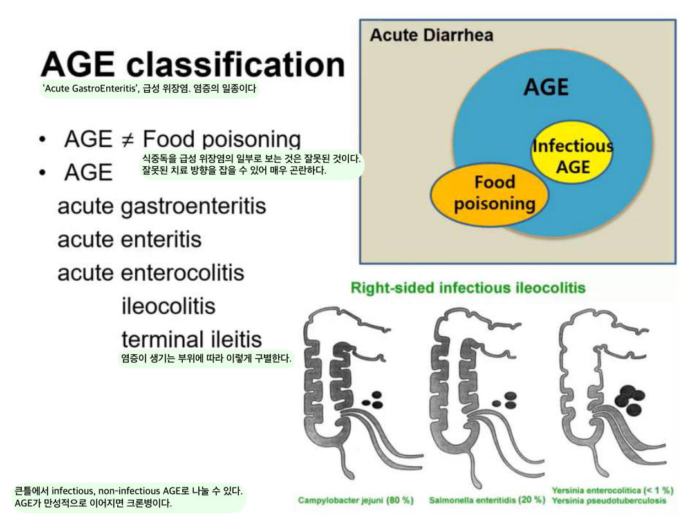
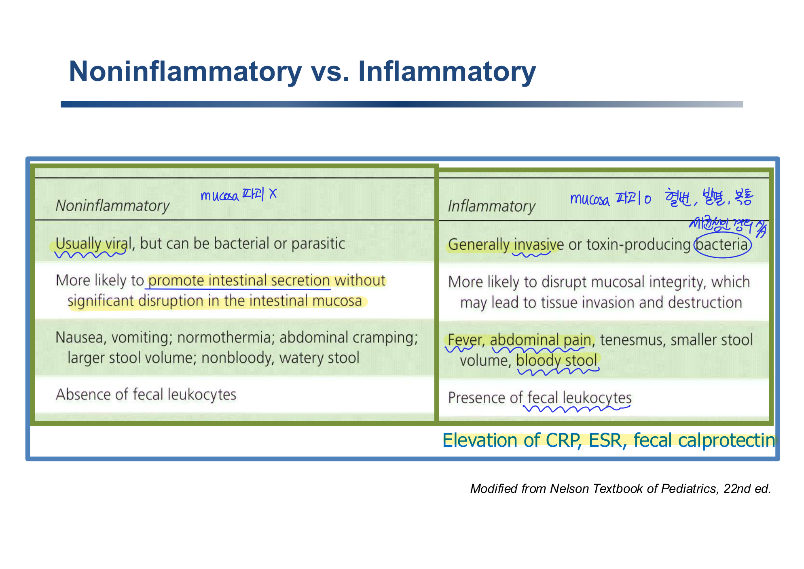
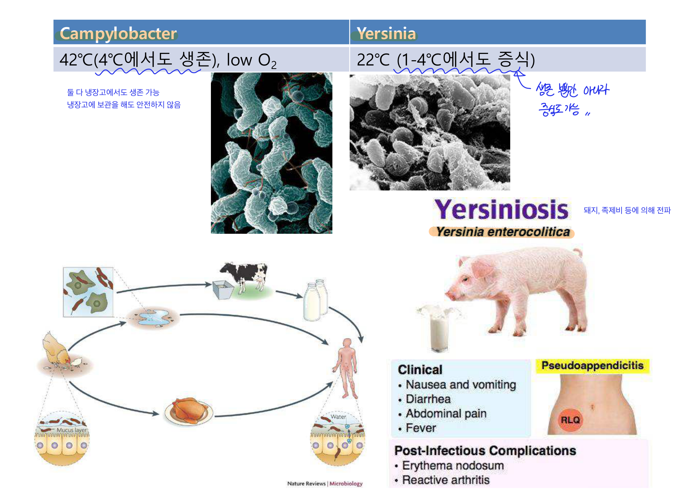
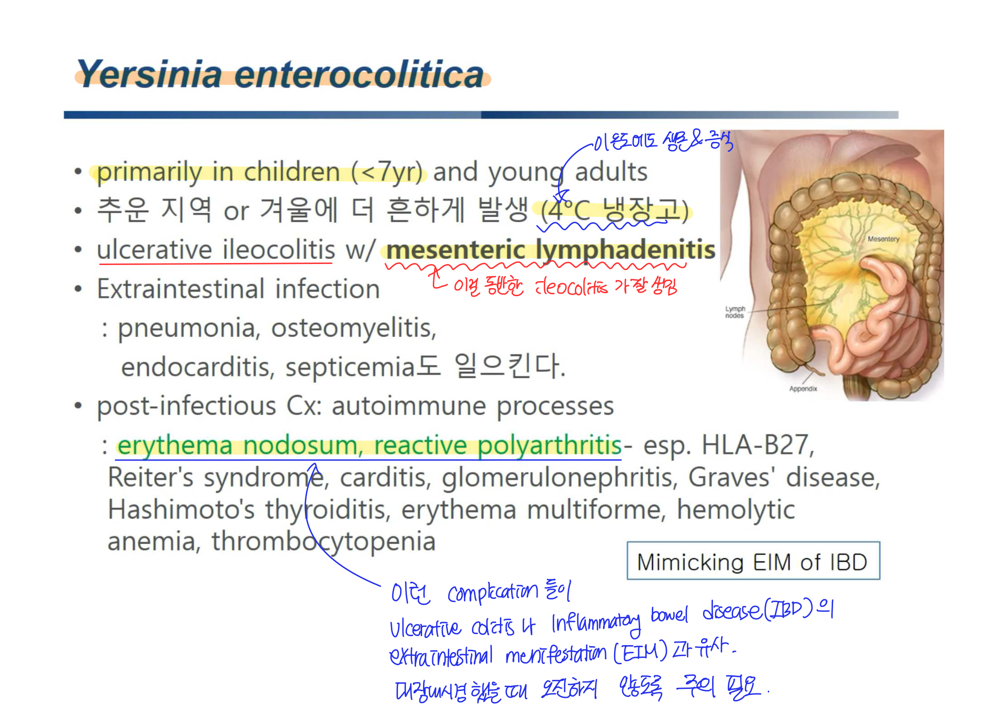
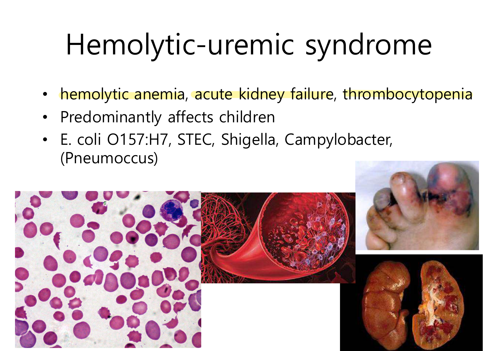
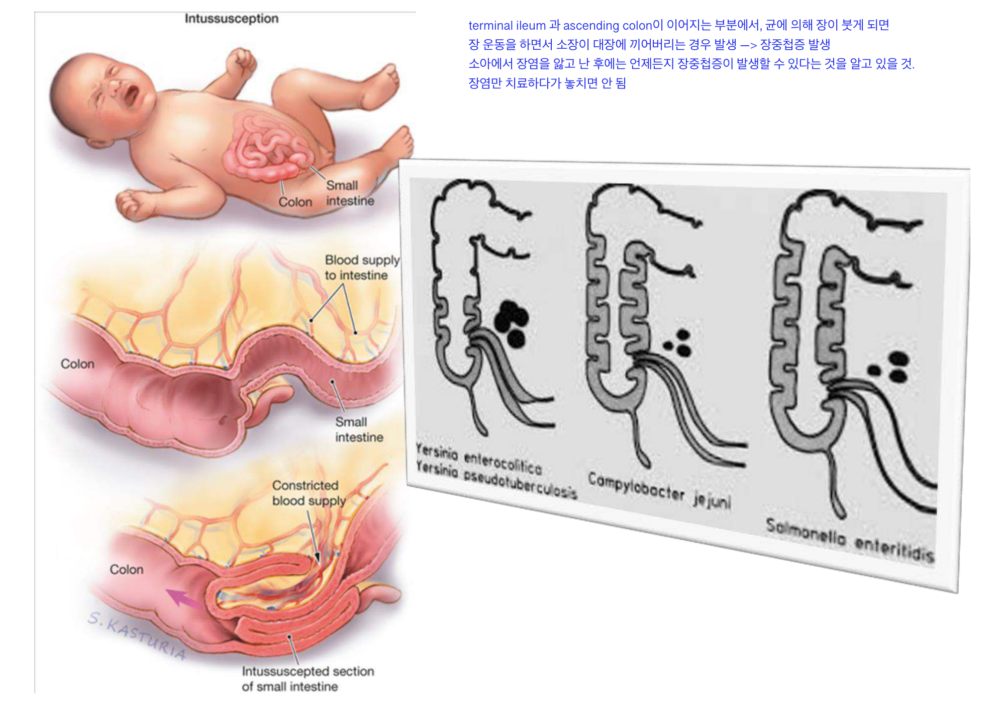
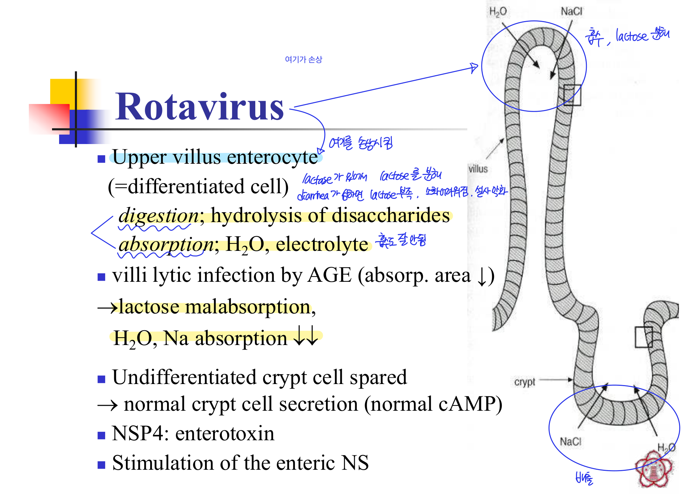
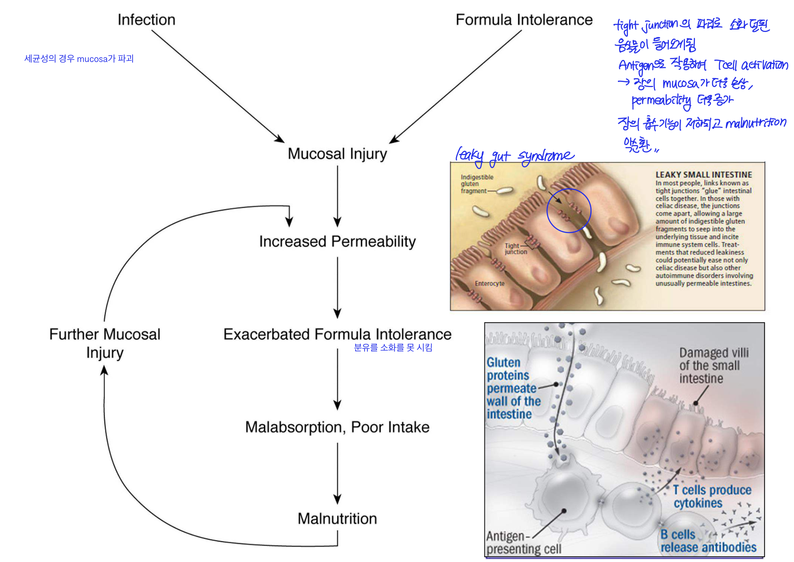
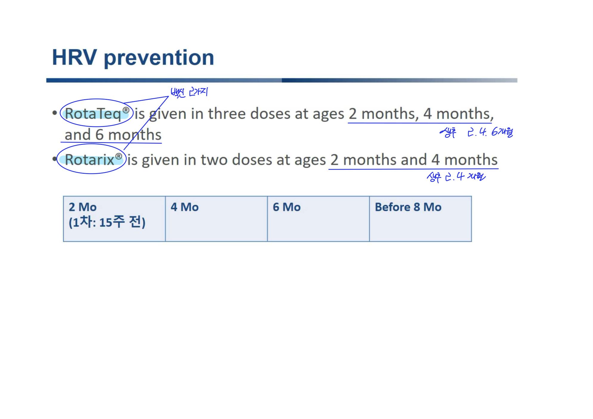

<!-- 필기본: 2026 · 2025 -->
<!-- 단계: 수업 후 -->

# 0. 이 수업을 공부하는 법

소아청소년과 소화기영양 **최병호 교수님** 수업(2022–2026 같은 교수님). 제목은 **「GI Infection: CYR」** — **C**ampylobacter, **Y**ersinia, **R**otavirus 세 가지가 이 수업의 뼈대다. 슬라이드는 사진·도식 위주이고, 필기에 교수님 말씀이 적혀 있다. 작년에 교수님이 "**세부적인 것보다 큰 그림을 알고 있을 것**", 일부 슬라이드는 "외울 필요 없다", "이런 거 몰라도 됩니다"라고 했다.

올해 필기본(2026, 34쪽)은 강의 화면을 찍은 사진이라 작년 필기본(2025, 40쪽)과 쪽 구성이 조금 다르다. 이 자료는 **올해 필기 순서**를 따르고, 올해 새로 생긴 내용은 초록 `올해 필기에서 추가` 상자, 작년과 달라졌거나 올해 빠진 내용은 `작년 필기와 다른 점` 상자로 표시했다.

- 기출 13문항(2020–2025). 반복되는 세 덩어리:
    1. **염증성 vs 비염증성 설사**(고열·복통·혈변·CRP 상승 = 염증성), **식중독 ≠ 급성 위장염**
    2. **Campylobacter**(닭 상재균, 냉장고에서 생존, 일반 배지 X, cephalosporin X, 회복기 길랭-바레·반응성 관절염)
    3. **로타바이러스**(11분절 dsRNA, 융모 끝 장세포 파괴 → 흡수장애·유당 소화 저하, NSP4 장독소, 백신 있음, 장염 후 지속 설사엔 가수분해·아미노산 분유)
- **족보**: 올해 필기본 2–3쪽에 2022–2025 기출(2025 5·20번, 2024 17·23번, 2023 9·17번, 2022 3·9번)이 정답 표시와 함께 붙어 있다. 작년 필기본에는 2020–2024 기출이 붙어 있었다. 해마다 같은 주제가 돌아온다는 뜻이다 — 2부 기출을 꼭 풀어 볼 것.

!!! key "핵심"
    혈변·고열·복통이면 **일단 세균성(염증성)** 의심 → 배양·PCR. 물설사는 대부분 **바이러스** → **수분·전해질(ORS)** 이 치료의 중심, 항생제 X. **STEC(EHEC O157:H7)은 항생제·지사제 금기**(HUS). 장염 뒤엔 **반응성 관절염·길랭-바레·HUS·장중첩증**을 놓치지 말 것.

# 1. 급성 설사 질환의 분류

## AGE classification — 급성 위장염은 식중독이 아니다

{: style="width:76%"}

### AGE란
- **AGE(Acute GastroEnteritis, 급성 위장염)** 는 위장관에 생긴 **염증**의 한 종류다. 필기: "염증의 일종이다".
- 염증이 생긴 **부위에 따라** 이름이 달라진다 — 모두 AGE 안에 들어간다.
    - acute gastroenteritis(급성 위장염): 위 + 소장
    - acute enteritis(급성 장염): 소장
    - acute enterocolitis(급성 장결장염): 소장 + 대장 → 그중 **ileocolitis(회결장염)**, **terminal ileitis(말단 회장염)**
- 큰 틀에서는 **감염성(infectious) AGE**와 **비감염성(non-infectious) AGE**로 나눈다.

### AGE ≠ Food poisoning
- 오른쪽 벤 다이어그램: 급성 설사(acute diarrhea) 안에 AGE가 있고, **감염성 AGE**는 AGE 안에 있지만 **식중독(food poisoning)은 AGE 밖으로 삐져나와 있다** — 겹치는 부분이 있을 뿐 같은 개념이 아니다.
- **왜 중요한가**: 필기 "식중독을 급성 위장염의 일부로 보는 것은 잘못된 것이다. **잘못된 치료 방향**을 잡을 수 있어 매우 곤란하다." 식중독은 미리 만들어진 **독소** 때문이라 항생제가 필요 없고, 감염성 AGE는 균이 장에서 자라는 것이라 필요하면 항생제를 쓴다(다음 쪽).
- 필기: "AGE가 만성적으로 이어지면 크론병이다." — 정확히는 급성 장염이 오래가면 **염증성 장질환(IBD, 크론병 등)을 감별**해야 한다는 뜻으로 읽는다(급성 장염이 크론병으로 '변하는' 것은 아니다).

### 오른쪽 회결장염 (Right-sided infectious ileocolitis)
그림 아래쪽: 말단 회장–맹장(오른쪽 아랫배)에 염증과 **장간막 림프절 비대(검은 동그라미)** 가 생기는 세균. 그림 속 숫자는 이런 회결장염의 원인 비율이다.

| 균 | 비율 | 림프절 |
|---|---|---|
| **Campylobacter jejuni** | **80%** | 작게 |
| Salmonella enteritidis | 20% | 작게 |
| **Yersinia enterocolitica**, Y. pseudotuberculosis | < 1% | **크게(가장 뚜렷)** |

→ 오른쪽 아랫배가 아파 **충수염처럼 보일 수 있고**, 림프조직이 부으면 **장중첩증**의 출발점이 된다(2단원 장중첩증에서 같은 그림이 다시 나온다).

!!! exam "기출 포인트"
    2부 4번(2024) O/X 1) "급성위장염과 식중독은 같은 개념이다" → **X**. 2부 7번(2022) 함정 보기 "식중독은 염증성 설사와 동일하다"도 X(식중독은 대부분 비염증성·독소형).

## 급성 설사 질환(Acute Diarrheal Diseases)의 원인

{: style="width:80%"}

### 감염성 (Infectious)
- **장염(enteritis)**: 바이러스 등(viral, etc) → **비염증성(noninflammatory)**
- **장결장염(enterocolitis)**: 침습성 세균(invasive bacterial) → **염증성(inflammatory)**. 필기: 살모넬라, 시겔라, E. coli 등.

### 비감염성 (Non-infectious)
네모 상자 안(장 안에서 생기는 원인 = **enteral**):

- **식중독(Food poisoning)**
- **항생제·약물 관련(Antibiotic associated, Drug-related)** — 필기 "항생제 유발성"(대표: C. difficile)
- **자극적인 음식·음료(Dietary)** — 필기: "과민성대장증후군 있는 사람이 찬물 마신다든지 마라탕 먹는다든지"
- **알레르기, 흡수장애(Allergy, Malabsorption)**

상자 밖(장 바깥 원인):

- **전신 감염, 장관 외 설사(Systemic infection, parenteral diarrhea)** — 필기: "패혈증 등 전신감염에 의한 설사", "**중이염 등의 이유로** (장에 무언가 먹지 않아도) 생기는 설사". 소아는 장 밖의 감염(중이염, 요로감염, 폐렴)만으로도 설사를 한다 — 그래서 설사하는 아이는 귀·소변도 봐야 한다.
- **심리적 요인(Psychological factors)** — 필기: "긴장을 많이 해서 설사하기도 한다".

### 하루 장액의 흐름 (그림 오른쪽, 형광펜)

!!! new "올해 필기에서 추가"
    필기가 그림의 숫자를 세 가지 색으로 묶었다.

    - **분홍 = 장으로 흘러 들어가는 양 약 9,000 mL/일**: 먹는 물 2,000 + 침 1,500 + 담즙 500 + 위액 2,000 + 췌장액 1,500 + 장액 1,500
    - **하늘 = 흡수되는 양 약 8,900 mL/일**: 소장 8,500 + 대장 400
    - **노랑 = 대변으로 나가는 양 약 100 mL/일**

    **왜 설사가 쉽게 생기나**: 하루 9 L 중 99%를 흡수하고 겨우 100 mL만 내보낸다. 흡수가 조금만(예: 10%) 줄어도 대변량이 몇 배로 뛴다. 소장(융모)이 8.5 L를 맡으므로 **로타바이러스처럼 소장 융모를 망가뜨리면 많은 양의 물설사**가 나고, 대장(400 mL)만 침범하는 염증성 설사는 **변량이 적다**(다음 표).

## 식품매개 질환 vs 식중독 (Food-borne ds vs. Food Poisoning)

{: style="width:76%"}

- **식품매개 질환(food-borne diseases)** = **식중독(food poisoning)** + **감염성 AGE(infectious AGE)**.
    - **식중독**: 화학적(chemical) 또는 생물학적(biological) 중독. 필기: "**독소만 들어온 상황이기 때문에 항생제를 투여하지 않는다**" → **No Abx**.
    - **감염성 AGE**: 필기: "**필요시 항생제를 투여한다**" → **Abx if indicated**.
- 오른쪽 그림이 차이를 한 줄로 보여 준다.
    - Stomach flu(감염성 위장염): 균이 위·장을 **침범**하고 **몸 안에서 증식**해 증상이 난다.
    - Food poisoning: 균이 **음식 안에서** 자라 독소를 만들고, 우리는 **미리 만들어진 독소(pre-formed toxin)** 를 먹어 **빨리**(몇 시간 안에) 아프다.
- 중요한 식품매개 세균(아래 상자):
    - 위 줄 = **식중독형(독소)**: **Staph aureus, Bacillus cereus, Clostridium(botulinum, perfringens)**
    - 아래 줄 = **감염성 AGE형(장에서 증식)**: **Salmonella, Brucella, Campylobacter, E. coli, Listeria, Vibrio cholerae·parahaemolyticus** — 화살표가 "Abx if indicated"로 이어진다.

※ 확인 필요: 올해 필기는 이 두 줄 옆에 "Bacterial / Viral"이라고 적었는데, 아래 줄(Salmonella, Campylobacter, E. coli …)도 모두 **세균**이다. 작년 필기는 같은 자리에 "**식중독 / 장염**"이라고 적었다 — 작년 표시가 맞는 뜻으로 보인다(위 = 식중독, 아래 = 장에서 증식하는 감염성 장염).

## 비염증성 vs 염증성 ★

{: style="width:84%"}

| | 비염증성(noninflammatory) | 염증성(inflammatory) |
|---|---|---|
| 원인 | **대개 바이러스**, 세균·기생충도 가능 | 대개 **침습성** 또는 독소 생성 **세균** — 필기 "세균성인 경우 대개 inflammatory" |
| 기전 | 점막을 크게 망가뜨리지 않고 **장 분비를 촉진** | **점막을 파괴**해 조직 침습·파괴 |
| 증상 | **구역·구토**, 정상 체온, 경련성 복통(쥐어짬), **변량 많음, 혈변 없는 물설사** | **발열, 복통, 뒤무직(잔변감)**, 변량 적음, **혈변** |
| 대변 백혈구 | **없음** | **있음** |
| 혈액·대변 염증 수치 | CRP·ESR **증가하지 않음** | **CRP, ESR, 대변 calprotectin 상승** — 필기 "장의 염증을 나타내는 수치들이 증가한다" |

- **기전으로 이해하기**: 비염증성은 장세포를 죽이지 않고 '물을 더 내보내게' 하거나(독소) 융모 끝만 벗겨(바이러스) **소장**에서 대량의 물설사를 만든다 → 구토·탈수가 문제. 염증성은 균이 **대장 점막을 뚫고 들어가** 염증을 일으키므로 열이 나고, 백혈구·피가 대변에 섞이고, 직장이 자극돼 뒤무직이 생긴다.
- **헷갈리는 것**: "세균 = 염증성"이 아니다. ETEC·콜레라처럼 독소만 내는 세균은 비염증성이고, 세균성이라도 가벼우면 비염증성처럼 보인다(아래 '장염 vs 장결장염').

!!! exam "기출 포인트"
    - 2부 7번(2022): 옳은 것 = **고열·복통·혈변이 동반되면 염증성**. 함정: "세균성은 염증성이다"(독소형은 비염증성), "대변 백혈구 없으면 비염증성"(초기·EHEC·아메바는 백혈구가 안 보일 수 있다), "반복되면 IBS"(IBD·알레르기 장염 감별), "식중독 = 염증성".
    - 2부 4번(2024) 2) 고열 + CRP·ESR 증가 + 혈변·점액변 = 염증성 → **O**.
    - 2부 10번(2022): 대변 형태로 로타 장염(물설사)과 감별되는 것 = **Dysentery(이질, 혈성·점액성)**. EPEC·콜레라·Cryptosporidium·노로는 모두 물설사.

## 원인균에 따른 분류 (Classification of Acute GI Infection)

{: style="width:80%"}

| 분비성·장독소형 — 물설사 | 염증성 장병원체 — 혈성 점액변 |
|---|---|
| **식중독(독소형)**: S. aureus, Bacillus cereus, Clostridium perfringens | **Shigella** |
| **ETEC, V. cholerae** — 필기 "세균이지만 여기 해당됨" | **Salmonella(non-typhi)** |
| **Giardia lamblia**, Cryptosporidium(기생충) | Invasive E. coli, **EHEC(E. coli O157:H7)** |
| 바이러스: **Rotavirus**, Adenovirus 40·41, Astrovirus, Calicivirus ∋ **Norovirus** ∋ Norwalk virus | **Campylobacter jejuni**, **Yersinia enterocolitica** |
| | Vibrio parahaemolyticus |
| | **Clostridioides difficile** — 필기 "항생제 overdose의 부작용인 C. difficile" |
| | **Entamoeba histolytica(아메바)** |
| | CMV(면역저하 환자) |

- 오른쪽 열 위에 필기: "→ **열도 많이 나고 세균성일 가능성이 높음**".
- 그림의 **화살표**: Salmonella, Campylobacter, Yersinia는 오른쪽(염증성)에 있지만 **가벼운 형태(mild form)면 왼쪽(물설사) 양상**도 보인다 → 다음 표의 '세균성이라도 mild하냐 severe하냐에 따라 갈린다'와 같은 이야기.
- 형광펜: 식중독, ETEC·V. cholerae, Giardia(왼쪽), 아메바(오른쪽). **Calicivirus ∋ Norovirus ∋ Norwalk virus**는 "포함 관계"(칼리시바이러스과 안에 노로바이러스 속, 그 안에 노웍 바이러스)라는 뜻이다.

!!! diff "작년 필기와 다른 점"
    작년 슬라이드는 "Calicivirus, Norwalk-like virus-Norovirus"라고 나열했는데 올해는 **∋(포함) 기호**로 바꿔 Calicivirus ⊃ Norovirus ⊃ Norwalk virus 관계를 분명히 했다. 내용은 같다.

## 장염 vs 장결장염 (Enteritis vs. Enterocolitis)

{: style="width:78%"}

| 장염(enteritis) = 비염증성, 분비성·장독소형 | 장결장염(enterocolitis) = 염증성 |
|---|---|
| 바이러스성 AGE | 감염성 장결장염(infectious EC) |
| 세균성 위장염: ETEC, V. cholerae / **Campylobacter, E. coli, Salmonella의 가벼운 형태** | |
| 식중독(S. aureus 등) | |
| 알레르기성 장병증, 흡수장애 | **알레르기성 장결장염**(allergic EC) |
| 약물, 음식, 장관 외 설사 등 | 장폐색(bowel obstruction) 등 |
| (만성) 만성 비특이적 설사, **IBS** | (만성) **만성 장결장염 = IBD** |

- 필기: "**세균성이라도 mild하냐 severe하냐에 따라** noninflammatory, inflammatory 양상으로 증상이 갈린다." 같은 Campylobacter라도 가벼우면 물설사(장염), 심하면 혈변(장결장염).
- 맨 아래 줄 — 만성으로 가면:
    - **IBS(과민성 장증후군)**: "장 조직 손상 **없이** 기능이 과민해짐" → 비염증성 쪽.
    - **IBD(염증성 장질환)**: "면역 이상으로 장에 **실제 염증, 손상**이 생김" → 염증성 쪽.
- **헷갈리는 것**: IBS와 IBD는 이름이 비슷하지만 하나는 기능 이상(염증 수치 정상), 하나는 실제 염증(calprotectin↑, 내시경 이상)이다. 2부 7번 함정 "염증성 설사가 반복되면 IBS" → X(염증성이 반복되면 IBD를 의심).

!!! diff "작년 필기와 다른 점 — 혈변 위험인자 슬라이드"
    작년 필기(9쪽)에 있던 **「급성 혈변 설사에서 세균성 원인을 시사하는 위험인자」** 슬라이드가 올해 필기에는 없다. 작년 강의 내용이므로 남겨 둔다.

    {: style="width:70%"}

    **혈변을 보면 일단 세균성 의심.** 발병 5일 안에 물설사 → 혈변으로 바뀜 · 복통·압통, 배변할 때 심해지는 통증(특히 E. coli O157:H7) · **직장탈출**(세균성 이질, O157:H7) · 처음 진찰할 때 **열이 없음 → E. coli O157:H7** · **39℃ 넘는 고열 → 세균성 이질** · 구토는 적음, 진찰 전 24시간에 5번 넘는 배변 · 혈변 환자·배양 확인 환자와의 접촉, 최근 항생제 사용.

    작년 필기본 2쪽의 손글씨 요약(세균 → 장결장염(염증성): Salmonella, Shigella, EIEC, EHEC, V. parahaemolyticus, Yersinia, Campylobacter, 아메바, C. difficile — ESR·CRP·calprotectin↑ / 바이러스 → 주로 **구토** → 비염증성: rotavirus, norovirus, adenovirus, astrovirus — 수치 정상)도 올해는 없지만 위 표와 같은 내용이다.

<!-- 아래는 수업 전판 — 수업 후판으로 고쳐 쓰는 중 -->
# 2. Campylobacter와 Yersinia

{: style="width:86%"}

| | Campylobacter | Yersinia |
|---|---|---|
| 배양 온도 | **42℃**, 낮은 산소(미호기성) — **4℃에서도 생존** | **22℃** — **1–4℃에서도 증식**(생존뿐 아니라 증식) |
| 숙주·전파 | **닭(조류)의 정상 상재균** | 돼지, 들쥐·족제비 배설물 → 오염된 약수터 물, 우유 |
| 공통 | **둘 다 냉장고에서 살아남는다 → 냉장 보관해도 안전하지 않다** | |

## Campylobacter
- **Campylobacter·Salmonella는 새(닭)의 정상균**이다. 닭이 알을 낳을 때 계란 껍질이 균에 오염된다 → **날계란, 덜 익힌 닭, 계란을 만진 손·식당 위생**이 문제. 일본 나가시소멘(흐르는 국수)에서 900명 가까이 집단 감염된 사례(2023)도 있다.
- 온대 지역 산업국의 **염증성 설사**, **어린아이에서 호발**(전 세계 소아 세균성 설사의 상당 부분).
- 장관 외 질환: **균혈증**(드묾), 관절염, 담낭염.
- **회복기에**: **길랭-바레 증후군**(신경에 생기는 후유증), **용혈요독증후군(HUS)**, **반응성 관절염(특히 HLA-B27)**.
- **지사제(장운동 억제제)를 쓰면**: 장운동이 감소해 세균·독소가 배출되지 않아 → **독성 거대결장**, 위막성 대장염, 대장 출혈.
- **항생제 내성**: 닭에게 항생제를 너무 많이 써서 내성균이 생겼다. 미국 CDC 사례에서 82%가 azithromycin, ciprofloxacin 등에 내성. **Campylobacter jejuni는 penicillin, amoxicillin-clavulanate, cephalosporin, metronidazole, TMP-SMX에 본래 내성** → "현재 cephalosporin은 전혀 듣지 않음". 사람에게 쓸 항생제는 남겨 두고 가축에 써야 한다.

!!! exam "기출 포인트"
    - 2부 3번(2024, 주관식): 냉장고에서도 생존, 일반 배지 X, 조류의 상재균, cephalosporin X → **Campylobacter**.
    - 2부 2번(2025): 옳은 것 = **심한 급성 대장염은 IBD와 비슷해 보일 수 있다**. 함정: 독소만으로 설사(X, 침습), 소장만 침범(X), 소아에서 균혈증 흔함(X), 회복기 신경 합병증 = 다발성 경화증(X → **길랭-바레**).
    - 2부 5번(2023): 닭요리·날계란 후 고열·혈변·점액변 → 옳은 것 = **조기 치료하지 않으면 관절염이 생기기도 한다**. 함정: 대부분 바이러스(X), 배양 음성이면 세균성 배제(X), 냉장고 닭은 안전(X), 조기 대장내시경(X).

## Yersinia enterocolitica

{: style="width:62%"}

- 주로 **소아(<7세)와 젊은 성인**. **추운 지역이나 겨울**에 흔하다(4℃ 냉장고에서도 생존·증식).
- **궤양성 회결장염 + 장간막 림프절염** → 오른쪽 아랫배 통증으로 **충수염처럼 보인다(pseudoappendicitis)**. 이 경우 회결장염이 가장 잘 생긴다.
- 장관 외 감염: 폐렴, 골수염, 심내막염, 패혈증.
- **감염 후 합병증(자가면역)**: **결절홍반, 반응성 다발관절염(HLA-B27)**, Reiter 증후군, 심염, 사구체신염, Graves병, 하시모토 갑상선염, 다형홍반, 용혈빈혈, 혈소판감소 → **IBD의 장관 외 증상과 비슷하다** → 대장내시경 할 때 오진하지 않도록 주의.
- 국내 약수터 여시니아 오염(1990년대 신문): 들쥐·족제비 배설물 → 13세 이하 어린이 고열·복통·설사.

**Yersinia pseudotuberculosis**("이런 거 몰라도 됩니다"): 항원이 HLA class II와 직접 결합해 **초항원(superantigen)** 역할 → 충수염, IBD, **가와사키병 비슷한 질환**과 감별.

## 장염 후 합병증

### 반응성 관절염과 자가면역
- **세균 항원이 HLA-B27 항원과 교차반응**한다 → 세균 감염 후 세균 항원과 비슷한 우리 몸 조직을 공격 → 자가면역 질환·장관 외 증상. HLA-B27을 가진 환자는 관절염 같은 증상이 잘 생긴다(**피부, 관절**에 잘 온다).
- 유전 소인(HLA class I B27, class II DR, DW 등) + **유발 감염**(Chlamydia, Yersinia, Salmonella, Shigella, Campylobacter, 바이러스) → 비정상 면역반응 → 질환. 관련 요인(유전, 미생물총, 면역, 환경)이 많아 **사람마다 경과가 다르다**.

### 용혈요독증후군 (HUS)

{: style="width:66%"}

- **용혈빈혈, 급성 신부전, 혈소판감소** — 주로 **소아**.
- 원인: **E. coli O157:H7, STEC(시가독소 생성 대장균)**, Shigella, Campylobacter, (폐렴알균).

### 장중첩증 (Intussusception)

{: style="width:72%"}

- **말단 회장과 상행결장이 이어지는 부분**이 균 때문에 부으면(림프조직 비대) 장운동을 하면서 **소장이 대장에 끼어 들어간다** → 장중첩증.
- **소아에서 장염을 앓고 난 뒤에는 언제든지 장중첩증이 생길 수 있다**는 것을 알고 있을 것. 장염만 치료하다가 놓치면 안 된다.

### 페스트 (여담)
흑사병 = **Yersinia pestis**. 쥐 → 벼룩 → 사람. 14세기 유럽 대유행, 1665년 런던, 1855년 중국에서 시작한 3차 대유행.

# 3. 만성 설사

원인: 감염 후, 약물, 식이(유당 불내성 등, 영양실조), 유분증(encopresis), IBS, 알레르기성 위장관 질환·호산구성 위장염, **IBD**, 해부학적 병변(단장증후군 등), 드문 원인.

# 4. 로타바이러스 (Rotavirus)

## 역학과 전파
- **1세 이전에 심하고 2세까지 증상**(어릴수록 심한 설사), 성인은 무증상인 경우가 많다. 방치하면 **심한 탈수** 때문에 위험해진다.
- **대변–구강 경로**: 아이가 장난감 등을 입에 넣는다. 대변·구토물에 **매우 높은 농도(>1012 입자/g)로 오래** 배출 → **손을 잘 씻어야 한다**.
- 늦가을–초겨울, 6–24개월에 가장 많고, 최근 3개월 미만·신생아 감염과 신생아실 집단 유행도 늘고 있다.
- 바이러스 구조: Reoviridae, **11분절 이중가닥 RNA(dsRNA)**. 군(group)·아군은 **VP6**, 혈청형은 G(VP7)·P(VP4)로 나뉘고 VP4·VP7이 중화항체를 만든다(G1P[8] 등, 해마다·지역마다 우세형이 다르다).

## 병태생리

{: style="width:80%"}

- **융모 위쪽 장세포(분화된 세포)**: 이당류 가수분해(소화), 물·전해질 흡수 → 로타바이러스가 **여기를 감염해 파괴**(흡수 면적 감소) → **유당 흡수장애**, 물·Na 흡수 감소.
- **분화되지 않은 crypt 세포는 보존** → 정상적인 분비(cAMP 정상)는 계속된다 → 흡수는 줄고 분비는 그대로 → 물설사.
- **NSP4 = 장독소(enterotoxin)**.
- 장 신경계 자극.

!!! exam "기출 포인트"
    - 2부 12번(2020): 옳은 것 = **villus enterocyte 손상으로 수분·전해질 흡수 장애**. 함정: crypt cell 흡수 증가(X, 분비), 재감염이 더 심함(X), 혈청 항원검사(X, 대변 항원), "유당 알레르기"(그런 용어 없음).
    - 2부 11·13번(2021·2020): 맞는 것 = **라(융모세포 세포질에서 증식 → 파괴·탈락 → 물·Na·포도당 흡수장애)만**. 가(dsDNA X → dsRNA), 나(백신 없음 X), 다(사람만 X).
    - 2부 9번(2022): 원본 정답은 ①(가·나·다)이지만 "예방백신이 없다"는 사실과 다르고 "NSP3가 장독소"도 틀렸다(NSP4) → 해설에 **※ 확인 필요**로 남겼다.

## 장 점막 손상과 분유 불내성

{: style="width:86%"}

- 감염(세균성이면 점막 파괴) 또는 분유 불내성 → **점막 손상** → **투과성 증가**(tight junction이 망가져 소화 덜 된 음식이 들어온다, **leaky gut**) → 그것이 항원으로 작용해 T 세포 활성화 → 점막이 더 손상 → **분유 불내성 악화**(분유를 소화 못 시킴) → 흡수장애·섭취 저하 → 영양실조 → 더 심한 점막 손상의 **악순환**.
- **우유 알레르기가 생기는 이유**: 장벽이 새면 우유 단백이 고유판으로 들어가 T 세포가 감작 → 우유가 들어올 때 강하게 반응해 장염이 심해진다. 나을 때까지 조심하지 않고 계속 주면 더 나빠진다.

!!! exam "기출 포인트"
    - 2부 8번(2022): 생후 4개월, 로타 장염 후 물설사가 2주 지속 → **완전가수분해분유나 아미노산 분유를 시도**. 함정: "유당 알레르기 예방"(용어 없음), 그대로 먹이면 낫는다, 이온음료(X → ORS), 1단계 분유로 변경.
    - 2부 6번(2023): 생후 9개월 로타 장염 + 탈수 → 옳은 것 = **격리실 보험은 가능하나 법적 격리의무는 없다**. 함정: 분유 양 늘리기, 무유당 분유로 "우유 알레르기 예방", 광범위 항생제, 백신 안 맞았으면 치료 후 접종(X — 8개월이 지나면 접종하지 않는다).

## 로타바이러스 예방 (HRV prevention)

{: style="width:72%"}

| 백신 | 횟수 | 접종 시기 |
|---|---|---|
| **RotaTeq**(5가) | **3회** | 생후 **2, 4, 6개월** |
| **Rotarix**(1가) | **2회** | 생후 **2, 4개월** |

- 1차는 **생후 15주 전**에 시작, **8개월 전**에 끝낸다. 경구 생백신.
- 필기의 퀴즈: HRV 백신(VP7/VP4 항원)과 HBV 백신(HBsAg 항원)은 모두 바이러스 표면 항원에 대한 체액성 면역(항체)으로 예방 효과를 낸다 → **참**.

# 5. C. difficile — 검사 해석

- C. difficile은 원래 장에 있는 **정상세균총**의 하나. 항생제를 많이·오래 쓰는 환자에서 **과증식**해 문제를 일으킨다.
- 그래서 **toxin A/B 유전자가 양성이라고 무조건 치료해야 하는 상태는 아니다.**
- **PCR에서 C. difficile이 나오는 건 크게 의미가 없다** — 소아에서는 거의 전부 양성으로 나온다(특히 영아는 무증상 보균이 흔하다).
- **CD toxin을 따로 검사**해서 높게 나오면 의미 있게 본다.
- 필기의 퀴즈: "toxigenic C. difficile(toxin A/B)가 multiplex PCR에서 양성이면 위막성 대장염에 준한 치료를 한다" → **거짓**.
- 필기의 퀴즈: "Campylobacter 장염 회복기에 길랭-바레 같은 자가면역성 신경계 합병증이 생길 수 있다" → **O**.

!!! memo "암기"
    식중독(독소, 항생제 X: S. aureus·B. cereus·C. perfringens) ≠ 감염성 AGE · 염증성 = 점막 파괴, 발열·복통·혈변, 대변 WBC, CRP·ESR·calprotectin ↑ · 혈변 + WBC 없음 = EHEC·아메바 · EHEC는 항생제 X(HUS) · Campylobacter = 닭, 42℃, 냉장고 생존, cephalosporin 내성, 길랭-바레·반응성 관절염 · Yersinia = 돼지·약수터, 4℃ 증식, 가성충수염, 결절홍반 · 장염 후 장중첩증 · 로타 = 11분절 dsRNA, 융모 끝 파괴(crypt 보존), NSP4, RotaTeq 2·4·6 / Rotarix 2·4개월, 지속 설사엔 가수분해·아미노산 분유 · C. difficile PCR 양성만으로 치료 X
