<!-- 필기본: 2026 · 2025 -->
<!-- 단계: 수업 후 -->

# 0. 이 수업을 공부하는 법

소아청소년과 소화기영양 **최병호 교수님** 수업(2022–2026 같은 교수님). 제목은 **「GI Infection: CYR」** — **C**ampylobacter, **Y**ersinia, **R**otavirus 세 가지가 이 수업의 뼈대다. 슬라이드는 사진·도식 위주이고, 필기에 교수님 말씀이 적혀 있다. 작년에 교수님이 "**세부적인 것보다 큰 그림을 알고 있을 것**", 일부 슬라이드는 "외울 필요 없다", "이런 거 몰라도 됩니다"라고 했다.

올해 필기본(2026, 34쪽)은 강의 화면을 찍은 사진이라 작년 필기본(2025, 40쪽)과 쪽 구성이 조금 다르다. 이 자료는 **올해 필기 순서**를 따르고, 올해 새로 생긴 내용은 초록 `올해 필기에서 추가` 상자, 작년과 달라졌거나 올해 빠진 내용은 `작년 필기와 다른 점` 상자로 표시했다.

- 기출 13문항(2020–2025). 반복되는 세 덩어리:
    1. **염증성 vs 비염증성 설사**(고열·복통·혈변·CRP 상승 = 염증성), **식중독 ≠ 급성 위장염**
    2. **Campylobacter**(닭 상재균, 냉장고에서 생존, 일반 배지 X, cephalosporin X, 회복기 길랭-바레·반응성 관절염)
    3. **로타바이러스**(11분절 dsRNA, 융모 끝 장세포 파괴 → 흡수장애·유당 소화 저하, NSP4 장독소, 백신 있음, 장염 후 지속 설사엔 가수분해·아미노산 분유)
- **족보**: 올해 필기본 2–3쪽에 2022–2025 기출(2025 5·20번, 2024 17·23번, 2023 9·17번, 2022 3·9번)이 정답 표시와 함께 붙어 있다. 작년 필기본에는 2020–2024 기출이 붙어 있었다. 해마다 같은 주제가 돌아온다는 뜻이다 — 2부 기출을 꼭 풀어 볼 것.

!!! key "핵심"
    혈변·고열·복통이면 **일단 세균성(염증성)** 의심 → 배양·PCR. 물설사는 대부분 **바이러스** → **수분·전해질(ORS)** 이 치료의 중심, 항생제 X. **STEC(EHEC O157:H7)은 항생제·지사제 금기**(HUS). 장염 뒤엔 **반응성 관절염·길랭-바레·HUS·장중첩증**을 놓치지 말 것.

# 1. 급성 설사 질환의 분류

## AGE classification — 급성 위장염은 식중독이 아니다

{: style="width:76%"}

### AGE란
- **AGE(Acute GastroEnteritis, 급성 위장염)** 는 위장관에 생긴 **염증**의 한 종류다. 필기: "염증의 일종이다".
- 염증이 생긴 **부위에 따라** 이름이 달라진다 — 모두 AGE 안에 들어간다.
    - acute gastroenteritis(급성 위장염): 위 + 소장
    - acute enteritis(급성 장염): 소장
    - acute enterocolitis(급성 장결장염): 소장 + 대장 → 그중 **ileocolitis(회결장염)**, **terminal ileitis(말단 회장염)**
- 큰 틀에서는 **감염성(infectious) AGE**와 **비감염성(non-infectious) AGE**로 나눈다.

### AGE ≠ Food poisoning
- 오른쪽 벤 다이어그램: 급성 설사(acute diarrhea) 안에 AGE가 있고, **감염성 AGE**는 AGE 안에 있지만 **식중독(food poisoning)은 AGE 밖으로 삐져나와 있다** — 겹치는 부분이 있을 뿐 같은 개념이 아니다.
- **왜 중요한가**: 필기 "식중독을 급성 위장염의 일부로 보는 것은 잘못된 것이다. **잘못된 치료 방향**을 잡을 수 있어 매우 곤란하다." 식중독은 미리 만들어진 **독소** 때문이라 항생제가 필요 없고, 감염성 AGE는 균이 장에서 자라는 것이라 필요하면 항생제를 쓴다(다음 쪽).
- 필기: "AGE가 만성적으로 이어지면 크론병이다." — 정확히는 급성 장염이 오래가면 **염증성 장질환(IBD, 크론병 등)을 감별**해야 한다는 뜻으로 읽는다(급성 장염이 크론병으로 '변하는' 것은 아니다).

### 오른쪽 회결장염 (Right-sided infectious ileocolitis)
그림 아래쪽: 말단 회장–맹장(오른쪽 아랫배)에 염증과 **장간막 림프절 비대(검은 동그라미)** 가 생기는 세균. 그림 속 숫자는 이런 회결장염의 원인 비율이다.

| 균 | 비율 | 림프절 |
|---|---|---|
| **Campylobacter jejuni** | **80%** | 작게 |
| Salmonella enteritidis | 20% | 작게 |
| **Yersinia enterocolitica**, Y. pseudotuberculosis | < 1% | **크게(가장 뚜렷)** |

→ 오른쪽 아랫배가 아파 **충수염처럼 보일 수 있고**, 림프조직이 부으면 **장중첩증**의 출발점이 된다(2단원 장중첩증에서 같은 그림이 다시 나온다).

!!! exam "기출 포인트"
    2부 4번(2024) O/X 1) "급성위장염과 식중독은 같은 개념이다" → **X**. 2부 7번(2022) 함정 보기 "식중독은 염증성 설사와 동일하다"도 X(식중독은 대부분 비염증성·독소형).

## 급성 설사 질환(Acute Diarrheal Diseases)의 원인

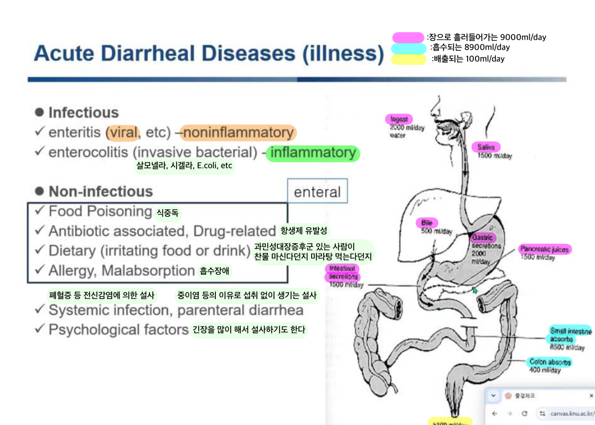{: style="width:80%"}

### 감염성 (Infectious)
- **장염(enteritis)**: 바이러스 등(viral, etc) → **비염증성(noninflammatory)**
- **장결장염(enterocolitis)**: 침습성 세균(invasive bacterial) → **염증성(inflammatory)**. 필기: 살모넬라, 시겔라, E. coli 등.

### 비감염성 (Non-infectious)
네모 상자 안(장 안에서 생기는 원인 = **enteral**):

- **식중독(Food poisoning)**
- **항생제·약물 관련(Antibiotic associated, Drug-related)** — 필기 "항생제 유발성"(대표: C. difficile)
- **자극적인 음식·음료(Dietary)** — 필기: "과민성대장증후군 있는 사람이 찬물 마신다든지 마라탕 먹는다든지"
- **알레르기, 흡수장애(Allergy, Malabsorption)**

상자 밖(장 바깥 원인):

- **전신 감염, 장관 외 설사(Systemic infection, parenteral diarrhea)** — 필기: "패혈증 등 전신감염에 의한 설사", "**중이염 등의 이유로** (장에 무언가 먹지 않아도) 생기는 설사". 소아는 장 밖의 감염(중이염, 요로감염, 폐렴)만으로도 설사를 한다 — 그래서 설사하는 아이는 귀·소변도 봐야 한다.
- **심리적 요인(Psychological factors)** — 필기: "긴장을 많이 해서 설사하기도 한다".

### 하루 장액의 흐름 (그림 오른쪽, 형광펜)

!!! new "올해 필기에서 추가"
    필기가 그림의 숫자를 세 가지 색으로 묶었다.

    - **분홍 = 장으로 흘러 들어가는 양 약 9,000 mL/일**: 먹는 물 2,000 + 침 1,500 + 담즙 500 + 위액 2,000 + 췌장액 1,500 + 장액 1,500
    - **하늘 = 흡수되는 양 약 8,900 mL/일**: 소장 8,500 + 대장 400
    - **노랑 = 대변으로 나가는 양 약 100 mL/일**

    **왜 설사가 쉽게 생기나**: 하루 9 L 중 99%를 흡수하고 겨우 100 mL만 내보낸다. 흡수가 조금만(예: 10%) 줄어도 대변량이 몇 배로 뛴다. 소장(융모)이 8.5 L를 맡으므로 **로타바이러스처럼 소장 융모를 망가뜨리면 많은 양의 물설사**가 나고, 대장(400 mL)만 침범하는 염증성 설사는 **변량이 적다**(다음 표).

## 식품매개 질환 vs 식중독 (Food-borne ds vs. Food Poisoning)

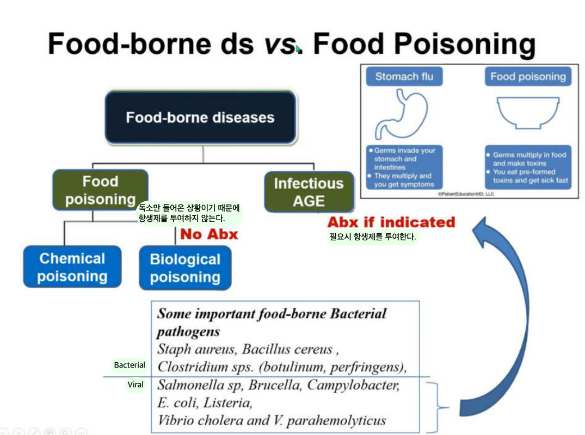{: style="width:76%"}

- **식품매개 질환(food-borne diseases)** = **식중독(food poisoning)** + **감염성 AGE(infectious AGE)**.
    - **식중독**: 화학적(chemical) 또는 생물학적(biological) 중독. 필기: "**독소만 들어온 상황이기 때문에 항생제를 투여하지 않는다**" → **No Abx**.
    - **감염성 AGE**: 필기: "**필요시 항생제를 투여한다**" → **Abx if indicated**.
- 오른쪽 그림이 차이를 한 줄로 보여 준다.
    - Stomach flu(감염성 위장염): 균이 위·장을 **침범**하고 **몸 안에서 증식**해 증상이 난다.
    - Food poisoning: 균이 **음식 안에서** 자라 독소를 만들고, 우리는 **미리 만들어진 독소(pre-formed toxin)** 를 먹어 **빨리**(몇 시간 안에) 아프다.
- 중요한 식품매개 세균(아래 상자):
    - 위 줄 = **식중독형(독소)**: **Staph aureus, Bacillus cereus, Clostridium(botulinum, perfringens)**
    - 아래 줄 = **감염성 AGE형(장에서 증식)**: **Salmonella, Brucella, Campylobacter, E. coli, Listeria, Vibrio cholerae·parahaemolyticus** — 화살표가 "Abx if indicated"로 이어진다.

※ 확인 필요: 올해 필기는 이 두 줄 옆에 "Bacterial / Viral"이라고 적었는데, 아래 줄(Salmonella, Campylobacter, E. coli …)도 모두 **세균**이다. 작년 필기는 같은 자리에 "**식중독 / 장염**"이라고 적었다 — 작년 표시가 맞는 뜻으로 보인다(위 = 식중독, 아래 = 장에서 증식하는 감염성 장염).

## 비염증성 vs 염증성 ★

{: style="width:84%"}

| | 비염증성(noninflammatory) | 염증성(inflammatory) |
|---|---|---|
| 원인 | **대개 바이러스**, 세균·기생충도 가능 | 대개 **침습성** 또는 독소 생성 **세균** — 필기 "세균성인 경우 대개 inflammatory" |
| 기전 | 점막을 크게 망가뜨리지 않고 **장 분비를 촉진** | **점막을 파괴**해 조직 침습·파괴 |
| 증상 | **구역·구토**, 정상 체온, 경련성 복통(쥐어짬), **변량 많음, 혈변 없는 물설사** | **발열, 복통, 뒤무직(잔변감)**, 변량 적음, **혈변** |
| 대변 백혈구 | **없음** | **있음** |
| 혈액·대변 염증 수치 | CRP·ESR **증가하지 않음** | **CRP, ESR, 대변 calprotectin 상승** — 필기 "장의 염증을 나타내는 수치들이 증가한다" |

- **기전으로 이해하기**: 비염증성은 장세포를 죽이지 않고 '물을 더 내보내게' 하거나(독소) 융모 끝만 벗겨(바이러스) **소장**에서 대량의 물설사를 만든다 → 구토·탈수가 문제. 염증성은 균이 **대장 점막을 뚫고 들어가** 염증을 일으키므로 열이 나고, 백혈구·피가 대변에 섞이고, 직장이 자극돼 뒤무직이 생긴다.
- **헷갈리는 것**: "세균 = 염증성"이 아니다. ETEC·콜레라처럼 독소만 내는 세균은 비염증성이고, 세균성이라도 가벼우면 비염증성처럼 보인다(아래 '장염 vs 장결장염').

!!! exam "기출 포인트"
    - 2부 7번(2022): 옳은 것 = **고열·복통·혈변이 동반되면 염증성**. 함정: "세균성은 염증성이다"(독소형은 비염증성), "대변 백혈구 없으면 비염증성"(초기·EHEC·아메바는 백혈구가 안 보일 수 있다), "반복되면 IBS"(IBD·알레르기 장염 감별), "식중독 = 염증성".
    - 2부 4번(2024) 2) 고열 + CRP·ESR 증가 + 혈변·점액변 = 염증성 → **O**.
    - 2부 10번(2022): 대변 형태로 로타 장염(물설사)과 감별되는 것 = **Dysentery(이질, 혈성·점액성)**. EPEC·콜레라·Cryptosporidium·노로는 모두 물설사.

## 원인균에 따른 분류 (Classification of Acute GI Infection)

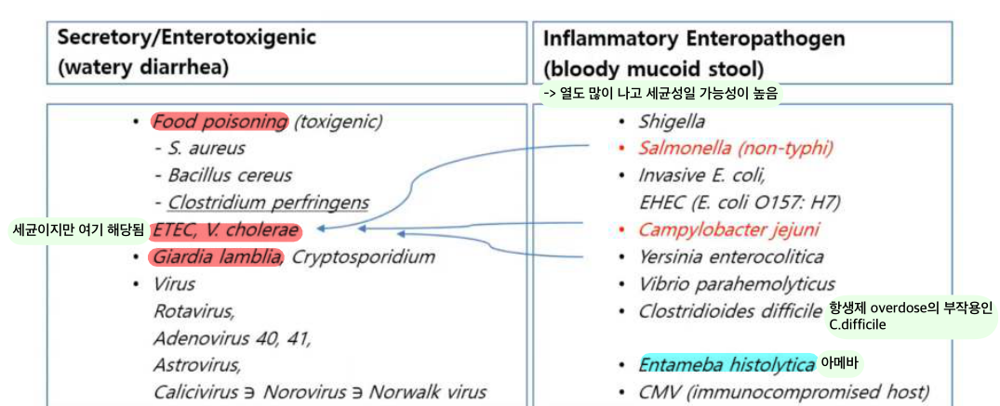{: style="width:80%"}

| 분비성·장독소형 — 물설사 | 염증성 장병원체 — 혈성 점액변 |
|---|---|
| **식중독(독소형)**: S. aureus, Bacillus cereus, Clostridium perfringens | **Shigella** |
| **ETEC, V. cholerae** — 필기 "세균이지만 여기 해당됨" | **Salmonella(non-typhi)** |
| **Giardia lamblia**, Cryptosporidium(기생충) | Invasive E. coli, **EHEC(E. coli O157:H7)** |
| 바이러스: **Rotavirus**, Adenovirus 40·41, Astrovirus, Calicivirus ∋ **Norovirus** ∋ Norwalk virus | **Campylobacter jejuni**, **Yersinia enterocolitica** |
| | Vibrio parahaemolyticus |
| | **Clostridioides difficile** — 필기 "항생제 overdose의 부작용인 C. difficile" |
| | **Entamoeba histolytica(아메바)** |
| | CMV(면역저하 환자) |

- 오른쪽 열 위에 필기: "→ **열도 많이 나고 세균성일 가능성이 높음**".
- 그림의 **화살표**: Salmonella, Campylobacter, Yersinia는 오른쪽(염증성)에 있지만 **가벼운 형태(mild form)면 왼쪽(물설사) 양상**도 보인다 → 다음 표의 '세균성이라도 mild하냐 severe하냐에 따라 갈린다'와 같은 이야기.
- 형광펜: 식중독, ETEC·V. cholerae, Giardia(왼쪽), 아메바(오른쪽). **Calicivirus ∋ Norovirus ∋ Norwalk virus**는 "포함 관계"(칼리시바이러스과 안에 노로바이러스 속, 그 안에 노웍 바이러스)라는 뜻이다.

!!! diff "작년 필기와 다른 점"
    작년 슬라이드는 "Calicivirus, Norwalk-like virus-Norovirus"라고 나열했는데 올해는 **∋(포함) 기호**로 바꿔 Calicivirus ⊃ Norovirus ⊃ Norwalk virus 관계를 분명히 했다. 내용은 같다.

## 장염 vs 장결장염 (Enteritis vs. Enterocolitis)

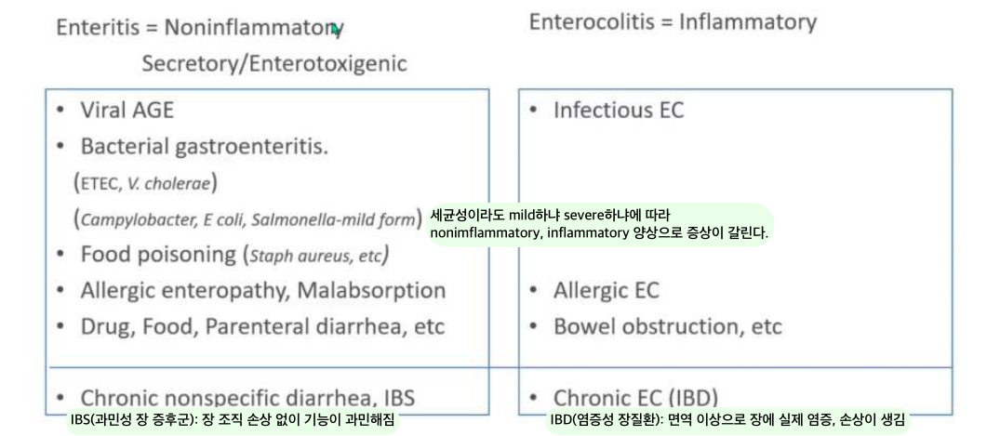{: style="width:78%"}

| 장염(enteritis) = 비염증성, 분비성·장독소형 | 장결장염(enterocolitis) = 염증성 |
|---|---|
| 바이러스성 AGE | 감염성 장결장염(infectious EC) |
| 세균성 위장염: ETEC, V. cholerae / **Campylobacter, E. coli, Salmonella의 가벼운 형태** | |
| 식중독(S. aureus 등) | |
| 알레르기성 장병증, 흡수장애 | **알레르기성 장결장염**(allergic EC) |
| 약물, 음식, 장관 외 설사 등 | 장폐색(bowel obstruction) 등 |
| (만성) 만성 비특이적 설사, **IBS** | (만성) **만성 장결장염 = IBD** |

- 필기: "**세균성이라도 mild하냐 severe하냐에 따라** noninflammatory, inflammatory 양상으로 증상이 갈린다." 같은 Campylobacter라도 가벼우면 물설사(장염), 심하면 혈변(장결장염).
- 맨 아래 줄 — 만성으로 가면:
    - **IBS(과민성 장증후군)**: "장 조직 손상 **없이** 기능이 과민해짐" → 비염증성 쪽.
    - **IBD(염증성 장질환)**: "면역 이상으로 장에 **실제 염증, 손상**이 생김" → 염증성 쪽.
- **헷갈리는 것**: IBS와 IBD는 이름이 비슷하지만 하나는 기능 이상(염증 수치 정상), 하나는 실제 염증(calprotectin↑, 내시경 이상)이다. 2부 7번 함정 "염증성 설사가 반복되면 IBS" → X(염증성이 반복되면 IBD를 의심).

!!! diff "작년 필기와 다른 점 — 혈변 위험인자 슬라이드"
    작년 필기(9쪽)에 있던 **「급성 혈변 설사에서 세균성 원인을 시사하는 위험인자」** 슬라이드가 올해 필기에는 없다. 작년 강의 내용이므로 남겨 둔다.

    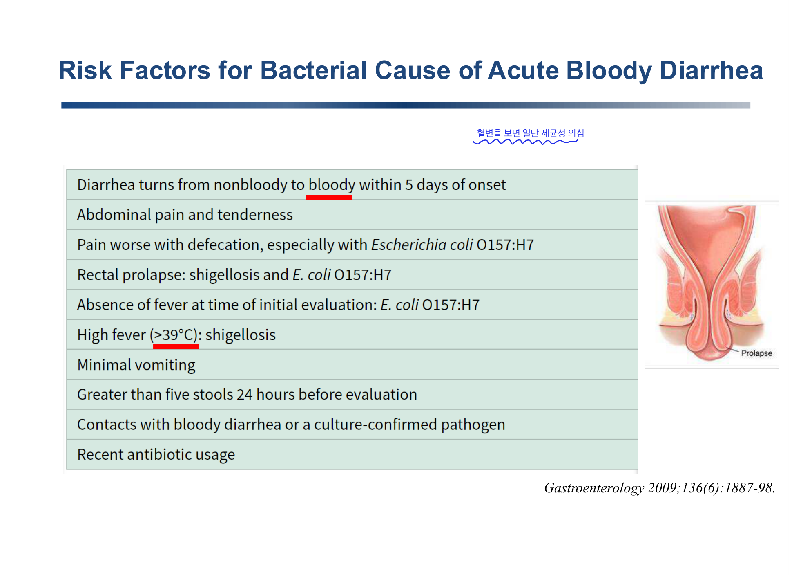{: style="width:70%"}

    **혈변을 보면 일단 세균성 의심.** 발병 5일 안에 물설사 → 혈변으로 바뀜 · 복통·압통, 배변할 때 심해지는 통증(특히 E. coli O157:H7) · **직장탈출**(세균성 이질, O157:H7) · 처음 진찰할 때 **열이 없음 → E. coli O157:H7** · **39℃ 넘는 고열 → 세균성 이질** · 구토는 적음, 진찰 전 24시간에 5번 넘는 배변 · 혈변 환자·배양 확인 환자와의 접촉, 최근 항생제 사용.

    작년 필기본 2쪽의 손글씨 요약(세균 → 장결장염(염증성): Salmonella, Shigella, EIEC, EHEC, V. parahaemolyticus, Yersinia, Campylobacter, 아메바, C. difficile — ESR·CRP·calprotectin↑ / 바이러스 → 주로 **구토** → 비염증성: rotavirus, norovirus, adenovirus, astrovirus — 수치 정상)도 올해는 없지만 위 표와 같은 내용이다.

# 2. Campylobacter와 Yersinia

## 닭과 계란 — Campylobacter·Salmonella는 새의 정상균

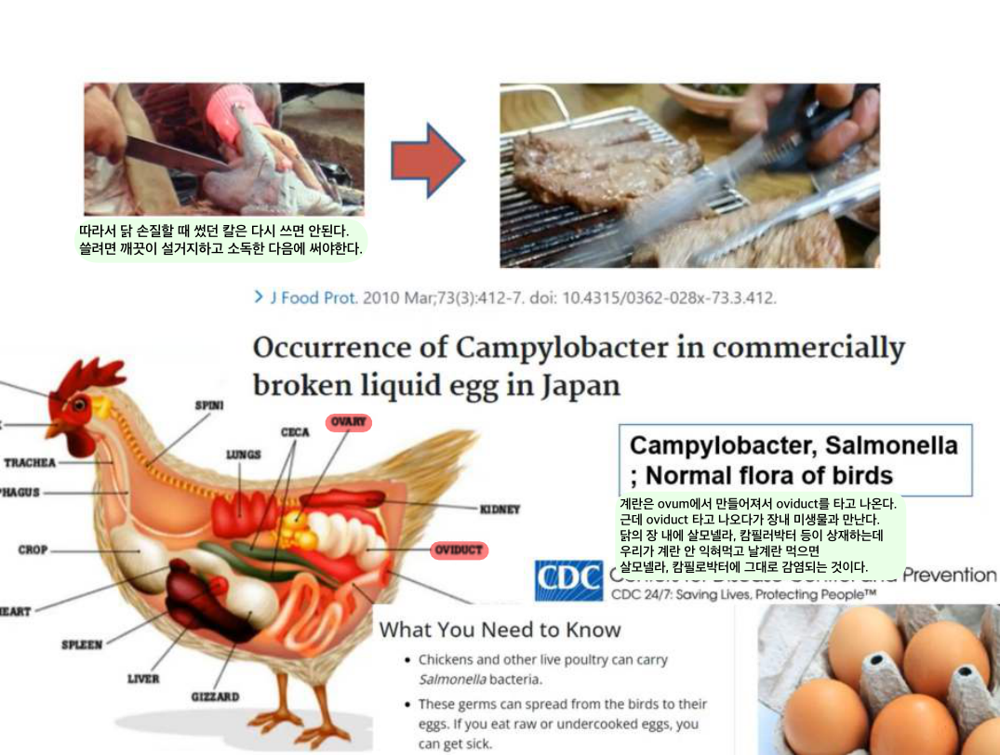{: style="width:70%"}

- **Campylobacter, Salmonella = 새(조류)의 정상 세균총(normal flora of birds)**. 닭 장 안에 늘 산다.
- **계란이 오염되는 이유**(필기): 계란은 **난소(ovary)의 ovum**에서 만들어져 **난관(oviduct)** 을 타고 나오는데, 나오다가 **장내 미생물과 만난다**(새는 장·생식관·요로가 총배설강 하나로 모인다). 그래서 **껍데기**에 살모넬라·캄필로박터가 묻어 나온다 → **날계란·덜 익힌 계란**을 먹으면 그대로 감염된다. 일본 논문 제목 "시판 깨진 액란에서 Campylobacter 검출"(J Food Prot 2010)과 CDC 안내문("닭·가금류는 Salmonella를 가지고 있고, 계란으로 옮길 수 있다. 날계란·덜 익힌 계란을 먹으면 병에 걸린다")이 근거로 붙어 있다.
- **교차 오염**(왼쪽 위 사진 → 고기 굽는 가위): 필기 "**닭 손질할 때 썼던 칼은 다시 쓰면 안 된다.** 쓰려면 깨끗이 설거지하고 소독한 다음에 써야 한다." 고기는 익혀도 생닭을 자른 칼·도마·가위로 다른 음식을 만지면 균이 옮는다.

## Campylobacter vs Yersinia — 냉장고에서도 산다

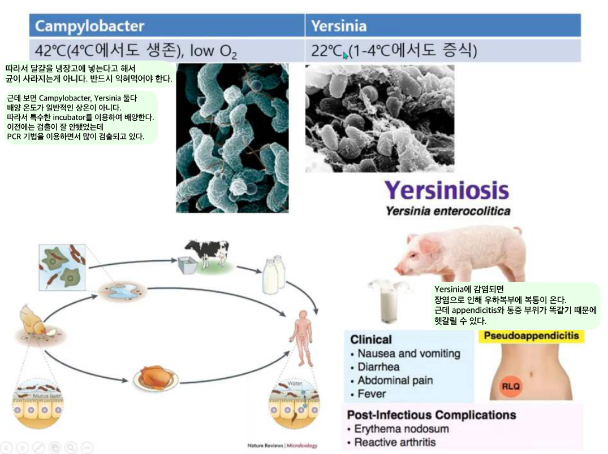{: style="width:84%"}

| | Campylobacter | Yersinia (enterocolitica) |
|---|---|---|
| 배양 조건 | **42℃, 낮은 산소(low O2, 미호기성)** | **22℃** |
| 냉장 온도 | **4℃에서도 생존** | **1–4℃에서도 증식**(살아남는 것을 넘어 자란다) |
| 숙주·전파 | 닭·가금류(그림 왼쪽 순환: 닭 → 고기·우유·물 → 사람) | **돼지**, 우유, (국내) 들쥐·족제비 배설물 → 약수 |
| 임상 | 염증성 설사 | 구역·구토, 설사, 복통, 발열 + **가성 충수염(pseudoappendicitis, RLQ 통증)** |
| 감염 후 합병증 | 길랭-바레, 반응성 관절염 | **결절홍반(erythema nodosum), 반응성 관절염** |

- 필기: "따라서 **달걀을 냉장고에 넣는다고 해서 균이 사라지는 게 아니다. 반드시 익혀 먹어야 한다.**"
- 필기: "Campylobacter, Yersinia 둘 다 **배양 온도가 일반적인 상온(일반 배지 36℃)이 아니다.** 따라서 특수한 incubator를 이용하여 배양한다. 이전에는 검출이 잘 안 됐었는데 **PCR 기법을 이용하면서 많이 검출**되고 있다." — 예전엔 병원 일반 배양에서 놓쳤던 균이라, PCR이 보급되면서 Campylobacter 유병률이 '늘어난 것처럼' 보인다.
- 필기(Yersinia): "장염으로 인해 **우하복부에 복통**이 온다. 근데 **appendicitis와 통증 부위가 똑같기 때문에** 헷갈릴 수 있다."
- **헷갈리는 것**: 둘 다 냉장고에서 살지만, **Campylobacter는 '생존'**(자라지는 못함, 42℃를 좋아함), **Yersinia는 '증식'**(저온균이라 냉장고에서 오히려 늘어남). 숫자 짝: Campylobacter **42℃·4℃**, Yersinia **22℃·1–4℃**.

!!! exam "기출 포인트"
    - 2부 3번(2024, 주관식): "냉장고에서도 생존, 일반 배지에서 배양 X, 조류 위장의 상재균, cephalosporin에 듣지 않음" → **Campylobacter**.
    - 2부 5번(2023): 닭요리·날계란 후 40℃ 고열·혈변·점액변 → 함정 보기 "**냉장고에 넣어둔 닭고기에는 균이 없으므로 안전하다**" X, "배양에서 안 나오면 세균성 배제" X(일반 배지에서 안 자란다), "대부분 바이러스성" X.

## Campylobacter

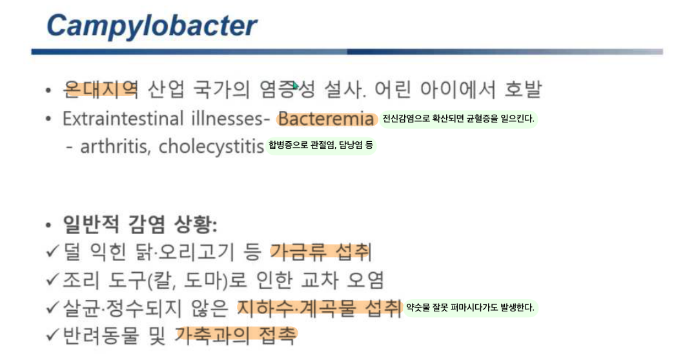{: style="width:74%"}

- **온대 지역 산업 국가의 염증성 설사**. **어린아이에서 호발**.
- **장관 외 질환(extraintestinal illnesses)**: **균혈증(bacteremia)** — 필기 "전신감염으로 확산되면 균혈증을 일으킨다"(드물고, 주로 영아·면역저하자). 합병증으로 **관절염, 담낭염(cholecystitis)**.

!!! new "올해 필기에서 추가 — 일반적 감염 상황"
    올해 슬라이드에 감염 경로 네 가지가 새로 정리됐다(형광펜).

    1. 덜 익힌 닭·오리고기 등 **가금류 섭취**
    2. 조리 도구(칼, 도마)로 인한 **교차 오염**
    3. 살균·정수되지 않은 **지하수·계곡물 섭취** — 필기 "약숫물 잘못 퍼마시다가도 발생한다"
    4. 반려동물 및 **가축과의 접촉**

!!! diff "작년 필기와 다른 점"
    작년 Campylobacter 슬라이드에는 "회복기에 길랭-바레(신경에 생기는 후유증)·HUS·반응성 관절염", "지사제 사용 시 독성 거대결장·위막성 대장염·대장 출혈"이 같은 쪽에 있었다. 올해는 이 내용이 **따로 「Cx Campylobacter」 쪽**(아래)으로 옮겨졌고, 그 자리에 위의 '일반적 감염 상황'이 들어왔다. 작년 손글씨 "전 세계 소아 세균성 설사의 상당 부분이 Campylobacter"는 올해 없다.

!!! exam "기출 포인트"
    2부 2번(2025): Campylobacter jejuni — 옳은 것 = **급성 대장염이 심하면 IBD와 비슷한 소견**. 함정: "독소 생성만으로 설사, 점막 침습 X"(X — 침습성), "소장만 침범"(X — 대장도), "**균혈증은 소아에서 흔하고 전형적**"(X — 드묾), "회복기 신경 합병증 = 다발성 경화증"(X → **길랭-바레**).

## 나가시 소멘 집단 감염 (2023, 일본)

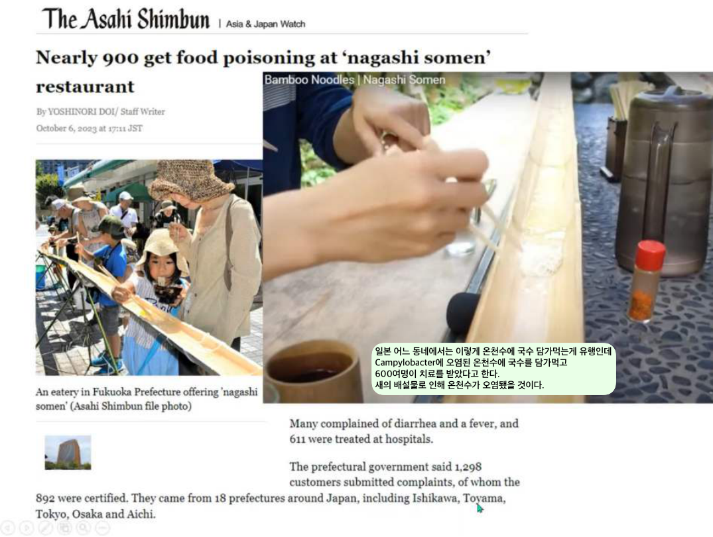{: style="width:62%"}

- 대나무 홈통에 흐르는 물로 국수를 흘려보내 건져 먹는 **나가시 소멘(流しそうめん)** 식당(후쿠오카)에서 약 900명(1,298명 신고, **892명 확인**, **611명 병원 치료**)이 설사·발열을 겪었다(Asahi Shimbun, 2023.10.6).
- 필기: "Campylobacter에 오염된 물에 국수를 담가 먹고 600여 명이 치료를 받았다. **새의 배설물**로 인해 물이 오염됐을 것이다." → 위의 감염 경로 ③(정수되지 않은 지하수·계곡물)의 실제 예.

※ 확인 필요: 올해 필기는 "온천수"라고 적었는데, 나가시 소멘은 보통 **샘물·지하수(용수)** 를 흘려 쓴다. 요점은 "정수되지 않은 물 + 새 배설물 → Campylobacter"이다.

## FilmArray 위장관 패널 — PCR로 한 번에

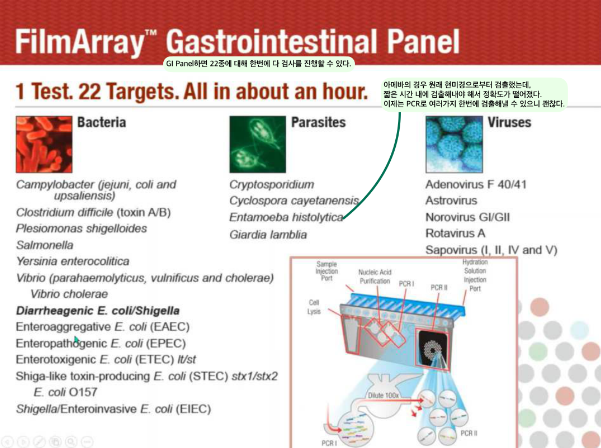{: style="width:80%"}

- **1 Test. 22 Targets. All in about an hour.** — 대변 한 번으로 **22종**(세균·기생충·바이러스)을 약 1시간 만에. 다중 **nested PCR**(PCR I → PCR II, 그림 아래 카트리지).
    - 세균: **Campylobacter(jejuni, coli, upsaliensis), C. difficile(toxin A/B)**, Plesiomonas, Salmonella, **Yersinia enterocolitica**, Vibrio(parahaemolyticus, vulnificus, cholerae), 설사 유발 대장균·Shigella(**EAEC, EPEC, ETEC lt/st, STEC stx1/stx2, E. coli O157, Shigella/EIEC**)
    - 기생충: Cryptosporidium, Cyclospora, **Entamoeba histolytica**, Giardia
    - 바이러스: Adenovirus F 40/41, Astrovirus, Norovirus GI/GII, **Rotavirus A**, Sapovirus
- 필기: "**아메바의 경우 원래 현미경으로 검출**했는데, **짧은 시간 내에 검출해내야 해서 정확도가 떨어졌다.** 이제는 PCR로 여러 가지 한 번에 검출해낼 수 있으니 괜찮다." — 아메바 영양형은 대변이 식으면 금방 움직임을 잃고 망가져 현미경으로 놓치기 쉽다.
- **헷갈리는 것**: PCR은 **유전자가 있다**는 것만 알려 준다. 살아 있는 균인지, 독소를 실제로 만드는지, 그 균이 지금 설사의 원인인지는 따로 판단해야 한다(예: 작년 강의의 C. difficile — 6단원).

!!! diff "작년 필기와 다른 점"
    작년 필기에는 이 쪽에 "Campylobacter·Yersinia는 일반 36℃ 배지에서 자라지 않아 예전에는 병원 단위에서 검출을 못 했다 → nested PCR로 세균과 아메바까지 한꺼번에 검사 → **검출되니까 Campylobacter의 유병률이 증가**"라고 적혀 있었다. 올해는 같은 이야기가 11쪽(위 Campylobacter vs Yersinia)으로 옮겨 갔다.

## 세균 항원과 HLA-B27의 교차반응 — 반응성 관절염의 기전

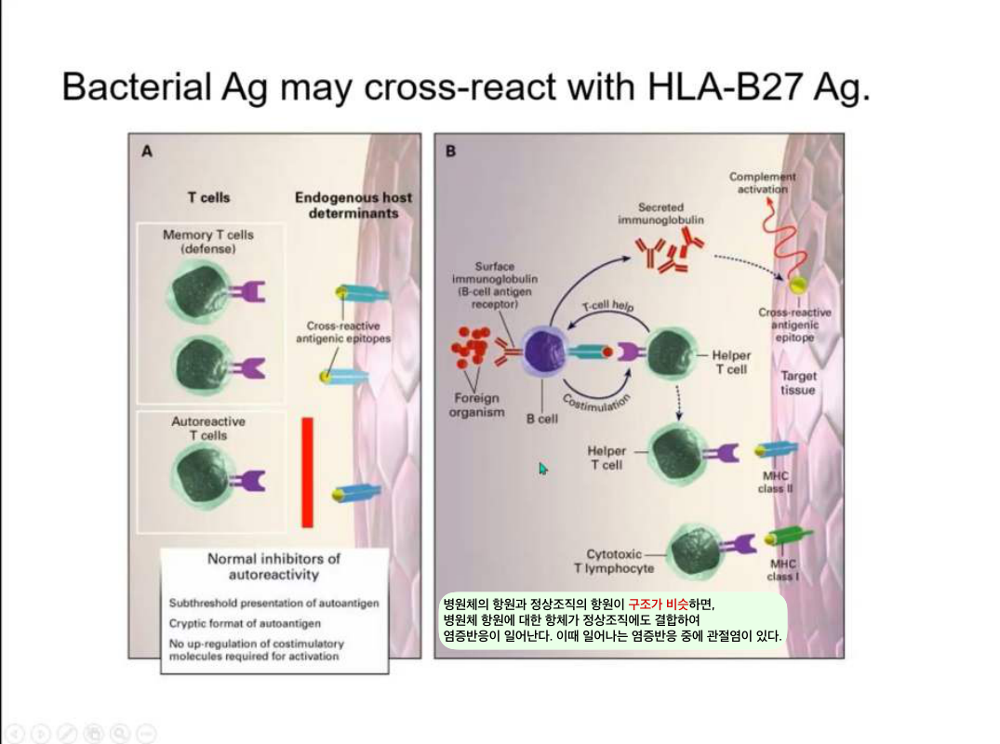{: style="width:70%"}

- **분자 모방(molecular mimicry)**: 필기 "병원체의 항원과 정상조직의 항원이 **구조가 비슷하면**, 병원체 항원에 대한 항체가 정상조직에도 결합하여 염증반응이 일어난다. 이때 일어나는 염증반응 중에 **관절염**이 있다."
- 그림 A: 평소엔 자기 항원에 반응하는 T세포(autoreactive T cell)가 있어도 억제 장치(자기 항원을 약하게 제시, 숨은 형태, 보조자극 분자 없음) 때문에 가만히 있다.
- 그림 B: 세균(foreign organism)이 들어오면 B세포·도움 T세포가 활성화되고, 만들어진 **항체**와 **세포독성 T세포**가 **세균 항원과 닮은 자기 조직의 epitope(cross-reactive epitope)** 까지 공격 → 보체 활성화·염증 → 관절염, 피부 병변.
- **HLA-B27**을 가진 사람은 이런 교차반응이 잘 생겨 **반응성 관절염**이 흔하다(MHC class I 분자가 세균 펩타이드를 제시).

!!! diff "작년 필기와 다른 점"
    작년에는 이 그림 뒤에 "유전 소인(HLA class I B27, class II DR, DW) + **유발 감염(Chlamydia, Yersinia, Salmonella, Shigella, Campylobacter, 바이러스)** → 비정상 면역반응 → 질환. 관련 요인(유전, 미생물총, 면역, 환경)이 많아 **사람마다 경과가 다르다**"라는 쪽이 있었다. 올해 필기에는 없다.

## Campylobacter 합병증 (Cx)

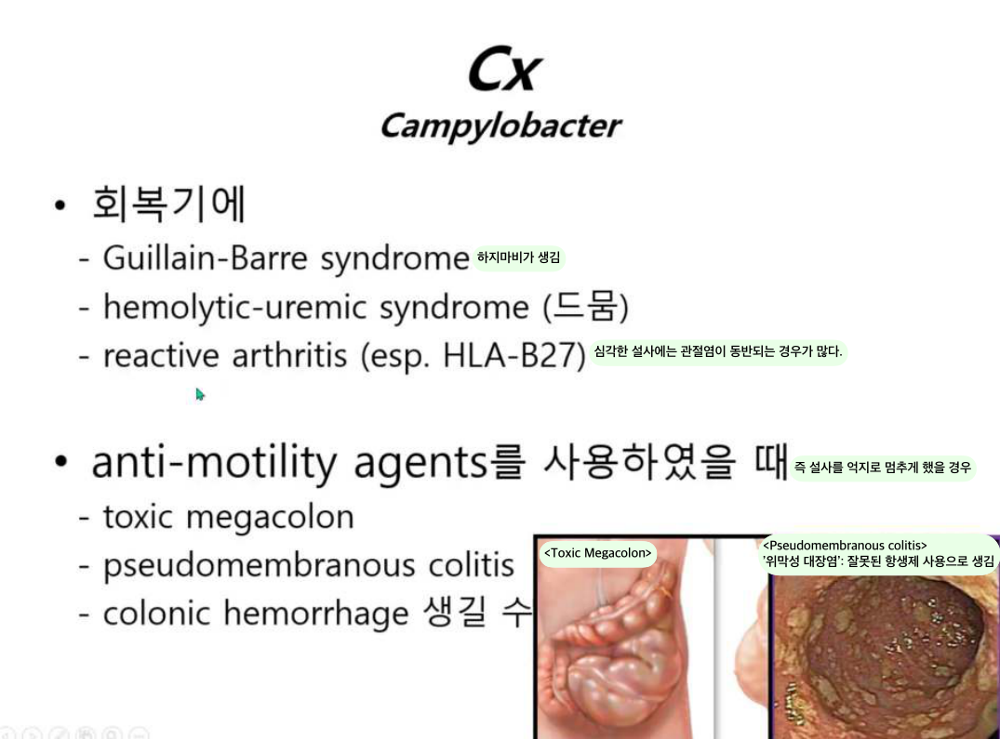{: style="width:76%"}

### 회복기에 (설사가 나은 뒤 1–3주)
- **길랭-바레 증후군(Guillain-Barré syndrome)** — 필기 "**하지마비가 생김**". C. jejuni의 지질올리고당이 말초신경의 강글리오사이드(GM1 등)와 닮아서 생기는 **분자 모방** 자가면역 신경병증이다. 다리부터 올라오는 대칭성 근력 약화.
- **용혈요독증후군(HUS)** — 올해 슬라이드에 **"(드묾)"** 이 붙었다.
- **반응성 관절염(reactive arthritis), 특히 HLA-B27** — 필기 "심각한 설사에는 관절염이 동반되는 경우가 많다."

### 지사제(장운동 억제제, anti-motility agents)를 썼을 때
필기: "즉 **설사를 억지로 멈추게 했을 경우**"

- **독성 거대결장(toxic megacolon)** — 대장이 크게 늘어나 마비되고 천공 위험
- **위막성 대장염(pseudomembranous colitis)** — 필기 "'위막성 대장염': 잘못된 항생제 사용으로 생김"
- **대장 출혈(colonic hemorrhage)**

**왜**: 설사는 균과 독소를 밖으로 내보내는 방어 작용이다. 침습성 세균 장염에 지사제를 쓰면 균·독소가 장 안에 고여 염증이 깊어진다 → **염증성(혈변) 설사에는 지사제를 쓰지 않는다**(STEC에서도 지사제 금기 — 3단원).

※ 확인 필요: 사진 설명 "위막성 대장염: 잘못된 항생제 사용으로 생김"은 위막성 대장염의 일반 원인(항생제 → C. difficile 과증식)을 적은 것이다. 이 쪽의 맥락은 "지사제를 쓰면 이런 합병증이 생길 수 있다"이다.

!!! diff "작년 필기와 다른 점"
    - 작년 합병증 목록에는 **Reiter 증후군**이 따로 있었고, 올해 Campylobacter 목록에서는 빠졌다(Reiter 증후군은 올해 '장관 외 증상' 쪽 그림으로 나온다).
    - HUS에 "(드묾)"은 올해 새로 붙었다.
    - 작년 손글씨: 지사제 → "장운동 감소 → 세균·독소가 배출되지 않음 → toxic megacolon 등 발생".

!!! exam "기출 포인트"
    - 2부 5번(2023): 옳은 것 = **치료를 조기에 하지 않으면 관절염이 생기기도 한다**(반응성 관절염).
    - 2부 2번(2025): "회복기 신경 합병증 = 다발성 경화증" → X, **길랭-바레**. 작년 필기 퀴즈도 "Campylobacter 장염 회복기에 길랭-바레 같은 자가면역성 신경계 합병증이 생길 수 있다" → **O**.

!!! diff "작년 필기와 다른 점 — Campylobacter 항생제 내성(올해 없음)"
    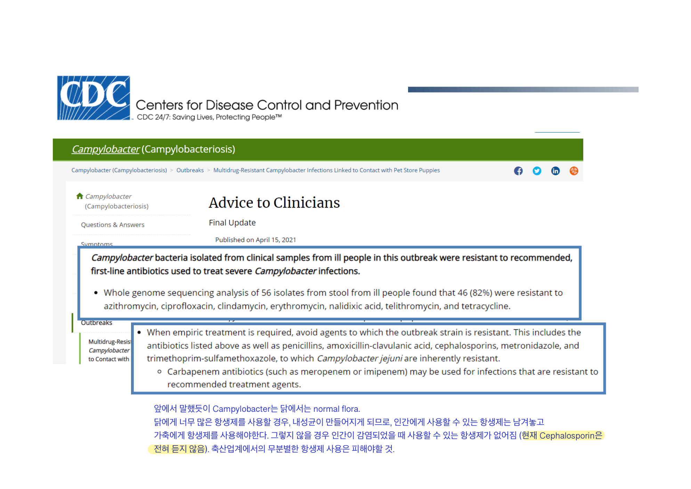{: style="width:64%"}

    - CDC(2021, 애완견 관련 다제내성 Campylobacter 유행): 환자 분리주 56개 중 **46개(82%)** 가 azithromycin, ciprofloxacin, clindamycin, erythromycin, nalidixic acid, telithromycin, tetracycline에 내성.
    - **C. jejuni는 penicillin, amoxicillin-clavulanate, cephalosporin, metronidazole, TMP-SMX에 본래(inherently) 내성** → 작년 필기 "**현재 cephalosporin은 전혀 듣지 않음**".
    - 작년 필기: 닭에게 항생제를 너무 많이 쓰면 내성균이 생긴다 → 사람에게 쓸 항생제는 남겨 두고 가축에 써야 한다. 축산업의 무분별한 항생제 사용은 피해야 한다.
    - 2부 3번(2024) "cephalosporin에 듣지 않는 세균"이 바로 이 내용이다.

## 용혈요독증후군 (HUS, Hemolytic-uremic syndrome)

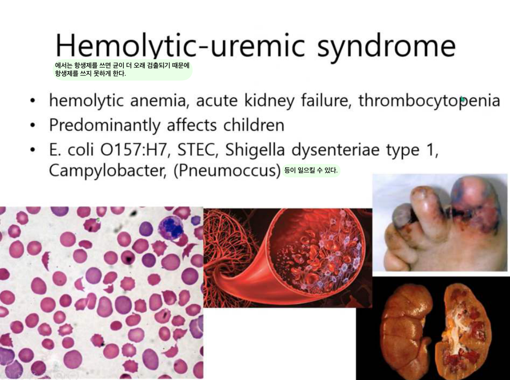{: style="width:70%"}

- 세 가지: **용혈빈혈(hemolytic anemia) + 급성 신부전(acute kidney failure) + 혈소판감소(thrombocytopenia)**.
- **주로 소아**에게 생긴다.
- 원인: **E. coli O157:H7, STEC(시가독소 생성 대장균), Shigella dysenteriae type 1, Campylobacter, (폐렴알균)** — 필기 "등이 일으킬 수 있다".
- 사진: 말초혈액의 **분열적혈구(schistocyte, 깨진 적혈구)**, 작은 혈관 안 미세혈전, 손발 끝 괴사, 신장 피질 괴사.
- **기전**: 시가독소가 혈관 내피(특히 신장 사구체)를 손상 → 미세혈관에 혈소판 혈전(혈소판 소모 → 감소) → 좁아진 혈관을 지나던 적혈구가 깨짐(용혈) → 신장 혈류가 막혀 급성 신손상.
- 필기(제목 옆): "(STEC)에서는 **항생제를 쓰면 균이 더 오래 검출되기 때문에 항생제를 쓰지 못하게 한다.**" — 항생제로 균이 죽으면서 **시가독소가 한꺼번에 쏟아져** HUS 위험이 커지고, 배출 기간도 길어진다(3단원 '항생제 금기').

!!! diff "작년 필기와 다른 점"
    작년 슬라이드는 원인균을 "Shigella"로만 적었는데 올해는 **Shigella dysenteriae type 1**(시가독소를 만드는 형)로 구체화됐다.

## Yersinia enterocolitica

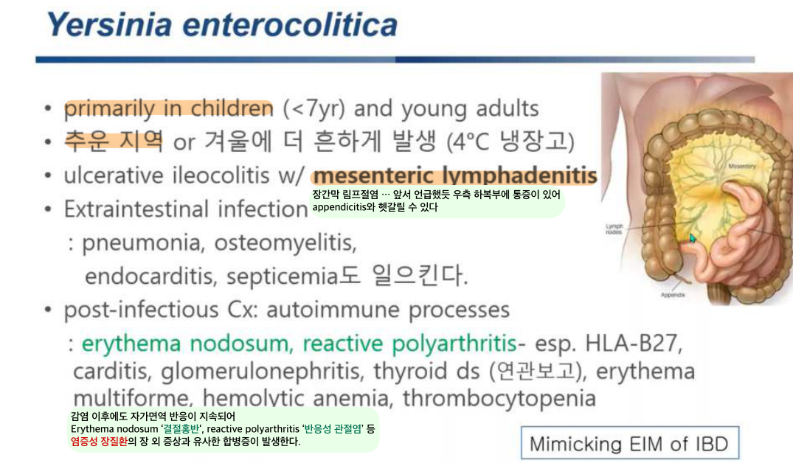{: style="width:76%"}

- **주로 소아(< 7세)와 젊은 성인**.
- **추운 지역이나 겨울에 더 흔하다(4℃ 냉장고)** — 저온에서 자라는 균이라서.
- **궤양성 회결장염 + 장간막 림프절염(mesenteric lymphadenitis)** — 필기 "앞서 언급했듯 **우측 하복부에 통증**이 있어 appendicitis와 헷갈릴 수 있다". 그림 오른쪽: 맹장·충수 주변 장간막 림프절.
- **장관 외 감염**: 폐렴, 골수염, 심내막염, 패혈증(septicemia)도 일으킨다.
- **감염 후 합병증 = 자가면역 과정(autoimmune processes)**:
    - **결절홍반(erythema nodosum), 반응성 다발관절염(reactive polyarthritis) — 특히 HLA-B27**
    - 심염(carditis), 사구체신염, **갑상선 질환(연관 보고)**, 다형홍반(erythema multiforme), 용혈빈혈, 혈소판감소
- 필기: "감염 이후에도 자가면역 반응이 지속되어 결절홍반, 반응성 관절염 등 **염증성 장질환의 장 외 증상과 유사한 합병증**이 발생한다." → 슬라이드 상자 **"Mimicking EIM of IBD"**(IBD의 장관 외 증상을 흉내 냄). 회결장염 + 결절홍반 + 관절염이면 **크론병처럼 보이므로** 대장내시경·진단 때 오진하지 않도록 주의.

!!! diff "작년 필기와 다른 점"
    작년에는 갑상선 질환을 **Graves병, 하시모토 갑상선염**으로 적었고(그리고 Reiter 증후군 포함), 올해는 "**thyroid ds (연관 보고)**"로 묶었다.

!!! diff "작년 필기와 다른 점 — Yersinia pseudotuberculosis(올해 없음)"
    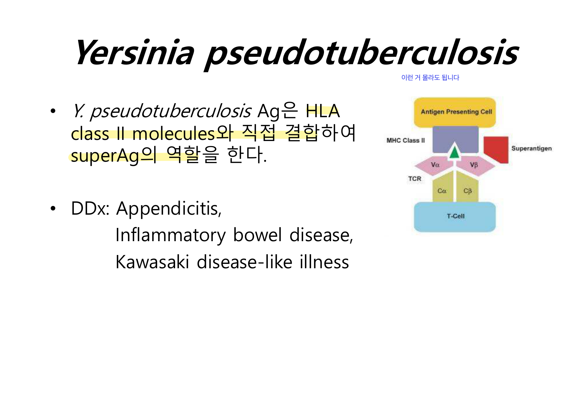{: style="width:56%"}

    작년 교수님이 "**이런 거 몰라도 됩니다**"라고 한 쪽. Y. pseudotuberculosis 항원은 HLA class II 분자와 직접 결합해 **초항원(superantigen)** 처럼 작용한다 → 충수염, IBD, **가와사키병 비슷한 질환**과 감별해야 한다.

## 약수터 여시니아 (국내 사례)

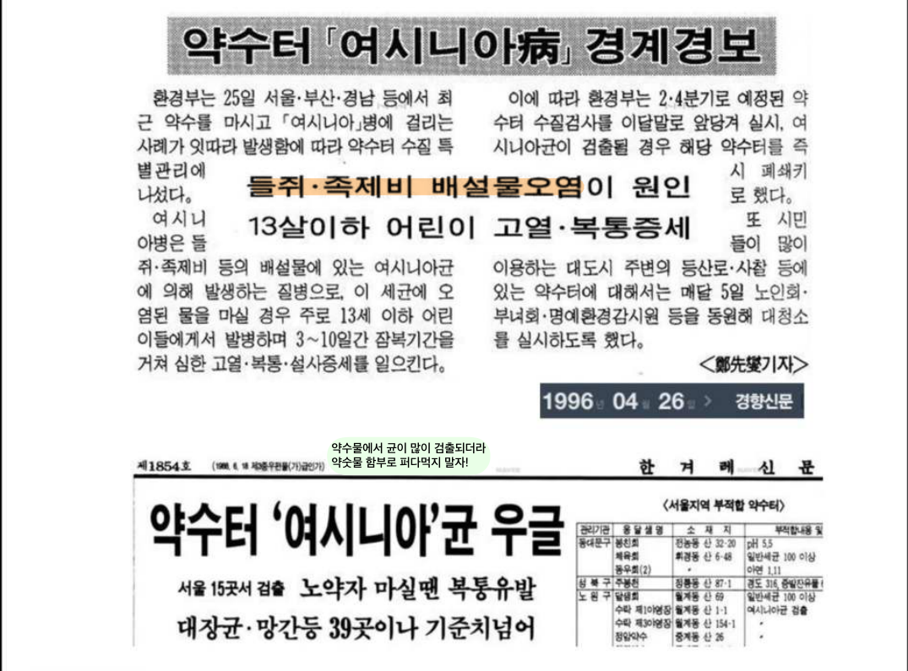{: style="width:62%"}

- 1996년 경향신문 「약수터 『여시니아病』 경계경보」: **들쥐·족제비 배설물 오염**이 원인, **13세 이하 어린이** 고열·복통 증세, 3–10일 잠복기 후 심한 고열·복통·설사. 환경부가 약수터 수질검사를 앞당기고 균이 나오면 즉시 폐쇄.
- 한겨레 「약수터 '여시니아'균 우글」: 서울 15곳에서 검출, 대장균·망간 등 39곳이 기준치 초과.
- 필기: "약숫물에서 균이 많이 검출되더라. **약숫물 함부로 퍼다 먹지 말자!**"

## 장염 뒤 장중첩증 (Intussusception)

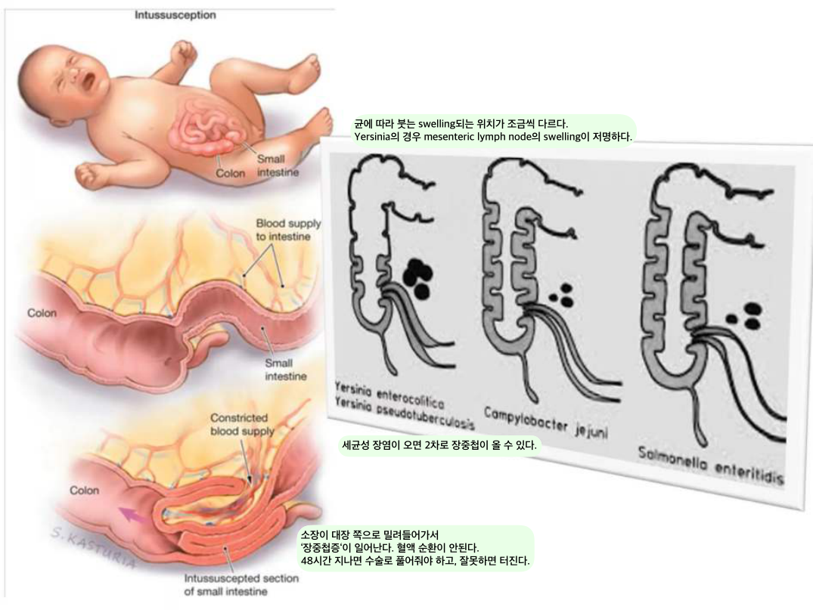{: style="width:76%"}

- 필기: "**소장이 대장 쪽으로 밀려 들어가서** '장중첩증'이 일어난다. **혈액 순환이 안 된다.** **48시간 지나면 수술로 풀어줘야 하고, 잘못하면 터진다.**"
    - 왼쪽 그림: 소장 끝(회장)이 대장(결장) 안으로 망원경처럼 접혀 들어가고(intussuscepted section), 함께 끌려 들어간 장간막 혈관이 눌린다(constricted blood supply) → 부종 → 허혈·괴사 → 천공.
- 필기: "**세균성 장염이 오면 2차로 장중첩이 올 수 있다.** 균에 따라 붓는(swelling) 위치가 조금씩 다르다. **Yersinia의 경우 mesenteric lymph node의 swelling이 저명하다.**"
    - 오른쪽 그림: 같은 회맹부지만 Yersinia(크게) > Campylobacter > Salmonella 순으로 림프절이 다른 모양으로 붓는다. 부은 림프조직이 **선두점(lead point)** 이 되어 장운동 때 소장이 대장으로 끌려 들어간다.
- **임상에서**: 장염을 앓던 아이가 **간헐적으로 심하게 보채거나 다리를 끌어당기며 울고(발작성 복통), 구토, 젤리 같은 혈변**을 보이면 장중첩증을 떠올린다. 작년 필기: "소아에서 장염을 앓고 난 후에는 **언제든지** 장중첩증이 생길 수 있다는 것을 알고 있을 것. **장염만 치료하다가 놓치면 안 됨.**"
- **헷갈리는 것**: 장염의 혈변(설사 + 피)과 장중첩증의 혈변(딸기잼 같은 점액 혈변 + 발작성 복통, 설사는 오히려 줄 수 있음)은 다르다. 로타 백신 금기에도 **장중첩증 병력**이 나온다(5단원).

!!! new "올해 필기에서 추가"
    "**48시간이 지나면 수술**로 풀어 줘야 하고 잘못하면 터진다" — 올해 새로 적힌 말이다. 일찍 발견하면 공기·조영제 관장으로 풀 수 있지만, 시간이 지나 장이 괴사하면 수술이 필요하다는 뜻.

## 장관 외 증상 (Extraintestinal manifestation)

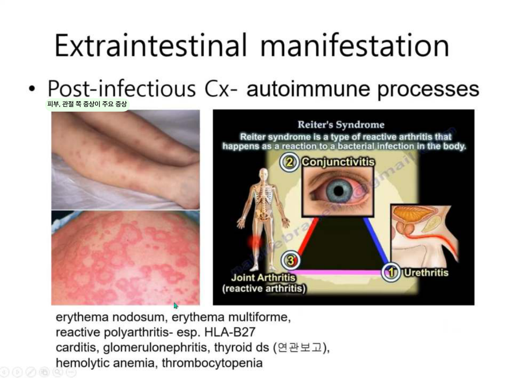{: style="width:70%"}

- **감염 후 합병증 — 자가면역 과정**. 필기: "**피부, 관절 쪽 증상이 주요 증상**".
- 사진 왼쪽: 정강이의 **결절홍반**(위), 몸통의 **다형홍반**(아래, 과녁 모양).
- 사진 오른쪽 **Reiter 증후군** = 세균 감염에 대한 반응으로 생기는 반응성 관절염의 한 형태. 세 가지: ① **요도염(urethritis)** ② **결막염(conjunctivitis)** ③ **관절염(reactive arthritis)** — "소변이 따갑고, 눈이 빨갛고, 무릎이 붓는다(can't pee, can't see, can't climb a tree)".
- 목록: 결절홍반, 다형홍반, 반응성 다발관절염(특히 HLA-B27), 심염, 사구체신염, 갑상선 질환(연관 보고), 용혈빈혈, 혈소판감소.

## 페스트 (Plague) — 여담

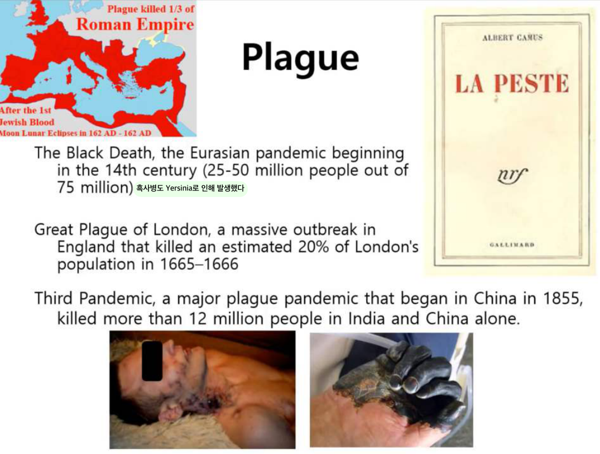{: style="width:58%"}

- 필기: "**흑사병도 Yersinia로 인해 발생했다**" — **Yersinia pestis**(장염을 일으키는 Y. enterocolitica와 같은 속, 다른 종).
- 세 번의 대유행: **14세기 흑사병(Black Death)**(유라시아, 7,500만 중 2,500–5,000만 명 사망), **런던 대역병(1665–1666)**(런던 인구의 20%), **3차 대유행(1855년 중국에서 시작)**(인도·중국에서만 1,200만 명 이상). 로마 제국 지도(1/3 사망), 카뮈의 소설 『페스트(La Peste)』, 림프절이 붓고(가래톳) 손가락이 까맣게 괴사한 사진.
- 전파(23쪽): ① **쥐**가 균을 가지고 있다 → ② **벼룩**이 쥐의 피를 빤다 → ③ 균이 벼룩 배 속에서 증식 → ④ 벼룩이 사람을 문다 → ⑤ 사람이 감염. 필기: "쥐를 문 벼룩이 사람을 물면서 감염이 일어난다. 서양인들이 쥐 혐오하는 게 흑사병 때문이 아닐까…" (Journal of Geek Studies "드라큘라가 정말 페스트를 옮겼나?" 기사 사진도 있다.)
- 시험보다는 이야기용 쪽이다. 같은 Yersinia 속이라는 것만 기억.

# 3. 진단과 항생제 치료

## 급성 감염성 설사의 진단 접근

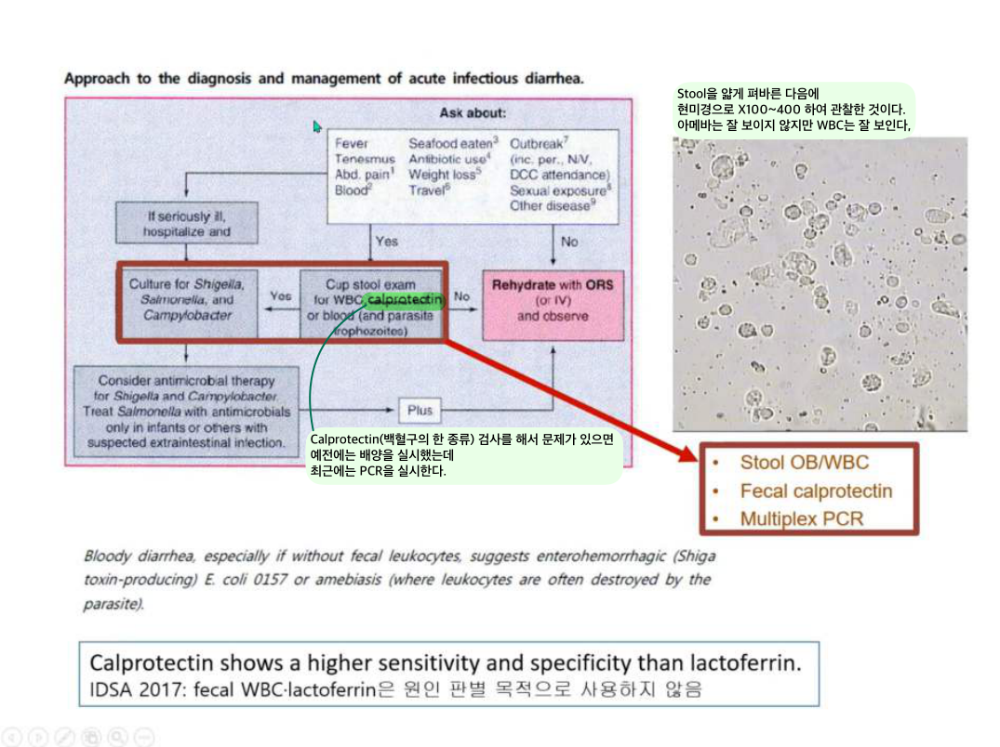{: style="width:84%"}

### 흐름도 읽기
1. **물어볼 것(Ask about)**: 발열, 뒤무직(tenesmus), 복통, 혈변 / 해산물 섭취, 항생제 사용, 체중 감소, 여행 / 집단 발생(어린이집 등), 성 접촉, 다른 질환.
2. **심하게 아프면(seriously ill) → 입원**.
3. 위 항목이 **있으면(Yes)** → **대변 검사: 백혈구(WBC)·calprotectin, 혈액, (기생충 영양형 trophozoite)**
    - 양성 → **배양: Shigella, Salmonella, Campylobacter** → **항균제 고려: Shigella, Campylobacter. Salmonella는 영아나 장관 외 감염이 의심될 때만 치료.**
    - 음성 → 수분 보충으로.
4. 위 항목이 **없으면(No)** → **ORS로 수분 보충(필요하면 정맥 수액)하고 관찰**.

- 빨간 상자로 묶은 "검사 단계"를 요즘 쓰는 세 가지로 정리: **대변 잠혈·백혈구(Stool OB/WBC), 대변 calprotectin, 다중 PCR(multiplex PCR)**.
- 필기: "**Calprotectin**(백혈구 안에 있는 단백질) 검사를 해서 문제가 있으면, 예전에는 배양을 실시했는데 **최근에는 PCR**을 실시한다."

※ 확인 필요: 필기는 calprotectin을 "백혈구의 한 종류"라고 적었는데, calprotectin은 **호중구(백혈구) 세포질에 많은 단백질**이다. 장에 호중구가 몰려오면 대변으로 나와 수치가 오른다 → 장 염증의 지표.

### 대변 현미경 (오른쪽 사진)
!!! new "올해 필기에서 추가"
    필기: "Stool을 얇게 펴 바른 다음에 현미경으로 ×100–400 하여 관찰한 것이다. **아메바는 잘 보이지 않지만 WBC는 잘 보인다.**" — 사진의 동그란 세포들이 대변 백혈구. 대변 백혈구가 많으면 염증성(침습성) 설사.

### 혈변인데 백혈구가 없으면
- 슬라이드: "**혈변, 특히 대변 백혈구가 없으면** → **장출혈성(시가독소 생성) E. coli O157** 또는 **아메바증**(기생충이 백혈구를 파괴한다)을 시사한다."
- **왜**: EHEC는 점막을 직접 파고들기보다 독소로 혈관을 망가뜨려 피가 나므로 백혈구가 적고, 아메바는 백혈구를 녹여 버린다.

### Calprotectin vs lactoferrin
- **Calprotectin이 lactoferrin보다 민감도·특이도가 높다.**
- **IDSA 2017**(미국감염학회 지침): **대변 WBC·lactoferrin은 원인(어떤 균인지) 판별 목적으로 사용하지 않는다.** — 염증이 있다는 것은 알려 주지만 어떤 균인지는 못 알려 주기 때문(그래서 배양·PCR이 필요).

!!! exam "기출 포인트"
    2부 1번(2025): 네 상황별 접근 **모두 옳다(⑤)** — ① 38.5℃ 발열·혈변·대변 WBC(+) → 침습성 세균(Campylobacter, Shigella, EHEC, Salmonella) **배양·분자검사** ② 상온 음식 **6시간 이내** 구토·설사, WBC(−) → **S. aureus·B. cereus 독소형 식중독, 특별한 검사 불필요** ③ **2주 이상·체중감소·여행력** → **Giardia·Cryptosporidium** 기생충 검사 ④ **장기 항생제 후** 설사 → **C. difficile toxin EIA + NAAT(PCR)**. 흐름도의 "Ask about" 항목(여행, 항생제, 체중 감소)이 그대로 문제가 됐다.

## 세균성 설사에서 항생제의 효과

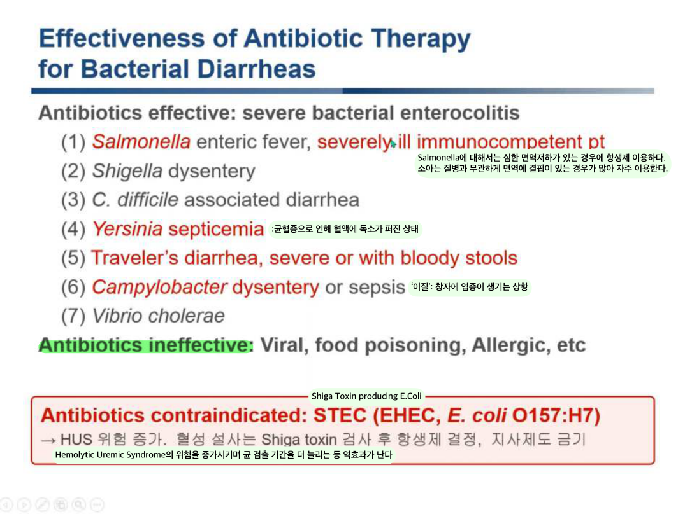{: style="width:80%"}

### 항생제가 효과 있는 경우 — 심한 세균성 장결장염
1. **Salmonella 장티푸스열(enteric fever), 심하게 아픈 면역정상 환자(severely ill immunocompetent pt)**
2. **Shigella 이질(dysentery)**
3. **C. difficile 연관 설사**
4. **Yersinia 패혈증(septicemia)** — 필기 "균혈증으로 인해 혈액에 독소가 퍼진 상태"
5. **여행자 설사 — 심하거나 혈변**
6. **Campylobacter 이질 또는 패혈증** — 필기 "'이질': 창자에 염증이 생기는 상황"(피·점액이 섞인 설사)
7. **Vibrio cholerae**

### 항생제가 효과 없는 경우
**바이러스, 식중독, 알레르기 등** (형광펜) — 1단원 "식중독 No Abx"와 연결.

- Salmonella에 대한 필기: "Salmonella에 대해서는 심한 면역저하가 있는 경우에 항생제를 이용한다. **소아는 질병과 무관하게 면역에 결핍이 있는 경우가 많아 자주 이용한다.**"
- 정리: 비장티푸스 Salmonella 장염은 대부분 저절로 낫고 항생제가 오히려 **보균 기간을 늘릴 수** 있어 일상적으로 쓰지 않는다. 쓰는 경우 = **장티푸스열, 심하게 아픈 환자, 영아(특히 3개월 미만), 면역저하, 장관 외 감염 의심**(앞 흐름도 "infants or suspected extraintestinal infection").

※ 확인 필요: 슬라이드는 "severely ill **immuno*competent*** pt"(면역이 정상이라도 심하게 아프면)인데 필기는 "심한 **면역저하**가 있는 경우"라고 적었다. 둘 다 항생제 대상이지만, 슬라이드 문구 그대로는 '면역정상이라도 중증이면'이다.

!!! new "올해 필기에서 추가 — 항생제 금기: STEC"
    올해 슬라이드 아래에 빨간 상자가 새로 생겼다.

    **Antibiotics contraindicated: STEC(EHEC, E. coli O157:H7)** — 필기 "Shiga Toxin producing E. coli"

    → **HUS 위험 증가.** **혈성 설사는 Shiga toxin 검사 후 항생제 결정**, **지사제도 금기**.

    필기: "Hemolytic Uremic Syndrome의 위험을 증가시키며 **균 검출 기간을 더 늘리는** 등 역효과가 난다."

    - **왜**: 항생제가 세균을 죽이거나 스트레스를 주면 시가독소 유전자(파지에 실려 있음)가 활성화되고 죽은 균에서 독소가 한꺼번에 나온다 → 혈관 내피 손상 → HUS. 지사제는 독소가 장에 오래 머물게 한다.
    - **임상에서**: 혈변을 보는 아이에게 바로 항생제를 주지 말고 **시가독소(stx1/stx2) 검사**(GI 패널 STEC 항목)부터 — 특히 **열이 없거나 미열인 혈변**이면 STEC를 의심(작년 '혈변 위험인자' 슬라이드).
    - **헷갈리는 것**: Shigella는 항생제 효과 있음(2번), 같은 시가독소를 만드는 **STEC는 금기**.

!!! diff "작년 필기와 다른 점 — 소아 세균성 장염 항생제 표(올해 없음)"
    작년 필기(11쪽)에는 균별 소아 항생제 표가 있었다. 올해 필기에는 없지만 작년 강의 내용이라 남긴다(작년 교수님은 위 '항생제 효과' 목록에 "외울 필요가 없다"고 했다).

    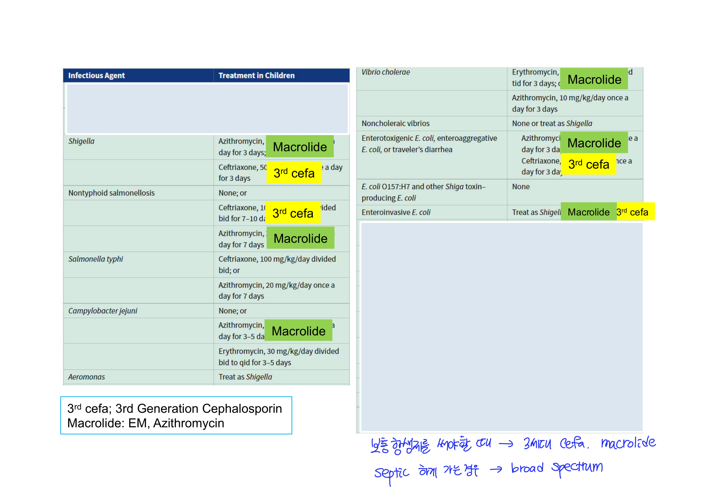{: style="width:86%"}

    | 원인균 | 소아 치료 |
    |---|---|
    | Shigella | Azithromycin 3일 또는 ceftriaxone |
    | 비장티푸스 살모넬라 | **없음**, 또는 ceftriaxone·azithromycin(필요할 때) |
    | Salmonella typhi | Ceftriaxone 또는 azithromycin |
    | Campylobacter jejuni | **없음**, 또는 azithromycin·erythromycin(마크롤라이드) |
    | V. cholerae | Erythromycin·azithromycin |
    | ETEC·여행자 설사 | Azithromycin 또는 ceftriaxone |
    | **EHEC(O157:H7, 시가독소 생성)** | **없음**(항생제 X — HUS 위험) |
    | 침습성 E. coli, Aeromonas | Shigella처럼 |

    큰 틀: 쓸 때는 **3세대 세팔로스포린(ceftriaxone)** 또는 **마크롤라이드(azithromycin, erythromycin)** — 단 **Campylobacter는 cephalosporin 내성이라 마크롤라이드**.

# 4. 만성 설사

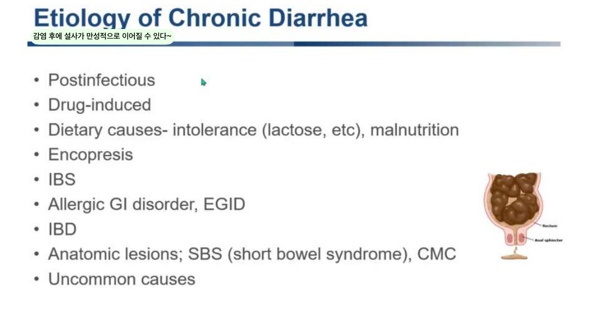{: style="width:66%"}

필기: "**감염 후에 설사가 만성적으로 이어질 수 있다~**" — 급성 장염이 2주 넘게 이어지면 아래 원인을 생각한다.

| 원인 | 설명 |
|---|---|
| **감염 후(postinfectious)** | 장염으로 점막이 손상된 뒤 이차적 유당불내성·우유 단백 과민이 생겨 설사가 이어짐 — 5단원 '분유 불내성의 악순환' |
| 약물(drug-induced) | 항생제 등 |
| 식이(dietary) | **불내성(유당 등)**, 영양실조 |
| 유분증(encopresis) | 변비로 딱딱한 변이 직장에 차 있고 그 옆으로 묽은 변이 새어 나와 설사처럼 보임(오른쪽 그림) |
| **IBS** | 과민성 장증후군 — 염증 없음 |
| 알레르기성 위장관 질환, **EGID**(호산구성 위장관 질환) | |
| **IBD** | 염증성 장질환 — 실제 염증 |
| 해부학적 병변 | **SBS(단장증후군)** 등 |
| 드문 원인 | |

!!! diff "작년 필기와 다른 점"
    작년 슬라이드는 "Allergic GI disorder, **EoGE**(호산구성 위장염)"였고 올해는 "**EGID**(eosinophilic gastrointestinal disorders, 호산구성 위장관 질환 전체)"로 넓은 이름을 썼다.

!!! exam "기출 포인트"
    2부 8번(2022): 생후 4개월, 로타 장염 후 물설사 **2주 지속** = 감염 후 만성 설사 → 답은 **완전가수분해분유나 아미노산 분유 시도**(5단원에서 이유).

# 5. 로타바이러스 (Rotavirus)

## 로타바이러스는 어떤 병인가

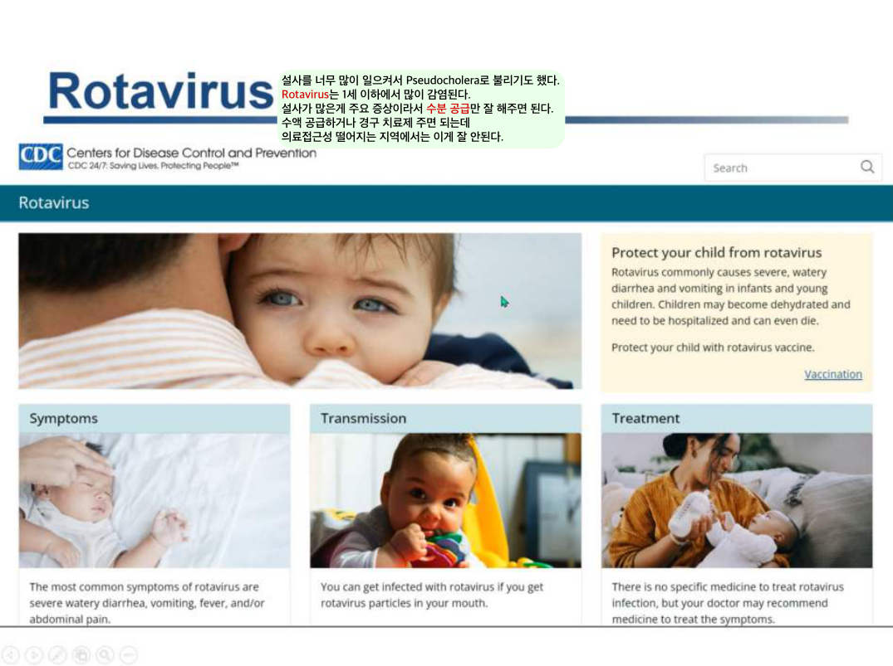{: style="width:66%"}

- CDC: 영아·어린 소아에게 **심한 물설사와 구토**를 일으키고, 탈수로 입원하거나 사망할 수도 있다. **증상**: 심한 물설사, 구토, 발열, 복통 / **전파**: 바이러스 입자가 입으로 들어가면 감염 / **치료**: 로타바이러스에 대한 특정한 약은 없고 증상 치료 / **백신으로 예방**.
- 필기:
    - "설사를 너무 많이 일으켜서 **Pseudocholera(가성 콜레라)** 로 불리기도 했다." — 콜레라처럼 쌀뜨물 같은 물설사를 엄청나게 한다는 뜻.
    - "**Rotavirus는 1세 이하에서 많이 감염된다.**"
    - "설사가 많은 게 주요 증상이라서 **수분 공급만 잘 해주면 된다.** 수액 공급하거나 경구 치료제(ORS) 주면 되는데, **의료 접근성이 떨어지는 지역에서는 이게 잘 안 된다.**" → 그래서 전 세계 영아 사망의 큰 원인이고 백신이 중요하다.
- 기출 문제 지문이 말하는 역학(2부 9·11·13번): **5세 이하 탈수성 물설사 장염의 가장 흔한 원인**, 우리나라 설사 환자의 가장 흔한 원인, **늦가을–초겨울**, **6–24개월**에 가장 많고 최근 **3개월 미만·신생아 감염**과 **신생아실 집단 유행**이 늘고 있다.

!!! diff "작년 필기와 다른 점"
    작년 손글씨: "**1세 이전에 심하고 2세까지 증상**(어릴수록 심한 설사), **성인은 무증상**. 방치하면 성인도 탈수 때문에 위험해질 수 있다." 올해는 "1세 이하에서 많이 감염", "Pseudocholera"가 새로 적혔다.

## 전파 경로 (Mode of Transmission)

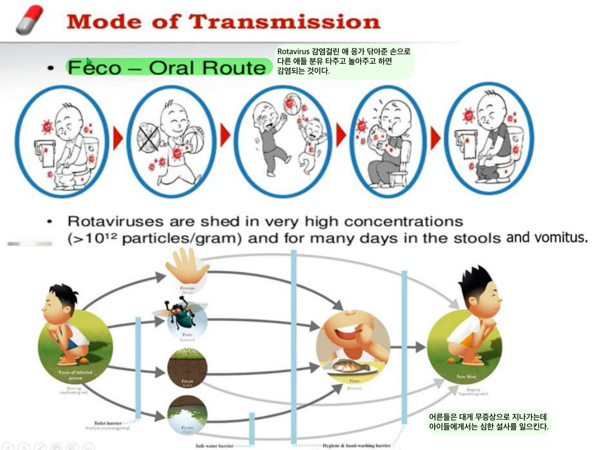{: style="width:74%"}

- **대변–구강 경로(feco-oral route)**. 위 그림: 아이가 변기 → 손을 안 씻고 공놀이 → 어른이 같이 놀아 줌 → 어른이 손을 입에 → 어른도 감염.
- 필기: "Rotavirus 감염 걸린 애 **응가 닦아 준 손으로 다른 애들 분유 타 주고 놀아 주고** 하면 감염되는 것이다." → 어린이집·신생아실 집단 감염의 전형.
- **대변과 구토물에 매우 높은 농도(> 1012 입자/g)로, 여러 날 동안** 배출된다. 아주 적은 양(입자 10개 정도)으로도 감염되므로 **손 씻기**가 가장 중요하다.
- 아래 그림(F-diagram): 감염자 대변 → **손가락(fingers), 파리(flies), 밭(fields), 물(fluids)** → 음식(food) → 새 숙주. 막는 방법 = **화장실 장벽, 안전한 물 장벽, 위생·손 씻기 장벽**.
- 필기: "**어른들은 대개 무증상**으로 지나가는데 **아이들에게서는 심한 설사**를 일으킨다." — 어른은 여러 번 감염돼 면역이 있다. 그래서 **재감염일수록 가볍다**.

!!! exam "기출 포인트"
    - 2부 12번(2020) 함정 "**재감염이 되면 중등도 이상의 감염**" → X(재감염은 가볍다).
    - 2부 6번(2023): 9개월 로타 장염 + 탈수 → 옳은 것 = **격리실 보험은 가능하나 법적 격리 의무는 없다**. 전파력이 높아 병원에서는 접촉 격리를 하지만 법정 격리 대상은 아니다.

## 병태생리 — 융모 끝이 날아간다

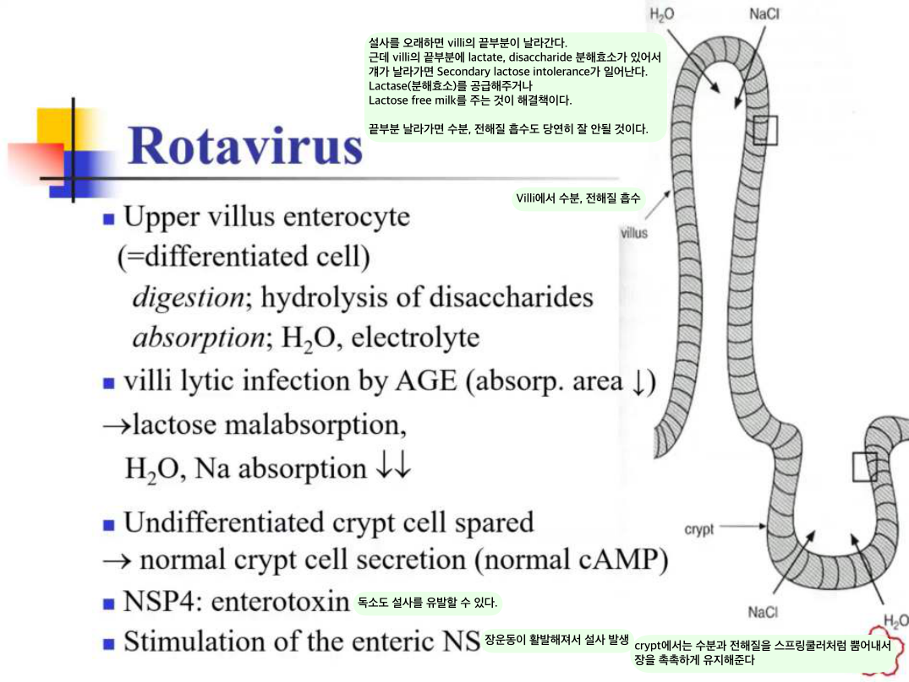{: style="width:80%"}

| 위치 | 하는 일 | 로타바이러스 감염 후 |
|---|---|---|
| **융모 위쪽 장세포(upper villus enterocyte) = 분화된 세포** | **소화**: 이당류 가수분해(lactase 등) / **흡수**: 물, 전해질 — 필기 "Villi에서 수분, 전해질 흡수" | **감염되어 파괴**(villi lytic infection, 흡수 면적↓) → **유당 흡수장애**, **물·Na 흡수↓↓** |
| **분화되지 않은 crypt 세포** | 물·전해질 **분비** — 필기 "crypt에서는 수분과 전해질을 **스프링클러처럼 뿜어내서** 장을 촉촉하게 유지해 준다" | **보존(spared)** → **분비는 정상(cAMP 정상)** |

→ **흡수는 줄었는데 분비는 그대로** = 장 안에 물이 남는다 = **물설사**. 여기에 두 가지가 더해진다.

- **NSP4 = 장독소(enterotoxin)** — 필기 "독소도 설사를 유발할 수 있다." (비구조 단백질 NSP4가 장세포 안 칼슘을 올려 Cl- 분비를 늘린다.)
- **장 신경계(enteric NS) 자극** — 필기 "장운동이 활발해져서 설사 발생."

### 이차성 유당불내증 (Secondary lactose intolerance)
- 필기: "설사를 오래 하면 villi의 끝부분이 날아간다. 근데 **villi의 끝부분에 lactase, disaccharide 분해효소**가 있어서 걔가 날아가면 **Secondary lactose intolerance**가 일어난다." "끝부분 날아가면 수분, 전해질 흡수도 당연히 잘 안 될 것이다."
- **해결책**(필기): **Lactase(분해효소)를 공급**해 주거나 **Lactose-free milk(무유당 분유)** 를 준다.
- **헷갈리는 것**:
    - **유당불내증(intolerance) ≠ 알레르기**. 유당은 당이라 면역반응(알레르기)을 일으키지 않는다 → "**유당 알레르기**"는 없는 말(2부 6·8·12번 함정).
    - 이차성(장염 뒤, 회복되면 나음) vs 일차성(선천적·성인형 lactase 결핍).
    - crypt 세포는 **분비**(흡수가 아님) — 2부 12번 함정 "crypt cell의 전해질 흡수가 증가" X.

※ 확인 필요: 올해 필기는 "villi 끝부분에 **lactate**… 분해효소"라고 적었는데 **lactase**(유당 분해효소)의 오타로 보인다(lactate = 젖산).

!!! exam "기출 포인트"
    - 2부 12번(2020): 옳은 것 = **villus enterocyte 손상으로 수분·전해질 흡수 장애**. 함정: crypt cell 흡수 증가(X, 분비), 재감염이 더 심함(X), **혈청** 항원검사(X → **대변** 항원), "유당 알레르기"(그런 용어 없음).
    - 2부 4번(2024) 3) 로타 장염으로 상부 융모 장세포 손상 → 수분·전해질 흡수 저하, 유당 소화 저하 → **O**.
    - 2부 11·13번(2021·2020): 맞는 것 = **라(융모세포 세포질에서 증식 → 파괴·탈락 → 물·Na·포도당 흡수장애)만**. 가(**dsDNA** X → dsRNA), 나(백신 없음 X), 다(사람만 감염 X — 동물에도).
    - 2부 9번(2022): 원본 정답은 ①(가·나·다)이지만 "예방백신이 없다"는 사실과 다르고 "**NSP3**가 장독소"도 틀렸다(**NSP4**) → 해설에 **※ 확인 필요**로 남겼다.

## 융모와 SGLT — ORS가 듣는 이유

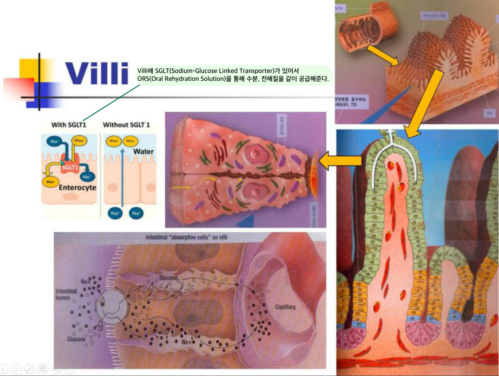{: style="width:76%"}

!!! new "올해 필기에서 추가"
    필기: "**Villi에 SGLT(Sodium-Glucose Linked Transporter)가 있어서 ORS(Oral Rehydration Solution)를 통해 수분, 전해질을 같이 공급**해 준다."

    - 그림 왼쪽: **SGLT1이 있으면** Na+ 하나와 포도당을 **함께** 장세포 안으로 끌어들이고, **물이 따라 들어간다**. SGLT1이 없으면 Na+·포도당이 장 안에 남고 물도 흡수되지 않는다.
    - 아래 그림: 장 흡수세포(absorptive cells)가 장 내강의 Na+·포도당을 받아 모세혈관으로 넘긴다.
    - **기전 → 임상**: 설사 때 cAMP·독소로 Cl- 분비가 늘어도 **SGLT1 경로는 대부분 살아 있다**. 그래서 소금물만, 설탕물만이 아니라 **Na와 포도당을 정해진 비율로 섞은 ORS**를 마시면 물이 흡수된다. 로타처럼 융모 끝이 일부 망가져도 남은 융모의 SGLT1로 흡수가 된다.
    - 작년 필기에는 같은 융모 그림만 있고 SGLT 설명은 없었다.

## 장 점막 손상과 분유 불내성의 악순환

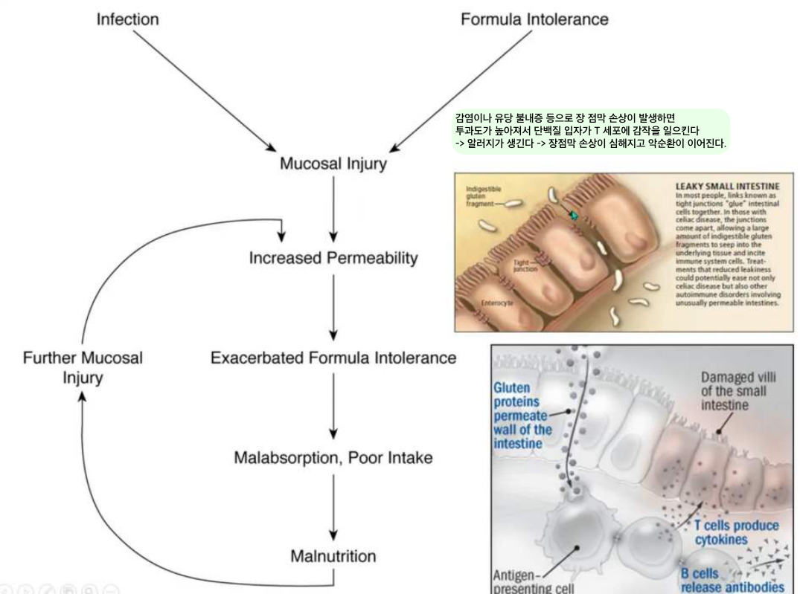{: style="width:80%"}

- 흐름: **감염(infection)** 또는 **분유 불내성(formula intolerance)** → **점막 손상(mucosal injury)** → **투과성 증가(increased permeability)** → **분유 불내성 악화** → **흡수장애·섭취 저하** → **영양실조(malnutrition)** → **점막이 더 손상** → 다시 투과성 증가 … **악순환**.
- 필기: "감염이나 유당 불내증 등으로 장 점막 손상이 발생하면 **투과도가 높아져서 단백질 입자가 T 세포에 감작**을 일으킨다 → **알러지가 생긴다** → 장점막 손상이 심해지고 악순환이 이어진다."
- 오른쪽 위 그림 **Leaky small intestine(새는 장)**: 정상이면 **tight junction**이 장세포를 '풀처럼' 붙여 큰 분자가 못 지나가는데, 손상되면 벌어져 소화 덜 된 단백질 조각이 점막 아래로 새어 든다(그림 예는 셀리악병의 글루텐).
- 오른쪽 아래 그림: 새어 든 단백질 → **항원제시세포** → **T세포가 사이토카인**, **B세포가 항체** → 융모 손상(damaged villi).
- **임상에서**: 장염 뒤 설사가 2주 넘게 이어지면(감염 후 만성 설사) 유당뿐 아니라 **우유 단백(카제인·유청)** 에도 반응할 수 있다 → 단백을 잘게 쪼갠 **완전가수분해분유** 또는 **아미노산 분유**로 바꿔 장을 쉬게 한다. 단순히 무유당 분유나 콩 분유(소이)로 바꾸면 콩 단백에도 교차 알레르기가 생길 수 있다.

!!! exam "기출 포인트"
    - 2부 8번(2022): 생후 4개월, 로타 장염 후 물설사 2주 지속 → **완전가수분해분유나 아미노산 분유를 시도**. 함정: "**유당 알레르기** 예방을 위해 무유당·소이분유"(용어 없음, 소이는 교차 알레르기), "그대로 먹이면 낫는다"(알레르기로 만성 설사가 됨), "**이온음료**로 보충"(X → ORS), "1단계 분유로 변경, 이유식 금지"(분유 단계는 의미 없음, 이유식은 가능).
    - 2부 6번(2023) 함정: "영양 공급을 위해 분유 양을 늘린다", "우유 알레르기 예방을 위해 무유당 분유", "광범위 항생제"(바이러스 — 항생제 X).

!!! diff "작년 필기와 다른 점 — 우유 알레르기가 생기는 이유(올해 없음)"
    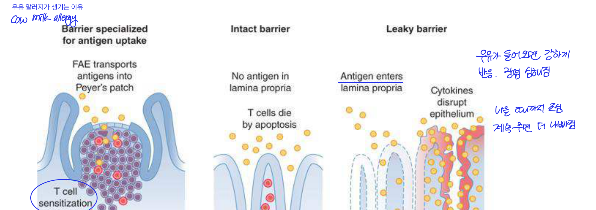{: style="width:78%"}

    작년에는 이 Harrison 그림이 따로 있었다. ① 정상 장벽에서는 Peyer판의 FAE가 항원을 조금씩 들여와 T세포를 감작(→ 장간막 림프절 → 혈액) ② 장벽이 온전하면 고유판에 항원이 없어 T세포가 세포자멸사로 사라진다 ③ **장벽이 새면(leaky barrier)** 항원이 고유판으로 들어와 감작된 T세포가 반응(IFN-γ, TNF-α) → 상피가 더 망가지는 **만성 염증의 악순환**. 작년 손글씨: "우유가 들어오면 강하게 반응, 장염 심해짐", "나을 때까지 계속 주면 더 나빠짐", "여기에 T cell이 침착". 올해는 위 '악순환' 쪽 손글씨에 같은 내용이 짧게 들어갔다.

## ORS — 무엇을 마시게 하나

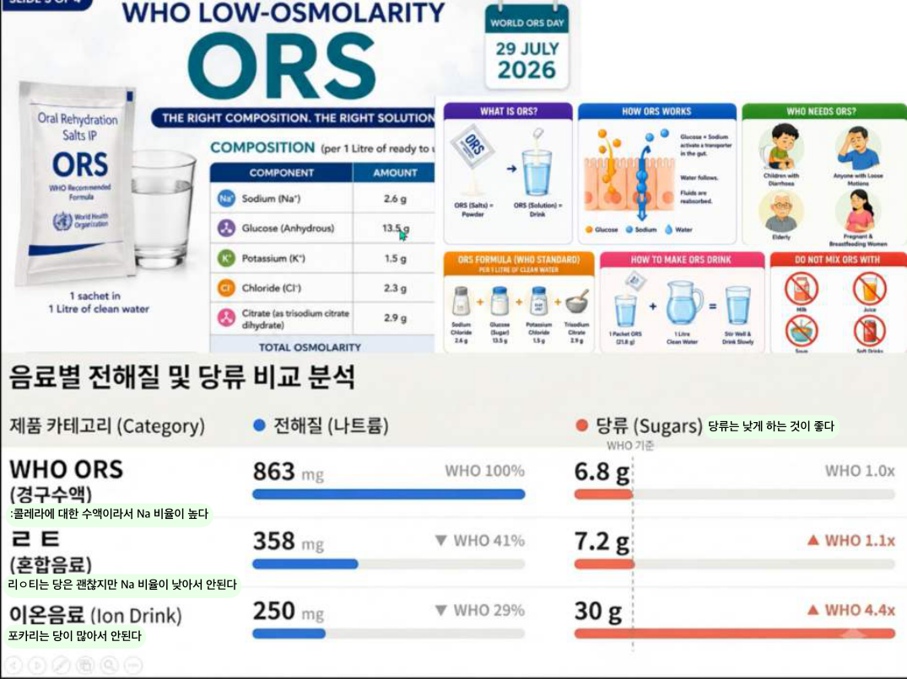{: style="width:80%"}

!!! new "올해 필기에서 추가 — 이 쪽 전체가 올해 새로 생겼다"
    **WHO 저삼투압 ORS(low-osmolarity ORS)** — 1포를 깨끗한 물 1 L에 녹인다. 슬라이드 성분표(1 L당): 염화나트륨 2.6 g, **포도당(무수) 13.5 g**, 염화칼륨 1.5 g, 구연산나트륨 2.9 g(표에는 "Sodium 2.6 g / Potassium 1.5 g / Chloride 2.3 g / Citrate 2.9 g"처럼 적혀 있다). 작은 그림: ORS가 하는 일(포도당 + 나트륨이 장의 운반체를 타고 들어가고 물이 따라간다), 누가 마셔야 하나(설사하는 소아, 묽은 변을 보는 누구나, 노인, 임신·수유부), **다른 것과 섞지 말 것(우유, 주스, 수프, 탄산음료)**. 세계 ORS의 날 = 7월 29일.

    **음료별 전해질과 당 비교**(같은 양 기준, 막대 = WHO ORS 대비):

    | 음료 | 나트륨 | 당 | 필기 |
    |---|---|---|---|
    | **WHO ORS(경구수액)** | **863 mg (100%)** | **6.8 g (1.0배)** | "**콜레라에 대한 수액이라서 Na 비율이 높다**" |
    | 리○티(혼합음료, 수분 보충 분말) | 358 mg (41%) | 7.2 g (1.1배) | "당은 괜찮지만 **Na 비율이 낮아서 안 된다**" |
    | 이온음료(포카리 등) | 250 mg (29%) | 30 g (**4.4배**) | "**당이 많아서 안 된다**" |

    필기: "**당류는 낮게 하는 것이 좋다.**"

    - **왜 당이 많으면 안 되나**: 장 안에 흡수 안 된 당이 많으면 삼투압으로 **물을 장 안으로 끌어당겨 설사가 더 심해진다**(특히 로타로 lactase·이당류 분해효소가 줄어 있을 때). SGLT1은 Na와 포도당을 1:1로 나르므로 **Na와 포도당이 비슷한 몰 농도**일 때 물이 가장 잘 흡수된다(저삼투압 ORS: Na 75, 포도당 75 mmol/L, 총 삼투압 245 mOsm/L — 교과서 수치).
    - **왜 Na가 적으면 안 되나**: 설사로 잃은 Na를 채우지 못하고, SGLT로 들어갈 Na가 모자라 물 흡수가 덜 된다 → 저나트륨혈증 위험.
    - **헷갈리는 것**: "목마를 땐 이온음료"는 운동 후 땀 보충용이지 **설사 탈수 치료용이 아니다**.

!!! exam "기출 포인트"
    2부 8번(2022) 함정 "부족한 수분과 전해질은 **이온음료**로 보충하십시오" → X, **ORS**를 써야 한다. 올해 이 쪽(이온음료는 당 4.4배, Na 29%)이 바로 그 이유다.

## 로타바이러스 혈청형 (Rotavirus Serotypes)

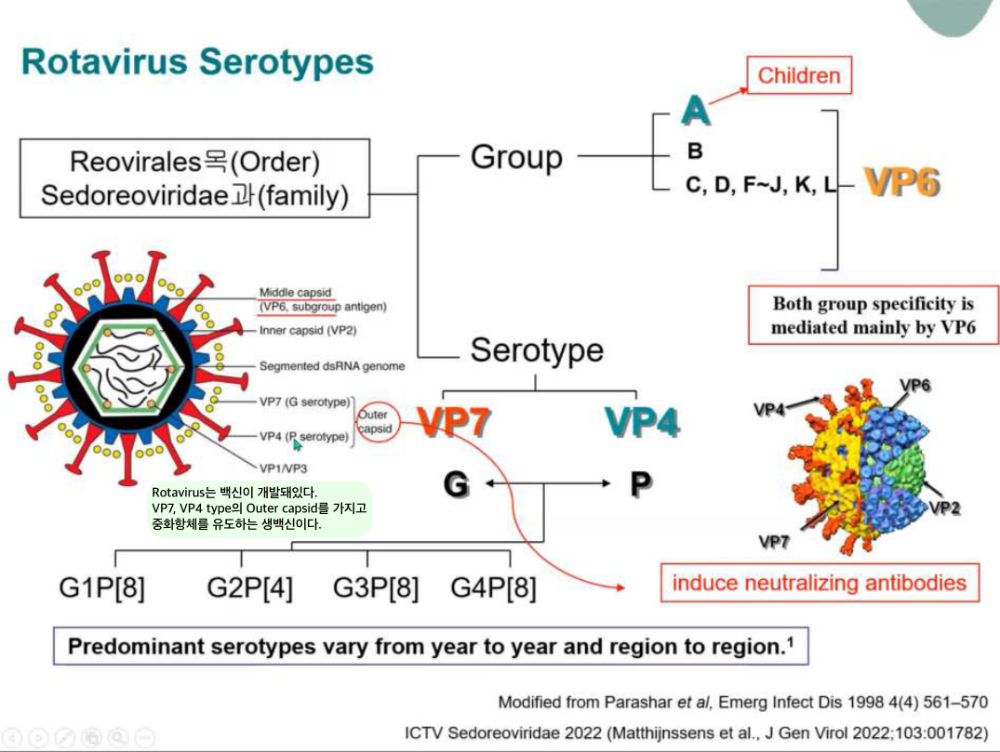{: style="width:80%"}

- **분류**: **Reovirales 목(order) — Sedoreoviridae 과(family)**. 유전체 = **분절된 이중가닥 RNA(segmented dsRNA)** — **11분절**(각 분절이 단백질 하나를 암호화).
- **바이러스 구조(왼쪽 그림, 바깥 → 안)**: 바깥 껍질(outer capsid) **VP7(G 혈청형)·VP4(P 혈청형, 돌기)** → 가운데 껍질(middle capsid) **VP6(군·아군 항원)** → 안 껍질(inner capsid) **VP2** → VP1/VP3(복제 효소) + dsRNA.
- **군(Group)**: **A**, B, C, D, F–J, K, L — **군 특이성은 주로 VP6**가 결정. **A군이 소아(children)** 장염의 원인.
- **혈청형(Serotype)**: **VP7 → G형**, **VP4 → P형**. 둘을 조합해 **G1P[8], G2P[4], G3P[8], G4P[8]** 처럼 부른다. **바깥 껍질(VP7·VP4)이 중화항체를 유도(induce neutralizing antibodies)** — 빨간 동그라미와 화살표.
- **우세한 혈청형은 해마다, 지역마다 다르다.**
- 필기: "Rotavirus는 **백신이 개발돼 있다.** **VP7, VP4 type의 outer capsid**를 가지고 **중화항체를 유도하는 생백신**이다."

!!! diff "작년 필기와 다른 점"
    | | 작년(2025) | 올해(2026) |
    |---|---|---|
    | 분류 | **Reoviridae 과(family)** | **Reovirales 목 – Sedoreoviridae 과**(ICTV 2022 개정) |
    | 군 | Group(Seven) **A–G** | **A, B, C, D, F–J, K, L** |
    | 아군 | **Sub-group(Two) I, II** — "군과 아군 특이성 모두 VP6" | 아군 칸 없음 — "군 특이성은 주로 VP6" |
    | 혈청형 수 | G(1–14), P(1–8) | 숫자 없음 |

    기출(2부 9·11·13번)은 "11분절 double-stranded RNA"만 물었다 — 분류 이름이 바뀌어도 **11분절 dsRNA, VP6 = 군, VP7·VP4 = 혈청형·중화항체**는 그대로다. 작년 필기 퀴즈: "HRV 백신(VP7/VP4 항원)과 HBV 백신(HBsAg 항원)은 모두 바이러스 표면 항원에 대한 체액성 면역(항체)으로 예방 효과를 낸다" → **참**.

## 로타바이러스 예방 (HRV prevention)

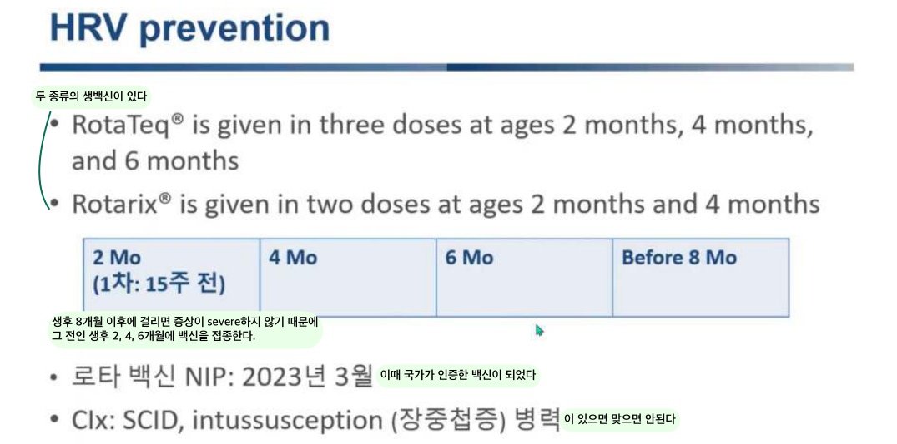{: style="width:72%"}

필기: "**두 종류의 생백신**이 있다." (둘 다 **먹는(경구)** 생백신)

| 백신 | 횟수 | 접종 시기 |
|---|---|---|
| **RotaTeq®**(5가, 소–사람 재조합) | **3회** | 생후 **2, 4, 6개월** |
| **Rotarix®**(1가, 사람 약독화) | **2회** | 생후 **2, 4개월** |

- **1차는 생후 15주 전**에 시작, **8개월 전**(Before 8 Mo)에 모두 끝낸다.
- 필기: "**생후 8개월 이후에 걸리면 증상이 severe하지 않기 때문에** 그 전인 생후 2, 4, 6개월에 백신을 접종한다." (교과서에서 덧붙이면: 첫 접종을 늦게 하거나 나이가 들어 맞으면 **장중첩증 위험**이 올라가서 나이 제한을 둔다 — 아래 금기와 연결.)

!!! new "올해 필기에서 추가"
    - **로타 백신 NIP(국가예방접종): 2023년 3월** — 필기 "이때 국가가 인증한 백신이 되었다"(이때부터 무료 국가 접종).
    - **금기(CIx): SCID(중증복합면역결핍증), 장중첩증 병력** — 필기 "이 있으면 맞으면 안 된다".
        - **SCID**: 생백신이라 면역이 없으면 백신 바이러스가 계속 증식해 심한 장염을 일으킨다.
        - **장중첩증 병력**: 백신 접종 후 1주 안에 장중첩증 위험이 약간 오른다(백신 바이러스가 장 림프조직을 붓게 함 — 2단원 장염 후 장중첩증과 같은 기전).

!!! exam "기출 포인트"
    - 2부 9·11·13번 "나. 예방백신이 없다" → **X**(경구 생백신 2종).
    - 2부 6번(2023) 함정: "로타바이러스 백신을 맞지 않았다면 **장염 치료 후 맞춘다**" → X. 이 아이는 **9개월** — **8개월이 지나면 접종하지 않는다**.

!!! memo "암기"
    **로타** = 1세 이하·늦가을–초겨울 · 대변–구강, 1012/g, 손 씻기 · **11분절 dsRNA**, Sedoreoviridae · VP6 = 군(A군 = 소아), **VP7(G)·VP4(P) = 바깥 껍질·중화항체·백신** · **융모 끝 장세포 파괴(crypt 보존, 분비 정상)** → 물·Na 흡수↓, **이차성 유당불내증**(lactase 공급·무유당) · **NSP4 = 장독소** · 장염 후 2주 넘는 설사 → **완전가수분해·아미노산 분유** · 탈수 → **ORS**(이온음료 X: 당 많고 Na 적음) · 백신 **RotaTeq 3회(2·4·6) / Rotarix 2회(2·4)**, 1차 15주 전, 8개월 전 완료, NIP 2023.3, **금기 SCID·장중첩증 병력** · 법정 격리 의무 없음

# 6. C. difficile — 검사 해석

!!! diff "작년 필기와 다른 점 — 이 단원 전체가 작년 필기에만 있다"
    작년 필기 마지막 쪽(40쪽)의 퀴즈와 손글씨. 올해 필기에는 없지만 2부 1번(2025) Case 4와 이어지므로 남긴다.

    - C. difficile은 원래 장에 있는 **정상 세균총**의 하나. **항생제를 많이·오래 쓰는 환자에서 과증식**해 문제를 일으킨다(올해 필기 8쪽 "항생제 overdose의 부작용인 C. difficile").
    - 그래서 **toxin A/B 유전자가 양성이라고 무조건 치료해야 하는 상태는 아니다.**
    - **PCR에서 C. difficile이 나오는 건 크게 의미가 없다** — 소아에서는 거의 전부 양성으로 나온다(특히 영아는 무증상 보균이 흔하다).
    - **CD toxin을 따로 검사**해서 높게 나오면 의미 있게 본다.
    - 작년 퀴즈: "toxigenic C. difficile(toxin A/B)가 multiplex PCR에서 양성이면 위막성 대장염에 준한 치료를 한다" → **거짓**.

!!! exam "기출 포인트"
    2부 1번(2025) Case 4: 장기간 항생제 후 설사 → **C. difficile toxin EIA와 NAAT(PCR) 기반 알고리즘** — PCR(유전자) 하나만이 아니라 **독소 검사(EIA)를 함께** 보는 이유가 바로 위 내용이다.

!!! memo "암기"
    식중독(독소, 항생제 X: S. aureus·B. cereus·C. perfringens) ≠ 감염성 AGE · 하루 9 L 들어와 100 mL 나감 · 염증성 = 점막 파괴, 발열·복통·뒤무직·혈변, 대변 WBC, CRP·ESR·calprotectin ↑ · 혈변 + WBC 없음 = EHEC·아메바 · **STEC는 항생제·지사제 금기(HUS)**, 혈변은 시가독소 검사 먼저 · Campylobacter = 닭·계란·교차오염·약수, **42℃, 4℃ 생존**, PCR로 검출↑, cephalosporin 내성, 회복기 **길랭-바레·반응성 관절염(HLA-B27)**, HUS 드묾, 지사제 → 독성 거대결장 · Yersinia = 돼지·약수터(들쥐·족제비), **22℃, 1–4℃ 증식**, <7세, 겨울, 장간막 림프절염 → **가성충수염**, 결절홍반·반응성 관절염 = **IBD 장관 외 증상 흉내** · 세균성 장염 후 **장중첩증**(48시간 지나면 수술) · HUS = 용혈빈혈 + 급성 신부전 + 혈소판감소, 소아 · Y. pestis = 흑사병, 쥐 → 벼룩 → 사람
