<!-- 필기본: 2026 · 2025 -->
<!-- 단계: 수업 후 -->

# 0. 이 수업을 공부하는 법

**권기태 교수님**(감염내과) 수업 — 2023·2025·2026 모두 같은 교수님이고, 기출 15문항(2020–2025)도 전부 이 수업 범위다. 올해(2026. 11. 17) 슬라이드는 Harrison 21판 66장·Cecil 159장을 바탕으로 **새로 만든 한글 슬라이드**(6단원: 개요 → 원인 → 임상평가 → 검사 → 생검 → 관리)로 바뀌었고, 필기본 2쪽에 2020–2025 기출 14문항 원본이 실려 있다.

교수님 말(필기본 1·25쪽):

- "**검사를 해야 하는가, 말아야 하는가 — 지켜봐도 되는가를 구분하는 것이 핵심.** 시험문제도 그렇게 나올 것 — 환자 케이스를 주고 알맞은 치료는? 진단은?"
- "**한 시간에 두 문제.** 지금까지 얘기한 데서 다 나왔다. **케이스 두 개 딱 나온다.**"

학습성과

1. 림프절염(림프절병증)의 감별진단을 설명할 수 있다.
2. 림프절염(림프절병증)의 임상적 평가를 설명할 수 있다.
3. 림프절염(림프절병증)에 시행하는 검사법을 설명할 수 있다.

기출은 거의 전부 두 증례의 변형이다:

1. **고령·흡연자, 왼쪽 쇄골위(빗장위), 3 cm, 단단하고 고정된 무통성 림프절 → 즉시 조직검사**(2부 1·7·11·14번)
2. **젊은 사람, 발열·인후통, 압통 있는 1 cm 안팎 다발성 경부 림프절 → 감염성 단핵구증·기쿠치병 등**, 악성(위암·전이암) 가능성이 가장 낮다(2부 2·6·9·12번)

그 밖에 부위–질환 짝(Virchow = 위암), 전신 림프절병증(에이즈), 대상포진 옆 림프절(acyclovir 후 관찰), 림프종(B 증상), 전이암 의심 소견(초음파 모양).

!!! key "핵심"
    **"그냥 지켜볼 것인가, 빨리 조직검사할 것인가"를 구분하는 게 이 수업의 전부다.**
    조직검사 쪽: **나이 >40(50), 쇄골위(특히 왼쪽), 크기 >2.25 cm²(지름 >2 cm), 딱딱함, 무통, 고정, 둥근 모양(L/S <2)**.
    관찰 쪽: **젊음, <1 cm², 부드러움, 압통, 상기도 증상 동반** → 2–4주 간격 추적, 항생제·스테로이드 X.

!!! diff "작년 필기와 다른 점"
    작년(2025)은 Harrison 매뉴얼(영어)을 그대로 읽는 슬라이드 24쪽이었고, 마지막에 **증례 2개 슬라이드**(감염성 단핵구증, 폐암 림프절 전이)와 "원인을 찾는 단서" 정리표가 있었다. 올해는 증례 슬라이드가 없어지고 대신 **핵심정리 6가지** 슬라이드가 생겼다. 다만 교수님은 올해도 "케이스 두 개 딱 나온다"고 했으므로, 작년 증례 두 개는 이 자료 **7단원**에 그대로 남겨 두었다 — 꼭 같이 볼 것.

# 1. 개요

## 림프절염과 림프절병증: 정의와 기전

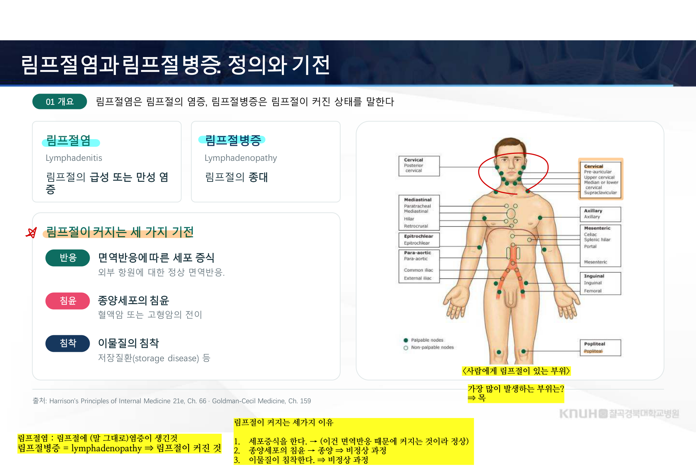{: style="width:78%"}

- **림프절염(lymphadenitis)**: 림프절에 말 그대로 **염증**이 생긴 것 — 급성 또는 만성. 감염 쪽에서 많이 쓰는 표현.
- **림프절병증(lymphadenopathy)**: 림프절이 **커진(종대) 상태** 그 자체 — 원인은 따지지 않는다. 악성종양 쪽에서 많이 쓰는 표현.
- 둘은 같은 환자를 두고 쓰지만, "염"은 원인(염증)을 이미 말하고 "병증"은 커졌다는 소견만 말한다는 차이가 있다. 시험 문제는 대개 "림프절종대·림프절병증"으로 표현한다.

!!! new "올해 필기에서 추가"
    **림프절이 커지는 세 가지 기전** (☆ 표시)

    | 기전 | 무엇이 일어나나 | 예 | 의미 |
    |---|---|---|---|
    | **반응** | 면역반응에 따른 림프구 **세포 증식** | 외부 항원(감염 등)에 대한 정상 면역반응 | **정상 과정** — 대부분 이것 |
    | **침윤** | **종양세포**가 들어와 자람 | 혈액암(림프종·백혈병), 고형암의 전이 | 비정상 |
    | **침착** | **이물질**이 쌓임 | 저장질환(storage disease, 예: 고셔병) | 비정상 |

    → "반응"이면 지켜봐도 되고, "침윤"이면 조직검사가 필요하다 — 이 수업의 핵심 질문이 기전에서부터 갈린다.

- **사람에게 림프절이 있는 부위**(그림): 경부(목 뒤·귀앞·위·아래 경부·쇄골위), 종격동·폐문, 겨드랑이(액와), 활차상(팔꿈치 안쪽), 장간막·대동맥옆·장골, 서혜부·대퇴, 오금. 초록 점(●)은 만져지는 림프절, 빈 점(○)은 만져지지 않는 림프절(흉부·복부).
- **가장 많이 생기는 부위는? ⇒ 목.** 그다음 겨드랑이, 복강 내, 서혜부. 각각의 자세한 위치까지 외울 필요는 없다.

## 정상 림프절과 비정상 림프절 ☆ "이 수업의 핵심"

{: style="width:78%"}

만져진다고 모두 비정상은 아니고, **크기와 위치**로 추가 평가 여부를 정한다. 의사가 결정할 것은 "이 림프절이 정상 소견인지, 생검까지 포함한 추가 검사가 필요한 소견인지"다.

| | 정상으로 본다 (추가 평가 불필요) | 비정상으로 본다 (평가 필요) |
|---|---|---|
| 크기 | 소아·젊은 성인의 **턱밑** 림프절: 부드럽고 납작하며 **<1 cm** / 건강한 성인의 **서혜부** 림프절: **2 cm까지** 만져질 수 있다 | 일반적으로 **1 cm보다 큰** 림프절 |
| 위치 | 새로운 항원에 계속 노출되는 어린 소아는 만져지는 림프절이 흔하다 | **빗장위(supraclavicular)·활차상(epitrochlear)·오금(popliteal)** 림프절은 **1 cm 미만이어도** 평가 |
| 서혜부 | — | 서혜부 림프절병증은 흔하고, 다른 소견이 없으면 대개 하지의 감염·외상 |

- **크기 기준은 1 cm**(서혜부만 2 cm): 그보다 크면 비정상 ⇒ 검사 필요. 서혜부는 다리에서 상처·감염이 늘 들어오므로 기준이 더 크다.
- **왼쪽 빗장위 림프절은 크기와 상관없이 대부분 검사한다**(여기에 병이 많아서) — "조금이라도 이상하면 검사를 하자."

!!! new "올해 필기에서 추가"
    작년에는 "정상" 기준(턱밑 <1 cm, 서혜부 ≤2 cm)만 있었는데, 올해는 **"비정상" 쪽 칸이 따로 생겼다**: **활차상·오금 림프절**도 빗장위처럼 **1 cm 미만이어도 평가** 대상이다. 이 세 곳은 평소에 만져지지 않는 자리라, 만져지는 것 자체가 이상 소견이다.

!!! exam "기출 포인트"
    2부 12번(2021): 25세, 콧물·인후통 + **턱밑 1 cm, 부드럽고 타원형, 압통** → 정상 범위의 반응성 림프절이라 **경과 관찰**.

## 림프절병증은 대부분 양성이다

| 어디서 본 환자인가 | 양성 | 악성 |
|---|---|---|
| **일차진료** | **2/3 이상**이 비특이적 원인 또는 상기도감염(바이러스·세균) | **1% 미만** |
| **림프절병증으로 의뢰된 환자**(한 연구) | **84%** — 원인이 확인된 것 중 **감염성 단핵구증, 톡소포자충증, 결핵**이 가장 흔하고, **63%는 원인을 못 찾은 비특이적·반응성** | **16%** — 림프종 또는 전이성 선암 |

- 일차병원에서 만나는 림프절병증이 종양일 확률은 1% 미만이고, (칠곡경대병원 같은) 의뢰 병원으로 온 환자는 16% 정도 — 걸러져서 온 환자이니 더 많은 게 당연하다.
- 그래서 **대부분 많은 검사가 필요 없다.** 감염이라도 대부분 바이러스성 상기도감염이라 조직검사·항생제가 필요 없다.

# 2. 원인 질환

## 림프절병증을 일으키는 질환 — "분류 4개만 보면 된다"

{: style="width:84%"}

교수님: **"이런 거 다 보지 마세요. 이거 다 보고 있으면 망합니다~"** → 질환 하나하나가 아니라 **분류 4개**(감염 / 면역질환 / 악성질환 / 그 밖의 원인)로 본다. 감염·면역질환·악성질환이 대부분을 차지한다.

| 분류 | 세부 | 대표 질환 | 어떻게 하나 |
|---|---|---|---|
| **1. 감염** | 바이러스 | **감염성 단핵구증(EBV, CMV)**, **HIV**, 간염, 단순포진, **수두대상포진**, 풍진, 홍역, 아데노바이러스 | 자가 제한적이면 관찰, 필요하면 추가 검사 |
| | 세균 | 사슬알균, 포도알균, 고양이할큄병, **결핵**, 비결핵항산균, **매독**, 브루셀라증, 야토병, 페스트 | 적절한 항균제 (요즘 세균성은 드물다) |
| | 진균·기생충·기타 | 히스토플라스마증, 콕시디오이데스진균증, **톡소포자충증**, 성병림프육아종, **쯔쯔가무시병** | |
| **2. 면역질환** | 자가면역 | 류마티스 관절염, **SLE**, 혼합결합조직병, 피부근염, 쇼그렌증후군, IgG4 연관질환 | 진단해서 추가 검사 |
| | 약물·기타 | **약물 과민반응(phenytoin, allopurinol, carbamazepine 등)**, 혈청병, 이식편대숙주병, IRIS(면역재구성 염증증후군) | |
| **3. 악성질환** ★ | 혈액암 | 호지킨·비호지킨 림프종, 급성·만성 림프구성 백혈병 | **당연히 조직검사** |
| | 전이암 | 여러 원발 부위의 고형암 | |
| **4. 그 밖의 원인** | | 사르코이드증, 캐슬만병, **기쿠치병**(동양인 젊은 여성), 가와사키병, 로사이-도프만병, 저장질환(고셔병 등), 갑상선기능항진증 | |

!!! diff "작년 필기와 다른 점"
    표의 큰 틀(카테고리로 보라)은 같다. 올해 표에 새로 들어간 질환: **비결핵항산균, 브루셀라증, 콕시디오이데스진균증, 피부근염·쇼그렌·IgG4 연관질환, allopurinol·carbamazepine, 혈청병, 이식편대숙주병, 로사이-도프만병, 저장질환(고셔병)**. 작년 표에는 있던 내분비 칸의 "**갑상샘암도 림프절이 커진다**"(필기)는 올해 "그 밖의 원인 — 갑상선기능항진증"으로만 남았고, 갑상선암은 경부 림프절의 **악성 원인(전이)**으로 3단원에 나온다.

## 원인에 따른 림프절병증의 특징

{: style="width:84%"}

감염이 전 세계적으로 가장 주된 원인이고, **자가면역질환과 약물 반응에 의한 림프절병증은 림프종과 구별이 어렵다**(조직으로도).

### ① 감염 (흔함)
- **세균보다 바이러스 감염이 더 많다.**
- 화농성(고름) 감염에서는 그 부위를 **배액하는 림프절**이 커진다(예: 편도염 → 턱밑, 발 봉와직염 → 서혜부).
- **경부 림프절병증은 결핵의 흔한 발현**이다 — 결핵에 걸리면 림프절병증이 생기고, 결핵은 **국소적**으로(발병 부위에 국한되어) 생긴다.
- **전신 림프절병증: EBV, CMV, HIV, 톡소포자충** — HIV 등 **바이러스는 systemic하게 전신적으로** 온다.
- 필기: 다른 부위에 세균 감염이 된 뒤 림프절로 가는 경우는 있어도, 우리나라는 **의료 접근성이 좋아서** 세균성 편도염·봉와직염·고름집이 생기기 전에 다 병원에 온다 ⇒ **림프절염 자체로 항생제가 필요한 경우는 많지 않다.**

### ② 자가면역질환
- **질환 자체가 림프절병증을 일으킨다**: 류마티스 관절염, SLE 등. 국소·전신 모두 가능하지만, 필기는 "**자가면역질환도 바이러스 감염처럼 전신 림프절병증 형태로 생긴다**".
- 이 환자들은 **악성 림프증식질환(림프종)의 발생 빈도도 높다** → 림프종을 배제하려면 **생검과 혈액병리 전문가 자문**이 필요하다.

### 약물 반응
- **드물지만** 조직학적으로 림프종과 구별이 매우 어려울 수 있다. 항경련제(phenytoin, carbamazepine), 항생제 등 다양한 약물.
- 단서: **발진, 호산구증가, 간기능 이상**이 같이 있으면 약물을 의심한다(DRESS 같은 약물 과민반응 양상).

### ③ 악성질환 — 두 가지로 나눈다
- **혈액학적 악성질환**(호지킨·비호지킨 림프종, 백혈병) → 림프절을 직접 침범하며 **전신적으로** 생긴다.
- **고형암 전이**(폐암, 갑상선암, 유방암 등) → **국소적으로**, 대개 **원발 종양의 배액 영역**에 생긴다: **유방암은 같은 쪽 액와, 전립선암은 장골 림프절**.

!!! new "올해 필기에서 추가"
    이 "원인별 특징" 슬라이드는 올해 새로 생겼다. 시험에 쓰기 좋은 짝: **바이러스·자가면역·혈액암 = 전신**, **결핵·고형암 전이·화농성 세균 = 국소**. 그리고 **자가면역·약물 반응은 림프종과 헷갈린다**(→ 생검 + 혈액병리 자문, 약물이면 발진·호산구·간기능 이상).

!!! exam "기출 포인트"
    2부 4번(2024): 림프절병증이 **전신적으로** 생길 가능성이 높은 것 = **에이즈**. 폐암·난소암(국소 전이), **림프절 결핵(주로 경부, 국소)**, 대상포진(해당 피절의 국소) — 위의 "전신 vs 국소" 짝 그대로다.

# 3. 임상 평가 — 병력과 신체검진

평가 순서: **자세한 병력 → 신체진찰 → (선택적) 검사 → (필요하면) 절제 생검.** 주의 깊고 완전한 **병력 청취가 첫 단계이자 가장 중요한 단계**다.

## 병력 청취

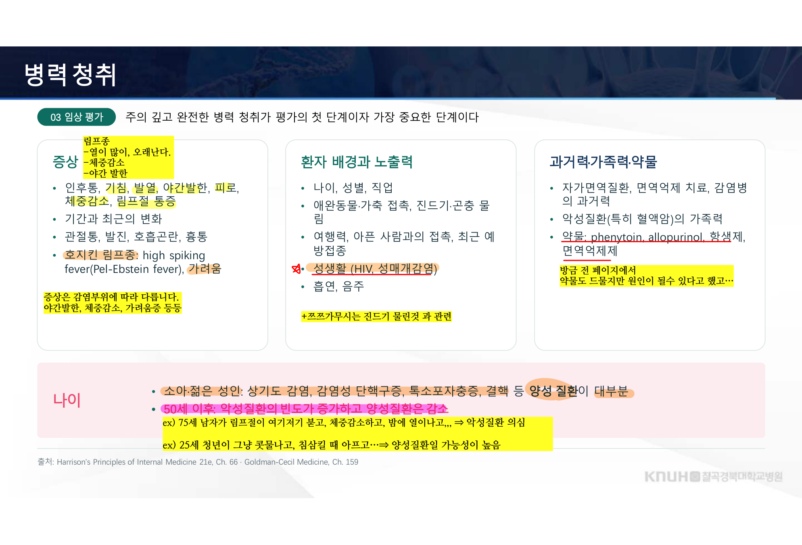{: style="width:80%"}

| 무엇을 묻나 | 항목 | 왜 묻나 |
|---|---|---|
| **증상** | 인후통, 기침, **발열, 야간 발한, 피로, 체중감소**, 림프절 통증 / 기간과 최근의 변화 / 관절통, 발진, 호흡곤란, 흉통 | 인후통·기침 = 상기도감염, 발열·야간 발한·체중감소 = **B 증상**(림프종), 관절통·발진 = 자가면역 |
| | **호지킨 림프종: high spiking fever(Pel-Ebstein fever), 가려움** | 열이 1–2주 오르다 내리기를 반복하는 독특한 열 |
| **환자 배경·노출력** | 나이, 성별, 직업 / 애완동물·가축 접촉, **진드기·곤충 물림** / 여행력, 아픈 사람 접촉, 최근 예방접종 / **성생활(HIV, 성매개감염)** ☆ / 흡연, 음주 | 고양이 → 고양이할큄병·톡소포자충, **진드기 → 쯔쯔가무시**, 성생활 → HIV·매독, 흡연 → 두경부암·폐암 |
| **과거력·가족력·약물** | 자가면역질환, 면역억제치료, 감염병의 과거력 / 악성질환(특히 혈액암)의 가족력 / **약물: phenytoin, allopurinol, 항생제, 면역억제제** | 앞 쪽에서 본 "약물도 드물지만 원인" |

- 필기: 증상은 감염 부위에 따라 다르다. **림프종** = 열이 많이·오래 난다, 체중감소, 야간 발한(+ 가려움).

### 나이 — 제일 중요!
- **소아·젊은 성인**: 상기도감염, 감염성 단핵구증, 톡소포자충증, 결핵 등 **양성 질환이 대부분**.
- **50세 이후**: **악성질환의 빈도가 증가**하고 양성 질환은 감소.
- 필기 예: **75세 남자**가 림프절이 여기저기 붓고, 체중이 줄고, 밤에 열이 난다 ⇒ **악성 의심** / **25세 청년**이 그냥 콧물 나고 침 삼킬 때 아프다 ⇒ **양성일 가능성이 높음**.

!!! new "올해 필기에서 추가"
    작년 병력 항목(증상·나이·성별·직업·반려동물·성행위·약물)에 올해 **진드기·곤충 물림, 여행력, 최근 예방접종, 흡연·음주, 과거력·가족력(혈액암), 면역억제치료**가 더해졌고, **호지킨 림프종의 Pel-Ebstein 열과 가려움**이 새로 나왔다.

!!! exam "기출 포인트"
    2부 3번(2024): 71세, 2개월간 **1주씩 반복되는 열**(Pel-Ebstein 양상), **이불이 젖는 야간 발한, 체중 9 kg 감소**, 양쪽 목·겨드랑이 3 cm **단단한 무통성** 림프절 여러 개, 간비장비대, 빈혈, **LDH 760** → **악성림프종**. 기쿠치병·결핵·톡소·감염성 단핵구증은 오답.

## 신체검진

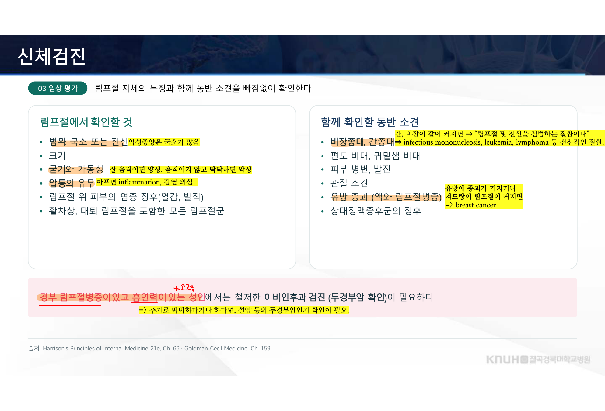{: style="width:80%"}

**림프절에서 확인할 것**

- **범위**: 국소 또는 전신 — 필기: **악성종양(고형암)은 국소가 많다.**
- **크기**
- **굳기와 가동성** — **잘 움직이면 양성, 움직이지 않고 딱딱하면 악성.**
- **압통의 유무** — **아프면 inflammation(염증), 감염 의심.**
- 림프절 위 피부의 염증 징후(열감, 발적)
- **활차상, 대퇴 림프절을 포함한 모든 림프절군** — 한 곳만 보지 말고 전부 만져 봐야 "국소 vs 전신"을 가를 수 있다.

**함께 확인할 동반 소견**

- **비장종대, 간종대** — 간·비장이 같이 커지면 ⇒ "림프절 및 전신을 침범하는 질환" ⇒ **감염성 단핵구증, 백혈병, 림프종** 등 전신 질환.
- 편도 비대, 귀밑샘 비대 / 피부 병변, 발진 / 관절 소견
- **유방 종괴**(액와 림프절병증과 같이) — 유방에 종괴가 있거나 겨드랑이 림프절이 커지면 ⇒ **유방암**.
- **상대정맥증후군**의 징후(얼굴·목·팔이 붓고 정맥이 불거짐 → 종격동 림프절이 큰 경우).

!!! key "핵심"
    **경부 림프절병증이 있고 흡연력이 있는 성인(+ 고령 — 손글씨)에서는 철저한 이비인후과 검진(두경부암 확인)이 필요하다.** 추가로 딱딱하다면 설암 등 두경부암인지 확인이 필요하다.

!!! diff "작년 필기와 다른 점"
    작년 필기에만 있던 설명: "**괴사(necrosis, 조직 파괴)가 있으면 악성**", "**딱딱하면 악성 의심, 부드러우면 정상 쪽**". 올해 필기는 같은 내용을 "움직이지 않고 딱딱하면 악성"으로 정리했다. 동반 소견(편도·귀밑샘·관절·유방 종괴·상대정맥증후군)은 올해 새로 나열됐다.

## 국소 림프절병증과 전신 림프절병증

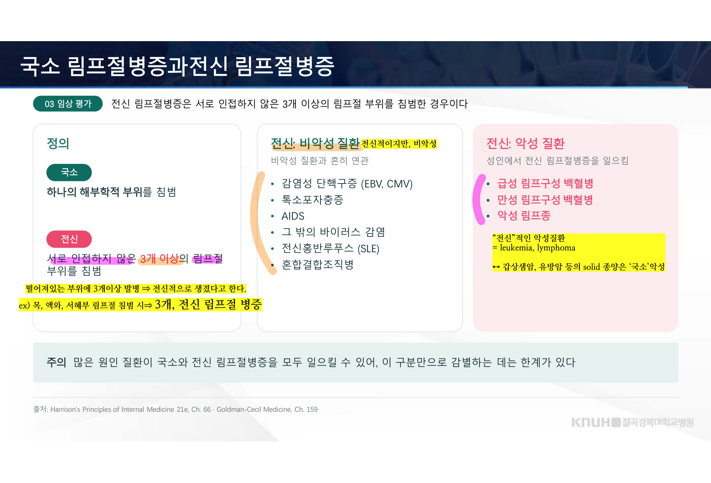{: style="width:80%"}

- **국소(localized)**: **하나의 해부학적 부위**를 침범.
- **전신(generalized)**: **서로 인접하지 않은 3개 이상**의 림프절 부위를 침범. 예) **목, 액와, 서혜부**가 같이 커지면 ⇒ 3개, 전신 림프절병증. (목 양쪽은 한 부위로 본다 — "떨어져 있는" 부위여야 한다.)

| 전신 림프절병증 | 질환 | 뜻 |
|---|---|---|
| **비악성** (흔히 연관) — "전신적이지만 비악성" | **감염성 단핵구증(EBV, CMV), 톡소포자충증, AIDS**, 그 밖의 바이러스 감염, **SLE**, 혼합결합조직병 | 전신 = 대부분 양성 |
| **악성** (성인에서) | **급성 림프구성 백혈병, 만성 림프구성 백혈병, 악성 림프종** | "전신"적인 악성 = **leukemia, lymphoma** |

- 반대로 **갑상선암, 유방암 같은 solid(고형) 종양은 "국소" 악성**이다 — 두경부·폐·유방 고형암은 전신 림프절병증을 잘 일으키지 않는다.
- **주의**: 많은 원인 질환이 국소·전신을 모두 일으킬 수 있어 이 구분만으로 감별하는 데는 한계가 있다.

!!! exam "기출 포인트"
    - 2부 4번(2024): 전신 림프절병증 가능성이 높은 것 = **에이즈**(폐암·난소암·림프절 결핵·대상포진은 국소).
    - 2부 15번(2020): 전이성 암을 의심할 소견을 고르는 문제에서 **"3부위 이상의 전신성 림프절 병증"은 오답** — 전신은 감염·림프종 쪽이다.

## 부위별 국소 림프절병증

### ① 후두부, 귀앞, 경부

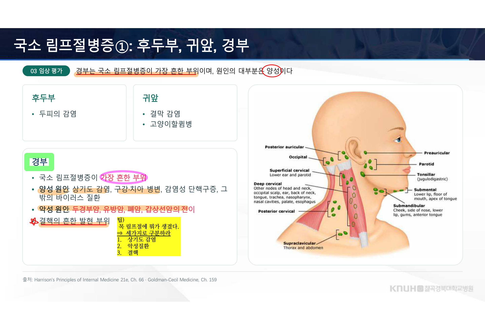{: style="width:78%"}

| 부위 | 원인 |
|---|---|
| 후두부(occipital) | 두피의 감염 |
| 귀앞(preauricular) | 결막 감염, 고양이할큄병 |
| **경부(neck)** | **국소 림프절병증이 가장 흔한 부위**, 원인의 대부분은 **양성** / 양성: **상기도 감염, 구강·치아 병변, 감염성 단핵구증**, 그 밖의 바이러스 질환 / 악성: **두경부암, 유방암, 폐암, 갑상선암의 전이** / ☆ **결핵의 흔한 발현 부위** |

!!! memo "암기"
    교수님 팁 — **목 림프절에 뭐가 생겼다 ⇒ 세 가지로 구분하라: ① 상기도 감염 ② 악성질환 ③ 결핵.**

그림의 경부 림프절과 배액 영역(참고): 귀뒤·후두 → 두피, 귀밑샘(parotid) → 얼굴, 턱밑(submandibular) → 뺨·코·입술·잇몸·혀 앞, 턱끝밑(submental) → 아랫입술·입바닥·혀끝, 편도(jugulodigastric) → 편도·인두, 깊은 경부 → 두경부 전체, **쇄골위 → 흉부와 복부**.

### ② 쇄골상(빗장위) 림프절 — "항상 비정상"

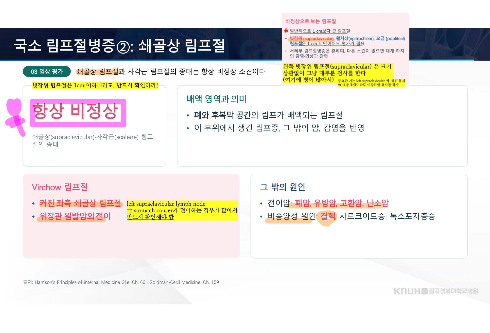{: style="width:78%"}

- **쇄골상(supraclavicular)·사각근(scalene) 림프절의 종대는 항상 비정상 소견**이다. **빗장위 림프절은 1 cm 이하라도 반드시 확인하라!**
- **배액 영역**: **폐와 후복막 공간**의 림프가 모이는 곳 → 이 부위에서 생긴 림프종, 그 밖의 암, 감염을 반영한다. 몸 안 깊은 곳(만질 수 없는 곳)의 병이 겉으로 드러나는 창이다.
- **Virchow 림프절 = 커진 좌측 쇄골상 림프절 → 위장관 원발암의 전이.** 흉관(thoracic duct)이 왼쪽 정맥각으로 들어가기 때문에 복부의 림프가 왼쪽 쇄골위로 모인다. 우리나라에 많은 **위암(stomach cancer)**이 잘 전이하므로 **반드시 확인해야 한다.**
- 그 밖의 원인: 전이암 — **폐암, 유방암, 고환암, 난소암** / 비종양성 — **결핵**, 사르코이드증, 톡소포자충증.

!!! exam "기출 포인트"
    - 2부 10번(2022): 맞는 짝 = **왼쪽 쇄골상 림프절 – 위암**. 겨드랑이–매독(X, 유방암), 종격동–급성 충수염(X), 서혜부–유방암(X), 왼쪽 경부–난소암(X; 난소암은 쇄골위로 갈 수는 있다).
    - 2부 1·7·14번: 고령 흡연자의 **왼쪽 쇄골위** 3 cm 딱딱·고정·무통 → **즉시 림프절 생검**.
    - 2부 11번(2021): 같은 환자인데 위치가 그냥 "**왼쪽 목 부위**"로 나오면, 위치는 생검 이유가 **아니다**(오답 함정) — 쇄골위여야 위치 자체가 이유가 된다.

### ③ 액와, 서혜부, 활차상

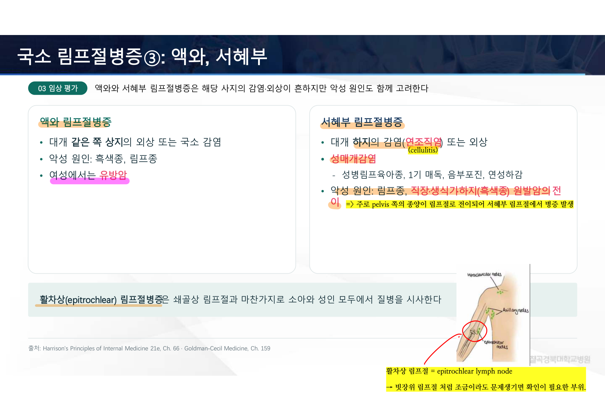{: style="width:78%"}

| 부위 | 흔한 원인 | 악성 원인 |
|---|---|---|
| **액와(겨드랑이)** | 대개 **같은 쪽 상지**의 외상 또는 국소 감염 | 흑색종, 림프종, **여성에서는 유방암** |
| **서혜부** | 대개 **하지의 감염(연조직염 = cellulitis)** 또는 외상 / **성매개감염**: 성병림프육아종, **1기 매독**, 음부포진, 연성하감 | 림프종, **직장·생식기·하지(흑색종) 원발암의 전이** — 주로 pelvis(골반) 쪽 종양이 서혜부 림프절로 전이 |

- **활차상(epitrochlear) 림프절**(팔꿈치 안쪽 위): **쇄골상 림프절과 마찬가지로 소아와 성인 모두에서 질병을 시사**한다 → 조금이라도 문제가 생기면 확인이 필요한 부위.

!!! exam "기출 포인트"
    2부 5번(2023): 60세, **오른쪽 등의 피절을 따른 통증·수포(대상포진)** + **같은 쪽 겨드랑이 2 cm** 림프절 → 원인이 뻔한 반응성 국소 림프절병증이므로 **acyclovir를 투여하며 경과 관찰**. 조직검사·초음파·CT·항생제는 오답.

!!! new "올해 필기에서 추가"
    **활차상 림프절**이 쇄골상처럼 "만져지면 질병 시사" 목록에 새로 들어왔다(6쪽 비정상 칸, 15쪽 아래 상자, 11쪽 "활차상·대퇴 림프절을 포함한 모든 림프절군"). 작년 필기에는 없던 부위다.

## 림프절의 크기

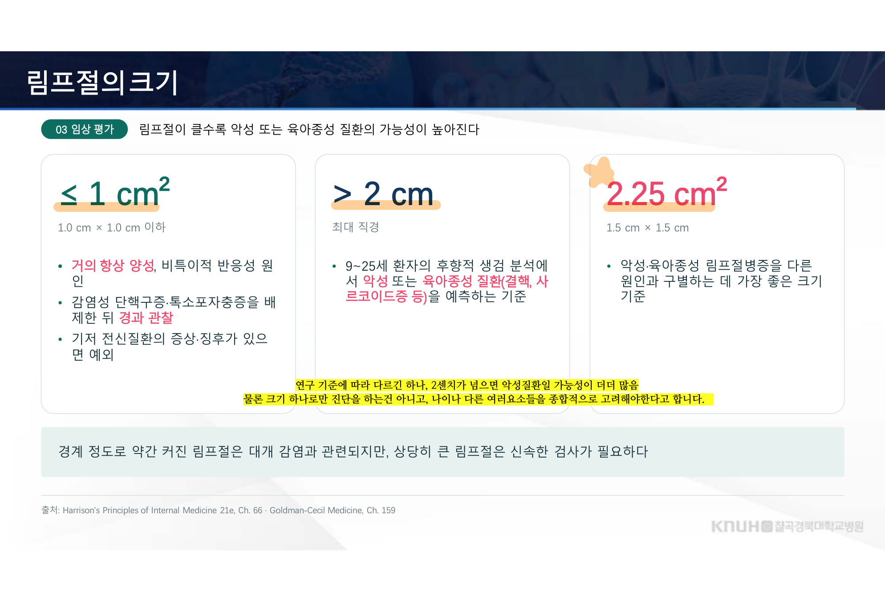{: style="width:78%"}

림프절이 **클수록 악성 또는 육아종성 질환**(결핵, 사르코이드증)의 가능성이 높아진다.

| 기준 | 크기 | 의미 |
|---|---|---|
| **≤1 cm²** | 1.0 × 1.0 cm 이하 | **거의 항상 양성**, 비특이적 반응성 원인 → **감염성 단핵구증·톡소포자충증을 배제한 뒤 경과 관찰**. 단, 기저 전신질환의 증상·징후가 있으면 예외 |
| **>2 cm** | 최대 직경 | **9–25세** 환자의 후향적 생검 분석에서 **악성 또는 육아종성 질환**(결핵, 사르코이드증 등)을 예측하는 기준 |
| **2.25 cm²** ★ | 1.5 × 1.5 cm | 악성·육아종성 림프절병증을 다른 원인과 구별하는 데 **가장 좋은 크기 기준** |

- cm²(넓이)와 cm(지름)를 헷갈리지 말 것: **1 cm² = 1 × 1 cm, 2.25 cm² = 1.5 × 1.5 cm**, ">2 cm"만 지름이다.
- 필기: 연구 기준에 따라 다르긴 하나 **2 cm가 넘으면 악성일 가능성이 더 많다.** 물론 크기 하나로만 진단하지 않고, **나이 등 여러 요소를 종합적으로** 고려한다.
- 경계 정도로 약간 커진 림프절은 대개 감염과 관련되지만, **상당히 큰 림프절은 신속한 검사**가 필요하다.

!!! exam "기출 포인트"
    2부 15번(2020): 전이성 암 의심 소견 고르기에서 **"1 cm² 이하의 크기"는 오답**(양성 쪽).

## 굳기, 압통, 비장종대

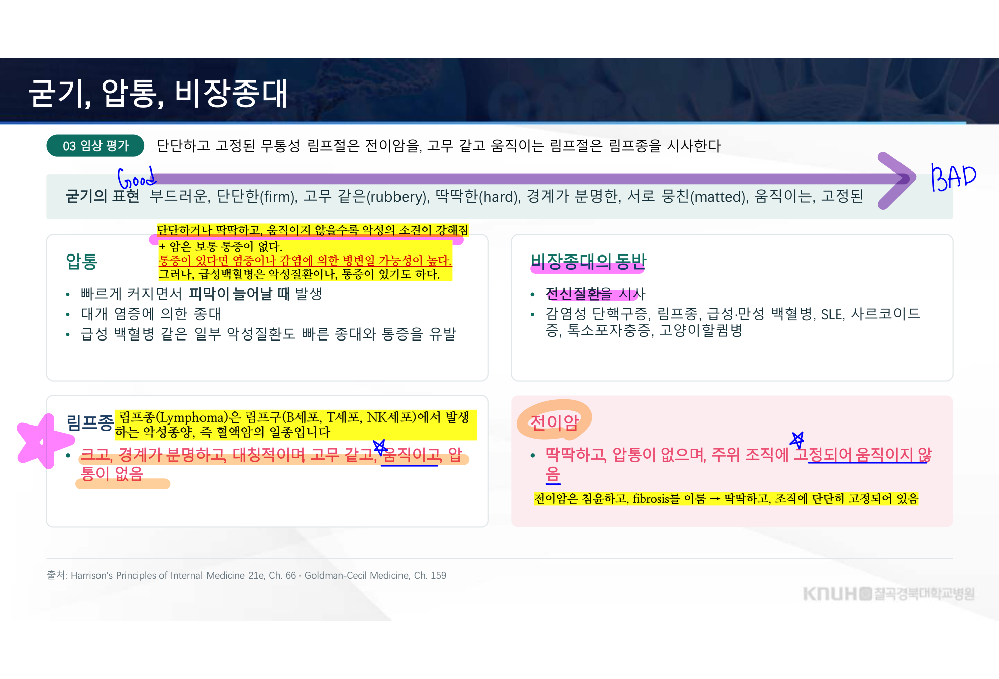{: style="width:80%"}

**굳기의 표현** — 부드러운 → 단단한(firm) → 고무 같은(rubbery) → 딱딱한(hard), 경계가 분명한(discrete), 서로 뭉친(matted), 움직이는 → 고정된. 필기의 화살표처럼 **왼쪽(Good)에서 오른쪽(BAD)으로 갈수록 악성** — **단단하거나 딱딱하고, 움직이지 않을수록 악성 소견이 강해진다.**

**압통**

- **빠르게 커지면서 피막이 늘어날 때** 생긴다 → **대개 염증에 의한 종대**.
- 암은 보통 통증이 없다. 통증이 있다면 염증·감염일 가능성이 높다.
- **예외: 급성 백혈병**은 악성질환이지만 빠른 종대로 **통증이 있기도 하다.**

**림프종 vs 전이암** — 둘 다 무통이지만 "움직이느냐"가 다르다(☆ 파란 밑줄).

| | 림프종 | 전이암(고형암) |
|---|---|---|
| 무엇 | 림프구(B·T·NK세포)에서 생기는 악성종양 = 혈액암의 일종 | 다른 장기 암이 림프절로 옮겨 옴 |
| 크기·모양 | **크고, 경계가 분명하고, 대칭적** | |
| 굳기 | **고무 같음(rubbery)** | **딱딱함(hard)** |
| 가동성 | **움직임** | **주위 조직에 고정되어 움직이지 않음** — 침윤하고 섬유화(fibrosis)를 이루기 때문 |
| 압통 | 없음 | 없음 |
| 분포 | 전신 또는 단일 | 국소(배액 영역) |

**비장종대의 동반 → 전신질환 시사**: 감염성 단핵구증, 림프종, 급·만성 백혈병, SLE, 사르코이드증, 톡소포자충증, 고양이할큄병.

!!! exam "기출 포인트"
    - 2부 6번(2023)·9번(2022): 25세 여성, 발열 + 양측 목의 **통증 있는 1 cm** 결절 여러 개 → 가능성이 **가장 낮은** 것 = **위암**(2023) / **전이성 암종**(2022). 감염성 단핵구증·톡소포자충증·기쿠치병·급성 인두염·에이즈·SLE는 모두 가능.
    - 2부 2번(2025): 28세, 발열·인후통, **부드럽고 움직이는 1.5 cm** 다발성 경부 림프절 + **비장 2 cm** + 비정형 림프구 → 감염성 단핵구증 → **EBV 항체검사**.

## 흉부와 복부의 림프절병증

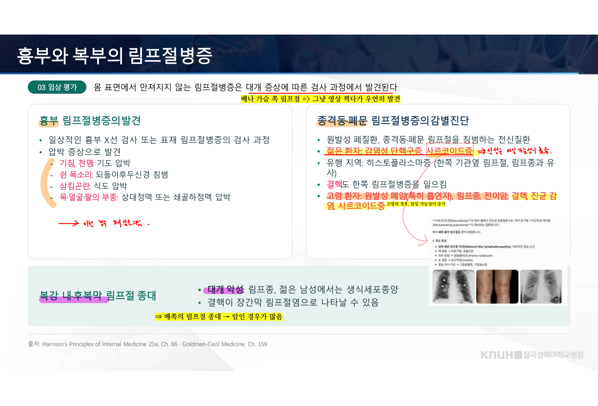{: style="width:80%"}

몸 표면에서 만져지지 않는 림프절병증은 **대개 증상 때문에 한 검사(영상)에서 우연히 발견**된다(배나 가슴 쪽 림프절 ⇒ 그냥 영상 찍다가 발견).

**흉부 림프절병증의 발견** — 일상적인 흉부 X선, 표재 림프절병증 검사 중, 또는 **압박 증상**:

| 증상 | 무엇이 눌렸나 |
|---|---|
| 기침, 천명(쌕쌕거림) | 기도 압박 |
| 쉰 목소리 | 되돌이후두신경 침범 |
| 삼킴곤란 | 식도 압박 |
| 목·얼굴·팔의 부종 | 상대정맥 또는 쇄골하정맥 압박 |

→ 필기(손글씨): 이런 압박 증상이 있는 경우 **폐암을 의심**.

**종격동·폐문 림프절병증의 감별진단**

- 원발성 폐질환, 종격동·폐문 림프절을 침범하는 전신질환.
- **젊은 환자: 감염성 단핵구증, 사르코이드증** ⇒ (손글씨) **악성은 아닐 가능성이 높음**. 사르코이드증은 원인 모를 전신 염증질환으로 **비건락성 육아종**을 만들고, 대표 영상이 **양측 폐문 림프절 비대**(필기에 붙인 그림: 결절홍반, 포도막염, 고칼슘혈증 동반).
- 유행 지역: 히스토플라스마증(한쪽 기관옆 림프절 → 림프종과 비슷).
- 결핵도 **한쪽** 림프절병증을 일으킨다.
- **고령 환자: 원발성 폐암(특히 흡연자)**, 림프종, 전이암, 결핵, 진균 감염, 사르코이드증 — 고령은 암일 가능성이 증가.

**복강 내·후복막 림프절 종대** — **대개 악성**: 림프종, **젊은 남성에서는 생식세포종양**. 결핵이 장간막 림프절염으로 나타날 수 있다. ⇒ 배 쪽 림프절 종대는 암인 경우가 많다.

!!! exam "기출 포인트"
    2부 7·11·14번: 고령 흡연자의 쇄골위(목) 종괴 + **흉부 X선에서 폐문·종격동 종괴** → 폐암 전이 의심 → 생검. 2부 11번에서 "**흉부 X선 소견**"은 생검 이유에 **해당한다**.

!!! diff "작년 필기와 다른 점"
    작년 필기에 있던 **"원인을 찾는 단서와 평가" 정리표**(나이·동반 증상·국소 vs 전신·압통·발적·움직임·크기·위치를 한 표로 모은 슬라이드)는 올해 없다. 내용은 3단원 전체와 같으므로 복습용으로 아래에 남겨 둔다.

    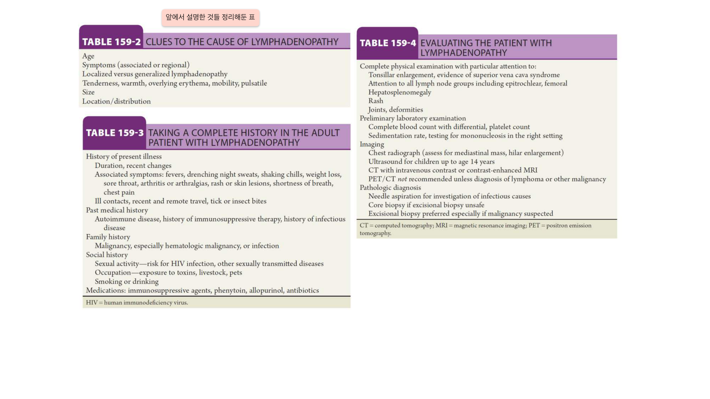{: style="width:84%"}
