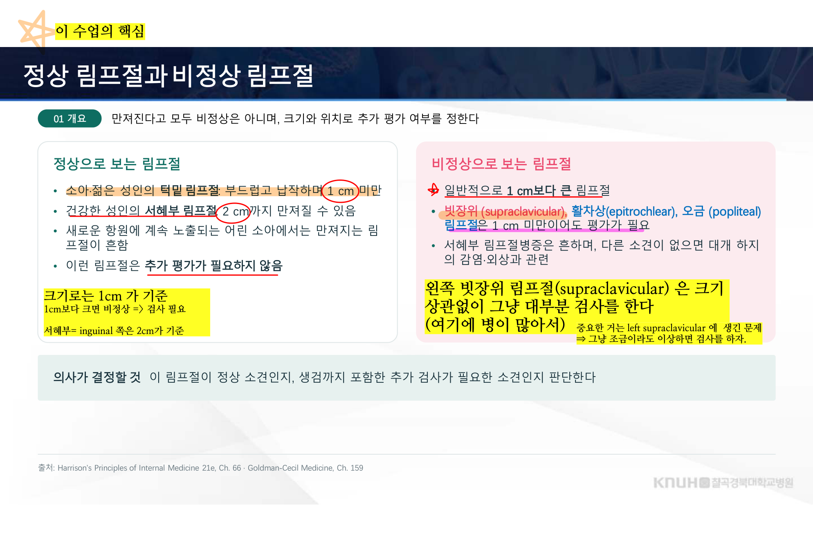
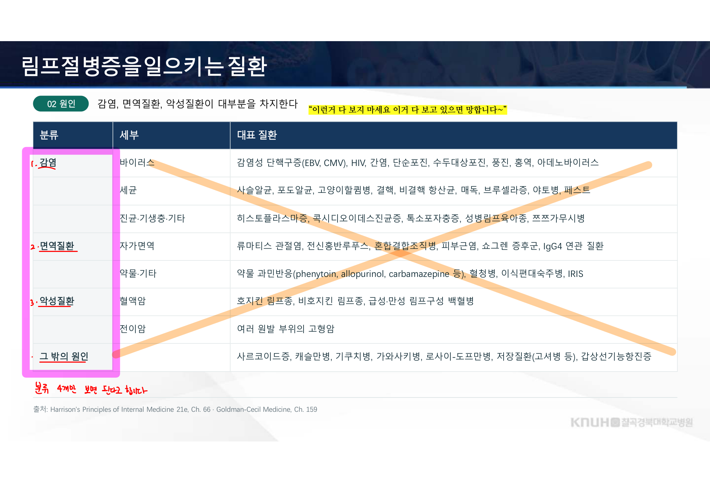
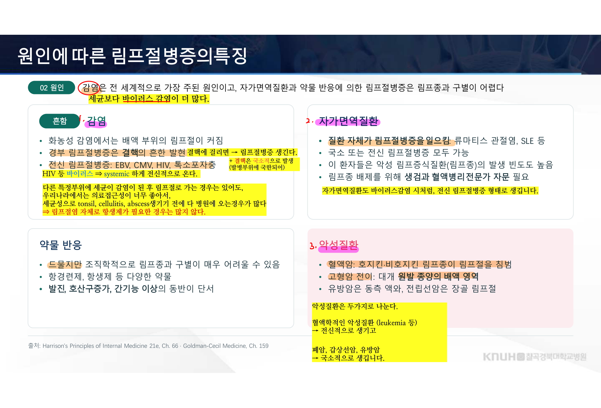

<!-- 필기본: 2026 · 2025 -->
<!-- 단계: 수업 후 -->

# 0. 이 수업을 공부하는 법

**권기태 교수님**(감염내과) 수업 — 2023·2025·2026 모두 같은 교수님이고, 기출 15문항(2020–2025)도 전부 이 수업 범위다. 올해(2026. 11. 17) 슬라이드는 Harrison 21판 66장·Cecil 159장을 바탕으로 **새로 만든 한글 슬라이드**(6단원: 개요 → 원인 → 임상평가 → 검사 → 생검 → 관리)로 바뀌었고, 필기본 2쪽에 2020–2025 기출 14문항 원본이 실려 있다.

교수님 말(필기본 1·25쪽):

- "**검사를 해야 하는가, 말아야 하는가 — 지켜봐도 되는가를 구분하는 것이 핵심.** 시험문제도 그렇게 나올 것 — 환자 케이스를 주고 알맞은 치료는? 진단은?"
- "**한 시간에 두 문제.** 지금까지 얘기한 데서 다 나왔다. **케이스 두 개 딱 나온다.**"

학습성과

1. 림프절염(림프절병증)의 감별진단을 설명할 수 있다.
2. 림프절염(림프절병증)의 임상적 평가를 설명할 수 있다.
3. 림프절염(림프절병증)에 시행하는 검사법을 설명할 수 있다.

기출은 거의 전부 두 증례의 변형이다:

1. **고령·흡연자, 왼쪽 쇄골위(빗장위), 3 cm, 단단하고 고정된 무통성 림프절 → 즉시 조직검사**(2부 1·7·11·14번)
2. **젊은 사람, 발열·인후통, 압통 있는 1 cm 안팎 다발성 경부 림프절 → 감염성 단핵구증·기쿠치병 등**, 악성(위암·전이암) 가능성이 가장 낮다(2부 2·6·9·12번)

그 밖에 부위–질환 짝(Virchow = 위암), 전신 림프절병증(에이즈), 대상포진 옆 림프절(acyclovir 후 관찰), 림프종(B 증상), 전이암 의심 소견(초음파 모양).

!!! key "핵심"
    **"그냥 지켜볼 것인가, 빨리 조직검사할 것인가"를 구분하는 게 이 수업의 전부다.**
    조직검사 쪽: **나이 >40(50), 쇄골위(특히 왼쪽), 크기 >2.25 cm²(지름 >2 cm), 딱딱함, 무통, 고정, 둥근 모양(L/S <2)**.
    관찰 쪽: **젊음, <1 cm², 부드러움, 압통, 상기도 증상 동반** → 2–4주 간격 추적, 항생제·스테로이드 X.

!!! diff "작년 필기와 다른 점"
    작년(2025)은 Harrison 매뉴얼(영어)을 그대로 읽는 슬라이드 24쪽이었고, 마지막에 **증례 2개 슬라이드**(감염성 단핵구증, 폐암 림프절 전이)와 "원인을 찾는 단서" 정리표가 있었다. 올해는 증례 슬라이드가 없어지고 대신 **핵심정리 6가지** 슬라이드가 생겼다. 다만 교수님은 올해도 "케이스 두 개 딱 나온다"고 했으므로, 작년 증례 두 개는 이 자료 **7단원**에 그대로 남겨 두었다 — 꼭 같이 볼 것.

# 1. 개요

## 림프절염과 림프절병증: 정의와 기전

{: style="width:78%"}

- **림프절염(lymphadenitis)**: 림프절에 말 그대로 **염증**이 생긴 것 — 급성 또는 만성. 감염 쪽에서 많이 쓰는 표현.
- **림프절병증(lymphadenopathy)**: 림프절이 **커진(종대) 상태** 그 자체 — 원인은 따지지 않는다. 악성종양 쪽에서 많이 쓰는 표현.
- 둘은 같은 환자를 두고 쓰지만, "염"은 원인(염증)을 이미 말하고 "병증"은 커졌다는 소견만 말한다는 차이가 있다. 시험 문제는 대개 "림프절종대·림프절병증"으로 표현한다.

!!! new "올해 필기에서 추가"
    **림프절이 커지는 세 가지 기전** (☆ 표시)

    | 기전 | 무엇이 일어나나 | 예 | 의미 |
    |---|---|---|---|
    | **반응** | 면역반응에 따른 림프구 **세포 증식** | 외부 항원(감염 등)에 대한 정상 면역반응 | **정상 과정** — 대부분 이것 |
    | **침윤** | **종양세포**가 들어와 자람 | 혈액암(림프종·백혈병), 고형암의 전이 | 비정상 |
    | **침착** | **이물질**이 쌓임 | 저장질환(storage disease, 예: 고셔병) | 비정상 |

    → "반응"이면 지켜봐도 되고, "침윤"이면 조직검사가 필요하다 — 이 수업의 핵심 질문이 기전에서부터 갈린다.

- **사람에게 림프절이 있는 부위**(그림): 경부(목 뒤·귀앞·위·아래 경부·쇄골위), 종격동·폐문, 겨드랑이(액와), 활차상(팔꿈치 안쪽), 장간막·대동맥옆·장골, 서혜부·대퇴, 오금. 초록 점(●)은 만져지는 림프절, 빈 점(○)은 만져지지 않는 림프절(흉부·복부).
- **가장 많이 생기는 부위는? ⇒ 목.** 그다음 겨드랑이, 복강 내, 서혜부. 각각의 자세한 위치까지 외울 필요는 없다.

## 정상 림프절과 비정상 림프절 ☆ "이 수업의 핵심"

{: style="width:78%"}

만져진다고 모두 비정상은 아니고, **크기와 위치**로 추가 평가 여부를 정한다. 의사가 결정할 것은 "이 림프절이 정상 소견인지, 생검까지 포함한 추가 검사가 필요한 소견인지"다.

| | 정상으로 본다 (추가 평가 불필요) | 비정상으로 본다 (평가 필요) |
|---|---|---|
| 크기 | 소아·젊은 성인의 **턱밑** 림프절: 부드럽고 납작하며 **<1 cm** / 건강한 성인의 **서혜부** 림프절: **2 cm까지** 만져질 수 있다 | 일반적으로 **1 cm보다 큰** 림프절 |
| 위치 | 새로운 항원에 계속 노출되는 어린 소아는 만져지는 림프절이 흔하다 | **빗장위(supraclavicular)·활차상(epitrochlear)·오금(popliteal)** 림프절은 **1 cm 미만이어도** 평가 |
| 서혜부 | — | 서혜부 림프절병증은 흔하고, 다른 소견이 없으면 대개 하지의 감염·외상 |

- **크기 기준은 1 cm**(서혜부만 2 cm): 그보다 크면 비정상 ⇒ 검사 필요. 서혜부는 다리에서 상처·감염이 늘 들어오므로 기준이 더 크다.
- **왼쪽 빗장위 림프절은 크기와 상관없이 대부분 검사한다**(여기에 병이 많아서) — "조금이라도 이상하면 검사를 하자."

!!! new "올해 필기에서 추가"
    작년에는 "정상" 기준(턱밑 <1 cm, 서혜부 ≤2 cm)만 있었는데, 올해는 **"비정상" 쪽 칸이 따로 생겼다**: **활차상·오금 림프절**도 빗장위처럼 **1 cm 미만이어도 평가** 대상이다. 이 세 곳은 평소에 만져지지 않는 자리라, 만져지는 것 자체가 이상 소견이다.

!!! exam "기출 포인트"
    2부 12번(2021): 25세, 콧물·인후통 + **턱밑 1 cm, 부드럽고 타원형, 압통** → 정상 범위의 반응성 림프절이라 **경과 관찰**.

## 림프절병증은 대부분 양성이다

| 어디서 본 환자인가 | 양성 | 악성 |
|---|---|---|
| **일차진료** | **2/3 이상**이 비특이적 원인 또는 상기도감염(바이러스·세균) | **1% 미만** |
| **림프절병증으로 의뢰된 환자**(한 연구) | **84%** — 원인이 확인된 것 중 **감염성 단핵구증, 톡소포자충증, 결핵**이 가장 흔하고, **63%는 원인을 못 찾은 비특이적·반응성** | **16%** — 림프종 또는 전이성 선암 |

- 일차병원에서 만나는 림프절병증이 종양일 확률은 1% 미만이고, (칠곡경대병원 같은) 의뢰 병원으로 온 환자는 16% 정도 — 걸러져서 온 환자이니 더 많은 게 당연하다.
- 그래서 **대부분 많은 검사가 필요 없다.** 감염이라도 대부분 바이러스성 상기도감염이라 조직검사·항생제가 필요 없다.

# 2. 원인 질환

## 림프절병증을 일으키는 질환 — "분류 4개만 보면 된다"

{: style="width:84%"}

교수님: **"이런 거 다 보지 마세요. 이거 다 보고 있으면 망합니다~"** → 질환 하나하나가 아니라 **분류 4개**(감염 / 면역질환 / 악성질환 / 그 밖의 원인)로 본다. 감염·면역질환·악성질환이 대부분을 차지한다.

| 분류 | 세부 | 대표 질환 | 어떻게 하나 |
|---|---|---|---|
| **1. 감염** | 바이러스 | **감염성 단핵구증(EBV, CMV)**, **HIV**, 간염, 단순포진, **수두대상포진**, 풍진, 홍역, 아데노바이러스 | 자가 제한적이면 관찰, 필요하면 추가 검사 |
| | 세균 | 사슬알균, 포도알균, 고양이할큄병, **결핵**, 비결핵항산균, **매독**, 브루셀라증, 야토병, 페스트 | 적절한 항균제 (요즘 세균성은 드물다) |
| | 진균·기생충·기타 | 히스토플라스마증, 콕시디오이데스진균증, **톡소포자충증**, 성병림프육아종, **쯔쯔가무시병** | |
| **2. 면역질환** | 자가면역 | 류마티스 관절염, **SLE**, 혼합결합조직병, 피부근염, 쇼그렌증후군, IgG4 연관질환 | 진단해서 추가 검사 |
| | 약물·기타 | **약물 과민반응(phenytoin, allopurinol, carbamazepine 등)**, 혈청병, 이식편대숙주병, IRIS(면역재구성 염증증후군) | |
| **3. 악성질환** ★ | 혈액암 | 호지킨·비호지킨 림프종, 급성·만성 림프구성 백혈병 | **당연히 조직검사** |
| | 전이암 | 여러 원발 부위의 고형암 | |
| **4. 그 밖의 원인** | | 사르코이드증, 캐슬만병, **기쿠치병**(동양인 젊은 여성), 가와사키병, 로사이-도프만병, 저장질환(고셔병 등), 갑상선기능항진증 | |

!!! diff "작년 필기와 다른 점"
    표의 큰 틀(카테고리로 보라)은 같다. 올해 표에 새로 들어간 질환: **비결핵항산균, 브루셀라증, 콕시디오이데스진균증, 피부근염·쇼그렌·IgG4 연관질환, allopurinol·carbamazepine, 혈청병, 이식편대숙주병, 로사이-도프만병, 저장질환(고셔병)**. 작년 표에는 있던 내분비 칸의 "**갑상샘암도 림프절이 커진다**"(필기)는 올해 "그 밖의 원인 — 갑상선기능항진증"으로만 남았고, 갑상선암은 경부 림프절의 **악성 원인(전이)**으로 3단원에 나온다.

## 원인에 따른 림프절병증의 특징

{: style="width:84%"}

감염이 전 세계적으로 가장 주된 원인이고, **자가면역질환과 약물 반응에 의한 림프절병증은 림프종과 구별이 어렵다**(조직으로도).

### ① 감염 (흔함)
- **세균보다 바이러스 감염이 더 많다.**
- 화농성(고름) 감염에서는 그 부위를 **배액하는 림프절**이 커진다(예: 편도염 → 턱밑, 발 봉와직염 → 서혜부).
- **경부 림프절병증은 결핵의 흔한 발현**이다 — 결핵에 걸리면 림프절병증이 생기고, 결핵은 **국소적**으로(발병 부위에 국한되어) 생긴다.
- **전신 림프절병증: EBV, CMV, HIV, 톡소포자충** — HIV 등 **바이러스는 systemic하게 전신적으로** 온다.
- 필기: 다른 부위에 세균 감염이 된 뒤 림프절로 가는 경우는 있어도, 우리나라는 **의료 접근성이 좋아서** 세균성 편도염·봉와직염·고름집이 생기기 전에 다 병원에 온다 ⇒ **림프절염 자체로 항생제가 필요한 경우는 많지 않다.**

### ② 자가면역질환
- **질환 자체가 림프절병증을 일으킨다**: 류마티스 관절염, SLE 등. 국소·전신 모두 가능하지만, 필기는 "**자가면역질환도 바이러스 감염처럼 전신 림프절병증 형태로 생긴다**".
- 이 환자들은 **악성 림프증식질환(림프종)의 발생 빈도도 높다** → 림프종을 배제하려면 **생검과 혈액병리 전문가 자문**이 필요하다.

### 약물 반응
- **드물지만** 조직학적으로 림프종과 구별이 매우 어려울 수 있다. 항경련제(phenytoin, carbamazepine), 항생제 등 다양한 약물.
- 단서: **발진, 호산구증가, 간기능 이상**이 같이 있으면 약물을 의심한다(DRESS 같은 약물 과민반응 양상).

### ③ 악성질환 — 두 가지로 나눈다
- **혈액학적 악성질환**(호지킨·비호지킨 림프종, 백혈병) → 림프절을 직접 침범하며 **전신적으로** 생긴다.
- **고형암 전이**(폐암, 갑상선암, 유방암 등) → **국소적으로**, 대개 **원발 종양의 배액 영역**에 생긴다: **유방암은 같은 쪽 액와, 전립선암은 장골 림프절**.

!!! new "올해 필기에서 추가"
    이 "원인별 특징" 슬라이드는 올해 새로 생겼다. 시험에 쓰기 좋은 짝: **바이러스·자가면역·혈액암 = 전신**, **결핵·고형암 전이·화농성 세균 = 국소**. 그리고 **자가면역·약물 반응은 림프종과 헷갈린다**(→ 생검 + 혈액병리 자문, 약물이면 발진·호산구·간기능 이상).

!!! exam "기출 포인트"
    2부 4번(2024): 림프절병증이 **전신적으로** 생길 가능성이 높은 것 = **에이즈**. 폐암·난소암(국소 전이), **림프절 결핵(주로 경부, 국소)**, 대상포진(해당 피절의 국소) — 위의 "전신 vs 국소" 짝 그대로다.
