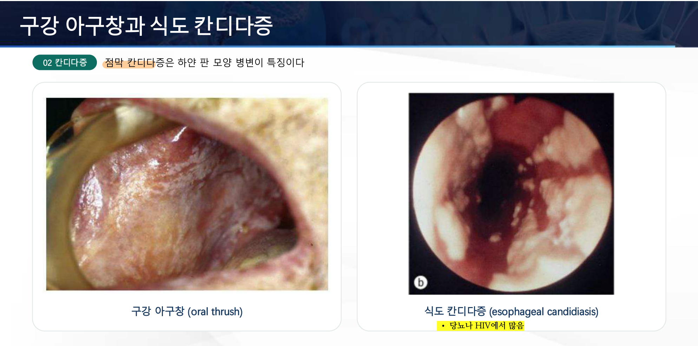
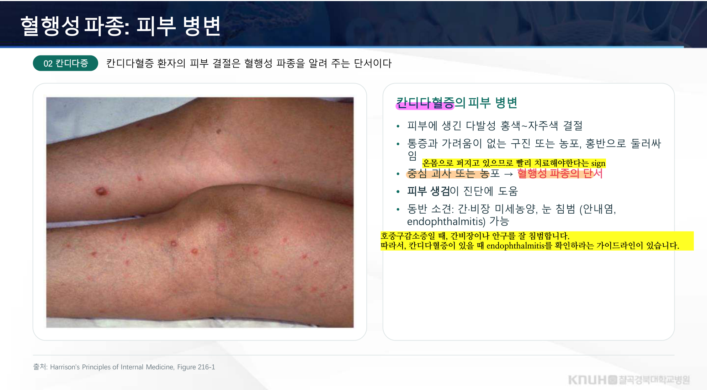
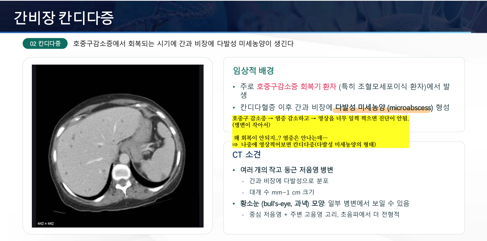

<!-- 필기본: 2026 · 2025 -->
<!-- 단계: 수업 후 -->

# 0. 이 수업을 공부하는 법

**권기태 교수님**(경북대병원 감염내과) 수업 — 2023·2025·2026 같은 교수님이다. 올해 강의는 2026년 11월 17일.

필기본 표지 메모: **"두 문제 출제!"** — 올해 시험에 이 수업에서 2문제가 나온다.

올해 슬라이드는 작년과 뼈대(Harrison 내과학 + 감염학 교과서)는 같지만, **한국어 슬라이드로 새로 만들어졌고** 표가 많이 늘었다. 교수님이 가장 오래 설명한 것은 6–7쪽의 **「기회감염 진균증 한눈에 보기」 표** 하나다.

- 교수님 말: "**이 표만 열심히 잘 보면 시험문제를 풀 수 있습니다**", "**원인이 뭔지, 진단 어떻게 하는지, 치료약은 뭔지 정확하게 아셔야 합니다**", 필기 메모 "이 표를 오래 설명했습니다".
- 3쪽 손글씨: "**진균증은 다섯 개만 보면 된다**" — 칸디다, 아스페르길루스, 크립토코쿠스, 털곰팡이증, 폐포자충 폐렴.
- 35쪽(항진균제 범위표): "**시험문제에는 안 듣는 게 뭔지 아는 게 중요하겠죠**".
- **Candida auris**: 교수님 말 "기출문제에는 있는데 **이번에는 안 냈습니다**", 필기 2쪽 족보 메모 "**candida auris 올해는 출제 X**". → 이름과 특징만 가볍게.

필기본 표시 읽는 법: 노란 상자 = 필기한 학생이 받아 적은 교수님 말, 주황·분홍 형광펜 = 교수님이 강조한 곳, 빨간 별(☆) = 중요 표시.

!!! diff "작년 필기와 다른 점"
    작년 필기 메모는 "**보통 진단 + 치료제를 묻는 문제! 22년도에는 위험인자도 나왔다**"였다. 올해는 표에 **일차 치료** 칸이 생기고, 칸디다증을 **점막형 / 침습형**으로 나눠 위험인자·치료를 따로 적었다. 새로 생긴 슬라이드: 칸디다혈증 선행 요인표, 카테터 감염·안내염, 점막피부 칸디다증 치료표, 아스페르길루스 형태별 진단검사표·CT 시간 변화, 털곰팡이 치료표·피부 사진, 폐포자충 임상양상·현미경·치료·예방 표.

학습성과(올해, 작년과 같음)

1. 기회감염 진균증과 풍토성 진균증을 구분한다.
2. 진균증의 진단에 대해 설명한다.
3. 칸디다(candidiasis), 4. 아스페르길루스(aspergillosis), 5. 크립토코쿠스(cryptococcosis), 6. 털곰팡이(mucormycosis), 7. 폐포자충(pneumocystosis) 감염증의 특징과 치료를 설명한다.

기출: 2부 16문항(2020–2025). 2023년 이 교수님 문제(골수이식 후 폐 병변 → **아스페르길루스증 / 보리코나졸**, 2문항)는 필기본 2쪽 족보에 실려 있지만 저장소에는 원본이 없어 2부에 없다 — 3장에 문제 내용을 적어 두었다.

!!! key "핵심 — 진균과 일차 치료제 짝 (6–7쪽 표의 마지막 칸)"
    | 진균 | 일차 치료 | 안 듣는 약(함정) |
    |---|---|---|
    | **Candida** 점막 | **Fluconazole** | — |
    | **Candida** 침습(칸디다혈증) | **Echinocandin**(-fungin: caspofungin, micafungin, anidulafungin) + **중심정맥관 제거** → 좋아지면 fluconazole | — |
    | **Cryptococcus** | **Amphotericin B + flucytosine → 이후 fluconazole** | Echinocandin |
    | **Aspergillus** | **Voriconazole** (isavuconazole) | **Fluconazole** |
    | **Mucor**(털곰팡이) | **Liposomal amphotericin B + 수술적 괴사조직 제거** (+ 당 조절) | **Voriconazole**, fluconazole, echinocandin |
    | **Pneumocystis** | **TMP-SMX**(trimethoprim-sulfamethoxazole), 중등도 이상이면 **스테로이드 추가** | 항진균제 전부(amphotericin B 포함) |
    **Amphotericin B는 폐포자충을 뺀 모든 진균에 듣는다**(34쪽 필기).

# 1. 개요와 진단

## 풍토성 진균증 vs 기회감염 진균증

{: style="width:76%"}

- **풍토성 진균증(endemic mycoses)**: **특정 지역**의 흙·환경에 사는 진균이 그 지역 사람에게 생기는 병 — 콕시디오이데스진균증(coccidioidomycosis), 히스토플라스마증(histoplasmosis), 분아균증(blastomycosis), 흑색진균증(phaeohyphomycosis), 페니실륨증(penicilliosis), 스포로트릭스증(sporotrichosis), 파라콕시디오이데스진균증, 아디아스피로진균증. 건강한 사람도 걸린다는 점이 기회감염과 다르다. **풍토성 진균증도 기회감염으로 생길 수 있다**(면역저하자에서 더 심하게).
    - 필기: "**우리나라에서는 풍토성 진균증은 거의 없다.**"
- **기회감염 진균증(opportunistic mycoses)**: 평소에는 병을 거의 안 일으키다가 **면역이 떨어진 환자**에게 생기는 것 — 칸디다증, 아스페르길루스증, 크립토코쿠스증, 털곰팡이증(mucormycosis, 접합균증 zygomycosis), 스케도스포륨증, 트리코스포론증, 푸사륨증, 폐포자충증.
    - 필기: "**오늘 하는 진균증 5개는 모두 기회감염 진균증**" — 형광펜 친 5개(칸디다, 아스페르길루스, 크립토코쿠스, 털곰팡이, 폐포자충)만 공부한다.

## 기회감염 진균증 한눈에 보기 ★★ (교수님이 가장 오래 설명한 표)

{: style="width:92%"}

{: style="width:92%"}

| 감염증 | 위험 인자 | 주요 특징과 진단 | 일차 치료 |
|---|---|---|---|
| **칸디다증** | 점막: **HIV/AIDS**, 스테로이드(글루코코르티코이드), 항생제 / 침습성: **호중구감소증, 중심정맥관**, 중환자실, 총정맥영양(TPN), 넓은 범위 항생제 | 점막: 구강·식도·외음질 / 침습성: **칸디다혈증**, 간비장·눈 침범, **β-D-glucan** | 점막: **fluconazole** / 침습성: **echinocandin, 중심정맥관 제거** |
| **크립토코쿠스증** | **HIV/AIDS(CD4 <100/μL)**, 스테로이드 | **수막뇌염**, 폐렴, 피부, **먹물(India ink) 염색**, **크립토코쿠스 항원**(혈청·CSF) | **Amphotericin B + flucytosine → fluconazole** |
| **아스페르길루스증** | **호중구감소증, 이식**, 스테로이드, 중환자실 | **폐 침범(혈관 침습)**, CT **달무리 징후(halo sign)**, **갈락토만난(galactomannan) 항원**, **예각으로 분지하는 격벽 균사** | **Voriconazole** |
| **털곰팡이증** | **당뇨병케톤산증(조절 안 되는 당뇨)**, 호중구감소증, 이식 | **코–안와–뇌 침범**, 혈관 침습 → **검은 괴사딱지**, 조직검사: **직각으로 분지, 격벽 거의 없음** | **Liposomal amphotericin B + 수술적 괴사조직 제거** |
| **폐포자충증** | **HIV/AIDS(CD4 <200/μL)**, 스테로이드, 이식 | **간질성 폐렴**, **저산소혈증**, **BAL PCR**, **배양 불가능**(특수 염색으로 확인) | **TMP-SMX**, 중등도 이상이면 **스테로이드 추가** |

교수님 설명(필기 6–7쪽 노란 상자)을 한 줄씩 풀면:

1. **칸디다증은 점막성과 침습성 두 가지.**
    - 점막: 스테로이드 복용, AIDS로 면역(특히 T세포)이 약해지면 입·식도에 생긴다 → **fluconazole**.
    - 침습성: **중심정맥 카테터를 오래** 쓰거나 **호중구감소증** → 혈액에서 칸디다가 자란다(칸디다혈증) → **echinocandin으로 치료하다가 좋아지면 fluconazole로 바꾼다**(손글씨 "→ 좋아지면 fluconazole").
    - 왜 갈리나: 점막 방어는 T세포(세포면역), 혈류 침입 방어는 호중구가 맡기 때문. 그래서 **HIV는 점막형, 호중구감소·카테터는 침습형**의 위험인자다.
2. **크립토코쿠스증**: 대부분 **AIDS**. **수막뇌염(중추신경 침범)**이 흔하다. 염색(효모 모양 확인)이나 **크립토코쿠스 항원**으로 진단. 치료 **amphotericin B + flucytosine**.
3. **아스페르길루스**: 원인 **호중구감소증, 이식 환자**("이식 환자에게부터 호중구 감소증이 나타난다는 게 특징"). 진단은 **달무리 징후**(가운데 경화 consolidation, 주변부 출혈 → 희뿌연 모양)와 **갈락토만난 항원**("아스페르길루스에 있는 다당류 항원"). 치료 **voriconazole**. 균사는 **예각, 격벽 있음**.
4. **털곰팡이증**: 원인 인자 → **당뇨!** **sinus(부비동)부터 시작해 점막을 뚫고 위로, 뇌 쪽으로** 올라간다. 진단은 특별한 게 없고 **조직검사**를 해야 한다. 치료는 **liposomal amphotericin B + 검게 괴사된 조직을 수술로 제거**. 균사는 **둔각(직각), 격벽 없음**.
    - 그냥 amphotericin B는 **신독성** 등 부작용이 많아, 지질(lipid)을 붙여 부작용을 줄인 것이 **liposomal amphotericin B**.
5. **폐포자충증**: 원인 **AIDS, 이식** — 그러나 **지금은 non-HIV(스테로이드·이식 등)에서 감염이 더 많다**. **간질성 폐렴, 양측 대칭성, 저산소혈증**. **BAL(기관지폐포세척액)을 PCR**로 진단.

!!! memo "암기 — 필기 7쪽 그림 암기법 (아스페르길루스)"
    **에스퍼**(초능력 포켓몬) = **아스페르**길루스 → **보리** = **보리**코나졸, **달**(달무리) = **halo sign**, **갈릭**(마늘) = **갈락**토만난. "에스퍼가 보리밭에서 달 보며 마늘 먹는다."

!!! diff "작년 필기와 다른 점"
    - 작년 표에는 **일차 치료 칸이 없었고** 칸디다 위험인자가 "HIV/AIDS, 부신피질호르몬, 호중구감소증, 중환자실" 한 줄이었다. 올해는 **점막(HIV·스테로이드·항생제) / 침습(호중구감소·중심정맥관·ICU·TPN·항생제)** 으로 나눴다.
    - 올해 새로 적힌 숫자: 크립토코쿠스 **CD4 <100/μL**, 폐포자충 **CD4 <200/μL**.
    - 털곰팡이 균사: 작년 "**넓은 각**으로 꺾임" → 올해 표 "**직각**으로 분지"(같은 뜻 — 아스페르길루스의 **예각** 45°와 대비되는 **넓은 각·직각** 90°).
    - 작년 교수님 설명(올해 없음): 진균은 **배양이 어렵다** — 조직을 얻으려면 침습적이고, 면역이 떨어진 환자라 감염 악화·출혈 위험이 있다(이식 환자는 항암치료로 자기 면역을 거의 없앤 상태에서 남의 장기를 받는다) → 그래서 **혈액이나 BAL**로 검사한다.

## 진균감염증의 진단 방법 ★

{: style="width:92%"}

| 기법 | 특징 | 장점 | 단점 |
|---|---|---|---|
| **현미경·조직병리** | 빠르지만 민감도 낮음, 형태에 의존. 염색: **KOH 도말, 먹물, 고모리 메테나민 은(GMS), PAS** | 특정 진균 확인(크립토코쿠스, 히스토플라스마). **균사 형태로 추정**: 아스페르길루스 **격벽 있음·예각**, 털곰팡이 **격벽 거의 없음·직각**, 칸디다 **거짓균사** | 여러 진균 모양이 비슷 → 종 동정 어려움(아스페르길루스, 칸디다) |
| **배양** | 성장의 조기 검출 | 종 수준 동정, **내성 확인**. **혈액배양에서 칸디다가 자라면 오염으로 보지 않음** | **아스페르길루스는 혈액배양에서 거의 안 자람**, 침습성 칸디다증 혈액배양 민감도 **약 50%**, 풍토성 진균은 배양률 낮음 |
| **항원 검출** | 혈액, BAL, CSF, 소변 | **크립토코쿠스 항원**(혈청·CSF, 신속검사), **아스페르길루스 갈락토만난**, 히스토플라스마 항원 | 갈락토만난은 **푸사륨(Fusarium)과 교차반응**, 다른 진균에는 한계 |
| **(1,3)-β-D-glucan** | 침습성 감염 **배제**에 유용(**높은 음성 예측도**) | 아스페르길루스, 칸디다, 폐포자충 등의 선별 | **털곰팡이, 크립토코쿠스에는 음성** |
| **항체 검출** | 중등도 민감도 | **알레르기 기관지폐 아스페르길루스증**, 풍토성 진균 | 대부분의 **기회감염 진균에는 부적합** |
| **PCR** | 배양보다 민감 | **폐포자충**, 아스페르길루스 진단(BAL) | 오염에 주의 |

교수님 설명(필기 8쪽):

- **왜 항원검사를 많이 하나**: 아픈 환자를 전신마취하고 조직 생검하기는 쉽지 않으니 **항원 검사를 많이** 한다.
- **배양 해석**: 곰팡이가 배양됐다고 감염이라고 볼 수는 없다 — 피부에 그냥 붙어 있는 균도 있다. 그러나 **혈액배양**에서 나오면 **무조건 병**이다(정상 혈액은 무균). **칸디다는 혈액배양에서 잘 자라고, 아스페르길루스는 자라지 않는다.**
- **항원**: 크립토코쿠스는 **CSF에서 항원** 검출 가능. 아스페르길루스는 **갈락토만난 항원**으로 진단.
- **β-D-glucan**: 진균 세포벽 성분. **음성이면 실제로 균이 없을 확률이 높다.** 털곰팡이와 크립토코쿠스는 감염되어도 **원래 음성**이 나온다(털곰팡이는 세포벽에 β-glucan이 거의 없고, 크립토코쿠스는 두꺼운 피막이 가린다).
- **항체**: 알레르기 기관지폐 아스페르길루스증은 **IgE** 검출이 가능하지만(진균 자체가 아니라 몸의 반응이 병이라서), 거의 대부분의 진균 감염에는 부적합(면역저하 환자는 항체를 잘 못 만든다).
- **PCR**: **폐포자충을 주로, 가장 많이 PCR로** 한다.

!!! diff "작년 필기와 다른 점"
    - 작년: "PCR — 오염, 표준화 부족, **진균에는 아직 활용도 낮음**" → 올해: **폐포자충은 PCR이 가장 많이 쓰이는 진단법**, 아스페르길루스도 BAL PCR.
    - 올해 새로: 염색 이름(KOH, 먹물, GMS, PAS), **혈액배양에서 칸디다 = 오염 아님**, **침습성 칸디다증 혈액배양 민감도 약 50%**, 갈락토만난의 **푸사륨 교차반응**.
    - 작년 교수님 말: "**조직병리와 배양이 gold standard(확진)** — 하지만 진행하기 쉽지 않다", "**Mucor는 조직(현미경)으로 확인**", "항원검출이 **임상에서 제일 많이**", "균종 종류도 알아 두시고, 중요하니까 시험에 잘 낼 거고".

!!! exam "기출 포인트"
    이 표 자체를 묻는 문제는 아직 없지만, 2부 1번(2025)의 오답 보기가 이 표에서 나왔다 — "**배양이 진단에 가장 유용**(X, 폐포자충은 배양 불가)", "**β-D-glucan으로 진단 불가**(X, 폐포자충은 β-D-glucan 양성)". 올해 표에 β-D-glucan이 **음성인 것 = 털곰팡이·크립토코쿠스**가 빨간 글씨로 강조됐다.

# 2. 칸디다증 (Candidiasis)

## 원인균과 발병기전

- **원인균**: **Candida albicans(가장 흔함)**, C. parapsilosis, C. tropicalis, C. krusei, C. glabrata 등. 이 중 **C. krusei·C. glabrata는 fluconazole이 잘 안 듣는 두 종**(35쪽 손글씨)이라 치료가 골치 아프다.
- **발병기전**: **넓은 범위 항생제**로 입안·질·대변의 정상 세균총이 줄면 그 자리를 칸디다가 차지해 **집락이 늘어난 뒤** 감염이 생긴다.
    - **입인두 아구창(oropharyngeal thrush)**: **신생아, 당뇨병, HIV 감염, 틀니** 사용자에서 흔하다.
    - **외음질 칸디다증**: **임신 제3삼분기**에 흔하다(에스트로겐 → 질 상피 글리코겐 ↑).
    - **칸디다혈증(candidemia)**: **중심정맥관** 관련, **특히 총정맥영양(TPN)을 할 때**(분홍 형광펜). 관을 오래 꽂고, 고농도 포도당·지질 영양액이 칸디다가 자라기 좋은 배지가 된다.
- 필기: "**중심정맥관 사용 시, 침습성으로 혈액에서 검출이 가능 → 이 경우 에키노칸딘으로 치료.**"

## 임상양상

- **점막·요로 감염**
    - **구강 아구창(oral thrush)**: 붉은 점막 위에 **하얀 치즈처럼** 보이는 병변(긁으면 벗겨지고 밑이 붉다).
    - **식도 칸디다증**: 삼킴 통증. 내시경에서 하얀 판.
    - **요로 감염**: 방광염, 신우염, 신유두괴사.
- **혈행성 파종(hematogenous dissemination)**
    - **만성 파종성 칸디다증(= 간비장 칸디다증)**: **심한 호중구감소증에서 회복 중인 급성백혈병** 환자에서 주로. 필기: "호중구감소증으로 면역이 저하된 사람은 칸디다가 혈액에서 자라다가 **간이나 비장으로 이동** → 간비장 칸디다증".
    - 그 밖에 중추신경계, 관절, 폐 감염(매우 드묾).

!!! key "소변 배양 해석 주의 (필기 10쪽 분홍 상자)"
    소변에서 칸디다가 배양되는 경우 **대부분은 도뇨관(Foley catheter)이나 많은 잔뇨에 따른 단순 방광 집락**이다. 필기: "**혈액과 달리 소변에서 검출된 칸디다는 단순 방광 집락이므로, 그냥 무시합니다.**" → 소변·객담·피부는 원래 균이 있을 수 있는 곳, **혈액·CSF·관절액은 무균 검체 → 나오면 감염**.

## 혈행성 파종성 칸디다증의 선행 요인

{: style="width:86%"}

| 약물·카테터·기저 상태 | 수술·면역저하·그 밖 |
|---|---|
| **항균제 사용** | **복부 수술과 흉부 수술** |
| **정맥 유치 카테터** | 세포독성 항암화학요법 |
| 고영양 수액(정맥영양) | **장기이식 후 면역억제제** |
| 유치 도뇨관 | 인공호흡기 |
| 비경구 글루코코르티코이드 | 골수세포 과산화효소(myeloperoxidase) 결핍 |
| 중증 화상 | **호중구감소증** |
| CARD9 결핍(중추신경계 감염) | 저체중 출생(신생아), 당뇨병 |

- 기전으로 묶으면: ① 칸디다가 **많아짐**(항생제) ② **들어갈 문**이 열림(카테터, 수술, 화상, 인공호흡기) ③ **잡아먹을 호중구**가 없음(호중구감소, 항암, MPO 결핍, 스테로이드, 이식 면역억제).
- **HIV는 이 표에 없다** — HIV는 T세포 결핍이라 **점막** 칸디다증의 위험인자다.

!!! new "올해 필기에서 추가"
    이 선행 요인표(Harrison Table 216-1)는 올해 새 슬라이드다. 필기 메모: "**올해는 '호중구 감소증' 하나만 설명하시고 넘어가셨지만, 기출에 출제된 바는 있습니다.**"

!!! exam "기출 포인트"
    2부 5번(2022): Candidemia의 위험인자가 **아닌** 것 = **HIV 감염**. 중심정맥관, 복부·흉부 수술, 장기이식 면역억제제, 호중구감소는 모두 표에 있다 — 필기본 11쪽에 이 기출이 그대로 붙어 있다.

## 진단

| | 표재성 칸디다증 | 심부 병변 |
|---|---|---|
| 원칙 | **배양만으로는 진단할 수 없다**(칸디다는 구강·질·피부의 **정상 상재균**) | **생검 검체의 조직 절편 검사** |
| 방법 | **습식 도말(wet smear)**에서 **출아 효모와 거짓균사 또는 균사**를 확인하고 배양으로 확진 | **뇌척수액, 혈액, 관절액, 조직의 배양** — 무균 검체라 검출되면 감염 |

필기: "표재성 칸디다는 피부에 정상 상재균이므로 배양만으로 진단할 수 없으나, **침습성(혈액, CSF, 관절액) 등은 검출이 되면 감염이 되었다고 진단할 수 있다.**"

## 구강 아구창과 식도 칸디다증

{: style="width:72%"}

- 점막 칸디다증은 **하얀 판 모양 병변**이 특징. 필기: 식도 칸디다증은 "**당뇨나 HIV에서 많음**".

!!! exam "기출 포인트"
    - 2부 14번(2020): **혈당 조절 안 되는 당뇨** 환자의 구강 흰 병변(아구창) → 으뜸 치료 **fluconazole**(점막형 = fluconazole). 오답 vancomycin·linezolid·TMP-SMX는 세균 약. 필기본 6쪽에도 이 문제가 붙어 있다(손글씨 "← 점막").
    - 2부 9번(2022): 구강 흰 막 + 식도 흰 반점 + 간·비장의 작은 저음영 병변 사진 → **Candidiasis**.

## 혈행성 파종: 피부 병변

{: style="width:76%"}

- **다발성 홍색~자주색 결절**, 통증·가려움이 없는 구진 또는 농포(홍반으로 둘러싸임), **중심 괴사 또는 농포 → 혈행성 파종의 단서**. **피부 생검**이 진단에 도움.
- 동반 소견: **간·비장 미세농양, 눈 침범(안내염, endophthalmitis)**.
- 필기: "**온몸으로 퍼지고 있으므로 빨리 치료해야 한다는 sign**", "호중구감소증일 때 간비장이나 안구를 잘 침범합니다. 따라서 **칸디다혈증이 있을 때 endophthalmitis를 확인하라는 가이드라인**이 있습니다."

## 카테터 관련 감염과 혈행성 파종

{: style="width:76%"}

- **중심정맥관 삽입 부위 감염** → 칸디다혈증 → **눈으로 파종**(혈행성 칸디다 안내염).
- 안저: 맥락망막에서 **유리체로 돌출한 회백색 병변**(화살표), 주변이 뿌옇다. 병변은 균보다 **주로 염증세포**. 진행하면 광범위한 유리체 염증과 **안구 상실**.
- 치료: **부분 유리체절제술 + 정맥 항진균제**(필요하면 **유리체 내 주사**).
- 그래서 칸디다혈증 = **① 중심정맥관 제거 ② 안과 검진(안저)** 이 항진균제와 함께 따라간다.

!!! new "올해 필기에서 추가"
    카테터 삽입 부위 사진과 안내염 안저 사진, 안내염 치료(유리체절제술·유리체 내 주사)는 올해 새 슬라이드다.

!!! diff "작년 필기와 다른 점"
    작년 교수님 말: "**혈액에서 Candida가 나오면 눈 검사**를 해야 한다. 안구 침범이 있으면 치료 기간이 **4주**까지 늘고, 없으면 **2주** 정도." 올해 슬라이드(18쪽)는 "**마지막 혈액배양 양성일과 증상·징후 호전 이후 2주까지**"로 적었다.

## 간비장 칸디다증 (Hepatosplenic candidiasis)

{: style="width:74%"}

- **임상 배경**: 주로 **호중구감소증 회복기** 환자(특히 조혈모세포이식). 칸디다혈증 이후 간과 비장에 **다발성 미세농양(microabscess)**.
- **CT**: **여러 개의 작고 둥근 저음영 병변**(간·비장에 다발성, 대개 수 mm–1 cm). **황소눈(bull's-eye, 과녁) 모양** — 중심 저음영 + 주변 고음영 고리, **초음파에서 더 전형적**.
- 왜 **회복기**에 보이나(필기): 호중구감소증 때는 **염증이 안 생겨** 영상을 너무 일찍 찍으면 병변이 작아 안 보인다. "왜 회복이 안 되지? 염증은 안 나는데…" → **호중구가 돌아와 염증(농양)을 만들 때** 찍어 보면 다발성 미세농양으로 보인다.

## 점막피부 칸디다증의 치료

{: style="width:84%"}

| 부위 | 우선 치료 | 대체 치료 |
|---|---|---|
| 피부 | 국소 아졸(azole) | 국소 니스타틴(nystatin) |
| 외음질 | **경구 fluconazole 150 mg**(1회) 또는 아졸 크림·질좌제 | 니스타틴 질좌제 |
| 구강(아구창) | 클로트리마졸(clotrimazole) 트로키 | 니스타틴, fluconazole |
| 식도 | **fluconazole 정제 100–200 mg/일** 또는 itraconazole 액제 200 mg/일 | caspofungin, micafungin 또는 amphotericin B |

- 원칙: **국소(피부·질·입) → 바르거나 녹여 먹는 약**, 식도처럼 깊어지면 **경구 fluconazole**, 안 들으면 정맥 약(echinocandin, amphotericin B).
- 필기: "국소적으로 발생했을 때의 치료제는 이렇고~ (**넘어갔습니다**)".

!!! new "올해 필기에서 추가"
    점막피부 칸디다증 치료표(Harrison Table 216-3)는 올해 새로 들어갔다(강의에서는 넘어감).

## 파종성 칸디다증의 치료 약제 ★

{: style="width:88%"}

필기: "**전신적 = 파종성으로 발생했을 때의 치료제는 이렇습니다. 용량은 안 봐도 되고**" (용량 칸에 X 표시). 치료 기간: **마지막 혈액배양 양성일과 감염 증상·징후 호전 이후 2주까지**.

| 계열 | 약 | 비고 |
|---|---|---|
| **Amphotericin B deoxycholate** ☆ | 정맥 | 대부분 **지질 제형으로 대체됨**(독성) |
| Amphotericin B **지질 제형** | 리포솜(AmBisome), 지질 복합체, 콜로이드 분산제 — 정맥 | FDA 일차 치료 승인은 없으나 **독성이 적어 흔히 사용**. 콜로이드 분산제는 주입 관련 반응 흔함 |
| **아졸계** | **posaconazole**(정맥·경구) | **예방 요법**으로 승인 |
| | **fluconazole** ☆ (정맥·경구) | **가장 흔히 사용** — "칸디다에서는 플루코나졸을 가장 많이 사용함" |
| | **voriconazole** ☆ (정맥·경구) | **약물상호작용이 많음**. 호중구감소증이 없는 환자의 칸디다혈증에 승인. 필기: "**아스페르길루스에서 더 많이 사용하나 칸디다에서도 효과는 있음**" |
| **에키노칸딘계** | **caspofungin, anidulafungin, micafungin** — **정맥만** | 칸디다 종에 넓은 범위, 파종성 칸디다증 승인, **amphotericin B 제형보다 독성 적음** |

- 필기: "**-fungin이면 에키노칸딘 계열**", "**중증의 경우 에키노칸딘 계열을 사용**", "**중증으로 입원 시 에키노칸딘 사용하다가, 호전되면 플루코나졸 경구로 바꿔 처방**"(step-down).
- 왜 echinocandin이 중증에 먼저인가: 세포벽 **β-1,3-glucan 합성을 막아 칸디다를 죽이는(살진균)** 약이고, fluconazole이 덜 듣는 **C. glabrata·C. krusei**에도 듣는다. 대신 주사만 있어 좋아지면 먹는 fluconazole로 바꾼다.

!!! diff "작년 필기와 다른 점"
    작년 교수님 말: amphotericin B deoxycholate는 "웬만한 진균에 다 잘 듣지만 **독약 수준**(열이 많이 나고 신장·간을 망친다)", 지질 제형은 "독성을 완화했지만 **너무 비싸다**", echinocandin은 "칸디다에 효과 자체는 더 좋은데 **우리나라는 보험 때문에 중증 칸디다에만** 사용". 올해는 "중증 → echinocandin → 호전되면 fluconazole 경구"로 정리됐다.

!!! exam "기출 포인트"
    2부 3번(2024): 맞는 짝 = **Candidiasis – Caspofungin**. 함정: Mucormycosis–voriconazole(X), Aspergillosis–fluconazole(X), Cryptococcosis–**micafungin**(X, echinocandin은 크립토코쿠스에 안 듣는다), Pneumocystosis–fluconazole(X). 필기본 2쪽 족보에 이 문제가 있다.

## 칸디다 아우리스 (Candida auris) — 올해 출제 X

{: style="width:86%"}

교수님 말: "**기출문제에는 있는데 이번에는 안 냈습니다. 골치 아픈 질병입니다.**", "**내성이 많고, 감염이 잘 되고… 이름 정도만 알고 계셔라~**" (2쪽 족보 메모: "candida auris 올해는 출제 X"). 그래도 연습문제 보기에는 나올 수 있으니 굵은 글씨만 보자.

| 구분 | 내용 |
|---|---|
| 정체 | 여러 약제에 **내성**을 보이며 의료기관에서 **집락화와 전파**를 일으키는 칸디다 **종(species)** |
| 역학 | 2009년 **일본** 첫 보고(역추적하면 한국 1996년), 30개국 이상 확산, 요양병원·중환자실 집락. **환경과 피부에서 오래 생존** |
| 특징 | **고온(42℃)·고염(10% NaCl)**에서도 자람, **생물막(biofilm)·피부 집락**이 강함, **거짓균사 없이도 감염** |
| 임상 | 혈류감염, 여러 장기 침범, **치사율 30–60%** — 침습성 감염 양상은 다른 칸디다와 비슷 |
| 진단 | **Candida haemulonii로 잘못 동정**되는 경우 흔함 → **MALDI-TOF MS**, ITS rDNA 염기서열, ePlex. CHROMagar: **흰색·분홍색·보라색** 집락 |
| 치료 | 1차 **echinocandin**, 2차 liposomal amphotericin B, 신생아 amphotericin B deoxycholate. **집락화는 치료 불필요** |
| 내성 | **fluconazole >90%**, amphotericin B 약 30–35%, echinocandin 약 7%, 일부는 모든 계열 내성 |
| 감염관리 | **접촉주의 격리**, EPA 등록 소독제, 전원 시 통보, 치료 후에도 피부 집락 지속 |

!!! new "올해 필기에서 추가"
    "**거짓균사(pseudohyphae) 없이도 감염**"이 비고에 새로 들어갔다(C. albicans와 달리 거짓균사를 잘 만들지 않는다).

!!! exam "기출 포인트"
    2부 2번(2025): C. auris에 대해 옳은 것 = **MALDI-TOF MS로 동정할 수 있다**. 함정: C. albicans와 같은 감수성(X), CHROMagar **흑색** 집락(X), 대부분 fluconazole 감수성(X, >90% 내성), 집락이면 반드시 치료(X). — 올해는 안 낸다고 했다.
