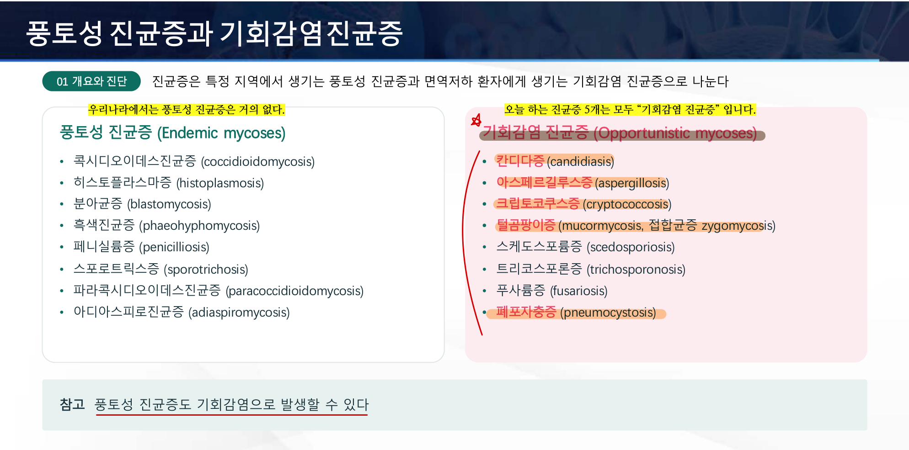
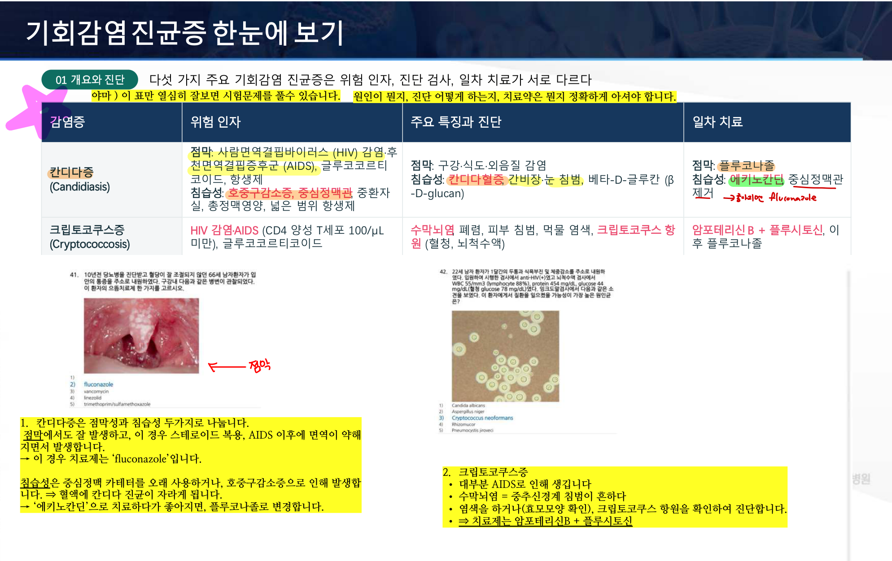

<!-- 필기본: 2026 · 2025 -->
<!-- 단계: 수업 후 -->

# 0. 이 수업을 공부하는 법

**권기태 교수님**(경북대병원 감염내과) 수업 — 2023·2025·2026 같은 교수님이다. 올해 강의는 2026년 11월 17일.

필기본 표지 메모: **"두 문제 출제!"** — 올해 시험에 이 수업에서 2문제가 나온다.

올해 슬라이드는 작년과 뼈대(Harrison 내과학 + 감염학 교과서)는 같지만, **한국어 슬라이드로 새로 만들어졌고** 표가 많이 늘었다. 교수님이 가장 오래 설명한 것은 6–7쪽의 **「기회감염 진균증 한눈에 보기」 표** 하나다.

- 교수님 말: "**이 표만 열심히 잘 보면 시험문제를 풀 수 있습니다**", "**원인이 뭔지, 진단 어떻게 하는지, 치료약은 뭔지 정확하게 아셔야 합니다**", 필기 메모 "이 표를 오래 설명했습니다".
- 3쪽 손글씨: "**진균증은 다섯 개만 보면 된다**" — 칸디다, 아스페르길루스, 크립토코쿠스, 털곰팡이증, 폐포자충 폐렴.
- 35쪽(항진균제 범위표): "**시험문제에는 안 듣는 게 뭔지 아는 게 중요하겠죠**".
- **Candida auris**: 교수님 말 "기출문제에는 있는데 **이번에는 안 냈습니다**", 필기 2쪽 족보 메모 "**candida auris 올해는 출제 X**". → 이름과 특징만 가볍게.

필기본 표시 읽는 법: 노란 상자 = 필기한 학생이 받아 적은 교수님 말, 주황·분홍 형광펜 = 교수님이 강조한 곳, 빨간 별(☆) = 중요 표시.

!!! diff "작년 필기와 다른 점"
    작년 필기 메모는 "**보통 진단 + 치료제를 묻는 문제! 22년도에는 위험인자도 나왔다**"였다. 올해는 표에 **일차 치료** 칸이 생기고, 칸디다증을 **점막형 / 침습형**으로 나눠 위험인자·치료를 따로 적었다. 새로 생긴 슬라이드: 칸디다혈증 선행 요인표, 카테터 감염·안내염, 점막피부 칸디다증 치료표, 아스페르길루스 형태별 진단검사표·CT 시간 변화, 털곰팡이 치료표·피부 사진, 폐포자충 임상양상·현미경·치료·예방 표.

학습성과(올해, 작년과 같음)

1. 기회감염 진균증과 풍토성 진균증을 구분한다.
2. 진균증의 진단에 대해 설명한다.
3. 칸디다(candidiasis), 4. 아스페르길루스(aspergillosis), 5. 크립토코쿠스(cryptococcosis), 6. 털곰팡이(mucormycosis), 7. 폐포자충(pneumocystosis) 감염증의 특징과 치료를 설명한다.

기출: 2부 16문항(2020–2025). 2023년 이 교수님 문제(골수이식 후 폐 병변 → **아스페르길루스증 / 보리코나졸**, 2문항)는 필기본 2쪽 족보에 실려 있지만 저장소에는 원본이 없어 2부에 없다 — 3장에 문제 내용을 적어 두었다.

!!! key "핵심 — 진균과 일차 치료제 짝 (6–7쪽 표의 마지막 칸)"
    | 진균 | 일차 치료 | 안 듣는 약(함정) |
    |---|---|---|
    | **Candida** 점막 | **Fluconazole** | — |
    | **Candida** 침습(칸디다혈증) | **Echinocandin**(-fungin: caspofungin, micafungin, anidulafungin) + **중심정맥관 제거** → 좋아지면 fluconazole | — |
    | **Cryptococcus** | **Amphotericin B + flucytosine → 이후 fluconazole** | Echinocandin |
    | **Aspergillus** | **Voriconazole** (isavuconazole) | **Fluconazole** |
    | **Mucor**(털곰팡이) | **Liposomal amphotericin B + 수술적 괴사조직 제거** (+ 당 조절) | **Voriconazole**, fluconazole, echinocandin |
    | **Pneumocystis** | **TMP-SMX**(trimethoprim-sulfamethoxazole), 중등도 이상이면 **스테로이드 추가** | 항진균제 전부(amphotericin B 포함) |
    **Amphotericin B는 폐포자충을 뺀 모든 진균에 듣는다**(34쪽 필기).

# 1. 개요와 진단

## 풍토성 진균증 vs 기회감염 진균증

{: style="width:76%"}

- **풍토성 진균증(endemic mycoses)**: **특정 지역**의 흙·환경에 사는 진균이 그 지역 사람에게 생기는 병 — 콕시디오이데스진균증(coccidioidomycosis), 히스토플라스마증(histoplasmosis), 분아균증(blastomycosis), 흑색진균증(phaeohyphomycosis), 페니실륨증(penicilliosis), 스포로트릭스증(sporotrichosis), 파라콕시디오이데스진균증, 아디아스피로진균증. 건강한 사람도 걸린다는 점이 기회감염과 다르다. **풍토성 진균증도 기회감염으로 생길 수 있다**(면역저하자에서 더 심하게).
    - 필기: "**우리나라에서는 풍토성 진균증은 거의 없다.**"
- **기회감염 진균증(opportunistic mycoses)**: 평소에는 병을 거의 안 일으키다가 **면역이 떨어진 환자**에게 생기는 것 — 칸디다증, 아스페르길루스증, 크립토코쿠스증, 털곰팡이증(mucormycosis, 접합균증 zygomycosis), 스케도스포륨증, 트리코스포론증, 푸사륨증, 폐포자충증.
    - 필기: "**오늘 하는 진균증 5개는 모두 기회감염 진균증**" — 형광펜 친 5개(칸디다, 아스페르길루스, 크립토코쿠스, 털곰팡이, 폐포자충)만 공부한다.

## 기회감염 진균증 한눈에 보기 ★★ (교수님이 가장 오래 설명한 표)

{: style="width:92%"}

{: style="width:92%"}

| 감염증 | 위험 인자 | 주요 특징과 진단 | 일차 치료 |
|---|---|---|---|
| **칸디다증** | 점막: **HIV/AIDS**, 스테로이드(글루코코르티코이드), 항생제 / 침습성: **호중구감소증, 중심정맥관**, 중환자실, 총정맥영양(TPN), 넓은 범위 항생제 | 점막: 구강·식도·외음질 / 침습성: **칸디다혈증**, 간비장·눈 침범, **β-D-glucan** | 점막: **fluconazole** / 침습성: **echinocandin, 중심정맥관 제거** |
| **크립토코쿠스증** | **HIV/AIDS(CD4 <100/μL)**, 스테로이드 | **수막뇌염**, 폐렴, 피부, **먹물(India ink) 염색**, **크립토코쿠스 항원**(혈청·CSF) | **Amphotericin B + flucytosine → fluconazole** |
| **아스페르길루스증** | **호중구감소증, 이식**, 스테로이드, 중환자실 | **폐 침범(혈관 침습)**, CT **달무리 징후(halo sign)**, **갈락토만난(galactomannan) 항원**, **예각으로 분지하는 격벽 균사** | **Voriconazole** |
| **털곰팡이증** | **당뇨병케톤산증(조절 안 되는 당뇨)**, 호중구감소증, 이식 | **코–안와–뇌 침범**, 혈관 침습 → **검은 괴사딱지**, 조직검사: **직각으로 분지, 격벽 거의 없음** | **Liposomal amphotericin B + 수술적 괴사조직 제거** |
| **폐포자충증** | **HIV/AIDS(CD4 <200/μL)**, 스테로이드, 이식 | **간질성 폐렴**, **저산소혈증**, **BAL PCR**, **배양 불가능**(특수 염색으로 확인) | **TMP-SMX**, 중등도 이상이면 **스테로이드 추가** |

교수님 설명(필기 6–7쪽 노란 상자)을 한 줄씩 풀면:

1. **칸디다증은 점막성과 침습성 두 가지.**
    - 점막: 스테로이드 복용, AIDS로 면역(특히 T세포)이 약해지면 입·식도에 생긴다 → **fluconazole**.
    - 침습성: **중심정맥 카테터를 오래** 쓰거나 **호중구감소증** → 혈액에서 칸디다가 자란다(칸디다혈증) → **echinocandin으로 치료하다가 좋아지면 fluconazole로 바꾼다**(손글씨 "→ 좋아지면 fluconazole").
    - 왜 갈리나: 점막 방어는 T세포(세포면역), 혈류 침입 방어는 호중구가 맡기 때문. 그래서 **HIV는 점막형, 호중구감소·카테터는 침습형**의 위험인자다.
2. **크립토코쿠스증**: 대부분 **AIDS**. **수막뇌염(중추신경 침범)**이 흔하다. 염색(효모 모양 확인)이나 **크립토코쿠스 항원**으로 진단. 치료 **amphotericin B + flucytosine**.
3. **아스페르길루스**: 원인 **호중구감소증, 이식 환자**("이식 환자에게부터 호중구 감소증이 나타난다는 게 특징"). 진단은 **달무리 징후**(가운데 경화 consolidation, 주변부 출혈 → 희뿌연 모양)와 **갈락토만난 항원**("아스페르길루스에 있는 다당류 항원"). 치료 **voriconazole**. 균사는 **예각, 격벽 있음**.
4. **털곰팡이증**: 원인 인자 → **당뇨!** **sinus(부비동)부터 시작해 점막을 뚫고 위로, 뇌 쪽으로** 올라간다. 진단은 특별한 게 없고 **조직검사**를 해야 한다. 치료는 **liposomal amphotericin B + 검게 괴사된 조직을 수술로 제거**. 균사는 **둔각(직각), 격벽 없음**.
    - 그냥 amphotericin B는 **신독성** 등 부작용이 많아, 지질(lipid)을 붙여 부작용을 줄인 것이 **liposomal amphotericin B**.
5. **폐포자충증**: 원인 **AIDS, 이식** — 그러나 **지금은 non-HIV(스테로이드·이식 등)에서 감염이 더 많다**. **간질성 폐렴, 양측 대칭성, 저산소혈증**. **BAL(기관지폐포세척액)을 PCR**로 진단.

!!! memo "암기 — 필기 7쪽 그림 암기법 (아스페르길루스)"
    **에스퍼**(초능력 포켓몬) = **아스페르**길루스 → **보리** = **보리**코나졸, **달**(달무리) = **halo sign**, **갈릭**(마늘) = **갈락**토만난. "에스퍼가 보리밭에서 달 보며 마늘 먹는다."

!!! diff "작년 필기와 다른 점"
    - 작년 표에는 **일차 치료 칸이 없었고** 칸디다 위험인자가 "HIV/AIDS, 부신피질호르몬, 호중구감소증, 중환자실" 한 줄이었다. 올해는 **점막(HIV·스테로이드·항생제) / 침습(호중구감소·중심정맥관·ICU·TPN·항생제)** 으로 나눴다.
    - 올해 새로 적힌 숫자: 크립토코쿠스 **CD4 <100/μL**, 폐포자충 **CD4 <200/μL**.
    - 털곰팡이 균사: 작년 "**넓은 각**으로 꺾임" → 올해 표 "**직각**으로 분지"(같은 뜻 — 아스페르길루스의 **예각** 45°와 대비되는 **넓은 각·직각** 90°).
    - 작년 교수님 설명(올해 없음): 진균은 **배양이 어렵다** — 조직을 얻으려면 침습적이고, 면역이 떨어진 환자라 감염 악화·출혈 위험이 있다(이식 환자는 항암치료로 자기 면역을 거의 없앤 상태에서 남의 장기를 받는다) → 그래서 **혈액이나 BAL**로 검사한다.

## 진균감염증의 진단 방법 ★

{: style="width:92%"}

| 기법 | 특징 | 장점 | 단점 |
|---|---|---|---|
| **현미경·조직병리** | 빠르지만 민감도 낮음, 형태에 의존. 염색: **KOH 도말, 먹물, 고모리 메테나민 은(GMS), PAS** | 특정 진균 확인(크립토코쿠스, 히스토플라스마). **균사 형태로 추정**: 아스페르길루스 **격벽 있음·예각**, 털곰팡이 **격벽 거의 없음·직각**, 칸디다 **거짓균사** | 여러 진균 모양이 비슷 → 종 동정 어려움(아스페르길루스, 칸디다) |
| **배양** | 성장의 조기 검출 | 종 수준 동정, **내성 확인**. **혈액배양에서 칸디다가 자라면 오염으로 보지 않음** | **아스페르길루스는 혈액배양에서 거의 안 자람**, 침습성 칸디다증 혈액배양 민감도 **약 50%**, 풍토성 진균은 배양률 낮음 |
| **항원 검출** | 혈액, BAL, CSF, 소변 | **크립토코쿠스 항원**(혈청·CSF, 신속검사), **아스페르길루스 갈락토만난**, 히스토플라스마 항원 | 갈락토만난은 **푸사륨(Fusarium)과 교차반응**, 다른 진균에는 한계 |
| **(1,3)-β-D-glucan** | 침습성 감염 **배제**에 유용(**높은 음성 예측도**) | 아스페르길루스, 칸디다, 폐포자충 등의 선별 | **털곰팡이, 크립토코쿠스에는 음성** |
| **항체 검출** | 중등도 민감도 | **알레르기 기관지폐 아스페르길루스증**, 풍토성 진균 | 대부분의 **기회감염 진균에는 부적합** |
| **PCR** | 배양보다 민감 | **폐포자충**, 아스페르길루스 진단(BAL) | 오염에 주의 |

교수님 설명(필기 8쪽):

- **왜 항원검사를 많이 하나**: 아픈 환자를 전신마취하고 조직 생검하기는 쉽지 않으니 **항원 검사를 많이** 한다.
- **배양 해석**: 곰팡이가 배양됐다고 감염이라고 볼 수는 없다 — 피부에 그냥 붙어 있는 균도 있다. 그러나 **혈액배양**에서 나오면 **무조건 병**이다(정상 혈액은 무균). **칸디다는 혈액배양에서 잘 자라고, 아스페르길루스는 자라지 않는다.**
- **항원**: 크립토코쿠스는 **CSF에서 항원** 검출 가능. 아스페르길루스는 **갈락토만난 항원**으로 진단.
- **β-D-glucan**: 진균 세포벽 성분. **음성이면 실제로 균이 없을 확률이 높다.** 털곰팡이와 크립토코쿠스는 감염되어도 **원래 음성**이 나온다(털곰팡이는 세포벽에 β-glucan이 거의 없고, 크립토코쿠스는 두꺼운 피막이 가린다).
- **항체**: 알레르기 기관지폐 아스페르길루스증은 **IgE** 검출이 가능하지만(진균 자체가 아니라 몸의 반응이 병이라서), 거의 대부분의 진균 감염에는 부적합(면역저하 환자는 항체를 잘 못 만든다).
- **PCR**: **폐포자충을 주로, 가장 많이 PCR로** 한다.

!!! diff "작년 필기와 다른 점"
    - 작년: "PCR — 오염, 표준화 부족, **진균에는 아직 활용도 낮음**" → 올해: **폐포자충은 PCR이 가장 많이 쓰이는 진단법**, 아스페르길루스도 BAL PCR.
    - 올해 새로: 염색 이름(KOH, 먹물, GMS, PAS), **혈액배양에서 칸디다 = 오염 아님**, **침습성 칸디다증 혈액배양 민감도 약 50%**, 갈락토만난의 **푸사륨 교차반응**.
    - 작년 교수님 말: "**조직병리와 배양이 gold standard(확진)** — 하지만 진행하기 쉽지 않다", "**Mucor는 조직(현미경)으로 확인**", "항원검출이 **임상에서 제일 많이**", "균종 종류도 알아 두시고, 중요하니까 시험에 잘 낼 거고".

!!! exam "기출 포인트"
    이 표 자체를 묻는 문제는 아직 없지만, 2부 1번(2025)의 오답 보기가 이 표에서 나왔다 — "**배양이 진단에 가장 유용**(X, 폐포자충은 배양 불가)", "**β-D-glucan으로 진단 불가**(X, 폐포자충은 β-D-glucan 양성)". 올해 표에 β-D-glucan이 **음성인 것 = 털곰팡이·크립토코쿠스**가 빨간 글씨로 강조됐다.
