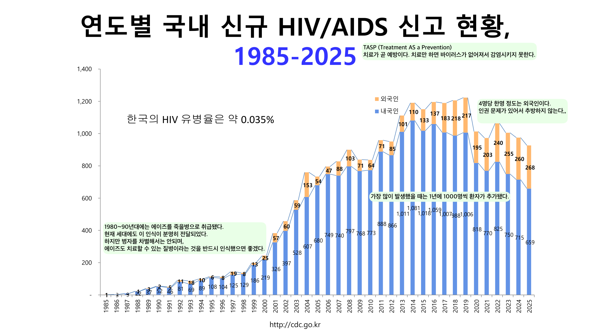

<!-- 필기본: 2026 · 2025 -->
<!-- 단계: 수업 후 -->

# 0. 이 수업을 공부하는 법

**김신우 교수님** 수업(2023·2025·2026 모두 같은 교수님, 2시간). 올해 필기본은 **PPT 127장**(2026년 11월판)이고, 맨 앞 4쪽에 **2022–2025 족보**(정답 표시)가 붙어 있다. 필기한 동기 말: "워드 파일도 있지만 **PPT 파일로 수업해도 괜찮을 것 같다** — 워드 파일은 PPT와 내용이 조금씩 다르지만 큰 틀은 같다."

!!! diff "작년 필기와 다른 점 — 자료 구성"
    작년 필기본은 **워드 본문 38쪽 + PPT 보조 114장**이었다. 올해는 PPT 하나로 수업했고, 워드에만 있던 **바이러스 구조, CDC 병기표, AIDS 지칭 질환, 뇌 침범·폐질환 표, PCP 치료, 첫 진료 검사, IRIS, 치료 변경·내성, 의료인 바늘찔림·PEP 약** 등이 올해 슬라이드에서 빠졌다. **그런데 기출은 이 부분에서 많이 나왔다**(PCP 5문항, PEP·의료인 예방 2문항, gp120/CD4 3문항). 이 자료는 그 내용을 지우지 않고 각 단원 끝에 「(작년 필기)」로 남겨 두었다 — 반드시 같이 본다.

{: style="width:62%"}

올해 강의 순서 — 이 자료의 단원도 이 순서를 따른다.

1. HIV 감염의 역사와 기원
2. HIV 감염의 역학 현황 요약(2025년)
3. HIV 감염의 진단, 임상증상 및 기회 질환
4. HIV 감염의 치료
5. HIV 감염의 예방
6. U=U (Undetectable = Untransmittable, 검출되지 않으면 감염시킬 수 없다)
7. 보편적 권리로서의 HIV 감염인의 치료
8. 최신 연구 현황 → 결어

학습성과

1. 사람면역결핍바이러스(HIV)의 전파경로를 설명할 수 있다.
2. HIV 감염의 진단을 설명할 수 있다.
3. 후천성면역결핍증후군(AIDS) 환자에서 흔히 관찰되는 기회감염이나 종양을 열거할 수 있다.
4. HIV 감염의 치료와 그 예후를 설명할 수 있다.
5. AIDS의 예방법을 설명할 수 있다.

## 기출이 묻는 곳 — 한눈에

기출 35문항(2020–2025)이 매년 거의 같은 주제를 돌려 낸다. 올해 필기본 맨 앞 「족보」 4쪽(2022–2025)도 아래 주제 그대로다.

| 주제 | 문항 수 | 2부 번호 |
|---|---|---|
| **U=U의 뜻** | 4 (+3번 사례) | 4, 11, 15, 19 |
| **진단: 선별 = EIA, 확진 = Western blot** | 4 | 2, 7, 21, 28 |
| **PCP: 서서히 오는 호흡곤란 + 양측 간질성 → TMP-SMX (+스테로이드)** · 가장 흔한 사망원인 | 5 | 10, 17, 25, 27, 30 |
| 급성 HIV 증후군에 **없는** 것 고르기 | 3 | 9, 16, 24 |
| **치료 시작 = CD4와 관계없이 모두 즉시** / 치료 목표 = 바이러스 검출한계 미만 | 4 | 3, 5, 8, 26 |
| **90-90-90의 세 번째 90 = 바이러스 억제** | 2 | 12, 23 |
| 전파 위험 비교(모자감염이 가장 큼), 바늘찔림 PEP, 의료인 예방 | 4 | 6, 14, 18, 31 |
| 기회감염 영상·사진(CMV 망막염, PML, 모상백반증, 좁쌀결핵) | 5 | 1, 13, 20, 32, 33 |
| 바이러스학(gp120/CD4, retrovirus 유전자) | 4 | 22, 29, 34, 35 |

!!! exam "기출 포인트 — 올해 족보에만 있는 2문항"
    올해 필기본 족보에는 **2025년 72번**(73세 남성, 체중감소 8 kg/2개월·호흡곤란, 흉부 CT → **파종성 결핵**)과 **2022년 6번**(24세 남자, 1달간 열, 흉부 사진·CT → **Miliary TB**)도 HIV 수업 문제로 실려 있다. 이 두 문항은 저장소에서 **CP-A2(11강)**로 분류돼 있어 2부에는 없다 — 4단원 「결핵」에서 같이 정리했다.

!!! key "핵심 — 이 수업의 메시지"
    교수님: "**치료받은 사람은 감염력이 없어진다 — U=U.**" 올해 결어도 같다: "**U=U, 바이러스 미검출은 전파할 수 없다는 뜻이다**", "**치료가 예방(TasP)**".
    그래서 **진단되면 CD4와 상관없이 바로 ART**(Treat All) → 개인·파트너·사회를 지킨다. "원래 사망률 100%의 질병이었으나 이제는 **약만 잘 먹으면 당뇨보다 훨씬 안전한 질병**이다."

# 1. HIV 감염의 역사와 기원

!!! new "올해 필기에서 추가"
    작년에는 역사가 강의 끝(인권 단원)에 몇 줄로만 있었는데, 올해는 **강의 첫머리에 연표 5장 + 한국 연표 2장**으로 크게 늘었다. 연도 자체를 묻는 기출은 없었지만, 각 연도가 **진단·치료·예방의 이정표**라서 뒤 단원과 이어진다.

{: style="width:70%"}

## 기원 — 언제, 어디서 사람에게 왔나
- **1920년경 콩고(Congo) 공화국의 킨샤사(Kinshasa)**에서 시작한 것으로 추정한다. 아프리카 밀림에서 **침팬지를 사냥하는 과정에서 침팬지의 SIV(원숭이 면역결핍 바이러스)가 사람에게 옮겨진 것**으로 본다(피·고기 접촉).
- HIV가 확인된 **가장 오래된 사람은 1959년에 채취해 보관한 피**(콩고 민주 공화국의 Bantu 성인)다. 실제 처음 전파된 것은 그보다 이른 1920년대로 본다.
- 이 질환은 전 세계로 늘어나 보건뿐 아니라 정치·경제 등 모든 분야에 영향을 미쳤다.
- HIV에는 HIV-1과 HIV-2가 있는데 **대부분 HIV-1**이다(작년 필기).

## 세계 연표 — 진단·치료·예방의 이정표

| 연도 | 사건 | 왜 중요한가 |
|---|---|---|
| 1981 | 미국 CDC가 **남성 동성애자들 사이의 폐포자충 폐렴(PCP)과 카포시 육종 집단 발생** 보고 | AIDS의 첫 사례. PCP는 원래 **면역저하자**가 걸리던 병인데 젊은 남성에게 나타나서 이상하다고 본 것이 시작 |
| 1982 | **AIDS(후천성 면역결핍증)**라는 이름, CDC가 임상 증상으로 정의 | |
| 1983 | 파스퇴르 연구소 **Luc Montagnier** — LAV(림프절병증 관련 바이러스) 분리 | 원인 바이러스 발견 |
| 1984 | 미국 국립암연구소 **Robert Gallo** — HTLV-III 분리(나중에 LAV와 같은 바이러스로 확인), AIDS의 원인이라 발표 | |
| 1985 | **혈액 내 HIV 항체 검사** 첫 허가 | 혈액 공급 선별, 개인 진단이 가능해짐 |
| 1986 | 국제 바이러스 분류 위원회가 **HIV**로 공식 명명 | |
| 1987 | **AZT(zidovudine, 지도부딘)** FDA 승인 — 첫 HIV 약 | 항레트로바이러스 치료 시대의 시작 |
| 1988 | **12월 1일 = 세계 에이즈의 날** | |
| 1990 | 수혈로 감염된 10대 **라이언 화이트** 사망 → Ryan White CARE 법(치료 자금 지원) | |
| 1991 | **빨간 리본** — AIDS 인식의 국제 상징 | |
| 1994 | 미국 공중보건국이 **산모→아이 전파를 줄이기 위해 AZT 권장** | 모자감염 예방의 출발 |
| 1995 | 첫 **프로테아제 억제제** 승인 → **HAART(고활성 항레트로바이러스 요법)**의 시작 | |
| 1996 | UNAIDS 출범, **3제 병합요법** | |
| 2000 | **더반 선언** — HIV가 AIDS의 원인임을 확인 | 「AIDS 부정주의」에 대한 반박 |
| 2002–03 | 세계기금(에이즈·결핵·말라리아), 미국 PEPFAR | 치료 자금 |
| 2008 | **CCR5 돌연변이 기증자의 줄기세포 이식 → 첫 완치(Timothy Ray Brown, 베를린 환자)** | CCR5가 감염에 중요한데, 돌연변이가 오히려 도움이 됨 |
| 2010 | CAPRISA 004 — 살균제(microbicide) 젤의 예방 효과 | |
| 2012 | **Truvada(TDF/FTC) — 첫 노출 전 예방(PrEP) 약** FDA 승인 | |
| 2014 | UNAIDS **90-90-90** 목표 | 90% 진단, 90% 치료, 90% 억제 |
| 2016 | **U=U 선언** | |
| 2019 | **런던 환자** — 두 번째 완치(역시 줄기세포 이식) | "대부분의 완치자는 CCR5 돌연변이를 가지고 있었다" |
| 2020 | 코로나19 속에서도 치료 유지, **지속형 주사 ART** 도입 | "주사는 **두 달에 한 번**" |
| 2021–22 | UN 「2030년 AIDS 종식」 재약속, 장기 지속형 PrEP 주사 | |
| 2023– | 유전자 편집 등 완치 연구 | |
| 2025 | **6개월 예방 주사**(lenacapavir) | "아직 한국에 도입되진 않았다" |

- **HAART**(Highly Active Anti-Retroviral Therapy): 세 가지 정도 약을 섞는 요법. 일반인에게는 「**칵테일 요법**」으로 알려졌고 요즘은 줄여서 **ART**라 한다.
- **AIDS 부정주의**: "에이즈는 가상의 질병이며 존재하지 않는다"는 주장. 이 때문에 치료를 거부한 사람이 많았다(작년 필기: Christine Maggiore 이야기).
- 약이 없던 시절에는 유명인도 HIV로 사망했다 — 1985년 영화배우 **록 허드슨**, 1991년 퀸의 보컬 **프레디 머큐리**. "건강한 유명인도 예외가 아니다"라는 사실에 「죽음의 병」이라는 인식이 퍼졌다.
- 지금까지 **누적 감염 약 9,200만 명, 누적 사망 약 4,420만 명**(13쪽 그림). "치료는 병을 바꾸었고, 이제 남은 것은 도달과 편견이다."
- 필기: "**AIDS라는 말은 '다 죽는다'는 부정적 뜻을 품고 있어서 HIV infection(HIV 감염)이라 하는 것이 좋다.**" "아직 mRNA 백신은 개발돼 있지 않다."
- 원래 사망률 100%의 병이었지만 치료법이 매우 빠르게 개발되어, 이제는 약만 잘 먹으면 당뇨보다 안전하다.

## 한국 연표

| 시기 | 사건 |
|---|---|
| 1985 | **한국 최초 HIV 감염자 확인** |
| 1987 | HIV 항체 검사 도입 |
| 1988 | AZT 등 초기 ART 도입 |
| 1995 | 국내 최초 HIV/AIDS 치료센터 |
| 1996 | HAART 도입 → 사망률 감소 |
| 2000 | 모성-아동 전파 예방 프로그램 (필기: **수직감염은 한국에서는 드문 편**) |
| 2004–05 | 국가 예방·관리 전략, 국립암센터 HIV/AIDS 연구센터 |
| 2006 | **무료 HIV 검사 확대** — "보건소에 가면 무료로 검사해 준다" |
| 2007 | 치료 기준 완화: **CD4 350/µL 이상에서도 치료 권고** |
| 2012 | **1일 1회 복용제 도입** — STR(Single Tablet Regimen, 단일정 요법), 즉 **하루 한 알** |
| 2015 | 치료 목표 **U=U** 제시 |
| 2016 | 신규 감염 감소세 |
| 2018 | **PrEP 도입** |
| 2020 | 장기 작용 치료제 도입 |
| 2022 | 국내 누적 감염자 1만 5천 명 돌파 |

- 필기: "현재 한국의 HIV 감염자는 **17,000여 명**. **희귀 질환이라서 환자 본인 부담금이 없다.**" 한국의 HIV 고위험군은 **MSM(Men who have Sex with Men, 남성 간 성접촉자)**. HIV 감염인은 스스로를 **PL(People Living with HIV)**이라 부른다.
- (곁가지) 한때 "홍삼이 예방에 도움이 된다"는 이상한 소문이 돌기도 했다.

# 2. 역학 현황 (2025년)

## 진단되지 않은 감염인 — 빙산

{: style="width:66%"}

- 맨 위 꼭짓점이 **에이즈 환자**, 그 아래가 **진단된 HIV 감염인**, 수면 아래 가장 큰 부분이 **진단되지 않은 감염인**이다. 진단되지 않은 사람은 치료를 받지 않으니 **다른 사람을 감염시킬 수 있다** → 광범위한 검사와 치료가 필요하다.
- 필기: "**한국은 20% 정도가 진단되지 않은 감염인**이다. 후진국일수록 이 비율이 더 높다." 한국에서는 보건소에서 공짜로 검사받을 수 있고 인터넷에서 진단 키트를 사서 해 볼 수도 있지만, **사회적 인식이 좋지 않아 검사를 꺼리는 사람이 많다.**
- "**일단 치료 과정에 들어오면 어지간하면 전파시키지 않는다 → 빠르게 진단해서 치료하는 게 매우 중요하다.**"
- 용어: "AIDS 환자보다는 **Advanced HIV infection(진행된 HIV 감염)**이라는 표현을 쓰는 게 맞다."

## HIV 감염의 단계

| 단계 | CD4 수(cells/µL) | 바이러스 양 | 임상 특징 |
|---|---|---|---|
| 급성 HIV 감염 | 변동적 | **매우 높음** | 독감 유사 증상 |
| 만성 HIV 감염 | **>500** | 낮음–중간 | 대개 무증상 |
| 에이즈 | **<200** | 높음 | **기회감염** 발생 |

- HIV는 **CD4(+) T 세포**를 공격해 그 수를 줄인다. 필기: 정상인은 **700–1,200**, **500 이하로 떨어지면 면역이 저하됐다고 본다.**

!!! diff "작년 필기와 다른 점"
    작년 필기는 정상 CD4를 **500–1,200/µL**(6세 이상)로 적었다. 올해 필기는 **700–1,200**. 「500 아래 = 면역 저하」, 「200 아래 = AIDS」라는 기준은 같다.

## 국내 신고 추이와 2025년 현황

{: style="width:72%"}

- **한국의 HIV 유병률은 약 0.035%**로 낮다. 가장 많을 때는 **한 해 1,000명씩** 늘었고(2013–2019), 2020년 이후 줄어 2025년 **927명**.
- **4명 중 1명 정도는 외국인**이다. 예전에는 외국인 감염인을 추방했지만 **인권 문제로 지금은 추방하지 않는다.**
- 1980–90년대에는 에이즈를 죽을병으로 취급했고 그 인식이 지금 세대에도 남아 있다. 교수님: "**병자를 차별해서는 안 되며, 에이즈도 치료할 수 있는 병이라는 것을 반드시 인식했으면 좋겠다.**"
- **TasP(Treatment as Prevention)** — 치료가 곧 예방이다. 치료하면 바이러스가 없어져 감염시키지 못한다.

{: style="width:70%"}

| 2025년 국내 신규 신고 | |
|---|---|
| 전체 | **927명** (전년 975명보다 4.9% 감소) |
| 내국인 / 외국인 | 659명(71.1%) / **268명(28.9%)** |
| 나이 | **20–30대가 66.0%** (30–34세 최다). 65세 이상도 13.1% |
| 감염 경로(응답자) | **성접촉 99.1%**, 그중 **동성 간 62.6%** |
| 생존 감염인 | **17,557명** |
| 신고 기관 | 병·의원 61.0% |

- **남성 환자가 10배가량** 더 많다. **MSM 남성이 여성과 관계를 맺으면 여성이 감염된다.**
- 어디서 발견되나: **성병을 진단하는 항문외과·비뇨기과**, 또는 **전신마취 전 검사**·응급의학과에서 HIV 검사를 하다가 발견된다.
- 젊은 사람이 많다. 교수님은 10대 환자도 보셨다(집을 나갔다가 낯선 성인에게 피해를 입은 경우).
- 슬라이드 결론: "**숫자는 줄었지만, 감염인은 나이 들어 가고 검사는 여전히 늦다.**"

!!! diff "작년 필기와 다른 점"
    - 국내 유병률: 작년 **약 0.027%** → 올해 **약 0.035%**. 성비: 작년 **약 15:1** → 올해 「**약 10배**」.
    - 작년에는 **전 세계 현황(2024, UNAIDS)** 표가 있었다 — 감염인 약 **4,080만 명**(여성·소녀 53%), 신규 130만/년, AIDS 관련 사망 63만/년, ART 3,160만 명, 본인 감염 인지율 87%, 치료 접근률 77%(**아동 55%로 낮음**, 여성 83% > 남성 73%). 추세: 감염인으로 사는 사람은 늘고(오래 산다) 신규 감염·사망은 준다. 사하라 이남 아프리카에 집중, 아프리카는 **남녀 1:1**.
    - 작년 필기의 국내 설명: 2020·21년 감소는 진단 감소·접촉 감소·TasP 효과로 추정, 최근 생존자가 늘어 70–80대 감염인도 있다.

## 진단까지 걸리는 시간 — 4.2년
- 국내 연구(ECDC 모델): **감염에서 진단까지 평균 4.2년** — 진단이 늦다. 원인은 인식 부족, 낙인, 검사·치료 서비스 접근 제한.
- 필기: "우리나라는 진단까지의 기간이 긴 편이다. **기간이 길어지면 역학조사 하기가 힘들어진다.**" (올해 필기본에서는 진단 단원 끝 34쪽에 있다.)
